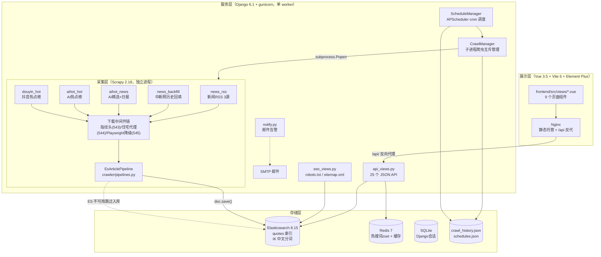
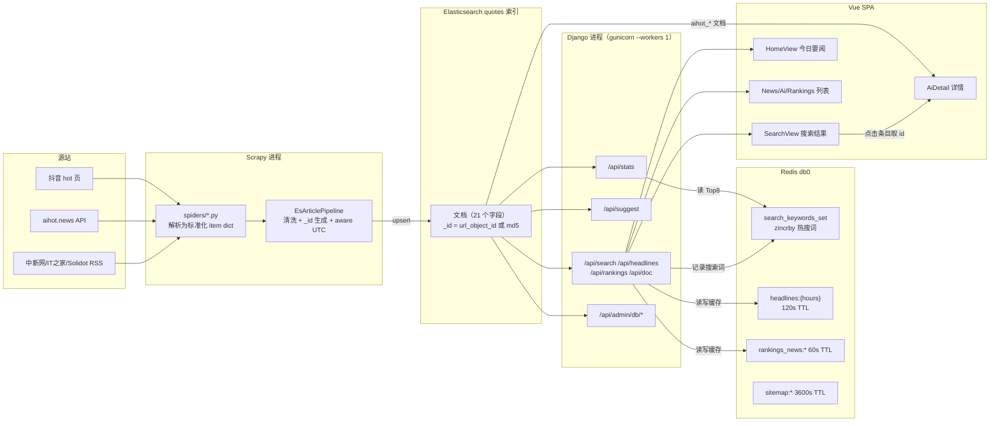

# XSearch 系统架构

> 项目：XSearch ｜ 版本：v1.1 ｜ 生成日期：2026-10-06 ｜ 依据：源码分析

## 一、整体架构图

XSearch 是一个典型的"采集—存储—服务—展示"四层系统，但各层之间的耦合被刻意降到很低：爬虫与后端是**两个独立进程**，只通过 Elasticsearch 共享数据；后端与前端是**前后端分离**的纯 JSON API 关系，只通过 HTTP 通信。唯一跨进程共享的运行时状态是 Redis（缓存与热搜词）。

图中需要特别说明的两条"隐藏"链路：第一，`CrawlManager`（`XSearch/search/crawl_manager.py`）通过 `subprocess.Popen` 拉起 `python -m scrapy crawl <spider>` 子进程，也就是说 Web 界面触发的采集与命令行触发的采集最终走的是同一条 Scrapy 管道；第二，`ScheduleManager` 挂在 Django 进程内的 APScheduler 后台线程上，触发时同样调用 `CrawlManager.start()`，因此**全系统同一时刻最多只有一个采集任务在跑**（进程内互斥锁保证）。

## 二、爬虫/后端/前端分层详解

### 2.1 采集层：Scrapy 爬虫子系统

采集层的全部代码位于 `XSearch/crawler/` 包，作为独立 Scrapy 项目运行（`scrapy.cfg` 指向 `crawler.settings` 模块），但因与 Django 同仓库，可直接复用同一份 Python 依赖。

**五个爬虫**（`crawler/spiders/`）按数据源分为三类：

- **RSS 官方源类**：`news_rss.py` 聚合中新网、IT之家、Solidot 三个官方 RSS feed，其中中新网 feed 无摘要，会以 `CNS_ARTICLE_RE` 正则识别真实文章链接并跟进文章页抓 `div.left_zw` 正文；`news_backfill.py` 则按日期逐日抓中新网滚动存档页（`/scroll-news/{yyyy}/{mmdd}/news.shtml`），只存"标题+链接+日期"，默认回填 180 天，靠 `md5(url)` 作为 ES `_id` 实现幂等。
- **官方 API 类**：`aihot_news.py` 与 `aihot_hot.py` 调用 aihot.news 的 `/api/v1/*` 公开接口（站方 llms.txt 明确允许匿名只读），2 秒限速，并对 429/503 做专门处理（记录 `aihot/ratelimited` 统计并放弃本次）。`aihot_hot` 有一个值得注意的设计：先入库一条基础数据保底，等 story 接口抓到 AI 综述后用**同一个 `_id` 覆盖为完整版**；爬虫收尾时通过 `spider_closed` 信号触发 `_prune_stale()`，用 `delete_by_query` 删除本轮未出现的旧热点，保证榜单是"当前状态"而非无限累积。
- **动态渲染类**：`douyin_hot.py` 是唯一需要浏览器的爬虫，通过 `meta={"playwright": True}` 交给 scrapy-playwright 渲染 `www.douyin.com/hot`，等待 5 秒后取 `body` 的 `inner_text`，用逐行扫描 + `^([\d.]+)\s*万\s*热度$` 正则解析出标题与热度值（比 DOM 选择器更抗页面结构变化），最多 50 条。失败时保存调试截图到 `/tmp`，`errback` 里确保关闭 Playwright 页面防泄漏。

**三个下载中间件**（`crawler/middlewares.py`，优先级 543/544/545）：

1. `BrowserFingerprintHeadersMiddleware`：仅对 `FINGERPRINT_HOSTS`（当前只有 douyin 域名）整体**替换**请求头为一组自洽的浏览器指纹（browserforge 生成或内置 Chrome 模板）。注释里明确记录了"为什么是替换而非 setdefault"——内置 `UserAgentMiddleware`（优先级 500）会先写入 `USER_AGENT`，setdefault 不会覆盖它，导致指纹头不生效（实测曾让目标站返回 412）。
2. `ResidentialProxyMiddleware`：从 `RESIDENTIAL_PROXIES` 设置或 `AI_PROXIES` 环境变量读代理列表，`itertools.cycle` 按请求轮换写入 `request.meta["proxy"]`；默认空 = 直连。
3. `PlaywrightFallbackMiddleware`：`process_exception` 钩子捕获渲染失败（超时/崩溃），移除 `playwright` 标记后重发为普通直连请求；**刻意保留 `download_slot`** 等 meta，避免绕过对目标站的礼貌限速。

**入库管道**（`crawler/pipelines.py`）：`EsArticlePipeline` 在 `open_spider` 时探测 ES 并执行 `QuoteDocument.init()` 建索引（不存在时），ES 不可用则告警并跳过入库（不阻塞爬虫）。每条 item 经 `index_item()` 标准化：空 content 直接丢弃、数值字段经 `_to_int/_to_float` 清洗、`crawled_at` 统一写 aware UTC（`utc_now()`——修复了 naive 本地时间被 ES 当 UTC 解释导致整体偏移 8 小时的时区 bug）、`doc.meta.id` 取 `url_object_id` 或 `md5(url+content[:200])`，重复抓取自动覆盖更新，这是全系统幂等性的基石。

### 2.2 服务层：Django 纯 JSON API

服务层只有一个 Django app `search`，页面渲染职责已完全移交前端（`xsearch/settings.py` 的 TEMPLATES 注释明确写了"页面层已由 frontend/ Vue 工程承担"）。其内部结构：

- **API 面**（`search/api_views.py`，约 1150 行）：25 个视图函数覆盖搜索（`api_search`）、补全（`api_suggest`）、概览（`api_stats`）、健康检查（`api_health`）、要闻（`api_headlines`）、榜单/新闻（`api_rankings`）、详情（`api_doc`）、图片代理（`api_img`）、登录登出、采集管理 6 个端点、定时任务 5 个端点、数据管理 4 个端点。所有 ES/Redis 依赖都有 try-except 降级：ES 故障返回结构化 503 而非 500，Redis 故障只损失缓存不阻塞主流程。
- **任务管理**（`search/crawl_manager.py`）：`CrawlManager` 维护"单任务互斥"语义——`start()` 在 RLock 内先收割上一轮（`_check_and_update_current`），再校验白名单、解析 JOBDIR（`JOB_NAME_RE` 正则拒绝路径穿越）、`Popen` 拉起子进程并落历史。一个**盯梢线程** `_watch_exit` 阻塞在 `proc.wait()` 上，进程一退出立刻回写终态：`returncode != 0` 记 `failed`，`item_scraped_count == 0` 记 `empty`（风控/改版的典型信号），否则 `completed`；失败/空跑会触发邮件告警（同类事件 30 分钟冷却），成功则清理 JOBDIR。启动时 `_reconcile_stale_runs()` 把上一进程遗留的 `running` 记录改判为 `interrupted`（按 pid 存活探测）。`ScheduleManager` 封装 APScheduler：cron 五段校验（字符正则 + `CronTrigger.from_crontab` 语义校验）、`misfire_grace_time=3600` + `coalesce=True`、`EVENT_JOB_MISSED/EVENT_JOB_ERROR` 监听器把"错过的触发"变成可见的历史记录与告警、配置原子持久化到 `schedules.json`（`.tmp` 写 + fsync + 原地覆盖，规避单文件 bind mount 上 `os.replace` 必然 EBUSY 的坑，详见 `_write_json_atomic` 注释）。
- **横切关注点**：`xsearch/middleware.py` 的 `CorsMiddleware` 实现白名单式 CORS（默认放行 Vite 5173/4173，`FRONTEND_ORIGINS` 可追加）；`search/apps.py` 的 `SearchConfig.ready()` 在服务进程启动时恢复定时调度器（`RUN_MAIN` 判断避开 runserver 自动重载的父进程）并打印弱配置告警（DEBUG 开启、管理员口令过弱等）；`search/notify.py` 用后台守护线程发信，绝不在请求路径里同步 SMTP。

### 2.3 展示层：Vue 3 SPA

前端是纯静态 SPA（`frontend/`），构建产物 `dist/` 由 Nginx 托管。10 条路由全部懒加载（`main.ts` 注释解释：此前静态 import 打成单个 1.1MB chunk，"读者只想搜个词也得把数据管理表格的代码下完"）。状态管理**没有引入 Pinia/Vuex**，而是三个轻量方案：`auth.ts` 用模块级 `ref` + `localStorage` 管理登录态（`ADMIN_PATHS` 常量同时供路由守卫与 401 处理共用）；`SearchView.vue` 践行"URL 是唯一真相"——`q/source/sort/days/p` 全部编码进 query，界面事件只改 URL，请求由路由 watch 统一发起，深链/前进后退/分享天然可用；服务端数据则按页面各自持有 `ref`，跨页面无共享需求。请求层 `api.ts` 封装了类型化客户端（与后端响应字段一一对应的 interface 定义）、统一错误处理（`ApiError` 携带 status 与业务 code）、401 时的分场景处置（管理页跳登录、公开页就地报错）、XSS 安全的高亮渲染（`renderHighlight` 先整体 HTML 转义、再仅还原 `<mark class="kw">`）。

## 三、数据流向图

数据流的关键性质：**单向写入、多点读取**。只有爬虫管道写 ES（外加数据管理接口的受控写）；Django 读侧按场景裁剪——`/api/search` 用 `must_not` 排除榜单来源（`douyin_hot`/`aihot_hot` 没有发布时间语义，混进搜索结果会长期霸榜），`/api/headlines` 同样排除榜单源并做同题去重；Redis 的热搜词 zset 在每次搜索时 `zincrby` 并裁剪到前 100，形成"搜索行为 → 热搜词 → 首页/空结果引导"的闭环。

## 四、关键设计决策与设计模式

1. **进程内单例 + 单 worker 的"伪分布式"**。`CrawlManager`、`ScheduleManager`、管理员 token 表、登录限速表都是进程内状态（模块级实例，`crawl_manager = CrawlManager()`），因此 `Dockerfile` 强制 `gunicorn --workers 1`。这是一个用部署约束换实现简单度的显式取舍，注释写明"要并行/排队/分布式需先升级 Scrapyd 并把状态外置"。
2. **文件即数据库**。采集历史与定时任务配置不用数据库而用两个 JSON 文件（`crawl_history.json` / `schedules.json`），换来零迁移、可人工查看；配套实现了带恢复能力的原子读写（`_write_json_atomic` + `_load_json_with_recovery`：主文件损坏回退 `.tmp`，再备份 `.corrupt-*` 现场）。
3. **ES `_id` 幂等去重**。所有爬虫以稳定 `_id`（md5(url) 或站点原生 id）upsert，重复采集 = 覆盖更新，定时任务可以放心每天跑。
4. **装饰器模式的鉴权**。`require_admin`（`api_views.py`）包住所有管理端点，校验 `X-Admin-Token` 并滑动续期；登录接口用 `hmac.compare_digest` 常数时间比较防时序侧信道。
5. **观察者/信号模式**。Scrapy 侧 `spider_closed` 信号触发榜单清理；APScheduler 事件监听器把 misfire/error 转为告警；Django `AppConfig.ready()` 钩子恢复调度器。
6. **策略模式体现在排序与降级链**。`_SORTS` 字典定义 relevance/time/hot 三种排序策略；搜索 0 结果时走"短语建议纠错 → 模糊重搜（fuzziness AUTO）→ 热搜词引导"的三级降级链。
7. **fail-closed 安全哲学**。生产形态（`DEBUG=False`）下 `DJANGO_SECRET_KEY` / `DJANGO_ALLOWED_HOSTS` 缺失直接拒绝启动（`settings.py` 抛 `ImproperlyConfigured` 或 `sys.exit(1)`），而不是带着已知弱配置默默起服务；`api_health` 只回异常类名不回消息串，防内部信息泄露。

## 五、安全与合规设计

安全设计贯穿五处：**认证层**（内存态 token、12 小时滑动续期、登出即吊销、按 IP 限速 5 次/5 分钟锁 15 分钟、`DJANGO_TRUST_PROXY_HEADER` 控制是否采信 XFF）；**传输层**（生产 nginx 强制 HTTPS 入口、`SECURE_PROXY_SSL_HEADER` 采信反代协议头、Cookie HttpOnly）；**接口层**（管理接口全部 `require_admin`、数据管理写操作字段白名单 + `confirm` 逐字确认、`resume_job` 路径穿越拦截、图片代理的 SSRF 三重防护——按点边界精确匹配域名白名单、拒绝 URL 内嵌用户名密码、20MB 大小上限）；**内容层**（前端 `renderHighlight` 转义 ES 高亮片段防存储型 XSS；爬虫 `strip_html` 删除 script/style 块防 JS 混入正文）；**运维层**（ES/Redis 仅绑 127.0.0.1、xpack.security 关闭前提下的网络隔离、备份目录 700 权限、`/admin/` 不代理到公网）。

合规设计的核心是 `crawler/settings.py` 的 `ROBOTSTXT_OBEY = True` 与 `USER_AGENT = 'XSearchBot/1.0'`，加上 `DOWNLOAD_DELAY=1` + AutoThrottle 的礼貌限速。指纹伪装被收敛在 `FINGERPRINT_HOSTS` 白名单内，`AI升级说明.md` 第七节诚实记录了抖音源的例外与张力。测试（`search/tests.py` 的 `CrawlerComplianceTests`）甚至把"robots 合规与指纹伪装域名边界"、"已移除模块不得回流"写成了自动化断言，防止合规约束在后续迭代中被无意破坏。
