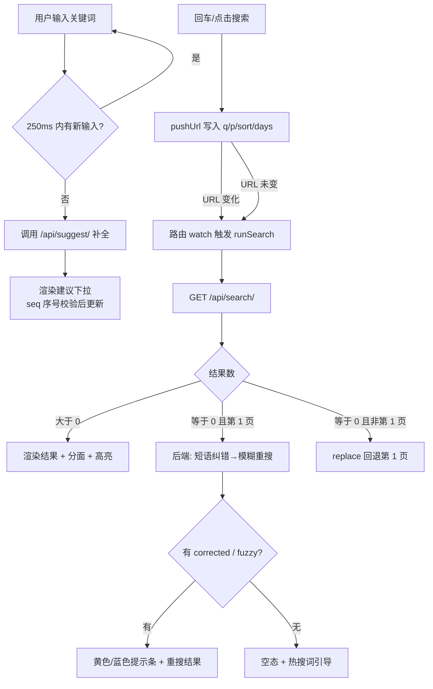
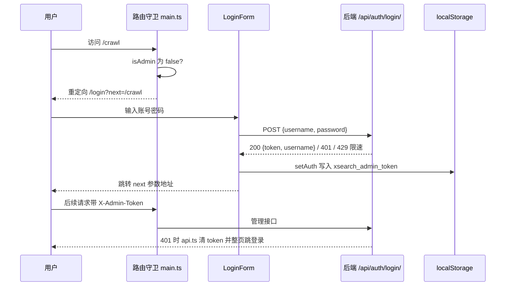

# XSearch 页面设计

> 项目：XSearch ｜ 版本：v1.0 ｜ 生成日期：2026-10-05 ｜ 依据：源码分析

## 一、前端工程与设计原则

前端是一个独立的 Vue 3 单页应用（`frontend/`），构建工具链为 Vite 6，组件库 Element Plus 2.9，语言 TypeScript 5.9（`tsconfig.json` 开启 strict 全套 + `noUnusedLocals` + `noUnusedParameters`，`package.json` 的 build 脚本是 `vue-tsc --noEmit && vite build`，类型检查失败即构建失败）。整个前端**没有引入 Pinia/Vuex 这类全局状态库**，状态管理由三个机制分担：模块级响应式单例（`src/auth.ts`）、URL 查询参数（`SearchView.vue` 的"URL 是唯一真相"）、以及页面组件内部的局部 `ref`。这是与项目规模匹配的克制选择。

全站页面遵循几条一致的设计原则。第一，**导航可见性与权限联动**：`App.vue` 的横向 `el-menu` 中，"采集管理""数据管理"两项用 `v-if="isAdmin"` 渲染，未登录只显示"登录"按钮（点击弹 `el-dialog` + 共用的 `LoginForm`），登录后变为"退出登录"。第二，**采集按钮按身份渲染**：`NewsView`、`AiView`、`RankingsView` 的"采集/更新数据"按钮同样 `v-if="isAdmin"`，源码注释解释这是为了"避免读者点了被弹到管理登录页"。第三，**错误就地展示**：每个页面用 `el-alert` 展示 `errText(e)` 提取的错误文案，后端 ES 故障返回的结构化 503 会直接呈现给用户而不是白屏。第四，**移动端适配**：`App.vue` 的样式里针对 768px 与 480px 两档断点收紧页头，导航在自身容器内横向滑动（`min-width:0` 的注释记录了实测 375px 视口下按钮被顶出视口的修复），仓库还带有 `frontend/scripts/mobile-audit.py` 移动端审计脚本。

## 二、前端路由与页面总表

路由定义在 `frontend/src/main.ts`，共 10 条，全部懒加载（`() => import(...)`）。每条路由的 `meta` 携带 `title`/`desc`/`noIndex`，`router.afterEach` 据此动态设置 `document.title` 与 meta 标签，管理页额外注入 `noindex, nofollow`。

| 路由 | 页面组件 | 导航名 | 访问级别 | 核心职责 |
|---|---|---|---|---|
| `/` | `views/HomeView.vue` | 首页 | 公开 | 检索入口 + 今日要闻混排（36 小时窗口、同题去重）+ 热搜词 + 四宫格栏目入口 |
| `/search` | `views/SearchView.vue` | 搜索 | 公开 | 关键词检索：补全、纠错、分面、排序、时间筛选、分页，URL 即状态 |
| `/news` | `views/NewsView.vue` | 新闻 | 公开 | 三源新闻列表（全部/中新网/IT之家/Solidot 四 Tab），20 条/页，管理员可触发采集 |
| `/ai` | `views/AiView.vue` | AI 讯息 | 公开 | 三 Tab：AI 精选 feed / AI 日报折叠面板 / AI 热点榜排名卡 |
| `/ai/detail` | `views/AiDetailView.vue` | （无导航） | 公开 | 按 `?id=` 的 ES `_id` 精确取单篇全文 |
| `/rankings` | `views/RankingsView.vue` | 抖音榜单 | 公开 | 抖音热点榜 50 条排名卡 |
| `/stats` | `views/StatsView.vue` | 数据概览 | 公开 | 文档总数/来源数/热搜词三卡片 + 来源分布进度条 + ES 状态标签 |
| `/crawl` | `views/CrawlView.vue` | 采集管理 | 管理员 | 启动采集、运行状态+日志尾部、定时任务 CRUD、任务统计、任务历史 |
| `/dbadmin` | `views/DbAdminView.vue` | 数据管理 | 管理员 | 索引概览、文档浏览/编辑/删除、按来源批量清理 |
| `/login` | `views/LoginView.vue` | （无导航） | 公开 | 独立登录页（被守卫重定向或直达时使用） |

路由守卫（`main.ts` 的 `router.beforeEach`）：访问 `ADMIN_PATHS`（`['/crawl', '/dbadmin']`，定义于 `src/auth.ts`）时未登录跳 `/login?next=<原地址>`；已登录访问 `/login` 直接进 `/crawl`。另有一个 `router.onError` 处理器：懒加载 chunk 404（发版后旧标签页引用了不存在的 chunk）时整页重载自救，用 sessionStorage 限制 10 秒内只重载一次。

## 三、组件树

```mermaid
graph TD
    APP["App.vue<br/>导航 + 登录弹窗 + 页脚"]
    APP --> MENU["el-menu 横向导航<br/>isAdmin 控制管理项"]
    APP --> DIALOG["el-dialog 管理员登录"]
    DIALOG --> LF["components/LoginForm.vue<br/>共用登录表单"]
    APP --> RV["router-view"]

    RV --> HOME["HomeView.vue"]
    RV --> SEARCH["SearchView.vue"]
    RV --> NEWS["NewsView.vue"]
    RV --> AI["AiView.vue"]
    RV --> AID["AiDetailView.vue"]
    RV --> RANK["RankingsView.vue"]
    RV --> STATS["StatsView.vue"]
    RV --> CRAWL["CrawlView.vue"]
    RV --> DBA["DbAdminView.vue"]
    RV --> LOGIN["LoginView.vue"]
    LOGIN --> LF

    SEARCH --> INP["el-input + 建议下拉"]
    SEARCH --> FB["排序/时间筛选栏"]
    SEARCH --> FC["来源分面 el-tag"]
    SEARCH --> CARDA["结果卡 article"]
    SEARCH --> PG["el-pagination"]

    AI --> TABS["el-tabs 三 Tab"]
    AI --> SEL["精选 feed 卡"]
    AI --> HOT["热点榜 rank-card"]
    AI --> DAILY["el-collapse 日报折叠"]

    CRAWL --> FORM["启动采集表单"]
    CRAWL --> LOG["日志尾部 pre"]
    CRAWL --> SCH["定时任务表格 + 编辑弹窗"]
    CRAWL --> ST1["任务统计卡"]
    CRAWL --> HIS["任务历史表格"]

    DBA --> OV["索引概览卡"]
    DBA --> TBL["文档表格"]
    DBA --> DR["el-drawer 详情/编辑"]
    DBA --> PURGE["危险操作区"]
```

## 四、逐页设计说明

### 4.1 首页（HomeView.vue）

布局自上而下分为四段：hero 区（站名 + 副标题"跨源中文新闻与 AI 资讯 · 全文检索" + 大号 `el-input` 搜索框 + "大家都在搜"热搜词标签）、今日要闻列表、错误告警、底部四宫格栏目入口（AI 讯息/新闻/榜单/检索，`BOARDS` 常量硬编码）。数据来自单一接口 `api.headlines()`（即 `/api/headlines/?hours=36`）：`items` 渲染要闻卡，`top_keywords` 渲染热搜词，`hours` 显示"最近 N 小时"提示。每张要闻卡的链接逻辑是**按来源分流**的：`isAi()` 判断来源属于 `AI_SOURCES`（aihot_news/aihot_daily/aihot_hot）时用 `router-link` 跳站内 `/ai/detail?id=`，否则渲染 `<a target="_blank" rel="noopener">` 直接回源站——因为新闻条目的正文在源站，站内没有详情页。加载中显示 `el-skeleton`，空数据显示"采集任务在每天 8 点前后跑"的引导文案。点击搜索框回车或热搜词标签即 `router.push({ path: '/search', query: { q } })` 跳转搜索页。

### 4.2 搜索页（SearchView.vue）——全站交互最复杂的一页

这一页践行了**"URL 是唯一真相"**的架构：`q/source/sort/days/p` 五个查询参数全部序列化进 `/search` 的 query string（`QUERY_KEYS` 常量定义、`pushUrl` 负责写入、路由 `watch(..., { immediate: true })` 负责还原与发请求）。用户敲回车、点分页、切排序、点分面，全部只是改 URL；浏览器前进/后退、粘贴链接、刷新页面因此天然还原全部筛选状态。内部兜底跳转（空页回退）用 `router.replace`，避免历史记录里留下"空页跳转"。

界面结构：搜索框（`@keyup.enter` 触发）+ 250ms 防抖的补全下拉（`suggestTimer` + `suggestSeq` 请求序号防旧响应覆盖新结果——这是源码里明确注释的竞态防护）；排序单选组（相关度/最新/最热）与时间 `el-check-tag` 组（全部/近7天/近30天/近90天，可再点取消）；来源分面 `el-tag`（显示"来源名 · 计数"，计数来自当前查询的聚合、点击即筛选，后端把活跃筛选放 `post_filter` 保证分面计数不受自身影响）；纠错告警条（`corrected` 时黄色提示"已为你显示「xxx」的结果"，仅模糊命中时蓝色提示"已显示相近结果"）；结果卡列表（标题与摘要经 `renderHighlight` 渲染 ES 高亮片段，新闻来源带标签）；底部分页（10 条/页，与后端 `PAGE_SIZE` 一致）。前端还复刻了后端的分页修复：返回 0 条且 `p>1` 时回退第 1 页；结果数少于 10 且 `p>1` 时把 `pageNums` 修正为当前页，杜绝空页。空结果时展示后端带回的热搜词引导（"大家都在搜"）。

### 4.3 新闻页（NewsView.vue）

`el-tabs` 四个 Tab（全部新闻/中新网/IT之家/Solidot）+ 刷新按钮 + 管理员专属"采集最新新闻"按钮。Tab 切换调用 `load(1)`，数据源是 `api.rankings(source, p)`（全部新闻时 source=`news`，后端聚合 `NEWS_SOURCES` 三源）。列表为简洁的新闻卡：标题（外链源站）、来源标签、发布日期、150 字摘要，20 条/页分页。管理员触发采集后启动一个自适频率的轮询（`pollTimer`），期间按钮禁用并显示"采集中…"。空状态文案区分身份：管理员看到"点右上角采集"，访客只看到"暂无新闻"。

### 4.4 AI 讯息页（AiView.vue）

三个 Tab 对应三个 ES 来源：`selected` → `aihot_news`（精选 feed，展示 AI 评分标签、信源、AI 摘要，20 条/页分页，标题跳 `/ai/detail`）；`hot` → `aihot_hot`（排名卡，大号排名数字前三名高亮，"N 信源印证"取自 `view_nums` 字段，展示 AI 综述全文）；`daily` → `aihot_daily`（日报折叠面板）。日报的渲染是一个有意思的设计：爬虫入库时把日报序列化成固定格式的**纯文本块**（"头条：xxx" / "【版块】" / "· 条目" / 缩进摘要 / "快讯：xxx"），前端 `parseDaily()` 函数再把它解析回结构化对象（`DailyParsed { leadTitle, leadTexts, sections, flashes }`）做富排版渲染——ES 里仍是一篇文档，展示层却获得了分版块的阅读体验。折叠面板默认展开最新一期；版块条目点标题是跳 `/search?q=<条目标题>` 而非详情页，源码注释解释：日报版块条目不是独立文档，跳详情只能靠标题猜、会带错文。管理员可点"更新数据"触发 `aihot_news` 采集。

### 4.5 AI 详情页（AiDetailView.vue）

从 `route.query.id` 取 ES `_id`，调 `api.doc(id)` 渲染全文卡片（标题、AI 评分、来源、信源、日期、全文、"查看原文 →"外链）。空 id 或 404 时给出明确空态："缺少文章编号，请从列表进入"/"没有找到这篇文章，可能已被清理或链接不完整"。源码注释记录了此页的演进动机：旧的 `/api/ai/item` 用标题再搜一遍取第一条，"标题相近或撞车时会把读者带到另一篇文章上——资讯站的一次错链就是一次信任崩塌"；现在按 `_id` 精确取文。内部同样用 `seq` 序号防换 id 时旧响应覆盖。

### 4.6 榜单页（RankingsView.vue）

当前只有抖音热点榜一个 Tab（`tab=douyin_hot`），排名卡复用与 AI 热点榜一致的 `rank-card` 样式：排名数字（前三高亮）、标题外链（指向 `douyin.com/search/<标题>`）、`formatNum()` 格式化的热度值（万位缩写）、日期。管理员可"更新榜单数据"。`CRAWL_SPIDER` 映射把 Tab 名映射到爬虫 key，为将来增加榜单源预留了结构。

### 4.7 数据概览页（StatsView.vue）

最简单的一页：三个 `el-statistic` 卡片（库内文档总数/数据来源数/热搜词数）、来源分布进度条列表（`el-progress`，百分比 = 来源文档数/总数）、热门搜索词标签云、右上角 ES 状态标签（`es_ok` 绿/红）。数据来自 `/api/stats/`；ES 故障时后端降级返回 `es_ok:false` + 截断的错误串，页面以 `el-alert` 呈现而不是报错崩掉——这与 `api_health` 的 503 探针语义形成分工（README 特别提醒 stats 不能当探针用）。

### 4.8 采集管理页（CrawlView.vue，管理员）

五个卡片区块。**启动采集**：`el-radio-group` 列出 5 个爬虫（初始值内联了与后端 `SPIDERS` 一致的列表，后端离线也能展示，`onMounted` 再用 `/api/crawl/spiders/` 覆盖），点击"开始采集"调 `api.crawlStart`，202 显示成功、409 显示"已有采集任务在运行"等 `reason`。**任务状态**：运行标签 + 开始时间 + 终端风格的日志尾部（`log_tail` 数组渲染进深色 `pre`，等宽字体），轮询间隔自适应——运行中 2 秒、空闲 8 秒（`schedule()` 函数），`onUnmounted` 清理定时器。**定时任务**：添加表单（爬虫下拉 + cron 输入 + 四个快捷 cron 按钮"每天8点/每6小时/每30分钟/每周一9点"）+ 任务表格（爬虫/Cron/下次运行/创建时间/启用开关/编辑删除）+ 编辑 `el-dialog` + 最近触发记录（status 为 started/misfired/error 时分别着色）；`scheduler_active=false` 时显示"APScheduler 未安装，任务不会自动触发"警告标签。**任务统计**：总数/成功/失败/成功率四张统计卡 + 按爬虫的成功失败堆叠条形图（纯 CSS 宽度百分比实现）。**任务历史**：最近 30 条记录表格，状态 `completed/failed/empty/running` 映射为"成功/失败/无数据/运行中"彩色标签。

### 4.9 数据管理页（DbAdminView.vue，管理员）

四个区块：**索引概览**（文档总数/索引大小 `formatSize`/来源数 + 可点击的来源标签快速过滤）；**文档浏览**（来源下拉 + 关键词输入 + 表格：标题外链/来源/作者/热度/发布日期/采集时间/操作，行点击打开详情抽屉，20 条/页）；**详情/编辑抽屉**（`el-drawer` 45% 宽，详情模式是 `el-descriptions` 全字段展示 + "编辑/删除"按钮，编辑模式是表单：标题/作者/标签逗号分隔串/正文 textarea，对应后端 `DB_DOC_EDITABLE_FIELDS` 白名单）；**危险操作**（红色标题卡，选择来源 + 手工输入来源名确认，两者一致才启用"清理该来源全部数据"按钮——前端把后端 `confirm` 逐字校验落成了 UI 约束）。删除操作经 `ElMessageBox.confirm` 二次确认。

### 4.10 登录（LoginForm.vue / LoginView.vue）

`LoginForm` 是导航弹窗与 `/login` 页共用的受控表单：账号/密码两个输入（带图标与 autocomplete 语义）+ 全宽登录按钮，提交调 `api.adminLogin`，成功则 `setAuth(token, username)` 写入 localStorage 并 `emit('success')`；429 限速、401 密码错误等统一走 `ElMessage.error`。`LoginView` 仅在 `success` 后按 `?next=` 参数回跳（无则回 `/crawl`）；`App.vue` 的弹窗登录成功后固定进 `/crawl`。

## 五、状态管理设计

| 状态域 | 载体 | 位置 | 说明 |
|---|---|---|---|
| 管理员登录态 | 模块级 `ref` + localStorage | `src/auth.ts` | `adminToken`/`adminName` 两个 ref，`isAdmin` 计算属性；`ADMIN_PATHS` 供守卫与 401 处理共用 |
| 搜索状态 | URL query string | `SearchView.vue` | `q/source/sort/days/p` 五参数，深链/前进后退/分享可用 |
| 页面数据 | 组件内 `ref` | 各 views | 按页自治，无跨页共享 |
| 请求竞态 | 递增序号 | `SearchView`/`AiDetailView` | `searchSeq`/`seq` 只认最新响应 |
| 轮询定时器 | `setTimeout` 链 | `CrawlView`/`NewsView` 等 | 自适应间隔 + `onUnmounted` 清理 |

`api.ts` 的 `request()` 统一封装了 401 处置：清除本地 token 后，**只有管理页整页跳登录**，公开页就地报错——源码注释明确"把匿名访客甩到他看不懂、也回不来的管理登录页是净损失"。

## 六、关键 UI 交互流程图

**搜索交互（含防抖与纠错链）**：

**管理员登录与守卫**：

这两张图覆盖了普通读者与管理员两条主线。整体上，前端把复杂性收敛在三个点：SearchView 的 URL 状态机、AiView 的日报文本解析、CrawlView 的自适应轮询；其余页面都保持"一个接口、一段列表、一个空态"的薄模式，可维护性好。
