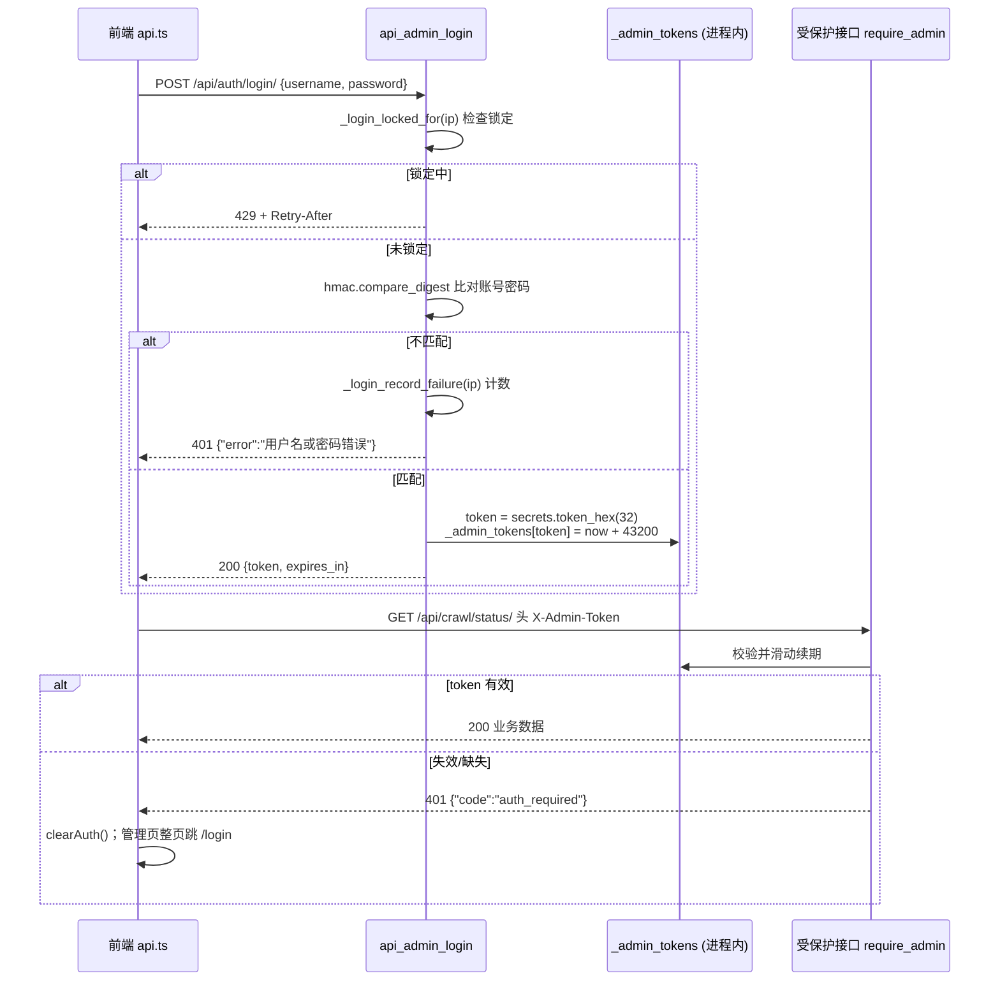

# XSearch 接口设计

> 项目：XSearch ｜ 版本：v1.1 ｜ 生成日期：2026-10-06 ｜ 依据：源码分析

## 一、API 总体约定

后端是**纯 JSON API 服务**（`XSearch/xsearch/urls.py` 文件头声明"页面层由 frontend/ 下的 Vue 3 + Vite 工程承担，本服务只提供 JSON API"）。全部业务接口集中在 `XSearch/search/api_views.py`，SEO 两个文本出口单独放在 `XSearch/search/seo_views.py`。所有 JSON 响应由 `JsonResponse` 产出；成功响应没有统一的包裹层（直接返回业务字段），错误响应统一为 `{"error": "<中文文案>", "code": "<机器码，可选>"}`。

**鉴权只有一层**：管理员 token。登录接口 `POST /api/auth/login/` 签发 64 位十六进制 token（`secrets.token_hex(32)`），后续请求以 `X-Admin-Token` 请求头携带。源码注释记录了一段历史：曾有第二层 `X-API-Token` 共享密钥，但它要生效必须打进前端产物，"公开仓库里的 dist 等于把钥匙挂出去"，2026-09 整体移除。token 存于后端**进程内字典** `_admin_tokens`，有效期 12 小时且每次成功请求滑动续期，进程重启全部失效；`Dockerfile` 因此强制 `gunicorn --workers 1`。登录接口按客户端 IP 限速：300 秒窗口内失败 5 次即锁定 900 秒（`_LOGIN_MAX_FAILS/_LOGIN_WINDOW/_LOGIN_LOCKOUT` 常量），锁定期间直接返回 429 并带 `Retry-After` 头；账号密码比较使用 `hmac.compare_digest` 常数时间比较防时序侧信道。客户端 IP 取值受 `DJANGO_TRUST_PROXY_HEADER` 控制（True 时优先 `X-Forwarded-For` 首段，适配 frp → VPS nginx 反代链路）。

**CORS**：`xsearch/middleware.py` 的 `CorsMiddleware` 实现白名单式跨域，默认放行 `localhost:5173/4173`（Vite dev/preview），`FRONTEND_ORIGINS` 环境变量可追加；允许的方法为 GET/POST/PUT/DELETE/OPTIONS，允许头为 `Content-Type, X-API-Token, X-Admin-Token`（其中 `X-API-Token` 属已废弃鉴权层的历史残留，见《13-技术债务与演进建议》#11），预检结果缓存 86400 秒。生产形态下前端与后端同源（nginx 反代 `/api/`），CORS 实际只服务于本地开发。

**依赖降级约定**：所有接口在 ES 不可用时返回结构化 503（`_es_error()` 辅助函数），Redis 不可用时静默跳过缓存/统计继续出数据——前端据此降级展示而不是整页报错。唯一例外是 `/api/health/`，它把依赖故障升格为 503 状态码本身，供容器探针判定。

## 二、API 端点总表

下表按 `XSearch/xsearch/urls.py` 的真实路由表整理（含视图函数名）。

### 2.1 公开接口（无需鉴权）

| 方法 | 路径 | 视图函数 | 用途 | 关键入参 | 响应要点 |
|---|---|---|---|---|---|
| GET | `/` | `ServiceInfo` | 服务自描述（版本 + 端点清单） | — | `{service, version:"2.1", endpoints[]}` |
| GET | `/api/search/` | `api_search` | 关键词搜索 | `q`（必）、`p`、`source`、`sort`(relevance/time/hot)、`days`(7/30/90) | `{total, page, page_nums, results[], facets{sources[],days[]}, did_you_mean, corrected, fuzzy, suggestions[]}` |
| GET | `/api/suggest/` | `api_suggest` | 搜索框补全（ES completion，fuzziness 2） | `s` 前缀 | `["标题", ...]`（JSON 数组，保序去重，排除榜单来源） |
| GET | `/api/stats/` | `api_stats` | 数据概览 | — | `{es_ok, total, by_source[], top_keywords[]}`；ES 故障降级 200 + `es_ok:false` |
| GET | `/api/health/` | `api_health` | 存活探针 | — | 200 `{status:"ok", checks, index}` / 任一依赖挂 503 `{status:"degraded"}`；错误只回异常类名 |
| GET | `/api/headlines/` | `api_headlines` | 首页今日要闻 | `hours`（默认 36，1–168 截断） | `{hours, total, items[], top_keywords[]}`，同题去重后最多 20 条，Redis 缓存 120s |
| GET | `/api/rankings/` | `api_rankings` | 榜单/新闻列表 | `source`（aihot_hot/douyin_hot/news/news_*/aihot_daily）、`p` | 榜单分支按 `rank` 升序一次拉全；新闻分支时间倒序 20 条/页 + 60s 缓存 |
| GET | `/api/doc/<doc_id>/` | `api_doc` | 单篇详情（按 ES `_id`） | 路径参数 `doc_id` | 全文字段 + `id`；不存在 404 `{"code":"not_found"}` |
| GET | `/api/img/` | `api_img` | 图片代理（防盗链图床） | `u`（图片 URL） | 图片二进制流（`FileResponse`，Cache-Control 30 天）；非白名单 400 |
| POST | `/api/auth/login/` | `api_admin_login` | 管理员登录 | body `{username, password}` | 200 `{ok, token, username, expires_in:43200}` / 401 / 429（带 Retry-After）/ 503 未配置账号 |
| GET | `/robots.txt` | `robots_txt` | 搜索引擎 robots | — | 纯文本：Allow / + Disallow 管理页 + Sitemap 指向 |
| GET | `/sitemap.xml` | `sitemap_xml` | 站点地图 | — | XML：4 个栏目页 + 近期 AI 详情页（上限 5000），Redis 缓存 1 小时 |

### 2.2 管理员接口（`X-Admin-Token`，经 `require_admin` 装饰器）

| 方法 | 路径 | 视图函数 | 用途 | 关键入参 | 响应要点 |
|---|---|---|---|---|---|
| POST | `/api/auth/logout/` | `api_admin_logout` | 退出登录（吊销 token） | 请求头 token | `{ok:true}` |
| POST | `/api/crawl/start/` | `api_crawl_start` | 启动爬虫子进程 | body `{spider, pages?, js?, resume_job?}` | 202 `{started:true, pid, job_dir,...}` / 409 `{started:false, reason}` |
| GET | `/api/crawl/status/` | `api_crawl_status` | 运行状态 + 日志尾部 30 行 | — | `{running, status, started_at, spider, log_tail[]}` |
| GET | `/api/crawl/history/` | `api_crawl_history` | 采集历史（最新在前） | `limit`（默认 50，1–200） | `{history[{job_id, spider, status, started_at, ended_at, pid, items}]}` |
| GET | `/api/crawl/stats/` | `api_crawl_stats` | 任务统计图表 | — | `{total, completed, failed, empty, running, success_rate, by_day[], by_spider[]}` |
| GET | `/api/crawl/resumable/` | `api_crawl_resumable` | 可恢复中断任务列表 | — | `{jobs[{job_id, spider, modified, has_queue, size_kb}]}`（最多 20 条） |
| GET | `/api/crawl/spiders/` | `api_crawl_spiders` | 爬虫白名单 | — | `{spiders[{key, label}]}`（5 项） |
| GET | `/api/crawl/schedule/` | `api_schedule_list` | 定时任务列表 + 触发历史 | — | `{jobs[{id, spider, cron, enabled, next_run, last_fire,...}], history[], scheduler_active}` |
| POST | `/api/crawl/schedule/add/` | `api_schedule_add` | 添加定时任务 | body `{spider, cron, pages?, js?}` | 201 `{ok, job_id, scheduler_active}` / 400 `{ok:false, reason}` |
| POST | `/api/crawl/schedule/remove/` | `api_schedule_remove` | 删除定时任务 | body `{job_id}` | `{ok}` |
| POST | `/api/crawl/schedule/update/` | `api_schedule_update` | 更新任务（未传字段保持原值） | body `{job_id, cron?, spider?, pages?, js?}` | `{ok}` / 400 |
| POST | `/api/crawl/schedule/toggle/` | `api_schedule_toggle` | 启用/禁用任务 | body `{job_id, enabled}` | `{ok, enabled}` |
| GET | `/api/admin/db/overview/` | `api_db_overview` | 索引概览 | — | `{total, size_bytes, by_source[]}` |
| GET | `/api/admin/db/docs/` | `api_db_docs` | 文档分页浏览 | `source`、`q`、`p`（20 条/页，按 `crawled_at` 倒序） | `{total, page, page_size, page_nums, items[]}` |
| GET | `/api/admin/db/doc/<doc_id>/` | `api_db_doc` | 单文档详情（全字段） | 路径 `doc_id` | 完整 `_source` + `id` |
| PUT | `/api/admin/db/doc/<doc_id>/` | `api_db_doc` | 编辑文档（白名单字段） | body：`title/content/tags/author` 的子集 | `{ok:true}`；title/author 变更会自动重建 `suggest` 字段 |
| DELETE | `/api/admin/db/doc/<doc_id>/` | `api_db_doc` | 删除文档 | 路径 `doc_id` | `{ok:true}` |
| POST | `/api/admin/db/purge/` | `api_db_purge` | 按来源批量清理 | body `{source, confirm}`（confirm 必须逐字等于 source） | `{ok, deleted}` |

三个说明：其一，`/api/admin/db/doc/<id>/` 三种方法共用一个视图函数，源码注释解释了原因——"Django 命中第一个路径即调用视图、不按 HTTP 方法回退匹配，拆成同路径三个视图会让 PUT/DELETE 被 GET 视图直接 405"。其二，`GET/POST /api/crawl/*` 的写操作（start）必须鉴权，"拉起子进程"是硬性安全边界。其三，`/admin/`（Django admin）路由存在但未注册任何模型，生产 nginx 也不转发该路径。

## 三、认证鉴权时序



## 四、错误处理约定

| 场景 | HTTP 状态 | 响应体 | 前端行为（`frontend/src/api.ts`） |
|---|---|---|---|
| ES 不可用（读接口） | 503 | `{"error": "Elasticsearch 不可用: <异常>"}` | `el-alert` 展示文案 |
| ES 不可用（suggest） | 200 | `[]`（静默降级） | 补全下拉为空 |
| 依赖不可用（health） | 503 | `{"status":"degraded", checks:{elasticsearch:"<异常类名>"}}` | 容器 HEALTHCHECK 判 unhealthy |
| 未登录/过期 | 401 | `{"error":"未登录或登录已过期","code":"auth_required"}` | 清 token；管理页跳登录、公开页就地报错 |
| 登录限速 | 429 | `{"code":"too_many_login_attempts"}` + `Retry-After` 头 | 文案提示等待秒数 |
| 参数错误/来源不支持 | 400 | `{"error":"<具体原因>"}` | `ElMessage.error` |
| 文档不存在 | 404 | `{"error":"文章不存在或已被清理","code":"not_found"}` | 详情页明确空态 |
| 启动冲突（已有任务） | 409 | `{"started":false,"reason":"已有采集任务在运行","pid":...}` | `ElMessage.warning` |
| 未知异常兜底 | 200/降级 | stats 返回 `es_ok:false`；suggest 返回 `[]` | 页面级告警条 |

约定要点：**错误文案是中文可直接展示的**（`errorMessage()` 取 `error` 字段，取不到回退"请求失败 (status)"）；机器可读的细分原因放 `code` 字段（`auth_required`/`not_found`/`too_many_login_attempts`）；`ApiError` 类把 status 与 code 一起抛给调用方，页面可据此区分"资源不存在"和"服务不可用"。

## 五、核心接口示例

### 5.1 关键词搜索 `GET /api/search/`

请求：

```
GET /api/search/?q=%E4%BA%BA%E5%B7%A5%E6%99%BA%E8%83%BD&sort=time&days=30&p=1
```

处理链路（`api_search`）：① `q` 为空直接返回空结果不查 ES；② 本次搜索词 `zincrby` 进 Redis `search_keywords_set`（裁剪到前 100）；③ 构造查询——`multi_match`（字段权重 `title^3, tags^2, author, content`，`minimum_should_match: "2<80%"`）作 must，`must_not` 排除榜单来源 `douyin_hot/aihot_hot`，`source` 与 `days` 筛选放 `post_filter`（保证分面聚合计数不受自身筛选影响），附 `highlight`（title/content，`<span class="kw">` 包裹）与两个聚合（`facet_sources` terms size 20、`facet_days` date_range 7/30/90 天累计口径）；④ 命中 0 时启用两级纠错：先短语建议器（`_did_you_mean`）换词重搜，仍无则 `fuzziness: "AUTO"` + 放宽命中率为 `2<50%` 模糊重搜；⑤ 分页修正：当前页空且非第 1 页时向前找最后一个有数据的页；当前页结果少于 10 且非第 1 页时把 `page_nums` 修正为当前页。

成功响应（结构示意）：

```json
{
  "total": 128,
  "page": 1,
  "page_nums": 13,
  "results": [
    {
      "id": "9f2c...md5",
      "title": "(span)AI(/span) 大模型发布会举行",
      "content": "...(span)人工智能(/span) ..." ,
      "url": "https://www.ithome.com/...",
      "author": "IT之家",
      "source": "news_ithome",
      "rating": null, "rank": null,
      "front_image_url": "",
      "create_date": "2026-10-04",
      "view_nums": null, "praise_nums": null
    }
  ],
  "facets": {
    "sources": [{"key": "news_ithome", "count": 52}, {"key": "news_chinanews", "count": 41}],
    "days": [{"key": "7", "count": 30}, {"key": "30", "count": 128}, {"key": "90", "count": 400}]
  },
  "did_you_mean": null, "corrected": null, "fuzzy": false,
  "suggestions": []
}
```

`results[].title/content` 中的高亮片段在响应里是原始 HTML（`<span class="kw">`），前端 `renderHighlight()` 先整体转义再仅还原为 `<mark class="kw">`，兼得高亮与 XSS 安全。`suggestions` 仅在空结果时携带 Redis 热搜词前 6 个，供"换个词试试"引导。

### 5.2 启动采集 `POST /api/crawl/start/`（管理员）

请求：

```
POST /api/crawl/start/
Content-Type: application/json
X-Admin-Token: 8f14e45fceea167a5a36dedd4bea2543...

{"spider": "news_rss", "pages": 2, "js": false}
```

处理链路：`require_admin` 校验通过后，`crawl_manager.start(spider, pages, js, resume_job=None)` 在可重入锁内执行——先收割可能已结束的上一轮任务；校验 `spider` 在 `SPIDERS` 白名单（5 个，未知爬虫直接拒绝，这是防任意命令执行的关键边界）；若带 `resume_job` 则用 `JOB_NAME_RE`（`[A-Za-z0-9][A-Za-z0-9._-]{0,79}`）+ `basename` 校验拒绝绝对路径与 `../` 穿越；随后 `subprocess.Popen([sys.executable, "-m", "scrapy", "crawl", "news_rss", "-s", "JOBDIR=jobs/news_rss_<ts>"], cwd=XSearch项目根, stdout=日志文件)`，写一条 `running` 历史并启动盯梢线程。

成功响应（202）：

```json
{
  "started": true,
  "pid": 41237,
  "started_at": "2026-10-05T09:30:00",
  "spider": "news_rss",
  "label": "新闻RSS(3源)",
  "job_dir": "news_rss_1788987390",
  "resumed": false
}
```

冲突响应（409，已有任务在跑）：

```json
{"started": false, "reason": "已有采集任务在运行", "pid": 41201, "started_at": "2026-10-05T09:28:11"}
```

子进程退出后由盯梢线程解析日志中的 `'item_scraped_count': N` 回写终态：非零退出码记 `failed`、0 条记 `empty`、正常记 `completed`，失败与空跑会触发 `search/notify.py` 的冷却告警邮件——调用方无需轮询等待，状态经 `/api/crawl/status/` 与 `/api/crawl/history/` 供前端自适应轮询展示。

## 六、接口与前端封装的对应关系

`frontend/src/api.ts` 为上表每个端点提供了类型化封装——`api` 对象共 24 个方法（`search/suggest/stats/doc/crawlStart/crawlStatus/crawlHistory/crawlStats/rankings/headlines/crawlSpiders/adminLogin/adminLogout/dbOverview/dbDocs/dbDoc/dbDocUpdate/dbDocDelete/dbPurge/scheduleList/scheduleAdd/scheduleRemove/scheduleUpdate/scheduleToggle`，与《15-接口全量参考》第七节的双清单一致），图片代理端点由模块级工具函数 `imgUrl` 构造地址（不在 `api` 对象内）；并为每个响应定义了与后端字段一一对应的 interface（`SearchResult`、`CrawlStatsResult`、`ScheduleJob` 等）。开发态经 Vite 代理（`vite.config.ts` 把 `/api` 转发到 `127.0.0.1:8000`）天然同源；生产态 nginx 反代同源，`VITE_API_BASE` 仅在需要指向绝对地址时启用。这套"后端视图函数 ↔ 前端类型化客户端"的双清单是理解接口契约的最短路径：改后端响应字段时，前端对应 interface 的类型检查会在 `npm run build` 时立刻报警。
