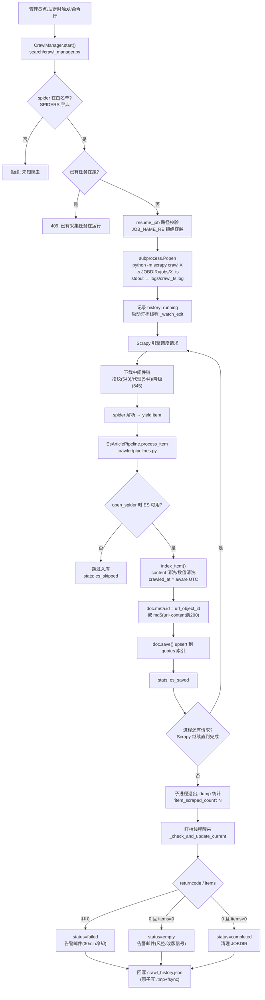
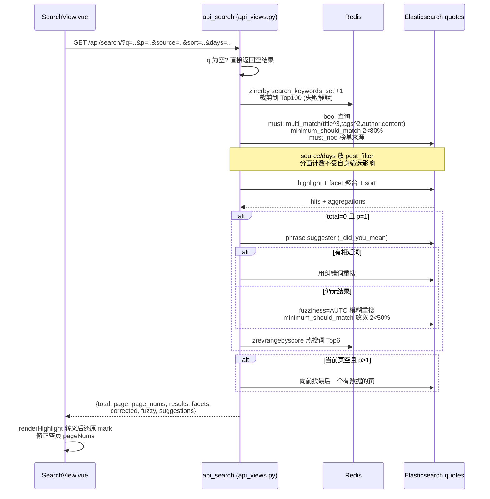
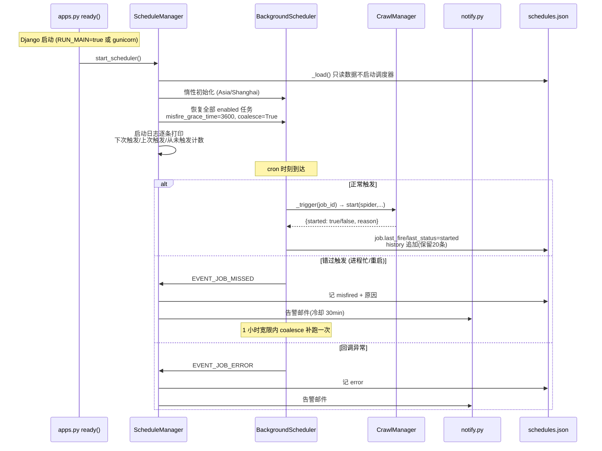
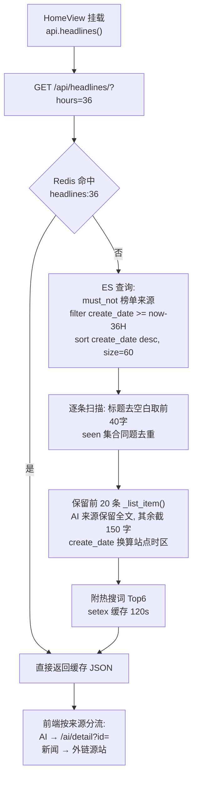
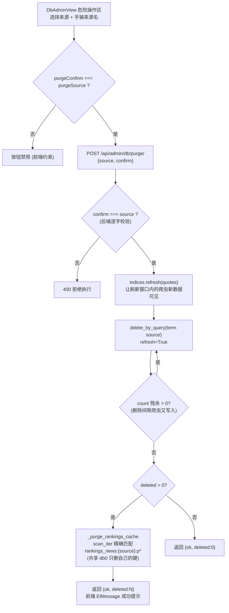

# XSearch 核心流程

> 项目：XSearch ｜ 版本：v1.0 ｜ 生成日期：2026-10-05 ｜ 依据：源码分析

本章拆解五个端到端流程：爬虫采集入库、关键词搜索、定时采集任务调度、首页今日要闻聚合、数据管理按来源清理。每个流程配流程图/时序图、分步说明与涉及文件清单。这五条链路覆盖了系统"写入侧"与"读取侧"的全部主干。

## 流程一：爬虫采集入库全流程

这是系统的写入主链路。触发方式有三种——管理员在 Web 界面点击、APScheduler 定时触发、命令行 `scrapy crawl <name>`——前两者最终都收敛到 `CrawlManager.start()` 拉起子进程，与命令行殊途同归。

**分步说明**：

1. **白名单与互斥**：`start()` 先查 `SPIDERS` 字典（`search/crawl_manager.py`，5 个键），未知爬虫直接拒绝——这是 Web 输入到命令执行的唯一闸门。随后在 RLock 内收割上一轮（`_check_and_update_current()`），若仍有存活子进程则返回"已有采集任务在运行"（HTTP 409）。全系统同时最多一个采集任务。
2. **断点恢复参数校验**：若带 `resume_job`，目录名必须通过 `os.path.basename` 一致性 + `JOB_NAME_RE`（`[A-Za-z0-9][A-Za-z0-9._-]{0,79}`）校验且真实存在于 `jobs/` 下——拒绝绝对路径与 `../` 穿越（测试 `ResumeJobValidationTests` 覆盖）。
3. **子进程拉起**：命令为 `[sys.executable, "-m", "scrapy", "crawl", <scrapy_name>, "-s", "JOBDIR=<jobs/爬虫名_时间戳>"]`，工作目录是项目根（`SPIDER_DIR`），stdout/stderr 合并重定向到 `logs/crawl_<时间戳>.log`。JOBDIR 让 Scrapy 持久化已爬 URL 与请求队列，中断后可用同一 JOBDIR 恢复。
4. **爬虫执行**：以 `news_rss` 为例（`crawler/spiders/news_rss.py`）：`start()` 逐源 yield feed 请求 → `parse_feed()` 解析 `<channel><item>`；中新网条目按 `CNS_ARTICLE_RE` 识别文章链接跟进抓 `div.left_zw` 正文；每条经 `strip_html()`（删 script/style/noscript 块与全部标签、反转义实体）与 `parse_date()`（RFC822 与两种中文格式兼容）产出标准化 dict：`url_object_id=md5(url)`、`content[:5000]`、`source=news_chinanews` 等。AIHOT 两爬虫额外处理 429/503（记 `aihot/ratelimited` 后放弃）；`aihot_hot` 收尾触发 `_prune_stale()` 删除跌榜文档；`douyin_hot` 在 Playwright 渲染的页面上等待 5 秒后解析 body 文本。
5. **管道入库**：`EsArticlePipeline.process_item()` → `index_item()`（`crawler/pipelines.py`）：content 空直接丢；`suggest.input=[title, author]`；数值字段 `_to_int/_to_float` 清洗；`crawled_at=utc_now()`（aware UTC，修复时区偏移事故）；`doc.meta.id` 取稳定 id 实现 upsert 幂等。ES 不可用时 `open_spider` 已置 `doc_cls=None`，item 被跳过且爬虫照常结束（"本次爬取数据将不入库"告警）。
6. **终态回写**：子进程退出后盯梢线程立刻收割：非零退出码 → `failed`；日志里 `'item_scraped_count': 0` → `empty`（不告警就会静默停更）；否则 `completed` 并清理 JOBDIR。终态与计数写入 `crawl_history.json`（`_write_json_atomic` 原子写），失败/空跑经 `search/notify.py` 发冷却告警邮件。**前端无需轮询等终态**——这是对旧实现"轮询一停历史就永久挂 running"的修复。

**涉及文件**：`search/crawl_manager.py`（CrawlManager 全部）、`search/api_views.py`（`api_crawl_start`/`require_admin`）、`search/notify.py`（告警）、`crawler/settings.py`（中间件与管道装配）、`crawler/middlewares.py`、`crawler/pipelines.py`（QuoteDocument/EsArticlePipeline/index_item）、`crawler/spiders/*.py`（5 个爬虫）、`crawler/ai/fingerprint.py`（指纹头）、`crawl_history.json`/`logs/`/`jobs/`（运行时产物）。

## 流程二：关键词搜索请求全流程

读取侧最复杂的链路，涉及 ES 查询构造、三级纠错、分面聚合与分页修正。

**分步说明**：

1. **参数规范化**（`api_search`）：`q` 去空白；`p` 非法回退 1；`sort` 限 `relevance/time/hot`（`_SORTS` 字典映射 ES sort 子句，time 按 `create_date desc`、hot 按 `view_nums desc`，均 `missing:_last` 并以 `_score` 次序兜底）；`days` 限 7/30/90。
2. **热搜词统计**：搜索词 `zincrby` 进 Redis，`zremrangebyrank(0, -101)` 裁剪到前 100；Redis 故障静默跳过，绝不阻塞搜索。
3. **查询构造**：`multi_match` 的 `minimum_should_match: "2<80%"` 表示超过 2 个词元的查询要求 80% 词元命中——防止低质命中刷屏；`must_not terms` 把榜单来源挡在搜索结果外（榜单条目无发布时间语义，混入会长期霸占"最新"排序）。
4. **纠错与兜底**（仅第 1 页 0 结果时）：`_did_you_mean()` 用 ES phrase suggester 找相近词，找到且不同则重搜并置 `corrected`；仍无则 `fuzziness: "AUTO"` 模糊重搜并置 `fuzzy=true`（容忍"猪申克"→"肖申克"级别的错字）；两级都失败则取 Redis 热搜词 Top6 作 `suggestions` 引导。
5. **分页修正**：ES 的 total 偶有估算偏差导致空页——当前页空则向前逐页试探到最后一个有数据的页并修正 total；当前页不满 10 条则把 `page_nums` 修正为当前页。前端 `SearchView.runSearch()` 镜像了同一套修正逻辑。
6. **前端渲染**：`renderHighlight()`（`frontend/src/api.ts`）先把整段 HTML 转义、再仅把 `` 还原为 `<mark class="kw">`，并合并相邻 mark（ES 中文单字高亮会碎片化）。

**涉及文件**：`search/api_views.py`（`api_search`/`_run_search`/`_extract`/`_did_you_mean`/`_record_search_keyword`/`_HIGHLIGHT`/`_FACET_AGGS`/`_SORTS`）、`crawler/pipelines.py`（mapping 决定分词行为）、`frontend/src/api.ts`（`api.search`/`renderHighlight`）、`frontend/src/views/SearchView.vue`（URL 状态机与渲染）。

## 流程三：定时采集任务调度（APScheduler）

采集管理的"自动化"半边，重点在于错过触发窗口后的补跑与可观测性——这是项目修过最隐蔽的一类 bug（"4 个 cron 一次都没触发"）。

**分步说明**：

1. **启动恢复**：`SearchConfig.ready()`（`search/apps.py`）在服务进程启动时调用 `schedule_manager.start_scheduler()`。runserver 场景用 `RUN_MAIN` 环境变量过滤掉自动重载的父进程，否则会起两份调度器、同一 cron 重复触发。启动日志逐条打印每个任务的"下次/上次触发"，"从没跑过"一眼可见（还有未触发计数告警）。
2. **惰性调度器**：`_get_scheduler()` 只在真正需要调度的路径（add/toggle/list/start_scheduler）初始化 APScheduler；未安装时返回 None，功能降级但配置仍保存（前端显示"APScheduler 未安装"警告）。
3. **注册细节**：`_add_to_scheduler()` 把五段 cron 拆给 `scheduler.add_job`，三个参数是可靠性关键——`misfire_grace_time=3600`（默认仅 1 秒，后端恰在触发时刻重启就会静默漏掉一整天）、`coalesce=True`（多次错过合并成一次补跑）、`max_instances=1`。cron 在 add/update 时经 `_validate_cron` 三级校验（段数 → 字符集正则 → `CronTrigger.from_crontab` 语义）。
4. **触发回调**：`_trigger()` 调 `crawl_manager.start()`（受互斥保护，已有任务在跑记 `skipped`），把结果写回 `job.last_fire/last_status/last_reason` 并追加 history（`schedules.json`，原子写）。
5. **事件可观测**：`_on_scheduler_event()` 监听 `EVENT_JOB_MISSED/EVENT_JOB_ERROR`，把"只有 logger 一行"的默认行为升级为：写任务字段 + 写 history + 冷却告警邮件。管理员在采集管理页能直接看到 misfired/error 记录。
6. **持久化可靠性**：所有写操作经 `_save()` 返回真实落盘结果；写入失败时 add 会回滚内存（"没落盘就别留在内存里假装成功"），update/toggle 会如实告知"重启后回到旧值"。

**涉及文件**：`search/apps.py`、`search/crawl_manager.py`（ScheduleManager 与 `_write_json_atomic`/`_load_json_with_recovery`）、`search/api_views.py`（`api_schedule_*` 五视图）、`search/notify.py`、`schedules.json`。

## 流程四：首页今日要闻聚合

跨源混排 + 同题去重 + 缓存的读取流程，体现了"榜单排除"与"展示时区"两个横切约定。

**分步说明**：`api_headlines`（`search/api_views.py`）不复用 `/api/rankings?source=news`——首页要的是"新闻 + AI 内容放一起看今天发生了什么"；`hours` 参数被夹在 1–168（默认 36）。查询用 `filter`（不计相关性）+ `must_not` 榜单源；取 60 条再按 `re.sub(r"\s+","",title)[:40]` 去重后截 20 条，避免同一事件的多源报道刷屏。AI 来源条目 `keep_content=True`（前端详情页需要全文），新闻条目截 150 字。整体 payload 以 120 秒 TTL 缓存进 Redis，页面轮询/多人访问零 ES 压力；ES 故障返回结构化 503。前端 `HomeView.vue` 按 `isAi()` 把条目分流到站内详情或源站外链，并渲染"最近 N 小时 · 同题已去重"提示与空态文案（"采集任务在每天 8 点前后跑"）。

**涉及文件**：`search/api_views.py`（`api_headlines`/`_list_item`/`_display_date`）、`frontend/src/views/HomeView.vue`、`frontend/src/api.ts`。

## 流程五：数据管理——按来源批量清理

危险写操作的完整闭环，展示"逐字确认 → 显式刷新 → 双轮删除 → 缓存联动"的防御链条。

**分步说明**：确认机制是双层的——前端要求用户手输来源名且与所选一致才启用按钮（`DbAdminView.vue`），后端再次逐字校验 `confirm == source`。执行时的关键细节是 ES `delete_by_query` 只能命中**已刷新**的文档：爬虫刚写入、还在 1 秒刷新窗口内的数据会躲过删除，所以先显式 `refresh`，删完再 `count` 校验、有残余补删一轮，兑现"清空该来源"的承诺。清理成功后联动清 Redis 的新闻列表缓存（`scan_iter` 精确匹配键模式——Redis db0 与其他项目共享，绝不能 `keys *`）。全程写 INFO 日志（"来源「X」清理 N 条文档"）。

**涉及文件**：`search/api_views.py`（`api_db_purge`/`_purge_rankings_cache`）、`frontend/src/views/DbAdminView.vue`、`frontend/src/api.ts`（`dbPurge`）。

## 五条流程的共同工程取向

把五条链路放在一起看，XSearch 的代码风格高度一致：**每一次"看起来能跑"的实现旁边，都有一段注释记录它在什么真实场景下坏过，以及现在的写法为什么能防住**——盯梢线程防"历史永久 running"、misfire 宽限防"cron 静默漏跑"、原子写防"配置文件截断"、显式 refresh 防"清不干净"、post_filter 防"分面计数失真"、aware UTC 防"时间偏 8 小时"。理解这五条流程不仅是理解功能，更是理解这套防御性编程取向；后续维护者改动任何一环时，应先读对应注释里记录的失败案例，再决定是否真的需要改动，并回到 `search/tests.py`（110 个测试方法）补上对应的回归断言。
