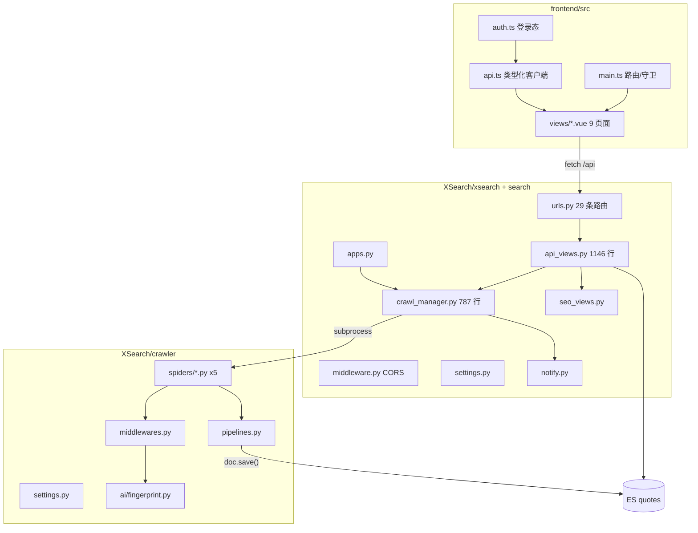

# XSearch 模块详解

> 项目：XSearch ｜ 版本：v1.2 ｜ 生成日期：2026-10-06 ｜ 依据：源码分析

本篇是"逐模块深读手册"：《00-项目总览》讲定位、《01-系统架构》讲分层与数据流，本篇则下沉到**每个模块内部的职责边界、关键类/函数清单与机制走读**。所有路径相对 `XSearch/` 仓库根目录，行数以源码实测为准（Python 后端合计约 5.2k 行，前端 TypeScript/Vue 合计约 2.5k 行）。

## 一、模块地图与阅读顺序

建议的阅读顺序：先读第 2.4 节 `pipelines.py`（全系统数据契约的锚点），再读第 3.3 节 `api_views.py`（读侧全貌），然后按需查阅其余小节。各模块与旧篇的分工：架构与流程见《01-系统架构》《05-核心流程》，本篇不重复画流程图，只做模块内走读。

## 二、爬虫子系统（crawler/ 包）逐模块深读

### 2.1 crawler/settings.py —— 采集侧装配清单（74 行）

这是 Scrapy 的 settings 模块（`scrapy.cfg` 的 `[settings] default = crawler.settings` 指向它），职责是把合规约束、中间件链、Playwright 渲染与 ES 管道装配进引擎。关键配置项全集如下（逐项语义详解见《14-配置与环境详解》第七节）：

| 配置项 | 值 | 作用 |
|---|---|---|
| `SPIDER_MODULES` | `crawler.spiders` | 爬虫发现目录 |
| `ROBOTSTXT_OBEY` | `True` | robots 合规总开关（2026-09-27 逐源核对过） |
| `DOWNLOAD_DELAY` / `AUTOTHROTTLE_*` | 1 / 启用、max 3、target 2.0 | 礼貌限速 |
| `COOKIES_ENABLED` | `False` | 不维持会话态 |
| `USER_AGENT` | `XSearchBot/1.0 (+github 链接)` | 自报身份 |
| `FINGERPRINT_HOSTS` | `['www.douyin.com', 'douyin.com']` | 指纹伪装白名单（唯一例外域名） |
| `DOWNLOADER_MIDDLEWARES` | 543 / 544 / 545 三件 | 指纹、代理、Playwright 降级 |
| `TWISTED_REACTOR` | `AsyncioSelectorReactor` | 与 scrapy-playwright 共存的前提 |
| `DOWNLOAD_HANDLERS` | http/https → Playwright handler | 渲染请求走浏览器 |
| `PLAYWRIGHT_*` | chromium、导航超时 60s、上下文/页面各上限 4 | 渲染资源上限 |
| `ITEM_PIPELINES` | `EsArticlePipeline: 300` | 入库管道 |
| `ES_HOSTS` / `ES_INDEX` | env `ES_HOSTS`/`ES_URL`、`ES_INDEX` | ES 连接与索引名 |
| `PROJECT_ROOT` | settings 上一级 | 插入 sys.path 使 crawler 包可导入 |

值得注意的一个装配细节：`ES_HOSTS` 兼容旧的逗号分隔多节点写法，且**优先于** `ES_URL`（`crawler/settings.py` 第 66-67 行），而 Django 侧只认 `ES_URL`——两份配置在 Docker 里靠 compose 注入同名 `ES_URL` 保持一致，若有人只设 `ES_HOSTS` 会出现"爬虫写 A 库、站点读 B 库"的静默分叉，这是配置面上一处已知的坑（见《13-技术债务与演进建议》）。

### 2.2 crawler/ai/fingerprint.py —— 指纹头生成（57 行）

| 函数/对象 | 职责 |
|---|---|
| `_FALLBACK_PROFILES` | 两套 Chrome 124/123 内置模板，UA 与 `sec-ch-ua` 成对出现保证自洽 |
| `_ACCEPT` / `_LANGS` | 真浏览器风格的 Accept 与三种语言组合 |
| `_gen` | 模块导入时尝试初始化 browserforge 的 `HeaderGenerator`（Chrome 源），失败置 None |
| `get_headers()` | 优先返回 browserforge 成套头；未安装则模板 + 随机语言/platform 拼装 |

机制走读：设计动机写在模块注释里——2025 年后的风控校验的是"整组信号"（UA 与 client hints 是否自洽、Accept 是否像真浏览器），单独换 UA 反而是爬虫特征；更底层的 TLS 指纹（requests/httpx 握手特征）当前无解，注释建议脱离 Scrapy 单独请求时改用 curl_cffi。`get_headers()` 每次调用都重新生成，因此同一轮爬取里不同请求的指纹也各不相同。该模块只被 `BrowserFingerprintHeadersMiddleware` 调用，作用域被中间件进一步收敛到白名单域名。

### 2.3 crawler/middlewares.py —— 三个下载中间件（94 行）

| 中间件 | 优先级 | 关键方法 | 核心逻辑 |
|---|---|---|---|
| `BrowserFingerprintHeadersMiddleware` | 543 | `process_request` / `_matches` | 域名按点边界匹配白名单（`host == h or host.endswith("." + h)`，防 `evil-douyin.com` 假阳性）；命中则**整体替换** `request.headers` 各键 |
| `ResidentialProxyMiddleware` | 544 | `process_request` | 读 `RESIDENTIAL_PROXIES` 设置或 `AI_PROXIES` env，`itertools.cycle` 轮换写入 `request.meta["proxy"]`；空列表 = 直连 |
| `PlaywrightFallbackMiddleware` | 545 | `process_exception` | 捕获渲染异常后剔除 `playwright` 标记重发直连请求，**保留 `download_slot`** 不绕过限速 |

机制走读有三处值得展开。第一，"替换而非 setdefault"：Scrapy 内置 `UserAgentMiddleware`（优先级 500）会先把 `USER_AGENT` 写进请求头，若指纹中间件用 setdefault 就永远盖不掉它——注释记录了这个 bug 曾让目标站返回 412。第二，代理中间件的标准认证写法（用户名密码直接编入代理 URL）适配 Bright Data、IPRoyal、快动态私密版等主流住宅代理，无需额外的 `Proxy-Authorization` 头。第三，降级中间件刻意保留 `download_slot`：渲染失败降直连时若连下载槽一起清掉，等于绕开了对目标站的礼貌限速，合规约束会在异常路径上悄悄失效——这行代码是"降级不降合规"的显式表达。

### 2.4 crawler/pipelines.py —— 索引 mapping 与入库管道（196 行）

这是全系统数据契约的锚点：ES mapping 在这里声明，五个爬虫的 item 在这里清洗落库。

| 函数/类 | 职责 |
|---|---|
| `_default_es_url()` | 模块级默认连接地址：env `ES_URL` → Django settings → 本机回退 |
| 模块级 `connections.create_connection` | 注册 dsl 默认连接（带 try 保护，ES 挂了不阻塞导入） |
| `CN_STOPWORDS` / `ik_stop_filter` / `ik_search_analyzer` | 检索侧停用词表（约 50 个高频虚词）与 `ik_smart`+停用词检索分析器 |
| `QuoteDocument` | 21 个字段的 Document 声明（详见《04-数据模型》与《15-接口全量参考》第五节） |
| `utc_now()` | aware UTC 当前时刻（修复 naive 时间偏移 8 小时事故） |
| `_to_int` / `_to_float` | 脏数值清洗为 None |
| `EsArticlePipeline.from_crawler / open_spider / process_item` | 建索引探测、入库计数（`es_saved`/`es_skipped`） |
| `index_item(item, source=None)` | 单条落库：清洗、`_id` 赋值、`doc.save()` upsert |
| `_md5(s)` | `_id` 兜底哈希 |

机制走读：`open_spider()` 探测 ES 成功后执行 `QuoteDocument.init()`——索引不存在才创建，已存在则**不更新 mapping**（意味着给 `QuoteDocument` 加字段对既有索引不生效，扩展字段时的正确姿势见《11-扩展开发指南》场景二）。ES 探测失败时只置 `doc_cls=None` 并告警，之后每条 item 在 `process_item` 里被静默跳过，爬虫照常结束——"不入库也不阻塞采集"是有意的取舍。`process_item` 的签名 `spider=None` 是适配 Scrapy 2.18 的弃用预告（未来不再透传 spider 参数），spider 名改从 `self.crawler.spider.name` 取。`index_item()` 的字段回退链也值得记住：content 取 `text or content`、为空直接丢弃（返回 False 计入 `es_skipped`）；title 回退 author、再回退 content 前 40 字；`_id` 优先 `url_object_id`、否则 `md5(url + content[:200])`——全系统幂等性都压在这两个键上。

### 2.5 五个爬虫逐个走读（crawler/spiders/）

| 爬虫（文件行数） | 类名 | 入口/参数 | 解析核心函数 | 产物特征 |
|---|---|---|---|---|
| `news_rss.py`（163） | `NewsRssSpider` | `async start()` 逐源 yield feed 请求；`-a sources=` 选源 | `parse_feed` / `parse_chinanews_article` / `strip_html` / `parse_date` / `_news_item` | 3 源；中新网跟进文章页抓 `div.left_zw` 正文；`_id=md5(url)` |
| `news_backfill.py`（88） | `NewsBackfillSpider` | `-a days=180` 逐日回溯存档页 | `parse_day`（`a[href*="/20"]` 过滤 + 锚文本抽取）、`skip_day` errback | 只存标题+链接+日期，`content=标题`；404 静默跳过 |
| `aihot_news.py`（210） | `AihotNewsSpider` | `-a full=0/1`、`-a pages=`、`-a daily_days=3` | `parse_items`（cursor 翻页）/ `_parse_item` / `parse_dailies_list` / `parse_daily` / `_parse_iso` | `aihot_{id}` 与 `aihot_daily_{date}` 两种 `_id`；日报序列化为"头条：/【版块】/· 条目/快讯："纯文本块 |
| `aihot_hot.py`（156） | `AihotHotSpider` | 无参数 | `parse_hot` / `parse_story` / `_prune_stale`（`spider_closed` 信号） | 先入基础版再以同一 `_id` 覆盖为综述完整版；收尾 `delete_by_query` 清跌榜旧文档 |
| `douyin_hot.py`（179） | `DouyinHotSpider` | 无参数，需 Playwright | `parse`（等 5 秒取 `body` inner_text）/ `_parse_hot_list`（逐行正则）/ `errback`（关页面防泄漏） | `_id=douyin_hot_{rank}`；失败时调试截图落 `/tmp/douyin_hot_debug.png/.txt` |

四个横切机制值得单独记录。其一，`strip_html()`（news_rss.py）先删成对的 `script/style/noscript` 块、再删未闭合残留开标签、最后去全部标签并反转义实体——这是防播放器 JS 混入正文的清洗函数，`search/tests.py` 的 `NewsRssStripHtmlTests` 为它写了 3 个用例。其二，AIHOT 两爬虫把 429/503 加入 `HANDLE_HTTPSTATUS_LIST` 让响应进入回调而非触发重试中间件，然后记 `aihot/ratelimited` 统计并**主动放弃本次**——对明确限速 60 req/min 的官方 API，退避重试只会加重压力。其三，`aihot_hot` 的 `from_crawler` 必须调 `super().from_crawler()` 而非手动构造实例，否则 `_set_crawler` 与 close 信号不挂，`spider.settings` 缺失直接崩溃（注释原话）。其四，`douyin_hot` 的 `_parse_hot_list` 用"找 `XX万热度` 行、回看最多 4 行取标题"的文本扫描而非 DOM 选择器，理由是抗页面结构变化；前 3 名无数字排名的问题靠"seen_titles 去重 + 纯数字行跳过"化解。

## 三、Django 服务层逐模块深读

### 3.1 xsearch/settings.py —— 全局配置（234 行）

按源码顺序分为九段：`DEBUG` 与密钥 fail-closed（24-41 行，`DJANGO_DEBUG=False` 缺密钥抛 `ImproperlyConfigured`）；`ALLOWED_HOSTS` 与生产安全开关（44-77 行，`SECURE_PROXY_SSL_HEADER`、Cookie HttpOnly、`X_FRAME_OPTIONS=DENY`、空 Host 列表 `sys.exit(1)`）；`TRUST_PROXY_HEADER`（82 行，登录限速取 IP 策略）；应用与中间件表（87-106 行，`CorsMiddleware` 挂最外层）；CORS 白名单（109-114 行）；模板与数据库（118-146 行，SQLite 只剩框架表职责）；本地化（171-179 行，`TIME_ZONE='Asia/Shanghai'`、`USE_TZ=True`）；业务配置段（192-211 行，ES/Redis/管理员/告警）；末尾的 `local_settings.py` exec 覆盖（213-217 行，优先级高于环境变量）与 `LOGGING`（222-235 行，仅 `search` logger 输出 INFO 到控制台）。逐行详解见《14-配置与环境详解》第五节。

### 3.2 xsearch/urls.py（68 行）、middleware.py（34 行）、wsgi.py（16 行）

`urls.py` 注册 29 条路由：`admin/`、服务自描述根路径 `ServiceInfo`（返回版本 2.1 与 6 条端点样例）、11 条公开 API、2 条 SEO 文本出口（顶层路径 `robots.txt`/`sitemap.xml`，nginx 必须单独转发）、`/api/auth/*` 2 条、`/api/crawl/*` 9 条、`/api/admin/db/*` 4 条、`/api/img/` 与 `/api/doc/<id>/`。`middleware.py` 的 `CorsMiddleware` 是白名单式 CORS：OPTIONS 直接短路返回空响应，其余请求透传后按 Origin 是否命中白名单（settings 内置 4 个本地源 + `FRONTEND_ORIGINS` 追加）附加响应头；允许头清单里仍保留着已废弃的 `X-API-Token`（历史残留，见《13-技术债务与演进建议》）。`wsgi.py` 是标准模板，gunicorn 指向 `xsearch.wsgi:application`。

### 3.3 search/api_views.py —— 全部 JSON API（1146 行）

文件内部分成五个功能区，函数清单如下：

| 分区 | 函数/常量 | 职责 |
|---|---|---|
| 基础设施 | `_es_error`、`_display_date`、`client`、`redis_cli`、`_DISPLAY_TZ` | 结构化 503、UTC→站点时区日历日、带超时的 ES/Redis 连接（5s/3s） |
| 鉴权区 | `_ADMIN_TOKEN_TTL`、`_admin_tokens`、`_purge_expired_tokens`、`require_admin`、`_LOGIN_MAX_FAILS/_LOGIN_WINDOW/_LOGIN_LOCKOUT`、`_client_ip`、`_login_locked_for`、`_login_record_failure`、`_login_clear`、`api_admin_login`、`api_admin_logout` | 内存态 token（12h 滑动续期）、按 IP 限速（300s 窗 5 次锁 900s）、常数时间比较 |
| 搜索区 | `_record_search_keyword`、`_HIGHLIGHT`、`_FACET_AGGS`、`_SORTS`、`_DAY_VALUES`、`_did_you_mean`、`api_search`、`api_suggest` | 热搜词 zset、高亮/分面/排序常量、短语建议、两级纠错搜索 |
| 内容区 | `api_stats`、`api_headlines`、`api_health`、`api_doc`、`_list_item`、`api_rankings`、`NEWS_SOURCES`、`AI_SOURCES`、`RANKING_SOURCES` | 概览降级、要闻去重、真检探针、按 `_id` 详情、榜单/新闻双分支 |
| 管理区 | `api_crawl_*` 7 个、`api_schedule_*` 5 个、`api_db_*` 4 个 + `_valid_doc_id`/`_db_doc_detail`/`_db_doc_update`/`_db_doc_delete`/`_purge_rankings_cache`、`DB_DOC_EDITABLE_FIELDS`、`DB_PAGE_SIZE` | 采集、定时任务、数据管理三组管理员端点 |
| 图片代理 | `_IMG_HOSTS`、`_IMG_REFERER`、`_IMG_CACHE_DIR/_MAX_AGE/_MAX_FILES`、`_img_cache_cleanup`、`_img_cache_path`、`api_img` | 白名单 + Referer 伪装 + 磁盘缓存（MD5 文件名、2000 文件上限、1% 概率触发淘汰） |

机制走读挑四处。第一，`api_search` 的纠错链只在"第 1 页且 0 结果"时触发：先 `_did_you_mean`（phrase suggester）换词重搜置 `corrected`，仍空则 `fuzziness:"AUTO"` + 放宽 `minimum_should_match` 到 `2<50%` 模糊重搜置 `fuzzy`，两级都失败才从 Redis 取热搜词 Top6 作 `suggestions`——每一步都有 try 包裹，纠错自身失败不影响主响应。第二，分页修正的双保险在服务端完成：当前页空且 `p>1` 时向前逐页试探到最后一个有数据的页并反推 total；当前页不满 10 条且非第 1 页时把 `page_nums` 收敛为当前页（`SearchView.vue` 镜像了同一套修正，见《02-页面设计》4.2）。第三，`api_db_doc` 三方法共用一个视图的原因写在注释里：Django 命中第一个路径即调用视图、不按 HTTP 方法回退匹配，拆成三个视图会让 PUT/DELETE 被 GET 视图直接 405。第四，`api_img` 的缓存写入用"临时文件 + `os.rename` 原子改名"防并发写坏，缓存淘汰只在 1% 的回源请求上触发以摊薄目录扫描成本。

一个容易被忽略的小事实：`api_doc` 上叠了**两个重复的** `@require_http_methods(["GET"])` 装饰器（565-566 行），功能无碍但属笔误级冗余（记录于《13-技术债务与演进建议》）。

### 3.4 search/crawl_manager.py —— 任务管理双子星（787 行）

模块头部是四个工具函数：`_alert()`（告警包装，任何异常不影响主流程）、`_write_json_atomic()`（`.tmp`+fsync+原地覆盖，规避单文件 bind mount 上 `os.replace` 的 EBUSY）、`_load_json_with_recovery()`（主文件坏回退 `.tmp`，再坏备份 `.corrupt-<ts>` 现场后抛出）、`_pid_alive()`（`os.kill(pid,0)` 探活，pid 缺失按"活着"处理——宁可晚收尾不可误判）。

`CrawlManager` 的方法清单：

| 方法 | 职责与要点 |
|---|---|
| `__init__` | 加载历史 + `_reconcile_stale_runs()` 启动收尾 |
| `_load_history` / `_save_history` | JSON 读写，损坏时告警降级为空历史 |
| `_reconcile_stale_runs` | 把 pid 已死的 `running` 改判 `interrupted` 并告警 |
| `_record_history` | 按 `job_id` 原位更新或追加，滚动上限 `MAX_HISTORY=200` |
| `_watch_exit` | 盯梢线程：`proc.wait()` 一返回立即收割 |
| `_check_and_update_current` | 终态判定（`failed`/`empty`/`completed`）、告警、清理 JOBDIR；`expected_job_id` 防止把新任务当成已结束的旧任务收掉 |
| `_extract_item_count` | 从日志正则抓 `'item_scraped_count': N` |
| `start` | 白名单校验 → 收割上轮 → `resume_job` 三重校验（basename 一致、`.`/`..` 排除、`JOB_NAME_RE` 全匹配）→ `Popen` 拉起 → 记 running → 起盯梢线程 |
| `status` / `history` / `stats` | 状态+日志尾 30 行 / 历史倒序 / 按天与按爬虫聚合（by_day 截最近 14 天） |
| `list_spiders` / `list_resumable_jobs` | 白名单输出 / JOBDIR 目录扫描（最多 20 条，带 `has_queue` 与体积） |

`ScheduleManager` 的方法清单：`_get_scheduler`（惰性初始化 + 事件监听注册 + 恢复全部 enabled 任务）、`_load`（只读配置不启动调度器，损坏降级空配置并告警）、`_validate_cron`（段数→字符集正则→`CronTrigger.from_crontab` 语义三级校验）、`_save`（落盘并返回真实结果，失败告警）、`_add_to_scheduler`（`misfire_grace_time=3600` + `coalesce=True` + `max_instances=1`）、`_on_scheduler_event`（`EVENT_JOB_MISSED/ERROR` 转 history + 告警）、`_trigger`（调 `crawl_manager.start`，回写 `last_fire/last_status/last_reason`）、`add/remove/update/toggle/list`、`start_scheduler`（`apps.py ready()` 调用，逐任务打印下次/上次触发并对"从未触发"计数告警）、`shutdown`。

机制走读两处。第一，模块级单例 `crawl_manager = CrawlManager()` 与 `schedule_manager = ScheduleManager()` 在**导入时**构造，这决定了 gunicorn 必须 `--workers 1`（多 worker 各持一份互不相见）；也意味着模块被测试导入时会读真实路径的 JSON 文件，所以测试用 `TempStateMixin` 把四个路径常量 patch 到临时目录。第二，`_alert()` 定义在文件 14 行就引用了 `logger`，而 `logger` 在 101 行才赋值——Python 运行时查找没问题，但这是"工具函数前置、import 后置"的非常规排版，初次阅读容易困惑（同样记录在技术债篇）。

### 3.5 search/ 其余模块

| 模块（行数） | 关键内容 | 要点 |
|---|---|---|
| `apps.py`（48） | `SearchConfig.ready()`、`_warn_insecure_config()` | `RUN_MAIN` 过滤 runserver 父进程后启动调度器；启动时告警 DEBUG 开启、口令过弱（长度 <10 或命中 9 个常见口令） |
| `notify.py`（99） | `notify(key, subject, body)`、`_config`、`_throttled`、`_send` | 后台守护线程发信（20s SMTP 超时）、同 key 30 分钟冷却、冷却表 200 条裁剪、未配置一次性降级告警 |
| `seo_views.py`（99） | `robots_txt`、`sitemap_xml`、`_detail_urls`、`_render` | `DISALLOWED` 四条管理路径；sitemap 只列 AI 详情页（新闻正文在源站不列）；ES 故障降级为仅栏目页；缓存 1h |
| `models.py`（8） | 迁移说明注释 | 无业务模型，mapping 归 `crawler/pipelines.py` |
| `admin.py`（3） | 空 | 未注册模型 |

## 四、前端核心模块（frontend/src/）

### 4.1 基础设施三件套

`main.ts`（91 行）承载四件事：10 条全懒加载路由（注释记录动机：此前静态 import 打成 1.1MB 单 chunk）；`afterEach` 按路由 `meta` 动态维护 `document.title`/`description`/`robots`（管理页注入 noindex）；`beforeEach` 守卫用 `ADMIN_PATHS` 拦截管理页未登录跳 `/login?next=`；`onError` 对懒加载 chunk 404 做整页重载自救（sessionStorage 限 10 秒一次）。

`auth.ts`（28 行）是全站唯一的登录态载体：两个模块级 `ref`（token/用户名）+ `isAdmin` 计算属性 + localStorage 三个函数（`setAuth`/`clearAuth`）。`ADMIN_PATHS = ['/crawl', '/dbadmin']` 同时供路由守卫与 `api.ts` 的 401 处置使用，避免两处清单漂移。

`api.ts`（350 行）分四段：22 个 interface 与后端响应字段一一对应；`request<T>()` 统一封装（自动附 `X-Admin-Token`、`ApiError` 携带 status 与业务 code、401 时清 token 且**仅管理页**整页跳登录）；`api` 对象的 24 个方法；以及 `renderHighlight`（转义后仅还原 `<mark class="kw">` 并合并相邻高亮）、`imgUrl`、`formatNum`、`errText` 四个模块级工具函数。

### 4.2 视图层模块矩阵

| 视图（行数） | 数据来源 | 内部机制要点 |
|---|---|---|
| `HomeView.vue`（146） | `api.headlines()` | `AI_SOURCES` 常量 + `isAi()` 决定条目跳站内详情还是外链源站；`BOARDS` 四宫格常量 |
| `SearchView.vue`（317） | `api.search`/`api.suggest` | URL 状态机（`QUERY_KEYS`/`pushUrl`/路由 watch immediate）、`suggestSeq`/`searchSeq` 双竞态序号、250ms 补全防抖、空页回退用 `router.replace` |
| `NewsView.vue`（140） | `api.rankings` | 四 Tab、管理员采集后 3 秒轮询（`pollTimer` + `onUnmounted` 清理） |
| `AiView.vue`（305） | `api.rankings` 三源 | `parseDaily()` 把日报纯文本解析回 `DailyParsed{leadTitle, leadTexts, sections, flashes}`；版块条目跳搜索而非详情 |
| `AiDetailView.vue`（120） | `api.doc(id)` | `seq` 序号防旧响应；`watch(route.query.id)` 支持同页换 id |
| `RankingsView.vue`（135） | `api.rankings(tab)` | `CRAWL_SPIDER` 映射 Tab→爬虫 key（为新增榜单源预留）；3 秒轮询 |
| `StatsView.vue`（70） | `api.stats()` | 最薄的一页：onMounted 拉一次 |
| `CrawlView.vue`（408） | `api.crawl*`/`api.schedule*` 六组 | 自适应轮询 `schedule()`（运行 2s/空闲 8s）；爬虫列表内联初始值兜底后端离线；快捷 cron 按钮组；按爬虫统计用纯 CSS 堆叠条 |
| `DbAdminView.vue`（332） | `api.db*` 四组 | 危险操作区要求手输来源名与所选一致才启用按钮；删除走 `ElMessageBox.confirm` |
| `LoginView.vue`（48）+ `LoginForm.vue`（51） | `api.adminLogin` | 弹窗与独立页共用表单组件；成功后按 `?next=` 回跳 |

`App.vue`（111 行）维持导航、登录弹窗（`el-dialog` + 共用 `LoginForm`）、登出（先调 `api.adminLogout` 吊销后端 token 再清本地态）与响应式样式（768px/480px 两档断点，`min-width:0` 注释记录了 375px 视口的修复）。`frontend/scripts/mobile-audit.py` 是移动端审计辅助脚本，不在构建链路内。

## 五、模块间依赖的三条铁律

走读完所有模块，可以把模块间的耦合约束总结为三条。**第一，爬虫与后端只通过 ES 通信**：`crawler/` 包不 import `search/` 的任何东西（反向也不成立，测试除外），因此爬虫可以独立重启、独立投放计划任务而不影响 API 可用性。**第二，管理类状态全部收敛在 `crawl_manager.py` 一个文件里**：token 表虽然住在 `api_views.py`，但任务互斥、历史、定时调度都在 `CrawlManager`/`ScheduleManager` 两个类内，这是"未来把状态外置到 Redis 时只需要动一个文件"的预留。**第三，前端依赖后端契约的唯一入口是 `api.ts`**：所有 fetch 收敛在 `request<T>()`，所有响应形状收敛在顶层 interface，后端改字段时 `npm run build` 的 vue-tsc 会第一时间报警——这是没有引入 API 代码生成的情况下能做到的最强契约保障。理解这三条后，再对照《11-扩展开发指南》做任何扩展，都能准确定位"该动哪几个文件、哪些文件绝对不该动"。
