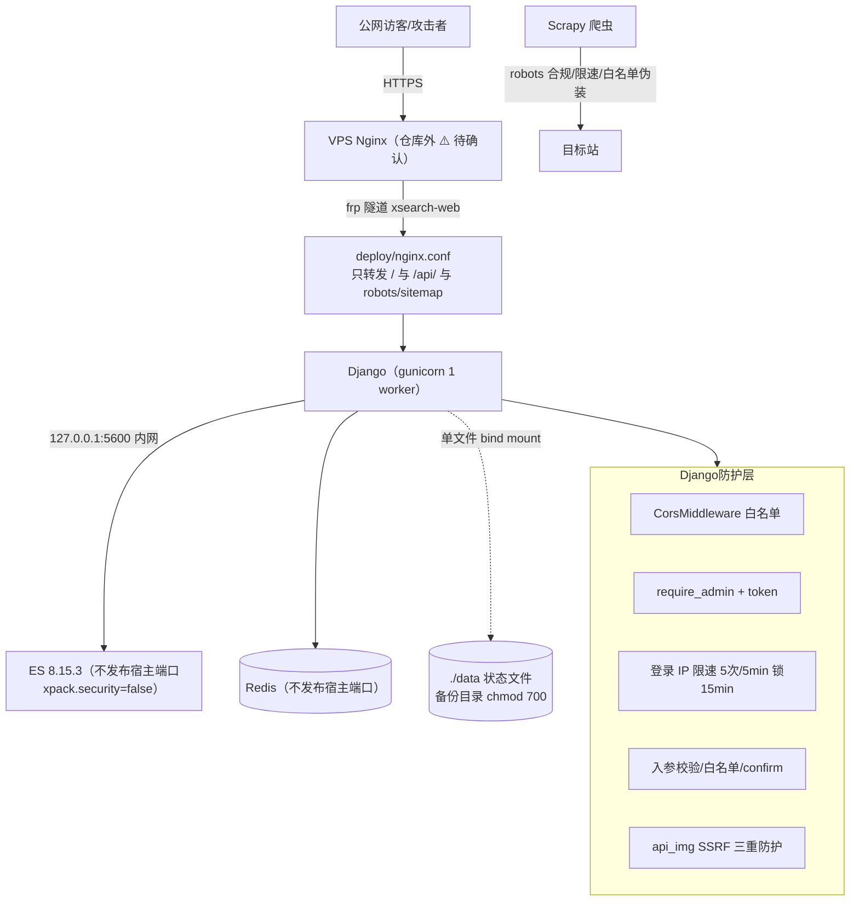

# XSearch 安全与权限设计

> 项目：XSearch ｜ 版本：v1.2 ｜ 生成日期：2026-10-06 ｜ 依据：源码分析

本篇是安全专项深读：旧篇中《01-系统架构》第五节用一段话概括了安全设计，本篇把"安全合规收口"（`README.md` 发布清单 + `AI升级说明.md` 第七节合规立场）逐项展开到源码证据级别，并诚实列出当前仍然敞着的门。攻击面按"谁能够到"分四层：**公网匿名访客**（读接口、登录接口、图片代理、SEO 出口）、**已登录管理员**（采集/数据管理写接口）、**爬虫目标站**（反向 feed/响应）、**内网与宿主**（ES/Redis/状态文件）。

## 一、安全模型总览

设计的总基调是**纵深防御 + fail-closed**：任何一层被穿透，下一层仍需独立攻破；而配置缺失时宁可拒绝启动也不带弱配置上线（`DJANGO_SECRET_KEY`/`DJANGO_ALLOWED_HOSTS` 两项，`xsearch/settings.py` 32-77 行）。

## 二、认证与鉴权

### 2.1 单层 token 模型的来历

鉴权只有一层：管理员 token。`api_views.py` 模块头注释记录了一段安全演化史：曾有第二层 `X-API-Token` 共享密钥，但它要生效就必须打进前端构建产物——"公开仓库里的 dist 等于把钥匙挂出去"，且所有受保护接口本来就已要求管理员登录，于是 2026-09 整体移除。`CrawlEndpointAuthTests.test_crawl_start_requires_admin` 甚至断言：只带已废弃的 `X-API-Token` 请求 `/api/crawl/start/` 也必须 401，防止这条旧通路回流。

### 2.2 token 生命周期与边界

| 属性 | 值 | 源码位置 |
|---|---|---|
| 签发 | `secrets.token_hex(32)`（64 位十六进制，256 bit 熵） | `api_admin_login` |
| 存储 | 进程内字典 `_admin_tokens`（token → 过期时间戳），不落盘 | `api_views.py` 96 行 |
| 有效期 | 12 小时（43200 秒），每次成功请求**滑动续期** | `_ADMIN_TOKEN_TTL` / `require_admin` |
| 吊销 | 登出即从字典弹出；进程重启全部失效（需重新登录） | `api_admin_logout` |
| 过期清理 | 校验失败路径顺带 `_purge_expired_tokens()`，防字典无界增长 | `require_admin` |
| 携带方式 | 请求头 `X-Admin-Token` | `require_admin` |

进程内存储是特性也是约束：README 明说"后端重启后需重新登录"，也因此 `Dockerfile` 强制 `gunicorn --workers 1`——多 worker 下 token 表互不可见，登录者一半概率 401。注释同时写明升级路径："扩容多 worker 前必须把计数外置到 Redis"。`require_admin` 是装饰器模式，包住了全部 16 个管理端点；所有管理端点一旦缺头/过期统一返回 401 + `code:"auth_required"`。

### 2.3 登录接口的暴力猜解防线

`api_admin_login` 叠了四道防线，按请求处理顺序：① **锁定前置检查**——`_login_locked_for(ip)` 先于密码比较执行，锁定期间"不再消耗比较成本，也不给爆破者反馈"（连错误信息都返回 429 而非 401）；② **常数时间比较**——账号与密码都用 `hmac.compare_digest` 逐字节比较，消除时序侧信道逐位猜解的可能；③ **按 IP 计数**——300 秒窗口内失败 5 次锁 900 秒，`Retry-After` 头告知剩余秒数；成功登录清零计数（`LoginRateLimitTests.test_success_clears_failure_window` 防正常用户被累积失败误锁），且锁定只作用于肇事 IP 本身（`test_limit_is_per_ip`）。④ **IP 取值受信策略**——`_client_ip()` 优先取 `X-Forwarded-For` 首段，理由写在注释里：真实链路是 frp → VPS nginx 反代，只看 REMOTE_ADDR 会把所有限速记到反代头上、限不到真实攻击者；代价是 XFF 可被客户端伪造，因此提供 `DJANGO_TRUST_PROXY_HEADER=False` 开关退回 REMOTE_ADDR，由部署者按代理链可信度决断。这个开关本身就是一处权衡记录：**限速的有效性 = 对代理链的信任度**，若公网入口不经过可信反代而该值保持 True，攻击者可轮换 XFF 绕过限速（见第九节隐患表）。

### 2.4 未配置即拒绝（fail-closed 的运行时形态）

`ADMIN_USERNAME`/`ADMIN_PASSWORD` 都为空时登录接口直接返回 503 并指路 `local_settings.py.example`——**不存在默认账号**，测试 `test_login_without_config_rejected` 固化了"503 而非 500"（配置缺失是服务侧问题，不该被监控当程序崩溃）。配套的软防线在 `apps.py._warn_insecure_config()`：口令长度 <10 或命中 9 个常见口令（admin/123456/password/qwerty 等）时启动日志告警——不能强行拦（拦了没人能登录），但要让弱点可见。账号本体治理：建议写在 `XSearch/local_settings.py`（`.gitignore` 收录、`exec` 进 settings 覆盖环境变量、`.dockerignore` 保证不进镜像分层）。

## 三、输入校验与注入面收口

Web 输入最终会流到三个高危去处：**命令行**（爬虫启动）、**ES 查询**、**文件系统**。逐一见招拆招：

| 危险去处 | 入口 | 防护 | 源码/测试证据 |
|---|---|---|---|
| 命令执行 | `POST /api/crawl/start/` 的 `spider` | 白名单字典 `SPIDERS`（5 键）查不到即拒绝；spider 名只作为参数传给 `scrapy crawl`，不进 shell（`subprocess.Popen` 列表形式，无 `shell=True`） | `crawl_manager.start` 286-288 行 |
| 路径穿越 | 同接口的 `resume_job` | `os.path.basename` 一致性 + 排除 `.`/`..` + `JOB_NAME_RE = [A-Za-z0-9][A-Za-z0-9._-]{0,79}` 全匹配 + 必须真实存在于 `jobs/` 下 | `ResumeJobValidationTests` 7 组恶意输入全拦 |
| ES 注入 | `api_search` 的 `source/days/sort` | `sort` 限 `_SORTS` 字典三键；`days` 限 `_DAY_VALUES`；`source` 作为 term 值本就是数据而非 DSL 结构 | `_SORTS`/`_DAY_VALUES` 常量 |
| ES `_id` 滥用 | `api_db_doc` 路径参数 | `_valid_doc_id`：非空、≤128 字符、无空白字符 | `test_doc_invalid_id_rejected` |
| 字段注入 | `PUT` 编辑文档 | `DB_DOC_EDITABLE_FIELDS = (title, content, tags, author)` 白名单取键，`url` 等不可编辑字段传了直接 400；标题非空校验 | `test_doc_update_rejects_non_whitelisted_fields` |
| 误操作 | `POST /api/admin/db/purge/` | `confirm` 必须与 `source` **逐字一致**；前端再叠一层手输来源名的 UI 约束 | `test_purge_confirm_mismatch_rejected` |
| 参数炸量 | 各接口数值参数 | `pages` 夹 1-20、`hours` 夹 1-168、`limit` 夹 1-200、`p` 非法回退 1 | 各视图 |
| cron 注入 | `api_schedule_add/update` | `_validate_cron` 三级校验（5 段 → `[\d*/,\-]+` 字符集 → `CronTrigger.from_crontab` 语义，拦"13 月"类越界） | `CronValidationTests` 4 例 |
| JSON 坏体 | 全部 POST/PUT | `json.loads(request.body or b"{}")` + `JSONDecodeError` → 400 | 各视图 |

值得说明的是设计取向：这里没有引入 DRF serializer 或表单体系，而是每个视图手写夹取与白名单——对一个 25 个视图的单文件 API 层，这种"就地显式校验"反而让每个端点的输入契约一眼可查；代价是规则分散、依赖测试兜底（见《09-测试与质量保障》）。

## 四、爬虫合规（对目标站的"安全"）

### 4.1 四条默认纪律

`crawler/settings.py` + `AI升级说明.md` 第七节构成合规四件套：**遵守 robots**（`ROBOTSTXT_OBEY = True`，2026-09-27 逐源核对：中新网/IT之家/Solidot 的 `User-agent: *` 组未禁 feed 与文章路径，aihot.news 明确 `Allow: /api/v1/`，抖音 robots 无 `*` 禁项）；**自报身份**（默认 UA `XSearchBot/1.0 (+https://github.com/zhangzhengyang27/XSearch)`，让站方能按 UA 放行或精准封禁）；**限速礼貌**（`DOWNLOAD_DELAY=1` + AutoThrottle 目标并发 2.0、上限 3 秒；AIHOT 两爬虫另设 2 秒间隔，注释核算"单次约 20 个请求，远低于 60 req/min 限额"；backfill 1.5 秒逐日抓存档）；**不碰红线**（不采集登录后数据、无验证码识别、无登录模拟——这三类模块曾在旧代码里存在，已移除并由测试防回流）。

### 4.2 唯一例外：指纹伪装收敛在白名单

`douyin_hot` 是诚实记录的张力点：抖音对诚实 UA 返回 444（nginx 层主动拒绝），取数依赖 Playwright 渲染 + `FINGERPRINT_HOSTS` 白名单内的整组浏览器指纹。收敛措施有三：白名单**默认只有抖音域名**，注释要求"新增条目 = 扩大风险面，动手前先确认该站真的拒绝常规 UA"；伪装在中间件层按点边界精确匹配域名（`evil-douyin.com` 拿不到伪装头，`test_suffix_lookalike_host_not_spoofed` 固化）；`CrawlerComplianceTests` 把"robots 开、身份报了、公开信源不被伪装、验证码/LLM 模块不得回流"全部写成自动化断言——合规约束不再依赖人的记忆，回归即失败。`AI升级说明.md` 第七节同时给出长期出路：下掉该源，或改用不依赖伪装的公开接口。

### 4.3 响应内容 hygiene

爬虫对"拿回来的东西"也有安全处理：`strip_html()` 整块删除 `script/style/noscript` 防播放器 JS 混入正文（三个测试用例覆盖成对标签、未闭合标签、实体反转义）；正文 5000 字符上限防超长文档撑爆 ES；`news_backfill` 标题截 300 字符。这些约束保证写入库的内容在后续被读接口吐给浏览器时，起点就是"近乎纯文本"。

## 五、SSRF 防线：图片代理三重防护

`api_img` 是全站唯一的"服务器替用户发请求"的端点，是 SSRF 的教科书入口，防护分三层：

1. **域名白名单按点边界精确匹配**：`host == h or host.endswith("." + h)`（`_IMG_HOSTS` 7 个豆瓣/B站图床域名）。注释点名了真实漏洞形态——`host.endswith("doubanio.com")` 会被 `evil-doubanio.com` 这类可注册域名绕过；带点前缀匹配则不会。
2. **URL 结构校验**：必须以 `http` 开头，且 `parsed.username`/`parsed.password` 存在即拒绝——防 `http://evil@doubanio.com` 类混淆攻击（userinfo 可以让"看起来合法的域名"实际解析到别处）。
3. **回源行为约束**：`allow_redirects=False`（白名单域名 302 跳内网即被切断）、`timeout=10`、单图 `Content-Length` 超 20MB 拒绝（413）、流式写盘。

缓存侧的配套约束：文件名 = `md5(url)` + 白名单内扩展名（`.jpg/.jpeg/.png/.gif/.webp`，其余强制 `.jpg`，防把可执行后缀写进磁盘），2000 文件上限按 mtime 淘汰一半。残留风险是诚实的：白名单域名自身若被注入恶意内容（如图床上的图片实为多态文件），`FileResponse` 按 Content-Type 回吐时由浏览器兜底——该端点只代理图床静态资源、不接受用户上传，风险可控但非零（⚠️ 未做图片魔数校验，记录于第九节）。

## 六、XSS 与内容安全

存储型 XSS 的攻击路径是"爬虫采到带脚本的内容 → 搜索页高亮渲染时执行"。三处防线：写入侧 `strip_html()`（见 4.3）；读取侧后端不做任何 HTML 清理、原样返回高亮片段（`` 包裹）；**前端渲染侧是最后一道也是决定性的一道**——`renderHighlight()`（`frontend/src/api.ts`）先把整段 HTML 做 `& < >` 实体转义，再仅把转义形态的 `` 还原为 `<mark class="kw">`。这意味着即使 ES 里的 `title` 存着 `<script>`，浏览器拿到的也是被转义的文本。Vue 侧所有插值默认转义，全站仅两处 `v-html` 且都经过 `renderHighlight`。配套细节：相邻 `<mark>` 合并处理 ES 中文单字高亮的碎片化，属于体验而非安全，但共用同一函数意味着安全路径不会被体验补丁绕开。

## 七、ES 与 Django 的暴露面（网络层）

### 7.1 端口策略与 Docker 网络隔离

两份 compose 的端口策略是整个安全模型里最硬的一层：

| 服务 | 开发态（docker-compose.yml） | 生产态（docker-compose.prod.yml） |
|---|---|---|
| Elasticsearch | `127.0.0.1:9200`（仅回环） | **不发布宿主端口**，仅 `xsearch` bridge 网络内可达 |
| Redis | `127.0.0.1:6379`（仅回环） | 不发布宿主端口 |
| backend | `8000:8000` | 不发布宿主端口 |
| frontend(nginx) | `8080:80` | `127.0.0.1:5600:80`（唯一入口，再经 frp → VPS Nginx → HTTPS） |

compose 注释原话点破前提："xpack.security 是关的，9200/6379 暴露到局域网等于把索引裸奔"。也就是说 **ES 的认证/授权被有意关闭（`xpack.security.enabled=false`），网络隔离是它唯一的安全层**：四容器同处一个自定义 bridge 网络，Docker bridge 网络天然与宿主其他网络隔离；ES/Redis 不发布端口后，宿主进程与同网络容器之外的任何人都够不到。发布清单把"ES 仅内网、切勿把 9200 暴露公网"列为独立检查项，正是承认这层一旦破（例如有人临时 `-p 9200:9200` 调试后忘了撤），认证层面无任何拦截。

### 7.2 nginx 转发规则即防火墙

`deploy/nginx.conf` 的 location 表决定了公网能打到 Django 的哪些路径：`/`（SPA 静态）、`= /index.html`、`= /robots.txt`、`= /sitemap.xml`、`/api/` 五组之外**一概不通**。效果：`/admin/`（Django admin，路由存在但未注册模型）、Django 静态文件、任何未列路径都到不了后端。README 发布清单与 `seo_views.DISALLOWED`（robots 层面再 Disallow 管理四路径）双重确认。管理接口的防护链因此是"nginx 不专开门 + `/api/` 统一放行 + Django `require_admin` 401"三层，其中最后一层是唯一强制层——nginx 的 `/api/` 转发是无差别放行，**绝不能把 nginx 当作管理接口的访问控制**。

### 7.3 信息泄露面收敛

探针语义分化是信息泄露治理的样本：`/api/stats/` 故障时降级 200 + `es_ok:false` + 截断 200 字符的 `es_error`（给站点访客看状态用）；`/api/health/` 作为公网探针**只回异常类名不回消息串**（`ConnectionError` 而非 "Connection refused by host http://10.0.0.7:9200 with auth secret-token"），`HealthEndpointTests.test_error_message_not_leaked` 用含 IP、端口、token 的假异常逐串断言不泄露。索引文档数在探针响应里只报告不判定（首部署未建索引不判死）。`/api/crawl/status/` 返回日志尾部含服务器绝对路径，因此必须是管理员接口（`CrawlEndpointAuthTests.test_crawl_status_requires_admin` 的注释点明此因）。

## 八、传输与 Django 安全开关

`xsearch/settings.py` 49-77 行在 `DEBUG=False` 时启用的生产项：`SECURE_PROXY_SSL_HEADER = ('HTTP_X_FORWARDED_PROTO', 'https')`（采信反代协议头，否则 sitemap/robots 生成 `http://` 链接收录价值归零）；`SESSION_COOKIE_HTTPONLY`/`CSRF_COOKIE_HTTPONLY = True`；`SECURE_CONTENT_TYPE_NOSNIFF`；`X_FRAME_OPTIONS='DENY'`。两处**有意不开**并留有注释：`SECURE_SSL_REDIRECT=False`（NAS 局域网还有 `http://…:5600` 直连入口，重定向会打断它）；HSTS 与 Cookie Secure 三行被注释掉（⚠️ 待确认——公网链路经 VPS Nginx 终结 HTTPS，若要全链路强制 HTTPS 应在 VPS Nginx 配 HSTS，该配置在仓库外）。API 本身无 Cookie 会话（token 走请求头），Cookie 安全项只影响 Django 框架设施，实际暴露面有限。所有写接口叠 `@csrf_exempt`：纯 token 鉴权无 Cookie 凭证可被 CSRF 利用，豁免是合理的，但前提是 token 永不落入 Cookie——当前实现满足。

## 九、已知隐患与加固建议（诚实清单）

| # | 隐患 | 证据/位置 | 影响 | 建议 |
|---|---|---|---|---|
| 1 | ES/Redis 无认证，网络隔离是唯一防线 | `xpack.security.enabled=false`（compose） | 任何能进 bridge 网络的进程可任意读写索引 | 启用 xpack basic auth 或至少给 Redis 设 requirepass；⚠️ 待确认 NAS 上共享 dev-stack 是否同网络 |
| 2 | `DJANGO_TRUST_PROXY_HEADER=True` 时限速可被 XFF 轮换绕过 | `api_views._client_ip` | 公网若直连 backend（不经可信反代），爆破者可伪造 XFF | 部署核对入口链路；不可信反代场景显式设 False |
| 3 | token 与限速计数进程内，重启即失效 | `_admin_tokens`/`_login_failures` | 可用性问题而非漏洞：重启后所有管理员需重登；多 worker 不可用 | 外置 Redis（与升级多 worker 同一工程） |
| 4 | 管理员口令明文存配置/环境变量 | `ADMIN_PASSWORD` 无哈希 | 配置文件泄露 = 口令泄露；备份脚本也原样拷 `.env` | 改存加盐哈希（如 PBKDF2）比对；备份目录 700 已做，但盘本身需物理安全 |
| 5 | 无登录审计与操作审计日志 | 管理写操作仅部分打 INFO（purge 有，db 编辑无） | 出事无法回溯"谁何时改了什么" | 统一审计日志行（IP+操作+对象） |
| 6 | 图片代理无魔数校验、无总量限速 | `api_img` | 白名单图床若被投毒可回吐多态文件；回源可被用于打图床 | 校验图片魔数；对单 IP 回源频率限速 |
| 7 | HSTS/Cookie Secure 未启用（注释态） | settings.py 57-61 行 | 降级攻击窗口依赖 VPS Nginx 自觉 | 在 VPS Nginx（仓库外）配 HSTS 并回填注释 |
| 8 | DEBUG 默认 True | `os.getenv("DJANGO_DEBUG", "True")` | 本机便利与生产误用一线之隔（生产 compose 已写死 False，手工部署可能漏） | 启动告警已有（apps.py），可再收紧为"非 localhost 绑定即拒绝 True" |
| 9 | 抖音源的伪装合规张力 | `AI升级说明.md` 第七节自述 | 公开仓库携带"针对特定站点伪装指纹"的代码，合规观感风险 | 评估下线该源或换公开接口（仓库文档已给出此建议） |
| 10 | 登出不清除其他会话/无 token 列表视图 | token 无标识不可管理 | token 丢失场景只能等 12h 过期或重启进程 | 可接受（单管理员场景）；多管理员前需改造 |

## 十、小结：这套安全设计的位置

把十节放在一起评价：XSearch 的安全设计在"单管理员、单机 Docker、公开只读内容站"这个定位内是**超配**的——它把通常只在大项目出现的机制（常数时间比较、SSRF 点边界匹配、探针信息收敛、合规测试固化、fail-closed 启动）都做齐了，且每一处都有注释记录"为什么"与"坏过什么"。它的边界也同样清晰：所有进程内状态方案（token/限速/互斥）在横向扩容那天全部要重做；ES/Redis 的裸奔依赖网络隔离单层防护；仓库外的 frp/VPS Nginx 是链路上唯一无法从源码审计的环节（⚠️ 待确认）。后续维护者应当把这十节当作"改动前自查清单"：任何触碰鉴权、输入、爬虫目标、网络端点的 PR，都应回到对应小节确认没有拆掉一道已修好的墙。
