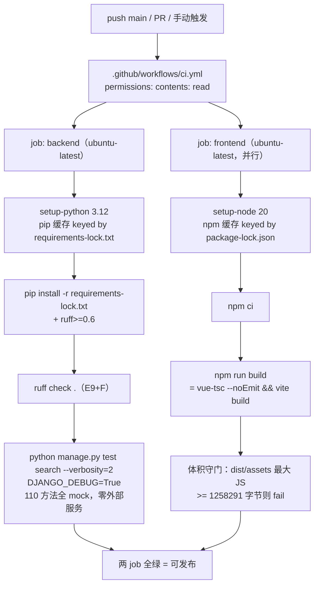

# XSearch 测试与质量保障

> 项目：XSearch ｜ 版本：v1.1 ｜ 生成日期：2026-10-06 ｜ 依据：源码分析

本篇是质量专项：拆解 CI 的两个 job 与 ruff 门禁的设计取舍，逐类清点 `XSearch/search/tests.py` 的 22 个测试类 / 110 个测试方法（README 正文写"85 条"为滞后数字，以源码为准），说明前端"构建期即测试"的两道闸，最后诚实列出测试缺口与补测路线。

## 一、质量门禁全景

CI 文件头一句注释点明定位："把发布清单里靠人自觉的两条变成机器把关"。整个 CI **不起任何服务容器**——测试全部 mock 外部依赖，因此两个 job 并行、总时长很短，这也是"测试必须 mock"这个约束换来的直接红利。

这个"零服务容器"的决策值得展开说一说。多数项目的 CI 会起一个真的 ES/Redis 跑集成测试，XSearch 反其道行之，理由藏在测试文件的写法里：被测单元全部围绕"纯决策逻辑"组织（参数怎么夹取、状态机怎么迁移、失败怎么降级），外部依赖只以"返回什么形状的数据"的身份存在，因此 mock 一个字典形状就足以驱动全部断言。这样换来的代价是第七节列出的"无集成测试"缺口，换来的收益则是：CI 不需要 Docker、不需要镜像拉取、不因 ES 启动慢而 flaky，任何人在本机裸 Python 环境十秒内可复现全部绿灯。对一个以"个人可运维"为约束的项目，这是一笔划算的交易。

## 二、backend job 详解

五个步骤依次为：`actions/checkout@v4`；`actions/setup-python@v5`（Python 3.12，pip 缓存以 `XSearch/requirements-lock.txt` 为依赖键——锁文件一变缓存即失效）；安装依赖（步骤注释："与镜像构建用同一份锁定依赖：CI 通过 ≈ 镜像里也是这套版本"，这是对"CI 绿、镜像里红"漂移的预防）；`ruff check .`（在仓库根执行，作用全部 Python 源码）；`python manage.py test search --verbosity=2`（working-directory 为 `XSearch/`，环境变量 `DJANGO_DEBUG: 'True'`——测试态用开发密钥即可，生产 fail-closed 逻辑不因此受影响）。

本地等价命令：`cd XSearch && python manage.py test search`。测试文件 `search/tests.py` 共 1398 行，22 个类 110 个方法，运行不需要 ES/Redis/SMTP。测试对进程内状态有两条纪律：`_admin_tokens` 与 `_login_failures` 在每个相关类的 `setUp` 里显式清空（注释解释：限速计数不清会让前面的失败用例把后面的登录打成 429）；`AdminDbTests` 直接注入未过期 token 而不走登录流程，减少耦合。

## 三、ruff 门禁（E9+F）的设计取舍

`ruff.toml` 全文只有 14 行，却是一份明确的态度声明：`select = ["E9", "F"]`——E9 是语法/致命错误（如缩进崩溃），F 是 pyflakes（未定义名 F821、无用导入 F401、未使用变量 F841 等）。`line-length = 120`；`extend-exclude` 排除 `frontend/node_modules`、`frontend/dist`、`XSearch/static`；`per-file-ignores` 给 `XSearch/manage.py` 与 `XSearch/search/admin.py` 豁免 F401（Django 脚手架的模板导入）。

配置注释解释了为什么刻意**不**启用风格类规则集（E/W/I/UP 等）："对一个 6.5k 行的既有代码库做批量风格改造，风险（踩碎隐式契约、淹没真实 diff）远大于收益。要收紧再逐条加。"这是存量代码库接入 lint 的成熟策略：先让机器挡住"真错误"（这类错误在运行时才炸、且往往炸在生产），风格统一留给重构窗口期逐条启用。代价也要说清楚：ruff 门禁抓不住逻辑错误——逻辑防线完全压在 110 个测试方法上，这正是两者必须同时存在的原因。

## 四、110 个测试方法逐类分布

| # | 测试类 | 数量 | 被测对象 | 代表断言 |
|---|---|---|---|---|
| 1 | `ApiSearchTests` | 3 | `api_search` | 空词不调 ES；非法页码回退 1；source 筛选走 `post_filter` |
| 2 | `ApiSuggestTests` | 2 | `api_suggest` | 空前缀返回 `[]`；ES 挂降级 `[]` 不抛 500 |
| 3 | `ApiStatsTests` | 1 | `api_stats` | ES/Redis 双挂仍返回结构化 `es_ok:false` |
| 4 | `CorsMiddlewareTests` | 4 | `CorsMiddleware` | 白名单 Origin 得响应头；evil.com 无头；PUT/DELETE 在预检放行；OPTIONS 短路不进视图 |
| 5 | `ApiRankingsTests` | 5 | `api_rankings` | news 分支 terms+时间倒序+分页；缓存命中跳过 ES；榜单分支 rank 升序；非法 source 400；AI 三源合法 |
| 6 | `AdminAuthTests` | 5 | 登录/token | 登录成功 token 可用；错密码 401；未配置 503；无 token 401+auth_required；登出吊销 |
| 7 | `AdminDbTests` | 10 | 数据管理 | overview 聚合形状；docs 来源过滤+分页；字段白名单 400；空标题 400；改标题/改作者重建 suggest；非法 id 400；purge confirm 不一致拒绝且不触发删除；purge 残余补删累计 13 条 |
| 8 | `CronValidationTests` | 4 | `_validate_cron` | 合法表达式通过；段数错；字符非法；"0 25 * * *" 语义越界 |
| 9 | `NewsRssStripHtmlTests` | 3 | `strip_html` | script 块整删；未闭合 script 删；实体反转义 |
| 10 | `CrawlEndpointAuthTests` | 4 | 采集接口鉴权 | 匿名/X-API-Token 一律 401；admin token 即可用 schedule 写接口；status 匿名不可读；合法 token 202 阳性对照 |
| 11 | `LoginRateLimitTests` | 3 | 登录限速 | 第 5 次失败后 429+Retry-After；成功清零计数；限速按 IP 隔离 |
| 12 | `ResumeJobValidationTests` | 2 | `CrawlManager.start` | 7 组穿越/绝对路径全拒；格式对但不存在报"找不到" |
| 13 | `CrawlerComplianceTests` | 8 | 爬虫合规 | robots 开+身份报；伪装仅限抖音白名单；非白名单域名发诚实 UA；evil-douyin 不被伪装；空白名单禁用伪装；验证码/LLM 模块不得回流；人民网源前后端一致移除 |
| 14 | `CrawlStateTransitionTests` | 7 | 采集状态机 | 无人轮询也落终态（本次改动的正身）；0 条记 empty+告警；非零退出记 failed+告警；start 收割上一轮；僵尸 running 改判 interrupted；活进程不误判；原子写后主文件可解析 |
| 15 | `SchedulePersistenceAlertsTests` | 14 | 定时任务持久化 | add 落盘+阳性返回；写失败回滚不假装成功；`_save` IO 错误告警不抛；toggle 如实报告"重启后回旧值"；损坏文件备份 `.corrupt-*`+告警；`.tmp` 检查点在场且主文件可解析；主文件坏从 `.tmp` 恢复；misfire_grace/coalesce/max_instances 参数断言；注册失败可见化；MISSED/ERROR 事件进历史+告警；trigger 回写 last_fire；`_pid_alive` 三态语义 |
| 16 | `NotifyTests` | 7 | 告警模块 | 未启用 no-op；配置解析收件人/默认 host；缺密码一次性降级；SSL 会话+`[XSearch]` 主题前缀；SMTP 失败不抛；同 key 冷却拦截；冷却过期放行 |
| 17 | `HealthEndpointTests` | 5 | `api_health` | 双依赖 up 200+docs 数；ES 挂 503（旧探针教训）；Redis 单挂也 503；异常消息不泄露 IP/端口/token；索引缺失不判死 docs=None |
| 18 | `DateDisplayTests` | 5 | `_display_date` | UTC 16 点分界归北京次日；naive 串按 UTC；带偏移串尊重原时区；datetime 对象；脏数据退回截断不抛 |
| 19 | `TzAwareWriteTests` | 2 | 写入侧时区 | `utc_now()` aware 且零偏移；**扫源码**断言 create_date/crawled_at 赋值无裸 `datetime.now()` |
| 20 | `DocDetailTests` | 6 | 详情契约 | 全文不截断+时区换算；404 not_found；ES 挂 503 非 500；按标题猜文的 `api_ai_item` 不得回流；两类列表都带 id；搜索结果带 id |
| 21 | `SeoTests` | 5 | robots/sitemap | robots Disallow 四管理路径+指 sitemap；sitemap 栏目+AI 详情+lastmod；只列存在页（AI 三源）；ES 挂降级栏目页 200；缓存命中不碰 ES |
| 22 | `HeadlinesTests` | 5 | 要闻聚合 | 同题两源只留一条；must_not 榜单+36h 窗口；hours 夹取 168/非法回 36；ES 挂 503；缓存命中跳 ES |

合计 110 个方法。分布反映的优先级一目了然：**持久化与状态机（14+7=21 个）与合规/鉴权（8+4+5=17 个）是测试密度最高的两块**——它们恰是"坏了会静默出错"或"坏了会出安全事故"的区域；纯查询形状类测试（1/2/3/5 号类）数量少而精，重点在降级行为而非查询语法。

## 五、测试基建的三件套

`tests.py` 705-751 行有三个可复用的基建，是读懂状态机类测试的前提。**`_FakeProc`**：替身爬虫子进程，测试用 `finish(code)` 决定它何时退出、退出码多少，`poll()/wait()` 与真实 `Popen` 同构——有了它，`CrawlStateTransitionTests` 才能在毫秒级验证"盯梢线程醒来收尸"而不真跑爬虫。**`TempStateMixin`**：把 `HISTORY_FILE`/`SCHEDULE_FILE`/`LOG_DIR`/`JOBS_DIR` 四个模块常量 patch 到 `tempfile.TemporaryDirectory`，并 patch 掉 `search.notify.notify`——注释写明"绝不碰仓库里的真文件""测试不许真的发信"。**mock 纪律**：所有 ES/Redis 依赖 `patch('search.api_views.client')` 级别打桩；`HeadlinesTests._call` 里专门给 `zrevrangebyscore` 设了返回值，注释解释"不设的话 mock 会把 MagicMock 塞进 top_keywords，测出来的是 mock 形状问题而不是业务问题"——这是 mock 测试的经典陷阱防范。

测试还有一个非常规手段值得单独点名：`TzAwareWriteTests.test_no_naive_now_in_stored_date_fields` 用 glob 扫 `crawler/**/*.py` 源码、正则匹配 `create_date/crawled_at` 赋值行中不得出现裸 `datetime.now()`——**用测试固化"写侧时区纪律"这条编码规范**，任何回退都会在 CI 红灯。同样，`CrawlerComplianceTests.test_captcha_and_llm_modules_removed` 用 `importlib.util.find_spec` 断言已移除模块不存在——防"删除的代码悄悄回流"。

把 110 个方法的 docstring 扫一遍还能读出一份"事故档案"：几乎每个高风险测试的中文注释都在讲一个曾经的故障——"旧探针打 /api/stats，ES 挂了容器永远 healthy""生产是单文件 bind mount，rename 必然 EBUSY，采集历史一次都没写成过""旧实现就是这里让 cron 悄悄消失的""没有人调 status()/history() 也必须落终态——这是本次改动的正身"。这套注释的价值观与《05-核心流程》总结的防御性编程一脉相承：**测试不是覆盖率数字，是故障的化石记录**。新维护者读测试的收益因此高于读实现——先看断言就知道每个模块"坏过什么形状"，再去看实现里对应的防线，理解成本反而更低。

## 六、前端两道闸：类型检查与体积守门

前端没有单测框架（package.json 无 test 脚本、无 vitest/jest 依赖），构建期质量由两道闸保证。值得先说明的是这个"无单测"并非疏漏的省钱，而是有意识的范围裁切：前端 9 个页面里 7 个是"一接口一列表一空态"的薄组件，交互逻辑集中在三个纯函数（`parseDaily`/`renderHighlight`/URL 序列化）与两处状态机（SearchView 的 URL watch、CrawlView 的自适应轮询）——组件级测试对薄组件只能测出 Element Plus 的行为，性价比极低。因此裁切的方向是"测纯函数、不测组件"，这也决定了第七节补测建议里前端项的形态。两道闸如下。**第一道是 `vue-tsc --noEmit`**：`npm run build` 脚本为 `vue-tsc --noEmit && vite build`，类型检查失败即构建失败，CI 与本地同一行为；tsconfig 开 strict 全套加 `noUnusedLocals`/`noUnusedParameters`。它事实上充当了"契约测试"：`api.ts` 的 interface 与后端响应字段一一对应，后端改字段名/类型，前端构建立刻红——这是前后端分离项目里成本最低的契约守护。

**第二道是 CI 的产物体积守门**：`npm run build` 后取 `dist/assets` 下最大的 `.js` 文件，若不小于 1258291 字节（精确的 1.2MB = 1.2 × 1024 × 1024）则 job 失败，错误信息直指病根——"包体膨胀超过 1.2MB，检查是否又丢了路由懒加载"。这个阈值不是拍脑袋：`main.ts` 注释记录了病史——此前 9 个视图静态 import 打成单个 1.1MB chunk，全量懒加载改造后单 chunk 显著缩小，守门线定在 1.2MB 允许正常增长、但"退回单 chunk"这种量级回归必被拦截。守门实现只有两行 shell（`find ... -printf '%s\n' | sort -n | tail -1` + `test`），没有引入任何工具依赖。

frontend job 另有一个运维备注：`npm ci` 依赖 `package-lock.json`，而 lock 的 resolved 指向 npmmirror，CI 拉取失败时注释给出预案（改官方 registry 重锁）。`frontend.Dockerfile` 用的是 `npm install` 而非 `npm ci`，与 CI 行为存在刻意的/无意的差异（见《13-技术债务与演进建议》）。

## 七、测试缺口与补测建议

诚实地按"风险 × 现状"列缺口：

| # | 缺口 | 现状证据 | 风险场景 | 补测建议 |
|---|---|---|---|---|
| 1 | 爬虫解析函数覆盖薄 | 仅 `strip_html` 有 3 例；`douyin_hot._parse_hot_list`、`aihot_news.parse_daily/_parse_item`、`aihot_hot.parse_story`、`news_backfill.parse_day` 均无测试 | 目标站改版/字段更名时，`empty` 只能事后被告警发现 | 用固化的页面文本/JSON 样本做纯函数单测（全部是"文本进、dict 出"的无副作用函数，成本极低）；`_parse_hot_list` 尤其值得——前 3 名无排名的解析逻辑最脆 |
| 2 | `index_item` 无测试 | `crawler/pipelines.py` 零覆盖 | `_id` 生成、字段回退链、数值清洗回归会静默改变去重语义 | mock `QuoteDocument.save`，断言 `_id` 优先级与字段清洗 |
| 3 | 无 ES 集成测试 | 110 个测试全 mock | mapping/分词/聚合的真实行为（IK 停用词效果、post_filter 分面）从未在 CI 验证 | 可选方案：testcontainers 或 compose profile 起一次性 ES，标记为 nightly 而非 PR 门禁，兼顾速度 |
| 4 | 前端零单测 | 无框架 | `parseDaily`、`renderHighlight`、`pushUrl` 序列化这类纯函数全靠手测 | 引入 vitest 只测三个纯函数即可覆盖最容易回归的部分；不必追求组件测试 |
| 5 | 无 E2E | 无 | 登录→启动采集→状态回写这类跨层链路无自动验证 | 可用 Playwright（依赖已有）写 2-3 条烟囱用例，同样放 nightly |
| 6 | `api_img` 无测试 | `api_views.py` 该函数无用例 | SSRF 三重防护回归 = 安全事故 | 高优先级：mock requests，断言白名单边界（evil-doubanio）、userinfo 拒绝、20MB 上限、重定向不跟随 |
| 7 | `_did_you_mean`/纠错链分支无直接测试 | 依赖 `ApiSearchTests` 间接覆盖 | 两级纠错顺序/标记（corrected vs fuzzy）回归 | mock client 依次返回空/建议词，断言响应标记 |
| 8 | 通知/告警与 Django 启动钩子联动 | `apps.py.ready` 无测试 | `RUN_MAIN` 判断回归会导致 runserver 双调度器 | `override_settings` + mock `start_scheduler` 断言调用与否 |

补测路线建议按"安全 > 数据契约 > 解析函数 > 集成"排序：第 6 项（api_img）应最先补，因为它是已有安全设计却无回归保护的唯一高危点；1/2 项次之，成本低收益高；3/5 项作为 nightly 层补上，不影响 PR 门禁速度。执行 `python manage.py test search` 时可用 `--verbosity=2` 逐类核对数量是否仍为 110，新增测试请同步更新本篇第四节表格与 README 的滞后数字。

## 八、可测性设计的经验沉淀

110 个测试能全部做到"零外部依赖、毫秒级运行"，不是测试写得好这么简单，而是**被测代码本身按可测性组织过**。四条经验值得在扩展时延续。

**第一，决策逻辑与副作用分离**。最值得测的函数全被刻意写成了纯函数：`strip_html`（文本进、文本出）、`news_rss.parse_date`（字符串进、datetime 出）、`douyin_hot._parse_hot_list`（页面文本进、榜单 dict 出）、前端的 `parseDaily` 同理。它们的测试不需要 mock 任何东西——`NewsRssStripHtmlTests` 三行断言就是全部成本。反过来，副作用（写 ES、发邮件、起进程）全部被推到管道、notify、CrawlManager 的边界方法里，mock 面收敛到一处。

**第二，依赖经参数或类属性注入**。`EsArticlePipeline.from_crawler` 从 settings 读连接信息而非模块顶部硬连；`CrawlManager` 把四个路径常量放在模块级（`HISTORY_FILE` 等），测试用 `patch.object` 逐个替换到临时目录——模块级常量在 Python 里恰好是最容易被 patch 的形态，这是"全局变量"在测试语境下的意外优点。`BrowserFingerprintHeadersMiddleware` 构造函数直接收 hosts 元组，测试绕过 Scrapy 引擎直接实例化中间件验证域名边界。

**第三，时间与随机可控**。限速窗口、token 过期、misfire 宽限全部依赖 `time.time()` 与注入的时间戳，测试用真实时间 + 短窗口（5 秒等待盯梢线程）或直接构造过期值（`notify._recent['k'] = time.time() - _COOLDOWN - 1`）驱动；唯一用线程的 `NotifyTests` 用 `threading.Event` 等"后台线程确实发了信"而非 sleep 猜时长——`done.wait(5)` 的写法既不 flaky 也不拖慢。

**第四，断言形状而非 mock 次数**。状态机类测试的最后一步总是回到"读落盘文件、验 JSON 内容"（`read_history()`），即验证的是**对外的真实可观测效果**（文件里写了什么），而不是"内部方法被调了几次"。调用计数断言只在"防误触发"场景使用（如 `mock_client.search.assert_not_called()` 表达"缓存命中就不该打 ES"这个业务语义）。这个取向让测试在重构实现时存活率高——只要落盘契约不变，内部怎么改测试都不红。

给扩展者的操作建议：新增功能时先问"我的决策逻辑能不能抽成纯函数、副作用能不能收敛到一个边界方法"——能做到，《09》第七节的补测清单里对应的测试就只需要几行；做不到，先重构再写测试，不要把 mock 编排得比业务还复杂。
