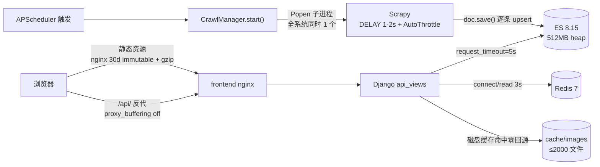

# XSearch 性能设计与优化

> 项目：XSearch ｜ 版本：v1.1 ｜ 生成日期：2026-10-06 ｜ 依据：源码分析

本篇是性能专项：把系统四个环节（ES 查询、爬虫采集、Django 服务、前端加载）里**已经做对的设计**逐一指认到源码，再给出有依据的优化建议。XSearch 的性能定位是"单机、个人可运维、日均数十万级文档"的资讯检索站，因此这里的取舍标准不是极限吞吐，而是**延迟可预测、资源占用可预算、慢路径有缓存兜底**。

## 一、请求链路与时延预算

按源码常量可推的时延预算：ES/Redis 客户端超时分别 5s/3s（`api_views.py` 59-61 行），即最坏情况下一个走满缓存的公开读接口也会在秒级返回而非挂死；gunicorn `--timeout 120` 兜住图片代理回源（10s 超时）与慢查询；前端搜索接口正常路径 = 1 次 ES 查询（带高亮+聚合），纠错路径最多 3 次（主查询 + phrase suggest + 模糊重搜），全部发生在"0 结果"这一少数分支。

## 二、ES 查询性能

### 2.1 分词设计：检索噪音即性能问题

`crawler/pipelines.py` 的 mapping 是性能设计的第一现场：`title/content/tags` 建索用 `ik_max_word`（细粒度切分最大化召回）、检索用 `ik_smart` + 自定义停用词过滤器。注释解释了停用词的性能动机："IK 会把'的/了/是'切成独立词元，OR 语义下命中几乎所有中文文档"——这不仅是相关性问题：海量低质命中意味着每次查询要打分、排序、聚合更多文档。停用词表 `CN_STOPWORDS` 收录约 50 个高频虚词，在检索侧过滤掉它们等于把长尾查询的候选集压缩了一个量级。配套的 `minimum_should_match: "2<80%"` 让多词查询要求 80% 词元命中，进一步约束候选集；模糊重搜时才放宽到 `2<50%`（`api_search._run_search`）。

### 2.2 高亮与聚合的开销控制

`_HIGHLIGHT` 只对 `title/content` 两个字段做高亮（`fragment` 等参数用 ES 默认），中文单字高亮碎片化由前端 `renderHighlight` 合并相邻 `<mark>` 解决而非后端 `fragment_size` 调优——把字符处理成本移到浏览器。聚合定义 `_FACET_AGGS` 固定两桶：`facet_sources` terms size 20（注释：来源已超 10 个，放宽到 20）、`facet_days` date_range 三档累计口径（近 30 天桶包含近 7 天，一次聚合同时服务三个筛选按钮）。`api_stats`/`api_db_overview` 的来源聚合都是 `size=0` 的 match_all——**聚合查询不带任何命中文档回传**，这是 ES 聚合开销最低的形态。

### 2.3 分页策略与已知天花板

所有分页都是 `from_ + size` 的浅分页：搜索 10 条/页、管理浏览 20 条/页、榜单一次 `size=300`（注释：榜单是"当前状态"全集，抖音 50 条/AI 热点 10 条，300 足够）。`from + size` 在 ES 有 10,000 条的默认窗口上限（`index.max_result_window`），对"资讯搜索翻前几页"的场景永远够用，但意味着**不支持跳转到千页以外**——真要深翻（如爬虫式遍历全库）应换 `search_after`。分页空页问题（ES total 估算偏差）的处理是在服务端向前逐页试探（`api_search` 380-392 行），最坏情况一次请求触发多页查询——`p` 很大且库里文档稀疏时这个循环可能跑多次 ES 查询，属于已知的可接受慢路径（前端也镜像了同样修正兜底）。

### 2.4 读路径缓存

缓存体系是本项目性能设计的核心杠杆：同样的 ES 查询在"冷"与"热"之间的成本差两个数量级，而缓存命中与否对调用方完全透明。四类缓存的键、TTL 与失效策略如下，其中"失效联动"一列是数据一致性工程里最容易被漏掉的部分——`api_db_purge` 清理来源后精确删除新闻列表缓存（含聚合键）就是为了让"清空该来源"在 60 秒内对前端生效，而不是等 TTL 自然过期给用户看"删了还在"的幽灵数据。

| 缓存 | 键 | TTL | 失效策略 |
|---|---|---|---|
| 要闻 | `headlines:{hours}` | 120s | 自然过期 |
| 新闻列表 | `rankings_news:{source}:p{page}` | 60s | purge 来源时 `scan_iter` 精确删除（含聚合键 `rankings_news:news:p*`） |
| sitemap | `sitemap:{base}` | 3600s | 自然过期 |
| 热搜词 | `search_keywords_set` zset | 无 | 每次 `zincrby` 后裁剪前 100 |

缓存读写全部 try-except 包裹——"Redis 不可用只是少了缓存，不影响出结果"。这个设计把 Redis 定位成**纯加速层**：挂掉时 ES 独自承压但系统仍正确。搜索结果本身**没有**缓存（每次真查 ES），是因为查询组合（q/source/sort/days/p）基数太高，缓存命中率不可预期——这是有意的取舍而非遗漏。

## 三、爬虫采集吞吐与限速

### 3.1 限速参数全景

| 爬虫 | DOWNLOAD_DELAY | 额外约束 | 单轮规模估算 |
|---|---|---|---|
| `news_rss` | 1s | RSS 轻量接口 | 3 feed + 中新网文章页跟进，分钟级 |
| `news_backfill` | 1.5s | 逐日 1 请求，404 静默跳 | 180 天 = 180 请求 ≈ 4.5 分钟 |
| `aihot_news` | 2s | 429/503 主动放弃 | 精选 ≤6 页 × 50 条 + 3 期日报 ≈ 10 请求 |
| `aihot_hot` | 2s | 同上 | 1 + 10（story 跟进）≈ 11 请求 |
| `douyin_hot` | 2s | Playwright 渲染等 5s | 1 请求，30-60 秒（AI升级说明.md） |

全局层 `AUTOTHROTTLE_ENABLED=True`、`TARGET_CONCURRENCY=2.0`、`MAX_DELAY=3`：AutoThrottle 按响应延迟动态调节每个站点的下载间隔，与静态 DELAY 叠加后实际并发极低——这是"礼貌优先于吞吐"的显式选择。`PlaywrightFallbackMiddleware` 刻意保留 `download_slot`，保证降级直连的请求仍受同一限速槽约束（合规不因异常路径打折）。

### 3.2 吞吐的结构性天花板：单任务互斥与逐条写入

两个结构性约束决定了采集吞吐上限。**第一，全系统同时最多一个采集任务**：`CrawlManager` 的进程内 RLock + `_proc.poll()` 互斥，定时触发撞上手动触发只记 `skipped`。对"每天几个 cron 错峰跑"的运营节奏这是正确设计（避免了双爬虫同写 ES 的争用），但意味着 180 天回填任务启动后，其他爬虫只能排队。**第二，入库是逐条 `doc.save()`**：`pipelines.py` 模块注释自己点名"大规模生产建议改批量写入"——elasticsearch-dsl 每条 save 一个 HTTP 请求，千条级别的 backfill 是千次往返。在有 `DOWNLOAD_DELAY=1.5s` 的限速下入库不是瓶颈（爬取间隔远大于单次写 ES 延迟），但若未来放开限速或换 bulk 抓取，这里会第一个成为瓶颈。

### 3.3 JOBDIR 的磁盘开销

每次启动都创建 `jobs/{spider}_{ts}` 目录持久化请求指纹与队列（`requests.seen`/`spider.state`/`requests.queue`），成功后由 `_cleanup_job_dir` 删除、失败保留供恢复。对大规模回填（几十万 URL 指纹）这会是可感知的磁盘占用；`list_resumable_jobs` 返回 `size_kb` 字段正是为运维观察这个开销准备的。

## 四、Django 服务的性能面

### 4.1 单 worker 的真实含义

`gunicorn --workers 1` 是可用性/一致性约束（token、互斥锁、调度器都是进程内状态），性能上它意味着：**所有请求共享一个 Python 进程与 GIL**。本项目的请求画像救了它——公开读接口都是"等 ES/Redis IO"型，单 worker 在 IO 等待间隙即可服务其他请求；真正吃 CPU 的只有 `renderHighlight` 之类的轻量处理（在前端）。两个配套设计把"单 worker 被拖死"的风险降到最低：`notify.py` 坚持后台守护线程发信，注释原话"SMTP 抖动会拖死唯一的工作线程（gunicorn --workers 1，且该线程同时是爬虫互斥锁的持有者）"；盯梢线程 `_watch_exit` 阻塞在 `proc.wait()` 上而非轮询 sleep，子进程退出即刻收尸且不占请求路径。

### 4.2 连接与超时的预算

ES 客户端 `request_timeout=5, retry_on_timeout=False`（快速失败优于长挂）；Redis `socket_connect_timeout=3, socket_timeout=3`。这两组数字决定了依赖故障时接口的**最坏响应时间有上界**：ES 挂时读接口 5 秒内返回 503（配合 nginx `proxy_read_timeout 300s` 不会提前断连），Redis 挂时 3 秒后走无缓存路径。`api_img` 回源 `timeout=10, stream=True` + 20MB 上限 + 流式写盘，防大图占内存。

### 4.3 图片代理的磁盘缓存

图片缓存是后端唯一的"本地内容分发"层：MD5 文件名、命中直接 `FileResponse` 零回源、`Cache-Control: public, max-age=30d` 让浏览器/中间层也缓存；容量治理双管齐下——文件数上限 2000，超限按 mtime 淘汰最旧一半，且淘汰只在 1% 的回源请求上触发（`random.random() < 0.01`），把目录扫描成本摊薄到不可感知。写入用临时文件 + `os.rename` 原子改名，并发回源同一图片不会写坏缓存。

## 五、前端加载性能

前端加载的设计密度集中在 `main.ts`、`vite.config.ts`、`deploy/nginx.conf` 三处：

1. **路由级懒加载**：10 条路由全部 `() => import(...)`，把首屏 JS 与管理页代码（DbAdminView/CrawlView 是最重的两个视图）拆开。CI 的 1.2MB 单 chunk 守门防这个优化被回退（见《09-测试与质量保障》第六节）。
2. **缓存策略分层**：`index.html` 强制 `no-cache, must-revalidate` + 关 etag——因为懒加载 chunk 文件名带 hash，浏览器缓存旧 index.html 后引用已不存在的旧 chunk 会白屏（nginx.conf 注释原话）；`js|css|图片|字体` 后缀 `expires 30d` + `Cache-Control: public, immutable`——hash 文件名内容永不变，可无限缓存；`gzip on` + `gzip_min_length 1024` 覆盖文本类类型。Element Plus 是整库引入（`import ElementPlus` + 全量 CSS），这是当前包体的最大组成——按需引入是最大的一块可优化空间（见第七节）。
3. **运行时自救**：`router.onError` 对 chunk 加载失败整页重载（sessionStorage 限 10 秒一次），发版后旧标签页不会白屏卡死。
4. **请求侧纪律**：搜索/补全的竞态序号（`searchSeq`/`suggestSeq`）+ 250ms 防抖，避免了"快速输入触发请求风暴 + 旧响应覆盖新结果"的双重浪费；管理页轮询自适应间隔（运行 2s/空闲 8s），页面切走 `onUnmounted` 清定时器。

## 六、优化建议清单（按性价比排序）

| # | 建议 | 依据 | 预期收益 | 代价 |
|---|---|---|---|---|
| 1 | Element Plus 按需引入（unplugin-vue-components + unplugin-auto-import） | 整库 import 是当前 chunk 主体 | 首屏体积预计降 30-50%，1.2MB 门限可同步下调 | 构建配置改动 + 全页面回归 |
| 2 | 爬虫入库换 `elasticsearch.helpers.bulk` | pipelines.py 注释自认 | 大批量回填（backfill 万条级）入库时间从分钟级到秒级 | 管道改造 + 失败重试语义需重写 |
| 3 | `/api/search` 结果缓存（同参数 30-60s） | 搜索是唯一无缓存的公开读接口 | 热词重复搜索的 ES 负载趋近于零 | 缓存键基数问题需评估（可只缓存第 1 页） |
| 4 | ES `index.refresh_interval` 采集窗口调大（如 30s） | 默认 1s 刷新为近实时服务，采集型负载不需要 | 索引段更少、查询与合并开销下降 | 管理页看到新文档的延迟变长（purge 已有显式 refresh 兜底） |
| 5 | 深分页换 `search_after` | `from+size` 万条窗口上限 | 支持全库遍历类需求（当前无此需求，属前瞻） | 接口契约变化 |
| 6 | ES JVM heap 512MB → 按数据量评估上调 | compose 写死 `-Xms512m -Xmx512m` | 百万级文档 + 更大聚合时避免 GC 抖动 | 内存预算上调（当前 1-2GB 机器即可跑的优势会减弱） |
| 7 | 搜索接口 HTTP 连接池复用确认 | elasticsearch-py 默认连接池即复用，需确认容器内无代理干扰 | 每请求省 TCP 握手 | 近零 |
| 8 | 热搜词 zset 裁剪频率优化 | 每次搜索都 `zremrangebyrank` | 微小；可改采样裁剪 | 不建议动（语义简单比微优化值钱） |

反方向的告诫同样重要：不要给 `news_backfill` 提速（1.5 秒间隔是对中新网的礼貌承诺）；不要给榜单接口加缓存外的并发优化（size=300 一次拉全已是 O(1) 查询）；不要在单 worker 前提下引入任何请求路径上的同步外部调用（SMTP 的教训已写在 notify.py 注释里）。性能优化的每一步都应回到《09-测试与质量保障》补对应回归，尤其是 2/3/4 三项会改变可观测行为（入库统计、响应来源、数据可见延迟）。

## 七、性能观测的现有入口

动手优化之前先知道"现在的数字从哪看"。项目没有引入任何 APM 或指标系统，但自带的观测点已覆盖主干：**采集侧**，每次爬虫结束的日志尾部有 Scrapy 官方统计（`item_scraped_count`、`response_status_count`、耗时），管道自记的 `es_saved`/`es_skipped` 计数与 `aihot/ratelimited` 也在同一份 dump 里——入库率与被限流次数是采集侧最该盯的两个数；**服务侧**，`/api/health/` 的 `index.docs` 给出文档量趋势，`/api/stats/` 的 `by_source` 给出来源分布变化，ES 自带 `_stats` API 可看查询缓存命中与段合并压力（`docker exec xsearch-es curl localhost:9200/quotes/_stats`）；**前端侧**，CI 的体积守门输出每次构建的最大 chunk 字节数，是最朴素却最有效的回归曲线；**状态文件侧**，`crawl_history.json` 的 `started_at/ended_at` 差值就是每轮采集耗时的历史序列，`list_resumable_jobs` 的 `size_kb` 监控 JOBDIR 磁盘开销。

若要建立最小监控闭环，建议只加两样：把 `/api/health/` 的 503 接到一个外部拨测（NAS 群晖自带的有害监控或 uptime 工具即可，后端已保证探针语义诚实）；对 `crawl_history.json` 写一个十行脚本，统计最近 7 天各爬虫的 empty 率——empty 是"悄悄停更"的前兆信号，告警邮件有 30 分钟冷却兜底，但趋势只有自己算才看得见。在此之前，不要为这个规模的项目引入 Prometheus + Grafana 全家桶——观测系统的运维成本会超过它保护的对象。
