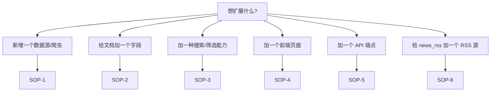

# XSearch 扩展开发指南

> 项目：XSearch ｜ 版本：v1.1 ｜ 生成日期：2026-10-06 ｜ 依据：源码分析

本篇是"改代码之前先读"的操作手册：给出六个高频扩展场景的逐步 SOP，全部以当前源码结构为锚点。每个场景都遵循同一格式：目标 → 触点清单（要动哪些文件）→ 步骤 → 验证方法 → 红线。开工前建议先读《07-模块详解》的"模块间依赖的三条铁律"，再对照本篇执行。

## 一、扩展决策图：想加什么，改哪里

## 二、SOP-1：新增一个爬虫站点

这是最常见的扩展，触点最多，也是唯一需要先过**合规关**的。

**触点清单**：新建 `XSearch/crawler/spiders/<name>.py`；`XSearch/search/crawl_manager.py` 的 `SPIDERS` 字典；`XSearch/search/api_views.py` 的来源分组常量（若属新闻/AI/榜单分类）；`frontend/src/views/`（若需新页面或 Tab）与 `CrawlView.vue` 内联爬虫列表；`XSearch/search/tests.py`。

**步骤**：
1. **合规预检**（红线，先于写代码）：读目标站 robots.txt 确认 `User-agent: *` 未禁目标路径；确认无需登录、无验证码；在 `crawler/settings.py` 的 `FINGERPRINT_HOSTS` **保持不动**（注释原话："新增条目 = 扩大风险面，动手前先确认该站真的拒绝常规 UA"——只有诚实 UA 拿 444/412 的站才有资格进白名单，且要先在《08-安全与权限设计》第九节的立场上过一遍）。`CrawlerComplianceTests.test_spoofing_scoped_to_douyin_only` 会因白名单变化而失败，这是有意的提醒。
2. **写爬虫文件**：仿照 `aihot_hot.py` 的骨架——`custom_settings` 设 `DOWNLOAD_DELAY`（≥1，官方 API 建议 2）与必要的 `HANDLE_HTTPSTATUS_LIST`；Scrapy 2.13+ 用 `async def start()` yield 首批请求；解析回调产出**标准化 item dict**，字段契约见《15-接口全量参考》第六节，其中 `url_object_id`（稳定唯一 id，决定幂等）与 `source`（新来源 key，建议 `<站名>_<类型>` 风格）两个键决定下游一切行为；正文过 5000 字符上限。
3. **注册白名单**：`crawl_manager.SPIDERS` 加 `"<key>": {"scrapy_name": "<scrapy名>", "label": "<中文标签>"}`——不加这行，Web 界面启动会被"未知爬虫"拒绝（这是防任意命令执行的闸门，不是繁文缛节）。
4. **归类来源**（按数据性质三选一）：新闻源加入 `api_views.NEWS_SOURCES`；AI 源加入 `AI_SOURCES`；榜单源加入 `RANKING_SOURCES`（会被搜索与要闻接口自动排除）。若都不是，只需保证 `source` 字段正确，分面聚合会自动展示新来源。
5. **前端适配**（可选）：榜单类给 `RankingsView.vue` 的 `CRAWL_SPIDER` 映射加 Tab（该映射就是为此预留的）；`CrawlView.vue` 第 210 行的内联 spiders 数组同步补一条（后端离线时的兜底展示）。
6. **补测试**：解析函数做成纯函数（文本进、dict 出）后加单测（样本固化目标站真实响应片段）；来源分组变更同步 `CrawlerComplianceTests` 的断言。

**验证**：`cd XSearch && scrapy crawl <name>` 本机跑通并检查 ES（`curl "localhost:9200/<索引>/_search?q=..."`）；`python manage.py test search` 全绿；登录采集管理页确认新爬虫出现在列表并能启动、状态/历史正常回写。

## 三、SOP-2：新增一个索引字段

以"给文档加 `lang`（语种）字段"为例。

**触点清单**：`crawler/pipelines.py`（`QuoteDocument` 声明 + `index_item` 赋值）；各爬虫 item（提供数据）；`search/api_views.py`（读接口透传：`_extract`/`_list_item`）；`frontend/src/api.ts`（`DocItem` interface）与展示组件。

**步骤**：
1. `QuoteDocument` 加字段声明（如 `lang = Keyword()`）。注意分析器选择：参与全文检索的中文文本用 `Text(analyzer="ik_max_word", search_analyzer=ik_search_analyzer)`，精确过滤/聚合维度用 `Keyword`。
2. `index_item()` 里加 `lang=item.get("lang")`，并按需经 `_to_int/_to_float` 清洗。
3. 数据供给方落字段：现有 5 个爬虫的 `_news_item`/`_parse_item` 等产出函数补键。
4. **处理既有索引（关键坑）**：`QuoteDocument.init()` 只在索引不存在时建 mapping，已存在的索引**不会**自动加字段（见《07-模块详解》2.4）。两种姿势二选一：开发期直接删索引重采（`curl -XDELETE localhost:9200/quotes` 后重跑爬虫）；生产期对存量索引 `PUT /quotes/_mapping` 增量加字段（ES 支持加字段、不支持改类型）。
5. 读侧透传：`_extract`（搜索结果）与 `_list_item`（列表/详情）的返回 dict 各加一行；前端 `DocItem` 加可选字段，`npm run build` 验证类型。
6. 若字段要参与筛选/排序：筛选值放 `post_filter`（保分面计数不失真，见 `api_search` 的 source/days 先例）；排序加进 `_SORTS` 字典（`missing: "_last"` 兜底空值）。

**验证**：删索引重采后 `curl "localhost:9200/quotes/_mapping"` 确认字段在场；跑一次搜索确认新字段出现在响应；`python manage.py test search` 全绿（TzAwareWriteTests 的源码扫描只管日期字段，新字段不受影响）。

## 四、SOP-3：新增一种搜索/筛选能力

以"按作者精确筛选（`author` 参数）"为例，这是对既有查询骨架的扩展，触点最少。

**步骤**：
1. 后端 `api_search`：读参数（`request.GET.get("author", "").strip()`），参照 `source` 的处理把它追加进 `post_filters` 列表——**务必走 post_filter 而非 must**：分面计数才能保持"其他筛选条件下"的口径，用户切换筛选不互相污染（`api_search.py` 285-289 行的注释是这条规则的原文）。
2. 若需要作者分面：`_FACET_AGGS` 加一个 terms 聚合（如 `"facet_authors": {"terms": {"field": "author", "size": 20}}`），`_extract` 里对应取桶。注意 `author` 是 Keyword 字段，terms 聚合天然可用。
3. 前端：`SearchView.vue` 的 `QUERY_KEYS` 数组加 `'author'`；`serialize`/路由 watch 的还原逻辑自动生效（这是 URL 状态机的好处：五个键变六个键只改一处常量）；界面控件仿照来源分面的 `el-tag` 组。
4. 测试：仿照 `ApiSearchTests.test_ranking_source_includes_keyword`，断言新参数落在 `post_filter` 且不影响 must 子句。

**验证**：构造带/不带 author 的请求对比分面计数；粘贴带 author 的 URL 深链打开，确认状态还原。

## 五、SOP-4：新增一个前端页面

以"新增 `/about` 页"为例。

**步骤**：
1. 新建 `frontend/src/views/AboutView.vue`，从 `StatsView.vue`（70 行，全站最薄）抄结构：`<script setup lang="ts">` + `onMounted` 拉数据 + `el-alert` 就地报错。
2. `main.ts` 路由表加一条：`{ path: '/about', component: () => import('./views/AboutView.vue'), meta: { title: '关于', desc: '...' } }`——**必须保持懒加载**（CI 体积守门就是防这里退化成静态 import）；`meta.title/desc` 供 afterEach 维护标题与描述，管理性质页面加 `noIndex: true`。
3. 导航入口：公开页在 `App.vue` 的 `el-menu` 加 `<el-menu-item index="/about">`；管理页必须同时满足两个条件——路由加入 `auth.ts` 的 `ADMIN_PATHS`（守卫拦截 + 401 处置共用），菜单项加 `v-if="isAdmin"`。
4. 数据获取：新端点先在 `api.ts` 加 interface 与 `api.<method>` 封装（走统一的 `request<T>`，401 处置/错误提取免费获得）；不要在组件里裸写 fetch。
5. 移动端自查：页头断点样式已在 App.vue 全局处理，页面内部宽表格参考 `DbAdminView` 的处理方式；仓库附带 `frontend/scripts/mobile-audit.py` 可做粗检。

**验证**：`npm run build`（vue-tsc + 体积守门双闸）；dev 态 `npm run dev` 手测深链/刷新/前进后退（history 模式由 nginx `try_files` 兜底，生产需确认 nginx.conf 无需改动——静态路径天然被 SPA 兜底规则覆盖）。

## 六、SOP-5：新增一个 API 端点

以"新增 `GET /api/tags/`（高频标签统计）"为例。

**步骤**：
1. `search/api_views.py` 写视图函数：遵循文件内既有范式——`@require_http_methods(["GET"])`；ES 查询包 try-except，故障返回 `_es_error(e)`（结构化 503）；响应用 `JsonResponse`，错误体 `{error, code?}`。
2. 鉴权决断：公开读接口直接暴露；任何触碰"拉起子进程/写 ES/读日志"的能力必须 `@require_admin`（写操作另加 `@csrf_exempt`，POST/PUT 皆然）。
3. `xsearch/urls.py` 注册 `path('api/tags/', api_tags, name="api-tags")`——注意 Django 路由无方法回退匹配，若同路径多方法必须单视图内部分流（`api_db_doc` 的注释解释过这个坑）。
4. 输入校验按《08-安全与权限设计》第三节清单过一遍（数值夹取、白名单、id 合法性）。
5. 前端 `api.ts` 加封装与 interface；`ServiceInfo`（urls.py）的 endpoints 样例列表可顺手补一条（该列表本就不全，见《13-技术债务与演进建议》）。
6. 测试：仿照同类既有测试（查询形状类 mock client 断言 DSL；降级类断言 503/200 降级体）。

**验证**：`python manage.py test search`；`curl` 实测含错误路径（空参、ES 停机）。

## 七、SOP-6：给 news_rss 新增一个 RSS 源

比 SOP-1 轻一个量级——爬虫与管道全部复用，只扩配置。

**步骤**：
1. `crawler/spiders/news_rss.py` 的 `FEEDS` 字典加条目：`key` 即写入 ES 的 `source`（必须 `news_` 前缀风格，前端 `SOURCE_NAMES` 映射与后端 `NEWS_SOURCES` 都依赖这个命名约定）；`label`、`url`、`follow_links`（feed 无摘要需跟进文章页抓正文时为 True，并可能需要仿照 `CNS_ARTICLE_RE` 加站点专属的文章链接正则与正文解析分支）。
2. 后端 `api_views.NEWS_SOURCES` 加同一个 key（`test_dead_people_feed_removed_everywhere` 断言爬虫 FEEDS 与后端 NEWS_SOURCES 集合一致，两处必须同步改，否则该测试红灯——这是刻意设计的一致性防漂移）。
3. 前端各视图的 `SOURCE_NAMES` 映射（HomeView/SearchView/NewsView 等各自持有一份）加中文名，否则界面显示原始 key。
4. 合规确认记入 PR 描述（robots 核对结论），沿用 2026-09-27 那次逐源核对的格式。

**验证**：`scrapy crawl news_rss -a sources=<新key>` 单源试跑（`sources` 参数就是为此设计的）；确认新闻页新 Tab/来源标签正常；停用源时参照 `news_people` 先例——后端常量、爬虫 FEEDS、前端映射三处同步移除并留注释，存量文档不删（可用数据管理页按来源清理）。

## 八、通用红线与回归清单

所有场景共享四条红线：**第一**，不动 `FINGERPRINT_HOSTS` 白名单与 `ROBOTSTXT_OBEY`，除非完成合规预检并同步更新 `CrawlerComplianceTests`；**第二**，不把任何新状态放进进程内单例（token/互斥/调度的前车之鉴——gunicorn 必须单 worker 的原因），新状态一律 ES/Redis/JSON 文件；**第三**，不改 `_id` 生成规则与 `source` 既有取值（幂等与来源分面全压在这两个键上，改了等于换库）；**第四**，每个 SOP 收尾必须跑 `python manage.py test search`（110 个方法）与 `npm run build`（类型+体积双闸），并把新增行为补成测试——补测优先级参考《09-测试与质量保障》第七节的缺口排序。

## 九、动手前的十项自查

六个 SOP 各有清单，但有一组横切问题是任何扩展开工前都值得过一遍的，逐条自问：

1. 我的改动会不会引入**新的进程内状态**？（会 → 违反红线二，先想外置方案）
2. 会不会让某个接口的响应**删字段或改字段类型**？（会 → 前端 interface 与《15-接口全量参考》同步改，且优先用"只增不改"的演进方式）
3. 有没有引入**新的外部输入**（请求参数、爬虫响应、文件内容）？（有 → 按《08-安全与权限设计》第三节逐项过校验）
4. 有没有触碰**文件系统路径**且路径里拼接了用户输入？（有 → 仿照 `JOB_NAME_RE` 的 basename + 正则 + 存在性三重校验）
5. 改动是否影响**时区语义**（任何新日期字段的写入必须 aware UTC，展示必须经 `_display_date`）？
6. 改动是否让某条路径**绕过既有防线**（require_admin、白名单、post_filter、strip_html）？
7. 爬虫侧改动是否需要**重新核对 robots** 并在 PR 描述留证据？
8. 是否新增了**配置项**？（有 → `.env.example`、README、《14-配置与环境详解》三处同步，并说明默认值与 fail-closed 属性）
9. 是否会改变**运行时产物**的形态（logs/jobs/cache 新文件类型）？（有 → 确认 `.gitignore`/`.dockerignore` 覆盖）
10. 这次改动**坏掉时会在哪里被发现**？（答不出来 → 先补一个能让它现形的测试或告警，再上线）

这十条里最容易跳过也最不该跳过的是第 10 条。这个项目的每一处防御性代码背后都有一个"曾在生产坏过"的故事（《05-核心流程》末节），扩展代码默认没有故事——它的失败是安静的。把"坏掉时在哪被发现"想清楚并落实成一个具体的信号（日志行、告警键、测试断言），新代码才算真正接入了这套系统的免疫系统。
