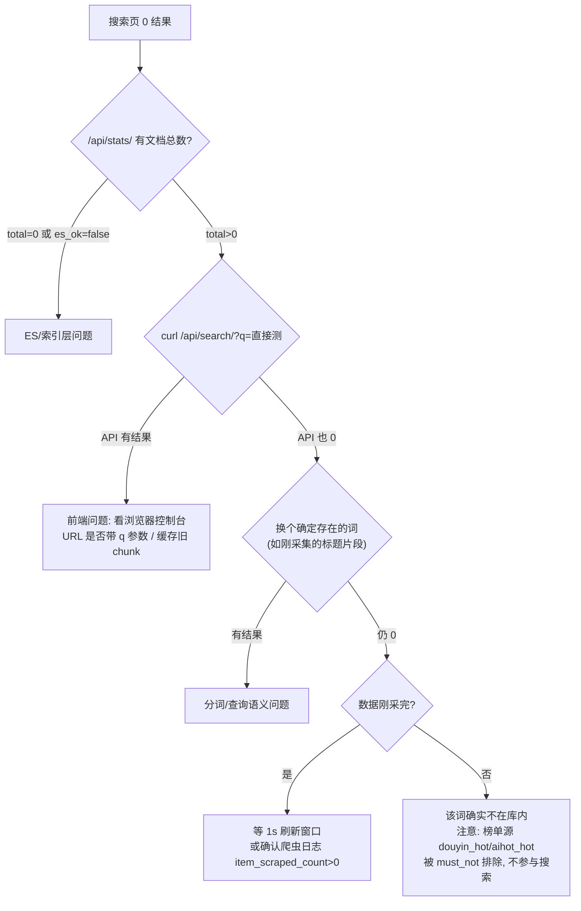
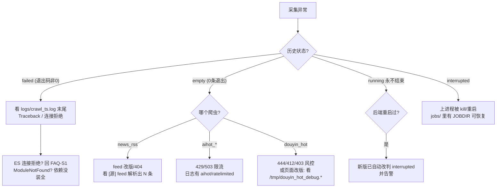
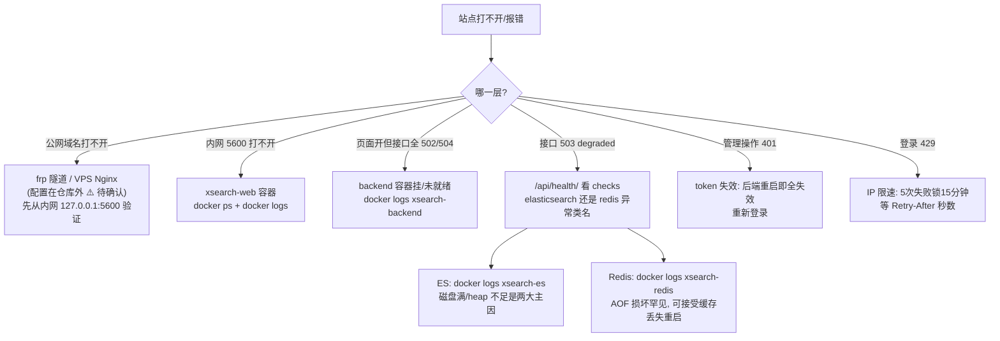

# XSearch FAQ 与故障排查

> 项目：XSearch ｜ 版本：v1.1 ｜ 生成日期：2026-10-06 ｜ 依据：源码分析

本篇是排障手册：先给日志入口总表，再按"搜索无结果 / 爬虫失败 / 服务不可达"三棵决策树组织高频故障，每条给出**症状 → 根因（源码位置）→ 处置**。排障总原则来自项目自身的工程取向：先看 `/api/health/`（真检依赖）与后端启动日志（调度器/弱配置告警都在那里），再二分定位到 ES、Redis、爬虫、前端某一层。

## 一、日志入口总表

| 日志 | 位置 | 内容 | 查看方式 |
|---|---|---|---|
| 后端控制台日志 | gunicorn 容器 stdout | 调度器启动（逐任务"下次/上次触发"）、弱配置告警、登录限速、purge 操作、misfire/异常 | `docker compose logs -f backend`（或 `docker logs xsearch-backend`） |
| 爬虫子进程日志 | `XSearch/logs/crawl_<时间戳>.log` | Scrapy 全量日志：每源解析条数、限流记录、`'item_scraped_count': N` 终统计 | 采集管理页"日志尾部"（30 行）或直接读文件；历史记录里有 `log_path` |
| Django search logger | 同后端控制台（settings.py LOGGING 配置了 `search` logger INFO 到 console） | `定时调度器已启动，恢复 N/M 个启用任务`、`启动收尾：N 条无主 running` 等 | 同后端控制台 |
| 告警邮件 | ALERT_* 配置的邮箱 | 采集 failed/empty、schedule misfired/error、状态文件损坏 | 同类事件 30 分钟冷却（`notify._COOLDOWN=1800`），没收到先查配置与冷却 |
| 容器健康 | `docker compose ps` | ES/Redis/backend 的 healthy 状态 | 镜像 HEALTHCHECK 打 `/api/health/`（真检 ES+Redis，任一挂 503） |
| 抖音调试产物 | `/tmp/douyin_hot_debug.png` / `.txt` | 解析失败时的整页截图与文本 | 仅 douyin_hot 解析 0 条时生成 |

自检命令速查：`curl -s localhost:5600/api/health/`（生产，经前端反代）；`curl -s localhost:8000/api/health/`（开发，直连后端）；`curl -s localhost:9200/_cluster/health`（ES 本体）；`docker compose exec backend scrapy crawl news_rss`（采集链路最小验证）。

## 二、搜索无结果决策树

**FAQ-S1：ES 起了，但搜索 503"Elasticsearch 不可用"。** 后端连不上 ES。排查顺序：① 容器内 `ES_URL` 是否 `http://elasticsearch:9200`（compose 已注入，手工 runserver 时应是 `http://127.0.0.1:9200`）；② ES 是否真健康（`curl 127.0.0.1:9200/_cluster/health`，开发态 ES 只绑 127.0.0.1）；③ 后端是否在 ES 就绪前启动——生产 compose 已用 `condition: service_healthy` 门控（2026-09-10 首发踩过爬虫连不上 ES 的坑），手工 compose up 时确认 healthcheck 通过。

**FAQ-S2：搜索全是无关结果 / 搜"A"出"B"。** 十有八九是分词层：确认用的是 `xsearch-es-ik:8.15.3` 定制镜像而非 stock ES（stock 无 IK，标准分词按单字切，命中噪音淹没精确匹配——但注意 stock 镜像下**建索引会直接失败**，所以这个症状更可能是索引建于 IK 正常、而查询词含停用词所致）。`CN_STOPWORDS`（crawler/pipelines.py）在检索侧滤掉"的/了/是"等约 50 虚词，属预期行为。

**FAQ-S3：刚采完的数据搜不到。** 三种时序原因：ES 默认 1 秒刷新窗口（`api_db_purge` 专门为此做了显式 refresh，搜索侧没有——等 1 秒即可）；要闻接口有 120 秒 Redis 缓存（`headlines:{hours}`），新闻列表 60 秒缓存；若搜的是榜单内容（抖音/AI 热点），搜索接口本就 `must_not` 排除榜单来源（`RANKING_SOURCES`），请去榜单页看。

**FAQ-S4：提示"已为你显示「xxx」的结果"或"已显示相近结果"。** 不是故障，是纠错链工作正常：前者是 phrase suggester 纠错（`corrected`），后者是 fuzziness AUTO 模糊重搜（`fuzzy`）。搜罕见新词（人名、产品名）被纠错得面目全非时，给词加引号试短语或反馈调整停用词表。

**FAQ-S5：分页翻到某页是空的。** ES total 估算偏差的已知问题，后端会自动向前回退到最后一个有数据的页（`api_search` 380 行起），前端也会修正页码条——若仍出现，检查是否正好踩上数据清理/爬虫覆盖的时间窗。

**FAQ-S6：搜索框补全下拉一闪而过或显示旧词。** 补全链路有两层客户端防护：250ms 防抖（`suggestTimer`）与请求序号（`suggestSeq`，只认最新响应）。"显示旧词"若可复现，多半是浏览器扩展或代理缓存作怪而非代码问题；可用 `curl "localhost:8000/api/suggest/?s=<词>"` 直测后端——后端返回正确则问题在前端网络层。另注意补全走 ES completion 的 `suggest` 字段（input 来自标题与作者），标题里的英文/数字前缀命中效果取决于 IK 对 completion 字段的表现，与全文搜索的召回不是一回事。

## 三、爬虫失败决策树

**FAQ-C1：历史里出现 `empty`（无数据）但进程正常退出。** 这是项目刻意区分的状态：进程活着但什么都没抓到，"多半是被拦或页面/feed 改版"（`_check_and_update_current` 注释），会触发冷却告警邮件。处置：按爬虫分诊——news_rss 看日志每源"feed 解析出 N 条"是否为 0（源站改版）；aihot 看是否 `aihot/ratelimited`（限流，等冷却）；douyin 看 `/tmp/douyin_hot_debug.png`（截图对页面结构）。

**FAQ-C2：抖音采集返回 444/412/403。** 444 是抖音 nginx 层对"不像浏览器"请求的主动拒绝：确认 `FINGERPRINT_HOSTS` 白名单仍含 douyin 域名、browserforge 可用（不可用会降级内置模板，日志有"指纹生成失败"警告）、Playwright chromium 已安装（`playwright install chromium`）。412 的历史成因是指纹头没盖住内置 UA（已修：中间件用"替换"而非 setdefault，见 crawler/middlewares.py 注释）。403/412 常提示需要登录态 cookie——项目不采集登录后数据，这是**预期边界**而非可修复故障。

**FAQ-C3：定时任务一次都没触发过。** 项目修过最隐蔽的一类 bug，现已有完整可见化。排查：① 后端启动日志找"定时任务 ... 下次 ..."逐条打印，"从没跑过"会有显式告警（`start_scheduler` 的 never 计数）；② 确认服务在 cron 窗口内一直开着——APScheduler 是进程内调度器，后端没起就没有任何触发；③ 看任务 `last_fire/last_status` 字段（misfired = 到点但进程忙/刚重启，已在 1 小时宽限 `misfire_grace_time=3600` 内尝试补跑）；④ `scheduler_active=false` 说明 APScheduler 未安装（容器镜像必装，裸机跑可能缺）。

**FAQ-C4：历史里挂着 `running` 不动。** 新版有两道收尾：盯梢线程在子进程退出后立即回写（不依赖前端轮询）；后端重启时 `_reconcile_stale_runs()` 把 pid 已死的 running 改判 `interrupted` 并告警。若仍见长期 running：`kill -0 <pid>` 验 pid 是否真活；jobs/ 目录若残留，可在采集管理"可恢复任务"里恢复或手动删除。

**FAQ-C5：爬虫被 robots 拒绝（日志含 robots.txt 相关 denied）。** `ROBOTSTXT_OBEY=True` 下的预期行为。处置只有一条正路：确认目标路径在 robots 里确实被禁后**放弃该源或与站方沟通**，不要关开关（`CrawlerComplianceTests` 也不允许）。

**FAQ-C6：恢复中断任务时提示"非法的任务名称"。** `resume_job` 只接受 `jobs/` 下的直接子目录名（`JOB_NAME_RE` 校验，防路径穿越）——从采集管理"可恢复任务"列表点恢复即可，别手输路径。

**FAQ-C7：douyin_hot 跑完后内存涨/浏览器进程残留。** scrapy-playwright 的 `playwright_include_page` 模式要求使用方显式关页：`douyin_hot.parse` 的 `finally: await page.close()` 与 `errback` 里的兜底关页就是为此而写。若发现 chromium 进程堆积，先确认没改掉这两处；其次是 `PLAYWRIGHT_MAX_CONTEXTS=4` 与 `MAX_PAGES_PER_CONTEXT=4` 的上限被调大过。单机长跑建议在采集管理页观察连续多轮后的容器内存曲线（`docker stats xsearch-backend`）。

## 四、服务不可达决策树

**FAQ-D1：`docker compose up` 直接报错起不来。** 最常见三个：`.env` 不存在（开发态 compose `env_file: .env` 是硬要求，先 `cp .env.example .env`）；9200/6379/8080 端口被占（compose 注释：NAS 上 9200/6379 已被共享 dev-stack 占用，生产 compose 因此不发布这三个端口）；生产 compose 放错目录（必须放部署目录根，相对路径 `./data` 与 `env_file` 按所在目录解析）。

**FAQ-D2：backend 反复重启。** 看日志是否命中 fail-closed 三件套：`DJANGO_DEBUG=False` 时缺 `DJANGO_SECRET_KEY` 抛 `ImproperlyConfigured`；`DJANGO_ALLOWED_HOSTS` 为空 `sys.exit(1)`；migrate 失败（单文件 bind mount 的 `data/db.sqlite3` 权限/损坏）。三者日志信息都直指修法。

**FAQ-D3：ES 容器 unhealthy。** 两大主因：`vm.max_map_count` 过低（宿主需 `sysctl -w vm.max_map_count=262144`）；磁盘水位超 95% 触发 ES 只读洪水位（`fielddata`/写入报错，清理磁盘后 `curl -XPUT .../_settings` 解除 `read_only_allow_delete`）。heap 512MB 是 compose 固定值，大数据量下 GC 频繁会拖慢一切查询。

**FAQ-D4：robots.txt / sitemap.xml 返回的是 HTML。** nginx 的 SEO 两条 location（`= /robots.txt`、`= /sitemap.xml`）没生效——被 SPA 兜底规则接走了。确认用的是仓库版 `deploy/nginx.conf` 且 `proxy_pass http://backend:8000` 的服务名在容器网络内可解析（生产 compose 服务名 backend 与 nginx.conf 一致；自改服务名会 502）。

**FAQ-D5：所有管理接口 401 但我明明登录过。** token 是进程内状态：后端重启/重新部署即全部失效（README 明说需重新登录）。前端 401 处置只对管理页自动跳登录，公开页就地报错——去 `/login` 重登即可。若登录本身 429，是登录限速（5 次失败锁 900 秒），等 `Retry-After`。

**FAQ-D6：发版后点导航白屏。** 旧 index.html 缓存引用了已不存在的 chunk。两层保障应已兜住：nginx 对 `= /index.html` 强制 no-cache；前端 `router.onError` 会整页重载自救（10 秒一次）。仍白屏说明两层都未生效——检查线上 nginx.conf 是否为仓库版本。

**FAQ-D7：本地开发时浏览器控制台报 CORS 错误。** 开发态应走 Vite 代理（`localhost:5173` 的 `/api` 自动转 8000），理论上无跨域；出现 CORS 报错说明前端绕过代理直连了 8000（比如 `VITE_API_BASE` 被设成了绝对地址，或直接用 IP 访问页面）。两条路任选：恢复走代理（推荐，`api.ts` 头注释的默认形态）；或把当期来源追加进 `FRONTEND_ORIGINS`（注意该变量由 `xsearch/middleware.py` 每请求实时读环境变量，改完需重启后端进程才生效——环境变量不是热更新的）。生产同源部署下 CORS 整层闲置，报错则说明 nginx 反代路径配置错位。

## 五、状态文件与数据类 FAQ

**FAQ-F1：`schedules.json`/`crawl_history.json` 提示损坏。** 写入侧有三层保护（`.tmp` 检查点 + 原地覆盖 + `.corrupt-<ts>` 现场备份），损坏时后端会降级（调度配置降为空）并发 `schedule-corrupt` 告警。处置：看 `XSearch/` 下 `.corrupt-*` 文件确认损坏时间点，从备份（backup.sh 每日拷过）恢复对应文件；不要手编 JSON 后直接挂回——先 `python -m json.tool` 验证。

**FAQ-F2：时间显示差 8 小时 / 时间分面错位。** 这是修过的历史 bug（naive 时间被 ES 当 UTC）：写入侧已统一 aware UTC、读侧 `_display_date` 按站点时区换算。若看到旧数据偏斜，那是修复前入库的存量（README 发布清单给了 update_by_query 校正方案）；新数据偏斜则是回归，先跑 `python manage.py test search`（TzAwareWriteTests 会扫源码抓回归）。

**FAQ-F3：误删了数据。** 单文档删除无回收站；按来源批量清理需逐字确认且不可逆。恢复手段只有 ES 快照（`deploy/backup.sh` 每日 `_snapshot`，保留 14 天）——恢复流程见《06-部署运行》4.8，顺序不能反（先起 ES 灌快照，再覆盖状态文件）。

**FAQ-F4：备份每天都在跑，恢复到底靠不靠谱。** 这个问题项目自己的回答是"只备份不练恢复 = 没有备份"（README 原话）。验证方法：空闲时段做一次完整演练——`DRY_RUN=1` 看动作 → 正式跑一次 → 在测试目录走一遍恢复命令（注册快照仓库、`_restore` 只恢复 quotes、覆盖三个状态文件、起 backend、`curl /api/health/` 验 200）。三个易错点提前记住：恢复顺序不能反（先 ES 后状态文件，与部署顺序相反）；`backup.sh` 会拒绝同盘目标（`case` 守卫，报"等于没备份"是设计不是 bug）；`.env` 也在备份里，因此备份盘的物理安全等同生产密钥安全（脚本把目录 chmod 700，但盘本身丢了就是密钥丢了）。

## 六、一页速查：症状 → 首查动作

最后这张表是全篇的压缩版，适合打印贴在运维笔记里。使用方法：从"症状"列找到最接近的行，执行"首查动作"，多数情况下一步就能把故障归入前文某个 FAQ；归不进去时，按第一节的日志入口总表把四路日志（后端控制台、爬虫日志、告警邮件、容器状态）各看一眼——四路信息交叉后仍无头绪的故障，大概率是新问题，此时按《11-扩展开发指南》第九节的第 10 问把它变成第一个"坏掉时有信号"的新案例。

| 症状 | 首查动作 | 关联 FAQ |
|---|---|---|
| 全站 503 | `curl /api/health/` 看 checks 异常类名 | S1 / D3 |
| 搜索 0 结果 | `/api/stats/` 看 total；换词重试 | S2-S4 |
| 采集 failed | `logs/crawl_*.log` 末尾 Traceback | C1 / D3 |
| 采集 empty | 按爬虫分诊（feed 改版 / 429 / 风控截图） | C1-C2 |
| cron 不触发 | 后端启动日志"下次/上次触发"逐条 | C3 |
| 管理 401 | 后端是否重启过 → 重登 | D5 |
| 登录 429 | 等 15 分钟（900s 锁定） | D5 |
| 容器起不来 | `.env` 存在？端口占用？fail-closed 日志？ | D1-D2 |
| 白屏 | nginx index.html no-cache + chunk 自救是否生效 | D6 |
| 时间差 8h | 存量数据 vs 回归，跑测试确认 | F2 |

最后提醒一个排障元技巧：这个项目把大多数故障的"第一现场"都写进了注释与日志——搜 `XSearch` 源码里与症状相关的关键词（如 "412" "EBUSY" "misfire" "444"），命中注释的概率非常高；先读注释再动手，往往能少走一圈弯路。
