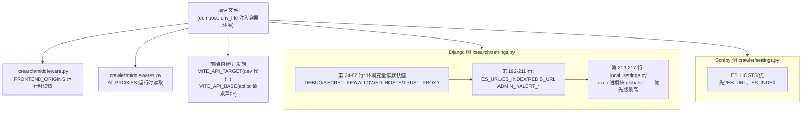

# XSearch 配置与环境详解

> 项目：XSearch ｜ 版本：v1.1 ｜ 生成日期：2026-10-06 ｜ 依据：源码分析

《06-部署运行》第三节给出了环境变量清单，本篇做全量展开：17 个 `.env.example` 变量逐一标注**定义位置 → 读取位置 → 上游/下游 → fail-closed 约束 → 误配症状**，并解析三份 Dockerfile、两份 compose 的差异点、`settings.py` 与 `crawler/settings.py` 的逐段走读。

## 一、配置加载顺序总览

三条加载规则需要牢记。**规则一（Django）**：环境变量先读，`local_settings.py` 后 `exec` 覆盖——所以"调试个别配置时可以只改文件不动 `.env`"；该文件已 gitignore + dockerignore，敏感值（管理员口令、SMTP 授权码）的推荐落点就在这里。**规则二（Scrapy）**：爬虫是独立进程，只认环境变量，不读 `local_settings.py`——Docker 里靠 compose 给 backend 容器注入 `ES_URL`/`REDIS_URL` 使 Django 与 Scrapy 同源；裸机跑爬虫时需自行 `export ES_URL=...`。**规则三（前端）**：Vite 变量在**构建/开发期**生效而非运行时，`VITE_API_BASE` 打进产物后不可变（该项目刻意保持它为空走同源反代，避免"密钥进 dist"的历史重演——`api.ts` 头注释）。

这张图还有一个不易察觉的含义：同一个变量名在三处各有默认值（如 `ES_URL` 在 settings.py、crawler/settings.py、pipelines.py 三处都写了回退默认 `http://127.0.0.1:9200`），三处值目前一致，但属于模式意义上的"双源"——修改默认值时必须三处同改（《13-技术债务与演进建议》第六节模式二）。运维上的安全做法是永远显式设置 `ES_URL`，不依赖任何一处默认值。

## 二、17 个环境变量逐一详解

下表为总览，随后按组展开上游下游与 fail-closed 语义。

| # | 变量 | 默认值 | 读取位置 | fail-closed? |
|---|---|---|---|---|
| 1 | `DJANGO_SECRET_KEY` | 仅开发态密钥 | `xsearch/settings.py:31` | **是**：DEBUG=False 缺失抛 `ImproperlyConfigured` 拒启 |
| 2 | `DJANGO_DEBUG` | `True` | `settings.py:24` | 否（但 False 触发其他两项 fail-closed） |
| 3 | `DJANGO_ALLOWED_HOSTS` | 空（DEBUG 时补 localhost/127.0.0.1） | `settings.py:44` | **是**：DEBUG=False 且空 → `sys.exit(1)` |
| 4 | `DJANGO_TRUST_PROXY_HEADER` | `True` | `settings.py:82` → `api_views._client_ip` | 否（安全语义开关） |
| 5 | `ES_URL` | `http://127.0.0.1:9200` | `settings.py:192`；`crawler/settings.py:66`（经 `ES_HOSTS` 默认）；`pipelines._default_es_url:27` | 否：ES 不可达时运行时降级（管道跳过入库/接口 503） |
| 6 | `ES_INDEX` | `quotes` | `settings.py:193`；`crawler/settings.py:68` | 否（但改它需重建索引，见下文） |
| 7 | `REDIS_URL` | `redis://127.0.0.1:6379/0` | `settings.py:196` → `api_views.redis_cli` | 否：Redis 不可用时静默跳过缓存/统计 |
| 8 | `ADMIN_USERNAME` | 空 | `settings.py:201`；读于 `api_admin_login`、`apps._warn_insecure_config` | **运行时是**：两者任一为空 → 登录接口 503（无默认账号） |
| 9 | `ADMIN_PASSWORD` | 空 | `settings.py:202`（同上） | 同上；弱口令启动日志告警（apps.py 42-48 行） |
| 10 | `ALERT_EMAIL_ENABLED` | `False` | `settings.py:206` → `notify._config` | 否：不为 True 时整条告警通道 no-op |
| 11 | `ALERT_SMTP_HOST` | `smtp.qq.com` | `settings.py:207` → `notify._config` | 否 |
| 12 | `ALERT_SMTP_PORT` | `465` | `settings.py:208`（int 转换） | 否 |
| 13 | `ALERT_SMTP_USER` | 空 | `settings.py:209` | 组合约束：启用但 user/password/to 不全 → 一次性降级告警后 no-op |
| 14 | `ALERT_SMTP_PASSWORD` | 空 | `settings.py:210` | 同上（QQ/163 用授权码非登录密码） |
| 15 | `ALERT_EMAIL_TO` | 空（=发给 USER） | `settings.py:211` | 同上；逗号分隔多收件人 |
| 16 | `AI_PROXIES` | 空 | `crawler/middlewares.py:76`（`ResidentialProxyMiddleware.from_crawler`） | 否：空 = 直连 |
| 17 | `FRONTEND_ORIGINS` | 空 | `xsearch/middleware.py:33`（每次请求实时读取） | 否：追加 CORS 白名单，内置 5173/4173 本地四源 |

组内详解与误配症状：

- **Django 安全三件套（#1-3）**是仅有的启动期 fail-closed：密钥缺失的错误信息里直接给了生成命令（`python -c "import secrets;print(secrets.token_urlsafe(50))"`）与落点提示；`ALLOWED_HOSTS` 留空的 `sys.exit(1)` 注释写明"留空会导致站点对所有 Host 返回 400，这里是有意早退而不是静默降级"。误配症状即"容器反复重启"，日志一眼可辨（《12-FAQ》D2）。
- **`DJANGO_TRUST_PROXY_HEADER`（#4）**的上下游最长：读于 settings，消费于 `api_views._client_ip`（登录限速取 IP），上游是 nginx 的 `X-Forwarded-For`（`deploy/nginx.conf` 有 `proxy_set_header X-Forwarded-For $proxy_add_x_forwarded_for`）。设 True 的前提是"公网入口经可信反代"；若攻击者可直连 backend，XFF 可伪造绕过限速——《08-安全与权限设计》第九节第 2 条。
- **`ES_INDEX`（#6）**改名的隐藏成本：索引 mapping 由首次采集建出，改名等于换库——旧索引数据不会跟过去，需重采或 reindex；且 `QuoteDocument.Index.name` 硬编码 `quotes` 靠 `open_spider` 的 `_index._name` 覆盖（《13-技术债务》第 4 条），非必要不动。
- **ALERT 五件套（#10-15）**是一组"半 fail-closed"：单独错配静默，组合错配（ENABLED=True 但凭证不全）会打印一次"降级为不发信"警告——验证通道要靠发布清单的自检命令 `python manage.py shell -c "from search.notify import notify; print(notify('selftest','告警通道自检'))"`。
- **`ES_HOSTS`（表外变量）**：仅 `crawler/settings.py` 认，逗号分隔多节点，优先级高于 `ES_URL`——与 Django 单源读 `ES_URL` 的分叉风险见《13-技术债务》第 3 条。
- **`TZ`（表外变量）**：生产 compose 给 backend 写死 `Asia/Shanghai`（与爬虫日志时间戳、cron 语义一致）；它不是 Python 代码读取的变量，但影响 `datetime.now()` 的本地形态与时区换算链。
- **`VITE_API_TARGET`/`VITE_API_BASE`（表外变量）**：前者给 `vite.config.ts` 的 dev/preview `/api` 代理（默认 `http://127.0.0.1:8000`），后者给 `api.ts` 的请求基址（默认空 = 同源）。生产推荐两者都不设，走 nginx 反代。

## 三、三份 Dockerfile 逐段解析

三份 Dockerfile 各管一层（后端运行时、前端静态托管、带 IK 插件的 ES），共性是"注释密度高"——几乎每个非常规写法旁都有一句为什么。逐段解析如下，读的时候建议对照原文件：层序本身就是性能设计（依赖层在前、代码层在后，利用 Docker 缓存让日常改代码的重建只花几十秒）。

### 3.1 Dockerfile（后端，73 行）

逐段：① `FROM python:3.12-slim`——版本硬约束（Django 6.1 要求 3.12+）；② 两个 ARG（`PIP_INDEX_URL`/`PLAYWRIGHT_DOWNLOAD_HOST`，默认空=官方源，CI 行为不变，NAS 构建时经 `--build-arg` 指向清华源/npmmirror）；③ apt 层 24 个包分两组——编译链（gcc/g++/libffi/libssl/libxml2/libxslt/zlib，lxml 与 Twisted 需要编译工具链）与 Playwright chromium 的 17 个图形库（libnss3、libgbm1、libasound2 等），`--no-install-recommends` + 清 lists 控制体积；④ 先 COPY 两个 requirements 文件再 pip install（**利用层缓存**：依赖不变时代码变更不触发重装）；⑤ `playwright install chromium`；⑥ `COPY XSearch/ .` 后 `mkdir -p cache/images jobs logs` 预建运行时目录（`.dockerignore` 已保证 logs/jobs/cache/local_settings/db.sqlite3 不进上下文）；⑦ HEALTHCHECK 打 `/api/health/`——注释记录了历史教训（曾打 `/api/stats/`，ES 挂了容器仍 healthy）；slim 镜像无 curl，用 python 标准库 urllib；⑧ CMD 是 `sh -c "migrate --noinput && gunicorn ... --workers 1 --timeout 120"`——**容器每次启动自动迁移**，`--workers 1` 的原因（进程内状态）写在同段注释。

### 3.2 frontend.Dockerfile（27 行）

两阶段：builder（node:20-alpine，`npm install` + `npm run build`，后者内嵌 vue-tsc 类型检查）→ runtime（nginx:alpine，拷入 dist 与 `deploy/nginx.conf` 为站点配置）。值得注意的两处已在《13-技术债务》记录：首行注释残留旧项目名"LcvSearch"；`npm install` 应改 `npm ci` 与 CI 对齐。EXPOSE 80，CMD 前台 nginx。

### 3.3 deploy/es-ik.Dockerfile（14 行）

最小定制：官方 `elasticsearch:8.15.3` + 一行 `bin/elasticsearch-plugin install --batch https://get.infini.cloud/elasticsearch/analysis-ik/8.15.3`。三条注释都是踩坑记录：插件版本必须与基础镜像严格一致（否则 ES 拒载）；走 infini.cloud 国内源（GitHub 直连在 NAS 上不可靠）；选 8.15.3 与 NAS 共享 dev-es 同版本（基础镜像层已存在，免 1.3GB 拉取）。

## 四、两份 compose 的关键差异（配置视角补充）

《06-部署运行》4.3 已列八处差异，本节只补配置语义上最容易踩的三点。**其一，backend 的 environment 合并顺序**：compose 的 `environment` 覆盖 `env_file` 同名变量——所以生产态 `DJANGO_DEBUG=False`、`ES_URL=http://elasticsearch:9200` 写在 environment 里，`.env` 里的同名值会被盖掉（这正是"关键环境写死、不依赖 .env 是否记得设"的实现机制）。**其二，单文件 bind mount 的两面性**：`data/db.sqlite3`、`data/schedules.json`、`data/crawl_history.json` 三个单文件挂载让容器重建不丢状态，但也制造了 `os.replace` EBUSY 问题（催生 `_write_json_atomic` 的原地覆盖方案，`crawl_manager.py` 24-46 行注释完整记录）。**其三，健康检查参数即启动时序**：开发态 ES healthcheck 30s/10s/5 次，生产态 10s/5s/30 次 + `start_period: 40s`——这是 2026-09-10 首发时"ES 未就绪即起爬虫导致整轮数据不入库"的修复，改动的是 backend `depends_on` 门控的实际等待窗口。

## 五、settings.py 走读（Django 侧逐段）

| 段落（行号） | 内容 | 要点 |
|---|---|---|
| 24 行 | `DEBUG = os.getenv("DJANGO_DEBUG", "True")...` | 默认 True 是开发便利，生产 compose 写死 False |
| 30-41 行 | 开发态密钥与 fail-closed | `_DEV_ONLY_KEY` 明文在仓库里——注释说明它"随公开仓库分发，用它 = 用已泄露密钥"，故仅 DEBUG 态可用且启动打 stderr 警告 |
| 44-47 行 | ALLOWED_HOSTS | DEBUG 且空时补 `localhost,127.0.0.1`（便于容器内健康检查） |
| 49-77 行 | 生产安全块 | `SECURE_SSL_REDIRECT=False`（保 NAS 局域网 http 直连入口）；`SECURE_PROXY_SSL_HEADER` 采信 X-Forwarded-Proto；Cookie HttpOnly；nosniff；X-Frame DENY；空 Host `sys.exit(1)`；HSTS/Cookie Secure 三行注释态（见《08》第九节第 7 条） |
| 82 行 | TRUST_PROXY_HEADER | 登录限速取 IP 策略开关 |
| 87-106 行 | INSTALLED_APPS/MIDDLEWARE | `CorsMiddleware` 挂最外层（在 SecurityMiddleware 之前，保证预检短路不经过后续中间件）；`search` 是唯一业务 app |
| 109-114 行 | CORS_ALLOW_ORIGINS | 内置 Vite dev(5173)/preview(4173) 的 localhost 与 127.0.0.1 四源 |
| 118-146 行 | TEMPLATES/DB | TEMPLATES 注释声明"页面层已由 frontend/ 承担，仅为 admin 保留"；SQLite 仅框架数据 |
| 152-179 行 | 密码验证器/本地化 | 密码验证器实际闲置（管理员不走 Django User）；`TIME_ZONE='Asia/Shanghai'`、`USE_TZ=True` 是时区约定的锚点 |
| 185-189 行 | STATIC | 指向遗留 `static/` 目录（待清理项，《13-技术债务》#14） |
| 192-211 行 | ES/Redis/ADMIN/ALERT | 七组业务配置，全部 env 可覆盖 |
| 213-217 行 | local_settings exec | `exec(compile(...), globals())`——文件里任何 settings 同名赋值都生效，权限等同 settings 本体（这也是它必须被 gitignore 的原因） |
| 222-235 行 | LOGGING | 仅配置 `search` logger 到 console INFO——注释解释：默认配置下非 django logger 的 INFO 会被丢弃，调度器启动记录会看不见 |

## 六、crawler/settings.py 逐项详解（Scrapy 侧）

74 行配置每一项都有合规或兼容语义：`BOT_NAME='XSearchCrawler'` 与 `scrapy.cfg` 的 project 名一致；`SPIDER_MODULES` 指向 `crawler.spiders`；`ROBOTSTXT_OBEY=True` 带逐源核对记录（2026-09-27）；`DOWNLOAD_DELAY=1` + AutoThrottle（target 2.0 / max 3）是"限速礼貌"双保险；`COOKIES_ENABLED=False` 不维持会话（与"不采集登录后数据"一致）；`USER_AGENT` 自报身份带项目 URL；`FINGERPRINT_HOSTS` 白名单的注释是全仓库最重要的合规注记（"新增条目 = 扩大风险面"）；`DOWNLOADER_MIDDLEWARES` 三件套优先级 543/544/545 刻意排在内置 UA 中间件（500）之后；`TWISTED_REACTOR=AsyncioSelectorReactor` + `DOWNLOAD_HANDLERS` 全量接管 http/https 是 scrapy-playwright 的标准装配（意味着**所有请求**都经 Playwright handler，非 playwright 标记的请求走普通路径直通）；`PLAYWRIGHT_MAX_CONTEXTS=4`/`MAX_PAGES_PER_CONTEXT=4` 限制浏览器资源占用；`ITEM_PIPELINES` 只挂 `EsArticlePipeline: 300`；`ES_HOSTS`/`ES_INDEX` 如第二节所述；末尾 `PROJECT_ROOT` 插 sys.path 让 `crawler` 包可被导入（settings 位于包内，根目录在上一级）。

## 七、CI 配置与 local_settings 模板速览

`.github/workflows/ci.yml` 的逐步拆解见《09-测试与质量保障》第二、六节；配置层面的三个键值：`permissions: contents: read` 最小权限、两 job 的缓存依赖键分别锚定 `requirements-lock.txt` 与 `package-lock.json`（锁文件变 → 缓存失效 → 重装）、frontend job 的体积守门阈值 1258291 字节精确等于 1.2MB。`local_settings.py.example` 给出两类配置的最小样例：管理员账号（ADMIN_USERNAME/ADMIN_PASSWORD）与告警邮箱五件套（注释强调 QQ/163 用 SMTP 授权码），复制为 `local_settings.py` 后即被 settings.py 末尾 exec——它是"环境变量之外的第二配置入口"，优先级更高且不入 git，适合存放不想进 `.env`（会进备份脚本、多服务共享）的敏感项。

## 八、配置变更的生效路径与操作语义

改配置前最常问的问题是"改完要不要重启"。按配置的消费时机分三类：

**启动时消费（改完必须重启进程）**：`settings.py` 全部变量（含 local_settings 的 exec）、`crawler/settings.py` 的 ES 配置、前端构建期变量（`VITE_API_TARGET` 影响的是 dev server 进程本身，`VITE_API_BASE` 影响构建产物——后者改完必须重新 `npm run build` 并重新发布 dist）。判断依据：这些值在模块导入时固化为 Python 常量或打进静态文件，进程不重启就永远是旧值。

**每请求消费（名义上运行时读取，实际仍需重启）**：唯一的"动态读取"是 `xsearch/middleware.py` 每个请求实时 `os.getenv("FRONTEND_ORIGINS")`——但它读的是**进程环境变量**，而环境变量本身在进程启动时由 compose 注入后就不变了，所以从外部视角看，改 `.env` 后依然要重启 backend 容器才生效。这是一个"代码动态、环境静态"的常见误解点。

**部署期消费（改完要重建容器或镜像）**：compose 的 environment/volumes/ports 变更需要 `docker compose up -d`（compose 会检测配置差异重建容器）；Dockerfile 层面的变更（如换基础镜像、加系统包）需要重新 build 镜像。特别注意生产 compose 的 `DJANGO_DEBUG=False` 写死在 environment 段——想临时开调试，正确做法不是改 `.env`（会被 environment 覆盖），而是改 compose 文件或用 `docker compose override`。

另一个值得记录的操作语义：`local_settings.py` 与 `.env` 的分工建议。两者都能配管理员账号与告警邮箱，但 `.env` 会被 `backup.sh` 原样备份、会随 compose 分发给容器；`local_settings.py` 只存在于 backend 容器内（且被 dockerignore 挡在镜像外，改它需要挂载或重建）。因此**敏感且需要随备份走的配置放 `.env`，只在单机调试的临时覆盖放 local_settings**——模板文件 `local_settings.py.example` 头注释的"文件配置优先级更高"说的是覆盖关系，不是推荐用法。

## 九、配置侧踩坑史索引

配置相关的故障在本项目历史上有四次记录在案的踩坑，全部已修复并留下注释，排障时可直接对号入座：**其一**，`path.repo` 走 ES 环境变量不生效（`deploy/es.elasticsearch.yml` 注释：8.15.3 官方镜像启动脚本只可靠转换 discovery.type 与 xpack.security.enabled 两个点号变量），快照仓库注册报 `path.repo is empty`——解法是挂载配置文件而非传 env；**其二**，单文件 bind mount 上 `os.replace` 必然 EBUSY（`crawl_manager.py` 注释记录 2026-09-28 线上实测，采集历史一次都没写成过）——解法是 `_write_json_atomic` 的原地覆盖写法；**其三**，开发态 compose 的 `env_file: .env` 硬要求文件存在（compose v2.5 不支持可选 env_file），漏掉 `cp .env.example .env` 会直接启动失败；**其四**，`package-lock.json` 的 resolved 指向 npmmirror，CI 在受限网络下可能拉取失败（ci.yml 注释给出改官方源重锁的预案）。这四条的共性值得点破：**它们都不是"配置写错了"，而是"配置系统的隐性行为与预期不符"**——这也是为什么本篇坚持每个变量都标注上下游而不止默认值。

收尾提醒：本篇与《06-部署运行》是互补关系——那篇讲"怎么配起来跑"，本篇讲"每一项为什么是这个值、错了会发生什么"。改任何配置前，先在第二节表格确认该项的 fail-closed 属性与上下游，再对照《12-FAQ与故障排查》预演误配症状；动手后按第八节确认生效路径（改环境变量一律重启容器，改前端变量一律重新构建）。
