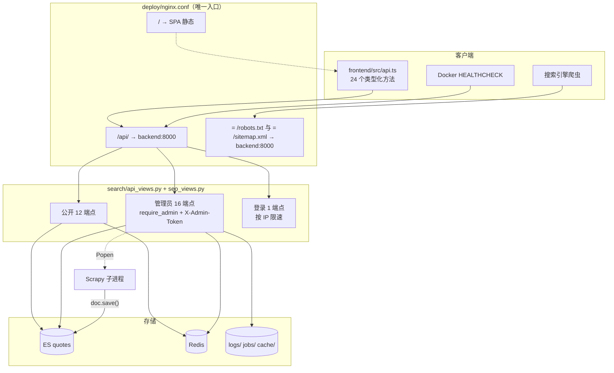

# XSearch 接口全量参考

> 项目：XSearch ｜ 版本：v1.1 ｜ 生成日期：2026-10-06 ｜ 依据：源码分析

本篇是速查手册：Django 全量 29 条路由逐端点详表（方法/路径/入参/响应/错误码）、ES `quotes` 索引字段全表、五个爬虫 item 字段矩阵。与《03-接口设计》的分工：那篇讲契约的设计意图与示例，本篇追求**完备与精确**——每个端点的每个参数边界值、每个错误码都直接对源码核对过。

## 一、接口总览图

## 二、通用约定

**鉴权**：仅一层管理员 token。登录 `POST /api/auth/login/` 签发，之后以请求头 `X-Admin-Token` 携带；12 小时有效、滑动续期、进程内存储（后端重启全失效）。鉴权失败统一 401 + `{"error":"未登录或登录已过期","code":"auth_required"}`。对接方还需知道两个边界行为：其一，token 校验失败时服务端会顺带清理全部过期 token（`require_admin` 的 `_purge_expired_tokens`），因此长期运行的管理面不会积累失效凭证；其二，登录接口在锁定期间**先于密码比较**返回 429——即使密码正确也会被拒，这是防爆破的预期行为，自动化脚本切勿把 429 当作"密码错误"的信号去做字典尝试。

**错误体**：统一 `{"error": "<中文可直接展示文案>", "code": "<机器码，可选>"}`。全部机器码只有三个：`auth_required`（401）、`not_found`（404）、`too_many_login_attempts`（429）。其余错误靠 `error` 文案区分。

**依赖降级**：ES 不可用时读接口返回 503 `{"error":"Elasticsearch 不可用: <异常>"}`（`_es_error()` 统一产出），两个例外——`/api/suggest/` 静默降级 200 `[]`，`/api/stats/` 降级 200 + `es_ok:false`；Redis 不可用时所有接口静默跳过缓存/统计照常出数据；唯 `/api/health/` 把依赖故障升格为 503 状态码本身。

**参数边界值速查**：`p` 非法回退 1；搜索 `sort` ∈ relevance/time/hot，`days` ∈ 7/30/90（其余值被忽略，等同不过滤）；headlines `hours` 夹 1-168 默认 36；crawl 的 `pages` 夹 1-20 默认 2；history `limit` 夹 1-200 默认 50；db docs 每页固定 20。

**CORS 与调用拓扑**：跨域响应头由 `xsearch/middleware.py` 白名单式下发（内置 Vite 5173/4173 四源，`FRONTEND_ORIGINS` 可追加），允许方法 GET/POST/PUT/DELETE/OPTIONS，允许头含 `X-Admin-Token`。但这层在标准部署里是"闲置保险"：开发态走 Vite 代理（同源），生产走 nginx 反代（同源），只有绕过代理直连后端的非常规用法才会触到 CORS。因此对接新客户端的首选形态是"同源反代"而非"申请 CORS 白名单"——后者会让 token 暴露在更多观测点下，且 OPTIONS 预检会让每个首请求多一跳。

## 三、公开端点详表（无需鉴权，共 13 条）

公开面的设计逻辑值得先说一句：**13 条里没有一条能改变服务端状态**（登录接口签发的 token 也只是进入管理面的门票），图片代理是唯一的"服务器替用户出网"端点且有白名单收口。这意味着公开面被攻破的最坏后果是读数据与借道打图床，没有写路径——这是攻击面计算时最重要的一个事实。

| # | 方法与路径 | 视图函数 | 入参 | 成功响应（要点） | 错误码 |
|---|---|---|---|---|---|
| 1 | GET `/` | `ServiceInfo.get` | — | `{service:"XSearch API", version:"2.1", endpoints:[6 条样例]}` | — |
| 2 | GET `/api/search/` | `api_search` | `q`（空则直接空结果不查 ES）、`source`（term 过滤走 post_filter）、`sort`、`days`、`p` | `{total, page, page_nums, results[], facets{sources[],days[]}, did_you_mean, corrected, fuzzy, suggestions[]}`；results 带 ES `_id` 与 `` 高亮 | 503（ES 故障） |
| 3 | GET `/api/suggest/` | `api_suggest` | `s` 前缀（空 → `[]`） | `["标题",...]` JSON 数组，completion fuzzy=2，保序去重，排除榜单来源 | ES 故障降级 200 `[]` |
| 4 | GET `/api/stats/` | `api_stats` | — | `{es_ok, total, by_source[size 20], top_keywords[Top8], es_error?截断 200 字}` | ES 故障降级 200；**不可当探针** |
| 5 | GET `/api/health/` | `api_health` | — | 200 `{status:"ok", checks:{elasticsearch,redis}, index:{name,docs}}`；docs 取不到为 null | 任一依赖挂 503 `{status:"degraded"}`；错误只回异常类名 |
| 6 | GET `/api/headlines/` | `api_headlines` | `hours`（默认 36，夹 1-168，非法回 36） | `{hours, total, items[≤20 同题去重], top_keywords[Top6]}`；AI 源保留全文、新闻截 150 字；Redis 缓存 120s | 503 |
| 7 | GET `/api/rankings/` | `api_rankings` | `source`（合法值：`aihot_hot`/`douyin_hot`/`news`/三新闻源/`aihot_daily`；默认 `aihot_hot`）、`p` | 榜单分支：`{source, total, items[]}` 按 rank 升序 size 300；新闻/日报分支：`{source, total, page, page_nums, items[]}` 时间倒序 20 条/页 + 60s 缓存 | 400 `{"error":"不支持的榜单来源"}`；503 |
| 8 | GET `/api/doc/<doc_id>/` | `api_doc` | 路径 `doc_id`（ES `_id`） | 全文字段 + `id`（keep_content=True 不截断） | 404 `{"code":"not_found"}`；503 |
| 9 | GET `/api/img/` | `api_img` | `u`（图片 URL，白名单域名） | 图片二进制 `FileResponse`，`Cache-Control: public, max-age=2592000`；本地磁盘缓存 30 天 | 400 非白名单/格式非法；502 图床不可达；413 大于 20MB；非 200 透传上游状态码；500 缓存失败 |
| 10 | POST `/api/auth/login/` | `api_admin_login` | body `{username, password}` | `{ok:true, token, username, expires_in:43200}` | 400 非法 JSON；401 账号或密码错；429 限速（带 `Retry-After`，code too_many_login_attempts）；503 未配置账号 |
| 11 | GET `/robots.txt` | `seo_views.robots_txt` | — | `text/plain`：Allow / + Disallow /crawl、/dbadmin、/login、/admin/ + Sitemap 绝对地址 | — |
| 12 | GET `/sitemap.xml` | `seo_views.sitemap_xml` | — | `application/xml`：4 栏目页 + AI 详情页（≤5000，带 lastmod）；Redis 缓存 1h；ES 故障降级仅栏目页仍 200 | — |
| 13 | `/admin/` | Django admin | — | 路由存在但未注册模型、nginx 不转发——**不可从公网到达** | — |

## 四、管理员端点详表（共 16 条）

本组除 #14（logout，本身不校验 token、幂等返回 ok）外均经 `require_admin` 装饰器；语义上 #14 仍属管理域——它吊销的就是请求头里的那枚 token。

| # | 方法与路径 | 视图函数 | 入参 | 成功响应 | 错误码 |
|---|---|---|---|---|---|
| 14 | POST `/api/auth/logout/` | `api_admin_logout` | 请求头 token | `{ok:true}`（token 无效也返回 ok，幂等） | — |
| 15 | POST `/api/crawl/start/` | `api_crawl_start` | body `{spider, pages?, js?, resume_job?}`；spider 必须在 SPIDERS 白名单（douyin_hot/aihot_hot/aihot_news/news_rss/news_backfill） | 202 `{started:true, pid, started_at, spider, label, job_dir, resumed}` | 400 非法 JSON；401；409 `{started:false, reason, pid?, started_at?}`（已有任务运行/未知爬虫/非法任务名/找不到恢复任务） |
| 16 | GET `/api/crawl/status/` | `api_crawl_status` | — | `{running, status(running/最近终态), started_at, spider, log_tail[≤30 行]}`（含服务器绝对路径，故须鉴权） | 401 |
| 17 | GET `/api/crawl/history/` | `api_crawl_history` | `limit`（默认 50，夹 1-200） | `{history:[{job_id, spider, status, started_at, ended_at, pid, items, ...}]}` 最新在前 | 401 |
| 18 | GET `/api/crawl/stats/` | `api_crawl_stats` | — | `{total, completed, failed, empty, running, success_rate, by_day[最近 14 天], by_spider[]}` | 401 |
| 19 | GET `/api/crawl/resumable/` | `api_crawl_resumable` | — | `{jobs:[{job_id, spider, modified, has_queue, size_kb}]}` 按 mtime 倒序 ≤20 条 | 401 |
| 20 | GET `/api/crawl/spiders/` | `api_crawl_spiders` | — | `{spiders:[{key, label}]}`（5 项） | 401 |
| 21 | GET `/api/crawl/schedule/` | `api_schedule_list` | — | `{jobs:[{id, spider, cron, enabled, created_at, label, pages, js, next_run?, last_fire?, last_status?, last_reason?}], history[≤10], scheduler_active}` | 401 |
| 22 | POST `/api/crawl/schedule/add/` | `api_schedule_add` | body `{spider, cron(五段), pages?, js?}` | 201 `{ok:true, job_id, scheduler_active, warning?}` | 400 缺参/非法 JSON/cron 校验失败/未知爬虫（`{ok:false, reason}`）；401 |
| 23 | POST `/api/crawl/schedule/remove/` | `api_schedule_remove` | body `{job_id}` | 200 `{ok:true/false}`（ok=false = 任务不存在或落盘失败，附 reason） | 400 缺 job_id；401 |
| 24 | POST `/api/crawl/schedule/update/` | `api_schedule_update` | body `{job_id, cron?, spider?, pages?, js?}`（未传字段保持原值） | 200 `{ok:true}` | 400 任务不存在/cron 非法/未知爬虫/落盘失败；401 |
| 25 | POST `/api/crawl/schedule/toggle/` | `api_schedule_toggle` | body `{job_id, enabled(默认 true)}` | 200 `{ok:true, enabled}` | 400 缺 job_id/任务不存在/落盘失败；401 |
| 26 | GET `/api/admin/db/overview/` | `api_db_overview` | — | `{total(主分片文档数), size_bytes, by_source[size 30]}` | 401；503 |
| 27 | GET `/api/admin/db/docs/` | `api_db_docs` | `source`、`q`（multi_match title^2+content）、`p` | `{total, page, page_size:20, page_nums, items[]}`（content 截 300，按 crawled_at 倒序） | 401；503 |
| 28 | GET/PUT/DELETE `/api/admin/db/doc/<doc_id>/` | `api_db_doc` | GET：—；PUT：body 为 `{title, content, tags, author}` 的子集（title 非空；title/author 变更自动重建 suggest）；DELETE：— | 200 `{ok:true}` 或全字段详情 | 400 非法 id/无可更新字段/空标题/非法 JSON；404 文档不存在；401；503；405 其他方法 |
| 29 | POST `/api/admin/db/purge/` | `api_db_purge` | body `{source, confirm}`（confirm 逐字等于 source） | `{ok:true, deleted:N}`（先 refresh 再删、残余补删一轮、联动清新闻缓存） | 400 缺 source/confirm 不一致；401；503 |

三个使用提示：其一，#15 的 409 是**正常业务态**（前端据此提示"已有采集任务在运行"），监控不应把它当错误率；其二，#22-25 的写失败语义是"如实告知"——落盘失败时 reason 会说明"重启后回到旧值"，调用方应把 `ok:false` 展示给管理员而非静默重试；其三，#28 三方法共用一个视图是 Django 路由机制决定的（`api_views.py` 961-965 行注释），勿拆。

## 五、ES `quotes` 索引字段全表

mapping 声明于 `crawler/pipelines.py` 的 `QuoteDocument`；索引名 `ES_INDEX`（默认 `quotes`）；中文文本字段建索 `ik_max_word`、检索 `ik_smart`+停用词（`ik_search_analyzer`）。

字段设计里有三组决策值得在查表之余理解，因为它们解释了"为什么有的字段这样、有的字段那样"。**第一组是双分析器**：`title/content/tags` 三个中文文本字段建索与检索用不同分析器——建索侧 `ik_max_word` 细粒度切分保证召回（"人工智能"切出"人工智能/人工/智能/…"全部词元），检索侧 `ik_smart` 粗分加停用词保证精确（查询词不再碎成虚词）。改这两个分析器中任何一个都会改变全部存量文档的检索行为，且需要重建索引才能对旧文档生效。**第二组是 Keyword 与 Text 的分界**：凡是"筛选维度"（`source`）、"精确标识"（`url`、`url_object_id`）、"排序聚合键"（`author`）都用 Keyword 不分词——`author` 参与 multi_match 但以完整值匹配信源名；`source` 支撑 terms 聚合与 must_not 排除。误把 `source` 建成 Text 是最常见的想当然事故（分面聚合会碎成词元桶）。**第三组是"语义复用"字段**：`view_nums` 在抖音源存热度值、在 aihot_hot 存信源印证数；`content` 在 backfill 存标题——单字段多语义是老课程数据模型的历史选择，读侧（`_list_item`）与前端按来源分支解释，扩展时照此惯例而非另起新字段，除非做 SOP-2 的全链路加字段。

| 字段 | 类型 | 分词/索引 | 写入来源（管道侧） | 读侧用途 |
|---|---|---|---|---|
| `suggest` | Completion | — | `input: [title, author]`；编辑文档时自动重建 | `/api/suggest/` 补全 |
| `title` | Text | ik_max_word / ik_smart+停用词 | item `title`（回退 author → content 前 40 字） | multi_match `^3`；高亮；phrase 纠错 |
| `content` | Text | 同上 | item `text`/`content`（上限 5000 字符，空则丢弃） | multi_match；高亮；列表截 150/300 字 |
| `tags` | Text | 同上 | item `tags`（数组） | multi_match `^2` |
| `author` | Keyword | 不分词 | item `author`（源站名/信源名） | multi_match 精确项；展示 |
| `url` | Keyword | 不分词 | item `url`（回退 `page_url`） | 前端外链 |
| `url_object_id` | Keyword | 不分词 | item `url_object_id`；**同时作为 `_id`**（缺省回退 `md5(url+content[:200])`） | 幂等去重锚点 |
| `front_image_url` | Keyword | 不分词 | item 值（当前各源均为空串） | 预留封面图 |
| `rating` | Float | — | `_to_float(item.rating)`（AIHOT 0-100） | AI 评分展示 |
| `praise_nums` | Integer | — | `_to_int` | 展示 |
| `view_nums` | Integer | — | `_to_int`（抖音热度值 / AIHOT 信源数复用） | `sort=hot` 排序键；榜单热度 |
| `reply_nums` / `danmaku_nums` / `coin_nums` / `favorite_nums` / `share_nums` | Integer | — | `_to_int` | 展示（B站遗留学段） |
| `duration` | Integer | — | `_to_int` | 预留（秒） |
| `rank` | Integer | — | `_to_int`（榜单排名） | 榜单接口 `sort:[{rank:asc}]` 排序键 |
| `source` | Keyword | 不分词 | item `source`，管道兜底取爬虫名 | 全系统过滤/聚合主维度 |
| `crawled_at` | Date | — | `utc_now()`（aware UTC） | 数据管理列表排序键 |
| `create_date` | Date | — | 各源发布时间（ISO/RFC822 解析） | 搜索 time 排序、时间分面、要闻窗口 |

`source` 全集 7 个活跃值 + 1 个存量：`news_chinanews`、`news_ithome`、`news_solidot`（news_rss 与 news_backfill 共用前两者）；`aihot_news`、`aihot_daily`、`aihot_hot`；`douyin_hot`；存量 `news_people`（已停采，仍可检索）。后端分组常量：`NEWS_SOURCES`（前三）、`AI_SOURCES`（中三）、`RANKING_SOURCES`（后二，被搜索与要闻排除）。

查询侧还有两个"看不见的字段"需要知道：`_id`（不在 `_source` 里，由各接口回传为 `id` 键，是详情页与数据管理全部单文档操作的寻址键）与 `_index`（恒为 ES_INDEX 配置值，调用方无需关心，但写 ES 快照恢复命令时要显式指定 `indices:"quotes"` 或改名后的值）。高亮片段同样不在 `_source` 里——它挂在命中结果的 `highlight` 键上，`api_search._extract` 的 `"".join(hl["title"])` 把分片拼回完整串，这也是前端必须转义后渲染的原因：高亮串是唯一携带 HTML 的响应内容。

## 六、Scrapy item 字段全表（写入侧契约）

管道 `index_item()` 消费的字段键全集与五个爬虫的产出矩阵如下。读表的钥匙是最后一行"最低要求四键"：item 契约是宽容的——缺键清洗为 None/空、脏值不炸管道，这让新增爬虫的接入成本极低；但宽容的另一面是**错键不报错**（比如把 `view_num` 拼成 `view_nums` 只会静默存成 None），所以新爬虫联调后务必到数据管理页抽查落库文档的真实形状。

| item 键 | news_rss | news_backfill | aihot_news | aihot_hot | douyin_hot | 说明 |
|---|---|---|---|---|---|---|
| `url_object_id` | md5(url) | md5(href) | `aihot_{id}` / `aihot_daily_{date}` | `aihot_{publicId}` | `douyin_hot_{rank}` | 即 ES `_id` |
| `title` | feed/文章 h1 | 锚文本[:300] | 事件标题 | 事件标题 | 榜单标题 | — |
| `content` | 正文[:5000]（中新网跟进文章页，其余 description） | =标题 | LLM 摘要+入选理由[:5000] | 标题 → story 综述覆盖（+最新进展） | "抖音热点榜第N名：标题" | 空则整条丢弃 |
| `author` | feed label | "中国新闻网" | 信源名或 AIHOT | "AIHOT" | "抖音热点" | — |
| `tags` | ["新闻", label] | ["新闻","中国新闻网","回填"] | ["AI资讯", category?, "AI精选"?] | ["AI热点","AIHOT"] | ["抖音热点"] | 数组 |
| `url` | 文章链接 | 存档链接 | `links.aihot` | `links.aihot` | `douyin.com/search/<标题>` | aihot 按站方要求保留 attribution |
| `front_image_url` | "" | "" | "" | "" | "" | 全部空串（预留） |
| `source` | `news_chinanews`/`news_ithome`/`news_solidot` | `news_chinanews` | `aihot_news` / `aihot_daily` | `aihot_hot` | `douyin_hot` | — |
| `create_date` | pubDate（RFC822/中文格式兼容） | 存档日期串 | `publishedAt`/`generatedAt`（ISO） | `latestAt`（ISO） | `datetime.now(timezone.utc)` | 解析失败为 None |
| `rating` | — | — | `score`（0-100） | — | — | 仅 aihot_news |
| `view_nums` | — | — | — | `sourceCount`（信源印证数） | 热度值（万×10000） | — |
| `rank` | — | — | — | 榜单 rank | 解析序 rank | 仅榜单类 |

管道附加写入（爬虫 item 之外）：`crawled_at=utc_now()`；`suggest={"input":[title, author]}`；数值字段经 `_to_int/_to_float` 清洗（脏值 → None）。**item 契约的最低要求**只有四键：`title`（或可回退）、`content`（非空，否则丢弃）、`url`（或 `page_url`）、`source`（或由管道取爬虫名兜底）——新增爬虫按 SOP-1 对齐即可。

## 七、前端 api.ts 方法 ↔ 端点对照

`frontend/src/api.ts` 的 `api` 对象共 24 个方法（另有模块级工具函数 `imgUrl` 构造图片代理地址），与后端端点一一对应：`search`→#2、`suggest`→#3、`stats`→#4、`doc`→#8、`imgUrl`（URL 构造）→#9、`headlines`→#6、`rankings`→#7、`adminLogin`→#10、`adminLogout`→#14、`crawlStart`→#15、`crawlStatus`→#16、`crawlHistory`→#17、`crawlStats`→#18、`crawlSpiders`→#20、`dbOverview`→#26、`dbDocs`→#27、`dbDoc`/`dbDocUpdate`/`dbDocDelete`→#28（三方法）、`dbPurge`→#29、`scheduleList`→#21、`scheduleAdd`→#22、`scheduleRemove`→#23、`scheduleUpdate`→#24、`scheduleToggle`→#25。未封装端点：#1（服务自描述）、#5（health，由 Docker HEALTHCHECK 直接打）、#11/#12（SEO 给搜索引擎）、#19（resumable，前端采集管理页未接 UI，属后端先行能力）。这张双清单的运维价值在《03-接口设计》第六节已述：改后端响应字段时，前端对应 interface 会在 `npm run build` 的 vue-tsc 阶段立刻报警——它是本仓库事实上的契约测试。

## 八、接口演进与兼容性约定

接口要长期活下去，需要成文的演进规则。依据这个仓库已有的实际做法，约定如下：

**响应演进只增不改**。历史先例是搜索结果增加 `id` 字段（详情页按 `_id` 取文的改造）与 `facets`/`corrected`/`fuzzy` 等纠错字段——全部是新增键，旧客户端（当时的页面代码）不受影响。反过来，`/api/ai/item` 整个端点被删除时，是连同前端调用一起下线的（`DocDetailTests.test_title_guessing_endpoint_is_gone` 防回流）。因此约定：给既有端点**加可选字段**随时可做；**删字段或改语义**必须同一次提交里改完前端所有调用点，并核对《03-接口设计》与本篇两份文档。

**错误码枚举保持封闭**。`code` 字段目前只有三个值（auth_required/not_found/too_many_login_attempts），前端 `ApiError.code` 的类型就是宽松字符串，但 `request()` 的 401 分支逻辑只认 HTTP 状态码而非 code。新增错误场景时优先复用既有状态码语义（配置缺失用 503 而非发明新码——`test_login_without_config_rejected` 注释明确了这个选择：原 500 改 503 是为了让前端/监控不把它当程序崩溃），确需新 code 时在《03》与本篇同步登记。

**版本标识的现状与边界**。`ServiceInfo` 返回 `version: "2.1"`，但全站没有 URL 版本前缀（`/api/v1/...` 这类）——单人项目、前后端同仓同批发布的形态下，版本协商由"同批部署"保证，这个简化是合理的。若未来出现第三方调用方或前后端独立发布，第一步应是把公开读接口加 `/api/v2/` 前缀并行跑一段，而不是依赖 version 字段做运行时协商。

**端点语义的不可变承诺**。有三个行为被测试钉死，任何演进都不应破坏：`/api/health/` 必须真检依赖且不泄露错误消息（HealthEndpointTests）；`/api/search` 空关键词不查 ES（ApiSearchTests）；榜单来源永远被搜索与要闻接口排除（HeadlinesTests/`must_not` 断言）。改动这三条任何一个都等于改变系统对外的承诺，需要当作破坏性变更对待。

## 九、错误码与状态码总表

状态码分布有一个鲜明的特征：**2xx 里混着降级**（stats/suggest/sitemap 的依赖故障都不以 4xx/5xx 表达），**5xx 只有 502/503 两个**且都有明确语义（图床不可达/依赖不可用），全站没有裸 500——这不是巧合而是文件头的总约定："所有接口在 ES/Redis 不可用时返回结构化错误（非 500），前端据此降级展示"。对接方因此可以建立一条简单纪律：收到 5xx 一律重试或告警，收到 2xx 仍需检查业务降级字段（es_ok），4xx 则一律是调用方的问题。

| 状态码 | 触发条件 | 响应体特征 | 典型来源端点 |
|---|---|---|---|
| 200 | 正常 / 各类降级（stats 的 es_ok:false、suggest 的 []、sitemap 降级栏目页） | 业务体或降级体 | 全部公开读接口 |
| 201 | 定时任务创建成功 | `{ok:true, job_id, ...}` | schedule/add |
| 202 | 采集任务已异步启动 | `{started:true, pid, ...}` | crawl/start |
| 400 | 参数缺失/非法/白名单外/confirm 不一致/JSON 坏体 | `{error}` 或 `{ok:false, reason}` | 大部分写接口与 rankings |
| 401 | 未登录/token 过期 | `{error, code:"auth_required"}` | 全部管理员接口 |
| 404 | 文档不存在 | `{error, code:"not_found"}` | doc、db/doc |
| 405 | 不支持的 HTTP 方法 | `{error:"不支持的方法"}` | db/doc（三方法视图兜底分支） |
| 409 | 启动冲突（已有任务/未知爬虫/非法任务名） | `{started:false, reason}` | crawl/start |
| 413 | 图片超 20MB | `{error:"图片过大"}` | img |
| 429 | 登录限速锁定中 | `{error, code:"too_many_login_attempts"}` + `Retry-After` 头 | auth/login |
| 502 | 图床不可达 | `{error:"图床不可达"}` | img |
| 503 | ES 不可用（读接口）/ 管理员账号未配置 / 依赖探针失败 | `{error}` 或 `{status:"degraded"}` 或 503 配置缺失 | 读接口、login、health |

使用建议：对接新客户端时先实现 401（清 token 重登）与 503（就地报错不重试轰炸）两个通用分支，再按业务处理 409/429/404；机器判断永远优先读 `code` 字段（仅三个值，枚举稳定），文案展示读 `error` 字段。另有一个容易踩的细节：429 的 `Retry-After` 是秒数而非 HTTP 日期，`fetch` 侧读取响应头后直接 `setTimeout` 即可；409 的响应体里带 `pid` 与 `started_at`，采集管理页用它展示"正在运行的那个任务是谁"，对接方可以复用这个形状。本篇与《03-接口设计》合并构成接口文档全集：契约变更时请两篇同改，并跑一遍 `python manage.py test search`——110 个测试中有相当一部分断言的就是本篇表格里的边界值。
