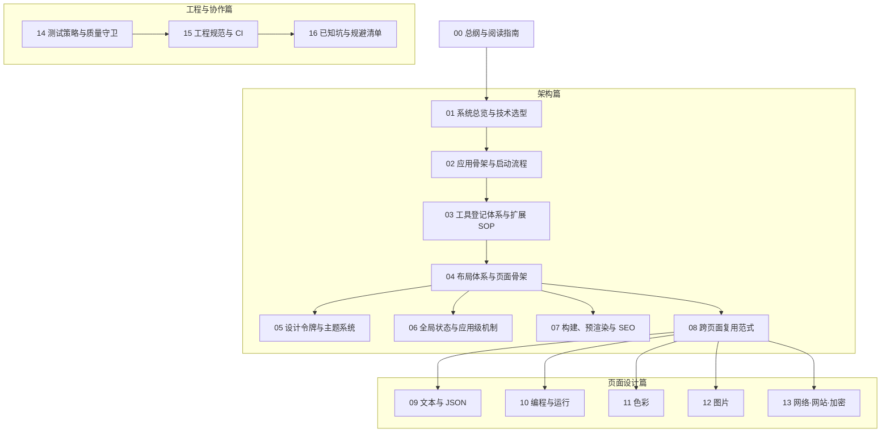

# 00 · 总纲与阅读指南

> **一句话摘要**：devtools 架构文档体系的入口——17 册分册的结构、推荐阅读路径、任务导向索引、术语表与写作维护约定。
> **目标读者**：全体 ｜ **关联文档**：全部分册（见 §2 总览表）

## 1. 项目一句话

devtools 是一个**纯前端在线开发者工具箱**：Vue 3.5 + TypeScript 5 + Vite 8 + Element Plus 2.14 + Pinia + Tailwind CSS 4，142 个工具按 9 大分类组织（分类与工具的唯一真源为 `src/config/tools/catalog.ts`，下称 **catalog**）。零后端、零登录，全部计算在浏览器本地完成；工具输入经 URL hash 而非 query 同步，践行「输入不出设备」的隐私承诺（`src/composables/useUrlState.ts`；README.md）。构建产物 `dist/` 为纯静态文件，任意静态托管即可部署。

## 2. 文档体系总览

全体系 17 册分三篇：**架构篇（00–08）**按「骨架 → 数据 → 外观 → 状态 → 构建」的依赖顺序排列；**页面设计篇（09–13）**按交互范式聚合功能域；**工程与协作篇（14–16）**面向维护者与后续 AI 协作；**附录（17）**为全量速查数据，不承担叙事。

| 篇 | 编号 | 文档 | 覆盖范围 | 目标读者 | 关键图表 |
|---|---|---|---|---|---|
| 架构 | 00 | **总纲与阅读指南**（本册） | 体系结构、阅读路径、任务索引、术语 | 全体 | 文档地图 |
| 架构 | 01 | [系统总览与技术选型](01-系统总览与技术选型.md) | 项目定位、技术栈选型理由、系统分层、一次工具调用的端到端数据流 | 全体 | 分层图、数据流图 |
| 架构 | 02 | [应用骨架与启动流程](02-应用骨架与启动流程.md) | main.ts 启动序列、App.vue 组装、EP 按需注册、路由派生联动、chunk 失败自愈、路由级埋点 | 新工程师 + AI Agent | 启动时序图 |
| 架构 | 03 | [工具登记体系与扩展 SOP](03-工具登记体系与扩展SOP.md) | catalog 真源与校验、三方登记与守卫测试、拼音索引、39 条历史重定向、**新增工具标准操作流程** | 新工程师 + AI Agent（写码前必读） | 新增工具流程图 |
| 架构 | 04 | [布局体系与页面骨架](04-布局体系与页面骨架.md) | 壳层链 CategoryLayout→ToolShell→三模板 + ImageToolLayout、layout 字段与满高切换、标题栏整合、面板套件 | 页面开发者 | 组件树、布局选型表 |
| 架构 | 05 | [设计令牌与主题系统](05-设计令牌与主题系统.md) | main.css 五层结构、surface 色阶、EP 令牌桥与全局皮肤层、暗色切换、图标子集体系 | 页面/样式开发者 | 令牌层级图 |
| 架构 | 06 | [全局状态与应用级机制](06-全局状态与应用级机制.md) | settingsStore、模块级单例 composables、CommandPalette 与拼音搜索、useUrlState 隐私边界、收藏/最近、埋点 | 新工程师 + AI Agent | 状态流转图 |
| 架构 | 07 | [构建、预渲染与 SEO](07-构建预渲染与SEO.md) | vite 配置要点、seo-prerender 插件机制、SEO 数据三层、sitemap/robots/llms.txt、部署方式 | 维护者 | 构建流水线图 |
| 架构 | 08 | [跨页面复用范式](08-跨页面复用范式.md) | 执行模式三分布、结果呈现模式、共享行为 composables、URL 状态范式 | 页面开发者 | 交互契约图 |
| 页面 | 09 | [文本与 JSON 工具设计](09-文本与JSON工具设计.md) | text 19 + json 12 共 31 页；自动/显式执行并存、ToolCodePanel 双栏范式 | 页面开发者 | 域内页面地图 |
| 页面 | 10 | [编程与运行工具设计](10-编程与运行工具设计.md) | dev 40 + run 4 共 44 页；runner 控制器与预览消息协议、API 调试器等复杂页 | 页面开发者 | runner 消息时序图 |
| 页面 | 11 | [色彩工具设计](11-色彩工具设计.md) | color 15 页；watch 实时合成范式、色彩空间转换算法 utils、WCAG 对比度评级 | 页面开发者 | 色彩数据流 |
| 页面 | 12 | [图片工具设计](12-图片工具设计.md) | image 家族约 25–28 页（含双口径说明）；ImageToolLayout 三变体、ImagePanel 家族、显式执行 | 页面开发者 | 三变体布局图 |
| 页面 | 13 | [网络·网站·加密工具设计](13-网络网站加密工具设计.md) | network 9 + site 10 + encrypt 8 共 27 页；速查/生成/加解密三类范式、WebCrypto | 页面开发者 | 分类范式表 |
| 工程 | 14 | [测试策略与质量守卫](14-测试策略与质量守卫.md) | vitest 双环境机制、setup 与 monaco stub、全页巡检、四组守卫测试、显式等待规约 | 维护者 + AI Agent | 测试分层表 |
| 工程 | 15 | [工程规范与 CI](15-工程规范与CI.md) | eslint 关键规约、prettier/typecheck、CI 五道门禁、发布核对清单 | 维护者 + AI Agent | CI 流水线图 |
| 工程 | 16 | [已知坑与规避清单](16-已知坑与规避清单.md) | 仍有效的踩坑规约（自 RUNTIME_AUDIT / UI_AUDIT / CODE_REVIEW 提炼并复核）、变更触发器表 | AI Agent 优先 + 新工程师 | 变更触发器表 |
| 附录 | 17 | [全工具速查矩阵](17-全工具速查矩阵.md) | 142 工具 × id × layout × 测试覆盖全量清单与汇总统计 | 全体 | — |

## 3. 文档地图

图释：边表示「先读前者更好理解后者」的主干依赖，并非全量引用关系；架构篇内部为线性主链 + 布局体系向四个横切主题分叉，页面设计篇五册平行、均以 08 的跨页范式为前置。17 号附录不在主干中，被 03（登记）、14（测试覆盖口径）按需引用。

## 4. 推荐阅读路径

- **新工程师（人类）首次接手**：01 → 02 → 03 → 04 → 08 → 自己负责的域册（09–13）；涉及样式再读 05，涉及构建部署读 07，涉及测试读 14。
- **AI Agent 写码前**：03（登记 SOP 与守卫）→ 04（布局契约）→ 08（页面范式）→ 16（避雷清单）→ 目标域册；改全局样式必读 05，动 catalog 必读 03。
- **维护 / 发布**：07 → 14 → 15 → 16。
- **快速查某个机制**：从 §5 术语表的「详见」列直接跳册。

### 4.1 按场景选路

上面的路径面向「整体上手」；下面按**本次改动类型**收敛必读集，避免每次全读。三行的选路依据均来自对应册自身的「目标读者」标注与变更指引节。

| 场景 | 必读（顺序） | 理由一句话 |
|---|---|---|
| **修 bug 前必读三册** | 16（坑清单 + §3 排查决策树）→ 目标域册（09–13）→ 14（§3.4 假红排查，若涉及测试） | 16 册先排除已知坑（如满高、特异性、revoke 泄漏），域册给该页的执行契约，14 册防「修出假红」 |
| **写新功能前必读四册** | 03（§6.1 新增工具 SOP）→ 04（§2 布局契约）→ 08（§2 执行/呈现范式）→ 16（§4 变更触发器表） | 四册分别管「登记不漂移」「页面骨架选型」「交互范式对齐」「改完要跑什么守卫」 |
| **只改样式读一册** | 05（先 §3.4 特异性阶梯与 §3.2 令牌桥，再 §6 实操配方） | 样式问题九成出在「令牌 vs 散写」与「特异性被皮肤层压过」，都在 05；连带守卫见 16 §4「改 main.css」行 |

读法提示：三张选路表的分界是「改动是否会越出单页」——只动一个页面的 scoped 样式或文案，选路表第三行即可；一旦要动 `catalog.ts`、`main.ts`、`main.css`、路由或共享组件（ToolShell/ImagePanel 等），影响面立刻跨页，必须回到「写新功能」四册路径，并查 16 §4 对应行的连带动作。判断某文件是否共享，用 17 号附录的覆盖列与 §5 术语表「详见」列交叉确认。

### 4.2 任务导向索引（我要做 X → 去哪册哪节）

节号已与各册实际标题逐一核对（`grep '^## \|^### '`）；若某册后续改版，请同步维护本表。

| 我要做 X | 去哪 | 那一节讲什么 |
|---|---|---|
| 新增一个工具 | 03 §6.1「新增工具 SOP」 | 三方登记步骤单 + 守卫测试 + 拼音索引重建 |
| 下线一个工具 | 03 §6.2「下线工具 SOP」 | 登记移除、重定向处置、`emptyOutDir` 残留页防范 |
| 工具改名（仅显示名 / 连 id 一起改） | 03 §6.3「改名 SOP」＋ §3.2 RENAMED_TOOL_IDS | id 变更必须补 `RENAMED_TOOL_IDS` 迁移本地偏好 |
| 新页面接入（非工具页 / 改壳层挂点） | 02 §2.3「路由派生与运行时挂点」＋ 04 §2.1 | 路由派生机制与壳层链 CategoryLayout→ToolShell |
| 加一个全局偏好项 | 06 §2.2 settingsStore ＋ §2.3 localStorage 键清单 | 唯一 Pinia store 的扩项方式与既有 3 个存储键 |
| 样式类不生效排查 | 05 §3.4 特异性阶梯 ＋ 16 §2.3 样式与令牌 | 双类 0-2-0 策略、令牌 vs 散写、穿透块位置 |
| 新增一个图标 | 05 §3.6 图标管线 | 静态 `ms:xxx` 写法 → `pnpm icons:build` → 子集守卫 |
| 暗色适配 | 05 §2.4 主题切换链路 ＋ §3.2 令牌桥映射表 | `.dark` class 切换与 EP 变量随令牌走 |
| 发版上线 | 07 §6.1 发布 runbook ＋ 15 §2.1 CI 流水线 | 编号步骤清单与五道门禁 |
| 改 SEO（title/description/JSON-LD） | 07 §2.2 SEO 数据三层 ＋ §3.2 seo-data-entry 输出结构 | 构建期与水合端必须两端同步 |
| 改 robots / sitemap / llms.txt | 07 §2.3 爬虫协议产物 | 三类产物的生成位置与真实样例 |
| 测试假红（本地过 CI 挂 / 反之） | 14 §3.4 假红排查流程 | 双环境差异、显式等待、SKIP 表机制 |
| 运行器加新语种（如 Python） | 10 §2.3 运行器沙箱协议 ＋ §3.1/3.2 | 消息协议、useRunnerPreview/Controller 装配边界 |
| 图片域加一个新变体页面 | 12 §2.1 三变体布局 ＋ §3.1 ImagePanel 家族契约 | dual/sidebar/single 选型与面板 props |
| ⌘K 面板调试 / 加全局快捷键 | 06 §3.3 CommandPalette 详解 ＋ §3.5 快捷键清单 | 516 行组件的搜索链路与全站快捷键登记表 |
| 改了 catalog 之后要跑什么 | 16 §4 变更触发器表「增删工具」行 | 四组守卫 + `pinyin:build` + build 页数核对 |
| 改判某工具的 layout 模板 | 03 §3.5 assertLayouts ＋ 04 §2.2 三模板契约 | catalog 注释写改判理由，`layouts.test.ts` 守卫 |
| 新增全局 EP 组件 | 02 §3.1 启动序列 ＋ 15 §3.2 模板组件白名单 | main.ts 注册 + 逐组件样式，重组件保持页面局部引入 |
| 引入新的第三方依赖 | 15 §6.4 新增依赖决策树 ＋ 01 §6.2 | 先查 utils 可复用实现，重库评估分包组归属 |
| 请求类工具要真实出站 | 01 §5 例外一 ＋ 13 §1 | 先更新 01 §5 隐私边界表述再动手（设计变更） |

上表是「改代码前」的入口；「改代码后」的出口统一是 16 §4 变更触发器表——它按改动类型列出必须连带的守卫与验证，与本表一一衔接。

## 5. 术语表

| 术语 | 一句话定义 | 详见 |
|---|---|---|
| catalog | 142 个工具的唯一登记真源（每条 7 字段：id/name/description/icon/categoryId/link/layout），路由与页面清单皆由它派生 | 03 |
| 三方登记 | `catalog.ts` / `config/tools/routes.ts`（TOOL_ROUTE_PATHS）/ `toolComponents.ts` 三处必须同步登记，由 `tool-registry.test.ts` 守卫 | 03 |
| 路由派生 | 工具路由不手写：`router/routes/tools.ts` 遍历 catalog 生成，缺组件映射构建期抛错 | 02 / 03 |
| ToolShell | 工具页统一壳组件（props `tool`；插槽 `#actions`/`#primary`/`#secondary`/`#toolbar`），约 120 页直接使用 | 04 |
| 三模板 | WorkbenchLayout（77 页）/ CenteredLayout（38 页，缺省）/ CanvasLayout（27 页）三种页面骨架 | 04 |
| layout 字段 | catalog 中每工具声明 `workbench/centered/canvas`，`assertLayouts` 构建期校验合法性 | 03 / 04 |
| ImageToolLayout | 图片家族专用布局，`dual/sidebar/single` 三变体，图片域约 25 页统一经它包装 | 12 |
| ToolActionBar（borderless） | 标题栏动作条：选项控件与动作按钮同栏，141 页使用；现行约定为 borderless 形态挂入 ToolShell `#actions` | 04 / 08 |
| ToolCodePanel | 输入/输出面板统一载体：editable→Monaco 编辑器，只读→CodeBlock；84 页使用 | 04 / 08 |
| 满高范式 | workbench/canvas 页整体 `height: calc(100vh - var(--header-height))`，面板 flex 收口 + 内部滚动 | 04 |
| 令牌桥 | main.css `:root:root` 段把 `--el-*` 系列映射到自有 `--color-*` 令牌，EP 主题随令牌走 | 05 |
| 皮肤层 | main.css 对 `.el-*` 的全局重绘段，靠 `.el-button.el-button` 双类 0-2-0 特异性策略压过 EP 默认样式 | 05 |
| 模块级单例 | useToolSearch / useCommandPalette / useTheme 等以模块级 ref 充当全局状态；Pinia 仅 settingsStore 一例 | 06 |
| 拼音索引 | `src/generated/tool-pinyin-index.ts`（构建期 `pnpm pinyin:build` 生成，勿手改），⌘K 搜索的拼音命中 | 06 |
| 双口径 | `src/views/tools/` 物理目录仍按 16 个旧家族组织，与 catalog 的 9 分类并存的两套划分 | 03 |
| 守卫测试 | tool-registry / redirects / icon-subset / tool-pinyin-index 四组一致性测试，防登记体系漂移 | 14 |
| 隐私承诺 | 输入不出设备：纯前端计算 + `useUrlState` 走 URL hash 不走 query（避免输入进入服务器日志） | 01 / 06 |
| seo-prerender | `build/plugins/seo-prerender.ts` 构建期插件：静态渲染每条路由为带 meta/JSON-LD 的 HTML（152 个），运行时由 usePageSeo 水合接管 | 07 |
| allToolPages 巡检 | `src/views/tools/allToolPages.dom.test.ts`：除 SKIP 表（现 1 项 dev-screen-recorder）外逐页挂载 142 页的 jsdom 冒烟 + layout 守卫 | 14 |
| runId 轮次 | runner 每次运行递增的序号：iframe postMessage 必须携带与 `activeRunId` 相符的 runId 才被接受，用于丢弃过期轮次的消息与防连点叠加 | 10 |
| rolldown 分包组 | Vite 8 `rolldownOptions.output.codeSplitting.groups`（manualChunks 的后继），七个组按「先特判重组件、后兜底大族」排列，顺序有语义 | 01 / 07 |
| 执行模式三分布 | 全站页面按「如何触发计算」分三类：显式按钮约 55 页 / watch 自动约 53 页 / 静态速查页不计算，页面接入时必须显式择一 | 08 |

## 6. 写作与维护约定

1. **统一骨架**：除本册外，每册固定六节——概述 / 架构与数据流 / 核心实现 / 设计决策与取舍 / 边界情况与已知限制 / 变更指引。「设计决策」讲 Why 而非复述 What，不设独立 ADR 目录。
2. **图表规范**：静态结构与依赖用 `graph TD`，状态与页面流转用 `stateDiagram-v2`，多角色异步交互用 `sequenceDiagram`；每张图配 2–3 句文字解读，禁止裸图。
3. **证据链**：关键结论标注文件路径（关键处含行号），做到可回溯；无法回溯的内容要么删除，要么显式标注「推测，待确认」。
4. **事实基准**：文档与代码冲突时**以代码为准**，并在对应册「边界情况与已知限制」节记录偏差，留待修订。
5. **维护触发**：修改某模块后应同步更新其对应册；具体触发器（何时重跑生成脚本、何时核对守卫清单）见 16 册「变更触发器表」。任务导向索引（§4.2）指向的节号属本册维护面，目标册改版时同步核对。
6. **物理位置**：本体系位于仓库根 `architecture/` 目录，与 `docs/` 的过程性档案物理分离；文件命名 `NN-中文主题.md` 序号化。

## 7. 与 docs/ 的关系

`docs/` 下现有 8 个文档与 `docs/superpowers/{plans,specs}` **原位保留、不迁移**，本体系按需引用，规则如下：

- **仍现行、可作为设计依据**：`docs/RUNTIME_AUDIT.md`（2026-09-24 全路由运行期审计）、`docs/UI_AUDIT.md`（2026-09-23 UI 与可访问性审计）、`docs/superpowers/specs/2026-09-14-full-site-redesign-design.md`（全站重设计规格，现行设计来源）。
- **历史过程档案**（CODE_REVIEW / FIX_REPORT / DISSOLVE_GENERATE_PLAN / PRODUCT_TECH_REVIEW / CATEGORY_GOVERNANCE_PROPOSAL / HANDOFF 及 plans/ 全部）：仅作演进背景引用，**不作为现行设计依据**。
- 涉及历史决策时，各册「设计决策与取舍」节直接给出结论与理由；需要过程细节再跳转旧档，避免把过程叙事搬进本体系。
