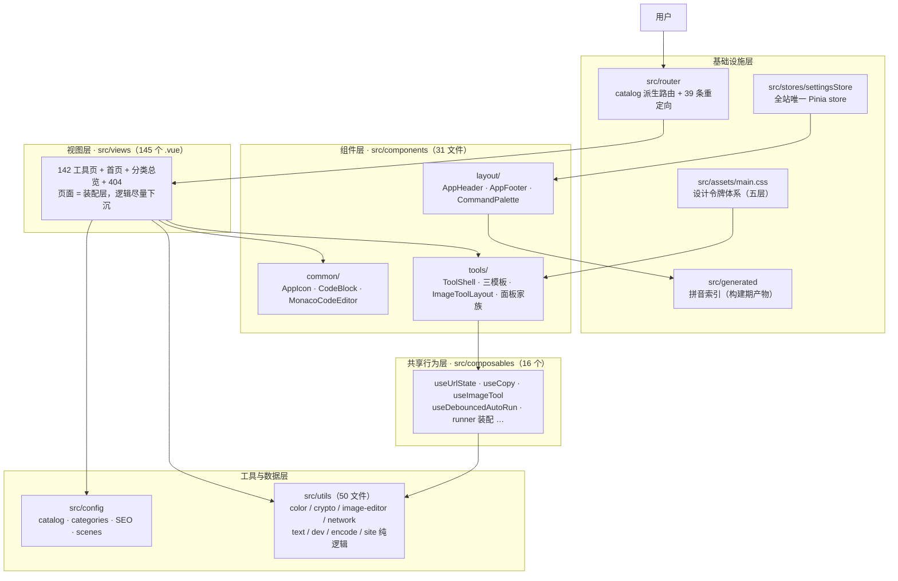
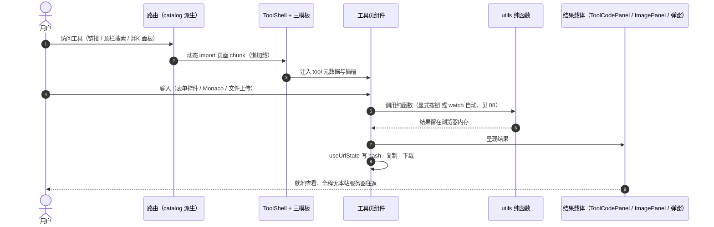
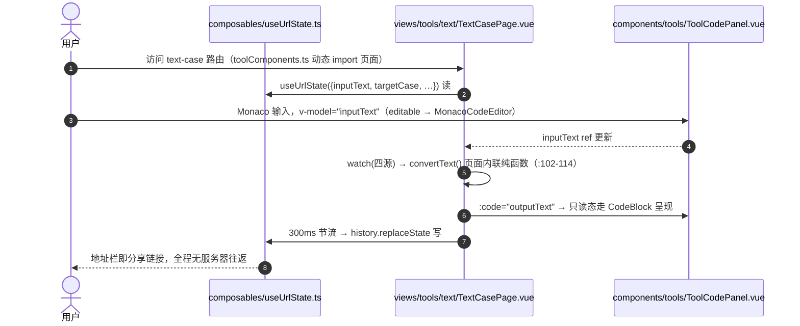
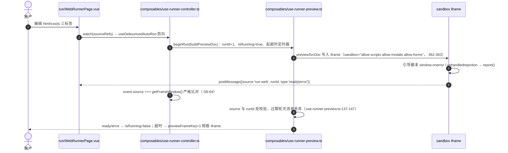

# 01 · 系统总览与技术选型

> **一句话摘要**：devtools 是什么、为什么是这套技术栈、代码分几层、一次工具调用如何端到端流动。
> **目标读者**：全体 ｜ **关联文档**：[00 总纲](00-总纲与阅读指南.md) · [02 应用骨架](02-应用骨架与启动流程.md) · [03 登记体系](03-工具登记体系与扩展SOP.md) · [05 设计令牌](05-设计令牌与主题系统.md) · [07 构建与 SEO](07-构建预渲染与SEO.md) · [10 编程与运行](10-编程与运行工具设计.md)

## 1. 概述

本册回答四个问题：系统的定位与边界（§1）、代码如何分层（§2.1）、一次工具调用如何流动（§2.3）、关键技术为什么这么选（§4）。读完应能回答验收问题之一——「系统如何分层」；「某机制为何如此设计」的细节分散在各专题册，本册只给结论与指路。

### 1.1 项目定位与边界

- **纯前端、零后端、零登录**：仓库由早期 `html5-examples` 项目抽离而来（README.md），所有工具的计算都在浏览器本地完成；`dist/` 为纯静态文件，任意静态托管即可部署（history 路由需 try_files 回退，见 07）。
- **规模**：142 个工具、9 个分类，唯一真源 `src/config/tools/catalog.ts`；`src/views/` 共 145 个页面级 `.vue`（142 工具页 + 首页 + 分类总览页 + 404）。
- **隐私承诺——「输入不出设备」**：本站自身没有任何接收用户输入的服务端。该承诺的**精确边界与两类出站流量例外**见 §5，对外表述时以 §5 为准。
- **界面与受众**：全中文界面（`App.vue` 经 `el-config-provider` 挂 zh-cn 语言包）；browserslist 下限 Chrome 111 / Edge 111 / Firefox 113 / Safari 15 / iOS 15（package.json）——目标用户是开发者，因此允许使用 `:has()`、`color-mix()` 等较新 CSS 能力（实证见 §5 第 5 条）。
- **工程底线**：TypeScript 全量类型检查（vue-tsc）、ESLint + Prettier、Vitest 测试（41 个测试文件）、CI 五道门禁（详见 15）。

### 1.2 规模账目（find / grep / wc 实测）

分层叙述前先对齐数字口径，下文与各分册引用的规模均以此表为准；重跑下方命令可复核。

| 账目 | 数值 | 实测手段（仓库根执行） |
|---|---|---|
| 工具数（catalog 登记） | 142 | `grep -c "categoryId: '" src/config/tools/catalog.ts` |
| 分类数 | 9 | 17 册分组表与 catalog 一致（json/color/text/dev/network/image/encrypt/site/run） |
| 页面级 .vue | 145 | `find src/views -name "*.vue" \| wc -l`（142 工具页 + 首页 + 分类总览 + 404） |
| 组件层文件 | 31 | `find src/components -type f \| wc -l` |
| composables | 16（非测试） | `ls src/composables/*.ts` 排除 `*.test.ts` |
| utils .ts | 50（38 非测试 + 12 测试） | `find src/utils -name "*.ts" \| wc -l` 与 `! -name "*.test.ts"` 对比 |
| 测试文件 | 41 | `find src -name "*.test.ts" \| wc -l` |
| 预渲染 HTML | 152 | `find dist -name "*.html" \| wc -l`（账目明细见 07 §3.3） |
| 有专属 dom 测试的页面 | 11 | 17 册「测试 ✓」列口径 |

## 2. 架构与数据流

### 2.1 系统分层



图释：依赖方向是单向向下的——视图层装配组件，组件经 composables 调用 utils 纯函数；反向只通过 props / 事件回传。基础设施横切所有层（路由决定渲染哪个页面，令牌决定一切外观）。`src/config` 既是运行时数据源，也是构建期（预渲染、拼音索引）的数据源，这条双面身份是全项目最核心的机制，展开见 03。

| 层 | 位置与规模 | 职责一句话 | 代表文件 | 深入阅读 |
|---|---|---|---|---|
| 视图层 | `src/views/`，145 个 .vue | 页面装配与页面级状态，复杂逻辑下沉 | `views/tools/json/JsonFormatPage.vue` | 04、09–13 |
| 组件层 | `src/components/`，31 文件 | 壳层与三模板、通用件、应用框架 | `components/tools/ToolShell.vue`、`components/common/AppIcon.vue` | 04、05 |
| 共享行为层 | `src/composables/`，16 个 | 跨工具行为复用（URL 同步、复制、防抖自动执行、图片状态、runner 装配） | `composables/useUrlState.ts` | 06、08 |
| 工具与数据层 | `src/utils/` 50 文件 + `src/config/` | 可单测的纯逻辑；catalog 等唯一数据真源 | `utils/color/`、`config/tools/catalog.ts` | 03、09–13 |
| 基础设施 | `router/` `stores/` `assets/` `generated/` `vendor/` | 派生路由、轻状态、令牌、生成物、格式化库 stub | `router/index.ts`、`assets/main.css` | 02、05、06 |
| 测试层 | 41 个 `*.test.ts` + `src/test/` | node/jsdom 双环境 + 四组守卫测试 | `src/test/setup.ts`、`src/test/monaco-module-stub.ts` | 14 |
| 构建期 | `build/` + `vite.config.ts` | SEO 预渲染、图标/拼音生成、分包 | `build/plugins/seo-prerender.ts` | 07 |

### 2.2 一段新代码放哪层：五层准入判据与反例

分层图只画了「谁依赖谁」；落地时更常问的是「这段代码放哪」。下表给每层一条**准入判据**和一个**不该放这层的反例**，反例均以真实文件作证——它们是按判据放对位置的正例，反向说明越层写法会在哪里被拆掉。

| 层 | 准入判据 | 不该放这层的反例（真实佐证） |
|---|---|---|
| views | 页面装配 + 页面级状态；**仅此页使用**的交互逻辑可以内联 | 跨页复用的工具元数据/路由判断：页面不自建标题与分类，统一 `toolFromPath(useRoute().path)` 取 catalog 数据（`TextCasePage.vue:11-12` 注释即契约），自写路由匹配会与 catalog 派生漂移 |
| components | props 驱动、无页面业务状态的可复用 UI；域级组件进 `components/tools/<域>/` | 单页私有的复杂交互状态机：裁剪框拖拽/缩放状态全部内联在页面（`ImageCropPage.vue`，1478 行），未塞进 `ImagePanel`——ImagePanel 家族契约是域级复用（12 §3.1），塞进去会让其余 24 个图片页为它买单 |
| composables | ≥2 处复用、且含响应式或 DOM 副作用的行为 | 为「将来可能复用」预抽象：runner 只抽四页**完全一致**的装配，引擎差异留在各页——`src/composables/use-runner-controller.ts:1-8` 头注原文即此纪律（摘录见下） |
| utils | 可单测的纯计算，不 import Vue | 响应式全局行为：主题切换是 `src/composables/useTheme.ts`（ref + localStorage + 切 `<html>` class）而非 util——放进 utils 就得把 Vue 依赖拖进纯函数层（05 §3.5） |
| config | 唯一真源数据 + 构建期校验，静态、声明式、可被 vite.config 直接 import | 可变的运行时状态：「最近使用/收藏」是 localStorage 单例语义，落在 `useToolPreferences`（06 §2.3 全仓仅 3 个存储键）；Pinia 状态在 `stores/`，config 里不写会变的东西 |

```ts
// src/composables/use-runner-controller.ts:1-8（composables 层准入纪律的原文）
/**
 * 文件说明：src/composables/use-runner-controller.ts，用于收敛"运行器"页面
 * （ReactRunner / VueRunner / WebRunner）里高度重复的脚本装配逻辑：
 * 消息监听、防抖自动运行、watch 触发、生命周期清理。
 *
 * 每个运行器各自的执行引擎（script 注入 / ESM import / SFC 编译）差异较大，
 * 因此只抽取这一段完全一致的装配逻辑，避免制造漏抽象的巨型组合式函数。
 */
```

图释/要点：「页面内联转换函数」不是坏味道——`TextCasePage.vue:43-100` 的 `splitWords/convertWord` 只服务本页，上提 utils 反而制造假复用；判据的锚点是「第二处消费方出现时才上提」。这条纪律与 15 §6.4 新增依赖决策树同构：先查既有实现，再决定新建位置。

### 2.3 一次工具调用的端到端数据流



图释：第 1–3 步是「进入工具」，路由与壳层信息全部来自 catalog（02、03）；第 4–6 步是「计算」，驱动方式在全站呈三种分布——显式按钮驱动约 55 页、watch 自动约 53 页、静态速查页不计算，契约细节见 08；第 7–9 步是「产出」，结果主流呈现在内联双面板（84 页用 ToolCodePanel），el-dialog 弹窗仅 8 页。整条链路没有任何一步经过本站服务器。

### 2.4 四类工具端到端数据流（四例实测）

上图是抽象骨架；下面按 08 的执行模式取四个真实页面各走一遍，参与步骤标注具体文件。四例分别代表：纯转换（watch 自动档）、生成（显式按钮档）、图片（显式执行 + canvas）、运行（iframe 沙箱 + 消息协议）。

**例一 · 纯转换：`text-case`（watch 自动档）**



解读：输入与全部选项经 `useUrlState` 与 hash 双向绑定，输出不入 hash（由输入推导，写了只会重复存一份，`TextCasePage.vue:31-34` 注释原文）。驱动是 watch 自动档且 `immediate: true`，所以带 hash 的分享链接打开即出结果，无需点按钮。

**例二 · 生成：`dev-uuid`（显式按钮档）**

```ts
// src/views/tools/generate/UuidGeneratorPage.vue:53-74（generate 全文，22 行）
const generate = () => {
  const count = Math.min(Math.max(1, quantity.value), 100)
  const result: string[] = []
  for (let i = 0; i < count; i += 1) {
    let uuid: string
    if (version.value === 'v1') {
      uuid = uuidv1()
    } else if (version.value === 'v7') {
      uuid = generateUuidV7()
    } else {
      uuid = uuidv4()
    }
    if (removeHyphens.value) {
      uuid = uuid.replace(/-/g, '')
    }
    if (isUppercase.value) {
      uuid = uuid.toUpperCase()
    }
    result.push(uuid)
  }
  uuids.value = result
}
```

解读：点击「生成」才执行（显式档）；v1/v4 来自 `uuid` 包，v7 是页面内用 `crypto.getRandomValues` 的自有实现（`:40-51`）。结果只存 `uuids` ref 并经 `allUuidsText` computed 交给 ToolCodePanel 只读呈现——本页未接 `useUrlState`，批量结果不写 hash（超长状态写 URL 会在 `useUrlState.ts:48` 的 8000 字符上限被拒）。

**例三 · 图片：`image-crop`（显式执行 + canvas 管线）**

```ts
// src/views/tools/image/ImageCropPage.vue:366-390（裁剪导出核心，25 行）
  canvas.width = cropRect.width
  canvas.height = cropRect.height

  const ctx = canvas.getContext('2d')

  if (!ctx) {
    throw new Error('浏览器不支持 Canvas')
  }

  ctx.imageSmoothingEnabled = true
  ctx.imageSmoothingQuality = 'high'
  ctx.drawImage(
    image,
    cropRect.x,
    cropRect.y,
    cropRect.width,
    cropRect.height,
    0,
    0,
    cropRect.width,
    cropRect.height
  )

  const quality = outputType === 'image/png' ? undefined : clampQuality(qualityPercent.value / 100)
  const blob = await canvasToBlob(canvas, outputType, quality)
```

解读：选图走页面局部引入的 `ElUpload`（`ImageCropPage.vue:15-17` 注释：重组件不入首屏 vendor），加载态由 `useImageProcessingState`（`composables/useImageTool.ts`）统一管理；用户框选 `cropRect` 后点执行，`drawImage` 九参形式完成源图 → 裁剪区 → 目标 canvas 的映射，`canvasToBlob`/`downloadBlob` 来自 `src/utils/image-tools.ts`——编码、预览、下载全在浏览器内存，无出站请求。

**例四 · 运行：`run-web`（iframe 沙箱 + runId 消息协议）**

```ts
// src/views/tools/run/WebRunnerPage.vue:121-142（buildPreviewDoc 头部，22 行）
const buildPreviewDoc = (runId: number) => {
  // 用户 HTML 原样插入 body：HTML 上下文里 "<\/script>" 不是合法闭合标签，
  // 转义反而会让用户内联的 <script> 永不闭合，吞掉后续内容
  const safeCss = cssCode.value.replace(/<\/style/gi, '<\\/style')
  // 用户 JS 位于 script 标签内，JS 上下文里 "<\/script>" 是正确转义
  const safeJs = jsCode.value.replace(/<\/script/gi, '<\\/script')

  return `<!doctype html>
<html lang="zh-CN">
  <head>
    <meta charset="UTF-8" />
    <meta name="viewport" content="width=device-width, initial-scale=1.0" />
    <style>${safeCss}</style>
    <script>
      // 运行时引导脚本放在 head、位于用户 body 内容之前：
      // 即使用户 HTML 里出现未闭合的 <script>，也吞不到上报通道。
      // 本段只定义上报函数与全局错误监听，不依赖 body DOM
      const runId = ${runId}

      const report = (type, message) => {
        window.parent.postMessage({ source: 'run-web', runId, type, message }, '*')
      }
```



解读：超时阈值实时读 `settingsStore.runTimeoutMs`（下次运行即生效，`WebRunnerPage.vue:37-38`）；`runId` 轮次 + `event.source` 引用比对是防连点叠加与第三方伪造消息的双闸（沙箱 iframe origin 为 "null" 不可用作凭据，`use-runner-controller.ts:59-60` 注释原文）。超时路径递增 `previewFrameKey` 整体替换 iframe，终止死循环代码继续占用 CPU（`use-runner-preview.ts:83-87` 注释）。

## 3. 核心实现

### 3.1 三个锚点文件

本册是总览，实现细节按 §2.1 表「深入阅读」列跳册。与分层直接相关的三个锚点文件：

- **`package.json`**：scripts 全集（dev 5560 端口 / build / test / typecheck / icons:build / pinyin:build）、engines `node>=22.12.0`、packageManager `pnpm@10.30.3`、browserslist。
- **`src/main.ts`**：装配入口——样式导入顺序（main.css → 图标子集 → 文本字体）、Element Plus 按需注册 24+ 组件、暗黑变量、Pinia、router、全局 toast 与 errorHandler。
- **`src/App.vue`**：`el-config-provider(zh-cn)` → AppHeader（可被 `meta.hideHeader` 隐藏）→ page-fade 过渡的 `<router-view>` → AppFooter → 全局 CommandPalette。

### 3.2 主要运行时依赖：使用域与引入方式（grep import 实测）

「引入方式」一列为 `grep -rE "from '<pkg>|import('<pkg>'"` 于 `src/`（排除测试）实测：**main.ts 全局**指经 `app.component()` 注册后模板直接可用；**页面局部**指仅消费页面/组件自行 import（配合独立样式 import，重依赖不进首屏）；**仅构建期**指不出现在运行时代码。完整清单见 package.json。

| 依赖 | 用途 | 使用域 | 引入方式（实测） |
|---|---|---|---|
| vue / vue-router / pinia | 框架三件 | 全站 | main.ts 静态 → `vendor` 分包组 |
| element-plus | 组件库，**无包装层直用** | 141 页动作条、表单控件 | main.ts 全局注册 24 组件 + 逐组件样式；ElTable/ElUpload/ElColorPicker 页面局部（如 `ImageCropPage.vue:15-17`）→ `element-plus-vendor` / `element-plus-heavy` 两组 |
| @vueuse/core | useStorage 等响应式工具 | 14 个文件（settingsStore、useTheme、useToolPreferences 等） | composable 内 import → `vueuse-vendor` 组 |
| monaco-editor | 代码编辑器 | dev/json 域编辑场景 | `MonacoCodeEditor.vue` 局部 + `utils/monaco-env.ts` 装配 5 个 `?worker` → `monaco-vendor` 组（首载偏差见 §5 第 6 条） |
| shiki | 代码高亮 | CodeBlock（全站只读代码块） | 仅 `utils/highlighter.ts`；语言 grammar 再按需动态 import → `shiki-vendor` 组（grammar 排除在组外） |
| mermaid | 图表渲染 | UniversalCodeBlock | 动态 `import('mermaid')`（`UniversalCodeBlock.vue:218`） |
| echarts / pako / rrweb / rrweb-player / js-base64 | 录屏事件压缩与回放 | dev-screen-recorder 单页 | `ScreenRecorderPage.vue` 局部 |
| jszip | zip 打包/解包 | image 切图/雪碧/GIF 等 4 页 | 页面局部 → `utils-vendor` 组 |
| pdf-lib | 图片转 PDF | image-to-pdf 单页 | 页面局部 → `utils-vendor` 组 |
| qrcode | 二维码生成 | QrCodeGeneratorPage / WifiQrPage | 页面局部 |
| html-to-image | DOM 转图片 | CodeImageGeneratorPage、UniversalCodeBlock | 页面/组件局部 |
| gifenc / gifuct-js | GIF 编码/解码 | image-gif 单页 | 页面局部 |
| uuid | UUID v1/v4 | generate 域 3 页（uuid/nanoid 等） | 页面局部；v7 为页面自有 WebCrypto 实现 |
| markdown-it | Markdown 解析 | `utils/dev/markdownTools.ts` | utils 层 |
| js-yaml | YAML 解析 | openapiTools、text-kv-convert、JsonConvertFormatPage | utils + 页面 |
| jsonpath-plus / jsondiffpatch / vue-json-pretty | JSON 查询/diff/树 | json 域各单页 | 页面局部 |
| dompurify | HTML 净化 | `utils/sanitize.ts` | utils 层 |
| axios | 请求库 | **疑似未用**：仅出现在生成的代码字符串模板（`openapiTools.ts:914`、`ApiRequestGeneratorPage.vue:498`）；真实出站用 fetch（`ApiRequestDebuggerPage.vue:183`） | grep 无 import 语句（§5 第 7 条） |
| @noble/hashes、diff | 哈希 / diff | **疑似未用**（MD5 为自有实现 `utils/crypto-md5.ts`，diff 仅命中 shiki 的 diff 语言） | grep 无 import 语句（§5 第 7 条） |
| tailwindcss ^4 + @tailwindcss/vite、autoprefixer、pinyin-pro、material-symbols、prettier | 原子类、前缀、拼音索引、图标源、格式化 | 全站样式 / 构建期 | **仅构建期**（vite 插件、`build/` 脚本） |

### 3.3 性能模型：首载链路与体积大头

**首载链路**（以 dist 实测产物为准，2026-09 构建）：`index.html`（152 个页面共用同一份壳与 preload 清单）→ 入口 chunk `assets/index-*.js`（**83.9KB raw / 26.7KB gzip**，含 main.ts、App.vue、router）→ 静态依赖组（modulepreload：`vendor` vue 三件 110.5KB / `catalog` / `categories` / `vueuse-vendor` / `element-plus-vendor` 163.9KB / `element-plus-heavy` 255.3KB，另有 3 个 CSS）→ 路由 chunk（`toolComponents.ts` 的 142 个动态 import，页面 chunk 自带其面板与 CSS）→ 大件 chunk（异步按需，见下表）。

| chunk（dist/assets 实测） | raw | gzip | 何时加载 |
|---|---|---|---|
| index（入口） | 83.9KB | 26.7KB | 每次首载 |
| vendor（vue 三件） | 110.5KB | 42.0KB | 每次首载 |
| element-plus-vendor | 163.9KB | 52.9KB | 每次首载（modulepreload） |
| element-plus-heavy（table/upload/color-picker） | 255.3KB | 84.9KB | 每次首载（modulepreload；与「页面级按需」意图的偏差记录见 §5 第 6 条） |
| monaco-vendor | 3784.9KB | 942.5KB | **实测于全部 152 个 HTML modulepreload**（偏差分析见 §5 第 6 条） |
| shiki-vendor | 751.7KB | 269.4KB | 异步：不在首载 preload 清单，随首个需要代码高亮的页面加载；语言 grammar 再逐个动态 import |
| utils-vendor（pdf-lib + jszip） | 515.9KB | 201.7KB | 异步：首个用到二者的工具页 |
| mermaid / gifenc / rrweb 等 | — | — | 更深的页面局部动态 import，仅对应工具页支付 |

**分包组如何切**：Vite 8 下 `manualChunks` 已迁移为 Rolldown 的 `codeSplitting.groups`，七个组按「先特判重组件、后兜底大族」排列，**顺序有语义**（完整七组表见 07 §2.1.1）。最关键的两组原文：

```ts
// vite.config.ts:61-77（rolldownOptions.output.codeSplitting.groups 节选）
groups: [
  {
    // Monaco（ESM 构建）：独立 async chunk，只有用到编辑器的页面才会加载。
    // 迁移到 ESM 后不再需要自托管 `public/vendor/monaco/vs`（旧 AMD 方案才要），
    // Worker 由 `?worker` 导入交给打包器分包。
    name: (id: string) => (id.includes('monaco-editor') ? 'monaco-vendor' : null),
  },
  {
    name: (id: string) => {
      if (!id.includes('shiki')) return null
      // 语言 grammar 由 highlighter.ts 按需动态 import（shiki/dist/langs、@shikijs/langs），
      // 必须排除在 shiki-vendor 之外，否则会随静态入口全量加载，懒加载失效
      if (id.includes('/shiki/dist/langs/') || id.includes('/@shikijs/langs/'))
        return null
      return 'shiki-vendor'
    },
  },
```

要点：返回 `null` 表示该模块不归此组（等价旧 manualChunks 返回 undefined）；shiki 组用「排除 grammar 路径」保住懒加载；EP 重组件组（#5）必须排在 EP 兜底组（#6）之前，否则被并入首屏 vendor 破坏首屏预算（07 §2.1.1 表 #5 行）。

**预渲染对首屏/SEO 的意义**：`build/plugins/seo-prerender.ts` 在构建期把 152 条路由渲染成带完整 meta/JSON-LD 的静态 HTML（07 §3.1）——首屏内容不等待 JS 执行即可达（FCP 不受 bundle 体积绑架），爬虫无需执行 JS；水合后由 `usePageSeo` 接管 title/description/JSON-LD（07 §3.5 双端对照表）。代价是内容更新必须重新 build（§5 第 4 条）。

**运行时体积三巨头及其加载时机**：monaco（3.8MB 级，编辑器页面；**当前实际已入首载，见 §5 第 6 条**）、shiki（752KB，首个高亮页面 + grammar 逐语言）、Element Plus（vendor 164KB 全站 + heavy 255KB 重组件）。三者都有对应的隔离手段：分包组、grammar 动态 import、main.ts 24 组件按需注册（02 §3.1）。

## 4. 设计决策与取舍

**技术选型对照表**（「否决理由」从代码注释与既有册事实出发；纯推断处标注「推断」）：

| 选型 | 被否备选 | 否决理由 | 代价 |
|---|---|---|---|
| Vue 3.5 SPA + 构建期预渲染 | Nuxt/Next 运行时 SSR | 零后端承诺排除任何运行时服务端；SEO 由 seo-prerender 静态达成（07 §4.1） | 内容更新必须重新 build（推断：未见 SSR 方案的旧档讨论记录） |
| catalog 单一真源 + 路由派生 | 手写 177 条路由记录 | 多处声明必漂移；缺组件映射构建期抛错把 404 事故左移（`toolComponents.ts:5-7` 注释） | toolComponents.ts 仍是手工登记面，需守卫测试盯防 |
| Element Plus 直用 | 自研包装组件层（AppButton 等） | 每个包装都要透传 props/插槽/事件，成本 > 收益；「EP 全面化」专项已整体拆除 | 皮肤层依赖 `.el-button.el-button` 双类特异性策略，页面样式须避让（16） |
| Pinia 仅 settingsStore 一个 store | 收藏/最近/搜索词全进 Pinia | 工具彼此独立几乎无共享状态；localStorage 单例语义进 Pinia 反引入初始化时序问题 | 模块级单例 composables 的测试隔离靠约定（06） |
| Tailwind v4 `@theme` 与手写令牌同源 | 工具类与组件 CSS 各养一套色值 | 双源必漂移；`@theme static` 把变量强制输出到 `:root` 供 scoped CSS 消费（05 §2.2） | 令牌纪律（禁散写字面量色值）靠规约维持 |
| Monaco ESM 承重 | CodeMirror 6 等轻编辑器 | dev/json 域核心体验是 VS Code 级补全与校验，轻编辑器达不到 | 3.8MB 级 chunk、测试 stub、专用分包组三重伺候（14/07） |
| URL hash 同步（useUrlState） | query 同步 | query 会在首请求进入 CDN 访问日志并随 Referer 泄漏，违背隐私承诺；hash 不发服务器 | 搜索引擎不索引片段；URL 状态上限 8000 字符（useUrlState.ts:48） |
| Vitest 双环境（node 默认 + jsdom 按文件名） | 全量 jsdom | 41 个测试文件按需支付 DOM 成本，默认档更快 | dom 测试须守显式等待规约（14 §3.3） |
| pnpm 10 + Node 22 锁定 | 不锁工具链版本 | Python 图标子集与 Node 拼音索引生成脚本要求 CI 可复现 | 本地须按 engines 安装对应版本 |
| CSS 压缩用 esbuild（`cssMinify: 'esbuild'`） | Vite 8 默认 Oxc Minifier | Oxc 把「-webkit-backdrop-filter + backdrop-filter」视为重复声明只留最后一条，autoprefixer 补出的 Safari 前缀被删（vite.config.ts:49-52 注释实证） | 显式维护 esbuild 依赖 |

1. **纯前端、零后端**。Why：隐私承诺（输入不出设备）只有在这个架构下才可被简单验证；运维为零（静态托管）；项目从静态示例集演化而来。代价：无账号、无服务端分享/云同步，「分享」只能靠 URL hash 或导出文件；请求类工具受浏览器 CORS 限制。被否方案：加轻后端做分享与收藏同步——拒绝理由是隐私承诺与运维成本的不可兼得。
2. **catalog 单一真源 + 路由派生**。Why：142 页规模下，工具元数据（名称/分类/layout/图标）若多处声明必然漂移；路由表改为从 catalog 遍历生成（`src/router/routes/tools.ts:55-69`），缺组件映射构建期即抛错，把「卡片能点但路由 404」这类事故左移到构建。三方登记中唯一手写面收敛到 `toolComponents.ts`，并交由守卫测试盯防（03）。
3. **Element Plus 直用，无包装组件层**。Why：早期的 AppButton/AppDialog 等包装层在「EP 全面化」专项中被整体拆除——每个包装组件都要透传 props/插槽/事件，维护成本高于收益；主题定制改走「令牌桥 + 全局皮肤层」（05）。代价：皮肤层依赖 `.el-button.el-button` 双类特异性策略，页面 scoped 样式须避免意外压过皮肤（坑与规避见 16）。
4. **轻状态策略**。Why：工具彼此独立，几乎无跨页共享状态；全局偏好仅代码缩进与运行超时两项。因此 Pinia 只有 `settingsStore` 一个 store，其余全局态（搜索词、面板开关、主题）用模块级单例 ref，持久化用 `@vueuse/core` 的 `useStorage`。被否方案：把收藏/最近使用也搬进 Pinia——它们是 localStorage 单例语义，进 Pinia 反而引入初始化时序问题（06）。
5. **Tailwind v4 与手写令牌同源**。Why：`@theme` 段把色板/字阶/圆角映射为工具类（`main.css:14-79`），同时以 `static` 强制把变量输出到 `:root` 供手写 CSS 消费——工具类与组件 scoped CSS 共享同一令牌源，杜绝两套色值。代价：令牌纪律（禁止散写字面量色值）靠规约维持，审计方式见 05/16。
6. **Monaco 承重 + stub 隔离**。Why：dev/json 域的核心体验是 VS Code 级编辑，值得它的体积；代价由三手段消化——测试环境用 `src/test/monaco-module-stub.ts` 隔离、构建用独立分包组（vite.config.ts codeSplitting.groups）、非编辑场景一律走只读 CodeBlock。
7. **Vitest 双环境**。Why：utils 纯逻辑与组件测试需求差异大——默认 node 环境跑得快，`*.dom.test.ts` 文件名约定切换 jsdom（vitest.config.ts environmentMatchGlobs），让 41 个测试文件按需支付 DOM 成本。
8. **浏览器基线 Chrome 111+**。Why：受众是开发者，自用比例高；基线抬高后 `:has()`（布局满高切换在用，`CategoryLayout.vue:99-102`）、`color-mix()`（令牌派生在用）都可直接用，省掉大量兼容补丁。代价：老浏览器用户直接不可用，属有意为之。
9. **工具链锁定 pnpm 10 + Node 22**。Why：`packageManager` 字段 + engines 下限保证生成脚本（Python 图标子集、Node 拼音索引）与 CI 环境一致；CI 五道门禁以同版本执行（15）。
10. **字体自托管 + 图标构建期子集**。Why：Google Fonts 的 `<link>` 在目标网络下经常不可达，会让首访白等一次失败请求且各平台回退不一致（`src/main.ts:8-10` 注释原文），故 Inter/JetBrains Mono 以 woff2 自托管（172.5KB）；图标同理，全量 material-symbols 3.8MB 压为按需子集 38.7KB（`src/main.ts:6` 注释原文）。代价：新增图标/换字体必须重跑 `icons:build` 并过子集守卫（05 §3.6）。
11. **Autoprefixer 显式挂载、源码只写标准属性**。Why：Vite 8 不会自动加载根目录 postcss 配置（vite.config.ts:33-36 注释实测），且「Safari < 18 只认 -webkit-backdrop-filter、Firefox 只认标准属性」意味着两条声明必须同时出现在产物里——前缀交给工具生成，源码保持标准写法（vite.config.ts:33-40）。代价：cssMinify 必须选 esbuild（见上表第 10 行），否则前缀被压掉。

## 5. 边界情况与已知限制

1. **隐私承诺的精确边界**（对外表述以本条为准）：
   - 本站自身：纯静态托管，没有任何接收用户输入的服务端——这是承诺的主体。
   - 例外一：请求类工具（如 dev 域 API 调试器，经 axios）会把用户构造的请求发往**用户指定的第三方目标**，目标站点自然可见请求内容。
   - 例外二：Umami **自托管**埋点上报使用事件（如工具 id，`src/router/index.ts:35-45`），不含用户输入内容。
   - 口径维护：本条的核查手段固定为 `grep -rn "axios" src/` 与 `grep -rn "fetch(" src/views src/utils`（13 §1）；本册 §3.2 表实测 axios 在 `src/` 无运行时 import，例外一中「经 axios」的表述应随下次修订改为「原生 fetch 直连目标」（10 §3.6），保留 axios 表述仅因 16 册 #23 的核查命令以其为关键字。
2. **无后端能力边界**：无账号体系、无跨设备同步、无服务端短链/分享服务；「分享」的合法载体是 URL hash（`useUrlState`）或导出文件。
3. **CORS 限制**：浏览器直连第三方 API 受同源策略约束，请求类工具对不支持 CORS 的目标无能为力，属浏览器侧限制而非实现缺陷。
4. **SEO 是构建期预渲染**：152 页静态 HTML + 客户端水合（07），不是运行时 SSR；构建后新增内容需重新 build 才有 SEO（sitemap lastmod 同理）。
5. **兼容下限**：Safari 15 / Chrome 111 以下不予支持；文档与代码中出现 `:has()`、`color-mix()` 不算 bug。基线与真实用点的对应关系（逐条摘录自 package.json:10-16）：

```json
// package.json:10-16
"browserslist": [
  "Chrome >= 111",
  "Edge >= 111",
  "Firefox >= 113",
  "Safari >= 15",
  "iOS >= 15"
],
```

   基线解锁的 CSS 能力均有真实使用点，非纸面允许：

```css
/* src/components/tools/CategoryLayout.vue:95-102：:has() 驱动的满高切换 */
/*    高度，用 :has 升级为固定 height，超长内容交给面板内部滚动消化 */
  min-height: calc(100vh - var(--header-height));
}

.tools-category:has(.tool-shell[data-layout='workbench']),
.tools-category:has(.tool-shell[data-layout='canvas']) {
  height: calc(100vh - var(--header-height));
}
```

```css
/* src/assets/main.css:201-206：color-mix() 从主色派生五档色阶（浅色态），随主题换挡 */
/* 颜色变体扩展 */
--color-primary-hover: color-mix(in srgb, rgb(var(--color-primary-rgb)) 85%, white);
--color-primary-active: color-mix(in srgb, rgb(var(--color-primary-rgb)) 75%, white);
--color-primary-light: color-mix(in srgb, rgb(var(--color-primary-rgb)) 16%, transparent);
--color-primary-lighter: color-mix(in srgb, rgb(var(--color-primary-rgb)) 10%, transparent);
--color-primary-ultra-light: color-mix(in srgb, rgb(var(--color-primary-rgb)) 6%, transparent);
```

   `:has()` 的其余消费集中在 `CategoryLayout.vue` 的满高族（:99-102、:198-223，按 `data-layout` 升级 height 与内滚）；`color-mix()` 另在深色态（main.css:273）与 `ImageEditorPage.vue:2516、2546` 的原子类任意值中出现。Safari 15 未覆盖 `:has()` 的早期版本对这两族样式的降级表现未做专项验证（无自动审计手段），已知限制。
6. **monaco-vendor 实际进入首载（与构建注释相悖，待修订）**：dist 实测入口 chunk 首部存在静态 `import { s } from "./monaco-vendor-*.js"`（仅 1 个绑定），且全部 152 个 HTML 的 modulepreload 清单都含 `monaco-vendor`（3784.9KB raw / 942.5KB gzip）——即 Monaco 并非「只有用到编辑器的页面才会加载」（vite.config.ts:63 注释），而是每次首载即拉。机制**推断**（待确认）：Monaco 五个语言 Worker 的 `?worker` 包装模块 id 含 `monaco-editor` 被收入 #1 分包组，Vite 的 preload 助手模块随其落入该组；入口静态引用该助手，遂与 monaco-vendor 形成静态依赖边。按「以代码为准」原则在此记录偏差；修复（调整组条件或拆出助手模块）属构建行为变更，动 `codeSplitting.groups` 后须按 07 §6 重核主 chunk 与首载 waterfall。
7. **三个疑似未用依赖（待清理候选）**：`@noble/hashes`、`axios`、`diff` 在 `src/` 与 `build/` 中 grep 不到任何 import/动态 import 语句（§3.2 表实测列）；axios 仅作为**生成给用户看的代码字符串**出现（`openapiTools.ts:914`、`ApiRequestGeneratorPage.vue:498`），真实出站是 fetch（`ApiRequestDebuggerPage.vue:183`）。移除前须按 15 §6.4 决策树核对并跑全量 `typecheck && test && build`（jsondiffpatch 自带 `@dmsnell/diff-match-patch`，不依赖顶层 `diff`，node_modules/jsondiffpatch/package.json 实测）。

## 6. 变更指引

1. **升级依赖/技术栈**：改 package.json 后联动检查三处——CI 的 Node 版本（`.github/workflows/ci.yml`）、browserslist、vite.config.ts 的分包 groups；大版本升级必须跑全量 `pnpm typecheck && pnpm test && pnpm build`。
2. **引入新的重依赖**：先确认 `src/utils/` 无既有实现可复用；体积超过约 100KB 的库评估是否需要加入 rolldown 分包组，避免挤进主 chunk。
3. **新增工具/分类**：不在本册展开，严格走 03 的「新增工具标准操作流程」。
4. **修改部署形态**（CDN、域名、回退规则）：先读 07 的部署契约与发布核对清单，`VITE_SEO_SITE_URL` 必须用正式域名重新 build。
5. **验证手段**：`pnpm typecheck` / `pnpm test` / `pnpm build`；CI 五道门禁的完整定义见 15。
6. **维护本册实测数据**：§1.2 规模账目、§3.2 依赖引入方式、§3.3 chunk 体积表均为实测快照——动 catalog、依赖或分包后应重跑对应命令核对本册数字；§5 第 6/7 条两项偏差若已修复，同步注销并在 16 册触发器表留痕。
