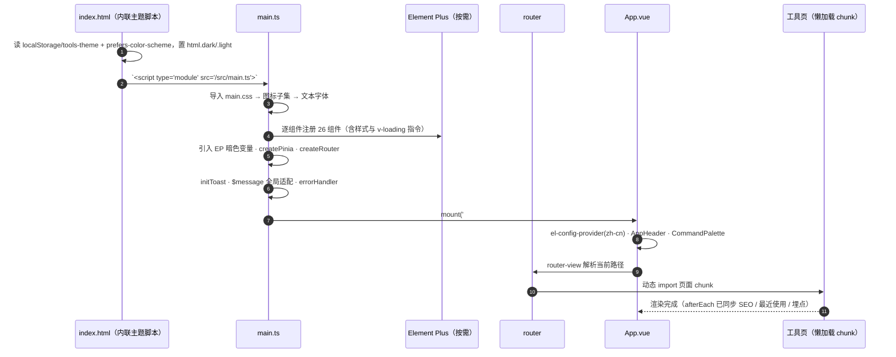
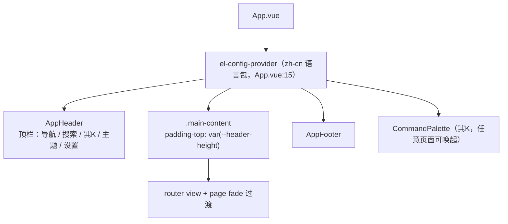
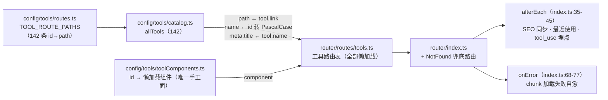
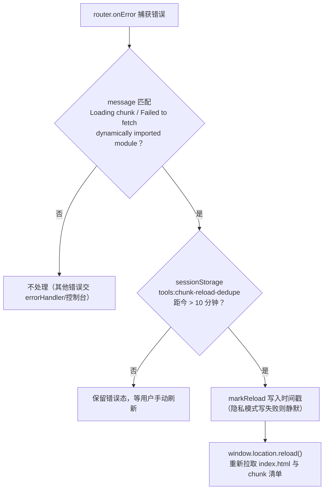

# 02 · 应用骨架与启动流程

> **一句话摘要**：从 `main.ts` 执行到工具页渲染完成的全部链路——启动序列、App.vue 组装、路由派生联动、chunk 失败自愈与路由级埋点。
> **目标读者**：新工程师 + AI Agent ｜ **关联文档**：[00 总纲](00-总纲与阅读指南.md) · [01 系统总览](01-系统总览与技术选型.md) · [03 登记体系](03-工具登记体系与扩展SOP.md) · [04 布局体系](04-布局体系与页面骨架.md) · [05 设计令牌](05-设计令牌与主题系统.md) · [06 全局状态](06-全局状态与应用级机制.md) · [07 构建与 SEO](07-构建预渲染与SEO.md)

## 1. 概述

本册描述「应用骨架」：应用如何启动（§2.1、§3.1）、根组件如何组装全局框架（§2.2）、142 个工具页的路由从哪里来（§2.3）、路由跳转后自动发生什么（§3.2）、部署更新后旧会话如何自愈（§4.4）。读完应能回答：「打开一个工具页时，代码里先后发生了什么」。路由表本身的数据契约（三方登记、守卫测试）在 03 展开，本册只讲派生机制与运行时行为。

规模速览（`wc`/`grep` 实测）：`src/main.ts` 133 行、`src/App.vue` 71 行、`src/router/index.ts` 80 行、`src/router/routes/tools.ts` 256 行；main.ts 全局注册 26 个 EP 组件 + 1 个指令，路由派生 142 条工具路由 + 39 条重定向 + 9 条分类路由 + 1 条首页路由。

## 2. 架构与数据流

### 2.1 启动时序



图释：启动期做了两类初始化——「外观就位」（样式三连 + EP 组件 + 暗色变量）与「能力就位」（Pinia、路由、toast、错误兜底），随后才挂载。第 1 步发生在 Vue 加载之前：`index.html` 内联了一段防主题闪烁脚本，这是全站第一个执行的「应用代码」。第 11 步的动态 import 使每个工具页都是独立 chunk。

主题反闪烁脚本（`index.html`，`<body>` 首个 script）：

```html
<!-- index.html（节选，body 内联脚本） -->
;(function () {
  const theme = localStorage.getItem('tools-theme')
  const prefersDark = window.matchMedia('(prefers-color-scheme: dark)').matches
  const isDark = theme === 'dark' || ((!theme || theme === 'system') && prefersDark)
  const root = document.documentElement
  if (isDark) {
    root.classList.add('dark')
    root.setAttribute('data-theme', 'dark')
  } else {
    root.classList.add('light')
    root.setAttribute('data-theme', 'light')
  }
})()
```

判定分支必须与 `src/composables/useTheme.ts` 的回落逻辑逐字对齐：`stored` 为 `'system'`（或未设置）时都回落到系统偏好。源码注释明确警告——漏掉 `'system'` 分支会导致「曾选过跟随系统 + 系统深色」的用户每次加载先闪浅色。这段脚本是 `html.dark` class 的第一个写入方，EP 暗色变量（§3.1 第 3 步）与 main.css 的 `.dark` 变量组都消费它。

### 2.2 App.vue 组装



图释：五个块是全站唯一的应用级框架，工具页只渲染在 `router-view` 里。AppHeader / AppFooter 受同一条件 `meta.hideHeader` 控制显隐；CommandPalette 不在 router-view 内，因此任何页面都能唤起。内部机制见 06。

根模板逐字摘录（`src/App.vue`）：

```vue
<!-- src/App.vue（template 节选） -->
<template>
  <el-config-provider :locale="zhCn">
    <div id="app-root">
      <AppHeader v-if="!hideHeader" />
      <main
        id="main-content"
        class="main-content"
        :class="{ 'main-content--no-header': hideHeader }"
      >
        <router-view v-slot="{ Component }">
          <Transition name="page-fade" mode="out-in">
            <component :is="Component" />
          </Transition>
        </router-view>
      </main>

      <!-- 全站页脚：与 hideHeader 页面（全屏预览等沉浸式视图）一同隐藏 -->
      <AppFooter v-if="!hideHeader" />

      <!-- 全局命令面板（Cmd/Ctrl + K）：在任意页面都能唤起，直接跳转到任意工具 -->
      <CommandPalette />
    </div>
  </el-config-provider>
</template>
```

配套脚本只有一行派生状态：`const hideHeader = computed(() => !!route.meta.hideHeader)`（App.vue:11）。页脚注释与实现一致：`meta.hideHeader` 同时隐藏 AppHeader 与 AppFooter，并把 `.main-content` 的 `padding-top` 清零（`--no-header` 修饰类）。

**`meta.hideHeader` 的使用面（grep 实测）**：`grep -rn "hideHeader" src --include="*.vue" --include="*.ts"` 共命中 9 处——App.vue 3 处消费（11、17、31 行）、`src/components/layout/AppFooter.vue:8` 注释、`src/components/tools/ToolCodePanel.vue` 3 处（那是同名 props，控制面板自身标题栏，与路由 meta 无关）。**路由侧写入点为 0**：当前没有任何路由记录写 `meta.hideHeader`。结论：这是一条「消费端就位、写入面暂空」的保留机制——新增沉浸式页面时，在路由 meta 里写 `hideHeader: true` 即可生效，无需改 App.vue。

page-fade 过渡与内容区定位（`src/App.vue` scoped 样式）：

```css
/* src/App.vue（style 节选） */
.main-content {
  padding-top: var(--header-height);
  position: relative;
}

.main-content--no-header {
  padding-top: 0;
}

.page-fade-enter-active,
.page-fade-leave-active {
  transition:
    opacity 0.22s ease,
    transform 0.22s ease;
}
```

图释：`padding-top: var(--header-height)` 把固定顶栏让出的空间留给内容，配合 04 册的满高公式 `calc(100vh - var(--header-height))`。page-fade 用 `mode="out-in"` + 6px 位移做换页过渡，时长 0.22s——换页动效只在这一处定义，工具页零参与。

### 2.3 路由派生与运行时挂点



图释：路由表**不是手写的**——`router/routes/tools.ts:55-69` 遍历 `allTools` 派生每条路由，组件来自 `toolComponents.ts` 映射，缺映射在构建期抛错（`tools.ts:56-62`）。三个数据源的一致性由守卫测试盯防（03）。派生出的路由表再拼上 NotFound 捕获路由挂入 router（`router/index.ts:7-17`），CategoryLayout 作为首页壳挂在 `/`（`tools.ts:251-253`）。

派生循环逐字摘录（`src/router/routes/tools.ts`）：

```ts
// src/router/routes/tools.ts:54-69
/** 工具页：完全由 catalog + 组件映射表派生 */
const toolRoutes: RouteRecordRaw[] = allTools.map<RouteRecordRaw>((tool) => {
  const component = toolComponents[tool.id]
  if (!component) {
    // 缺失组件映射会让工具页白屏，构建期就暴露出来而不是等到运行时
    throw new Error(
      `[toolsRoutes] 工具 "${tool.id}" 缺少组件映射，请在 src/config/tools/toolComponents.ts 中登记`
    )
  }
  return {
    path: tool.link.replace(/^\//, ''),
    name: pascal(tool.id),
    component,
    meta: { title: tool.name },
  }
})
```

四行派生规则对应文件头注释的约定：path ← `catalog.tool.link`（由 `toolPath()` 生成，去头斜杠作为子路由相对路径）、name ← id 的 PascalCase、component ← `toolComponents` 手工映射、meta.title ← `catalog.tool.name`。`throw` 把「卡片能点但页面白屏」从运行时左移到 `vite build` / `vite dev` 启动瞬间——tools.ts 在 vite.config.ts 之前被 import，错误直接打断启动。

39 条重定向的路由结构样例（同文件，两组真实条目）：

```ts
// src/router/routes/tools.ts:76-87
// 导出以便测试守卫：重定向目标必须是真实存在的路由，否则等于把用户送去 404
export const redirectRoutes: RouteRecordRaw[] = [
  {
    path: 'encrypt/symmetric',
    redirect: '/encrypt/aes',
  },
  {
    // 归类治理：颜色格式转换器从 text 移到 color（原属 text 分类但项目有
    // 独立的 color 分类）。保留重定向避免线上已收录 URL 返回 404。
    path: 'text/color-converter',
    redirect: '/color/format-converter',
  },
```

```ts
// src/router/routes/tools.ts:103-118
  // 去重：dev 与 encrypt 各有一套哈希工具，已合并到 encrypt（保留其 URL）。
  // dev 版独有 SHA-384 / CRC32 / 文件输入 / Base64 输出，encrypt 版独有 MD5，
  // 合并后取并集，能力只增不减。
  {
    path: 'dev/hash-calculator',
    redirect: '/encrypt/hash',
  },
  {
    path: 'dev/hmac-generator',
    redirect: '/encrypt/hmac',
  },
  {
    // 去重：dev 版支持 HS256 / RS256 且带签发，encrypt 原版仅 HS256，取前者
    path: 'dev/jwt-parser',
    redirect: '/encrypt/jwt',
  },
```

图释：每条重定向只占 3 行（path + redirect），注释记录下线/归类的业务原因；`export const redirectRoutes` 专供 `src/router/routes/redirects.test.ts` 守卫「目标路由必须真实存在」。39 条全部同理（grep `redirect:` 计 39，实测）。

派生表的最终装配（`src/router/routes/tools.ts:249-255`）：

```ts
// src/router/routes/tools.ts:249-255
export const toolsRoutes: RouteRecordRaw[] = [
  {
    path: '/',
    component: () => import('@/components/tools/CategoryLayout.vue'),
    children: [homeRoute, ...categoryRoutes, ...toolRoutes, ...redirectRoutes],
  },
]
```

图释：所有工具/分类/首页/重定向路由都是 `/` 下 `CategoryLayout` 的子路由——分类壳层因此能感知「当前处于哪个分类」（子路由 name 的 `ToolsCategory` 前缀，见 tools.ts:43 注释与 04 册）。`router/index.ts:7-17` 在 `...toolsRoutes` 之后追加 NotFound 捕获路由（`/:pathMatch(.*)*`）。

**meta 字段表**（写入与消费点均为实测行号）：

| meta 字段 | 写入点 | 消费点 |
|---|---|---|
| `meta.title` | `tools.ts:38`（首页「工具箱」）、`tools.ts:51`（分类名）、`tools.ts:67`（工具名）、`index.ts:15`（NotFound「页面未找到」） | `src/composables/usePageSeo.ts:125`：`route.meta?.title` 非字符串时回落 `SITE_NAME`，最终写 `document.title` 并联动 OG/JSON-LD |
| `meta.hideHeader` | **当前无写入方**（grep 实测，见 §2.2） | `App.vue:11` 派生 → `App.vue:17/31` 控制 AppHeader/AppFooter、`:21` 切 `--no-header` |
| `name`（非 meta，同表备查） | `tools.ts:65` 派生 PascalCase；分类路由保持 `ToolsCategory<Id>` 前缀（`tools.ts:49`） | CategoryLayout 以 `ToolsCategory` 前缀判断当前是否分类页（`tools.ts:43` 注释） |

换页滚动的显式归位（`src/router/index.ts:22-29`）：

```ts
// src/router/index.ts:22-29
  async scrollBehavior(_to, _from, savedPosition) {
    // html 上设了 scroll-behavior: smooth（供页内锚点平滑滚动），
    // 该声明同样作用于路由切换后的归位滚动，导致换页时页面「飘」到顶部。
    // 显式 instant 让路由跳转瞬时归位，平滑只留给页内锚点。
    if (savedPosition) return { ...savedPosition, behavior: 'instant' }
    await new Promise((resolve) => requestAnimationFrame(resolve))
    return { top: 0, behavior: 'instant' }
  },
```

图释：全局 CSS 的 `scroll-behavior: smooth` 会「泄漏」到路由归位滚动上，这里用 `behavior: 'instant'` 显式夺回；`requestAnimationFrame` 等一帧是给懒加载页面的 DOM 留出挂载时间。浏览器原生的前进后退 `savedPosition` 仍被保留。

## 3. 核心实现

### 3.1 启动序列（`src/main.ts`）逐段摘录

**第 1 段·样式三连**（main.ts:5-10）：

```ts
// src/main.ts:5-10
import '@/assets/main.css'
// 图标字体走按需子集（38.7 KB），不要改回 material-symbols/outlined.css（全量 3.8 MB）
import '@/assets/material-symbols.css'
// 文本字体（Inter / JetBrains Mono）自托管，共 172.5 KB；不要再改回 index.html 里的
// Google Fonts <link>（该域不可达时要白等一次失败请求，且各平台回退字体不一致）
import '@/assets/text-fonts.css'
```

三连的实测体积：`src/assets/material-symbols.css` 2.2KB（壳）+ `src/assets/fonts/material-symbols-subset.woff2` 39,980 B≈39.0KB（源码注释写 38.7KB，以构建产物为准）；Inter/JetBrains Mono 四个 woff2 合计 176,640 B≈172.5KB，与注释一致。main.css 必须保持最先——它是令牌初始化时序的起点（05）。

**第 2 段·EP 按需注册**（main.ts:13-17 注释 + 18-47 导入 + 81-109 注册）：

```ts
// src/main.ts:13-17（注册段注释，逐字）
// ── element-plus 按需注册 ──────────────────────────────────────────────────
// 只引入项目实际用到的组件，避免全量 app.use(ElementPlus) 把未用组件带进首屏。
// 样式按组件单独引入，避免全量 element-plus/dist/index.css。
// 重组件（ElTable/ElUpload/ElColorPicker）不在此注册，由使用页面局部引入，
// 防止把重依赖带进首屏 vendor chunk。
```

```ts
// src/main.ts:80-84（注册方式示例，逐字）
// element-plus 组件全局注册（模板中以 el-* 使用）
app.component('ElButton', ElButton)
app.component('ElAlert', ElAlert)
app.component('ElCard', ElCard)
app.component('ElCheckbox', ElCheckbox)
```

完整注册清单（`grep -c "app.component(" src/main.ts` = 26；`grep -c "element-plus/es/components/.*style/css"` = 24；导入块 main.ts:18-47、样式块 48-71、注册块 81-107，均为实测行号）：

| 组件 | 注册方式 | 样式引入（`element-plus/es/components/<x>/style/css`） |
|---|---|---|
| ElButton / ElAlert / ElCard / ElCheckbox | `app.component` 全局 | button / alert / card / checkbox 各一条 |
| ElConfigProvider | `app.component` 全局（App.vue 根节点挂 zh-cn） | config-provider |
| ElDialog / ElDivider / ElEmpty / ElFormItem / ElInput | `app.component` 全局 | dialog / divider / empty / form-item / input 各一条 |
| ElSelect / **ElOption** | 两者都注册；**共享 select 一条样式** | select（无 option 样式段） |
| ElPagination / ElPopconfirm / ElProgress / ElSegmented / ElSlider / ElStatistic / ElSwitch / ElTag | `app.component` 全局 | 各自同名样式段 |
| ElTabs / **ElTabPane** | 两者都注册；**共享 tabs 一条样式** | tabs（无 tab-pane 样式段） |
| **ElDropdown / ElDropdownItem / ElDropdownMenu** | 三者都注册；**共享 dropdown 一条样式** | dropdown（无 item/menu 样式段） |
| ElTooltip | `app.component` 全局 | tooltip |
| ElMessage（非组件） | 不注册；经 `$message` 适配消费（见下） | message |
| ElLoadingDirective（指令） | `app.directive('loading', ElLoadingDirective)`（main.ts:109） | loading |

要点：26 个组件 + 2 个非组件导出对应 24 条样式段——差额正是上表「共享」三组（option→select、tab-pane→tabs、dropdown-item/menu→dropdown）。**不在册的重组件**：ElTable / ElUpload / ElColorPicker 由使用页面局部引入，如 `src/views/tools/image/ImageCropPage.vue` 内 `import { ElUpload } from 'element-plus'` + `import 'element-plus/es/components/upload/style/css'`，不使用它的页面零成本（01 §3.2 依赖表）。

**第 3 段·暗色变量**（main.ts:72-73）：

```ts
// src/main.ts:72-73
// 暗黑模式 CSS 变量：配合 useTheme 在 <html> 上切换的 .dark class 生效
import 'element-plus/theme-chalk/dark/css-vars.css'
```

它晚于 EP 注册段导入，且依赖 index.html 内联脚本（§2.1）写入的 `html.dark` 才生效——「暗色失效」排查先看这个 class 是否存在（§5.6）。

**第 4 段·能力初始化**（main.ts:75-78、111-126、128-132）：

```ts
// src/main.ts:75-78
const app = createApp(App)

app.use(createPinia())
app.use(router)
```

```ts
// src/main.ts:111-112
// 传入完整的 app._context（AppContext 类型），而非 app.config
initToast(app._context)
```

```ts
// src/main.ts:117-126
type MessageSeverity = 'success' | 'error' | 'warning' | 'info'
const messageAdapter = (severity: MessageSeverity, content: string, duration?: number) =>
  ElMessage({ type: severity, message: content, duration: (duration ?? 3) * 1000 })

app.config.globalProperties.$message = {
  success: (content: string, duration?: number) => messageAdapter('success', content, duration),
  error: (content: string, duration?: number) => messageAdapter('error', content, duration),
  warning: (content: string, duration?: number) => messageAdapter('warning', content, duration),
  info: (content: string, duration?: number) => messageAdapter('info', content, duration),
}
```

```ts
// src/main.ts:128-132
app.config.errorHandler = (err, _instance, info) => {
  console.error('[vue-error]', info, err)
}

app.mount('#app')
```

图释：Pinia 与 router 先于任何组件就位；`initToast(app._context)` 传完整 AppContext 而非 app.config，`useToast` 经 appContext 读取 `$message`（06）；`messageAdapter` 做「秒 → 毫秒」单位换算（useToast 签名是秒，ElMessage 是毫秒）；errorHandler 仅 `console.error` 兜底，保证「其余部分仍可用」。

**反直觉点（保留并强调）**：EP 组件样式在 `main.css` **之后**导入，全局皮肤层（05）靠特异性取胜（`.el-button.el-button` 双类 0-2-0、`:root:root` 令牌桥，见 `src/assets/main.css:618-627` 的自述注释），而不是靠导入顺序压样式——调整导入顺序不会破坏皮肤层，但会破坏令牌初始化时序，main.css 必须保持最先。

### 3.2 路由运行时（`src/router/index.ts`）

**afterEach 三件事**（index.ts:32-45，逐字）：

```ts
// src/router/index.ts:32-45
const applyPageSeo = createPageSeoApply()

// 路由跳转完成后同步 SEO（title/description/OG/JSON-LD），并记录「最近使用」与行为埋点
router.afterEach((to) => {
  applyPageSeo(to)
  recordToolVisit(to.path)

  // 工具页行为事件：PV 之外需要知道「163 个工具里哪些真正被用」。
  // 只上报工具 id 与分类，不含任何用户输入内容（与本站「数据不出设备」的定位一致）。
  const tool = toolFromPath(to.path)
  if (tool) {
    trackEvent('tool_use', { tool_id: tool.id, category: tool.categoryId })
  }
})
```

三件事依次是：

1. **SEO 同步**：`applyPageSeo(to)`（`src/composables/usePageSeo.ts`）——upsert meta/OG/canonical，JSON-LD 收敛为单个 `#seo-jsonld` 数组节点，与预渲染输出结构一致避免水合后重复（06 §2.4）。
2. **最近使用**：`recordToolVisit(to.path)`（`src/composables/useToolPreferences.ts:134-140`，逐字）：

```ts
// src/composables/useToolPreferences.ts:134-140
export function recordToolVisit(path: string): void {
  const id = resolveToolId(path, LINK_TO_ID)
  if (!id) return
  // 已在队首时跳过，避免每次刷新都写一遍 storage
  if (recentIds.value[0] === id) return
  stored.value = { ...preferences.value, recent: addRecentId(recentIds.value, id, RECENT_LIMIT) }
}
```

3. **tool_use 埋点**：`trackEvent`（`src/utils/analytics.ts`）只在生产上报，开发环境降级为 `logger.debug`，umami 脚本被拦截时静默跳过（逐字节选）：

```ts
// src/utils/analytics.ts（trackEvent 头部节选）
export function trackEvent(event: AnalyticsEvent, data?: EventData): void {
  // 开发环境：只打印不上报，避免污染线上统计
  if (!import.meta.env.PROD) {
    logger.debug('[analytics]', event, data ?? '')
    return
  }
```

三者都是「每次进入工具页必然要做」的横切关注点，收口在 afterEach 意味着任何页面零负担且不会漏报。注意 `useUrlState` 刻意走 `history.replaceState` 而不是 `router.replace`，就是为了**不触发** afterEach——否则每次按键都会重复写最近使用与埋点（`src/composables/useUrlState.ts` 注释明言，08）。

**chunk 失败自愈**（index.ts:50-77）。去重判据与标记（逐字）：

```ts
// src/router/index.ts:50-66
const RELOAD_DEDUPE_KEY = 'tools:chunk-reload-dedupe'
const RELOAD_DEDUPE_WINDOW_MS = 10 * 60 * 1000

const shouldAutoReload = (): boolean => {
  if (typeof window === 'undefined') return false
  const last = Number(window.sessionStorage.getItem(RELOAD_DEDUPE_KEY) ?? 0)
  return !Number.isFinite(last) || last === 0 || Date.now() - last > RELOAD_DEDUPE_WINDOW_MS
}

const markReload = (): void => {
  if (typeof window === 'undefined') return
  try {
    window.sessionStorage.setItem(RELOAD_DEDUPE_KEY, String(Date.now()))
  } catch {
    // 隐私模式或 quota 满：静默失败，next reload 仍可能触发，靠重试间隔避免真循环
  }
}
```

```ts
// src/router/index.ts:68-77
router.onError((error) => {
  if (
    error instanceof Error &&
    /Loading chunk|Failed to fetch dynamically imported module/.test(error.message) &&
    shouldAutoReload()
  ) {
    markReload()
    window.location.reload()
  }
})
```



图释：典型场景是部署新版本后，旧会话持有的 hash 文件名 chunk 已在服务器上消失。命中「chunk 类错误 + 10 分钟窗口外」才整页 reload；窗口内的第二次失败不再自动刷新，防止「chunk 永久失败」退化为无限刷新循环。`typeof window === 'undefined'` 守卫与 try/catch 静默失败让这段逻辑在 SSR/预渲染与隐私模式下都安全。

### 3.3 与构建期的两处联动

- `vite.config.ts` 启动即执行 `assertLayouts(allTools)`（逐字，vite.config.ts:11-13）：

```ts
// vite.config.ts:11-13
// catalog layout 值的构建期强校验（债务 #15）：dev/build 启动即校验，
// 非法值直接让 vite 启动失败，不再依赖 vitest 间接拦截。
assertLayouts(allTools)
```

- 预渲染插件以 catalog + categories + SEO 配置为页面清单（07）——路由派生与预渲染吃的是同一份数据，这是「单一真源」双面身份的体现。

## 4. 设计决策与取舍

1. **EP 按需注册，eslint 封禁全量引入**。Why：全量引入的 chalk 体积不可接受；`eslint.config.js` 用 `no-restricted-imports` 把「按需」从约定升级为门禁。重组件留给页面局部引入，让 142 页中不使用它的页面零成本。代价：页面漏局部引入时子树**静默变 `<!---->`** 且默认 errorHandler 吞错（症状与排查法见 §5.6，坑登记 16 #1）。
2. **路由由 catalog 派生，构建期校验兜底**。Why：见 §2.3 图释——把「登记漂移」从运行时 404 左移到构建失败（`tools.ts:56-62` 的 throw 在 vite 启动瞬间触发）。代价：新增工具必须理解三方登记（03 的 SOP 存在的原因）。
3. **全量懒加载 + 大件独立分包**。Why：145 个页面 .vue 各自成 chunk（dist/assets 实测 491 个文件，页面 chunk 以 `XxxPage-*.js` 命名），rolldown `codeSplitting.groups` 把 monaco / shiki / element-plus / pdf-lib 等重依赖拆为独立共享 chunk（vite.config.ts:58-106）。代价与实测偏差见 §5.3。
4. **chunk 失败自动 reload + 10 分钟去重**。Why：静态托管下部署即换文件，旧会话续用旧 chunk 清单必然 404；自动 reload 是纯前端架构下唯一可用的自愈手段。去重窗口防止「chunk 永久失败」场景退化为无限刷新循环。代价与残余风险见 §5.2。
5. **afterEach 单一收口**。Why：SEO/最近使用/埋点三项都是路由级横切关注点，分散到页面必然出现漏报与重复实现；集中在 router 层后，新增同类横切关注点也有明确落点。代价：afterEach 内逻辑需保持轻量（`recordToolVisit` 有队首去重、`trackEvent` 有 PROD 门，都是为这条付出的设计）。
6. **`$message` 全局属性适配**。Why：composables 运行在组件上下文之外，也要弹 toast；把 ElMessage 适配为全局属性后，`useToast` 经 appContext 读取（`initToast(app._context)`），toast 出口唯一，未来换实现只动一处。
7. **全局 errorHandler 兜底**。Why：单页应用里未捕获错误会造成局部白屏且无痕迹；全局兜底保住「其余部分仍可用」。注意它只 `console.error`（main.ts:128-130），**不会**弹任何提示——排查专门技巧见 §5.6。
8. **主题判定前置到 index.html 内联脚本**。Why：Vue bundle 加载前写入 `html.dark/.light`，否则深色用户每次首屏都要经历一次浅色闪烁（FOUC）。代价：判定逻辑在两处存在（内联脚本 + useTheme），必须同步维护——这是有意的重复，改动任一处必须双写。
9. **换页滚动显式 `instant`**。Why：`scroll-behavior: smooth` 的全局声明会污染路由归位（§2.3 摘录的注释自证）；`requestAnimationFrame` 等待一帧再归位，兼顾懒加载页面的 DOM 时序。

## 5. 边界情况与已知限制

1. **EP 组件漏注册的静默失效**：页面模板里用了未注册的 el-* 组件时，Vue 渲染为空注释节点，**不报错、errorHandler 也无感**（main.ts:128-130 只 console）。排查法：控制台执行 `#app.__vue_app__._context`（或临时替换 `#app.__vue_app__.appContext.config.errorHandler`）抓真实警告栈。预防：eslint `vue/no-undef-components` 白名单机制会在 lint 期捕获未注册组件（15）。
2. **chunk 自愈的盲区**：自动 reload 只覆盖**动态 import 失败**（onError 的正则只匹配 chunk 类消息）；若浏览器缓存的入口 index.html 引用的主 bundle 已失效（部署瞬间打开的页面），仍需用户手动刷新。10 分钟去重窗口内第二次失败不会再次自动 reload（§3.2 流程图的 END2 分支）。
3. **首载预加载面比源码注释的意图更宽（实测修正）**：vite.config.ts:63-64 注释称 monaco「只有用到编辑器的页面才会加载」，但对 2026-09-27 构建的 `dist/index.html` 实测：**monaco-vendor（JS 3,696KB + CSS 127.5KB）与 element-plus-heavy（JS 249.4KB + CSS 86.6KB）都在入口 modulepreload 列表中**，且入口 chunk 含对这两个分包组的静态 import；shiki-vendor（734KB）则确在懒加载侧。成因（rolldown 分组 facade 推断，待查）未逐模块追证，但产物事实可复核：`grep modulepreload dist/index.html`。修订分包配置后必须重跑此检查。
4. **沉浸式页面与 AppHeader**：`meta.hideHeader` 隐藏顶栏机制在消费端就绪（App.vue:11/17/31），但**当前无路由写入**（§2.2 实测）——新页面要用它时直接写 meta 即可；页面需自行提供返回与操作入口。
5. **埋点隐私边界**：afterEach 上报的 `tool_use` 仅含工具 id 与分类 id（index.ts:41-43 的注释即契约），不含用户输入；上报目标为自托管 Umami（01 §5 例外二）。
6. **启动失败模式排查表**（症状 → 第一检查点，全部对应本册已引代码）：

| 症状 | 第一检查点 | 依据 |
|---|---|---|
| 整页白屏、`#app` 为空 | console 是否有 `[vue-error]`；index.html 内联主题脚本是否抛错（它在 main.ts 之前） | main.ts:128-130；index.html 内联脚本 |
| 整页白屏、main.ts 报「缺少组件映射」 | toolComponents.ts 是否漏登记该工具 id | tools.ts:56-62 throw |
| 子树白屏（页面其余正常） | EP 组件是否漏注册/漏局部引入：`#app.__vue_app__._context.components` | §5.1；16 #1 |
| 工具类样式不生效 | 皮肤穿透块位置与双类特异性是否被页面 scoped 样式打乱 | 16 §2.3（#9–#12）→ 05 §5 |
| toast 不弹 | `initToast(app._context)` 是否先于 mount；`$message` 适配段是否被改 | main.ts:112、121-126 |
| 暗色失效（EP 组件仍浅色） | `<html>` 是否有 `.dark`；dark/css-vars.css 是否仍晚于注册段导入 | index.html 内联脚本；main.ts:72-73 |
| 点击路由后白屏（部署后） | sessionStorage `tools:chunk-reload-dedupe` 是否已在 10 分钟窗口内（是则不再自动 reload） | index.ts:50-77 |
| 换页「飘」回顶部缓慢 | scrollBehavior 的 `behavior: 'instant'` 是否被移除 | index.ts:22-29 |

## 6. 变更指引

1. **新增全局 EP 组件**：在 main.ts 注册段加组件 + 逐组件样式（对照 §3.1 清单表确认是否与既有样式段共享）；重组件保持页面局部引入的惯例，不要图省事改为全局注册。改完跑 `pnpm lint`（no-undef-components 白名单）+ `pnpm test`（全页巡检 `src/views/tools/allToolPages.dom.test.ts`）。
2. **调整启动顺序**：main.css 必须保持最先导入（令牌初始化时序）；EP 暗色变量保持在注册段之后。皮肤层不受顺序影响（特异性取胜，05），但任何顺序改动后必须暗/浅双态实测。
3. **改路由派生或重定向**：必跑 `src/config/tools/tool-registry.test.ts`、`src/router/routes/redirects.test.ts` 与 `pnpm build`（assertLayouts 与预渲染都消费 catalog）；新增重定向时目标路由必须真实存在——守卫会抓死链。完整 SOP 见 03。
4. **改自愈逻辑**：保持去重窗口语义（防刷新循环）；任何修改后须模拟「旧 chunk 404」场景验证（build 后改 dist 文件名或用 preview + 删文件模拟）。
5. **改主题判定**：index.html 内联脚本与 `src/composables/useTheme.ts` 必须同步改（§4.8），漏一边即 FOUC 或暗色失效。
6. **动 vite.config 分包**：改完 `pnpm build` 后执行 `grep modulepreload dist/index.html` 核对首载面（§5.3 的实测方法），并核对 dist 页数（当前 152 个 HTML）。
7. **验证手段**：`pnpm dev`（127.0.0.1:5560）手测启动与首屏、`pnpm test`（router/守卫相关用例）、`pnpm build`（构建期校验 + 预渲染页数核对）。
