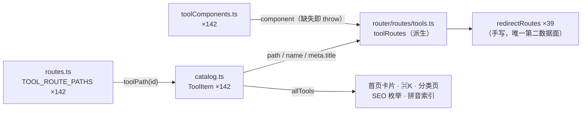
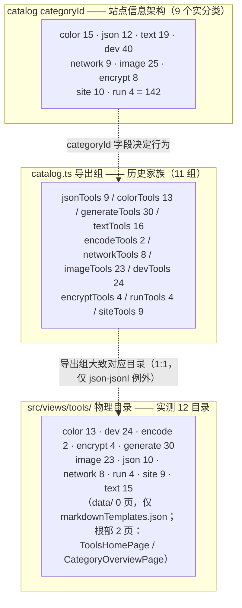
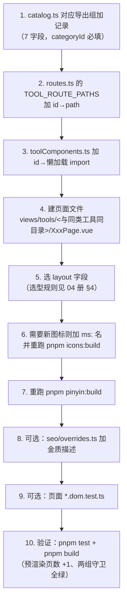

# 03 · 工具登记体系与扩展 SOP

> **一句话摘要**：142 个工具如何用「三方登记 + 派生路由 + 守卫测试」管理——以及新增、下线、改名工具的标准操作流程（AI Agent 写码前必读）。
> **目标读者**：新工程师 + AI Agent（写码前必读）｜ **关联文档**：[00 总纲](00-总纲与阅读指南.md) · [02 应用骨架](02-应用骨架与启动流程.md) · [04 布局体系](04-布局体系与页面骨架.md) · [07 构建与 SEO](07-构建预渲染与SEO.md) · [14 测试策略](14-测试策略与质量守卫.md)

## 1. 概述

全项目的规模化根基不是某个组件，而是**登记体系**：每个工具的存在由三处登记共同定义，路由、页面清单、搜索、SEO、拼音索引全部从登记数据**派生**，一致性由构建期校验与守卫测试双保险。任何「新加一个工具」的任务，本质都是一次登记操作加一次页面实现——本册 §6 的三张步骤单就是为此准备的，照抄执行即可。

本册所有数字均为对当前仓库的实测值：catalog.ts 1401 行、142 条工具记录、`TOOL_ROUTE_PATHS` 142 条、`toolComponents.ts` 158 行 142 条映射、`redirectRoutes` 39 条、`RENAMED_TOOL_IDS` 36 条、`seoOverrides` 覆盖约 30 个高流量工具（`src/config/seo/overrides.ts` 194 行）。

## 2. 架构与数据流

### 2.1 三方登记

| 登记处 | 文件 | 内容 | 性质 |
|---|---|---|---|
| 路径真源 | `src/config/tools/routes.ts`（148 行） | `TOOL_ROUTE_PATHS`：142 条 id→path 映射；`toolPath(id)` 生成器 | 数据 |
| 工具目录 | `src/config/tools/catalog.ts`（1401 行） | 每工具 7+1 字段：`id / name / description / icon / categoryId / link / layout`（+可选 `accent`）；11 个 legacy 导出组拼成 `allTools` | 数据 |
| 组件映射 | `src/config/tools/toolComponents.ts`（158 行） | id → `() => import('...XxxPage.vue')` 懒加载组件 | **唯一手工映射面** |

三方登记各自的真实形态（逐字摘录）：

**① 路径真源**（`src/config/tools/routes.ts:1-10`，首尾条目即全表形态）：

```ts
export const TOOL_ROUTE_PATHS = {
  'json-format': '/json/format',
  'color-contrast': '/color/contrast',
  'color-brightness': '/color/brightness',
  'color-grayscale': '/color/grayscale',
  'color-gradient': '/color/gradient',
  'color-mix': '/color/mix',
  'color-random': '/color/random',
  'color-palette': '/color/palette',
  // ……共 142 条，末条：
  //   'site-og-preview': '/site/og-preview',
} as const

export type ToolRouteName = keyof typeof TOOL_ROUTE_PATHS

export const toolPath = (name: ToolRouteName) => TOOL_ROUTE_PATHS[name]
```

`as const` + `keyof typeof` 让 `toolPath()` 的参数类型被路径表穷尽——传错 id 是编译错误，这是「路径真源」能兜住 catalog `link` 字段的类型基础。

**② 工具目录**（`src/config/tools/catalog.ts:5-13`，一条完整记录）：

```ts
export const jsonTools: ToolItem[] = [
  {
    id: 'json-toolbox',
    name: 'JSON 工具箱',
    icon: 'ms:data_object',
    categoryId: 'json',
    link: toolPath('json-format'),
    description: '格式化、压缩、校验 JSON 数据',
    layout: 'workbench',
  },
```

注意 `link` 不是手写字符串，而是 `toolPath('json-format')` 的返回值——catalog 与路径真源的联动点就在每一记录的这一行。

**③ 组件映射**（`src/config/tools/toolComponents.ts:13-16`，表头 + 首条映射）：

```ts
export const toolComponents: Record<string, () => Promise<Component>> = {
  'color-blind': () => import('@/views/tools/color/ColorBlindPage.vue'),
  'color-brightness': () => import('@/views/tools/color/ColorBrightnessPage.vue'),
  'color-contrast': () => import('@/views/tools/color/ColorContrastPage.vue'),
  'color-gradient': () => import('@/views/tools/color/ColorGradientPage.vue'),
```

三者缺一不可：路由表由 catalog 派生（§2.3，缺组件映射构建期抛错）；首页卡片、⌘K 面板、拼音索引、SEO 页面清单都吃 catalog。任何一处漏改的典型症状是「卡片能点但路由 404」或「搜不到」——守卫测试把这些症状左移到了测试期（§2.4）。

### 2.2 ToolItem 类型：7+1 字段逐个文档

`ToolItem` 是三方登记共享的记录类型，逐字摘录（`src/types/tool.ts:11-33`）：

```ts
export type ToolAccent = 'blue' | 'orange' | 'green' | 'pink' | 'purple' | 'indigo'

export interface ToolCategory {
  id: string
  name: string
  icon: string
  accent?: ToolAccent
}

/** 工具页模板类型（ToolShell 分发依据），缺省 centered */
export type ToolLayout = 'workbench' | 'centered' | 'canvas'

export interface ToolItem {
  id: string
  name: string
  description?: string
  icon: string
  categoryId: string
  link: string
  accent?: ToolAccent
  /** 工具页布局模板：workbench 转换类 / centered 生成类（缺省）/ canvas 编辑类 */
  layout?: ToolLayout
}
```

| 字段 | 类型与约束 | 消费方（全部实测） |
|---|---|---|
| `id` | `string`，kebab-case，全局唯一（`tool-registry.test.ts` 「id 无重复」） | `toolComponents` 键、`seoOverrides` 键、`toolPinyinIndex` 键、`RENAMED_TOOL_IDS` 目标值、useToolPreferences 收藏/最近使用存储、`toolFromPath` 反查 |
| `name` | `string`，非空（守卫测试断言 truthy） | 路由 `meta.title`（派生循环逐字摘录见 §2.3）、ToolHeader H1、首页卡片、⌘K 面板、SEO `name` |
| `description` | `string?`，守卫测试要求 truthy（当前 142 条全填） | ToolShell 标题下描述行的回退值（`buildSeoForTool().longDescription ?? tool.description`）、首页卡片、SEO 默认模板 |
| `icon` | `string`，`ms:` 前缀 Material Symbols 名；新图标须重跑 `pnpm icons:build`（`build/fonts/build-icon-subset.py`） | ToolHeader 图标、首页卡片、⌘K、同类工具下拉、FavoriteButton |
| `categoryId` | `string`，**必须**在 `toolCategories` 登记（守卫测试逐条断言） | 分类导航/分类页路由、`getToolsByCategory`、ToolShell「同类工具」下拉、首页分组、统计口径（§2.5） |
| `link` | `string`，必须经 `toolPath()` 产生且值在 `TOOL_ROUTE_PATHS` 中（守卫测试「每个工具的 link 都来自 TOOL_ROUTE_PATHS」） | 派生路由的 `path`、ToolHeader「同类工具」跳转 `router.push(target.link)`、`LINK_TO_ID` 映射、SEO 路由枚举 |
| `accent` | `ToolAccent?`，可省 | 首页卡片色条/chip 色；省略时 `getCategoryAccent()`（`categories.ts:24-27`）按分类默认色回退，再回退 indigo |
| `layout` | `ToolLayout?`：`'workbench' \| 'centered' \| 'canvas'`，缺省 centered；非法值被构建期 `assertLayouts` 抛错（§3.5） | `getToolLayout` → ToolShell 三模板分发（04 册 §2.1）；当前 142 条全部显式声明：77 workbench / 38 centered / 27 canvas |

### 2.3 路由派生：唯一手写面到路由表的最后一跳

`src/router/routes/tools.ts` 不含任何工具路由的硬编码。派生循环逐字摘录（`tools.ts:55-69`）：

```ts
/** 工具页：完全由 catalog + 组件映射表派生 */
const toolRoutes: RouteRecordRaw[] = allTools.map<RouteRecordRaw>((tool) => {
  const component = toolComponents[tool.id]
  if (!component) {
    // 缺失组件映射会让工具页白屏，构建期就暴露出来而不是等到运行时
    throw new Error(
      `[toolsRoutes] 工具 "${tool.id}" 缺少组件映射，请在 src/config/tools/toolComponents.ts 中登记`
    )
  }
  return {
    path: tool.link.replace(/^\//, ''),
    name: pascal(tool.id),
    component,
    meta: { title: tool.name },
  }
})
```

四个派生口径一次看清：`path` ← `tool.link`、`name` ← id 的 PascalCase、`meta.title` ← `tool.name`、`component` ← `toolComponents[tool.id]` 且查不到**立即 throw**（不是等到点击时白屏）。`pascal` 定义在同文件 26-31 行：按 `[-_]` 分段、首字母大写拼接。路由树装配在 `tools.ts:249-255`：`{ path: '/', component: CategoryLayout, children: [homeRoute, ...categoryRoutes, ...toolRoutes, ...redirectRoutes] }`。



图释：数据从路径真源流入 catalog，catalog + 组件映射共同派生路由；`redirectRoutes` 是路由文件里唯一的手写数据面（非派生），因此需要独立守卫。catalog 还单方面喂养四个消费面，这就是「改 catalog 一处、全站生效」的机理。

### 2.4 守卫矩阵与断言逻辑

| 守卫 | 文件 | 抓什么 |
|---|---|---|
| 三方一致性 | `src/config/tools/tool-registry.test.ts`（175 行，15 个 it） | catalog ↔ TOOL_ROUTE_PATHS ↔ toolComponents 三处 id 集合不一致、link 与路径真源不匹配 |
| 重定向健康 | `src/router/routes/redirects.test.ts`（82 行，6 个 it） | redirectRoutes 目标路由存在、不与真实页面撞路径、无链式跳转 |
| layout 合法 | `src/config/tools/layouts.ts` 的 `assertLayouts`（vite.config.ts:13 启动即执行） | catalog layout 字段非法值 |
| 拼音同步 | `src/generated/tool-pinyin-index.test.ts` | catalog 增删工具后未重跑 `pnpm pinyin:build` |

**守卫一：三方一致性**（`tool-registry.test.ts`）。核心断言逐字摘录：

```ts
it('catalog link 集合与 TOOL_ROUTE_PATHS path 集合完全一致', () => {
  expect([...catalogLinks].sort()).toEqual([...toolRoutePaths].sort())
})

it('每个工具都有对应的组件映射（缺映射会导致工具页白屏）', () => {
  const missing = allTools.filter((tool) => !toolComponents[tool.id]).map((tool) => tool.id)
  expect(missing, `以下工具缺少组件映射：${missing.join(', ')}`).toEqual([])
})

it('组件映射表中的每一项都对应一个已登记的工具（无孤儿映射）', () => {
  const toolIds = new Set(allTools.map((tool) => tool.id))
  const orphans = Object.keys(toolComponents).filter((id) => !toolIds.has(id))
  expect(orphans, `以下组件映射没有对应的工具：${orphans.join(', ')}`).toEqual([])
})
```

解读：双向集合比对是这套守卫的骨架——「catalog→路由」「路由→catalog」「catalog→组件」「组件→catalog」四个方向各断言一次，任何一处漏改/多改都会以**具体 id 清单**报错（消息里直接列出缺谁）。辅助断言还有 id/link/name 唯一性、必填字段非空、categoryId 已登记、路由 name 唯一、分类页 name 保持 `ToolsCategory` 前缀（CategoryLayout 依赖该约定判断当前是否为分类页）。文件头注释特别说明了一个安全性前提：测试直接 import `toolsRoutes` 是安全的，因为 `() => import('...vue')` 在箭头函数体内，模块加载时不会执行。

**守卫二：重定向健康**（`redirects.test.ts`）。文件头把两类不报错的坏法写得很直白：「目标路径拼错，或目标页后来被删了 → 用户被送去 404」「重定向路径与某个真实页面重名 → 把真页面挡在后面（路由按注册顺序匹配）」。核心断言逐字摘录：

```ts
it('每条重定向都指向真实存在的路由（不把用户送去 404）', () => {
  const broken: string[] = []
  for (const route of redirectRoutes) {
    const target = typeof route.redirect === 'string' ? route.redirect : ''
    if (!target) {
      broken.push(`${route.path} → (空)`)
      continue
    }
    if (!realPaths.has(norm(target))) {
      broken.push(`${route.path} → ${target}`)
    }
  }
  expect(broken, `以下重定向目标不存在：${broken.join(', ')}`).toEqual([])
})

it('重定向的目标不应是另一条重定向（避免链式跳转）', () => {
  const redirectSources = new Set(redirectRoutes.map((r) => norm(String(r.path))))
  const chained = redirectRoutes
    .filter((r) => redirectSources.has(norm(String(r.redirect))))
    .map((r) => `${r.path} → ${r.redirect}`)
  expect(chained, `以下重定向指向了另一条重定向：${chained.join(', ')}`).toEqual([])
})
```

解读：第一条把「目标存在」收敛为对**真实页面集合**（`route.component` 存在的路由，跳过纯 redirect）的成员检查；第二条禁止 A→B 而 B 又是重定向的链式跳转，保证用户一次跳转即落地。另有 4 条辅助断言：至少 1 条重定向（防守卫文件被清空后静默失效）、path 非空、不与真实页面重名（防遮挡）、彼此不重复。

### 2.5 双口径：必须先建立的认知

同一个「分类」在仓库里有**三套口径**并存：



图释：**categoryId 是唯一的行为口径**（导航、分类页、统计都按它算）；导出组与物理目录是历史遗留的组织方式（generate 分类已解散、encode 并入 text，但导出组和目录没有重排）。**找页面文件时按物理目录/导出组找，判断工具归属时只看 categoryId**。

完整映射表（实测：解析 catalog 142 条记录交叉统计）：

| categoryId | 工具数 | 导出组构成（条数） | 页面物理目录构成（条数） |
|---|---|---|---|
| color | 15 | colorTools 13 + generateTools 1 + textTools 1 | color/ 13 + generate/ 1 + text/ 1 |
| json | 12 | jsonTools 9 + generateTools 2 + textTools 1 | json/ 10 + generate/ 2 |
| text | 19 | textTools 14 + encodeTools 2 + generateTools 3 | text/ 14 + encode/ 2 + generate/ 3 + json/ 1 |
| dev | 40 | devTools 24 + generateTools 16 | dev/ 24 + generate/ 16 |
| network | 9 | networkTools 8 + generateTools 1 | network/ 8 + generate/ 1 |
| image | 25 | imageTools 23 + generateTools 2 | image/ 23 + generate/ 2 |
| encrypt | 8 | encryptTools 4 + generateTools 4 | encrypt/ 4 + generate/ 4 |
| site | 10 | siteTools 9 + generateTools 1 | site/ 9 + generate/ 1 |
| run | 4 | runTools 4 | run/ 4 |

错位点逐条点名（共 33 条记录的 id 前缀 ≠ 物理目录）：

- **generate/ 目录是最大错位池**：30 条记录全部「名不副实」——目录名来自已解散的 generate 分类，实际装着 dev 16 条、encrypt 4 条、text 3 条、json 2 条、image 2 条、color/network/site 各 1 条。
- **encode/ 目录**装着 2 条 text 分类工具（`text-url-encode`、`text-encode-workbench`）。
- **text/ 目录**装着 1 条 color 分类工具（`color-format-converter` → `ColorConverterPage.vue`）。
- **json/ 目录**装着 1 条 text 导出组的工具（`json-jsonl` → `JsonlPage.vue`），这是唯一「导出组 ≠ 物理目录」的例外。
- 两个文件名与 id 差异较大的例子：`json-toolbox` → `JsonFormatPage.vue`、`color-image-gradient` → `ImageToGradientPage.vue`（找文件时按 `toolComponents.ts` 映射列查，不要猜文件名）。

## 3. 核心实现

### 3.1 redirectRoutes：39 条按成因分组完整表

`src/router/routes/tools.ts:77-247` 共 39 条重定向。按成因分四组（旧路径 → 新路径）：

**组一：工具下线（1 条）**

| 旧路径 | 新路径 | 成因 |
|---|---|---|
| encrypt/symmetric | /encrypt/aes | 对称加密大全 2026-08-30 下线：DES/3DES/RC4 依赖已停维护的 crypto-js 且 WebCrypto 不支持，AES 能力由 /encrypt/aes 接管 |

**组二：归类治理 / 去重合并（4 条）**

| 旧路径 | 新路径 | 成因 |
|---|---|---|
| text/color-converter | /color/format-converter | 颜色格式转换器从 text 移到 color |
| dev/hash-calculator | /encrypt/hash | dev/encrypt 两套哈希合并，取能力并集（dev 版独有 SHA-384/CRC32/文件输入，encrypt 版独有 MD5） |
| dev/hmac-generator | /encrypt/hmac | 同上，两套 HMAC 合并 |
| dev/jwt-parser | /encrypt/jwt | dev 版支持 HS256/RS256 且带签发，encrypt 原版仅 HS256，取前者 |

**组三：解散 encode 分类（3 条，覆盖 2 个工具页 + 分类入口）**

| 旧路径 | 新路径 |
|---|---|
| encode/url | /text/url-encode |
| encode/workbench | /text/encode-workbench |
| encode | /text |

**组四：解散 generate 分类（31 条，覆盖 30 个工具页 + 分类入口）**

| 旧路径 | 新路径 | | 旧路径 | 新路径 |
|---|---|---|---|---|
| generate/password-strength | /encrypt/password-strength | | generate/version | /dev/version-generator |
| generate/password | /encrypt/password | | generate/tree | /dev/file-tree |
| generate/passphrase | /encrypt/passphrase | | generate/markdown | /dev/markdown-generator |
| generate/mask | /encrypt/data-mask | | generate/theme | /dev/css-theme |
| generate/uuid | /dev/uuid | | generate/lorem | /text/lorem |
| generate/ulid | /dev/ulid | | generate/csv-sample | /text/csv-sample |
| generate/nano-id | /dev/nanoid | | generate/regex | /text/regex-visualizer |
| generate/snippet | /dev/code-snippet | | generate/qrcode | /image/qrcode |
| generate/api-req | /dev/api-request | | generate/avatar | /image/avatar |
| generate/api-response | /dev/api-response | | generate/mock-json | /json/mock-data |
| generate/mock-dict | /dev/mock-dict | | generate/json-anonymizer | /json/anonymizer |
| generate/ts-to-mock | /dev/ts-to-mock | | generate/og-meta | /site/og-meta |
| generate/openapi-schema | /dev/openapi-schema | | generate/wifi-qr | /network/wifi-qr |
| generate/db-schema | /dev/db-schema | | generate/color | /color/code-generator |
| generate/er-diagram | /dev/er-diagram | | generate（分类入口） | /dev |
| generate/sql-insert | /dev/sql-insert | | | |

（组四左列 15 条 + 右列 15 条 + 分类入口 = 31 条。）重定向条目自带成因注释，范本逐字摘录（`tools.ts:82-87`）：

```ts
  {
    // 归类治理：颜色格式转换器从 text 移到 color（原属 text 分类但项目有
    // 独立的 color 分类）。保留重定向避免线上已收录 URL 返回 404。
    path: 'text/color-converter',
    redirect: '/color/format-converter',
  },
```

### 3.2 RENAMED_TOOL_IDS：本地偏好的改名迁移表

`src/composables/useToolPreferences.ts:39-80` 的 `RENAMED_TOOL_IDS`（36 条）保证改名/换分类后用户 localStorage 里的收藏与最近使用不丢。读取时统一翻译（同文件 97-103 行）：

```ts
const preferences = computed<ToolPreferences>(() => {
  const migrated: ToolPreferences = {
    favorites: stored.value.favorites.map((id) => RENAMED_TOOL_IDS[id] ?? id),
    recent: stored.value.recent.map((id) => RENAMED_TOOL_IDS[id] ?? id),
  }
  return sanitizePreferences(migrated, VALID_IDS)
})
```

条目样例逐字摘录（`useToolPreferences.ts:40-49`）——与 §3.1 重定向表的成因分组一一对应：

```ts
const RENAMED_TOOL_IDS: Readonly<Record<string, string>> = {
  'text-color-converter': 'color-format-converter',
  // 归类治理：encode 分类（仅 2 个工具）并入 text
  'encode-url': 'text-url-encode',
  'encode-workbench': 'text-encode-workbench',
  // 去重：dev 与 encrypt 各有一套哈希/HMAC，现合并到 encrypt
  'dev-hash-calculator': 'encrypt-hash',
  'dev-hmac-generator': 'encrypt-hmac',
  'dev-jwt-parser': 'encrypt-jwt',
  // 归位明显错放的（原在 generate，但都不是「生成」类）
  'generate-password-strength': 'encrypt-password-strength',
```

注意一个历史细节：generate 解散批次中旧 id 有 `gen-password`、`generate-ulid`、`generate-og-meta` 等三种拼写形态（36 条里 26 条来自该批次），新条目照实迁移即可，不必统一。迁移后 `sanitizePreferences` 再按 `VALID_IDS`（catalog 全集）过滤，已下线工具的残留 id 在这里被静默清除。

### 3.3 SEO 覆盖与默认模板

`src/config/seo/overrides.ts`（194 行）按工具 id 提供金质 description/keywords/longDescription，未覆盖者走 `defaults.ts` 模板。一条真实 override 逐字摘录（`overrides.ts:11-19`）：

```ts
export const seoOverrides: Record<string, PartialSeo> = {
  'json-toolbox': {
    description:
      '在线 JSON 格式化、压缩与校验工具，支持树形浏览与自定义缩进。无需安装，浏览器本地实时处理，适用于调试接口与配置。',
    keywords: ['JSON格式化', 'JSON校验', 'JSON压缩', '在线JSON工具'],
    longDescription:
      'JSON 在线格式化与校验工具，能够一键将压缩或杂乱的 JSON 整理为可读结构，并即时校验其合法性。支持自定义缩进、压缩输出与语法错误定位，广泛用于接口调试、配置维护与日志分析场景。数据全程在本地浏览器处理，不会上传到服务器。',
  },
```

联动告警在 `src/config/seo/index.ts:24-30`：`import.meta.env?.DEV` 下遍历 override 键，「未命中任何工具 id」即 `console.warn('[seo] overrides key "…" 未命中任何工具 id，该覆盖内容不会生效')`——下线工具忘删 override 会被抓到（构建期 DEV 为 undefined 自动跳过，不影响产物）。注意告警是**单向**的：新工具没写 override 不会告警，走默认模板是合法状态。

### 3.4 拼音索引：构建期产物

`src/generated/tool-pinyin-index.ts`（149 行）由 `pnpm pinyin:build`（`node build/pinyin/build-pinyin-index.mjs`）生成，**勿手改**。生成脚本核心逐字摘录（`build/pinyin/build-pinyin-index.mjs:28-41`）：

```js
const outPath = resolve(root, 'src/generated/tool-pinyin-index.ts')
mkdirSync(dirname(outPath), { recursive: true })
writeFileSync(
  outPath,
  `/**
 * 构建期生成的工具拼音首字母索引（pnpm pinyin:build）。
 * ⚠️ 自动生成，勿手改；catalog 增删工具后重跑生成（tool-pinyin-index.test.ts 守卫覆盖）。
 * 运行时零依赖：命令面板对该索引做子序列模糊匹配（sjz → 时间戳转换）。
 */
export const toolPinyinIndex: Record<string, string> = ${JSON.stringify(index, null, 2)}
`,
  'utf8'
)
```

产物形态（真实条目）：`"json-toolbox": "jsongjx"`、`"text-base-converter": "zsjzzhq"`、`"text-datetime-converter": "rqsjzhq"`——值是工具名全字拼音首字母串，⌘K 面板做子序列匹配。catalog 增删工具后不重跑，`tool-pinyin-index.test.ts` 会红，但 dev server 不会提示。

### 3.5 assertLayouts：构建期 layout 校验

逐字摘录（`src/config/tools/layouts.ts:10-16`）：

```ts
/** catalog 构建期校验：非法 layout 直接抛错，禁止静默回退（规格 §5.3） */
export function assertLayouts(tools: readonly ToolItem[]): void {
  const bad = tools.filter((t) => t.layout !== undefined && !VALID_LAYOUTS.has(t.layout))
  if (bad.length > 0) {
    throw new Error(`非法 layout 值: ${bad.map((t) => `${t.id}:${String(t.layout)}`).join(', ')}`)
  }
}
```

`vite.config.ts:9,13` 在配置加载期 `import { assertLayouts } from './src/config/tools/layouts'` 并立即执行——typo 的 layout 值（如 `'Worbench'`）让 dev server / build 直接起不来。同文件的 `getToolLayout`（6-8 行）对未声明或非法值回退 `'centered'`，这是双保险的里层：校验拦截后运行时回退实际不可达。

## 4. 设计决策与取舍

1. **为什么是「三方」而不是一处**。理想形态是 catalog 一处声明一切、组件由约定自动解析；但 Vite 的动态 import 需要可静态分析的字符串路径，无法从纯数据生成，组件映射必须手写；而路径真源独立成表是为了让 catalog 的 `link` 字段经 `toolPath()` 产生而不是各处散写字符串。三方中已把手工面压缩到只剩 `toolComponents.ts`，且其表头注释（`toolComponents.ts:10-11`）把三步操作写死在文件里：「新增工具三步：① catalog.ts 登记 ② routes.ts 加路径常量 ③ 本表加组件映射」。
2. **双口径不合并**。Why：142 条记录一次性重排目录/导出组是大面积无行为收益的 diff，还会冲掉 git blame；categoryId 字段已经承担了全部行为语义。代价：新人有认知成本（§2.5 专门写清 + 完整映射表），以及「物理目录叫 generate 但分类已不存在」这类历史化石（30 条错位记录，见 §2.5 逐条点名）。
3. **守卫测试而非纯类型约束**。Why：三处登记是三个独立数据结构，TypeScript 无法跨文件断言「id 集合相等」；运行时测试是能抓住「忘了同步」的唯一手段，且在 `pnpm test`/CI 必经路径上。守卫消息里带具体 id 清单（§2.4 摘录可见），失败时无需再排查。
4. **layout 改判注释制度**。catalog 里 36 条布局判定注释（grep「// 改判」26 条 + 「// canvas：」10 条，含 23 条 ImageToolLayout 层集成说明）就地记录判定理由——例如 `catalog.ts:217` 的「改判 workbench：实为 420px 设置面板 + 结果列表双面板（手册「生成器实为双面板则 workbench」）」。相当于轻量 ADR 内联在数据源处，04 册的选型规则即提炼于此。
5. **下线工具必留重定向**。Why：外部链接与用户收藏无法追回，39 条重定向 + redirects 守卫保证旧路径永久可达；配套的 `RENAMED_TOOL_IDS`（36 条）把同样的保障延伸到本地偏好。

## 5. 边界情况与已知限制

- 双口径的存在意味着「按分类找文件」会失败：text 分类 19 个工具的页面文件散落在 `views/tools/text/`（14）、`views/tools/encode/`（2）、`views/tools/generate/`（3）、`views/tools/json/`（1）四个物理目录（§2.5 映射表）。
- `getToolLayout` 对非法 layout 回退 centered，但 `assertLayouts` 已在构建期拦截非法值——运行时回退实际不可达，属于双保险的里层。
- 拼音索引是**构建期产物**：只改 catalog 不重跑 `pinyin:build`，守卫测试会红，但 dev server 不会提示。
- SEO overrides 与 catalog 的联动是单向告警（未命中 id 告警），「新工具没写 override」不会告警——新工具走默认 SEO 模板是合法状态。
- 派生路由的 `name` 是 `pascal(tool.id)`（如 `json-format` → `JsonFormat`）：代码中只有 `ToolsHome` / `ToolsCategory*` 两个语义名被引用（AppHeader 跳首页、CategoryLayout 判分类页），工具路由 name 从未被业务代码引用——若要在代码里跳转工具页，用 `tool.link` 而非路由名。
- `redirectRoutes` 按注册顺序匹配：新增重定向若与未来某个真实工具路径撞名，会被 redirects 守卫「重定向路径不与真实页面重名」拦下——新工具选路径时不必为旧重定向让位，但改完必须跑测试。

## 6. 变更指引：三张步骤单

### 6.1 新增工具 SOP



前三步的**真实代码样例**（以既有 `json-convert-format` 为范本，新工具照此仿写）：

```ts
// ① src/config/tools/routes.ts —— TOOL_ROUTE_PATHS 内按字母序就近插入：
  'json-convert-format': '/json/convert-format',

// ② src/config/tools/catalog.ts —— 对应导出组（如 jsonTools）内追加：
  {
    id: 'json-convert-format',
    name: 'JSON 格式互转',
    icon: 'ms:swap_horiz',
    categoryId: 'json',
    link: toolPath('json-convert-format'),
    description: 'JSON ↔ TS 类型、CSV、YAML、URL Query 六种格式转换',
    layout: 'workbench',
  },

// ③ src/config/tools/toolComponents.ts —— 同样按 id 字母序插入：
  'json-convert-format': () => import('@/views/tools/json/JsonConvertFormatPage.vue'),
```

第 ④ 步的页面文件路径取 `toolComponents.ts` 映射里写的目录——放进与同类工具相同的物理目录（§2.5 映射表是目录选择依据）。第 ⑩ 步验证通过的三方守卫是 `tool-registry.test.ts` 的 15 个断言；`assertLayouts` 在 `pnpm dev`/`pnpm build` 启动即生效。

### 6.2 下线工具 SOP

1. 三处登记同步删除（catalog 记录、TOOL_ROUTE_PATHS 条目、toolComponents 映射）；
2. 删页面文件与其专属子组件、专属测试；移除**仅它使用**的依赖（查 import 面，勿删共用库）；
3. `redirectRoutes` 加一条旧路径→相近工具的重定向（**这是必做项不是可选项**）。范本即 §3.1 组一条目：

```ts
  {
    path: 'encrypt/symmetric',
    redirect: '/encrypt/aes',
  },
```

4. 清理 `seo/overrides.ts` 中该 id 的条目（否则 dev 期 seo/index 告警「该覆盖内容不会生效」）、`scenes.ts` 精选位；`RENAMED_TOOL_IDS` **不动**（历史 id 迁移表不是有效工具清单，留着无害且必要）；
5. 重跑 `pnpm pinyin:build`；`pnpm test` + `pnpm build`（预渲染页数 -1，redirects 守卫验证重定向目标存在）。

### 6.3 改名（id 不变仅换名 / id 也变）SOP

- **仅换显示名**：只改 catalog `name`（+ 可选 SEO override），路径不变，无迁移。`meta.title`、ToolHeader H1、卡片、⌘K 全部从 `name` 派生，一处改全站生效；唯一需要同步的手工面是拼音索引（名字变了首字母串变）：重跑 `pnpm pinyin:build`。
- **id 也变**：三方登记同步改 + `RENAMED_TOOL_IDS` 加旧→新映射（范本摘自真实条目）：

```ts
  // 去重：dev 与 encrypt 各有一套哈希/HMAC，现合并到 encrypt
  'dev-hash-calculator': 'encrypt-hash',
```

  再加 `redirectRoutes` 旧路径重定向 + 重跑拼音索引。判据：凡旧 id 曾进入用户 localStorage（收藏/最近使用），`RENAMED_TOOL_IDS` 条目必加；凡旧 URL 可能被外部引用，redirect 必加——两者通常同时需要。
