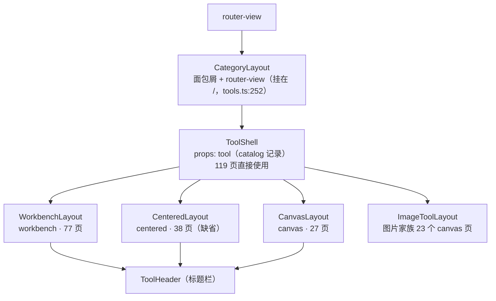
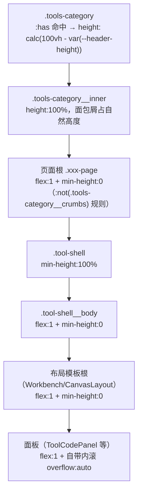

# 04 · 布局体系与页面骨架

> **一句话摘要**：一个工具页从路由到像素的全部骨架——壳层链、三种布局模板、图片家族专用布局、面板套件与「选项进标题栏」的整合范式。
> **目标读者**：页面开发者 ｜ **关联文档**：[02 应用骨架](02-应用骨架与启动流程.md) · [03 登记体系](03-工具登记体系与扩展SOP.md) · [05 设计令牌](05-设计令牌与主题系统.md) · [08 跨页面复用范式](08-跨页面复用范式.md) · [12 图片工具](12-图片工具设计.md) · [17 工具矩阵](17-全工具速查矩阵.md)

## 1. 概述

142 个工具页没有一页是自由发挥的：每页都由统一的壳层链装配（§2.1），布局由 catalog 的 `layout` 字段分发给三种模板之一（或图片家族专用布局，§2.2/§2.3），页内内容由一组标准面板承载（§3）。本册回答验收问题「新页面如何接入」的骨架部分——交互范式部分在 08。

本册结构数字均为可复现实测（2026-09-27，口径随文标注）：142 页 = **119 页直接挂 `ToolShell` + 23 页经 `ImageToolLayout` 间接挂壳**（`grep -rl "<ToolShell" src/views` = 119，图片域 23 页全部走 `ImageToolLayout`，见 `config/tools/toolComponents.ts` 的 image-* 映射）；layout 分布 **workbench 77 / centered 38 / canvas 27**（§2.4 有按分类细表）；面板家族契约与使用数见 §3。

## 2. 架构与数据流

### 2.1 壳层链与布局分发



图释：`ToolShell` 是中枢——接收 catalog 的 tool 记录，经 `getToolLayout`（`src/config/tools/layouts.ts:8`）把 `layout` 字段分发给模板，同时提供 `#actions`（标题栏右侧）、`#primary`/`#secondary`（workbench 双栏）、`#toolbar`+默认（canvas 舞台）等插槽。布局字段缺省即 centered；非法值被构建期 `assertLayouts` 拦截（03）。

**分发与回退逻辑逐字摘录**——布局取值只有一处实现，缺省/非法一律 centered：

```ts
// src/config/tools/layouts.ts:5-16
/** 工具页布局取值：未声明或非法一律 centered（非法值另有构建期校验兜底） */
export function getToolLayout(tool: ToolItem): ToolLayout {
  return tool.layout && VALID_LAYOUTS.has(tool.layout) ? tool.layout : 'centered'
}

/** catalog 构建期校验：非法 layout 直接抛错，禁止静默回退（规格 §5.3） */
export function assertLayouts(tools: readonly ToolItem[]): void {
  const bad = tools.filter((t) => t.layout !== undefined && !VALID_LAYOUTS.has(t.layout))
  if (bad.length > 0) {
    throw new Error(`非法 layout 值: ${bad.map((t) => `${t.id}:${String(t.layout)}`).join(', ')}`)
  }
}
```

运行时取值（行 6-8）容忍非法值回退 centered，构建期校验（行 11-16）则直接抛错——两条防线分工：回退保证运行时不崩，抛错保证错值在 CI 就被修掉，而不是带病上线。`ToolShell` 侧只做一件事——把 tool 记录转成布局值与同分类兄弟列表：

```ts
// src/components/tools/ToolShell.vue:23-35
const props = defineProps<{
  tool: ToolItem
}>()

const layout = computed(() => getToolLayout(props.tool))
const siblings = computed(() =>
  getToolsByCategory(props.tool.categoryId).filter((t) => t.id !== props.tool.id)
)

/** 标题下的描述行：SEO 长描述优先，回退 catalog 短描述 */
const description = computed(
  () => buildSeoForTool(props.tool)?.longDescription ?? props.tool.description
)
```

**插槽转发逐字摘录**（`ToolShell.vue:47-63`）——三模板按 `v-if / v-else-if / v-else` 互斥分发，转发时有一条关键纪律：

```vue
<!-- src/components/tools/ToolShell.vue:47-63 -->
      <WorkbenchLayout v-if="layout === 'workbench'">
        <!-- 条件转发：Vue 里 <template #x> 无条件传给子组件会使子组件的
             $slots.x 恒为真，页面没给插槽时也会渲染空样式条。故先查自己的
             $slots，页面没提供就不转发（primary/secondary 必给，不需判断）。 -->
        <template v-if="$slots.options" #options><slot name="options" /></template>
        <template #primary><slot name="primary" /></template>
        <template #secondary><slot name="secondary" /></template>
      </WorkbenchLayout>

      <CanvasLayout v-else-if="layout === 'canvas'">
        <template v-if="$slots.toolbar" #toolbar><slot name="toolbar" /></template>
        <slot />
      </CanvasLayout>

      <CenteredLayout v-else>
        <slot />
      </CenteredLayout>
```

要点：`#options` 与 `#toolbar` 是**条件转发**（先查 `$slots` 再决定是否转发），否则布局组件里的 `v-if="$slots.options"` 恒真、会渲染出空样式条——这是 Vue 插槽转发的通用陷阱，新加转发插槽时必须沿用此写法。根部 `data-layout`（`ToolShell.vue:39`）是满高链的开关信号（§2.3）。

### 2.2 三模板契约

| 模板 | 文件 | 插槽 | 结构要点 |
|---|---|---|---|
| WorkbenchLayout | `components/tools/layouts/WorkbenchLayout.vue` | `#options`（条件渲染，**已无人使用**）/ `#primary` / `#secondary` | 双栏 grid `1.2fr / 1fr`；≤1023px 单列；行高 `minmax(0,1fr)` 封顶防内容撑破 |
| CenteredLayout | `components/tools/layouts/CenteredLayout.vue` | 默认插槽 | 单列居中，宽度钩子 `--centered-max-width`（默认 720px；全站 15 页放宽至 1100px，见下） |
| CanvasLayout | `components/tools/layouts/CanvasLayout.vue` | `#toolbar` + 默认舞台 | 舞台 `flex:1; min-height:320px`；容器放宽至 1600px |

**WorkbenchLayout 真实布局 CSS**——双栏定义与行高封顶是本模板的全部要点：

```css
/* src/components/tools/layouts/WorkbenchLayout.vue:31-46 */
.layout-workbench__panes {
  display: grid;
  grid-template-columns: minmax(0, 1.2fr) minmax(0, 1fr);
  /* 行高必须封顶：隐式行默认按内容自适应，面板内容超高时会把行撑出容器，
     画穿固定高度工作区一直漫到页脚上；minmax(0,1fr) 让行恒等于容器高，
     长内容交给面板内部滚动（页面自带的 overflow-y:auto 才能生效） */
  grid-template-rows: minmax(0, 1fr);
  gap: 12px;
  /* 不设 align-items: start（默认 stretch）让面板拉伸填满网格行——满高链下
     短内容不留白、长内容由面板内部填充裁剪（ToolCodePanel 自带
     flex:1/min-height:0/overflow:hidden）；若改用 start 会让面板保持内容高度，
     长内容溢出网格框画到下方关于区块上 */
  /* 双栏区吃掉 options 之外的剩余高度 */
  flex: 1;
  min-height: 0;
}
```

`minmax(0, 1.2fr) / minmax(0, 1fr)` 的列宽比意味着输入栏略宽于结果栏（转换类「输入重于输出」的权重分配）；两条 `minmax(0, …)` 同时封死了列与行的最小尺寸，这是网格内容不撑破容器的唯一保障。窄屏降级断点实测为 `1023px`（不是 1024px）：

```css
/* src/components/tools/layouts/WorkbenchLayout.vue:55-62 */
@media (max-width: 1023px) {
  .layout-workbench__panes {
    grid-template-columns: 1fr;
    /* 单列两行同样封顶、均分固定工作区（容器所有断点都是 100vh-header）：
       不封顶的话行按内容自适应，超高内容溢出容器画到页脚上 */
    grid-template-rows: repeat(2, minmax(0, 1fr));
  }
}
```

**CenteredLayout 真实布局 CSS**——全部样式只有一段，宽度钩子是页面唯一的扩展点：

```css
/* src/components/tools/layouts/CenteredLayout.vue:14-22 */
.layout-centered__inner {
  /* 页面可通过根节点设 --centered-max-width 放宽（如结果已移入弹窗、主体是宽表格的页）；
     未设置时保持 720px 窄栏不变 */
  max-width: var(--centered-max-width, 720px);
  margin: 0 auto;
  display: flex;
  flex-direction: column;
  gap: 16px;
}
```

`--centered-max-width` 实测消费者 **15 页，全部取 1100px**：color 家族 4 页（ColorBrightness/ColorGrayscale/ColorPalette/ColorGradient，视图文件在 `views/tools/color/`）、generate 视图目录 9 页（Ulid/Uuid/Snippet/Lorem/CsvSample/MockDictionary/Mask/OpenApiSchema/Version）、dev 1 页（CrontabGenerator）、text 2 页（Lorem/CsvSample 对应 text-lorem/text-csv-sample）、network 1 页（DnsRecordsGenerator）。按 catalog 分类计：color 4 / dev 7 / text 2 / encrypt 1 / network 1——即「1100px 放宽」不是 color 专属惯例，而是**生成列表类 centered 页的通用惯例**（这些页 catalog 注释多含「参数收成一行、生成列表上下铺满」，§4.2）。

**CanvasLayout 真实布局 CSS**——舞台定义与下限保护：

```css
/* src/components/tools/layouts/CanvasLayout.vue:37-43 */
.layout-canvas__stage {
  /* 画布区吃掉 toolbar 之外的剩余高度；既有 min-height 保底下限，flex:1 叠加其上 */
  flex: 1;
  min-height: 320px;
  border-radius: var(--radius-lg);
  overflow: hidden;
}
```

`min-height: 320px` 保证 toolbar + 舞台的组合在极端矮视口下也不塌成零高；`overflow: hidden` 把溢出裁剪权交给舞台内部的画布实现（图片域是 `ImageCanvasPreview`，run 域是 iframe 容器）。canvas 页的容器放宽（1600px）不在本组件内，而在 CategoryLayout 的 `:has()` 全局规则里（§2.3）。

### 2.3 满高范式（workbench / canvas）

`ToolShell` 根部写 `data-layout`，`CategoryLayout.vue:99-102` 用 `:has()` 对 workbench/canvas 页把工作区升级为 `height: calc(100vh - var(--header-height))`（centered 保持 min-height 自然流）。真实 CSS 逐字摘录：

```css
/* src/components/tools/CategoryLayout.vue:88-102（scoped） */
.tools-category {
  display: flex;
  flex-direction: column;
  /* 高度模型分两档：
     - centered / 分类概览：min-height 保底满屏，内容超高时容器自然生长，页脚
       随文档流排在内容之后（固定 height 会让超长内容溢出容器画到页脚上下）；
     - workbench / canvas：满高工作区模型，子元素 height:100%/flex 链需要确定
       高度，用 :has 升级为固定 height，超长内容交给面板内部滚动消化 */
  min-height: calc(100vh - var(--header-height));
}

.tools-category:has(.tool-shell[data-layout='workbench']),
.tools-category:has(.tool-shell[data-layout='canvas']) {
  height: calc(100vh - var(--header-height));
}
```

逐行解读：

- `.tools-category` 基础态只给 `min-height`——容器高度「至少一屏、可继续生长」，这是 centered 页的模型：内容多长容器多长，页脚按文档流排在后面；
- `:has(.tool-shell[data-layout='workbench'|'canvas'])` 是**隔代选择**：`.tools-category` 与 `.tool-shell` 之间隔着 `__main`/`__inner`/页面根三层，`:has()` 让祖先容器能感知孙代节点上的布局标记，免掉旧方案「逐页维护选择器清单」的债务（该清单已随 2026-09-15 全量迁移清空，见 `CategoryLayout.vue:192-194` 的注释）；
- 命中后 `min-height` 升级为确定 `height`——CSS 里子元素的 `height:100%`/`flex` 链只有在父级**有确定高度**时才能解析，这一行是整个满高链的源头开关。

满高链从容器到面板的完整传递：



图释：链上每一环要么给「确定高度」（源头），要么给「吃掉剩余空间 + 允许收缩」（`flex:1 + min-height:0` 成对出现），要么给「内部滚动」兜底——三缺一都会退化为内容撑高。其中页面根这一环的规则摘录：

```css
/* src/components/tools/CategoryLayout.vue:198-215（非 scoped 满高规则块） */
.tools-category__inner:has(.tool-shell[data-layout='workbench']),
.tools-category__inner:has(.tool-shell[data-layout='canvas']) {
  padding: 28px 0 32px;
  gap: 12px;
}
/* 去左右 padding 是给桌面满高双栏/画布的；≤1023px 单列降级后窄屏内容会
   整页贴边（面包屑/表单/卡片全部 x=0），恢复水平内边距。断点与
   WorkbenchLayout 的单列降级保持一致 */
@media (max-width: 1023px) {
  .tools-category__inner:has(.tool-shell[data-layout='workbench']),
  .tools-category__inner:has(.tool-shell[data-layout='canvas']) {
    padding-left: var(--page-padding-x);
    padding-right: var(--page-padding-x);
  }
}
.tools-category__inner:has(.tool-shell[data-layout='canvas']) {
  max-width: 1600px;
}
```

```css
/* src/components/tools/CategoryLayout.vue:222-226 */
.tools-category__inner:has(.tool-shell[data-layout='workbench']) > :not(.tools-category__crumbs),
.tools-category__inner:has(.tool-shell[data-layout='canvas']) > :not(.tools-category__crumbs) {
  flex: 1;
  min-height: 0;
}
```

`> :not(.tools-category__crumbs)` 的意思是：inner 的直接子元素里**除面包屑外**（页面根）全部拉伸填满——面包屑保持自然高度（约一行），若它也被 `flex:1` 会被撑到约半屏（源注释 `CategoryLayout.vue:216-221` 记录了这两次实际事故：`height:100%` 不扣面包屑导致工作区底边溢出 34px 画进页脚）。canvas 的 1600px 放宽也在这条规则族里，与 Workbench 的 1023px 断点刻意保持一致，避免「栏已单列、边距仍满血」的错位态。

由此派生三条铁律：

1. 满高页内的纵向填充用 **`height:100%`**，不要写 `width:100%`（后者会压瘪并列的 `flex:1` 兄弟，2026-09 图片家族审计的实际事故）；
2. `flex:1` 的面板必须**自带内滚**（`min-height:0` + `overflow:auto`），否则内容把行撑爆；
3. 页脚 AppFooter 必须在固定高容器**之外**（`position:relative; z-index:0` 建层叠上下文压住工作区溢出）。

### 2.4 layout 分布总账（按分类细分）

统计口径：`grep -c "layout:" src/config/tools/catalog.ts` = **142**（catalog 为唯一真源，03）；按下表逐分类拆分，与 [17 工具矩阵](17-全工具速查矩阵.md) 的逐分类汇总交叉核对一致（json 12 全 workbench、color 5W/10C、image 2W/23CV 等）：

| 分类 | workbench | centered | canvas | 合计 |
|---|---:|---:|---:|---:|
| dev | 25 | 15 | 0 | 40 |
| image | 2 | 0 | 23 | 25 |
| text | 12 | 7 | 0 | 19 |
| json | 12 | 0 | 0 | 12 |
| color | 5 | 10 | 0 | 15 |
| site | 9 | 1 | 0 | 10 |
| network | 7 | 2 | 0 | 9 |
| encrypt | 5 | 3 | 0 | 8 |
| run | 0 | 0 | 4 | 4 |
| **合计** | **77** | **38** | **27** | **142** |

分布读法：

- **json 是最纯的 workbench 域**（12/12），site 9/10——「输入/结果对照」形态在这两域是压倒性多数；
- **canvas 27 页 = image 23 + run 4**，无第三来源；image 域 25 个 catalog 工具中 2 个 workbench（image-qrcode、image-avatar，独立生成器页，物理位于 `views/tools/generate/`，不经 ImageToolLayout）；
- **dev 是混合域**（25W/15C）：转换/格式化类走 workbench，生成器里「参数收成一行」的家族（dev-uuid 及其模板家族）走 centered——同一域内两种形态并存是常态，选型看单页信息形态而非域归属；
- run 域 4 页全部 canvas：代码沙箱天然是「满高舞台」。

## 3. 核心实现（页面套件）

### 3.1 组件清单与使用面

使用数为 2026-09-27 实测（`grep -rl "import X" src/views src/components --include='*.vue'`；标签数 = `grep -rno "<X" | wc -l`）：

| 组件 | 使用面（实测） | 契约与职责 |
|---|---|---|
| ToolHeader | import 仅 2 处（ToolShell、ImageToolLayout），覆盖全部 142 页 | 图标 + H1 + `#actions`（`margin-left:auto` 右对齐）+ ElDropdown「同类工具」+ FavoriteButton（免 props，路由自取 id）；popper 弹层 teleport 到 body，经 `popper-class` 全局覆盖样式（`ToolHeader.vue:150-155`） |
| ToolActionBar | 141 个视图文件 import，其中 **141 处 borderless 形态**、仅 1 处独立卡片形态（`views/tools/dev/UniversalCodeBlockPage.vue:483`） | 默认插槽 = 左区选项控件，`#right` = 右区主操作；**选项与动作同栏的机制 = borderless 形态挂进 ToolHeader `#actions`**（范例 `views/tools/json/JsonTransformPage.vue:190-254`）；ToolHeader:127-130 特意解除其 flex-shrink 防溢出 |
| ToolCodePanel | **83 文件 import**（generate 21 / dev 16 / text 11 / json 10 / site 7 / network 7 / run 4 / encrypt 4 / encode 2 / image 1；另有 1 文件仅注释提及） | `editable` → MonacoCodeEditor，只读 → CodeBlock minimal；根 `flex:1; min-height:0; overflow:hidden` 满高收口；`hideHeader` 供自定义单行头 |
| ImagePanel | 图片域 14 文件直接 import，`<ImagePanel>` 标签 40 处 | `#header-extra` / 默认 body / `#footer`；主色圆点 + caps 标题 + mono 统计条；`fill` 使 flex:1 拉伸（fill 面板必须自带内滚，实测 11 文件使用 fill） |
| ToolEditorPanel | **仅 2 页（遗留）**：`views/tools/json/JsonTreePage.vue`、`views/tools/json/JsonDiffPage.vue` | caps 标题头 + CopyButton + scrollable body；新页面禁止再用，遇迁移机会应收敛到 ToolCodePanel |
| CopyButton | 39 文件 import，标签 59 处 | 免上下文复制：`value` 进、`copied` 态出，aria-live 播报（`CopyButton.vue:66-68`） |
| AppTabGroup | 3 文件 import（`generate/UlidPage`、`generate/VersionGeneratorPage`、`dev/RandomUaGeneratorPage`），标签 4 处 | 互斥选项 pill 组，ARIA 语义 radiogroup 而非 tablist（理由见组件头注，`AppTabGroup.vue:2-15`） |
| 辅件 | — | ImageDropzone（12 文件）/ ImageParamRow（21 文件）/ ImageCanvasPreview（12 文件）图片域专用；UniversalCodeBlock（dev 域） |

### 3.2 面板家族逐组件契约

**ToolHeader**（`src/components/tools/ToolHeader.vue`）：

| 契约项 | 定义 |
|---|---|
| props | `tool: ToolItem`（必填）；`siblings?: ToolItem[]`（ToolShell 传入，喂「同类工具」下拉） |
| slots | `#actions`——标题栏右侧动作区，页面经 ToolShell 同名插槽转发进来 |
| 内置 | ElDropdown 同类工具（`trigger="click"`，`@command="go"` 路由跳转）；FavoriteButton 免 props |
| a11y | 按钮 `aria-haspopup="menu"` + `aria-expanded`（经 `visible-change` 桥接，`ToolHeader.vue:53-55` 注释） |

动作区宽度纪律的真实 CSS（含两处实测溢出事故的修复注释）：

```css
/* src/components/tools/ToolHeader.vue:111-130 */
.tool-header__actions {
  margin-left: auto;
  display: flex;
  flex-wrap: wrap;
  align-items: center;
  gap: 8px;
  /* flex item 不超过头部内容宽度（375px 实测 scrollWidth 594 的溢出修复） */
  max-width: 100%;
  /* flex item 的 min-width:auto 拒绝收缩到内容以下，max-width 会被其钳制失效——
     显式归零解开收缩限制（与 .json-anon-page__table-wrap 同款陷阱） */
  min-width: 0;
}

/* 槽内 ToolActionBar 自带 flex-shrink: 0（供 workbench 纵向防压缩），放到本行向
   上下文会冻结在 max-content 的 flex base 上拒绝收缩：动作区即使收窄，bar 仍以
   原宽溢出文档。解禁收缩，内部按钮靠其自带 flex-wrap 换行。 */
.tool-header__actions :deep(.tool-actionbar) {
  flex-shrink: 1;
  min-width: 0;
}
```

**ToolActionBar**（`src/components/tools/ToolActionBar.vue`）：

| 契约项 | 定义 |
|---|---|
| props | `borderless?: boolean = false`；`label?: string = '工具操作栏'`（作 aria-label） |
| slots | 默认 = 左区（`flex:1`）；`#right` = 右区（`v-if="$slots.right"` 条件渲染） |
| 形态 | 默认玻璃卡片（border + 0.75rem 圆角 + 半透明底）；borderless 去壳挂进标题栏 |

```css
/* src/components/tools/ToolActionBar.vue:76-87 */
/* borderless：融入标题栏时去掉外边框/卡片背景 */
.tool-actionbar--borderless {
  padding: 0;
  background: transparent;
  border: none;
  border-radius: 0;
  min-height: 0;
}

.tool-actionbar--borderless .tool-actionbar__left {
  flex: initial;
}
```

borderless 下左区从 `flex:1` 收回 `initial`——独立卡片形态里左区要吃掉右侧按钮之外的整行，融入标题栏后则按内容收缩，把空间让给标题。borderless 挂进 `#actions` 的真实范例（`views/tools/json/JsonTransformPage.vue:190-200`）：

```vue
<!-- src/views/tools/json/JsonTransformPage.vue:192-202 -->
      <template #actions>
        <ToolActionBar borderless>
          <div class="json-transform-page__opt-group">
            <span class="json-transform-page__opt-label">处理方式</span>
            <el-select
              aria-label="处理方式"
              v-model="activeMode"
              class="json-transform-page__mode-select"
              size="small"
              @update:model-value="switchMode"
            >
```

**ToolCodePanel**（`src/components/tools/ToolCodePanel.vue`）——props 全量契约：

| prop | 类型 | 默认值 | 语义 |
|---|---|---|---|
| `title` | `string` | （必填） | caps 单行头标题 |
| `icon` | `string` | `'ms:code'` | 头部图标（当前头部模板未渲染 icon，仅保留契约位） |
| `modelValue` | `string` | `undefined` | `editable=true` 时的受控输入（v-model） |
| `code` | `string` | `undefined` | 只读态的内容源（`displayCode` 二选一取值，`:33`） |
| `language` | `string` | `'text'` | Monaco/CodeBlock 高亮语言 |
| `editable` | `boolean` | `false` | true → MonacoCodeEditor；false → CodeBlock variant="minimal" |
| `showCopy` | `boolean` | `true` | 头部 CopyButton 开关（内容非空才渲染，`:46`） |
| `placeholder` | `string` | `'结果将显示在这里'` | 空态文案（编辑态浮层 / 只读态占位，双分支各一） |
| `hideHeader` | `boolean` | `false` | 隐藏单行头，供调用方自定义 header 布局 |
| emits | `'update:modelValue': [value: string]` | | 仅 editable 态发出 |

根元素满高收口 CSS（`ToolCodePanel.vue:90-101` 摘 8 行）：

```css
/* src/components/tools/ToolCodePanel.vue:90-97 */
.tool-code-panel {
  display: flex;
  flex-direction: column;
  /* 作为 flex 容器子元素时填充剩余空间，避免在纵向 flex（如 .page-stack）中塌缩成内容高度；
     grid 子元素会忽略 flex 属性，不受影响 */
  flex: 1;
  min-height: 0;
  overflow: hidden;
```

**ImagePanel**（`src/components/tools/image/ImagePanel.vue`）：

| prop | 类型 | 默认值 | 语义 |
|---|---|---|---|
| `title` | `string` | `''` | 头部 caps 标题（title 与 `#header-extra` 皆空则整个头部不渲染，`:35`） |
| `icon` | `string` | `''` | 标题旁小图标 |
| `minBodyHeight` | `number` | `280` | body 最小高度，防空内容塌陷 |
| `fill` | `boolean` | `false` | flex 列父容器内拉伸占满剩余高度 |

| slot | 语义 |
|---|---|
| 默认 | 面板 body（居中容器） |
| `#header-extra` | 头部右侧操作位 |
| `#footer` | 底部 mono 统计条 |

```css
/* src/components/tools/image/ImagePanel.vue:57-71 */
.image-panel {
  display: flex;
  flex-direction: column;
  overflow: hidden;
  min-height: 0;
  border-radius: var(--radius-lg);
  background: rgb(var(--color-surface-container-low-rgb));
  border: 1px solid rgb(var(--color-outline-variant-rgb) / 0.5);
  box-shadow: var(--shadow-sm);
}

/* fill：flex 列父容器内拉伸满高（.image-panel 已有 min-height:0，flex:1 即可） */
.image-panel--fill {
  flex: 1;
}
```

`fill` 的代价写在 props 注释里（`ImagePanel.vue:17-22`）：拉伸后根节点 `overflow:hidden` 不再放行页面级滚动，**内容可能超视口的页面必须自带内滚容器**（slice/__scroll、watermark/__preview 等）——这正是 §2.3 铁律 2 在组件层的落点。

**ToolEditorPanel**（遗留）props：`title: string`（必填）；`icon?: string`；`copyValue?: string`（非空才渲染 CopyButton）；`copyLabel?: string = '复制结果'`；`scrollable?: boolean = true`；插槽仅默认 body。能力是 ToolCodePanel 的真子集（无 Monaco、无语言高亮）。

**CopyButton**（`src/components/tools/CopyButton.vue`）props：`value: string`（必填，空值自动 disabled）；`successText? = '已复制'`；`size?: 'small' | 'normal' = 'small'`；`variant?: 'default' | 'text' | 'outline' | 'pill-muted' = 'outline'`；`label? = '复制'`；`disabled? = false`；emits `copied: [value: string]`。内部即 `useCopy()` + `aria-live="polite"` 成功播报（`:66-68`）。

**AppTabGroup**（`src/components/tools/AppTabGroup.vue`）props：`modelValue: T`（泛型 `T extends string | number`）；`items: { value: T; label: string; icon?: string }[]`；`label: string`（radiogroup 可访问名）；emits `update:modelValue`。方向键/Home/End roving tabindex 键盘支持内建（`:45-72`）。**互斥专用**——多选开关（正则标志位等）应就地 `aria-pressed`，不得复用本组件（组件头注 `:13-15`）。

### 3.3 ImageToolLayout 契约（图片家族专用）

ImageToolLayout 自身**内嵌 ToolShell**（图片域 23 页因此零直挂壳层），并把页面的 `#header` 动作转发给壳层 `#actions`：

```vue
<!-- src/components/tools/image/ImageToolLayout.vue:55-60 -->
  <ToolShell :tool="tool">
    <!-- 页面动作（原 #header 插槽的 ToolActionBar）移入壳层头部动作区；
         FavoriteButton/同类工具下拉由 ToolHeader 内置 -->
    <template v-if="slots.header" #actions>
      <slot name="header" />
    </template>
```

props 契约（`ImageToolLayout.vue:10-40`）：`variant?: 'dual' | 'sidebar' | 'single' = 'dual'`；`showPreview? = true`；`previewGridClass?`（默认 `grid flex-1 min-h-0 grid-cols-1 gap-4 lg:grid-cols-2`）；`leftTitle? = '原图'`；`rightTitle? = '结果'`；`sidePanelTitle?`；`minBodyHeight? = 280`；`title/description/icon` 三个 props 已 `@deprecated`（头部由 ToolShell 统一渲染，决策 #24，仅保留兼容声明不产生渲染）。tool 记录免传——组件内部 `toolFromPath(useRoute().path)!` 自取（`:46`，图片页只挂自己的路由，必有值）。

插槽契约与实测使用数（23 个消费页，均在 `views/tools/image/`）：

| slot | 语义 | 实测使用 |
|---|---|---|
| `#header` | 页面动作 → 转发壳层 `#actions` | 23 页（全员） |
| `#sidePanel` | sidebar 左参数栏 | 23 页（全员） |
| 默认 | sidebar 右内容 / single 内容 | 23 页 |
| `#between` | 页头与预览之间的间隙条（参数/错误提示） | 1 页（`ImageSvgEditorPage.vue:117`，条件渲染） |
| `#left-header-extra` / `#leftBody` / `#leftFooter` / `#right-header-extra` / `#rightBody` / `#rightFooter` | dual 双面板专用 | **0 页** |

变体分支实现摘录（sidebar 是唯一在用分支）：

```vue
<!-- src/components/tools/image/ImageToolLayout.vue:67-80 -->
      <!-- sidebar：左参数栏 + 右内容 -->
      <template v-if="variant === 'sidebar'">
        <div class="image-tool-layout__split">
          <aside v-if="slots.sidePanel" class="image-tool-layout__side">
            <div v-if="sidePanelTitle" class="image-tool-layout__side-head">
              <span class="image-tool-layout__side-title">{{ sidePanelTitle }}</span>
            </div>
            <slot name="sidePanel" />
          </aside>
          <div class="image-tool-layout__body">
            <slot />
          </div>
        </div>
      </template>
```

**实测修正**：23 个消费页全部显式传 `variant="sidebar"`（`grep -rn 'variant="sidebar"' views/tools/image | wc -l` = 23），dual 分支（`shouldRenderPreview` 守卫 + 左右两块 ImagePanel）与 single 分支当前 **0 消费者**——dual 的 6 个专属插槽同理。dual 是「原图|结果」双面板的历史形态，已被「sidebar 参数栏 + 页内自组双 ImagePanel（14 页直接 import ImagePanel，40 处标签）」取代；三个分支暂时都保留（删除属破坏性变更，见 §6.4）。

### 3.4 `#options` 的现状

**`#options` 的现状**：WorkbenchLayout 仍支持该插槽，但全站只剩 `ToolShell:51` 的条件转发、**0 个页面使用**——历史上的「选项区」已被「选项控件进标题栏」取代（决策见 §4.3）。

## 4. 设计决策与取舍

1. **三模板而非每页自由布局**。Why：142 页的视觉一致性只能靠结构约束保证；三模板覆盖了工具页的全部三种信息形态（双栏对照 / 单列流 / 画布舞台）。代价：不符合三形态的页面曾被迫扭曲（见 §4.2 的改判史）。
2. **layout 判定规则**（判据从 catalog 改判注释提炼，原文判例见 §4.2）：输入/结果双栏对照 → **workbench**；「生成器实为双面板」也是 workbench（encrypt-password:217）；参数能收成一行、结果上下铺满 → **centered**（dev-uuid:237 家族）；单输入卡 + 结果卡片流、无对照需求 → **centered**；需要满高画布/沙箱 → **canvas**。改判时在 catalog 注释里写明理由（制度见 03 §4.4）。
3. **`#options` → 标题栏 `#actions` 的迁移**。Why：独立选项区占掉一行高度且与动作按钮割裂；141 个 borderless ToolActionBar 已挂进 `#actions`（§3.1 实测），选项与动作同栏。代价：标题栏变挤，无宽度限制的 select/input 须限宽 110–260px。
4. **图片家族独立布局体系**。Why：图片页的「画布 + 参数侧栏 + 原图/结果双面板」结构与文本域双栏本质不同，硬套三模板会导致每页各写一套定位。代价：多一套要维护的布局组件（ImageToolLayout 三变体中 sidebar 实际独占 23/23，dual/single 为历史形态待收敛，§3.3）。
5. **ToolShell 数据面收口**。Why：tool 元数据（名称/图标/收藏/同类工具下拉）只该有一处装配；FavoriteButton 免 props 直接从路由取 id，是「页面少传一层」的刻意设计。

### 4.2 catalog 改判注释判例（原文摘录）

layout 改判必须在 catalog 注释里留理由（03 §4.4 的制度），以下是可直接套用的判例原文：

```ts
// src/config/tools/catalog.ts:217（encrypt-password，默认 centered → workbench）
// 改判 workbench：实为 420px 设置面板 + 结果列表双面板（手册「生成器实为双面板则 workbench」）
```

```ts
// src/config/tools/catalog.ts:258-268（json-mock-data，改判双联注释）
  {
    id: 'json-mock-data',
    name: 'OpenAPI 模拟数据生成器',
    icon: 'ms:data_object',
    categoryId: 'json',
    link: toolPath('json-mock-data'),
    description: '基于 JSON 模板生成模拟数据，支持嵌套与数组',
    // 改判 workbench：参数设置卡 + 生成结果双面板；centered 的 720px 上限压垮
    // 480px 参数列（台账 #20 的 375px 溢出与 228px 结果面板一并根治）
    layout: 'workbench',
  },
```

```ts
// src/config/tools/catalog.ts:237（dev-uuid，workbench → centered）
// 改判 centered：参数收成一行、生成列表上下铺满（同 dev-code-snippet 模板家族）
```

```ts
// src/config/tools/catalog.ts:195（color-oklch，centered → workbench）
// 改判 workbench：输入/三分量滑块设置 + 分量读数结果双栏
```

```ts
// src/config/tools/catalog.ts:295（dev-code-snippet，结果弹窗化后连带 layout 改判）
// 改判 centered：生成结果收进弹窗后，页面只剩参数表单单卡（与 dev-openapi-schema 同款）
```

```ts
// src/config/tools/catalog.ts:734（network-dns-records-generator，workbench → centered）
// 改判 centered：参数收成一行、JSON 输入与 Zone·JSON 输出上下铺满（同 dev-uuid 模板家族）
```

六条判例合起来给出改判的两个方向与四类触发器：**升 workbench** 的触发器是「实为双面板」（encrypt-password、json-mock-data——后者还留了量化证据：720px 上限下参数列 375px 溢出、结果面板只剩 228px）；**降 centered** 的触发器是「参数收成一行」（dev-uuid、dns-records）与「结果移入弹窗导致单卡」（dev-code-snippet，同时是 08 册结果呈现改判的联动案例）；color-oklch 则说明「生成器外观」不决定布局，「输入/读数对照」才决定。注释中的「同 X 模板家族」字样同时承担家族登记功能——新页选型时先 grep 这些家族再下判断。

## 5. 边界情况与已知限制

- **ToolCodePanel 定高失效**：组件根是 `flex:1; basis:0`，外部给它定 `height` 会被顶掉——需要固定高度时用 `flex:none` 包裹（2026-09 实际踩坑，`Ieee754ExplorerPage.vue:311` 注释记录了同款症状「basis=内容高的板块会把 ToolCodePanel 吸干塌缩」）。
- **ToolHeader 弹层在 body**：dropdown/popper 样式不在组件 scoped 作用域内，必须走 `popper-class` 全局覆盖；页面局部样式改不到它（全局覆盖块在 `ToolHeader.vue:147-173`）。
- **WorkbenchLayout `#options` 是活代码但已无消费者**：删除它前先确认 ToolShell:51 的转发链路一并清理；新页面不要使用。
- **ImageToolLayout 的 dual/single 是零消费者分支**（§3.3 实测）：新图片页一律 `variant="sidebar"`；收敛这两个分支前不要往 dual 插槽上挂新能力。
- **ToolEditorPanel 是遗留物**：仅 `JsonTreePage`、`JsonDiffPage` 2 页使用，功能是 ToolCodePanel 的子集，不扩展。
- **满高三铁律**（§2.3）违反后症状隐蔽（通常表现为兄弟面板被压瘪或整页溢出），图片家族审计已收编 8 页死区，新页必须遵守。

## 6. 变更指引

### 6.1 新工具页接入清单与最小骨架

接入顺序：建 `XxxPage.vue`（与同类工具同物理目录）→ 根部包 ToolShell → 按 §4.2 选 layout（写进 catalog，复杂判定附注释）→ 选项控件进 `#actions` 的 borderless ToolActionBar（select/input 限宽）→ 输入/输出用 ToolCodePanel → 需要 URL 回填用 useUrlState（08）→ 补 `*.dom.test.ts`（14）。

以真实页 `views/tools/json/JsonFormatPage.vue` 的结构简化出的最小骨架（**示意**，非逐字源码；workbench 形态）：

```vue
<!-- 示意：workbench 页最小骨架（脱胎于 views/tools/json/JsonFormatPage.vue） -->
<script setup lang="ts">
import { ref } from 'vue'
import { useRoute } from 'vue-router'
import ToolShell from '@/components/tools/ToolShell.vue'
import ToolActionBar from '@/components/tools/ToolActionBar.vue'
import ToolCodePanel from '@/components/tools/ToolCodePanel.vue'
import { toolFromPath } from '@/composables/useToolPreferences'

const tool = toolFromPath(useRoute().path)! // 本页只挂自己的路由，必有值
const input = ref('')
const output = ref('')
function run() { /* 执行逻辑；范式选型见 08 §2.4 */ }
</script>

<template>
  <div class="my-page">
    <ToolShell :tool="tool">
      <template #actions>
        <ToolActionBar borderless>
          <!-- 选项控件（限宽）与主操作按钮同栏 -->
        </ToolActionBar>
      </template>
      <template #primary>
        <ToolCodePanel v-model="input" title="输入" editable language="json" />
      </template>
      <template #secondary>
        <ToolCodePanel :code="output" title="结果" language="json" />
      </template>
    </ToolShell>
  </div>
</template>

<style scoped>
.my-page {
  /* 满高链一环：吃掉面包屑之外的剩余高度（04 §2.3 的 > :not() 规则作用对象） */
  display: flex;
  flex-direction: column;
  height: 100%;
  min-height: 0;
}
</style>
```

逐行说明：

1. `toolFromPath(useRoute().path)!`——页面不 import catalog 记录，从路由反查（与 ToolShell、ImageToolLayout 同一手法），非空断言的依据是「页面只挂在自己的路由下」（`JsonFormatPage.vue:14` 同款注释）；
2. 根部包 ToolShell 并传 tool——标题栏、描述行、同类工具下拉、收藏全部由壳层装配，页面**不直接** import ToolHeader；
3. `#actions` + borderless ToolActionBar——选项与动作进标题栏（§4.3），是全站 141 处的统一写法；
4. `#primary`/`#secondary` 双 ToolCodePanel——左输入（`editable` + v-model）右结果（`:code` 只读），即 workbench 的标准双栏；
5. 根元素 `height:100% + min-height:0`——把自己接进满高链（§2.3），panel 的 `flex:1` 才有可分配的高度。

### 6.2 改三模板本身

影响面是全部分布其上的页面——改 grid/断点前先 grep 使用页抽样实测 ≤1023px 单列形态；改 WorkbenchLayout 行高必须保持 `minmax(0,1fr)` 封顶语义。

### 6.3 改满高规则

`data-layout` + `:has()` 链路动一处即影响 104 页（77+27），须逐布局类型实测；确认 AppFooter 层叠上下文未被破坏；CategoryLayout 的 scoped/非 scoped 两个样式块分工不同（前者管容器高度模型，后者管满高 padding/放宽/页面根拉伸），改动前先确认目标在哪个块。

### 6.4 收敛遗留形态

迁移 ToolEditorPanel 遗留 2 页：替换为 ToolCodePanel 后从组件目录删除，并更新本册 §3.1 表格；ImageToolLayout 的 dual/single 分支（含 6 个 dual 插槽）在确认无回归后可删，删除时同步更新 §3.3 实测数。

### 6.5 验证手段

`pnpm dev` 逐页目检暗/浅双态；`pnpm test`（页面 DOM 测试）；布局相关改动建议跑一次 `pnpm build` 确认无 SSR/预渲染回归。
