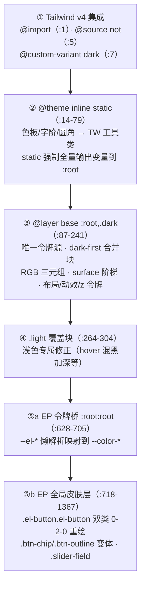
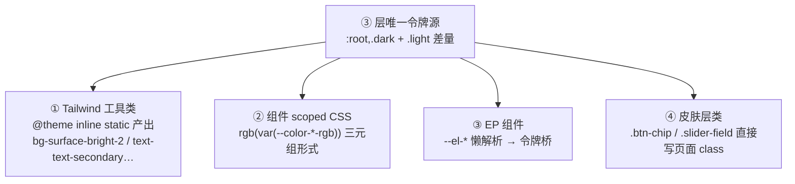
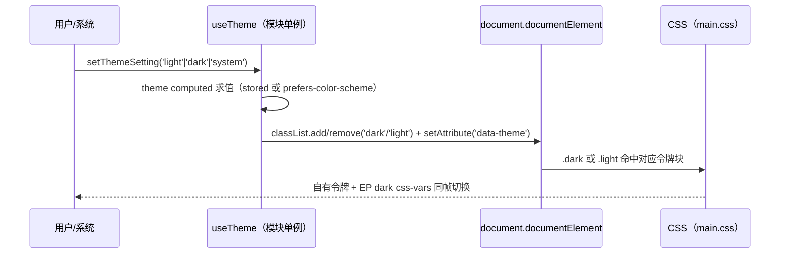
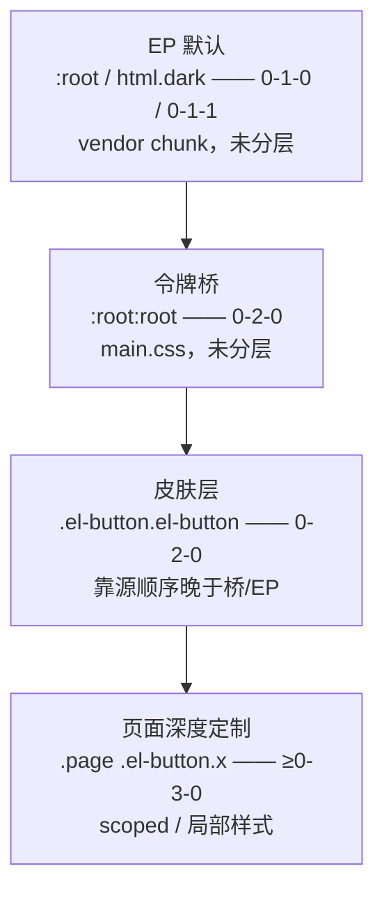

# 05 · 设计令牌与主题系统

> **一句话摘要**：main.css 五层结构如何让「一套令牌」同时驱动 Tailwind 工具类、手写 CSS、Element Plus 与暗/浅双主题——外加图标子集体系。
> **目标读者**：页面/样式开发者 ｜ **关联文档**：[04 布局体系](04-布局体系与页面骨架.md) · [02 应用骨架](02-应用骨架与启动流程.md) · [07 构建](07-构建预渲染与SEO.md) · [16 已知坑](16-已知坑与规避清单.md)

## 1. 概述

全站样式只有一个令牌源：`src/assets/main.css`（`wc -l` 实测 1418 行）。它的核心难题是**一份令牌要喂四个消费方**（Tailwind 工具类、组件 scoped CSS、Element Plus、全局皮肤层），且暗/浅两态都要成立。本册讲清五层结构、每层的真实代码、完整令牌清单、消费路径与特异性策略——改样式的安全边界也在这里。

字体（Inter / JetBrains Mono）由 `src/assets/text-fonts.css` 自托管；图标走独立管线（§3.6）。`main.ts` 引入顺序决定了 EP vendor CSS 与本文件的层叠关系，见 §3.4。

## 2. 架构与数据流

### 2.1 main.css 五层



图释：①②是 Tailwind 侧的接入层；③是唯一事实源——`:root` 与 `.dark` 合并为一个 dark-first 块，浅色由 ④ 差量覆盖；⑤是 Element Plus 的两层接驳：令牌桥管「变量」，皮肤层管「组件皮肤」。**顺序即优先级**：越靠下特异性策略越强，但这是设计出来的（§3.4），不是靠加载顺序。③④⑤ 之间还夹着两段不属于令牌体系的普通 base 样式（`body`/`::selection`/`:focus-visible`，:306-340 段）与首页 Hero 动画（:520-613 段）。

### 2.2 五层逐层实证（真实摘录）

**① Tailwind 接入层**（`src/assets/main.css:1-7`）：

```css
@import 'tailwindcss';

/* 排除 public 下预渲染静态站目录：其中的 HTML 含 &quot; 实体类名，
   Tailwind 误提取后生成的 url(&quot;...&quot;) 会导致 PostCSS 解析失败 */
@source not '../../public/static-sites';

@custom-variant dark (&:is(.dark *));
```

解读：`@source not` 把预渲染产物目录挡在类名扫描之外，否则静态 HTML 里的实体类名会被误提取、产出的非法 `url()` 直接让构建失败；`@custom-variant dark` 把 Tailwind 的 `dark:` 前缀重定义为「祖先带 `.dark` 类」，与 useTheme 挂类名的方案（§3.5）咬合。

**② @theme inline static**（`src/assets/main.css:14-30`，节选）：

```css
@theme inline static {
  --color-primary: rgb(var(--color-primary-rgb));
  --color-secondary: rgb(var(--color-secondary-rgb));
  --color-surface: rgb(var(--color-surface-rgb));
  --color-surface-bright: rgb(var(--color-surface-bright-rgb));
  --color-surface-bright-2: rgb(var(--color-surface-bright-2-rgb));
  --color-surface-variant: rgb(var(--color-surface-variant-rgb));
  --color-background: rgb(var(--color-background-rgb));
  /* --color-border 供 TW 工具类生成（border-border）；var() 消费走
     @layer base :root 的同式同值定义 */
  --color-border: rgb(var(--color-border-rgb) / var(--color-border-alpha, 1));
```

解读：`inline` 让工具类**内联** `var()` 引用而非值快照（主题切换不需要重新生成 CSS）；`static` 强制把全部 `--color-*` 变量输出到 `:root`——EP 令牌桥等手写 CSS 才能在运行时引用它们（工具类只内联值、不输出变量）。这一段同时产出 `bg-surface-bright-2`、`text-text-secondary` 等全站工具类。

**③ 唯一令牌源 `:root, .dark`**（`src/assets/main.css:87-103`，节选）：

```css
  :root,
  .dark {
    --color-primary-rgb: 99 102 241; /* #6366f1 单一靛蓝主色 */
    --color-surface-rgb: 12 12 14; /* #0c0c0e */
    --color-surface-dim-rgb: 9 9 11;
    --color-surface-bright-rgb: 16 16 19; /* #101013 表面1 */
    --color-surface-bright-2-rgb: 20 20 22; /* #141416 表面2 */
    --color-surface-variant-rgb: 28 28 34; /* #1c1c22 表面3 */
    --color-surface-variant-high-rgb: 39 39 42; /* #27272a */
    --color-background-rgb: 9 9 11; /* #09090b */
    --color-border-rgb: 255 255 255;
    --color-border-alpha: 0.14; /* ≈ #2b2b2d on #09090b */
    --color-text-rgb: 250 250 250; /* #fafafa */
    --color-text-secondary-rgb: 161 161 170; /* #a1a1aa */
```

解读：dark-first 单块——`useTheme` 把 `.dark`/`.light` 挂在 `<html>` 上，与 `:root` 同一元素，所以暗色值只需声明一次；此块也是 JS 执行前的兜底，避免深浅混色闪屏。所有颜色存 **RGB 三元组**而非 hex（取舍见 §4.2）。

**④ `.light` 差量覆盖块**（`src/assets/main.css:271-298`，节选）：

```css
  .light {
    --color-primary-rgb: 79 70 229;
    /* hover/active 覆盖为「混黑加深」：:root 的混白变亮配方只对深色底成立，
       浅色底上变亮会贴近白底、视觉上像失焦 */
    --color-primary-hover: color-mix(in srgb, rgb(var(--color-primary-rgb)) 85%, black);
    --color-primary-active: color-mix(in srgb, rgb(var(--color-primary-rgb)) 75%, black);
    --color-surface-rgb: 255 255 255;
    --color-surface-bright-2-rgb: 244 244 245; /* #f4f4f5 */
    --color-surface-variant-rgb: 228 228 231; /* #e4e4e7 */
    --color-background-rgb: 250 250 250; /* #fafafa */
    --color-border-rgb: 24 24 27; /* #18181b，原靛蓝染色废除 */
    --color-text-rgb: 24 24 27; /* #18181b */
    --color-border-alpha: 0.09; /* ≈ #eaeaea on white */
```

解读：`.light` 只覆盖**两态确实不同**的令牌（surface 阶梯、文字、主色 hover 配方、border alpha 等），文件顺序天然压过前面的 `:root, .dark` 值。注意 hover/active 的混色方向是**有意相反**的（暗色混白变亮、浅色混黑加深），勿「统一」掉。

**⑤a EP 令牌桥 `:root:root`**（`src/assets/main.css:628-682`，节选）：

```css
:root:root {
  --el-color-primary: rgb(var(--color-primary-rgb));
  --el-color-primary-dark-2: var(--color-primary-active);
  --el-color-primary-light-3: var(--color-primary-hover);
  --el-color-success: rgb(var(--color-success-rgb));
  --el-color-warning: rgb(var(--color-warning-rgb));
  --el-color-danger: rgb(var(--color-error-rgb));
  --el-bg-color: rgb(var(--color-surface-bright-rgb));
  --el-bg-color-overlay: rgb(var(--color-surface-bright-2-rgb));
  --el-bg-color-page: rgb(var(--color-background-rgb));
  --el-text-color-primary: rgb(var(--color-text-rgb));
  --el-border-color: rgb(var(--color-border-rgb) / var(--color-border-alpha, 1));
  --el-fill-color: rgb(var(--color-surface-variant-rgb));
  --el-fill-color-light: rgb(var(--color-surface-bright-2-rgb));
```

解读：值是 `var(--color-*)` **懒解析**——主题切换时 EP 组件自动跟随，无需重写任何 `--el-*`。选择器 `:root:root`（特异性 0-2-0）是为了同时压过 EP 自带的 `:root`（0-1-0）与 dark css-vars 的 `html.dark`（0-1-1），且必须放在 `@layer base` 之外（EP 默认变量未分层，层内规则永远打不过它）。完整映射清单见 §3.2。

**⑤b 皮肤层**（`src/assets/main.css:737-755` 与 `:876-914`，节选）：

```css
.el-button.el-button {
  display: inline-flex;
  align-items: center;
  justify-content: center;
  gap: 6px;
  height: 36px;
  padding: 0 14px;
  font-family: var(--font-body);
  font-weight: 500;
  font-size: 0.875rem;
  border: 1px solid transparent;
  box-shadow: none;
  /* 按钮圆角上限 4px（用户规范）：全站按钮/按钮形控件统一收平 */
  border-radius: var(--radius-sm);
}
```

```css
.el-input.el-input,
.el-textarea.el-textarea {
  border: 1px solid rgb(var(--color-border-rgb) / var(--color-border-alpha, 1));
  border-radius: var(--radius-md);
  min-height: 32px;
  background: rgb(var(--color-surface-bright-2-rgb));
}
/* 剥 EP wrapper 自带边框/阴影（!important 防 dev 环境加载顺序翻车） */
.el-input .el-input__wrapper,
.el-textarea .el-textarea__inner {
  background: transparent !important;
  box-shadow: none !important;
  border: none !important;
}
```

解读：皮肤层是「裸 `el-*` 直接长成本站皮肤」的唯一来源（App\* 包装组件已拆除，见 §4.3）。策略：**根节点双类**（`.el-button.el-button`，0-2-0）画壳，**内层带父级前缀**（`.el-input .el-input__wrapper`，0-2-0）剥 EP 默认样式，默认变体态用 `:not` 链排除显式变体。完整覆盖清单见 §3.3。

### 2.3 四条消费路径



图释：四条路全部指回 ③ 层——`@theme` 里的 `--color-primary: rgb(var(--color-primary-rgb))` 只是**别名转发**，真值永远在 `:root, .dark` 块。因此改一处令牌，工具类、scoped CSS、EP 组件、皮肤类四个消费方同时生效，不存在第二份需要同步的色值。

### 2.4 主题切换链路



图释：一次写入同时驱动两套体系——自有 `--color-*-rgb`（③④层）与 EP 官方 `dark/css-vars.css`（`main.ts:73` 引入，依赖 `.dark` 类）。`data-theme` 属性是冗余信号，供 CSS 之外的场景（如 E2E 断言）使用。

## 3. 核心实现

### 3.1 完整令牌清单（③ 层实测逐项）

**surface 阶梯**（面板底色四档 + 背景，值自 `main.css:95-101` 与 `:275-281` 抄录）：

| 令牌 | 暗色（:root,.dark） | 浅色（.light） | 语义 |
|---|---|---|---|
| `--color-background-rgb` | `9 9 11` | `250 250 250` | 页面最底 |
| `--color-surface-rgb` | `12 12 14` | `255 255 255` | 基础面 |
| `--color-surface-dim-rgb` | `9 9 11` | `244 244 245` | 压暗面 |
| `--color-surface-bright-rgb` | `16 16 19` | `255 255 255` | 面1（卡片/EP bg） |
| `--color-surface-bright-2-rgb` | `20 20 22` | `244 244 245` | 面2（输入框/overlay） |
| `--color-surface-variant-rgb` | `28 28 34` | `228 228 231` | 面3（fill/hover） |
| `--color-surface-variant-high-rgb` | `39 39 42` | `212 212 216` | 面4（fill-dark） |

M3 容器阶梯别名（`--color-surface-container-lowest-rgb` / `--color-surface-container-low-rgb` / `--color-outline-variant-rgb`，:148-150）是 Stitch 遗产残档，**仅 image 家族消费**，两态各自重索引到主阶梯（暗/浅映射档位不同），勿凭空恢复已删的四档。

**文字与语义色**（暗/浅，抄录自 :104-108 与 :283-287）：

| 令牌 | 暗色 | 浅色 |
|---|---|---|
| `--color-text-rgb` | `250 250 250` | `24 24 27` |
| `--color-text-secondary-rgb` | `161 161 170` | `82 82 91` |
| `--color-success-rgb` | `34 197 94` | `22 163 74` |
| `--color-error-rgb` | `239 68 68` | `220 38 38` |
| `--color-warning-rgb` | `245 158 11` | `180 83 9`（amber-700，对比度 ≥4.5:1） |

主色 `--color-primary-rgb`：暗 `99 102 241`（#6366f1）/ 浅 `79 70 229`（#4f46e5）。10 个 accent（pink/rose/sky/cyan/amber/orange/blue/green/purple/indigo）暗色为主清单、浅色差量覆盖 10 个中的 10 个（浅色整体加深一档）；代码块品牌色 19 个 `--color-codeblock-*`（macOS 三圆点 3 个 + 语言标识 16 个）为固定 hex，不随主题。

**border-alpha 双态**（本册最易踩的分叉点）：

| 令牌 | 暗色 | 浅色 | 派生 |
|---|---|---|---|
| `--color-border-rgb` | `255 255 255` | `24 24 27` | 边框色相 |
| `--color-border-alpha` | `0.14` | `0.09` | 边框浓度 |
| `--color-border` | `rgb(var(--color-border-rgb) / var(--color-border-alpha, 1))` | 同左 | 标准边框 |
| `--color-border-soft` | `calc(alpha * 0.7)` | 同左 | 弱边框 |
| `--color-border-input` | `calc(alpha * 1.3)` | 同左 | 输入框边框 |

**字阶 4 档**（`@theme inline static`，:67-78；这是删减后的存量，见 §4.4）：

| 令牌 | 值 | line-height | font-weight |
|---|---|---|---|
| `--text-body-lg` | `1.125rem`（18px） | 1.6 | 400 |
| `--text-body-md` | `1rem`（16px） | 1.5 | 400 |
| `--text-body-sm` | `0.875rem`（14px） | 1.5 | 400 |
| `--text-code-sm` | `0.75rem`（12px） | 1.6 | 400 |

另有流式字阶 `--text-fluid-display / -headline / -title`（:233-235，`clamp()` 插值，仅首页 Hero 消费）。

**radius**：`--radius-sm` 4px / `--radius` 6px / `--radius-md` 8px / `--radius-lg` 10px / `--radius-xl` 12px / `--radius-full` 999px（@theme，:55-60）；扩展档 `--radius-2xl` 14px / `--radius-3xl` 16px（:221-222）。按钮统一 `--radius-sm`（4px 上限，皮肤层注释为「用户规范」）。

**shadow xs~2xl**（:171-176；只服务显式 `var()` 消费方，TW 的 `shadow-*` 工具类与 EP 的 `--el-box-shadow` 都不走本梯子）：

| 令牌 | 值 |
|---|---|
| `--shadow-xs` | `0 1px 2px rgb(var(--color-shadow-rgb) / 0.05)` |
| `--shadow-sm` | `0 2px 8px rgb(var(--color-shadow-rgb) / 0.08)` |
| `--shadow-md` | `0 4px 16px rgb(var(--color-shadow-rgb) / 0.1)` |
| `--shadow-lg` | `0 8px 28px rgb(var(--color-shadow-rgb) / 0.14)` |
| `--shadow-xl` | `0 16px 48px rgb(var(--color-shadow-rgb) / 0.2)` |
| `--shadow-2xl` | `0 24px 64px rgb(var(--color-shadow-rgb) / 0.28)` |

**z 三档**（:191-193）：`--z-dropdown: 100`、`--z-header: 1000`、`--z-modal: 1100`。原 8 档中 5 档零消费已删；EP 浮层走自有 2000+ 层级不受此梯子约束。CommandPalette 的遮罩即消费 `var(--z-modal, 1100)`（此前硬编码 1000 与 header 同层，是真实修复过的事故）。

**duration / ease**（:179-187）：`--duration-fast` 150ms / `--duration-base` 200ms / `--duration-smooth` 250ms / `--duration-page` 300ms；`--ease-out: cubic-bezier(0.16, 1, 0.3, 1)`、`--ease-in-out: cubic-bezier(0.4, 0, 0.2, 1)`、`--ease-spring: cubic-bezier(0.34, 1.56, 0.64, 1)`。

**focus-ring**（:239-240）：`--focus-ring: 0 0 0 3px rgb(var(--color-primary-rgb) / 0.1)`；`--focus-ring-strong: 0 0 0 4px rgb(var(--color-primary-rgb) / 0.3)`（slider 拖拽柄等强反馈场景）。input/textarea/select（`:focus-within`）与 slider（`:focus-visible`）统一消费。

**布局令牌**（:160-165）：`--header-height: 4rem`、`--layout-max-width: 1440px`、`--page-padding-x: 1.5rem`（767px 以下媒体查询内重定义为 `1rem`，:257-261）。满高计算（04 §2.3）依赖前两者；`--layout-max-width` 曾是只被引用未定义的「假令牌」，2026-09 补齐。间距不走自有令牌——统一走 TW 4px 标度。

**文字透明度变体**（:215-218）：`--color-text-strong`（0.92）/ `--color-text-soft`（0.8）/ `--color-text-tertiary`（0.6）/ `--color-text-quaternary`（0.4）。**固定色**（:230-232）：`--color-text-inverse`（#ffffff，彩色表面上的反字，刻意不用 text-rgb）、`--color-preview-canvas`（#ffffff 运行器画布）、`--color-accent-rose-strong-rgb`（rose-500，Ieee754 符号位高亮）。

### 3.2 EP 令牌桥映射表（`:root:root` 段 :628-705 逐项实测）

| EP 变量 | 映射到 |
|---|---|
| `--el-color-primary` | `rgb(var(--color-primary-rgb))` |
| `--el-color-primary-dark-2` | `var(--color-primary-active)` |
| `--el-color-primary-light-3` | `var(--color-primary-hover)` |
| `--el-color-primary-light-5/7/8/9` | `color-mix(primary 50/30/20/10%, background)` |
| `--el-color-success / warning` | `rgb(var(--color-success-rgb))` / `rgb(var(--color-warning-rgb))` |
| `--el-color-danger / error` | `rgb(var(--color-error-rgb))`（两者同源） |
| `--el-color-info` | `rgb(var(--color-text-secondary-rgb))` |
| `--el-bg-color` | `rgb(var(--color-surface-bright-rgb))` |
| `--el-bg-color-overlay` | `rgb(var(--color-surface-bright-2-rgb))` |
| `--el-bg-color-page` | `rgb(var(--color-background-rgb))` |
| `--el-text-color-primary` | `rgb(var(--color-text-rgb))` |
| `--el-text-color-regular` | `rgb(var(--color-text-rgb) / 0.86)` |
| `--el-text-color-secondary` | `rgb(var(--color-text-secondary-rgb))` |
| `--el-text-color-placeholder` | `rgb(var(--color-text-secondary-rgb) / 0.5)`（全站单值 0.5） |
| `--el-text-color-disabled` | `rgb(var(--color-text-secondary-rgb) / 0.4)` |
| `--el-border-color` | `rgb(var(--color-border-rgb) / var(--color-border-alpha, 1))` |
| `--el-border-color-light / lighter / extra-light` | `calc(alpha × 0.75 / 0.5 / 0.35)` |
| `--el-border-color-hover` | `rgb(var(--color-text-secondary-rgb) / 0.45)` |
| `--el-fill-color` | `rgb(var(--color-surface-variant-rgb))` |
| `--el-fill-color-dark / darker` | `rgb(var(--color-surface-variant-high-rgb))`（两者同源） |
| `--el-fill-color-light` | `rgb(var(--color-surface-bright-2-rgb))` |
| `--el-fill-color-lighter / extra-light` | `rgb(var(--color-surface-bright-rgb))`（两者同源） |
| `--el-fill-color-blank` | `transparent` |
| `--el-border-radius-base / small / round` | `var(--radius-md)` / `var(--radius)` / `999px` |
| `--el-component-size / small / large` | `32px / 28px / 40px` |
| `--el-font-family` | `var(--font-body)` |
| `--el-font-size-base / medium / large / extra-small` | `var(--text-body-sm)` / `--text-body-md` / `--text-body-lg` / `--text-code-sm` |
| `--el-box-shadow / -light` | `0 8px 24px … / 0.28`、`0 4px 12px … / 0.2`（**不映射** --shadow-*，无等值令牌） |
| `--el-mask-color`、`--el-overlay-color-lighter` | `rgb(var(--color-background-rgb) / 0.7)`（两者同值、消费方不同） |
| `--el-popover-border-radius` | `10px`（独立补齐块 :713-716，与面板 `--radius-lg` 一致） |

small 13px / extra-large 20px 字号无对应令牌，保持 EP 默认——字阶只有 4 档是刻意的（§4.4）。

### 3.3 皮肤层覆盖组件完整清单（grep `.el-` 于 :718-1367 实测）

| 组件族（选择器出现次数） | 覆盖内容 |
|---|---|
| `el-button`（26） | 基础壳（36px 高、4px 圆角、font-body）；禁用整体降透明 0.4；small/large 尺寸档；默认变体（表面2底+令牌边框）；primary 主色实底；text 极简文字态 |
| `el-textarea`（24） | 根节点画壳（边框/圆角/最小高/表面2底）；focus-within 焦点环画在根；内层 wrapper/inner 剥 EP 边框阴影；行高 1.6 + 纵向 resize |
| `el-checkbox`（22） | 基态透明底方框（4px 圆角）；选中/半选主色实底；未选中 hover 边框升一级；label 字体字号继承 |
| `el-input`（17） | 同 textarea 根壳契约；placeholder 走桥变量 0.5；is-disabled 降透明 0.4 |
| `el-select`（16+3） | 根节点画壳（v2 wrapper DOM）；focus-within 补焦点环（EP 默认聚焦阴影已被剥，不补则键盘焦点不可见）；wrapper/selected-item/caret 剥皮；禁用 `:has()` 整体降透明 |
| `el-tabs`（12） | header 高 40px；item 字号 0.875rem、hover/active 主色；active-bar 主色；nav-wrap 底线令牌化 |
| `el-dialog`（10） | 面板壳（令牌边框 + `--radius-lg` + el-box-shadow-light）；header 16/24 padding + 底边框；title/body/footer 排版 |
| `el-alert`（10） | 细条语义杆：表面2底 + 令牌边框 + `--el-alert-padding: 10px 14px`；四类型文字色分语义；关闭钮隐藏（对齐原 AppMessage 不可关闭） |
| `el-table`（9） | 组件内变量整体令牌化（border/header bg/header text/hover bg/transparent 底）；表头 0.75rem 600；cell padding 10px |
| `el-statistic`（9） | head 变 label-caps（0.6875rem 大写 + letter-spacing）；content 走 mono 1.5rem |
| `el-slider`（9） | 滑轨表面3、填充段主色、12px 主色滑钮白描边；拖拽柄 focus-visible 补 `--focus-ring-strong` |
| `el-tag`（8） | 徽标形态（透明底无边框 + `::before` 6px 状态点随 currentColor）；`.badge-plain` 关点；large 档 0.9375rem |
| `el-segmented`（7） | 轨道表面2、选中项表面亮底主色字；4px 圆角；窄视口自身滚动收口；「全部 item 禁用才整体降透明」的 `:has()` 组合 |
| `el-message`（6） | 右上角定位（right 24px）；`--wb-msg-tint` 与表面 color-mix 出类型底色；阴影收敛 el-box-shadow-light |
| `el-empty`（6） | 紧凑空态 padding 32px 16px；描述 0.875rem 次级色 |
| `el-divider`（4） | margin 16px 0；text 0.8125rem 次级色（颜色本身已由桥的 --el-border-color 覆盖） |
| `el-card`（4） | 面板形态：令牌边框、`--radius-lg`、`--el-card-bg-color: rgb(var(--color-surface-rgb) / 0.5)`、无投影 |
| `el-select-dropdown`（3） | 选项 hover 表面升级（表面3） |
| `el-pagination`（3+1 pager） | 透明底页码、主色 hover/激活、字号 0.875rem |
| `el-switch`（2） | 关态填充 `--el-switch-off-color: rgb(var(--color-surface-variant-high-rgb))`（开态主色走桥） |
| `el-loading-mask`（1） | 遮罩背景色 60% |
| `el-popper`（1） | `.is-light` 统一阴影 `var(--el-box-shadow-light)` 兜底 tooltip 等轻浮层 |

**类变体**（页面直接挂 class）：

| 类 | 用途 | 关键值 |
|---|---|---|
| `.btn-chip` | 强调小徽钮（原 .btn-pill，2026-09-24 更名） | 7px 14px 内边距、主色 12% 底 + 35% 边、0.6875rem/600 |
| `.btn-chip-muted` | 低强调小徽钮 | 表面2底 + 令牌边框、次级文字色 |
| `.btn-outline` | 遗留别名：表面2底 + 主色描边 | hover 主色 10% 底 |
| `.slider-field`（:1213-1279） | 「label + 滑轨 + 数值徽章」组合布局（AppSlider 拆除后的共享表达） | label mono 0.75rem；value 徽章表面2底主色字；`--small` / `--disabled` 变体 |
| `.badge-plain` | el-tag 无状态点变体 | `::before { display: none }` |

**工具类穿透块**（:958-976，三条规则，必须排在全部根节点皮肤区之后）：

```css
.el-textarea.font-mono,
.el-button.font-mono,
.el-select.font-mono {
  font-family: var(--font-mono);
}
.el-input.text-xs,
.el-textarea.text-xs {
  font-size: 0.75rem;
}
.el-textarea.resize-none .el-textarea__inner {
  resize: none;
}
```

解读：根节点皮肤写死了 `font-body` 与 `0.875rem`（双类特异性），页面在这些元素上写 `font-mono`/`text-xs` 工具类会被压掉——穿透块按类名把意图还原。给带 `.el-*` 皮肤的节点加工具类前先查这里是否已覆盖；新皮肤根属性变化时同步维护本块。

### 3.4 特异性阶梯



图释：EP 的单类默认（0-1-0）被 `:root:root`（0-2-0）压过；皮肤层用**双类 0-2-0** 压过 EP 单类组件选择器，但**不会**压过页面三类以上的定制；同一 0-2-0 之内靠源顺序（皮肤层在文件中晚于令牌桥）。加载顺序不可依赖：生产 vendor CSS 先于 main.css，dev 相反——皮肤层历史上保留的少量 `!important`（如 `.el-input__wrapper` 剥皮）正是为 dev 顺序兜底，其余规则全部靠特异性。

真实选择器对照（同为主色 hover，三档写法）：

```css
/* 皮肤层默认变体 hover（0-2-0 + :not 链） */
.el-button.el-button:not(.el-button--primary):not(.el-button--success):not(.el-button--warning):not(
    .el-button--danger
  ):not(.el-button--info):not(.el-button--error):not(.is-text):not(.btn-chip):not(
    .btn-chip-muted
  ):not(.btn-outline):hover {
  background: rgb(var(--color-surface-variant-rgb));
}
/* primary 变体 hover（0-2-0，显式类） */
.el-button.el-button--primary:hover {
  background: var(--color-primary-hover);
}
```

页面要覆盖皮肤层时用「更高特异性 + 更晚位置」，禁止 `!important` 对抗（历史上两处已清理）。

### 3.5 useTheme 代码走读（`src/composables/useTheme.ts`）

模块级单例 + 独立 effectScope，不依赖组件生命周期：

```ts
function applyTheme(value: Theme) {
  if (typeof document === 'undefined') return
  const root = document.documentElement
  // 同步切换 .dark/.light class：既驱动项目自有 --color-*-rgb 变量，
  // 也驱动 element-plus 暗黑模式（theme-chalk/dark/css-vars.css 依赖 .dark）
  if (value === 'dark') {
    root.classList.add('dark')
    root.classList.remove('light')
    root.setAttribute('data-theme', 'dark')
  } else {
    root.classList.add('light')
    root.classList.remove('dark')
    root.setAttribute('data-theme', 'light')
  }
}
```

```ts
const themeScope = effectScope(true)
let themeWatchInitialized = false

themeScope.run(() => {
  watch(theme, applyTheme, { immediate: true })
  themeWatchInitialized = true
})
```

走读要点：① `theme` 是模块级 `computed`（`stored === 'system'` 时回落 `usePreferredColorScheme`），是全站主题判定的**唯一来源**——此前函数式实现导致三种写法并存、UniversalCodeBlock 自建版本读 classList 切换后不更新，已收敛；② watch 挂在独立 `effectScope` 上，与组件作用域解耦——若绑定到首个调用组件，该组件卸载（如 HMR 重建）后 watch 被 stop，主题切换从此失灵（报告 #14 的真实事故，注释原文保留在源码）；③ `themeWatchInitialized` 被 `void` 引用，防 tree-shake 误删副作用；④ `reapplyTheme()` 供外部清理后恢复 DOM 状态。偏好持久化在 `tools-theme` 键（值 `'dark' | 'light' | 'system'`，见 06 §3.2）。

### 3.6 图标管线（Material Symbols ligature + 构建期子集）

**渲染端**（`src/components/common/AppIcon.vue:39-58`）：`span.material-symbols-outlined` 用 ligature 文本渲染，前缀解析真实代码：

```ts
const iconName = computed(() => {
  let name = props.icon
  if (name.startsWith('ms:')) {
    name = name.slice(3)
  } else if (name.startsWith('material-symbols:')) {
    name = name.slice('material-symbols:'.length)
  }
  // Material Symbols 字体 ligature 使用下划线命名
  return name.replace(/-/g, '_')
})
```

根元素固定带 `app-icon` 类（2026-09-24 起）——此前 18 处 `.xxx .app-icon { … }` 规则因根类名缺失而**不匹配任何元素**。

**构建端**（`build/fonts/build-icon-subset.py`，`pnpm icons:build`）：输入是 node_modules 的全量字体（3,964,532 字节 ≈ 3.8MB、约 3600 图标）；扫描正则与输出清单：

```python
# 组成图标名的字符（连字规则的输入字形）
LETTERS = "abcdefghijklmnopqrstuvwxyz0123456789_"
ICON_RE = re.compile(r"(?:ms|material-symbols):([a-z0-9_-]+)")

def scan_icon_names() -> list[str]:
    """扫描 src/ 收集全部 `ms:` 图标名（横线归一为下划线，与 AppIcon 一致）"""
    names: set[str] = set()
    for path in (ROOT / "src").rglob("*"):
        if path.suffix not in {".ts", ".vue", ".js"}:
            continue
        text = path.read_text(encoding="utf-8", errors="ignore")
        for m in ICON_RE.finditer(text):
            names.add(m.group(1).replace("-", "_"))
    return sorted(names)
```

脚本七步：解压 woff2 → 扫描 → HarfBuzz 整形校验名字有效 → 裁 GSUB 连字规则（LookupType 7 包 LookupType 4，必须解包 `ExtSubTable`）→ 变量轴实例化（wght=400/FILL=0/GRAD=0，保留 `opsz`）→ fontTools subset → 子集再整形回归校验。输出 `src/assets/fonts/material-symbols-subset.woff2` 与清单 `src/assets/fonts/icon-manifest.json`（样例，实测头部）：

```json
{
  "_comment": "由 build/fonts/build-icon-subset.py 生成，请勿手工编辑。",
  "source": "material-symbols outlined",
  "axes": ["opsz"],
  "glyphCount": 253,
  "icons": [
    "abc",
    "account_tree",
    "add",
    "ads_click",
    "api",
    "apps",
```

**实测数字**（manifest + `ls -l`，2026-09-27）：227 个图标 / 253 个字形 / 子集 39,980 字节 ≈ 39.0 KB，较全量减少 99.0%；`@font-face` 的 font-weight 为 400（变量轴已实例化，上游 `100 700` 不再成立）；`font-display: block`（38.7KB 级别阻塞窗口可忽略，swap 会让 `arrow_forward` 以文字闪现）。全站用量实测：`ms:` 图标名出现 1176 处，`<AppIcon` 组件用法 753 处、分布 157 个文件。守卫：`src/assets/fonts/icon-subset.test.ts` 在「代码里用了但子集里没有」时失败（`pnpm test` / CI 拦截）。

> 注：`src/assets/material-symbols.css` 头部注释写「224 图标 / 251 字形 / 38.7KB」，滞后于自动生成的 manifest；以 manifest 为准（227/253/39,980B）。该注释随下次 `icons:build` 时才可能同步。

## 4. 设计决策与取舍

1. **dark-first 单块**（`:root` 与 `.dark` 合并声明，:81-241）。Why：同元素在两态下绝大多数令牌恒等，拆两块曾造成 42 行逐值重复漂移；dark 值进 `:root`、浅色差量进 `.light`，文件顺序即覆盖关系。源码注释保留合并日期（2026-09-24）防回退。
2. **RGB 三元组格式**（`--color-*-rgb: r, g, b`）。Why：`rgb(var(--x-rgb) / alpha)` 与 `color-mix()` 派生（border 三档 alpha、hover 加深/变亮、message tint）都要求通道值可拆；直接存 hex 做不到。代价是可读性略差——注释里保留 hex 对照（如 `#0c0c0e`）。
3. **EP 主题化走桥 + 皮肤，不走包装组件**。Why：包装层（AppButton 等）已拆除——透传成本高（01 §4.3）；令牌桥解决「颜色对」（§3.2 全表 30 余项），皮肤层解决「形状/密度/圆角」（§3.3 全表 22 个组件族），两者合计约 740 行，替代了原本会膨胀到数千行的包装组件族。代价：特异性策略必须被严格遵守（§3.4）。
4. **双类 0-2-0 特异性策略**。Why：EP 自身用单类选择器，`.el-button.el-button` 恰好压过它又**不会**压过页面用三类的深度定制；这给「全局默认 + 局部覆盖」留出了明确的特异性阶梯（§3.4 图）。
5. **图标 ligature + 构建期子集，而非 SVG 组件**。Why：227 个图标只发 39KB 且一次缓存全站复用（753 处 `<AppIcon` 共享同一字体），SVG 组件方案是每图标一次组件引入与打包。代价：**新图标必须重跑 `pnpm icons:build`**，否则渲染为 ligature 文本；子集测试会在 CI 抓到未重跑。脚本头部的 8 条踩坑记录（闭包爆回 3.81MB、LookupType 7 解包、HarfBuzz 不能读 woff2 等）是血泪换来的，勿删。
6. **字阶只保留 4 档**。Why：实测全站 800+ 处字号为手写 rem、字阶工具类零使用，13/15px 无对应档位；2026-09-24 移除完整字阶，重启收编前先按实测分布（12/13/14/15px 为主）重设阶梯（@theme 注释原文）。

## 5. 边界情况与已知限制

- **皮肤穿透规则**：皮肤根节点选择器（双类）特异性高于单类工具类——`font-mono`、`text-xs`、`resize-none` 等 TW 工具类写在带皮肤类的元素上会失效；穿透块（§3.3 尾部三规则）必须排在**全部根节点皮肤区之后**（同特异性后者胜）。给带 `.el-*` 皮肤的节点加工具类前先查穿透块。
- **特异性纪律**：皮肤层选好后，页面想覆盖它要用「更高特异性 + 更晚位置」；禁止在页面里用 `!important` 对抗皮肤层（历史上两处已被清理）。皮肤层内部仅存的 `!important` 是为 dev 加载顺序兜底，不要扩散。
- **`--el-*` 只该被桥映射**：直接写 `--el-*` 字面量会绕过令牌源；EP 变量一律经桥取得。例外是皮肤层在**组件根**上设置 EP 组件自有变量（如 `.el-segmented.el-segmented { --el-segmented-bg-color: … }`）——这是皮肤的一部分，不是绕桥。
- **字阶扩张需审批式谨慎**：4 档是删减后的存量，新增档位前先确认不是局部一次性需求（§4.6）。
- **图标子集盲区**：动态拼接 `ms:` 图标名（运行时才确定字符串）无法被构建期扫描到，属禁用模式——图标名必须静态字面量；无效图标名会被脚本 `[3/7]` 步直接 fail 而非静默缩水。
- **断点阶梯**：主阶梯为 640/768/1024/1280px 四组互补对（min/max 成对），900/720/480px 各 1 处布局专用；手机（<660px）不在支持范围，AppHeader 隐藏分类导航属可接受降级（:243-254 注释文档化）。
- **EP 阴影不映射**：`--el-box-shadow` 与 `--shadow-*` 无等值令牌，两套并存（观感优先）——改阴影时两边都要看。

## 6. 变更指引

1. **改/加令牌**：只改 ③ 层唯一源；若有浅色差量同步 ④ 层；改动后暗/浅双态各过一遍主要页面，EP 组件（select/dialog/table）重点核对令牌桥映射（§3.2 表）是否需要跟进。登记位置：本文档 §3.1 对应表。
2. **接入新 EP 组件**：先在皮肤层为其建立重绘段（双类策略，参照 §3.3 表既有条目），再检查令牌桥是否覆盖其变量；注册方式见 02 §6.1。
3. **新增图标**：源码写静态 `ms:xxx` → `pnpm icons:build` → `src/assets/fonts/icon-subset.test.ts` 验证 → manifest 数字回填本文 §3.6。
4. **改字体/字阶**：`src/assets/text-fonts.css` 自托管字体（Inter / JetBrains Mono，woff2 四个文件共约 176KB）；换字体注意 fallback 栈与 mono 场景（ToolCodePanel 等）。
5. **验证手段**：双主题像素抽查（body 背景、主色 hover 两态）、`pnpm test`（icon-subset 等守卫）、改皮肤层后跑全页巡检测试。

### 实操配方

**配方 A：给某页内容区加宽（centered 布局）**。满高骨架（04 §2.3）用 `--layout-max-width` 控制容器上限，页面级覆盖在自己的 scoped 样式里做，不动全局令牌：

```css
/* 页面 scoped：把本页容器上限放宽到 1680px（仅此页生效） */
.tool-page {
  max-width: 1680px;
  margin-inline: auto;
  padding-inline: var(--page-padding-x); /* 沿用全局页边距令牌 */
}
```

要点：`max-width` 直接写值即可（本页一次性需求不升格为令牌）；若第二个页面也要 1680px，再把它升级进 ③ 层并在 §3.1 登记。

**配方 B：新增一个皮肤类变体**（如信息型 chip `.btn-chip-info`），写在皮肤层 `.btn-chip` 段之后：

```css
/* 新变体：信息蓝 chip，对齐 .btn-chip 的形、只换色 */
.el-button.btn-chip-info {
  border-color: rgb(var(--color-accent-blue-rgb) / 0.35);
  background: rgb(var(--color-accent-blue-rgb) / 0.12);
  color: rgb(var(--color-accent-blue-rgb));
}
.el-button.btn-chip-info:hover {
  background: rgb(var(--color-accent-blue-rgb) / 0.2);
  border-color: rgb(var(--color-accent-blue-rgb) / 0.55);
}
```

要点：选择器保持 `.el-button.btn-chip-*` 双类（0-2-0）；形（padding/字号/圆角）继承 `.btn-chip` 不重写；同时确认尺寸档选择器 `.el-button.el-button--small:not(.btn-chip):not(.btn-chip-muted)` 的 `:not` 链是否需要纳入新变体（chip 系自带紧凑尺寸不参与尺寸档）。

**配方 C：新增一个令牌**（例：悬浮卡raised 底色），三步：

```css
/* ① ③ 层唯一源（:root,.dark 块内，surface 阶梯之后） */
--color-surface-raised-rgb: 24 24 28;

/* ② ④ 层浅色差量（.light 块内，有差异才写） */
--color-surface-raised-rgb: 255 255 255;

/* ③ ② 层别名（@theme inline static，供 bg-surface-raised 工具类） */
--color-surface-raised: rgb(var(--color-surface-raised-rgb));
```

要点：三元组格式（§4.2）；EP 侧若也要用，同步在令牌桥补一行映射；随后双主题过一遍消费页面，并在本文 §3.1 surface 表登记一行。
