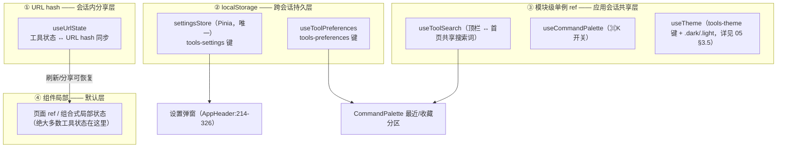

# 06 · 全局状态与应用级机制

> **一句话摘要**：全站状态只有四层——URL hash、localStorage、模块级单例 ref、唯一 Pinia store——外加 ⌘K 命令面板、搜索与 SEO 同步三个应用级机制。
> **目标读者**：新工程师 + AI Agent ｜ **关联文档**：[02 应用骨架](02-应用骨架与启动流程.md) · [05 设计令牌](05-设计令牌与主题系统.md) · [08 跨页面复用范式](08-跨页面复用范式.md) · [10 编程与运行](10-编程与运行工具设计.md)

## 1. 概述

本项目的状态哲学是**轻状态**：工具彼此独立（catalog 实测 142 个工具），几乎不需要跨页共享可变状态。全局态按「生命周期 × 持久化需求」分四层放置，每层有明确的准入条件（§2.1）。本册还覆盖三个横切机制：设置弹窗与 settingsStore、⌘K 命令面板、SEO 同步。`src/composables/` 下 16 个非测试文件逐一登记在 §3.1，消费方数量为 grep 实测。

## 2. 架构与数据流

### 2.1 四层状态判据与实例清单



图释：准入自上而下——能放局部就放局部；要跨组件共享但不跨刷新 → 模块单例；要跨刷新 → localStorage（直接 `useStorage`）；要进 URL 可分享/可恢复 → useUrlState。**Pinia 只有一个 store 是刻意结果**：settingsStore 之外没有任何状态同时满足「跨页共享 + 跨刷新 + 响应式注入组件树」三条件（取舍见 §4.1）。

| 层 | 准入判据（全部满足才入层） | 当前全部实例（实测） |
|---|---|---|
| ① URL hash | 工具输入/结果需要「刷新还在、链接可发」；序列化 ≤8000 字符 | 4 个页面：UrlEncoderPage、TextCasePage、RegexLabPage、CodeImageGeneratorPage（grep 实测） |
| ② localStorage | 跨会话有效、纯客户端、无服务器参与 | 3 个键：`tools-settings`（settingsStore）、`tools-preferences`（useToolPreferences）、`tools-theme`（useTheme）；完整清单见 §2.3 |
| ③ 模块级单例 ref | 跨组件共享 + 会话内存活 + 不需要持久化（或持久化由 useStorage 附加） | 4 个：useTheme（含持久化）、useToolPreferences（含持久化）、useCommandPalette、useToolSearch |
| ④ 组件局部 | 默认层：不满足以上任何一条 | 其余全部状态，包括各工具页 ref、useEditorHistory/useImageSource/useLayerOrder 等组件作用域 composable |

### 2.2 settingsStore 全文与逐段解读（`src/stores/settingsStore.ts`，wc -l 实测 90 行）

```ts
import { defineStore } from 'pinia'
import { computed } from 'vue'
import { useStorage } from '@vueuse/core'

const STORAGE_KEY = 'tools-settings'

export interface SettingsState {
  /** 运行超时（毫秒），对所有运行类工具生效 */
  runTimeoutMs: number
  /** 代码缩进，JSON 格式化 / SQL 格式化等格式化类工具共用 */
  codeIndent: CodeIndent
}

/** 超时允许范围 */
export const RUN_TIMEOUT_MIN = 500
export const RUN_TIMEOUT_MAX = 60000
export const RUN_TIMEOUT_DEFAULT = 10000

/** 代码缩进的可选值与默认值（设置弹窗与各工具页共用同一份选项） */
export type CodeIndent = '2' | '4' | 'tab'
export const CODE_INDENT_DEFAULT: CodeIndent = '2'
export const CODE_INDENT_OPTIONS: Array<{ label: string; value: CodeIndent }> = [
  { label: '2 空格', value: '2' },
  { label: '4 空格', value: '4' },
  { label: 'Tab', value: 'tab' },
]

function isCodeIndent(value: unknown): value is CodeIndent {
  return value === '2' || value === '4' || value === 'tab'
}

/** 统一的越界钳制：四舍五入后限制在允许范围内 */
function clampRunTimeout(value: number): number {
  return Math.min(RUN_TIMEOUT_MAX, Math.max(RUN_TIMEOUT_MIN, Math.round(value)))
}

export const useSettingsStore = defineStore('settings', () => {
  const stored = useStorage<SettingsState>(STORAGE_KEY, {
    runTimeoutMs: RUN_TIMEOUT_DEFAULT,
    codeIndent: CODE_INDENT_DEFAULT,
  })

  const runTimeoutMs = computed({
    get: () => stored.value.runTimeoutMs,
    set: (value: number) => {
      if (!Number.isFinite(value)) return
      stored.value.runTimeoutMs = clampRunTimeout(value)
    },
  })

  // 历史存量存储可能没有 codeIndent 字段（useStorage 只在键整体缺失时落默认值），
  // 读取侧兜底默认，写入侧拒绝非法值
  const codeIndent = computed({
    get: () =>
      isCodeIndent(stored.value.codeIndent) ? stored.value.codeIndent : CODE_INDENT_DEFAULT,
    set: (value: CodeIndent) => {
      if (!isCodeIndent(value)) return
      stored.value.codeIndent = value
    },
  })

  /** 缩进单元字符串：直接可用作 JSON.stringify 的 space 参数，也可作 SQL 缩进单元 */
  const indentUnit = computed(() =>
    codeIndent.value === 'tab' ? '\t' : ' '.repeat(Number(codeIndent.value))
  )

  return {
    runTimeoutMs,
    setRunTimeoutMs,
    codeIndent,
    setCodeIndent,
    indentUnit,
  }
})
```

逐段解读：

- **setup 风格 + id `'settings'`**：组合式写法与 composables 心智一致；常量（`RUN_TIMEOUT_*`、`CODE_INDENT_OPTIONS`）从 store 模块导出而非组件内定义——设置弹窗（AppHeader）与工具页读的是同一份选项表，不会漂移。
- **`useStorage` 是持久化全部**：没有手写 JSON.parse/try-catch 语句，vueuse 负责序列化与容错；测试环境无 localStorage 时退化为内存 ref（`settingsStore.test.ts` 注释原话）。
- **可写 computed 做校验层**：`runTimeoutMs` 的 setter 钳制到 500–60000（`clampRunTimeout` 先 `Math.round` 再 min/max）；`codeIndent` 的 getter 是**读时兜底**——因为 `useStorage` 只在键整体缺失时落默认值，历史存量可能缺 `codeIndent` 字段，setter 拒绝非法值。这是「存储结构演进」的样板：新字段上既有键时照抄这条注释里的策略。
- **`indentUnit` 是派生而非第二状态**：`'tab' → '\t'`、`'2' → '  '`，直接可用作 `JSON.stringify(value, null, indentUnit)` 的 space 参数与 SQL 缩进单元——消费方永远拿现成字符串，不重复翻译。
- **消费方**：设置弹窗（AppHeader:244-287 的缩进 segmented 与超时 input）、全部代码编辑/格式化工具（Monaco indent、格式化缩进）、运行器超时（10 册 §3）。**跨工具偏好进设置弹窗，任务参数留页面**（§4.5）。

### 2.3 localStorage 键完整清单（grep `useStorage(` 与 `STORAGE_KEY` 实测，全仓库仅此 3 处）

| 键名 | 写入方 | 值结构 | 清理入口 |
|---|---|---|---|
| `tools-theme` | `src/composables/useTheme.ts`（模块级 `useStorage`） | `'dark' \| 'light' \| 'system'` | 无（三态循环，无需清理） |
| `tools-settings` | `src/stores/settingsStore.ts` | `{ runTimeoutMs: number, codeIndent: '2'\|'4'\|'tab' }` | 无（两个字段均有默认值兜底） |
| `tools-preferences` | `src/composables/useToolPreferences.ts`（模块级 `useStorage`） | `{ favorites: string[], recent: string[] }`（存工具 id） | 设置弹窗「清空最近 / 清空收藏」两个按钮（`el-popconfirm` 二次确认，AppHeader:301-322） |

三处写入方之外，全仓库没有直接 `localStorage.` 读写（grep 实测仅 `src/test/helpers.ts` 注释提及清理方式）。结构合法性不在存储层校验，而在**读取侧**：settingsStore 的可写 computed（§2.2）、useToolPreferences 的 `sanitizePreferences` + `RENAMED_TOOL_IDS` 迁移（§3.2）。

### 2.4 设置弹窗（AppHeader:214-326）

弹窗四段：外观（主题 `el-segmented`，三态 `system/light/dark`，经 `useTheme().setThemeSetting`）→ 格式化（缩进，`settingsStore.setCodeIndent`）→ 运行偏好（超时毫秒 `el-input type=number`，经可写 computed `timeoutInput` 回写 store 并被钳制）→ 本地数据（清空最近/收藏，`el-popconfirm` 确认后调 `useToolPreferences` 的 clear 方法并 toast）。主题、缩进、超时三个控件分别消费 `tools-theme`、`tools-settings`、`tools-settings`，是全站唯二的设置 UI（另一个是 ⌘K 面板里的「切主题」动作项）。

### 2.5 ⌘K CommandPalette 与 SEO 同步概览

- **打开**：window 级 keydown 监听 ⌘K/Ctrl+K（§3.5 快捷键表）；Teleport 到 body、`z-index: var(--z-modal, 1100)`。
- **可访问性**：`role=dialog/combobox/listbox` + `aria-activedescendant` + Tab 焦点陷阱 + IME `isComposing` 兼容（中文输入法回车不误触发），详见 §3.3。
- **搜索管线**：`src/utils/palette-search.ts` 子序列模糊匹配 × `src/generated/tool-pinyin-index.ts` 拼音索引（实测 135 条，`sjz` 命中时间戳类工具）；索引是构建期产物（03 §3）。
- **SEO 同步**：路由 `afterEach` 触发（`src/router/index.ts:35-38`），同步 title / meta / OG / canonical / JSON-LD，复用 `src/config/seo` 单一数据源；`setJsonLd` 按 id 原地更新，详见 §3.6。

## 3. 核心实现

### 3.1 16 个 composables 逐一登记（`src/composables/` 非测试文件全量；消费方为 grep 实测文件数）

| # | 文件（行数） | 签名（入参 → 返回） | 职责 | 消费方 | 持久化 |
|---|---|---|---|---|---|
| 1 | `useTheme.ts`（87） | `useTheme()` → `{ theme, themeSetting, isDark, isLight, toggleTheme, setTheme, setThemeSetting, reapplyTheme }` | 主题判定唯一来源（模块级 computed）+ html 挂 `.dark/.light`；effectScope 隔离 watch（05 §3.5 走读） | 7 文件（main.ts、AppHeader、CommandPalette、UniversalCodeBlock、MonacoCodeEditor、CodeBlock、MarkdownToHtmlPage） | `tools-theme` |
| 2 | `useToolPreferences.ts`（176） | `useToolPreferences()` → `{ favoriteIds, recentIds, favoriteTools, recentTools, isFavorite, toggleFavorite, clearRecent, clearFavorites }`；另有模块级导出 `recordToolVisit(path)`、`toolIdFromPath(path)`、`toolFromPath(path)` | 收藏 + 最近使用；读时清洗（改名迁移 + 下线剔除）；路由层单点记录访问 | 127 文件（router 单点、CommandPalette、AppHeader、首页、绝大多数工具页） | `tools-preferences` |
| 3 | `useUrlState.ts`（160） | `useUrlState(defaults)` → 与 defaults 同构的 ref 集合；导出 `serializeUrlState` / `deserializeUrlState` / `MAX_URL_STATE_LENGTH=8000` / `WRITE_DEBOUNCE_MS=300` | 工具状态 ↔ URL hash 双向绑定（§3.4 编码详解） | 4 页面（UrlEncoder、TextCase、RegexLab、CodeImageGenerator） | URL hash（会话性） |
| 4 | `useCommandPalette.ts`（45） | `useCommandPalette()` → `{ isOpen, open, close, toggle }` | ⌘K 面板开关（模块级单例）；open 时记住焦点、close 时归还焦点（`lastFocused.isConnected` 存在性检查） | 3 文件（AppHeader、CommandPalette、ToolsHomePage） | 无 |
| 5 | `useToolSearch.ts`（18） | `useToolSearch()` → `{ keyword, clearKeyword }` | 顶栏搜索框 ↔ 首页过滤共享关键词（最小单例：一个 ref） | 2 文件（AppHeader、ToolsHomePage） | 无 |
| 6 | `useToast.ts`（60） | `initToast(appContext)`（main.ts:112 挂载前调用）+ `useToast()` → `{ toast }`；`toast.success/error/warning/info(message, {duration?})` | 全站唯一 toast 出口：缓存 `appContext`，任意上下文（事件回调/async/setTimeout）可弹；读 `globalProperties.$message`（ElMessage 适配） | 53 文件 | 无 |
| 7 | `useCopy.ts`（62） | `useCopy()` → `{ copy(text): Promise<void>, copied: Ref<boolean>, isSupported: Ref<boolean> }` | 剪贴板统一封装：vueuse `useClipboard({ legacy: true, copiedDuring: 2000 })`（非安全上下文降级 execCommand）；成功/失败 toast；埋点单点 `trackEvent('tool_export', { kind: 'copy' })` | 16 文件（CopyButton 底层——`<CopyButton>` 全站 59 处/43 文件——及 CodeBlock 等） | 无 |
| 8 | `useToolError.ts`（74） | `useToolError({ pattern?: 'toast'\|'message'\|'inline' })` → `{ error, setError, clearError, withError(fn) }` | 工具页三套错误模式统一；`withError` 捕获后只上报 tool_id 不上报内容（隐私承诺） | 61 文件（近全部工具页；含类型定义间接引用） | 无 |
| 9 | `useDebouncedAutoRun.ts`（56） | `useDebouncedAutoRun({ enabled: Ref<boolean>, delayMs, run })` → `{ schedule, cancel }` | 自动档防抖执行核心：enabled 翻 false 立即 cancel；卸载清理 | 1 页面直接用（JsTsRunnerPage）+ `use-runner-controller.ts` 内部装配 | 无 |
| 10 | `useEditorHistory.ts`（119） | `useEditorHistory<S>({ createSnapshot, applySnapshot, isEqual?, isActive?, limit?=50, debounceMs?=150 })` → `{ canUndo, canRedo, push, debouncedPush, undo, redo, clear, reset }` | 泛型撤销/重做栈：快照形状由调用方注入；150ms 防抖合连续交互；`applying` 旗标防撤销反向入栈 | 1（ImageEditorPage，拆分 3000+ 行组件的第一步） | 无 |
| 11 | `useImageTool.ts`（28） | `useImageProcessingState()` → `{ errorMessage, isProcessing, setError, clearError }` | 图片域共享的「错误 + 处理中」状态样板；返回字段名与页面原命名一致，零改动接入 | 23 文件（image/color 家族页面） | 无 |
| 12 | `useImageSource.ts`（147） | `useImageSource({ processing, onLoaded })` → `{ sourceFile, sourceImage, sourceObjectUrl, isDragOver, load, revoke, reset, onFileInputChange, onDragOver, onDragLeave, onDrop }` | 源图关注点：校验→解码→object URL 生命周期（换图先 revoke、卸载兜底 revoke）→拖拽投放 | 1（ImageEditorPage） | 无 |
| 13 | `useLayerOrder.ts`（158） | `useLayerOrder({ textLayers, stickerLayers })` → `{ layerOrder, getLayerKey, parseLayerKey, ensureLayerExists, cleanupLayerOrder, addToLayerOrder, removeFromLayerOrder, getLayerOrderIndex, canMoveLayerUp, canMoveLayerDown, moveLayer, resetLayerOrder }` | 图层栈顺序表（顺序表与内容表分离 + cleanup 兜底对齐） | 1（ImageEditorPage） | 无 |
| 14 | `use-runner-controller.ts`（101） | `useRunnerController({ handleRunnerMessage, getFrameWindow, runCode, autoRun, delayMs, sourceRefs, dispose, onMountedSetup?, runOnMounted? })` → `{ skipAutoRunOnce, cancelAutoRun }` | 运行器页面公共装配：消息监听（source 严格比对 iframe contentWindow）+ 防抖自动运行 + 卸载清理（§3.2 摘录） | 3（WebRunner / ReactRunner / VueRunner） | 无 |
| 15 | `use-runner-preview.ts`（199） | `useRunnerPreview({ source, timeoutMs, timeoutErrorText, onTimeout? })` → `{ isRunning, runMessage, errorMessage, previewSrcDoc, activeRunId, previewFrameKey, showDebug, debugLogs, beginRun, clearPreview, cancelActiveRun, handleRunnerMessage, dispose }` | 预览状态与消息协议：runId 单调递增丢弃过期消息；超时递增 frameKey 重建 iframe 终止死循环（§3.2 摘录） | 4（WebRunner / ReactRunner / VueRunner / JsTsRunner） | 无 |
| 16 | `usePageSeo.ts`（164） | `createPageSeoApply()` → `applyPageSeo(route)`（供 `router.afterEach` 使用） | SPA 内部跳转的 meta/OG/canonical/JSON-LD 同步（§3.6 摘录） | 1（router/index.ts:32,36） | 无 |

读表要点：持久化只出现在 #1/#2（自管 useStorage）与 #3（URL）；其余 13 个都是纯会话态。组件作用域的 #10-#13 与模块单例 #1-#5 的分界就是 §2.1 判据表。

### 3.2 重点 composable 代码摘录

**useToolPreferences：改名迁移 + 读时清洗**（`src/composables/useToolPreferences.ts:39-46, 97-103`）：

```ts
const RENAMED_TOOL_IDS: Readonly<Record<string, string>> = {
  'text-color-converter': 'color-format-converter',
  // 归类治理：encode 分类（仅 2 个工具）并入 text
  'encode-url': 'text-url-encode',
  'encode-workbench': 'text-encode-workbench',
  // 去重：dev 与 encrypt 各有一套哈希/HMAC，现合并到 encrypt
  'dev-hash-calculator': 'encrypt-hash',
  'dev-hmac-generator': 'encrypt-hmac',
  'dev-jwt-parser': 'encrypt-jwt',
  // 归位明显错放的（原在 generate，但都不是「生成」类）
  'generate-password-strength': 'encrypt-password-strength',
```

```ts
const preferences = computed<ToolPreferences>(() => {
  const migrated: ToolPreferences = {
    favorites: stored.value.favorites.map((id) => RENAMED_TOOL_IDS[id] ?? id),
    recent: stored.value.recent.map((id) => RENAMED_TOOL_IDS[id] ?? id),
  }
  return sanitizePreferences(migrated, VALID_IDS)
})
```

解读：存储里是工具 **id**，工具改名/合并后旧 id 会被 `sanitizePreferences` 当「已下线」静默丢弃——收藏凭空消失。迁移表在清洗**之前**翻译旧 id（`sed -n '39,80p' | grep -c` 实测 36 条），覆盖 encode 分类并入 text、dev/encrypt 哈希去重、generate 分类取消重分等三轮归类治理。表只增不删（§5）。清洗的合法 id 集合来自 catalog（`new Set(allTools.map(t => t.id))`，实测 142 个）——catalog 是唯一真源。

**use-runner-preview：runId 协议与超时失效**（`src/composables/use-runner-preview.ts:137-159`，节选）：

```ts
const handleRunnerMessage = (payload: RunnerMessagePayload | null | undefined) => {
  if (!payload || payload.source !== options.source) {
    return false
  }

  const messageRunId = typeof payload.runId === 'number' ? payload.runId : -1

  if (messageRunId !== activeRunId.value) {
    appendDebug(`[${options.source}] 忽略过期消息 #${messageRunId}`)
    return true
  }

  if (payload.type === 'loading') {
    // 仅更新进度文案，不重置超时：超时从本次运行开始统一计时，
    // 避免运行过程中的每条进度/日志消息不断「续命」导致超时永不触发
    runMessage.value = payload.message || '加载中...'
    return true
  }
```

解读：iframe 消息三重过滤——`source` 字段比对（区分 4 个运行器）、`runId` 比对（过期运行的消息直接丢弃）、类型分派（loading 只改文案**不续命超时**，error/ready 才终止运行）。超时分支还会 `previewFrameKey += 1` 重建 iframe，终止用户死循环继续占 CPU。历史事故（报告 #7）：原实现另设 400ms 定时器无条件把 `isRunning` 置 false，vendor 加载慢时运行按钮提前可点、连点叠加多次运行——现已移除该逻辑（源码注释保留）。

**use-runner-controller：消息来源校验**（`src/composables/use-runner-controller.ts:58-65`）：

```ts
const handlePreviewMessage = (event: MessageEvent) => {
  // 来源校验：event.source 与预览 iframe 的 contentWindow 严格比对，
  // 沙箱 iframe 的 origin 是 opaque 的（"null"），无法用 origin 判断，只能比对引用
  if (event.source !== getFrameWindow()) {
    return
  }
  handleRunnerMessage(event.data)
}
```

解读：安全边界——window 级 `message` 监听会收到任何脚本的 postMessage（opener、浏览器扩展），只有 `event.source === previewFrame.contentWindow` 的消息才进入协议处理。防抖自动运行经 `useDebouncedAutoRun` 装配；`skipAutoRunOnce` 供「加载示例/清空」这类主动赋值跳过一次自动运行。

### 3.3 ⌘K CommandPalette 详解（`src/components/layout/CommandPalette.vue`，516 行）

**键盘映射完整表**（实测自 `onKeydown`/`onInputKeydown`/`trapTab`）：

| 按键 | 挂点 | 行为 |
|---|---|---|
| ⌘K / Ctrl+K | window（`onKeydown`） | 面板未开则 `open()`，已开则 `close()`（toggle） |
| ⌘K / Ctrl+K | 面板输入框（`onInputKeydown`） | `close()`（window 版监听不到已 stopPropagation 的输入框事件） |
| `↓` / `↑` | 输入框 + window | `move(±1)`：可导航项循环移动 + `scrollIntoView({ block: 'nearest' })` |
| `Enter` | 输入框 + window | `onEnter()`：工具项 `router.push(tool.link)`、动作项执行 `action.run()`，随后统一 `close()` |
| `Esc` | 输入框 + window | `close()`（并归还焦点到打开前的元素） |
| `Tab` / `Shift+Tab` | 输入框 | `trapTab` 焦点陷阱：焦点在面板内循环，不逃逸到被遮罩的背景页 |
| IME 组词中（`isComposing`） | 输入框 | 全部吞掉——组词阶段的 Esc/Enter/方向键属于候选框操作；Safari 在 `compositionend` 后补发一条 `isComposing=false` 的确认 Enter，用 `swallowNextKeydown` 旗标吞掉 |
| 其他键（输入框内） | 输入框 | `event.stopPropagation()`——面板打开期间接管键盘，页面级 window 监听不触发 |

**分区与数据来源**（`results` computed，实测）：

| 分区 | 出现条件 | 数据来源 | 数量上限 |
|---|---|---|---|
| 最近使用 | 空查询且无分类前缀 | `recentTools`（useToolPreferences） | 前 5 条 |
| 收藏 | 同上（recent 已占位的 id 去重） | `favoriteTools` | 前 7 条 |
| 动作 | 同上 | 组件内 `actions`：切换主题（`useTheme().toggleTheme`）、清空最近使用（`clearRecent`） | 2 条 |
| 分类直出 | `img ` 等仅前缀（尾随空格、空关键词） | `searchTools('', categoryId, …)` 按 catalog 顺序 | 前 40 条 |
| 分类内搜索 | `img qr` 形态 | `searchTools(keyword, categoryId, …)` | 前 40 条 |
| 全库搜索 | 普通关键词 | `searchTools(keyword, undefined, …)` | 前 40 条 |

**匹配算法**（`src/utils/palette-search.ts:11-33, 45-61`，真实摘录）：

```ts
export const CATEGORY_PREFIXES: Readonly<Record<string, string>> = {
  img: 'image',
  json: 'json',
  txt: 'text',
  dev: 'dev',
  net: 'network',
  enc: 'encrypt',
  color: 'color',
  site: 'site',
  run: 'run',
}

export function parsePaletteQuery(raw: string): { keyword: string; categoryId?: string } {
  const query = raw.trim()
  // 前缀触发条件是「前缀 + 空格」：`img qr` 限定分类内搜索，仅 `img `（尾随
  // 空格、空关键词）则直出该分类工具池。空格判定必须基于未 trimEnd 的原文，
  // 否则 `img ` 的前缀信号会被 trim 吃掉，退化成普通关键词 'img' 误伤全库搜索。
  const matched = /^([a-z]+)\s+(.*)$/.exec(raw.trimStart())
  if (matched && CATEGORY_PREFIXES[matched[1]]) {
    return { keyword: matched[2].trim(), categoryId: CATEGORY_PREFIXES[matched[1]] }
  }
  return { keyword: query, categoryId: undefined }
}
```

打分阶段把四个字段喂给 `fuzzyMatchFields`（`src/utils/fuzzy-match.ts` 子序列匹配）：`name` 权重 1.0、拼音索引 0.9、`id` 0.8、`description` 0.55；未命中 score=-1 被过滤，排序为「分数降序，同分按 name 字典序」，取前 40。

**拼音索引样例**（`src/generated/tool-pinyin-index.ts`，构建期生成、实测 135 条；运行时零依赖）：

```ts
export const toolPinyinIndex: Record<string, string> = {
  "json-toolbox": "jsongjx",
  "json-path": "jsonpathcx",
  "color-contrast": "ysdbd",
  "color-palette": "tsbtq",
  "encrypt-password": "sjmmscgj",
```

解读：值为「工具名拼音首字母串」，因此 `sjz` 能命中「时间戳」类、`ysdbd` 能命中「颜色对比」类——中文开发者无需切输入法即可检索。索引由 `pnpm pinyin:build`（`build/pinyin/build-pinyin-index.mjs`）从 catalog 生成，`tool-pinyin-index.test.ts` 守卫拦截漏跑（§5）。

### 3.4 useUrlState 的 hash 编码格式（`src/composables/useUrlState.ts` 实测）

**编码了什么**：调用方传入 `defaults`（键集合 + 每键默认值 + 类型载体），composable 返回同构 ref 集合。序列化规则（`serializeUrlState:57-65`）：

- 输出是标准 `URLSearchParams` 串（`key=value&…`，值 `String()` 化、自动百分号编码），拼在 `pathname+search` 之后的 `#` 后；
- **与默认值相同的键不写入**——URL 保持精简，清空到默认值时片段整体移除；
- 只接受 defaults 已声明的键，其余忽略（防 URL 注入无关状态）；类型按默认值推断：number 走 `Number()`（NaN 回落默认）、boolean 走 `=== 'true'`、其余为 string；
- 串行化结果超 `MAX_URL_STATE_LENGTH = 8000` 时跳过写入并 `logger.warn`（浏览器/CDN 对 URL 长度有限制）。

**写入路径**：状态变化 → 300ms 防抖（`WRITE_DEBOUNCE_MS`）→ `history.replaceState` 原地改地址栏。**为什么不用 router.replace**（源码注释原文）：那是一次真实导航，会触发 `router.afterEach`，导致每次按键重复上报埋点与「最近使用」。首次挂载读取 `window.location.hash.replace(/^#/, '')` 还原（非 immediate watch，首次进入不改写地址栏）。

**为什么 hash 而非 query**（源码注释原文）：

```ts
/**
 * 本项目的核心承诺是「输入的数据不会离开当前设备」。若把工具输入放进 `?query`：
 *  - 静态托管的 SPA 首次请求会带着完整 query 打到 CDN，用户输入随即进入**访问日志**；
 *  - 还会写入浏览器历史、并可能随 Referer 泄漏给外链。
 *
 * **URL 片段（`#...`）不会被发送到服务器**，因此这里统一写 hash：既能分享/收藏结果，
 * 又不违背承诺。代价是搜索引擎不索引片段 —— 对隐私优先的工具站，这是正确的取舍。
 */
```

当前 4 个消费页面（UrlEncoder/TextCase/RegexLab/CodeImageGenerator）；改序列化格式必须评估旧 hash 兼容（§6.4）。

### 3.5 全站快捷键清单（grep `keydown`/`metaKey`/`ctrlKey`/`altKey` 实测）

| 快捷键 | 挂点 | 行为 | 作用域 |
|---|---|---|---|
| ⌘K / Ctrl+K | window（CommandPalette.vue:257） | 打开/关闭命令面板 | **全站唯一全局快捷键** |
| Esc / ↑ / ↓ / Enter / Tab | 面板输入框 + window（面板开启期间） | 面板导航（§3.3 表） | 面板开启期间接管键盘 |
| Ctrl/Cmd+Z（+Shift）/ Ctrl+Y | ImageEditorPage window 监听（:1943 注册，:1649 处理） | 撤销 / 重做（先 `isEditableTarget` 排除输入态） | 仅图片编辑器页 |
| Ctrl+滚轮 | ImageEditorPage 画布 wheel（:1483） | 预览缩放 ±0.08/格 | 仅图片编辑器页 |
| Alt+方向键 | ImageCropPage（:715） | 裁剪框尺寸微调（无 Alt 为移动） | 仅裁剪页 |
| （监听 keydown 显示按键） | KeycodePage、ScreenRecorderPage 回放、AppTabGroup roving-tabindex | 工具功能本身，非快捷键 | 各页 |

**主题没有独立键盘快捷键**：切换入口为顶栏按钮、设置弹窗三态 segmented、⌘K 面板「切换主题」动作项，三者都写同一个 `tools-theme` 键。页面级快捷键在面板打开期间被输入框 `stopPropagation` 屏蔽（特性，§5）；页面劫持 ⌘K 是禁区。

### 3.6 SEO 同步流程（`src/composables/usePageSeo.ts`）

接线（`src/router/index.ts:32-37`，实测）：

```ts
const applyPageSeo = createPageSeoApply()

router.afterEach((to) => {
  applyPageSeo(to)
  recordToolVisit(to.path)
```

`applyPageSeo` 按 path 分派：剥尾斜杠与 query/hash 后查 `getSeoForPath`；命中则同步 `document.title` + description/keywords/OG/twitter 全套 `upsertMeta` + `upsertCanonical` + `setJsonLd(buildNodesForPath(path))`；未命中（404/未登记路由）走兜底分支——注入 `robots: noindex` 并**清掉上一页遗留**的 canonical/keywords/JSON-LD，防止搜索引擎把错误 canonical 归属到别的页面；从兜底页回到正常页时先 `removeMeta('robots')`。path 剥尾斜杠是真实事故修复：静态托管的目录式 URL（`/text/xxx/`）与 vue-router 保留的 path 不一致会让精确匹配落空、误入 404 分支。

`setJsonLd` 原地更新机制（:49-64，真实摘录）：

```ts
/** JSON-LD 内容统一为单个数组节点：合法 JSON-LD，且与预渲染输出结构一致，避免水合后重复 */
function setJsonLd(nodes: unknown[]): void {
  let script = document.getElementById('seo-jsonld') as HTMLScriptElement | null
  if (!nodes.length) {
    script?.remove()
    return
  }
  if (!script) {
    script = document.createElement('script')
    script.type = 'application/ld+json'
    script.id = 'seo-jsonld'
    document.head.appendChild(script)
  }
  // `<` 转义防止内容中出现 `</script>` 截断脚本
  script.textContent = JSON.stringify(nodes).replace(/</g, '\\u003c')
}
```

解读：全站只有一个 id 为 `seo-jsonld` 的 script 节点——首访不存在则创建，后续路由**原地改写 `textContent`**，永不重复注入；nodes 为空时移除。内容是单个数组（website/organization/itemList/softwareApp/breadcrumb 各构造器产出的节点合并），与预渲染静态 HTML 的结构一致，客户端水合不会出现第二个 JSON-LD。`<` 转义 `\u003c` 防 `</script>` 提前截断。meta 系的 `upsertMeta` 同理（查到改、查不到建），twitter 卡片按规范用 `name` 属性而非 `property`——与预渲染输出一致，避免水合后重复标签。

## 4. 设计决策与取舍

1. **Pinia 仅一 store**。Why：把收藏/最近使用搬进 Pinia 曾被评估后否决——它们是 localStorage 单例语义，进 Pinia 反而引入初始化时序与 SSR 心智负担；模块级单例 ref + `useStorage` 恰好等价且更薄（useToolPreferences 与 useTheme 是同一写法的两个实例）。Pinia 保留给「跨页共享 + 跨刷新 + 需要响应式贯穿组件树」的设置项——目前只有 settingsStore 满足。
2. **URL hash 而非 query**。Why：隐私承诺的直接推论（§3.4 源码注释）。代价：hash 不进服务器日志也不进 SEO——工具状态本来就是会话性的，可接受。
3. **⌘K 键盘隔离模式**。Why：面板打开期间接管键盘（Tab 焦点陷阱、Esc 关闭）并屏蔽页面级快捷键；输入框按键就地处理而非 `@keydown.stop`——原实现把 Escape/方向键/Enter 也拦在了 window 处理器之外，面板脚注标注的快捷键全部失效（源码注释保留该教训）。键盘交互测试须注意事件挂点差异（14 §5）。
4. **搜索输入才跳页**。Why：顶栏搜索框聚焦不动作、输入后经 `router.push({ name: 'ToolsHome', query: { q } })` 跳首页——`?q=` 使结果可分享、可后退还原（AppHeader:61-79 注释：此前跳转不带参数，语义落差明显）。避免每键一次路由切换。
5. **跨工具偏好 vs 任务参数的分界**。Why：缩进、超时这类「我 everywhere 都要」进设置弹窗（settingsStore 全部两个成员都按此准入）；「这次任务用什么分隔符」留页面。新偏好出现时按此划界，不扩 store 除非真的全局。
6. **错误处理三模式收敛到一个 composable**。Why：useToolError 的 `toast/message/inline` 三 pattern 覆盖了 61 个文件的原生写法；错误埋点只上报 `tool_id` 不上报内容——错误信息常由用户输入拼出，上报它会背离「数据不出设备」（源码注释原文）。

## 5. 边界情况与已知限制

- **无 SSR**：模块级单例在纯客户端前提下成立（useTheme/useToolPreferences/useCommandPalette/useToolSearch 顶层都直接跑）；`useUrlState`/`useImageSource` 里有 `typeof window === 'undefined'`/`getCurrentScope()` 防御仅服务单测，不构成 SSR 就绪。若未来引入 SSR 需全量重审。
- **localStorage 键名清单（精确三键）**：`tools-settings`（settingsStore）、`tools-preferences`（useToolPreferences，收藏+最近使用）、`tools-theme`（useTheme）。新增持久化键必须登记到 §2.3 表并考虑清理入口（设置弹窗「清空」按钮只覆盖 preferences）。
- **RENAMED_TOOL_IDS 只增不删**：旧映射删除会让更早期用户收藏失联；表当前 40 条且单调增长，属可接受成本。
- **⌘K 面板与页面快捷键冲突**：面板打开时页面快捷键被屏蔽是特性；反向（页面劫持 ⌘K）是禁区。面板 z-index 用 `--z-modal`（1100）高于 header（1000），遮罩盖顶栏。
- **拼音索引滞后窗口**：catalog 改动后 dev server 内索引不自动更新，需重跑 `pnpm pinyin:build`（`tool-pinyin-index.test.ts` 守卫拦截漏跑）。
- **useStorage 的字段级缺省**：`useStorage` 只在键整体缺失时落默认值——给已有键增加新字段时（settingsStore 的 codeIndent 即先例）必须在读取侧兜底（§2.2 解读），否则历史用户读到 undefined。
- **URL 状态上限**：序列化超 8000 字符静默不写（仅 console warn）——大输入的页面（如全量文本）不该进 hash，接 useUrlState 前先估状态体积。
- **最近使用去重节流**：`recordToolVisit` 在「已在队首」时跳过写入，避免每次刷新都碰 storage；但队列满时每次新工具访问都会写一次（`RECENT_LIMIT` 截断），属预期行为。

## 6. 变更指引

1. **新增全局偏好**：先按 §4.5 判界——确属全局再进 settingsStore（照抄可写 computed 的校验/兜底样板）+ 设置弹窗加控件 + 本册 §2.2/§2.3 登记；任务参数一律留页面。
2. **新增 localStorage 键**：命名带 `tools-` 归属前缀、登记本册 §2.3、评估是否需要「清空」入口与迁移表（参照 RENAMED_TOOL_IDS 先例）；写入一律走 `useStorage`，禁止裸 `localStorage.setItem`。
3. **改 CommandPalette 搜索管线**：同步检查 `src/utils/palette-search.ts` 单测、`src/utils/fuzzy-match.ts` 与 `pnpm pinyin:build` 生成脚本两侧；分区数量/快捷键变化更新本册 §2.5/§3.3。
4. **改 useUrlState**：影响所有用它回填状态的页面（现 4 页）——改序列化格式必须做旧 hash 兼容或一次性迁移评估；新增状态键超 8000 字符预算的先加压缩或放弃 URL 化。
5. **工具改名/合并**：catalog 改 id 必须同步在 `RENAMED_TOOL_IDS` 追加旧→新映射，否则用户收藏/最近使用静默丢失；映射只增不删。
6. **验证手段**：`pnpm test`（settingsStore/useUrlState/useEditorHistory/useImageSource/useLayerOrder/tool-pinyin-index 各有单测）；⌘K 与设置弹窗改动须手测 IME 输入法场景与 Tab 焦点陷阱；SEO 改动后比对预渲染 HTML 与客户端水合后的 head 一致性。
