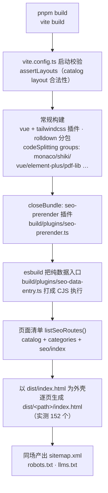
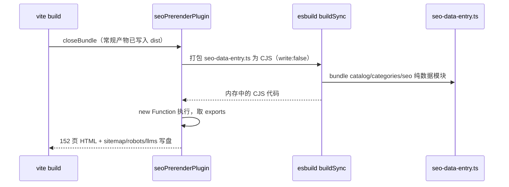

# 07 · 构建、预渲染与 SEO

> **一句话摘要**：从 `pnpm build` 到可部署 dist 的全流水线——自研 seo-prerender 插件如何产出 152 页静态 HTML 与 sitemap/robots/llms.txt，以及静态托管的部署契约。
> **目标读者**：维护者 ｜ **关联文档**：[02 应用骨架](02-应用骨架与启动流程.md) · [03 登记体系](03-工具登记体系与扩展SOP.md) · [15 工程规范与 CI](15-工程规范与CI.md) · [16 已知坑](16-已知坑与规避清单.md)

## 1. 概述

本项目是纯静态 SPA，SEO 靠**构建期预渲染**：把每个路由渲染成带完整 head 的静态 `index.html`，服务器零运行时。本册讲清构建流水线、预渲染机制、SEO 数据三层与部署契约——发布相关操作以本册为准。

核心事实先行（均为实测或源码可查证）：

- `find dist -name index.html | wc -l` = **152**；`grep -c "<url>" dist/sitemap.xml` = **152**，两者恒等（都由同一份 `listSeoRoutes()` 派生，见 §3.3 页数账目）。
- 预渲染只覆盖首页 + 分类页 + 工具页；**404 不预渲染**，由客户端水合端注入 `noindex` 兜底（§3.5）。
- SEO 数据与站点运行时**同源编译**：预渲染读到的 catalog 与打包进站点的 catalog 是同一次构建的同一份产物（§3.1）。

## 2. 架构与数据流

### 2.1 构建流水线



图释：前半是标准 Vite 构建（分包把重依赖拆为共享 chunk，`emptyOutDir` 清掉已下线页面的残留目录——下线工具的旧 SEO 页不会遗留成僵尸）；后半是自研插件的预渲染：数据入口以 CJS 执行后直接吐出每页的 head 数据，套进 SPA 外壳写入目录式 HTML。`cssMinify: 'esbuild'` 为保留 `backdrop-filter` 前缀，另经 PostCSS autoprefixer。

#### 2.1.1 vite.config.ts 逐段走读

**① 启动校验与插件**（`vite.config.ts`）——catalog 的 layout 声明在 dev/build 启动即校验，非法值直接让 Vite 启动失败，不等测试兜底：

```ts
// vite.config.ts（节选）
// 扩展名不可省略：Vite 8 的 configLoader: 'native' 不支持无扩展名的相对 import
import { seoPrerenderPlugin } from './build/plugins/seo-prerender.ts'
import { allTools } from './src/config/tools/catalog'
import { assertLayouts } from './src/config/tools/layouts'

// catalog layout 值的构建期强校验（债务 #15）：dev/build 启动即校验，
// 非法值直接让 vite 启动失败，不再依赖 vitest 间接拦截。
assertLayouts(allTools)

export default defineConfig({
  plugins: [vue(), tailwindcss(), seoPrerenderPlugin()],
```

**② 别名**：`@` 指向 src；`fmt` 是为 CodeImageGeneratorPage 的 Go 模板字符串专门立的空桩——依赖扫描把模板里的 `import "fmt"` 误判成真实依赖，不桩住会让构建直接失败：

```ts
// vite.config.ts（节选）
  resolve: {
    alias: {
      '@': r('./src'),
      // CodeImageGeneratorPage 的 Go 模板字符串含 `import "fmt"`，vite 依赖扫描会误判，
      // 映射到空 stub 规避解析失败（实际不产生副作用）
      fmt: r('./src/vendor/fmt-stub.ts'),
    },
  },
```

**③ build 选项**——三项都各有事故背景：`emptyOutDir` 防僵尸 SEO 页、`cssMinify: 'esbuild'` 防前缀被 Oxc 删掉、`postcss` 必须显式声明（Vite 8 不自动加载根目录 postcss 配置）：

```ts
// vite.config.ts（节选）
  build: {
    target: 'esnext',
    // 构建前清空 dist：否则已下线的工具页会作为残留继续留在产物里，
    // 部署后仍可访问（归类治理移除了 encode 分类与若干 dev 页，这个问题真实出现过）。
    emptyOutDir: true,
    cssCodeSplit: true,
    // CSS 压缩改用 esbuild：Oxc 的 CSS 压缩会把「-webkit-backdrop-filter + backdrop-filter」
    // 视为重复声明、只保留最后一条，导致 autoprefixer 补出的前缀被删掉（Safari 丢失模糊）。
    cssMinify: 'esbuild',
    chunkSizeWarningLimit: 600,
    reportCompressedSize: false,
```

**④ 分包**：Vite 8 起 `build.rollupOptions` 更名 `build.rolldownOptions`，`manualChunks` 函数迁移为 `codeSplitting.groups`。七个组按「先特判重组件、后兜底大族」的顺序排列，**顺序有语义**（见下表 element-plus-heavy 行）。

| # | group 名 | 匹配的库（判定条件） | 备注 |
|---|---|---|---|
| 1 | `monaco-vendor` | `id.includes('monaco-editor')` | Monaco ESM 全量；独立 async chunk，仅编辑器页面加载 |
| 2 | `shiki-vendor` | `id.includes('shiki')`，但排除 `/shiki/dist/langs/` 与 `/@shikijs/langs/` | 语言 grammar 由 highlighter.ts 动态 import，排除在组外才保持懒加载 |
| 3 | `vendor` | 正则 `/node_modules\/(vue\|vue-router\|pinia\|@vue)\//` | Vue 运行时三件 + @vue 内部包 |
| 4 | `vueuse-vendor` | `id.includes('@vueuse')` | @vueuse/core |
| 5 | `element-plus-heavy` | `element-plus` 且 `/components\/(table\|upload\|color-picker)\//` | EP 重组件独立 async chunk；**必须排在 #6 之前**，否则被兜底组并入首屏 vendor 破坏首屏预算 |
| 6 | `element-plus-vendor` | `id.includes('element-plus')` | EP 其余部分，单独分包便于观察体积 |
| 7 | `utils-vendor` | `id.includes('pdf-lib') \|\| id.includes('jszip')` | pdf-lib / jszip |

最 tricky 的两组，注释原文：

```ts
// vite.config.ts rolldownOptions.output.codeSplitting.groups（节选）
{
  name: (id: string) => {
    if (!id.includes('shiki')) return null
    // 语言 grammar 由 highlighter.ts 按需动态 import（shiki/dist/langs、@shikijs/langs），
    // 必须排除在 shiki-vendor 之外，否则会随静态入口全量加载，懒加载失效
    if (id.includes('/shiki/dist/langs/') || id.includes('/@shikijs/langs/'))
      return null
    return 'shiki-vendor'
  },
},
{
  // EP 重组件（table/upload/color-picker，B3 起页面级按需引入）：
  // 独立 async chunk。必须排在下方兜底组之前，否则会被
  // catch-all 并入首屏 element-plus-vendor，破坏首屏预算
  name: (id: string) =>
    id.includes('element-plus') &&
    /components\/(table|upload|color-picker)\//.test(id)
      ? 'element-plus-heavy'
      : null,
},
```

**⑤ dev 预打包**（只影响 dev 体验，不影响产物）——Monaco/Shiki 模块图大，不预打包会触发「首次进入编辑器页面 → 现场优化 → 整页 reload」：

```ts
// vite.config.ts（节选）
  optimizeDeps: {
    include: [
      'monaco-editor',
      'shiki',
      'shiki/core',
      'shiki/engine/oniguruma',
      'dayjs/plugin/advancedFormat',
      'dayjs/plugin/customParseFormat',
      'dayjs/plugin/weekday',
      'dayjs/plugin/localeData',
    ],
  },
```

（原文还包括 `weekOfYear` / `weekYear` / `quarterOfYear` 三个 dayjs 插件，共 11 项。）

### 2.2 SEO 数据三层

| 层 | 文件 | 内容 |
|---|---|---|
| 站点常量 | `src/config/seo/site.ts` | `SITE_ORIGIN`、`HOME_TITLE`、`TOOL_COUNT`（**从 catalog 派生**，不会与工具数漂移） |
| 默认模板 | `src/config/seo/defaults.ts` | 未覆盖工具的 title/description/keywords 模板 |
| 金质覆盖 | `src/config/seo/overrides.ts` | 按工具 id 的长描述/关键词手写覆盖；`index.ts` 对「override 指向不存在 id」告警 |

`getSeoForPath()` 汇三层输出单页数据：title / description / keywords / canonical / OG / Twitter 卡片 / JSON-LD（WebSite、Organization、ItemList、SoftwareApplication、BreadcrumbList 五型）+ `<noscript>` 正文。客户端水合端（`usePageSeo.setJsonLd`）与构建期吃**同一份**数据结构——改数据结构必须两端同步（字段级对照见 §3.5）。

**层 1 站点常量**真实摘录（`src/config/seo/site.ts`）——`TOOL_COUNT` 由 catalog 派生是防「文案说 130+、实际 163」漂移的关键设计：

```ts
// src/config/seo/site.ts（节选）
const envUrl = (import.meta.env.VITE_SEO_SITE_URL as string | undefined) ?? ''

export const SITE_NAME = 'Tools'
export const SITE_URL = envUrl || 'https://tools.example.com'
/** canonical / sitemap 使用的完整 URL 根，剥掉末尾斜杠 */
export const SITE_ORIGIN = SITE_URL.replace(/\/+$/, '')

// og:image 必须用位图：Facebook/Twitter 等主流抓取器不渲染 SVG，分享卡片会没有图
export const DEFAULT_OG_IMAGE = '/og-image.png'

export const HOME_TITLE = `${SITE_NAME} - 开发者在线工具箱`

/** 工具总数。由 catalog 派生而非写死，避免「文案说 130+、实际 163」这类漂移再次发生 */
export const TOOL_COUNT = allTools.length
```

**层 2 默认模板**真实摘录（`src/config/seo/defaults.ts`）——标题/描述全部由工具字段拼装，新增工具零 SEO 配置即有合法 meta：

```ts
// src/config/seo/defaults.ts（节选）
export function defaultToolSeo(tool: ToolItem): SeoData {
  const plain = categoryPlainOf(tool)
  return {
    title: `${tool.name} - 在线${plain}工具`,
    description: `${plain}在线工具：${tool.description ?? tool.name}。无需安装，浏览器打开即用，本地计算、安全高效。`,
    keywords: [tool.name, plain, '在线工具', '开发者工具'],
    canonicalPath: tool.link || `/tools/${tool.id}`,
    ogImage: undefined,
    longDescription: toolLong(tool),
  }
}
```

**层 3 金质覆盖**真实条目（`src/config/seo/overrides.ts`，全文 194 行、35 个 key，均为高流量工具）：

```ts
// src/config/seo/overrides.ts（前两条原文）
export const seoOverrides: Record<string, PartialSeo> = {
  'json-toolbox': {
    description:
      '在线 JSON 格式化、压缩与校验工具，支持树形浏览与自定义缩进。无需安装，浏览器本地实时处理，适用于调试接口与配置。',
    keywords: ['JSON格式化', 'JSON校验', 'JSON压缩', '在线JSON工具'],
    longDescription:
      'JSON 在线格式化与校验工具，能够一键将压缩或杂乱的 JSON 整理为可读结构，并即时校验其合法性。支持自定义缩进、压缩输出与语法错误定位，广泛用于接口调试、配置维护与日志分析场景。数据全程在本地浏览器处理，不会上传到服务器。',
  },
  'json-convert-format': {
    keywords: ['JSON转换', 'JSON转TS', 'JSON转YAML', 'JSON转CSV', 'JSON转Query'],
```

### 2.3 爬虫协议产物（真实产物样例）

- **sitemap.xml**：构建期生成于 dist 根，lastmod 即构建日期——每次发布须重新 build 才会刷新。
- **robots.txt**：放行常规爬虫与 AI 爬虫（Baiduspider / Bytespider / GPTBot / ClaudeBot / PerplexityBot / Gemini）——对 AI 可见是有意决策。
- **llms.txt**：面向 LLM 的站点说明，列出全部非首页页面的标题+描述链接。

三个产物的真实结构（取自当前 dist，域名由 `VITE_SEO_SITE_URL` 注入）：

```xml
<!-- dist/sitemap.xml（头部原文） -->
<?xml version="1.0" encoding="UTF-8"?>
<urlset xmlns="http://www.sitemaps.org/schemas/sitemap/0.9">
  <url>
    <loc>https://tools.zhangzhengyang.com/</loc>
    <lastmod>2026-09-27</lastmod>
    <changefreq>daily</changefreq>
    <priority>1.0</priority>
  </url>
  <url>
    <loc>https://tools.zhangzhengyang.com/color</loc>
    <lastmod>2026-09-27</lastmod>
    <changefreq>weekly</changefreq>
    <priority>0.8</priority>
  </url>
```

```text
# dist/robots.txt（全文）
User-agent: *
Allow: /

User-agent: Baiduspider
Allow: /

User-agent: Bytespider
Allow: /

User-agent: GPTBot
Allow: /

User-agent: ClaudeBot
Allow: /

User-agent: PerplexityBot
Allow: /

User-agent: Gemini
Allow: /

Sitemap: https://tools.zhangzhengyang.com/sitemap.xml
```

```text
# dist/llms.txt（头部原文）
# Tools

> Tools 是一个面向开发者的在线工具箱，提供 JSON、文本、编码、加密、图片、网络等 142 个常用工具，无需安装，浏览器打开即用。

## Key pages

- [色彩工具](<https://tools.zhangzhengyang.com/color>): 色彩工具在线工具合集，收录多种常用能力，无需安装、打开即用，帮助开发者快速完成相关开发任务。
- [JSON 工具](<https://tools.zhangzhengyang.com/json>): JSON 工具在线工具合集，收录多种常用能力，无需安装、打开即用，帮助开发者快速完成相关开发任务。
```

三者的权重字段与页面类型一一对应：首页 `daily`/`1.0`，分类页 `weekly`/`0.8`，工具页 `monthly`/`0.6`（判定逻辑在 `build/plugins/seo-data-entry.ts` 的 `buildSitemapEntries()`，按 `route.kind` 分派）。

## 3. 核心实现

### 3.1 seo-prerender 插件走读（`build/plugins/seo-prerender.ts`）

插件 `apply: 'build'`、钩在 `closeBundle`——此时常规产物（含外壳 `dist/index.html`）已就绪。closeBundle 的第一步是**把纯数据入口现场打成 CJS 并执行**：

```ts
// build/plugins/seo-prerender.ts（loadData，节选）
  const loadData = (root: string) => {
    const entry = path.resolve(root, 'build/plugins/seo-data-entry.ts')
    // 优先读 vite 已加载的 .env（config.env），兜底读进程环境变量
    const siteUrl =
      (config?.env?.VITE_SEO_SITE_URL as string | undefined) ||
      process.env.VITE_SEO_SITE_URL ||
      ''
    const result = buildSync({
      entryPoints: [entry],
      bundle: true,
      format: 'cjs',
      platform: 'node',
      target: 'node18',
      write: false,
      define: {
        'import.meta.env': JSON.stringify({
          VITE_SEO_SITE_URL: siteUrl,
        }),
      },
    })
    const code = result.outputFiles?.[0]?.text ?? ''
    const mod = { exports: {} as Record<string, unknown> }
    const req = createRequire(import.meta.url)
    const fn = new Function('module', 'exports', 'require', code) as (
      m: typeof mod,
      exp: typeof mod.exports,
      r: NodeRequire,
    ) => void
    fn(mod, mod.exports, req)
    return mod.exports
  }
```

要点：`write: false` 拿内存产物、`define` 把 `import.meta.env` 注入成纯对象（数据入口因此能像浏览器代码一样读 `VITE_SEO_SITE_URL`）、`new Function` 执行后 `mod.exports` 直接暴露 `buildAllPages()/buildSitemapEntries()/seoSiteMeta` 三个导出。这就是「预渲染数据与站点同源」的实现处——esbuild 打包的数据入口引用的就是 `src/config` 同一批模块。



图释：数据入口不经过 dist、不落临时文件，全在插件进程内存里完成「TS → CJS → 执行」；失败时只打印错误并 return，不影响主构建产物（`console.error('[seo-prerender] 加载 SEO 数据失败，跳过预渲染：', ...)`）。

**外壳套用与 head 注入**（closeBundle 主体）——对每页做四次字符串手术：换 `<title>`、删旧 description、`</head>` 前插 head 块、`#app` 内插 noscript：

```ts
// build/plugins/seo-prerender.ts（closeBundle 逐页循环，节选）
      for (const page of pages) {
        const target = path.join(outRoot, page.path === '/' ? '' : page.path, 'index.html')
        mkdirSync(path.dirname(target), { recursive: true })

        let html = shell
        // 替换 <title>
        html = html.replace(/<title>[\s\S]*?<\/title>/, `<title>${esc(page.title)}</title>`)
        // 移除可能的旧 description
        html = html.replace(/\s*<meta name="description"[^>]*>\n?/, '')
        // 注入 head 块
        const headEnd = html.lastIndexOf('</head>')
        const headBlock = buildHeadBlock(page, origin)
        html = html.slice(0, headEnd) + `${headBlock}\n` + html.slice(headEnd)
        // 注入 noscript 静态正文（放在 #app 容器内，bot 无 JS 时可读取；JS 用户交给 CSR）
        html = html.replace(/(<div id="app">)/, `$1\n<noscript>\n${page.noscriptBody}\n</noscript>`)
        writeFileSync(target, html, 'utf-8')
      }
```

`buildHeadBlock()` 产出的 head 块依次为：canonical / description / keywords / og:type+title+description+url（+image）/ twitter:card+title+description（+image）/ 单个 `#seo-jsonld` script。JSON-LD 注入行与客户端水合端结构刻意一致：

```ts
// build/plugins/seo-prerender.ts（buildHeadBlock 内，原文）
    // 与客户端 usePageSeo.setJsonLd 相同的结构：单个 #seo-jsonld script，内容为节点数组。
    // 客户端水合后按 id 原地更新内容，不会重复注入；`<` 转义防止内容截断脚本。
    const jsonLdText = page.jsonLd?.length
      ? `<script type="application/ld+json" id="seo-jsonld">${JSON.stringify(page.jsonLd).replace(/</g, '\\u003c')}</script>`
      : ''
```

目录式输出（`dist/<path>/index.html`）不是风格选择而是部署契约的一半：静态服务器靠 `$uri/` 命中目录默认页（§6.1 nginx 配置）。

### 3.2 seo-data-entry 的输出结构（字段表）

`build/plugins/seo-data-entry.ts` 导出 `PrerenderPage`——每页 head 数据的完整形态，构建期与客户端共同遵守：

| 字段 | 类型 | 含义 | 来源 |
|---|---|---|---|
| `path` | `string` | 相对路径，如 `/`、`/json`、`/json/format` | 工具取 `tool.link`，分类取 `/${cat.id}` |
| `title` | `string` | 页面 `<title>` | 三层合并结果 |
| `description` | `string` | meta description | 三层合并结果 |
| `keywords` | `string[]` | 写入 meta keywords（逗号 join） | 三层合并结果 |
| `canonical` | `string` | canonical 相对路径（不带域名） | 等于 `path` |
| `ogImage` | `string` | 分享图绝对路径；空串则省略 og:image/twitter:image 标签 | 目前恒为 `/og-image.png` |
| `jsonLd` | `JsonLdNode[]` | 结构化数据节点数组 | 首页 3 节点 / 分类页 2 / 工具页 2 / 兜底 0 |
| `noscriptBody` | `string` | 无 JS 环境可见的静态正文 HTML（含可点链接列表，工具页截前 30 条） | `buildHomePage/buildCategoryPage/buildToolPage` 拼装 |

接口定义原文：

```ts
// build/plugins/seo-data-entry.ts（节选）
export interface PrerenderPage {
  /** 相对路径，如 '/'、'/json'、'/json/format' */
  path: string
  title: string
  description: string
  keywords: string[]
  canonical: string
  ogImage: string
  jsonLd: JsonLdNode[]
  /** 无 JS 环境下 bot 可见的静态正文 HTML */
  noscriptBody: string
}
```

### 3.3 页数账目表（口径：`listSeoRoutes()` 源码 + dist 实测）

`listSeoRoutes()`（`src/config/seo/index.ts`）的枚举范围是**首页 + 非全部分类 + 工具**三类，逐段核对：

| 页型 | 数量 | 依据（源码口径） | dist 实测（按目录 index.html 计数） |
|---|---|---|---|
| 首页 | 1 | `routes.push({ path: '/', kind: 'home', ... })` | dist 根 index.html |
| 分类页 | 9 | categories.ts 共 10 条定义，`if (cat.id === 'all') continue` 排除「全部」 | color 16 / json 13 / text 20 / dev 41 / network 10 / image 26 / encrypt 9 / site 11 / run 5（各含 1 张分类页 + 工具页） |
| 工具页 | 142 | `for (const tool of allTools) routes.push(...)` | 上述各目录减分类页：15+12+19+40+9+25+8+10+4 = 142 |
| **合计** | **152** | | `find dist -name index.html \| wc -l` = **152**；`grep -c "<url>" dist/sitemap.xml` = **152** |

交叉验证：sitemap 按优先级计数 `1.0`×1（首页）、`0.8`×9（分类）、`0.6`×142（工具），与上表完全一致。**404 不是账目项**：`listSeoRoutes()` 不含 404，dist 也没有 404 目录——未命中路由的 SEO 由客户端水合端注入 `noindex` 兜底（§3.5），不做静态页。

页数会随 catalog 漂移：新增/下线工具 ±1，新增分类 +1（分类页）+ 其下工具数。CI 注释里的「166 页」是旧工具数时期的历史基线，以当前构建产物为准。

### 3.4 真实 JSON-LD 输出样例

取自当前 dist 的工具页 `dist/json/format/index.html`（`#seo-jsonld` 节点原文，未改动任何字符）：

```html
<script type="application/ld+json" id="seo-jsonld">[{"@context":"https://schema.org","@type":"SoftwareApplication","name":"JSON 工具箱","url":"https://tools.zhangzhengyang.com/json/format","applicationCategory":"DeveloperApplication","operatingSystem":"Web","applicationSubCategory":"Developer Tool","offers":{"@type":"Offer","price":"0","priceCurrency":"CNY"},"inLanguage":"zh-CN"},{"@context":"https://schema.org","@type":"BreadcrumbList","itemListElement":[{"@type":"ListItem","position":1,"name":"首页","item":"https://tools.zhangzhengyang.com"},{"@type":"ListItem","position":2,"name":"JSON 工具","item":"https://tools.zhangzhengyang.com/json"},{"@type":"ListItem","position":3,"name":"JSON 工具箱","item":"https://tools.zhangzhengyang.com/json/format"}]}]</script>
```

静态/按页的边界（对照 `src/config/seo/jsonld.ts` 的构造函数）：

| 字段 | 性质 | 说明 |
|---|---|---|
| `@context` / `applicationCategory` / `operatingSystem` / `applicationSubCategory` / `offers` / `inLanguage` | **全站静态** | 所有工具页逐字相同，写死在 `softwareAppJsonLd()` |
| `SoftwareApplication.name` / `url` | **按页变化** | 来自 `tool.name` / `SITE_ORIGIN + tool.link` |
| BreadcrumbList 第 1 项（首页） | **全站静态** | position 1 恒为 `{name:'首页', item: origin}` |
| BreadcrumbList 第 2、3 项 | **按页变化** | 分类名/分类路径来自 tool.categoryId 反查 categories，工具名/路径来自该工具 |

首页与分类页注入的是另一组节点：首页 = WebSite + Organization + ItemList（142 条 ListItem）；分类页 = ItemList（该分类工具）+ BreadcrumbList（两段）。FAQPage 已停发——「关于此工具/常见问题」正文区块下线后，结构化数据与可见正文必须一致（README「SEO / GEO 部署」段）。

### 3.5 SEO 双端对照表：构建期 vs 客户端水合

| 字段/行为 | 构建期（seo-data-entry → seo-prerender） | 客户端水合（`src/composables/usePageSeo.ts`） |
|---|---|---|
| `<title>` | 外壳 `<title>` 正则替换 | `document.title = seo.title` |
| description / keywords / og:* / twitter:* | `buildHeadBlock()` 拼出 meta 串插入 head | `upsertMeta()` 逐条 upsert（存在改 content，不存在创建） |
| canonical | `<link rel="canonical">` 注入 | `upsertCanonical()` 同型操作 |
| JSON-LD | 单个 `#seo-jsonld` script，内容为**节点数组** | 按 id 找到同一 script 原地更新 textContent，**不重复注入**；无节点时整支移除 |
| noscript 正文 | 有（bot 专用） | 无（CSR 接管后无意义） |
| robots noindex | 无此概念（只渲染已登记页） | **404 兜底分支独有**：未命中 `getSeoForPath` 时注入 `noindex`、清 canonical/keywords/JSON-LD，防错误归属 |
| 尾斜杠处理 | 输出目录式 URL（`/json/format/`） | `route.path` 先剥尾斜杠再匹配，否则目录式 URL 会让精确匹配落空、误入 noindex 分支 |

水合端兜底分支的关键原文——这是「404 不预渲染」策略在客户端的另一半：

```ts
// src/composables/usePageSeo.ts（节选）
    // ─── 兜底：404 / 未登记路由 ───────────────────────────────────────────────
    // 输出 noindex + 站点默认信息，并清掉上一页遗留的 canonical/keywords/JSON-LD，
    // 防止搜索引擎把错误 canonical 归属到别的页面。
    if (!seo) {
      const metaTitle = typeof route.meta?.title === 'string' ? route.meta.title : SITE_NAME
      const title = metaTitle === SITE_NAME ? metaTitle : `${metaTitle} - ${SITE_NAME}`
      document.title = title
      upsertMeta('name', 'description', SITE_DESCRIPTION)
      removeMeta('name', 'keywords')
      upsertMeta('name', 'robots', 'noindex')
      removeCanonical()
      setJsonLd([])
      return
    }
```

## 4. 设计决策与取舍

1. **构建期预渲染而非运行时 SSR**。Why：零后端定位（01 §4.1）排除了任何运行时服务；预渲染让「纯静态托管」与「完整 SEO」兼得。代价：内容更新必须重新 build（工具元数据本就随代码发布，天然匹配）；不是真 SSR，无动态请求渲染能力。
2. **数据入口 esbuild 现打 CJS**。Why：插件运行在 Node 侧，直接 import TS 源码模块需要 loader；esbuild 现场打包让「预渲染读到的 catalog」与「打包进站点的 catalog」是同一次构建的同一份产物。
3. **`emptyOutDir: true`**。Why：下线工具后旧 `dist/<path>/` 若残留会成为孤儿 SEO 页面；清空重建保证 dist 与 catalog 严格一致。
4. **部署契约（README）**：history 路由要求服务器把 `/foo` 映射到 `dist/foo/index.html` 并回退首页——Nginx `try_files $uri $uri/ $uri.html /index.html`；设置 `VITE_SEO_SITE_URL` 为正式域名后重新 build（canonical/sitemap/JSON-LD 全依赖它）。
5. **AI 爬虫放行**。Why：工具站的使用者大量来自 AI 推荐；拒绝 AI 爬虫等于放弃该渠道。代价：内容被抓取复制——工具类站点无内容护城河焦虑，可接受。
6. **单节点数组 JSON-LD 而非多支 script**。Why：客户端水合按 `id="seo-jsonld"` 原地更新，一个 id 对应一支 script，天然幂等；若预渲染与水合各写各的多支标签，水合后会出现重复注入。

## 5. 边界情况与已知限制

- **静态性边界**：预渲染 HTML 里的 noscript 正文是唯一的「无 JS 内容」；客户端接管后由 usePageSeo 水合，两态内容可能有毫秒级不一致（title 先静态后 JS 校正）。
- **sitemap lastmod 语义**：等于构建日期而非内容变更时间——小改也全量刷新，属有意简化。
- **页数核对**：新增/下线工具后 build 产物页数应 ±1（工具页）或按新增分类页计算；对不上先查 catalog 漏改（03 守卫矩阵）。
- **`VITE_SEO_SITE_URL` 缺失**：canonical 等会落到占位域名 `https://tools.example.com`（`site.ts` 的 `SITE_URL` 回落值）——CI 构建门禁已注入该变量（15 §2.1），本地构建预览时 URL 相关字段仅供结构参考。
- **icons:build 的 Python 环境**：`build/fonts/build-icon-subset.py` 需要 venv（fonttools/brotli/uharfbuzz），首次克隆仓库后跑生成脚本前先装依赖（依赖变更频率极低）。
- **README 数字为手写口径**：README 功能段「160 个在线工具 / 11 类」与当前 catalog（142 工具 / 9 实分类）存在漂移，以 catalog 与本册 §3.3 账目为准；llms.txt 里的「142 个」由 `TOOL_COUNT` 派生，不会漂。

## 6. 变更指引

### 6.1 发布 runbook（编号步骤，逐条执行）

1. **确认域名**：`.env` 中 `VITE_SEO_SITE_URL` 为正式域名（不带尾斜杠）。缺省时构建不会失败，但 canonical/sitemap/robots/llms 全部写入占位域名 `https://tools.example.com`，等于白做 SEO。
2. **构建**：`pnpm build`。
3. **核对产物账目**（口径见 §3.3）：
   ```bash
   find dist -name index.html | wc -l        # 应 = 1 + 分类页数 + 工具数（当前 152）
   grep -c "<url>" dist/sitemap.xml          # 应与上行相等
   grep -c "<priority>0.6</priority>" dist/sitemap.xml   # 应 = 工具数（当前 142）
   ```
4. **核对协议产物**：`dist/sitemap.xml` 的 lastmod 是今天；`robots.txt` 含 7 个 User-agent 段 + Sitemap 行；`llms.txt` 头部工具数与 `TOOL_COUNT` 一致。
5. **部署**：上传 dist 全量；服务器 history 回退规则在位。Nginx 参考配置（摘自 README「SEO / GEO 部署」段原文）：
   ```nginx
   server {
     listen 80;
     server_name example.com;
     root /path/to/tools/dist;

     # 预渲染页面（目录下的 index.html）
     location / {
       try_files $uri $uri/ $uri.html /index.html;
     }
   }
   ```
   `$uri/` 命中目录式预渲染页，`/index.html` 兜底把未命中路径交给 SPA 路由——两级正好对应「预渲染页」与「纯客户端页」。
6. **线上抽查**：`curl https://<域名>/json/format/`（带尾斜杠）应返回工具页 `<title>` 与 `link[rel=canonical]`；`/sitemap.xml`、`/robots.txt`、`/llms.txt` 均应可访问（README 上线核对清单原文要求）。
7. **本地冒烟等价物**：`pnpm build && pnpm preview`——首页 / 深链 fallback / 静态资源 200；SEO 改动用 view-source 抽查 JSON-LD。

### 6.2 代码变更对照

1. **改 SEO 数据结构**：`build/plugins/seo-data-entry.ts`（构建期）与 `composables/usePageSeo.ts`（水合端）**两端同步**（字段对照表见 §3.5），跑 `pnpm build` 核对产物 head 字段 + 手测客户端切换路由后 head 正确。
2. **新增分类/特殊页**：确认它进 `listSeoRoutes()`（否则无预渲染页）；分类页清单来自 categories.ts，一般自动纳入；404 类页面**有意不进清单**（noindex 兜底，§3.5）。
3. **改分包策略**：动 `codeSplitting.groups` 后核对主 chunk 体积与工具页首载 waterfall（02 §5.3）；注意组顺序语义（§2.1.1 表 #5 行）。
4. **改 SEO 三层**：overrides 新增 key 后确认命中工具 id（dev 期 console.warn 会告警「未命中任何工具 id」）；`TOOL_COUNT`/`SITE_DESCRIPTION` 由 catalog 派生，不需要手改。
