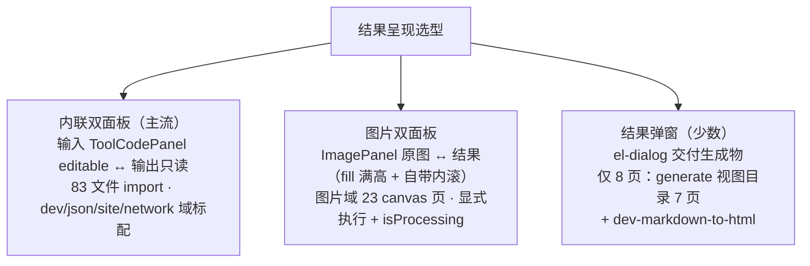
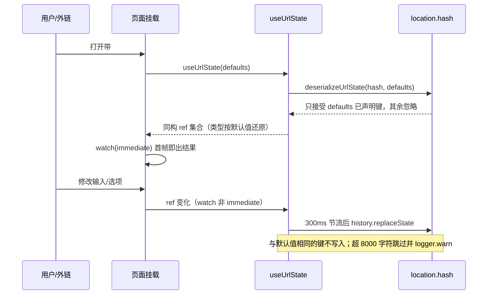
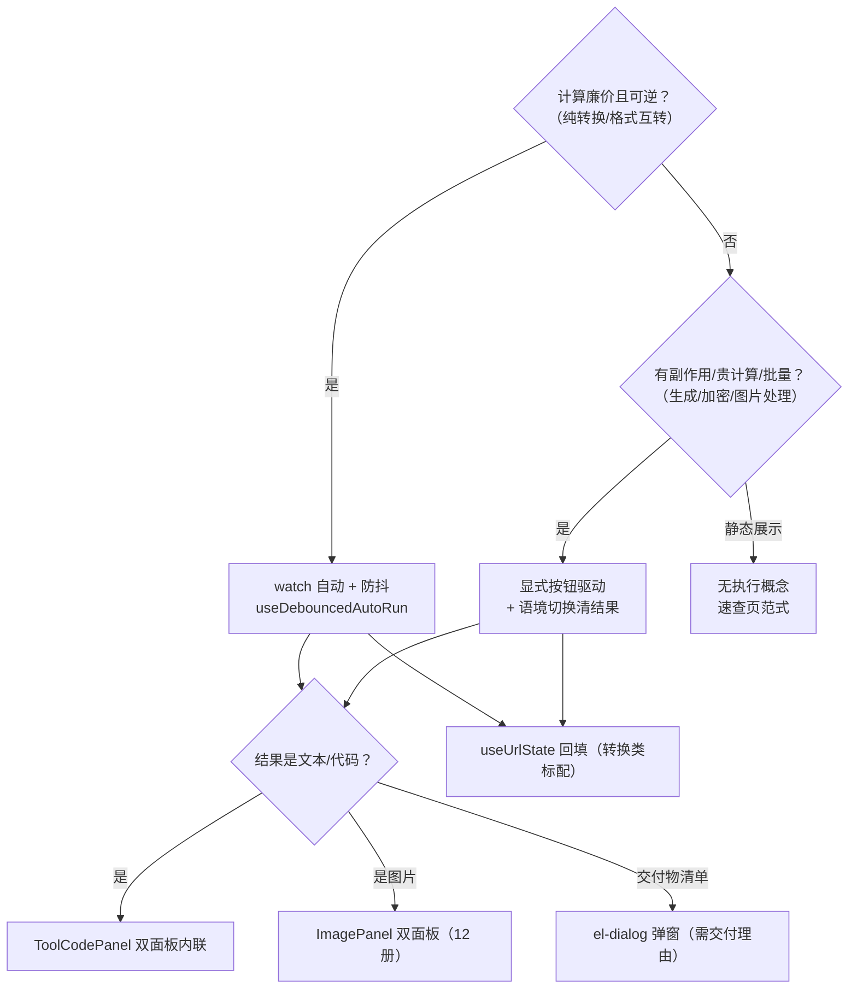

# 08 · 跨页面复用范式

> **一句话摘要**：142 个工具页共享的三组决策——执行模式（显式/自动/静态）、结果呈现（内联双面板/图片面板/弹窗）、状态回填（URL hash）——新页面照此选型即与全站一致。
> **目标读者**：页面开发者 ｜ **关联文档**：[04 布局体系](04-布局体系与页面骨架.md) · [06 全局状态](06-全局状态与应用级机制.md) · [09–13 各域册](00-总纲与阅读指南.md) · [14 测试策略](14-测试策略与质量守卫.md)

## 1. 概述

布局骨架（04）解决「页面长什么样」，本册解决「页面怎么行为」。全站页面在三个维度上呈现高度一致的范式，这些范式是 142 页演化出的公约数，也是用户跨工具获得的稳定心智。新页面接入时按 §2.4 的决策树选型，不需要发明新交互。

本册统计数字（除注明「约」的全站口径外）均为 2026-09-27 实测，统计命令与口径随文标注；按分类细分矩阵见 §2.1.1，弹窗页全量清单见 §2.2.1，三种模式的逐字代码模板见 §3.1–§3.3。

## 2. 架构与数据流

### 2.1 执行模式三分布

全站口径（约数，产品语义分类）：

| 模式 | 规模 | 典型页 | 特征 |
|---|---|---|---|
| **显式按钮驱动** | 约 55 页 | json-toolbox（格式化/压缩）、image-crop（执行裁剪）、dev-format、各生成器 | `@click="run*/generate*/convert*/format*…"`；贵计算、有副作用、批量处理 |
| **watch 自动实时** | 约 53 页 | text-case、color-contrast、color-mix 等转换/混合类 | `watch([inputs…])` + 防抖（重计算页）；廉价、可逆、纯转换 |
| **静态速查** | 其余约 34 页 | text-ascii-table、network-http-status、dev-device-info、dev-keycode | 无计算或纯展示，无执行概念 |

**显式执行契约**（产品级拍板）：生成器/批处理类页面**统一显式按钮驱动，否定自动执行**；且**语境切换（换模板/换模式）清空结果**——防止用户把上一语境的产物误当当前语境的输出。转换类则相反，自动实时是体验优势。分界判据见 §4.1。

#### 2.1.1 执行模式按分类细分矩阵（实测）

统计口径（可复现，2026-09-27）：

1. **自动信号**：页面文件含 `watch(`（Vue 组合式 watch）——`grep -rl "watch(" src/views/tools --include='*.vue' | grep -v test` = 53 文件，扣除首页 `ToolsHomePage.vue`（含 1 处筛选 watch）后**纯工具页 52**；
2. **显式信号**：文件无 `watch(` 且 `@click` 命中执行动词正则 `@(run|generate|convert|format|crop|compress|resize|encrypt|decrypt|hash|transform|apply|process|execute|start|encode|decode|export|merge|split|grayscale|redact|slice|border|dedupe|organize|normalize|send)`；
3. **静态**：以上皆无；
4. 优先级：watch 命中即计自动（含 20 个「watch + 执行按钮」双信号页——自动为主、按钮兜底的混合形态）；不剔除测试文件之外的任何页面（142 = 全部工具页，已排除 `ToolsHomePage.vue` 与 `CategoryOverviewPage.vue`）。

| 视图目录 | 自动 | 显式 | 静态 | 合计 |
|---|---:|---:|---:|---:|
| generate | 8 | 20 | 2 | 30 |
| dev | 7 | 8 | 9 | 24 |
| image | 9 | 13 | 1 | 23 |
| text | 8 | 2 | 5 | 15 |
| color | 9 | 1 | 3 | 13 |
| site | 0 | 0 | 9 | 9 |
| json | 3 | 6 | 1 | 10 |
| network | 2 | 0 | 6 | 8 |
| encrypt | 3 | 0 | 1 | 4 |
| run | 1 | 3 | 0 | 4 |
| encode | 2 | 0 | 0 | 2 |
| **合计** | **52** | **53** | **37** | **142** |

与全站约数（约 55 显式 / 约 53 自动 / 约 34 静态）的**对账说明**：三列合计均为 142，结构结论一致（显式与自动两分天下、静态约四分之一）。逐列差值的来源：

- 自动 52 vs 约 53：原口径把首页的筛选 watch 一并计入；
- 显式 53 vs 约 55：动词正则的边界页归属差异（如 `parseOctalInput`、`takeNow` 这类不含执行动词的处理器，宽口径会算入显式）；
- 静态 37 vs 约 34：本口径下「无 watch 无执行按钮、但用 `computed` 实时派生」的页（site 域 9 个解析器页、text 域 5 页统计/转换）落在静态列——它们同样「无执行概念」，与速查页在范式上同档。

矩阵读法：generate 是最纯的显式域（20/30）；image 是显式+自动混合域（自动 9 多为参数联动重绘、显式 13 为像素处理主操作）；site 全域静态（解析器结果全部 computed 派生）；encode/encrypt/json 各自主形态鲜明（encode 全自动、json 显式为主）。

### 2.2 结果呈现三模式



图释：主流是**内联双面板**——输入输出同屏对照，符合「满高工作区」布局（04 §2.3）；弹窗只用于「生成物交付」场景（产物是一份要复制/下载的成品，看一眼即可关闭）。新页面默认内联，弹窗需有「交付物」理由。

#### 2.2.1 结果呈现使用数（实测口径）

| 呈现载体 | 统计命令 | 结果 |
|---|---|---|
| ToolCodePanel | `grep -rl "import ToolCodePanel" src/views --include='*.vue' \| wc -l` | **83 文件**（generate 21 / dev 16 / text 11 / json 10 / site 7 / network 7 / run 4 / encrypt 4 / encode 2 / image 1） |
| ImagePanel | `grep -rl "import ImagePanel" src/views --include='*.vue' \| wc -l`；标签数 `grep -rno "<ImagePanel" \| wc -l` | **14 文件直接 import、40 处标签**（全部在图片域；另 23 页经 ImageToolLayout 间接消费，04 §3.3） |
| el-dialog | `grep -rln "el-dialog" src/views/tools --include='*.vue'` | **8 文件**（全量清单见下表） |

#### 2.2.2 el-dialog 页面全量清单（8 页及弹窗交付物）

| 工具 id | 页面文件 | 弹窗交付物 |
|---|---|---|
| text-csv-sample | `views/tools/generate/CsvSampleGeneratorPage.vue` | `showResultDialog` 生成结果（960px） |
| text-lorem | `views/tools/generate/LoremGeneratorPage.vue` | `showResultDialog` 生成结果（960px） |
| encrypt-data-mask | `views/tools/generate/MaskGeneratorPage.vue` | `showResultDialog` 生成结果（960px） |
| dev-mock-dict | `views/tools/generate/MockDictionaryGeneratorPage.vue` | `showResultDialog` 生成结果（960px） |
| dev-openapi-schema | `views/tools/generate/OpenApiSchemaPage.vue` | `showResultDialog` 生成结果（960px） |
| dev-code-snippet | `views/tools/generate/SnippetGeneratorPage.vue` | `showResultDialog` 生成结果（960px，标题栏内置复制/下载） |
| json-mock-data | `views/tools/generate/MockJsonGeneratorPage.vue` | 「可用规则」速查弹窗（**辅助弹窗**；主结果内联） |
| dev-markdown-to-html | `views/tools/dev/MarkdownToHtmlPage.vue` | `showPreviewModal` 预览（`min(1024px, calc(100vw - 32px))`） |

清单读法：6 页是同一款「960px 结果交付弹窗」（`showResultDialog`）；json-mock-data 的弹窗是规则速查而非交付物（主结果始终内联，不能因它出现就误判该页走弹窗范式）；dev-markdown-to-html 的弹窗是「渲染预览」——HTML 渲染结果与源码对照留在页面内，弹窗只负责放大预览。页面文件与工具 id 的映射以 `config/tools/toolComponents.ts` 为准（如 encrypt-data-mask → `generate/MaskGeneratorPage.vue`）。

### 2.3 状态回填与共享行为

- **useUrlState**：转换类页面把关键输入同步到 URL hash——刷新恢复、链接可发。写法：状态 ref 进、出 hash，组件挂载时回填。
- **useToolError**（配 `types/refactor.ts` 的 ToolErrorPattern）：错误提示统一模式——输入不合法时在结果区显示可操作的错误文案，而非弹 toast 打断。
- **useCopy / CopyButton**：任何可复制产物（输出面板、生成列表、颜色值）旁标配 CopyButton（39 文件 import、59 处标签，04 §3.1）。
- **useEditorHistory**：可编辑输入面板的撤销/重做栈统一实现。
- **useDebouncedAutoRun**：自动档防抖底座；**重计算自动页必须防抖**，防大输入每键全量计算（实测仅 run 域消费，见 §3.4 的口径澄清）。

**useUrlState 核心 API 逐字摘录**：

```ts
// src/composables/useUrlState.ts:107-119
export function useUrlState<T extends UrlStateShape>(defaults: T): UrlStateRefs<T> {
  const keys = Object.keys(defaults) as Array<keyof T & string>

  const restored =
    typeof window === 'undefined'
      ? ({ ...defaults } as UrlStateShape)
      : deserializeUrlState(window.location.hash.replace(/^#/, ''), defaults)

  const state = {} as UrlStateRefs<T>
  for (const key of keys) {
    // 还原值已按 defaults 的类型做过转换，这里只需要包成 ref
    state[key] = ref(restored[key]) as UrlStateRefs<T>[typeof key]
  }
```

API 三个关键常量与行为（`useUrlState.ts:48-51,123-141`）：`MAX_URL_STATE_LENGTH = 8000`（超长放弃写入）、`WRITE_DEBOUNCE_MS = 300`（写地址栏节流）、写入走 `history.replaceState` 而非 `router.replace`——避免每次按键触发路由钩子重复上报埋点与「最近使用」（文件头注释 `:16-19`）。hash 而非 query 的隐私理由见文件头 `:7-14`（输入不进 CDN 访问日志）。典型消费页调用：

```ts
// src/views/tools/text/TextCasePage.vue:31-40
/**
 * 输入与全部转换选项都与 URL 片段同步（如 `#inputText=hello%20world&targetCase=snake`），
 * 打开链接即可还原现场。输出不写入 —— 它由输入推导，写进去只会重复存一份。
 */
const { inputText, targetCase, preserveAcronyms, acronymWords } = useUrlState({
  inputText: '',
  targetCase: 'camel' as CaseTarget,
  preserveAcronyms: false,
  acronymWords: 'API,ID,URL,HTTP',
})
```

注意调用约定：**输出不进 useUrlState**（由输入推导，写进去是重复状态）；默认值对象同时决定键集合与类型推断（`UrlStateRefs<T>` 保证布尔默认值 `false` 不会把 ref 锁死成字面量类型，`:36-45`）。

一次完整的「还原 → 回写」时序：



图释：还原发生在 `useUrlState` 构造期（同步、SSR 安全降级到默认值），回写发生在订阅期（300ms 节流 + `replaceState` 不惊动路由）——两端都不经过 router，因此刷新恢复与「最近使用」埋点互不干扰。页面侧唯一要做的事就是解构 ref 集合，回填后的首帧出结果由自动档的 `immediate: true` watch 接力（§3.1）。

**useToolError 错误模式逐字摘录**——三档模式由一个类型穷举：

```ts
// src/types/refactor.ts:17-23
/**
 * 工具页错误处理模式
 * - toast: 弹出 toast 提示
 * - message: 内联消息展示
 * - inline: 仅设置 error ref，由调用方自行渲染
 */
export type ToolErrorPattern = 'toast' | 'message' | 'inline'
```

消费端（`views/tools/json/JsonFormatPage.vue:24`）：`const { error, setError, clearError } = useToolError({ pattern: 'inline' })`，错误就地渲染进结果区：

```vue
<!-- src/views/tools/json/JsonFormatPage.vue:131-136 -->
        <el-alert v-if="error" type="error" class="json-format-page__error">
          <div>
            <AppIcon icon="ms:error" :size="18" />
            {{ error }}
          </div>
        </el-alert>
```

`setError` 只在 `pattern === 'toast'` 时才弹 toast（`composables/useToolError.ts:45-48`），inline 模式下错误纯由调用方渲染——「错误进结果区」的范式由页面持有渲染权实现。实测 59 个视图文件消费 useToolError。

### 2.4 新页面选型决策树



## 3. 核心实现

- **显式执行的按钮位**：主操作放 ToolActionBar 的 `#right`（右区），选项控件在左区——同栏不同区（04 §3）；执行中状态用按钮 disabled + 文案，图片域统一走 `useImageProcessingState` 的 isProcessing（23 图片页消费，`composables/useImageTool.ts`）。
- **自动执行的 watch 写法**：`watch([输入源数组], run, { immediate: true })`；**语境切换清结果**在 watch 回调内比较语境键实现（换语境先 `result.value = ''`）。
- **范例页**：`views/tools/text/TextCasePage.vue`（自动档 + #actions 选项 + #secondary 只读面板 + useUrlState 全套范式）；`views/tools/json/JsonFormatPage.vue`（显式档 + Monaco 双面板 + 缩进读全局设置）；`views/tools/image/ImageCropPage.vue`（显式 + isProcessing + 双 ImagePanel）。
- **行为 composables 一览**：useCopy / useEditorHistory / useToolError 为全站共用（useToolError 59 文件）；useDebouncedAutoRun 当前由 run 域消费（`JsTsRunnerPage.vue` + `use-runner-controller.ts`）；useImageTool / useImageSource / useLayerOrder 为图片域共用；use-runner-* 为 run 域专用（10 册）。

### 3.1 自动档真实模板（TextCasePage 的 watch 段）

```ts
// src/views/tools/text/TextCasePage.vue:102-114
function convertText(): void {
  if (!inputText.value.trim()) {
    outputText.value = ''
    return
  }

  outputText.value = inputText.value
    .split('\n')
    .map((line) => convertLine(line))
    .join('\n')
}

watch([inputText, targetCase, preserveAcronyms, acronymWords], convertText, { immediate: true })
```

解读：watch 源数组 = **输入 + 全部语境选项**（targetCase/preserveAcronyms/acronymWords 都是语境键），任何一个变化都重算——不存在「改了选项不生效」的状态缺口；`immediate: true` 保证 useUrlState 回填后的首帧就有结果（刷新恢复链路的最后一环）；空输入短路清输出，错误态无从产生。这个函数**没有错误分支**——自动档处理的是「任何输入都合法」的纯转换，这正是 §4.1 分界判据的技术投影。

### 3.2 显式档真实模板（JsonFormatPage 的执行函数 + 按钮段）

```ts
// src/views/tools/json/JsonFormatPage.vue:43-59
function tryParseJson(transform: (parsed: unknown) => string, successMsg: string) {
  clearError()
  if (!inputCode.value.trim()) {
    outputCode.value = ''
    return
  }
  try {
    const parsed = JSON.parse(inputCode.value)
    outputCode.value = transform(parsed)
    toast.success(successMsg)
  } catch (e: unknown) {
    const message = e instanceof Error ? e.message : String(e)
    const location = parseErrorPosition(message, inputCode.value)
    setError(`JSON 解析错误: ${message}${location}`)
    outputCode.value = ''
  }
}
```

解读：开头 `clearError()` 让上一次错误不残留到本次执行；空输入清结果（与自动档同一守卫）；成功路径 `toast.success` 只承担「操作反馈」，解析错误则带行列定位走 `setError` 进结果区（§2.3 的 inline 渲染）——**反馈与错误分属两个通道，不混用**。

```vue
<!-- src/views/tools/json/JsonFormatPage.vue:110-125 -->
          <el-button class="btn-chip-muted" size="small" @click="loadExample">
            <AppIcon icon="ms:auto_awesome" :size="14" />
            示例
          </el-button>
          <el-button class="btn-chip" size="small" @click="formatJson">
            <AppIcon icon="ms:format_align_justify" :size="14" />
            格式化
          </el-button>
          <el-button class="btn-chip" size="small" @click="compressJson">
            <AppIcon icon="ms:unfold_less" :size="14" />
            压缩
          </el-button>
          <el-button class="btn-chip-muted" size="small" @click="clearAll">
            <AppIcon icon="ms:delete" :size="14" />
            清空
          </el-button>
```

按钮段读法：主操作（格式化/压缩）用主色 `btn-chip`，辅助动作（示例/清空）用 `btn-chip-muted`，视觉权重即操作权重；全部 `size="small"` 以适配标题栏动作区 32px 高度（borderless 挂进 `#actions`，04 §3.2）。语言切换类语境键变化时在 `switchMode` 中清空 outputCode——即「语境切换清结果」契约的落点。

### 3.3 弹窗交付真实模板（SnippetGeneratorPage 的结果弹窗）

```vue
<!-- src/views/tools/generate/SnippetGeneratorPage.vue:596-609 -->
      <!-- 生成结果弹窗：内容为最近一次「执行」的产物（generatedCode 响应式）；
           复制/下载收在标题栏右侧，徽章（语言/模板/行数）随结果入弹窗 -->
      <el-dialog v-model="showResultDialog" width="960px">
        <template #header>
          <div class="snippet-page__result-heading">
            <span class="snippet-page__result-title">生成结果</span>
            <div class="snippet-page__result-actions">
              <CopyButton
                :value="generatedCode"
                :disabled="!generatedCode"
                label="复制代码"
                success-text="已复制代码"
                size="small"
              />
```

解读：弹窗挂在 ToolShell 的插槽内（el-dialog 自身 teleport 到 body，04 §5 的弹层层级问题与此相关）；「交付三件套」= 产物本体 + CopyButton + 下载，与 §2.2.2 的 6 个 960px 结果弹窗同构；弹窗内不做输入、不承载对照——对照（模板编辑 ↔ 产物）留在页面里，弹窗只负责「成品出场」。这是弹窗范式的完整边界：**超出「交付/预览」用途的弹窗需回本册补理由**。

### 3.4 useImageProcessingState（图片域执行态）逐字摘录

```ts
// src/composables/useImageTool.ts:10-28
export function useImageProcessingState() {
  const errorMessage = ref('')
  const isProcessing = ref(false)

  const setError = (message: string) => {
    errorMessage.value = message
  }

  const clearError = () => {
    errorMessage.value = ''
  }

  return {
    errorMessage,
    isProcessing,
    setError,
    clearError,
  }
}
```

解读：图片域把「错误 + 处理中」收成 4 字段统一状态，23 个图片页消费（全量）；返回**同名** `errorMessage` ref 是刻意的——各页既有的 `errorMessage.value = ...` 写法零改动迁移（文件头注释 `:4-7`）。注意命名：composable 实际名为 `useImageProcessingState`（文件名 `useImageTool.ts`），本册旧文写「useImageTool 的 isProcessing」指的就是它。

**防抖口径澄清**：`useDebouncedAutoRun` 实测仅 run 域消费（`views/tools/run/JsTsRunnerPage.vue`、`composables/use-runner-controller.ts`）。52 个 watch 自动页大多是毫秒级纯转换、裸 watch 直跑不抖——「自动页必须防抖」的准确表述是：**重计算自动页必须防抖**，廉价转换页可直跑（§5 第一条的大输入防护建议仍适用于后者）。其调度体逐字摘录：

```ts
// src/composables/useDebouncedAutoRun.ts:21-40
  const schedule = () => {
    if (!options.enabled.value) {
      cancel()
      return
    }

    cancel()
    timer = setTimeout(
      () => {
        timer = null

        if (!options.enabled.value) {
          return
        }

        void options.run()
      },
      Math.max(0, Math.floor(options.delayMs))
    )
  }
```

解读：`enabled` 开关被检查两次（入队前 + 定时器触发时）——开关在等待窗口内被关掉时，已排队的执行也会作废，对应 run 域「手动执行时暂停自动执行」的交互；每次 schedule 先 `cancel()` 再入队，保证窗口内连续输入只保留最后一次；`Math.max(0, Math.floor(delayMs))` 把非法 delay 收敛到 0（立即执行而非负延迟异常）。签名见 `composables/useDebouncedAutoRun.ts:3-9`（`UseDebouncedAutoRunOptions { enabled: Ref<boolean>; delayMs: number; run: () => void | Promise<void> }`）。

## 4. 设计决策与取舍

1. **显式 vs 自动的分界 = 廉价可逆性**。Why：转换类（编码互转、大小写）每次计算毫秒级且无状态残留，自动实时是纯体验增益；生成/加密/图片处理要么贵（批量像素操作）要么产生「看起来像结果的结果」（随机生成），自动执行会让用户误拿旧产物。这条分界是产品级拍板，不是技术妥协。
2. **语境切换清结果**。Why：生成器页通常有多种语境（模板/语言/风格），切换后旧结果与当前语境不符仍展示，是最易造成误用的交互缺陷；清空的「丢状态」代价由「可重按生成」对冲。
3. **内联优先于弹窗**。Why：工具站的核心动作是「对照输入输出微调」，弹窗打断对照；8 个弹窗页都是「生成成品」场景（产物无对照需求，§2.2.2）。**弹窗化的页面边界由用户确认，不自行扩大**——这是历次改造确立的约束。
4. **错误进结果区而非 toast**。Why：输入类错误与「结果」是同一关注位，就地显示可随输入修正消失；toast 适合「操作反馈」（复制成功、格式化完成），两者不混用（§3.2 的 tryParseJson 是标准实现）。
5. **范式即复用单位**。Why：本册三范式 + 04 布局 + 06 状态四层，构成「新页面零新交互」的完整拼图；页面的独创性应留给算法（utils 层），不留给交互。

### 4.2 改判案例：曾选错范式并被修正的页面

范式选型允许犯错，改判必须留痕（catalog 注释 + 本册），三例：

1. **json-mock-data（centered → workbench）**：初版按「生成器 → centered」选型，720px 窄栏把参数列压到 375px 溢出、结果面板只剩 228px（台账 #20）。改判 workbench 后参数列 480px 起步。改判注释见 `catalog.ts:265-266`（原文摘录见 [04 §4.2](04-布局体系与页面骨架.md)）。启示：**生成器不必然 centered，量一下双面板的真实宽度需求**。
2. **dev-code-snippet（结果内联 → 弹窗，连带 workbench → centered）**：结果弹窗化后页面只剩参数单卡，双栏失去意义，layout 随结果呈现范式一起改判 centered（`catalog.ts:295`「改判 centered：生成结果收进弹窗后，页面只剩参数表单单卡」）。启示：**结果呈现与布局两个选型联动，改一个要检查另一个**。
3. **network-dns-records-generator（workbench → centered）**：参数收成一行后，「JSON 输入 / Zone·JSON 输出」改为上下铺满，双栏对照需求消失（`catalog.ts:734`）。启示：**参数收纳重构可能消灭双栏需求，layout 要跟着信息形态走，不是一锤子买卖**。

三例共同点：改判都发生在「页面信息形态被产品重构改变」之后，且注释都引用了家族判例（同款页面）作为先例——改判理由的可追溯性比改判本身更重要。

## 5. 边界情况与已知限制

- **自动页的大输入防护**：防抖只能缓解，超大文本（MB 级）建议页面内再加节流或「输入 > N 时转显式」的降级——现有自动页大多是裸 watch（§3.4 口径澄清），属已知改进空间。
- **useUrlState 键冲突**：同一页面多个状态共用一个 hash 编码空间，新增键须用页面专属键名，避免与既有键重叠；超 8000 字符写入被静默跳过并 `logger.warn`（`useUrlState.ts:133-136`），大输入页面要意识到「刷新恢复」会失效。
- **弹窗交付与满高布局叠加**：dialog 打开时背景工作区仍满高滚动，需确认遮罩层级（--z-modal）盖住 ToolHeader 弹层（--z-dropdown）。
- **静态速查页的「伪交互」**：部分速查页有筛选/高亮交互（甚至 ToolsHomePage 有筛选 watch），但无执行概念——不要为了统一而强行套执行按钮。
- **双信号页的范式归属**：20 页同时含 watch 与执行按钮（§2.1.1 口径），改动这类页面时先确认主范式（通常自动为主、按钮兜底），再决定清结果语义挂在哪条路径上。
- **执行模式迁移**：改某页执行模式（自动↔显式）属产品决策，须与用户确认，连带更新该页测试与本册 §2.1.1 分布统计。

## 6. 变更指引

### 6.1 新页面接入核对清单

与 [04 §6.1](04-布局体系与页面骨架.md) 的骨架清单衔接，逐项勾选：

- [ ] catalog 登记完整（id/name/icon/categoryId/link/description，03 册）
- [ ] `layout` 按 [04 §4.2](04-布局体系与页面骨架.md) 判定三选一；偏离家族惯例时在 catalog 附改判注释（参考本册 §4.2 判例）
- [ ] 根部挂 ToolShell（图片页走 ImageToolLayout，[04 §2.1/§3.3](04-布局体系与页面骨架.md)）
- [ ] 执行模式按本册 §2.1.1 矩阵对号入座；自动档写「输入+语境键」全量 watch 源数组 + `immediate: true` + 空输入短路（§3.1）
- [ ] 显式档：主操作进 ToolActionBar、执行函数开头 `clearError()`、语境切换清结果（§3.2）
- [ ] 结果呈现默认内联双面板；用弹窗必须先在 §2.2.2 清单登记交付物理由（§2.2）
- [ ] 转换类接 useUrlState：只放输入与语境键、键名页面专属、输出不回填（§2.3）
- [ ] 错误统一 useToolError：输入类错误 inline 进结果区，操作反馈才 toast（§2.3/§4.4）
- [ ] 可复制产物旁挂 CopyButton；互斥选项用 AppTabGroup 而非自搓按钮组（04 §3.2）
- [ ] 补 `*.dom.test.ts`（[14 测试策略](14-测试策略与质量守卫.md)）＋ 手测「语境切换清结果」与「刷新恢复」两条路径

### 6.2 改共享 composable

useCopy/useDebouncedAutoRun/useToolError 影响面是全站（useToolError 59 文件、useCopy 39 文件），改签名前 grep 全部调用点，跑全量测试。

### 6.3 新增交互范式

先确认确实无法用本册三范式表达（与用户确认），再实现并**回填本册**（§2 分布统计、§2.4 决策树、必要时 §4.2 改判案例）——范式清单保持穷尽是它的价值。

### 6.4 验证手段

新页面跑 `*.dom.test.ts`（显式等待规约见 14）＋ 手测「语境切换清结果」与「刷新恢复」两条路径；统计口径有变（新增动词/模式）时同步更新 §2.1.1 的命令与矩阵。
