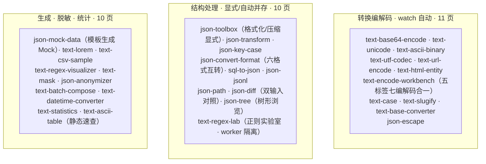
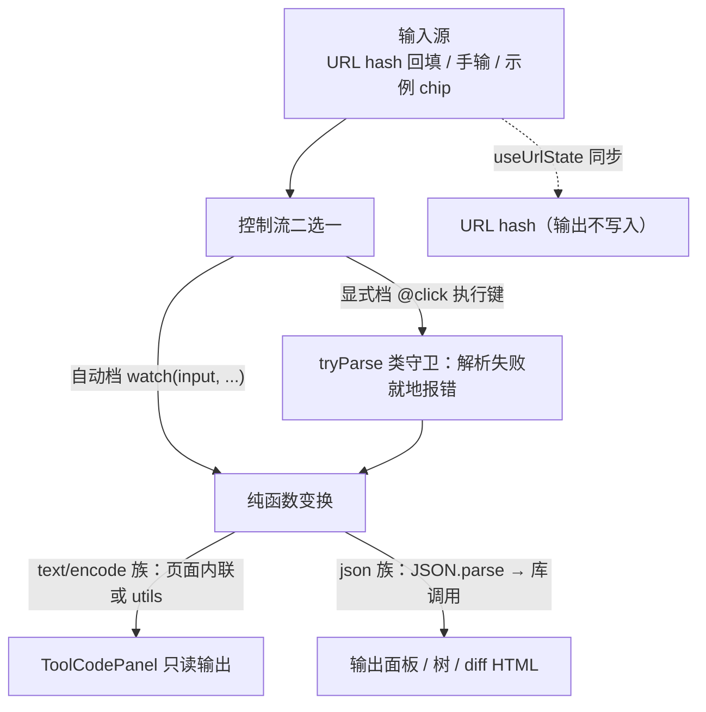

# 09 · 文本与 JSON 工具设计

> **一句话摘要**：text 19 页 + json 12 页共 31 页的设计——两大范式（自动转换 / 结构处理）、弹窗交付例外、五个代表页深析与 utils 质量防线的实测现状。
> **目标读者**：页面开发者 ｜ **关联文档**：[08 跨页面复用范式](08-跨页面复用范式.md) · [04 布局体系](04-布局体系与页面骨架.md) · [10 编程与运行](10-编程与运行工具设计.md) · [16 踩坑手册](16-已知坑与规避清单.md)

## 1. 概述

本域是全站「转换类工具」的大本营：31 页（text 19 + json 12）里 watch 自动实时范式占多数，显式执行集中在结构处理与生成器。行为口径只看 categoryId（03 §2.2），物理目录横跨四个目录：

| 物理目录 | 本域页面数 | 构成 |
|---|---|---|
| `src/views/tools/text/` | 18 | text 14 页 + json-jsonl（JsonlPage）+ 正则 worker |
| `src/views/tools/encode/` | 2 | text-url-encode、text-encode-workbench |
| `src/views/tools/json/` | 10 | json 族主目录（json-toolbox 与 json-format 路由共用 JsonFormatPage） |
| `src/views/tools/generate/` | 5 | text-lorem · text-regex-visualizer · text-csv-sample · json-mock-data · json-anonymizer |

id → 组件的映射真源是 `src/config/tools/toolComponents.ts`（158 行），例如 `json-toolbox` 与 `json-format` 路由实际指向同一份 `JsonFormatPage.vue`——**「工具箱」是 catalog 条目名，「格式化页」是路由路径，一个物理文件服务两者**。

执行模式实测（`grep -c "@click"` 与 `grep -c "watch("`，按物理目录小计）：

| 目录 | 页面文件数 | @click 总数 | watch( 总数 | 均值/页 |
|---|---|---|---|---|
| `text/`（16 个 .vue，含 color 域 1 页） | 16 | 44 | 10 | click 2.8 / watch 0.6 |
| `encode/` | 2 | 7 | 2 | click 3.5 / watch 1.0 |
| `json/`（10 个 .vue） | 10 | 30 | 4 | click 3.0 / watch 0.4 |

@click 的基本盘是「示例 / 清空」两枚 chip（每页 2 枚起步），超出部分才是真正的执行按钮——这解释了为什么均值只有 3 左右：**自动档页面的按钮几乎只剩示例与清空，显式档多一枚执行键**。

## 2. 架构与数据流

### 2.1 域内页面地图



图释：三组的划分依据是 08 册 §2.1 的执行模式三分布——转换编解码组几乎全为自动实时；结构处理组以显式按钮为主（转换结果贵或需校验）；生成组一律显式（08 §4.1 契约）。**json 12 页全部为 workbench 布局**，是 catalog 中布局最整齐的一族；text 19 页里 12 页 workbench、7 页 centered。

### 2.2 页面清单总表（31 页，物理位置与测试实测）

| id | 名称 | layout | 物理目录（views/tools/ 下） | 专属测试文件（用例数） |
|---|---|---|---|---|
| text-base64-encode | Base64 编解码器 | workbench | text/Base64Page.vue | Base64Page.dom.test.ts（4） |
| text-case | 命名风格转换 | workbench | text/TextCasePage.vue | TextCasePage.dom.test.ts（3） |
| text-html-entity | HTML 实体转义 | workbench | text/HtmlEntityPage.vue | 无 |
| text-base-converter | 整数进制转换器 | workbench | text/BaseConverterPage.vue | 无 |
| text-unicode | Unicode 转义工具 | workbench | text/UnicodeConverterPage.vue | 无 |
| text-ascii-binary | ASCII 二进制转换器 | workbench | text/AsciiBinaryPage.vue | AsciiBinaryPage.dom.test.ts（4） |
| text-slugify | Slugify 字符串转换器 | workbench | text/SlugifyPage.vue | 无 |
| text-regex-lab | 正则实验室 | workbench | text/RegexLabPage.vue + regex-lab.worker.ts | 无 |
| text-mask | 文本掩码脱敏 | workbench | text/TextMaskPage.vue | 无 |
| text-utf-codec | UTF-8/16/32 编解码 | workbench | text/UnicodeUtfPage.vue | 无 |
| text-url-encode | URL 编解码 | workbench | encode/UrlEncoderPage.vue | UrlEncoderPage.dom.test.ts（4） |
| text-encode-workbench | 编码解码工作台 | workbench | encode/EncodeWorkbenchPage.vue | 无 |
| text-batch-compose | 批量文本拼接 | centered | text/BatchComposePage.vue | 无 |
| text-datetime-converter | 日期时间转换器 | centered | text/DatetimeConverterPage.vue | 无 |
| text-statistics | 文本统计分析 | centered | text/TextStatisticsPage.vue | 无 |
| text-ascii-table | ASCII 码表 | centered | text/AsciiTablePage.vue | 无 |
| text-lorem | Lorem Ipsum 生成工具 | centered | generate/LoremGeneratorPage.vue | 无 |
| text-regex-visualizer | 正则可视化说明生成器 | centered | generate/RegexGeneratorPage.vue | 无 |
| text-csv-sample | CSV 示例数据生成器 | centered | generate/CsvSampleGeneratorPage.vue | 无 |
| json-toolbox | JSON 工具箱 | workbench | json/JsonFormatPage.vue | JsonFormatPage.dom.test.ts（7） |
| json-convert-format | JSON 格式互转 | workbench | json/JsonConvertFormatPage.vue | 无 |
| json-transform | JSON 结构处理 | workbench | json/JsonTransformPage.vue | 无 |
| json-key-case | JSON 键名转换 | workbench | json/JsonKeyCasePage.vue | 无 |
| json-escape | JSON 转义/反转义 | workbench | json/JsonEscapePage.vue | 无 |
| sql-to-json | SQL 转 JSON | workbench | json/SqlToJsonPage.vue | 无 |
| json-tree | JSON 树形浏览 | workbench | json/JsonTreePage.vue | 无 |
| json-path | JSONPath 查询 | workbench | json/JsonPathPage.vue | 无 |
| json-diff | JSON Diff 对比 | workbench | json/JsonDiffPage.vue | 无 |
| json-jsonl | JSON Lines 工具 | workbench | json/JsonlPage.vue | 无 |
| json-mock-data | OpenAPI 模拟数据生成器 | workbench | generate/MockJsonGeneratorPage.vue | 无 |
| json-anonymizer | JSON 匿名化处理器 | workbench | generate/JsonAnonymizerPage.vue | 无 |

测试实测结论：31 页里只有 **5 个专属 dom 测试文件、22 个用例**（text 族 3 文件 11 用例、encode 族 1 文件 4 用例、json 族 1 文件 7 用例），其余页面仅被 `src/views/tools/allToolPages.dom.test.ts` 全页巡检覆盖。

### 2.3 utils 模块映射表（实测消费方）

`src/utils/text/`（6 模块）与 `src/utils/encode/`（3 模块）的职责与消费方（grep import 实测）：

| 模块 | 职责一句话 | 被谁消费（实测） |
|---|---|---|
| `src/utils/text/text-guard.ts` | `normalizeLineEndings` 行尾归一 | utils/network、utils/site、utils/dev、utils/encode 四个工具库（跨域公共底座） |
| `src/utils/text/text-jsonl.ts` | JSONL ↔ JSON 数组互转 | json/JsonlPage.vue |
| `src/utils/text/text-batch-compose.ts` | 多段文本模板拼接 | text/BatchComposePage.vue |
| `src/utils/text/text-mask.ts` | 手机号/身份证/邮箱掩码规则 | text/TextMaskPage.vue |
| `src/utils/text/text-delimited.ts` | 分隔符文本解析变换（237+ 行） | **无任何消费方（孤儿模块）** |
| `src/utils/text/text-kv-convert.ts` | env/properties/yaml 键值互转 | **无任何消费方（孤儿模块）** |
| `src/utils/encode/encoding-tools.ts` | 字节层原语：hex/base64/base64url 编解码 | encode-tools.ts + EncodeWorkbenchPage.vue |
| `src/utils/encode/encode-tools.ts` | 工作台五个变换（URL/Unicode/实体/DataURL…） | encode/EncodeWorkbenchPage.vue |
| `src/utils/encode/base64-utf8.ts` | `encodeBase64Utf8`/`decodeBase64Utf8` | **无任何消费方（孤儿模块）** |

孤儿模块是本域的一笔已知技术债：`parseDelimitedText`、`convertKvText`、`encodeBase64Utf8` 三个入口在 `src/` 全树 grep 为零引用，删除或复活前先确认没有计划中的页面（变更指引 §6.3）。

json 域四个三方库的真实 import 位置（逐字）：

```ts
// src/views/tools/json/JsonDiffPage.vue
import { create } from 'jsondiffpatch'
import { format as formatHtml } from 'jsondiffpatch/formatters/html'
import 'jsondiffpatch/formatters/styles/html.css'
```

```ts
// src/views/tools/json/JsonPathPage.vue
import { JSONPath } from 'jsonpath-plus'
```

```ts
// src/views/tools/json/JsonTreePage.vue
import VueJsonPretty from 'vue-json-pretty'
import 'vue-json-pretty/esm/styles.css'
```

```ts
// src/views/tools/json/JsonConvertFormatPage.vue（另一处是 src/utils/dev/openapiTools.ts）
import { load as yamlLoad, dump as yamlDump } from 'js-yaml'
```

四个库都只在单一页面消费（js-yaml 例外，还被 dev 域的 openapiTools 用），因此没有为其建共享包装层——直接页面级 import + 页面级测试兜底。

### 2.4 本域数据流形态



图释：自动档与显式档的分叉点只在「谁来触发纯函数」，转换本体都是无副作用函数；URL hash 只回填输入与选项，输出由输入推导不回写（TextCasePage 源码注释原话见 §3.1）。

## 3. 核心实现（代表页深析）

### 3.1 TextCasePage（自动档标准范式，239 行）

`src/views/tools/text/TextCasePage.vue`。选项控件（目标风格 el-select、缩略词 el-checkbox、白名单 el-input、示例/清空 chip）全部收进标题栏 `#actions` 的 borderless ToolActionBar；`#primary` 可编辑输入、`#secondary` 只读 ToolCodePanel 输出。这是 08 册 §2.4 决策树「自动 + 内联 + 回填」全分支的参照实现。

状态同步段（逐字）——输入与全部选项进 URL hash，输出不写入：

```ts
/**
 * 输入与全部转换选项都与 URL 片段同步（如 `#inputText=hello%20world&targetCase=snake`），
 * 打开链接即可还原现场。输出不写入 —— 它由输入推导，写进去只会重复存一份。
 */
const { inputText, targetCase, preserveAcronyms, acronymWords } = useUrlState({
  inputText: '',
  targetCase: 'camel' as CaseTarget,
  preserveAcronyms: false,
  acronymWords: 'API,ID,URL,HTTP',
})
const outputText = ref('')
```

自动触发段（逐字）——一个 watch 覆盖全部状态源，`immediate` 保证刷新回填后立刻出结果：

```ts
watch([inputText, targetCase, preserveAcronyms, acronymWords], convertText, { immediate: true })
```

值得注意的事实修正：本页的转换逻辑（`splitWords` / `convertWord` / `convertLine`）**内联在页面里**，没有下沉 utils——因为命名风格转换只有这一处消费。页面模板骨架则是标准三段式：

```html
<ToolShell :tool="tool">
  <template #actions>
    <ToolActionBar borderless>
      <div class="text-case-page__options">…el-select 目标风格…</div>
      <div class="text-case-page__options">…el-checkbox 保留缩略词…</div>
      <el-button class="btn-chip-muted" size="small" @click="loadExample">…</el-button>
      <el-button class="btn-chip" size="small" @click="clearAll">…</el-button>
    </ToolActionBar>
  </template>
  <template #primary>
    <ToolCodePanel title="原始文本" v-model="inputText" editable … />
  </template>
  <template #secondary>
    <ToolCodePanel title="转换结果" :code="outputText" … />
  </template>
</ToolShell>
```

### 3.2 JsonFormatPage（显式档标准范式，165 行）

`src/views/tools/json/JsonFormatPage.vue`（catalog id 为 `json-toolbox`，路由 `/json-format`）。`#actions` 内显式「格式化/压缩」按钮；`#primary` Monaco 可编辑、`#secondary` 只读输出。**缩进从 settingsStore 读全局偏好**（06 §2.2），页面不设缩进选项。

核心逻辑段（逐字）——解析守卫把错误位置翻译成行号列号：

```ts
function tryParseJson(transform: (parsed: unknown) => string, successMsg: string) {
  clearError()
  if (!inputCode.value.trim()) {
    outputCode.value = ''
    return
  }
  try {
    const parsed = JSON.parse(inputCode.value)
    outputCode.value = transform(parsed)
    toast.success(successMsg)
  } catch (e: unknown) {
    const message = e instanceof Error ? e.message : String(e)
    const location = parseErrorPosition(message, inputCode.value)
    setError(`JSON 解析错误: ${message}${location}`)
    outputCode.value = ''
  }
}
```

状态同步段（逐字）——全局缩进变更时若已有输出立即按新缩进重排：

```ts
// 缩进是全局格式化偏好：读取设置弹窗里的统一值（导航栏设置 → 格式化 → 缩进）
function getIndent(): string {
  return settingsStore.indentUnit
}

// 切换缩进（全局设置）时若已有输出，立即按新缩进重新格式化
watch(
  () => settingsStore.codeIndent,
  () => {
    if (inputCode.value.trim() && outputCode.value) {
      formatJson()
    }
  }
)
```

测试 `JsonFormatPage.dom.test.ts` 7 用例覆盖输入→输出链路与全局缩进联动，Monaco 在 jsdom 下以 textarea 桩测试（14 §2.3）。

### 3.3 JsonTreePage（vue-json-pretty 包装教训，297 行）

基于 `vue-json-pretty` 的树形浏览，树本体接在 ToolEditorPanel 里：

```html
<VueJsonPretty
  v-if="parsedData !== undefined"
  :data="parsedData"
  :deep="defaultDepth"
  :show-line="showLine"
  :show-double-quotes="showDoubleQuotes"
  :virtual="true"
/>
```

曾发生「三个死按钮」事故（16 册台账 #3）：展开/折叠全部按钮因 vue-json-pretty 的 deep watch 带 truthy 卫语句吞掉 `0` 值而永远无效。本页的防御手法是把深度选项做成字符串枚举再转数字，`999` 代表「全部」而非用 `0`：

```ts
const depthOptions = [
  { value: '999', label: '全部' },
  { value: '1', label: '1' },
  { value: '2', label: '2' },
  { value: '3', label: '3' },
  { value: '4', label: '4' },
]
const depthOption = computed({
  get: () => String(defaultDepth.value),
  set: (val: string) => {
    defaultDepth.value = Number(val)
  },
})
```

教训：**包装第三方组件时，控制 API 的边界值必须实测**（0 层级、空数组这类 falsy-but-legal 值），改造前先读 16 册对应条目。

### 3.4 JsonDiffPage（双输入对照，286 行）

双输入页的装配样本：Original 居左 `#primary`，Modified 与结果纵排 `#secondary`；diffpatcher 实例化时注入对象哈希策略，让数组按 `id` 对齐而非按位对齐：

```ts
const diffpatcher = create({
  objectHash: (obj: unknown, index?: number) => {
    if (typeof obj === 'object' && obj !== null && 'id' in obj) {
      return (obj as Record<string, unknown>).id as string
    }
    return `$$index:${index}`
  },
})
```

结果渲染前过 `sanitizeHtml`（`diffHtml.value = sanitizeHtml(formatHtml(delta, left) ?? '')`）——jsondiffpatch 的 HTML formatter 会产出内联样式标签，直接 v-html 存在注入面，这是全站「第三方 HTML formatter 必须过消毒」的示范位。视图模式（可视化 / Delta JSON）由 `viewMode` 切换，两侧解析错误分别报「左侧/右侧」来源。双输入不进 URL hash（§4.3）。

### 3.5 EncodeWorkbenchPage（七编解码合一，652 行）

`src/views/tools/encode/EncodeWorkbenchPage.vue`，本域最大页面。五个标签页（编码转换 / URL / Unicode / HTML 实体 / Data URL）聚合 catalog 描述的七种编解码——「编码转换」标签内部再支持 `utf8 | hex | base64 | base64url` 四种（`encoding-tools.ts` 的 `DataEncoding` 联合类型）。核心分发段（逐字）：

```ts
function runTransform() {
  resetDerived()
  if (!inputText.value) {
    outputText.value = ''
    return
  }
  try {
    switch (currentTool.value) {
      case 'encoding': {
        const result = transformEncodingWorkbench(inputText.value, {
          sourceEncoding: sourceEncoding.value,
          targetEncoding: targetEncoding.value,
        })
        outputText.value = result.output
        derivedByteLength.value = result.byteLength
        break
      }
      case 'url': {
        const result = transformUrlText(inputText.value, { … })
        outputText.value = result.output
        transformedLineCount.value = result.transformedLineCount
        break
      }
      …
```

自动触发由 `watch(inputText, () => { … })`（第 190 行）驱动；`switchTool()` 在切标签时执行**语境切换清结果**（08 §2.1 契约）：`resetAll()` 清空输入输出并重置该标签全部选项为默认值，防止上一算法的选项泄漏进下一算法。

### 3.6 正则实验室的 Worker 隔离（37 行 worker）

`src/views/tools/text/regex-lab.worker.ts` 把用户正则跑在独立 worker，主线程可随时 terminate 防 ReDoS（16 册报告 #11），并有结果上限：

```ts
const MAX_RESULTS = 10000

self.onmessage = (event: MessageEvent<{ pattern: string; flags: string; text: string }>) => {
  const { pattern, flags, text } = event.data
  const regex = new RegExp(pattern, flags)
  const results: MatchResult[] = []
  let match: RegExpExecArray | null

  regex.lastIndex = 0
  while ((match = regex.exec(text)) !== null) {
    results.push({
      match: match[0],
      index: match.index,
      groups: match.slice(1),
    })
    if (!regex.global) break
    if (match[0] === '') regex.lastIndex += 1
    if (results.length >= MAX_RESULTS) break
  }

  ;(self as unknown as Worker).postMessage(results)
}
```

图释：零宽匹配 `lastIndex += 1` 防死循环、`MAX_RESULTS` 防大结果集卡 postMessage——两道上限都是「不可信输入跑在主线程之外」之外的必要补充。三方言语义差异（JS/Java/Python）由页面层 flags 预处理承担，worker 只跑 JS 引擎。

### 3.7 生成器三页交付形态对比（实测）

| 页面（物理文件） | layout | 结果交付 | 下载 | 结果弹窗 | 行数 |
|---|---|---|---|---|---|
| text-lorem（LoremGeneratorPage.vue） | centered | el-dialog 960px（`showResultDialog`） | 无 | 有 | 572 |
| text-csv-sample（CsvSampleGeneratorPage.vue） | centered | el-dialog 960px | `downloadText(…, sample-${Date.now()}.${ext})` | 有 | 987 |
| json-mock-data（MockJsonGeneratorPage.vue） | workbench | 右栏内联输出面板 | `downloadText(…, mock-json-${Date.now()}.json)` | 仅「可用规则」速查 512px | 1068 |

三者都带「CopyButton 复制」；差异点在**结果走不走弹窗**：参数表单单卡的 centered 页把结果收进 960px 弹窗（页面保持一张参数卡），而 json-mock-data 因参数复杂改判 workbench 后结果直接落在右栏（catalog 注释记录改判理由：「参数设置卡 + 生成结果双面板；centered 的 720px 上限压垮 480px 参数列」）。

## 4. 设计决策与取舍

1. **转换组全走自动实时**。Why：编码互转毫秒级且可逆，自动是纯体验增益（08 §4.1）；text-encode-workbench 把七种编解码合并一页，正是让「换算法不用换页」来放大自动范式的优势——代价是 `switchTool` 必须做语境切换清结果（§3.5）。
2. **json 族全 workbench**。Why：JSON 工具的本质都是「左输入右结果」对照（含树形、diff），双栏 workbench 是唯一自然形态；无一页需要 centered 单列（catalog 12 条 json 记录零 centered，实测）。
3. **diff 双输入不进 URL hash**。json-diff 双输入状态体积大，hash 回填价值低——URL 回填是转换类单输入页的标配（§3.1 的 useUrlState 全选项回填是上限形态），不是全域强制。
4. **脱敏双页分工**。text-mask 面向「一段文本里的敏感字段」（规则内置 `utils/text/text-mask.ts`），json-anonymizer 面向「整棵 JSON 树按规则路径脱敏」（规则显式）——同一需求域按数据形态拆页而非塞进一页。
5. **生成器弹窗交付**。text-lorem / text-csv-sample 沿用原 generate 家族的弹窗交付（产物即成品，无对照需求，08 §4.3，实测见 §3.7 表）；json-mock-data 因参数复杂改判 workbench 双面板，结果内联。
6. **转换逻辑「就近内联 or 下沉 utils」的实然分界**。单一消费方的算法内联页面（TextCasePage 的 case 转换、Base64Page 的 `btoa(unescape(encodeURIComponent(text)))`）；多页面共享或跨域复用的才进 utils（text-guard 被 4 个域的工具库引用）。不要为了「架构好看」把一次性逻辑硬抽出去。

## 5. 边界情况与已知限制

- **大文本**：自动组超大输入靠防抖缓解，MB 级输入仍可能卡顿（08 §5.1 的全站性限制在本域最常见）。
- **编码类非法输入**：非合法 Base64/JSON/正则的输入走 useToolError 在结果区就地报错（08 §4.4），正则实验室另有 worker 隔离 + 双上限（§3.6）。
- **Monaco 测试盲区**：jsdom 下 Monaco 被 stub 成 textarea，涉及选区/富交互的用例测不到真实行为（14 §5）。
- **text-statistics 的口径**：字数/词数对中文与英文统计口径不同，页面内已注明口径；改动统计算法须同步更新口径说明。
- **utils/text 与 utils/encode 无专属单测（实测）**：`find src/utils -name "*.test.ts"` 在这两个目录为零命中——本域质量主防线实际是 5 个页面级 dom 测试（22 用例）+ 全页巡检，不是「算法层单测」。改 `encoding-tools.ts` / `encode-tools.ts` 这类共享纯函数时，页面测试只覆盖各自入口，公共分支（如 base64url 与 base64 的差集）没有直接断言，需手测补位。
- **三个孤儿模块**：text-delimited.ts、text-kv-convert.ts、base64-utf8.ts（§2.3）——不修不删但要在变更时显式决策，避免误以为有页面在依赖。

## 6. 变更指引

1. **新增文本/JSON 工具**：先归 §2.1 三组之一，照组内代表页复制范式（转换组抄 TextCasePage，结构组抄 JsonFormatPage，生成组确认弹窗/内联交付方式）；物理目录放 `text/` 或 `json/`（encode/generate 目录不再新增文件）；登记三件套 catalog.ts + routes.ts + toolComponents.ts（03 §3）。
2. **改 vue-json-pretty 相关交互**：先读 JsonTreePage 死按钮教训（16 册 #3），对 0/空值边界做显式测试。
3. **改编码实现**：共享逻辑改 `utils/text/`、`utils/encode/` 纯函数，页面只做装配；若确认为孤儿模块（§2.3）先决定删留再动手。注意这两个 utils 目录当前没有单测（§5），新增公共函数时应顺手补 `*.test.ts`，把「算法层防线」从欠账变常态。
4. **给第三方 HTML 渲染结果上屏前**：一律过 `sanitizeHtml`（JsonDiffPage 先例，§3.4）。
5. **验证手段**：`pnpm test`（含全页巡检）+ 手测每页「示例填充 → 输出 → URL 刷新恢复」路径（自动档单输入页）；双输入页（json-diff）与弹窗交付页（lorem/csv）另手测左右两侧独立报错与弹窗复制/下载。
