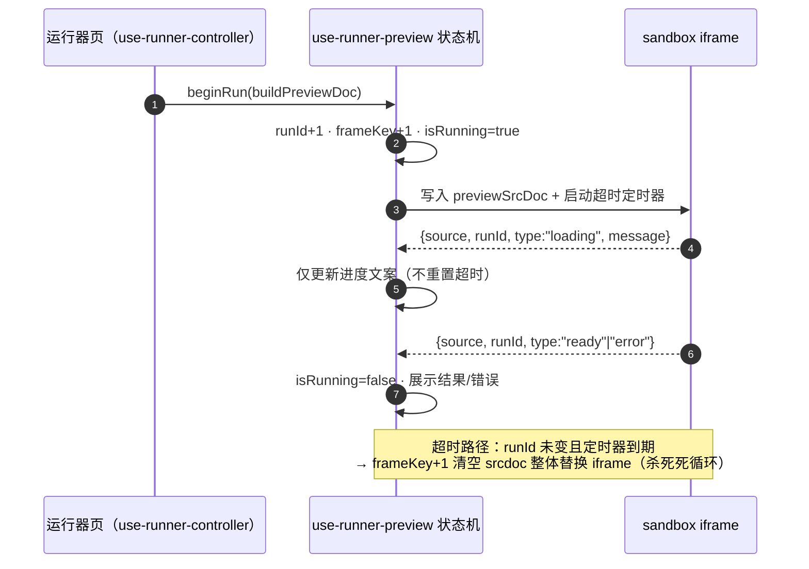

# 10 · 编程与运行工具设计

> **一句话摘要**：dev 40 页 + run 4 页共 44 页的设计——六个范式分组、原 generate 生成器家族的布局改判谱系、运行器的 iframe/Worker 双引擎消息协议与 vendor 实测。
> **目标读者**：页面开发者 ｜ **关联文档**：[08 跨页面复用范式](08-跨页面复用范式.md) · [06 全局状态](06-全局状态与应用级机制.md) · [04 布局体系](04-布局体系与页面骨架.md) · [07 构建](07-构建预渲染与SEO.md)

## 1. 概述

dev 是全站最大的分类（40 页），内部按六组范式聚合；run 是规模最小但架构最特殊的分类（4 页全是 canvas 满高沙箱运行器）。物理目录分布（实测）：

| 物理目录 | 本域页面数 | 构成 |
|---|---|---|
| `src/views/tools/dev/` | 24 | devTools 组 24 页（dev-format 到 dev-timezone） |
| `src/views/tools/generate/` | 16 | 原 generate 家族 16 页（分类已解散，categoryId='dev' 保留行为归属） |
| `src/views/tools/run/` | 4 | 四个沙箱运行器 |

执行模式实测（`grep -c "@click"` / `grep -c "watch("`）：

| 页面组 | 页数 | @click 总数 | watch( 总数 | 特征 |
|---|---|---|---|---|
| `dev/` 目录 24 页 | 24 | 90 | 15 | 均值 click 3.8 / watch 0.6，显式执行为主 |
| `generate/` 目录中 16 个 dev 页 | 16 | 85 | 4 | click 5.3 / watch 0.25——生成器家族是全站显式范式浓度最高的一组 |
| `run/` 目录 | 4 | 13 | 2 | 按钮极少：示例/清空/运行三件套 |

本域是「重依赖聚集地」——monaco、shiki、TypeScript 编译器、@vue/compiler-sfc、rrweb 都在此域被消费，分包策略（`vite.config.ts` 的 `codeSplitting.groups`，07 §2.1）直接影响本域首载。

## 2. 架构与数据流

### 2.1 dev 40 页六组清单总表（layout 与测试实测，全组无专属 dom 测试）

**组 1 · 代码处理（6 页，全 workbench，显式执行）**

| id | 名称 | layout | 测试 | 一句话 |
|---|---|---|---|---|
| dev-format | 代码格式化 | workbench | 无 | 7 语言一键格式化，算法在 `devCodeTools.formatCodeByLanguage`（async） |
| dev-compress | 代码压缩 | workbench | 无 | HTML/CSS/JS/XML 压缩 |
| dev-diff | 代码对比 | workbench | 无 | 双输入按行 diff，+/− 标记与摘要统计 |
| dev-sql-format | SQL 格式化工具 | workbench | 无 | 多方言美化/压缩 |
| dev-markdown-to-html | Markdown 转 HTML | workbench | 无 | GFM 扩展语法渲染（`utils/dev/markdownTools.ts`） |
| dev-html-to-markdown | HTML 转 Markdown | workbench | 无 | GFM 反向转换 |

**组 2 · 解析与查询（8 页：workbench 4 + centered 4，解析廉价即时）**

| id | 名称 | layout | 测试 | 一句话 |
|---|---|---|---|---|
| dev-openapi | OpenAPI 工具 | workbench | 无 | 解析 JSON/YAML + Swagger 风格预览 + 生成 cURL/Fetch/Axios/Postman/Mock（最复杂页，§3.7） |
| dev-semver | SemVer 版本校验 | workbench | 无 | 语义化版本与 npm 范围语法校验 |
| dev-ieee754 | IEEE 754 浮点工具 | workbench | 无 | 双精度浮点二进制/十六进制/内存布局可视化 |
| dev-ua-parser | User-Agent 解析 | centered | 无 | 浏览器/引擎/OS/设备类型解析 |
| dev-ip-info | IP 信息查询 | centered | 无 | IPv4/IPv6 类型、分类与网络结构 |
| dev-device-info | 设备信息 | centered | 无 | 屏幕/浏览器/系统只读展示 |
| dev-keycode | Keycode 查询 | centered | 无 | 按键监听显示键码/位置/修饰键 |
| dev-random-ua | 随机 UA 生成 | centered | 无 | 主流浏览器与设备组合 UA |

**组 3 · 计算与换算（4 页：workbench 2 + centered 2，watch 自动联动）**

| id | 名称 | layout | 测试 | 一句话 |
|---|---|---|---|---|
| dev-chmod-calculator | Chmod 计算器 | workbench | 无 | 权限矩阵 → 八进制/符号/chmod 命令 |
| dev-umask-calculator | Umask 计算器 | workbench | 无 | umask 反推文件/目录默认权限 |
| dev-crontab-generator | Crontab 表达式生成器 | centered | 无 | 可视化生成/验证/解析 + 最近运行时间 |
| dev-timezone | 时区转换 | centered | 无 | 多时区互转 + 各时区当前时间 |

**组 4 · 生成器家族（16 页，原 generate 分类解散迁入，改判谱系见 §4.4）**

| id | 名称 | layout | 测试 | 一句话 |
|---|---|---|---|---|
| dev-uuid | UUID 生成工具 | centered | 无 | 批量 UUID v1/v4，自定义格式 |
| dev-ulid | ULID 生成器 | centered | 无 | 时间有序唯一标识 |
| dev-nanoid | NanoID 生成器 | workbench | 无 | URL 安全短 ID，自定义字母表与长度 |
| dev-code-snippet | 代码片段生成器 | centered | 无 | 多语言代码模板，结果收弹窗 |
| dev-api-response | API 响应模拟生成器 | workbench | 无 | RESTful 风格模拟响应 |
| dev-version-generator | 版本号生成器 | centered | 无 | SemVer 规则版本号 |
| dev-db-schema | 数据库表结构生成器 | workbench | 无 | 多方言建表 SQL |
| dev-css-theme | CSS 主题变量生成器 | workbench | 无 | CSS 自定义属性主题（明暗模式） |
| dev-api-request | API 请求示例生成器 | workbench | 无 | 多语言 HTTP 请求代码示例 |
| dev-mock-dict | Mock 数据字典生成器 | centered | 无 | 中文姓名/地址/公司模拟数据 |
| dev-file-tree | 文件目录树生成器 | workbench | 无 | 目录树文本，自定义缩进与图标 |
| dev-markdown-generator | Markdown 文档生成器 | workbench | 无 | Markdown 文档模板 |
| dev-sql-insert | SQL INSERT 生成器 | workbench | 无 | 字段配置 → 多行 INSERT INTO |
| dev-openapi-schema | OpenAPI Schema 生成器 | centered | 无 | 可视化编辑字段 → OpenAPI 3.0 schema |
| dev-er-diagram | ER 图设计器 | workbench | 无 | 多表结构与关系 → DDL 与 Mermaid |
| dev-ts-to-mock | TypeScript 转 Mock | workbench | 无 | 粘贴 TS interface 自动生成 Mock |

**组 5 · 网络调试（3 页，全 workbench，显式执行）**

| id | 名称 | layout | 测试 | 一句话 |
|---|---|---|---|---|
| dev-api-debugger | API 请求调试器 | workbench | 无 | 原生 fetch 直连用户目标（全站唯一真实出站页，§3.6） |
| dev-basic-auth | Basic Auth 生成器 | workbench | 无 | Base64 认证头，三种凭据形态 |
| dev-otp-generator | OTP 验证码生成器 | workbench | 无 | RFC 6238 TOTP（`utils/dev/otp-time-step.ts`，@noble/hashes） |

**组 6 · 展示与媒体（3 页）**

| id | 名称 | layout | 测试 | 一句话 |
|---|---|---|---|---|
| dev-universal-code-block | 统一代码块展示 | centered | 无 | 多语言高亮与行号（shiki） |
| dev-code-image | 代码块生成图片 | workbench | 无 | 代码渲染为图片导出（html-to-image） |
| dev-screen-recorder | 前端录屏（rrweb） | centered | 无 | rrweb 录制交互并回放 |

测试实测：**dev 40 页全部没有 `*.dom.test.ts` 专属测试**，仅被 `src/views/tools/allToolPages.dom.test.ts` 全页巡检覆盖；算法质量由 `src/utils/dev/` 的两个单测文件兜底（`devCodeTools.test.ts`、`otp-time-step.test.ts`）。

### 2.2 run 域 4 页单列表

| id | 名称 | 引擎 | 页面文件（行数） | vendor 依赖（实测） |
|---|---|---|---|---|
| run-js-ts | JS / TS 运行 | **Web Worker**（Blob URL 常驻复用） | run/JsTsRunnerPage.vue（820） | `public/vendor/typescript.js`（CDN 回退） |
| run-vue | Vue SFC 在线运行 | sandbox iframe（SFC 浏览器端编译） | run/VueRunnerPage.vue（572） | `public/vendor/compiler-sfc.esm-browser.js` |
| run-react | React / TSX 在线运行 | sandbox iframe（TSX 编译执行） | run/ReactRunnerPage.vue（767） | `react.production.min.js` + `react-dom.production.min.js` + `typescript.js` |
| run-web | HTML / CSS / JS 在线运行 | sandbox iframe（三标签编辑直排） | run/WebRunnerPage.vue（520） | 无（原生 DOM） |

public/vendor 目录实测字节数：`typescript.js` **9,112,572**、`compiler-sfc.esm-browser.js` **1,726,218**、`react-dom.production.min.js` **131,835**、`react.production.min.js` **10,751**、`vue.esm-browser.prod.js` **172,369**。vendor 加载策略由 `src/utils/runtime-vendor.ts` 的 `buildVendorSources(localAsset, cdnPackagePaths)` 统一：**本地 vendor 优先（script src 直连），失败按版本号回退 CDN**。

### 2.3 运行器沙箱协议（iframe 三页共用）



图释：协议要点有三——①`runId` 轮次号使过期消息作废，连续运行互不串扰；②`source` 匹配配额之外，沙箱 iframe 的 origin 是 opaque（`"null"`），只能用 `event.source === contentWindow` **引用比对**防伪造（opener/浏览器扩展注入）；③超时不靠消息续命，从 beginRun 统一计时，`loading` 类消息只改文案不重置定时器。

run-js-ts 走 Worker 分支时复用同一状态机，但回包类型更细：`loading / result / done / error` 四类，其中 `result/done` 只进控制台输出面板、不经过 `handleRunnerMessage` 的终态分支（历史实现曾把每条日志包成 loading，导致 setInterval 日志让超时永不触发——已改）。

## 3. 核心实现

### 3.1 use-runner-preview.ts（消息协议与状态机，199 行，全走读）

对外的契约是宽载荷接口，iframe 与 Worker 两条引擎共用：

```ts
// src/composables/use-runner-preview.ts
export interface RunnerMessagePayload {
  source?: string
  runId?: number
  type?: string
  message?: string
}

interface RunnerPreviewOptions {
  source: string
  timeoutMs: number | (() => number)
  timeoutErrorText: string
  onTimeout?: (runId: number) => void
}
```

`timeoutMs` 支持传函数——运行器页传入 `() => settingsStore.runTimeoutMs`（06 §2.2），设置弹窗改超时即时生效；`resolveTimeoutMs` 对非有限值/非正数兜底 30000。启动运行段（逐字）：

```ts
const beginRun = (buildPreviewDoc: (runId: number) => string) => {
  const runId = activeRunId.value + 1
  activeRunId.value = runId
  previewFrameKey.value += 1
  isRunning.value = true
  runMessage.value = '运行中...'
  errorMessage.value = ''
  previewSrcDoc.value = buildPreviewDoc(runId)

  clearPreviewMessageTimer()
  startPreviewTimeout(runId)
  appendDebug(`[${options.source}] 启动运行 #${runId}`)

  return runId
}
```

消息处理段（逐字）——`loading` 不续命是协议的关键约束：

```ts
if (payload.type === 'loading') {
  // 仅更新进度文案，不重置超时：超时从本次运行开始统一计时，
  // 避免运行过程中的每条进度/日志消息不断「续命」导致超时永不触发
  runMessage.value = payload.message || '加载中...'
  appendDebug(`[${options.source}] #${messageRunId} ${runMessage.value}`)
  return true
}
```

超时杀 iframe 段（逐字）：

```ts
previewMessageTimer = setTimeout(() => {
  if (runId !== activeRunId.value) {
    return
  }

  isRunning.value = false
  runMessage.value = '运行超时'
  errorMessage.value = options.timeoutErrorText
  appendDebug(`[${options.source}] #${runId} 超时（${timeoutMs}ms）`)

  // 使 iframe 失效：递增 frame key 整体替换并清空 srcdoc，
  // 终止用户死循环继续占用 CPU（sandboxed iframe 与父页常同渲染进程），
  // 同时保留上面的超时错误信息展示
  previewFrameKey.value += 1
  previewSrcDoc.value = ''

  options.onTimeout?.(runId)
}, timeoutMs)
```

历史 bug #7（已修，教训在源码注释里）：旧实现另有 400ms 定时器无条件把 isRunning 置 false，而 React/TS 加载 vendor + 编译远超 400ms，运行按钮（`:disabled="isRunning"`）提前可点、连点叠加多次运行。修复原则：**isRunning 只由「ready/error 消息、超时、主动取消/清空」终止**。`cancelActiveRun` 专供「本次运行实际不会开始」的场景（如输入解析失败），把 runId +1 作废以避免假超时弹窗；`debugLogs` 环形保留 40 条供调试面板；`onScopeDispose(dispose)` 自动清理定时器防泄漏。

### 3.2 use-runner-controller.ts（装配层，101 行，全走读）

收敛 React/Vue/Web 三个 iframe 运行器页重复的「消息监听 + 防抖自动运行 + watch 触发 + 卸载清理」。来源校验段（逐字）：

```ts
const handlePreviewMessage = (event: MessageEvent) => {
  // 来源校验：event.source 与预览 iframe 的 contentWindow 严格比对，
  // 沙箱 iframe 的 origin 是 opaque 的（"null"），无法用 origin 判断，只能比对引用
  if (event.source !== getFrameWindow()) {
    return
  }
  handleRunnerMessage(event.data)
}
```

skipAutoRunOnce 机制（逐字）——「加载示例/清空」是主动行为，跳过随后一次自动运行避免双重执行：

```ts
watch(sourceRefs, () => {
  if (skipAutoRunOnce.value) {
    skipAutoRunOnce.value = false
    return
  }
  scheduleAutoRun()
})
```

**刻意不抽象执行引擎**——文件头注释原文：「每个运行器各自的执行引擎（script 注入 / ESM import / SFC 编译）差异较大，因此只抽取这一段完全一致的装配逻辑，避免制造漏抽象的巨型组合式函数」。run-js-ts 因走 Worker 而不使用本装配层，只用 useRunnerPreview + useDebouncedAutoRun 自行组装。

### 3.3 WebRunnerPage（iframe 引擎样板，520 行）

buildPreviewDoc 的转义策略段（逐字）——对 `</style` 与 `</script` 的处理方向相反，注释说明原因：

```ts
const buildPreviewDoc = (runId: number) => {
  // 用户 HTML 原样插入 body：HTML 上下文里 "<\/script>" 不是合法闭合标签，
  // 转义反而会让用户内联的 <script> 永不闭合，吞掉后续内容
  const safeCss = cssCode.value.replace(/<\/style/gi, '<\\/style')
  // 用户 JS 位于 script 标签内，JS 上下文里 "<\/script>" 是正确转义
  const safeJs = jsCode.value.replace(/<\/script/gi, '<\\/script')
```

沙箱内引导脚本的上报通道（逐字）——runId 在引导脚本开头绑定，error 与 unhandledrejection 全兜：

```ts
const runId = ${runId}

const report = (type, message) => {
  window.parent.postMessage({ source: 'run-web', runId, type, message }, '*')
}

const formatError = (error) => { … }

window.addEventListener('error', (event) => {
  report('error', formatError(event.error || event.message))
})

window.addEventListener('unhandledrejection', (event) => {
  report('error', formatError(event.reason))
})
```

控制器接线（逐字）——挂载时由 loadExample 加载示例并运行，`runOnMounted: false` 防止重复触发：

```ts
const { skipAutoRunOnce } = useRunnerController({
  handleRunnerMessage,
  getFrameWindow: () => previewFrame.value?.contentWindow ?? null,
  runCode,
  autoRun,
  delayMs: 1000,
  sourceRefs: [htmlCode, cssCode, jsCode],
  dispose,
  // 挂载时由 loadExample 加载示例并运行，避免控制器重复触发一次
  onMountedSetup: loadExample,
  runOnMounted: false,
})
```

### 3.4 JsTsRunnerPage（Worker 引擎分支，820 行）

Worker 以 Blob URL 创建并**常驻跨运行复用**（TS 编译器只 importScripts 一次）；运行结束 `clearRunTimers()` 清理本次运行创建的定时器，保持常驻 worker 干净。编译执行核心（逐字，摘自 buildWorkerSource 模板）：

```ts
if (mode === "typescript") {
  emit("loading", "正在编译 TypeScript...")
  ensureTypescript()
  const transpiledResult = self.ts.transpileModule(sourceCode, {
    compilerOptions: {
      target: self.ts.ScriptTarget.ES2020,
      module: self.ts.ModuleKind.None
    },
    reportDiagnostics: true
  })
  const diagnostics = (transpiledResult.diagnostics || []).filter(
    (item) => item.category === self.ts.DiagnosticCategory.Error
  )
  if (diagnostics.length > 0) {
    throw new Error(formatDiagnostics(diagnostics))
  }
  compiled = transpiledResult.outputText
}

emit("loading", "正在执行代码...")
const runner = new AsyncFunction("input", "console", compiled)
const result = await runner(input, proxyConsole)
```

主线程收包时按 runId 丢弃过期回包，并把日志类消息与终态消息分流（防日志「续命」超时，§2.3 末段）。超时路径与 iframe 不同：杀 Worker 用 `terminateRunnerWorker()`（terminate + revokeObjectURL），之后按需重建。

### 3.5 dev 代表页一：CodeFormatPage（显式档标准形态，165 行）

`src/views/tools/dev/CodeFormatPage.vue`。算法下沉 `utils/dev/devCodeTools.ts`（954 行），页面只做装配——async 执行 + isProcessing 门闸（逐字）：

```ts
async function runFormat() {
  clearError()

  if (!inputCode.value.trim()) {
    outputCode.value = ''
    return
  }

  isProcessing.value = true

  try {
    outputCode.value = await formatCodeByLanguage(activeLanguage.value, inputCode.value)
    toast.success('格式化成功')
  } catch (e: unknown) {
    const message = e instanceof Error ? e.message : '未知错误'
    outputCode.value = ''
    setError(`格式化失败：${message}`)
  } finally {
    isProcessing.value = false
  }
}
```

切语言即清空（`onLanguageChange` 清输入输出与错误）——同一「语境切换清结果」契约在 dev 域的落点。

### 3.6 dev 代表页二：ApiRequestDebuggerPage（全站唯一真实出站，523 行）

**事实修正**：本页用的是**原生 `fetch` + AbortController**，不是 axios——`axios` 字样在全仓库仅出现在生成的代码片段模板字符串里（`openapiTools.ts` 第 914 行 `'import axios from "axios"'` 等三处），属产出文本而非运行时依赖。全站对 `fetch(` 的扫描只有三处命中：本页（真实出站）、FaviconGeneratorPage（`fetch(dataUrl)` 本地字节转换）、ApiRequestGeneratorPage（模板字符串）。

请求并发防护三件套：`activeRequestId` 轮次号（旧响应回包丢弃）、`AbortController`（新请求 abort 旧请求）、超时定时器（5/10/30/60 秒与「无超时」五档，默认 30 秒）：

```ts
activeRequestController?.abort()
if (timeoutTimer) {
  clearTimeout(timeoutTimer)
  timeoutTimer = null
}
const controller = new AbortController()
const requestId = activeRequestId + 1
activeRequestId = requestId
activeRequestController = controller
isTimeoutAbort = false

if (timeoutMs.value > 0) {
  timeoutTimer = setTimeout(() => {
    isTimeoutAbort = true
    controller.abort()
  }, timeoutMs.value)
}
```

响应侧统一 `response.text()` 后交 `formatResponseText`（`src/utils/http-debug.ts`）判别 JSON/文本，耗时用 `performance.now()` 差值计算；AbortError 再按 `isTimeoutAbort` 区分「请求超时」与「手动取消」两种文案。

### 3.7 dev 代表页三：OpenApiToolPage（最复杂页，1121 行）

页面骨架：粘贴 OpenAPI JSON/YAML → `parseAndValidateSpec` 解析校验 → 接口列表 el-table（方法/路径/说明）→ 选中操作详情（参数表、请求体、响应）→ 生成 cURL/Fetch/Axios/Postman/Mock 五类产出。重逻辑全部在 `src/utils/dev/openapiTools.ts`（1041 行）：`parseOpenApiSource`（js-yaml 兼容 YAML）、`validateOpenApiDocument`、`createOpenApiMockPayload`、`getOpenApiServerUrls`、`getOpenApiOperationDetail` 等。catalog 改判注释记录了它的布局结论：「≥1280px 本是『文档输入/聚合结果』双栏，centered 720px 压垮三列代码网格」→ workbench。

### 3.8 utils/dev 模块映射（实测消费方）

| 模块 | 行数 | 职责 | 消费页面（grep 实测） |
|---|---|---|---|
| `src/utils/dev/devCodeTools.ts` | 954 | 7 语言格式化 / 4 语言压缩 / 按行 diff | CodeFormatPage · CodeCompressPage · CodeDiffPage · MarkdownToHtmlPage（复用 formatCodeByLanguage） |
| `src/utils/dev/openapiTools.ts` | 1041 | OpenAPI 解析/校验/Mock/代码片段/Postman | OpenApiToolPage |
| `src/utils/dev/markdownTools.ts` | 304 | Markdown ↔ HTML（GFM） | MarkdownToHtmlPage（HtmlToMarkdownPage 走独立实现） |
| `src/utils/dev/otp-time-step.ts` | 35 | RFC 6238 时间步与剩余秒数 | OtpGeneratorPage |

单测实测：devCodeTools.test.ts 与 otp-time-step.test.ts 是 dev 域仅有的两个算法单测——格式化/压缩/diff 的公共分支有直接断言，页面零专属测试是可接受分工。

## 4. 设计决策与取舍

1. **Worker 与 iframe 分治**。Why：JS/TS 无 DOM 诉求，Worker 隔离更彻底且无渲染成本（还能常驻复用编译器）；Vue/React/Web 必须渲染，iframe sandbox 是浏览器原生隔离单元。代价：两套运行环境、两套消息语义（Worker 走 onmessage 四类消息，iframe 走 postMessage 三类协议）。
2. **只抽装配不抽引擎**。Why 见 §3.2 源码注释；教训通用化——组合式函数抽象的边界画在「完全一致的机械重复」，不画在「形似而神不同」。
3. **runId 轮次 + 引用比对**。Why：纯前端沙箱没有服务端会话，轮次号是防「旧运行消息污染新状态」的唯一廉价手段（ApiRequestDebuggerPage 的 `activeRequestId` 是同一模式在出站请求上的复刻）；opaque origin 下引用比对是唯一可信来源校验。
4. **生成器家族的布局改判谱系**。16 页在 generate 分类解散时逐页改判，理由逐条摘自 catalog 注释原文：

| id | 改判 | catalog 注释原文（摘录） |
|---|---|---|
| dev-uuid | centered | 「参数收成一行、生成列表上下铺满（同 dev-code-snippet 模板家族）」 |
| dev-ulid | centered | 「参数收成一行、生成列表上下铺满（同 dev-uuid 模板家族）」 |
| dev-code-snippet | centered | 「生成结果收进弹窗后，页面只剩参数表单单卡（与 dev-openapi-schema 同款）」 |
| dev-version-generator | centered | 「参数区顶部多行收纳、结果面板下方铺满（同 dev-uuid 模板家族）」 |
| dev-mock-dict | centered | （无注释，直录 centered） |
| dev-openapi-schema | centered | （无注释，直录 centered） |
| dev-api-response | workbench | 「设置卡 + 模板/结果双栏」 |
| dev-db-schema | workbench | 「左配置栈 + 右 SQL 输出双栏」 |
| dev-css-theme | workbench | 「左配色配置 / 右预览产出双栏」 |
| dev-api-request | workbench | 「左请求设置表单 / 右生成结果双栏」 |
| dev-file-tree | workbench | 「输入参数面板 + 生成结果双栏」 |
| dev-markdown-generator | workbench | 「360px 配置卡 + 生成结果双栏」 |
| dev-nanoid | workbench | 「320px 参数卡 + 生成列表双面板（同 passphrase）」 |
| dev-sql-insert | workbench | 「生成参数+字段规则面板与结果双栏」 |
| dev-er-diagram | workbench | 「表单式设计器+输出 Tab 双栏，无满高画布」 |
| dev-ts-to-mock | workbench | （无注释，直录 workbench） |

   改判结果：**centered 6 页 / workbench 10 页**，判据只有一条——信息形态是「单卡参数 + 成品弹窗」还是「参数面板 × 结果面板对照」。改判制度让 16 页的布局与真实信息形态对齐，而非按历史分类一刀切。
5. **超时杀死 iframe / terminate Worker 而非尝试中断脚本**。Why：JS 死循环无法从外部中断，唯一手段是整体替换（frameKey+1 清空 srcdoc）或 terminate；注释明言 sandboxed iframe 与父页常同渲染进程，不清空则死循环持续占 CPU。
6. **vendor 本地优先 + CDN 兜底**。`buildVendorSources` 把本地 `/vendor/*` 放首位的意义：run-react 首用要拉 TypeScript 编译器（9.1MB 级），自托管保证内网/离线可用，CDN 路径仅作失败回退。

## 5. 边界情况与已知限制

- **超时上下限**（`src/stores/settingsStore.ts` 实测常量）：`RUN_TIMEOUT_MIN = 500`、`RUN_TIMEOUT_MAX = 60000`、`RUN_TIMEOUT_DEFAULT = 10000`——默认 10 秒、可调区间 0.5~60 秒，超长编译/运行仍会被杀，属有意上限。
- **vendor 体积**：run-js-ts 与 run-react 共用 `typescript.js`（9,112,572 字节 ≈ 9.11MB），run-vue 用 `compiler-sfc.esm-browser.js`（1,726,218 字节 ≈ 1.73MB）——首次使用对应运行器时的等待是已知体验代价（本地 vendor 命中时取决于网络与缓存）。历史 bug #7 注释中的「~9.4MB」为旧估算，当前实测以本节数字为准。
- **SFC/TSX 编译器版本**：浏览器端编译依赖打包进站点的 `@vue/compiler-sfc` 与 TypeScript 版本（`runtime-vendor.ts` 的 `VENDOR_VERSIONS` 钉版本），与官方最新版存在滞后；`transpileModule` 只做转译不做类型检查（诊断仅过滤 Error 级语法错）。
- **CORS**：dev-api-debugger 原生 fetch 直连目标受浏览器同源策略限制（01 §5.3），对无 CORS 头的目标无法调试；「无超时」档（0）意味着挂起请求只能靠手动停止。
- **dev-keycode 的输入独占**：监听全局按键的页面（keycode、screen-recorder）在 ⌘K 面板打开时被键盘隔离（06 §4.3），属预期行为。
- **dev 40 页零专属页面测试**：生成器家族（16 页 click 85 处）与网络调试组的手测路径没有自动化回归，改这些页面时全页巡检之外需人工过「示例 → 执行 → 结果」主链路。

## 6. 变更指引

1. **新增运行器**：iframe 类复用 use-runner-controller + use-runner-preview 装配，只写自己的 `buildPreviewDoc` 与引擎逻辑；Worker 类参照 JsTsRunnerPage 自管生命周期；超时接 `() => settingsStore.runTimeoutMs`；按本册 §2.3 三要点自检协议。
2. **改消息协议**：`RunnerMessagePayload` 是三个 iframe 运行器 + 装配层 + Worker 回包映射的共同契约，改字段必须多端同步（controller/preview/三个 iframe 引导脚本/JsTs 的 onmessage 分流段）。
3. **新增 dev 工具**：先归 §2.1 六组之一，布局按组内惯例（生成器家族按 §4.4 判据：单卡+弹窗 → centered，双面板 → workbench）；依赖库超过约 100KB 评估独立分包（07 §6.2）。
4. **改 generate 遗留页**：物理目录在 `views/tools/generate/`（分类已解散），迁移目录时同步更新 `src/config/tools/toolComponents.ts` 的 import 路径（三件套一致性由 tool-registry.test.ts 守护）。
5. **改 dev-api-debugger 出站逻辑**：保持 `activeRequestId + AbortController + 超时定时器`三件套的成对新增；新增响应头/体处理进 `src/utils/http-debug.ts` 而非页面。
6. **验证手段**：run 页手测「死循环 → 超时杀 iframe → 错误文案」与「连点运行不叠加」两条路径；dev 页跑全量巡检 + 手测主链路；utils/dev 改动跑 `devCodeTools.test.ts` / `otp-time-step.test.ts`。
