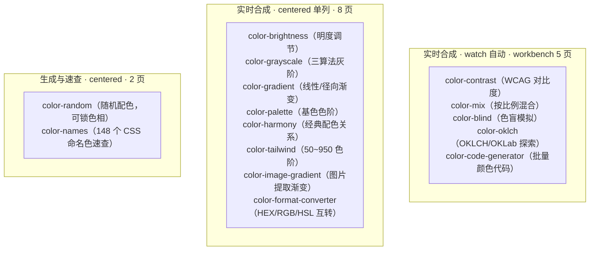
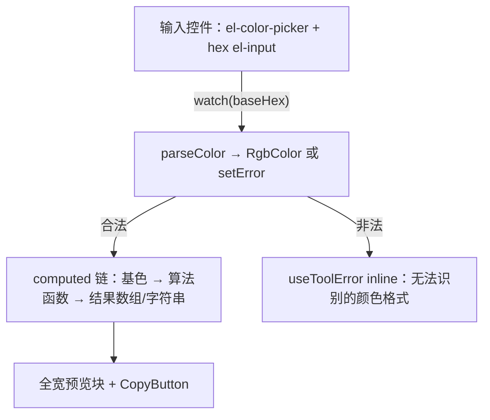

# 11 · 色彩工具设计

> **一句话摘要**：color 15 页的设计——watch 实时合成的主导范式（10/15 页，全站均值的两倍）、centered 单列 1100px 加宽惯例（本域发源、全站 15 处）、色彩算法下沉单文件 `utils/color-tools.ts`（381 行、14 个消费文件）的分工与防线现状。
> **目标读者**：页面开发者 ｜ **关联文档**：[08 跨页面复用范式](08-跨页面复用范式.md) · [04 布局体系](04-布局体系与页面骨架.md) · [05 设计令牌](05-设计令牌与主题系统.md) · [09 文本与 JSON](09-文本与JSON工具设计.md)

## 1. 概述

color 是全站「watch 自动范式」密度最高的分类：颜色计算廉价、可逆、预览直观，天然适合实时联动。布局上 centered 单列占三分之二（10/15），且本域确立了 `--centered-max-width: 1100px` 的加宽惯例。物理目录分布（实测）：

| 物理目录 | 本域页面数 | 构成 |
|---|---|---|
| `src/views/tools/color/` | 13 | colorTools 组 13 页 + 静态数据文件 `css-color-names.ts`（159 行） |
| `src/views/tools/generate/` | 1 | color-code-generator（ColorGeneratorPage.vue） |
| `src/views/tools/text/` | 1 | color-format-converter（ColorConverterPage.vue） |

找文件按目录，判归属按 categoryId（03 §2.2）——id → 组件映射真源见 `src/config/tools/toolComponents.ts`：color 组 13 条在第 14–26 行，`'color-code-generator'` 在第 60 行，`'color-format-converter'` 在第 149 行（`'color-format-converter': () => import('@/views/tools/text/ColorConverterPage.vue')`）。

### 1.1 执行模式逐页实测

`wc -l` + `grep -c "@click"` / `grep -c "watch("` 逐页实测（15 页合计 **click 36 / watch 11**）：

| 页面（id · 组件） | 行数 | @click | watch( | 模式 |
|---|---|---|---|---|
| color-contrast · ColorContrastPage | 354 | 2 | 2 | watch 自动（fg/bg 双 watch） |
| color-mix · ColorMixPage | 322 | 2 | 1 | watch 自动 |
| color-blind · ColorBlindPage | 302 | 2 | 1 | watch 自动 |
| color-oklch · OklchExplorerPage | 405 | 1 | 0 | computed 直驱（滑块 v-model，无 watch） |
| color-code-generator · ColorGeneratorPage | 607 | 7 | 0 | 显式批量生成（多按钮） |
| color-brightness · ColorBrightnessPage | 221 | 2 | 1 | watch 自动 |
| color-grayscale · ColorGrayscalePage | 220 | 2 | 1 | watch 自动 |
| color-gradient · ColorGradientPage | 255 | 2 | 1 | watch 自动（数组源 + immediate） |
| color-palette · ColorPalettePage | 233 | 2 | 1 | watch 自动 |
| color-harmony · ColorHarmonyPage | 232 | 2 | 1 | watch 自动 |
| color-tailwind · ColorTailwindPage | 245 | 2 | 1 | watch 自动 |
| color-image-gradient · ImageToGradientPage | 376 | 2 | 0 | 事件驱动（上传/提取） |
| color-format-converter · ColorConverterPage | 488 | 3 | 1 | watch 自动 |
| color-random · ColorRandomPage | 240 | 3 | 0 | 显式一键生成（可锁色相） |
| color-names · CssColorNamesPage | 269 | 2 | 0 | 静态速查 |

按交互形态归并为三档：**实时联动 11 页**（10 页 watch 解析输入 + OklchExplorer 的 v-model→computed 直驱）、**显式/事件执行 3 页**（ColorGeneratorPage 7 处 click 的批量生成、ColorRandomPage 3 处 click 的一键生成、ImageToGradientPage 的上传事件驱动）、**静态速查 1 页**（CssColorNamesPage，纯数据渲染）。watch 自动页的 2 处 click 是统一底盘：`#actions` 里的「示例 / 清空」chip（ColorContrastPage:99-104 等）。

**明细勘误**：本册旧版写「13 页各带 1 watch」——实测是 9 页各 1 处 + ColorContrastPage 2 处（fg/bg 两个 watch），合计 10；此前的 group 汇总数（26/10）不变，明细修正如上。

### 1.2 与全站分布对照

`find src/views/tools -name "*Page.vue"` 实测 144 个页面文件（toolComponents.ts 映射 140 条，少数工具共用页面），逐目录统计带 `watch(` 的页面：

| 目录 | 页面数 | 带 watch | 占比 |
|---|---|---|---|
| color/ | 13 | 9 | 69% |
| text/（含域内的 ColorConverterPage） | 15 | 8 | 53% |
| image/ | 23 | 9 | 39% |
| encrypt/ | 4 | 3 | 75% |
| dev/ | 24 | 7 | 29% |
| generate/（含域内的 ColorGeneratorPage） | 30 | 8 | 27% |
| json/ | 10 | 3 | 30% |
| run/ | 4 | 1 | 25% |
| network/ | 8 | 2 | 25% |
| encode/ | 2 | 2 | 100%（仅 2 页） |
| site/ | 9 | 0 | 0% |
| **全站合计** | **144** | **53** | **36.8%** |

color 域按 categoryId 归口为 **10/15 = 66.7%** 页面 watch 驱动（把 Oklch 的 computed 直驱算进实时则为 11/15 = 73%），约为全站均值 36.8% 的 1.8 倍；click 密度 36/15 = **2.4 处/页**，低于全站均值 595/144 ≈ **4.1 处/页**——两个方向都印证「实时为默认、按钮只做示例/清空」的域性格。encode 100% 与 site 0% 是两个小样本极端：前者 2 页全是编码预览，后者 9 页全是抓取/生成报告类显式工具。

异常值即分类法：ColorRandomPage（click 3 / watch 0，「一键生成」显式）、ImageToGradientPage（watch 0，文件上传事件驱动）、OklchExplorerPage（click 1 / watch 0，滑块 v-model 直驱 computed）、CssColorNamesPage（watch 0，纯静态速查）——**watch 数量与「输入连续变化驱动预览」的交互形态严格对应**。

## 2. 架构与数据流

### 2.1 域内页面地图



图释：本域无「结果弹窗」页——颜色结果天然是可视预览，全部内联呈现（08 §2.2）；workbench 5 页都是「分量输入 ↔ 读数/预览对照」形态，centered 10 页是「控件在上、大预览在下」的单列流。G1 里 color-oklch 与 color-code-generator 是两个「形态进 workbench 但执行模式不同」的例外：前者 computed 直驱仍实时，后者 7 处 click 显式批量——layout 与执行模式是两个正交维度。

### 2.2 页面清单总表（15 页，行数与测试实测）

| id | 名称 | layout | 物理目录（views/tools/ 下） | 行数 | 映射行号 | 专属测试 |
|---|---|---|---|---|---|---|
| color-contrast | 颜色对比度 | workbench | color/ColorContrastPage.vue | 354 | toolComponents.ts:16 | 无 |
| color-mix | 颜色混合 | workbench | color/ColorMixPage.vue | 322 | :21 | 无 |
| color-blind | 色盲模拟 | workbench | color/ColorBlindPage.vue | 302 | :14 | 无 |
| color-oklch | OKLCH 探索器 | workbench | color/OklchExplorerPage.vue | 405 | :23 | 无 |
| color-code-generator | 颜色代码生成工具 | workbench | generate/ColorGeneratorPage.vue | 607 | :60 | 无 |
| color-brightness | 颜色明度调节 | centered | color/ColorBrightnessPage.vue | 221 | :15 | 无 |
| color-grayscale | 颜色灰阶转换 | centered | color/ColorGrayscalePage.vue | 220 | :18 | 无 |
| color-gradient | 渐变生成器 | centered | color/ColorGradientPage.vue | 255 | :17 | 无 |
| color-palette | 调色板提取 | centered | color/ColorPalettePage.vue | 233 | :24 | 无 |
| color-harmony | 颜色和谐 | centered | color/ColorHarmonyPage.vue | 232 | :19 | 无 |
| color-tailwind | Tailwind 色板生成 | centered | color/ColorTailwindPage.vue | 245 | :26 | 无 |
| color-image-gradient | 图片转 CSS 渐变 | centered | color/ImageToGradientPage.vue | 376 | :20 | 无 |
| color-format-converter | 颜色格式转换器 | centered | **text/**ColorConverterPage.vue | 488 | :149 | ColorConverterPage.dom.test.ts（64 行 / 5 用例，随页面在 text/ 目录） |
| color-random | 随机配色生成 | centered | color/ColorRandomPage.vue | 240 | :25 | 无 |
| color-names | CSS 命名颜色值 | centered | color/CssColorNamesPage.vue + css-color-names.ts | 269 + 159 | :22 | 无 |

测试实测：**color 15 页中只有 color-format-converter 一页有专属 dom 测试**（64 行 5 用例：HEX 输入可解析出 RGB / HEX 大写回显 / 支持 CSS 颜色名 / rgb() 写法也能解析 / 非法输入不产出结果），其余 14 页仅被 `src/views/tools/allToolPages.dom.test.ts` 全页巡检覆盖。双口径活例：页面与测试都按「行为分类」住进 text/，而 categoryId 仍是 color——找文件勿按分类目录猜（16 册 #21）。

### 2.3 算法层：色彩模块映射（find + grep 实测）

**事实修正**：仓库**不存在** `src/utils/color/` 目录——`find src/utils -iname "*color*"` 实测仅 3 个文件：`src/utils/color-tools.ts`（381 行，旧版记 382 行系笔误）、`src/utils/image-editor/color.ts` 及其测试。全站共享色彩算法集中在单文件 color-tools.ts，内部表示统一为 `{ r, g, b }` 0~255。文件头（逐字，`src/utils/color-tools.ts:1-23`）：

```ts
/**
 * 文件说明：src/utils/color-tools.ts，色彩工具共享的颜色计算能力。
 *
 * 统一的颜色内部表示：{ r, g, b }，各分量取值 0 ~ 255。
 */

export interface RgbColor {
  r: number
  g: number
  b: number
}

export interface HslColor {
  h: number
  s: number
  l: number
}

export const clampByte = (v: number) => Math.max(0, Math.min(255, Math.round(v)))

/** 分量数值兜底：非有限值视为 0 */
export const normalizeByte = (v: number) => (Number.isFinite(v) ? v : 0)
```

模块映射表（消费方 `grep -rln "utils/color-tools" src` 实测）：

| 模块 | 职责 | 被哪些文件 import（实测） |
|---|---|---|
| `src/utils/color-tools.ts`（381 行） | 全站共享色彩算法（见下方算法对照表） | **14 个消费文件**：color/ 目录 12 页（除 CssColorNamesPage）+ 跨域 `generate/QrCodeGeneratorPage.vue`、`generate/WifiQrPage.vue`（二维码前景/背景色校验，16 册 #42 的规避范式即复用其 `hexToRgb`） |
| `src/utils/image-editor/color.ts` | 图片编辑器私有颜色模块（滤镜矩阵 `applyAdjustments` / `applyColorMatrix`） | 仅 `src/utils/image-editor/render.ts` 与自身 `color.test.ts`（相对路径 `./color`）——不出 image-editor 边界，与色彩工具域无关 |
| `src/utils/palette-search.ts` | 命令面板的工具模糊匹配——「palette」指**工具面板**而非色板，同名陷阱 | `src/components/layout/CommandPalette.vue` + 自身测试 |
| `src/views/tools/color/css-color-names.ts`（159 行） | color-names 页静态数据，文件头注明「覆盖 CSS Color Level 4 中 148 个标准命名颜色」 | 仅 CssColorNamesPage |

两个独立实现例外：CssColorNamesPage 用上述数据文件不走算法层；ColorConverterPage **自带一套解析**（`parseHex` / `parseRgb` / `parseCssName`，见 §5），是历史上「两页行为不一致」的现存实例。

算法对照表（签名与行号逐字摘自源码，`grep -n "^export"` 实测）：

| 能力组 | 函数签名（摘录 · 行号） | 消费页 |
|---|---|---|
| 通用钳制 | `clampByte`（:19）· `normalizeByte`（:22）· `rgbToCss(rgb): string`（:199） | 全域 |
| 通用解析 | `hexToRgb(hex): RgbColor \| null`（:25，3/6 位可带 #）· `cssRgbToRgb`（:50）· `cssHslToRgb`（:64）· `parseColor(input): RgbColor \| null`（:80，分发 `#hex` / `rgb()` / `hsl()`） | 全域入口 |
| HEX/RGB/HSL 互转 | `rgbToHex`（:44）· `rgbToHsl(rgb): HslColor`（:90，h 0-360，s/l 0-1）· `hslToRgb`（:117） | contrast / palette / harmony / tailwind |
| WCAG 对比度 | `relativeLuminance(rgb): number`（:141，0.2126/0.7152/0.0722 加权，0.03928 折点）· `getContrastRatio(a, b): number`（:150，1~21）· `getContrastLevel(ratio): 'AAA' \| 'AA' \| 'AA_Large' \| 'Fail'`（:158，≥7 / ≥4.5 / ≥3）· `getPerceivedBrightness`（:166） | contrast / mix |
| 灰阶三算法 | `grayscaleLuminance`（:171，0.299/0.587/0.114 加权）· `grayscaleAverage`（:177，三分量均值）· `grayscaleLightness`（:183，max/min 均值） | grayscale |
| 混合与调节 | `mixRgb(a, b, weight)`（:189，weight 0-1 钳制）· `adjustBrightness(rgb, factor)`（:204，乘法系数）· `rotateHue(rgb, deltaHue)`（:213，经 HSL 转色相） | mix / brightness / harmony |
| 和谐配色 | `harmonyHueOffsets(type): number[]`（:222，complementary [0,180] · analogous [-30,0,30] · triadic [0,120,240] · tetradic [0,90,180,270] · split [0,150,210]）· `generateHarmony`（:242）· `hueName(h)`（:250） | harmony / random |
| OKLab/OKLCH | `oklabToOklch`（:283）· `oklchToOklab`（:294）· `rgbToOklab`（:304）· `oklabToRgb`（:325）· `rgbToOklch`（:343）· `oklchToRgb`（:348）；:303 注释「基于 Björn Ottosson 的 OKLab 公式」，`C = sqrt(a²+b²)`、`h = atan2(b,a)` | oklch |
| Tailwind 色阶 | `generateTailwindScale(base): Record<number, string>`（:353，50~950 十一档，以基色为 500，`steps` 表内联 0.98→0.3 光系数，两端向黑/白过渡且 `Math.max(0.02, Math.min(0.98, l))` 钳制） | tailwind |

数据流形态（本域 watch 自动页同构）：



图释：页面不写色彩数学——watch 只负责「字符串 → RgbColor」的解析与报错，computed 链调用 color-tools 纯函数，预览块直接绑 CSS 变量。非法输入统一报「无法识别的颜色格式，请输入 #hex / rgb() / hsl()」（ColorContrastPage:56 原文）；两条变体见 §5。

## 3. 核心实现（代表页深析）

### 3.1 ColorContrastPage 逐段走读（实时合成范式参照，354 行）

`src/views/tools/color/ColorContrastPage.vue` 六段结构：

1. **script 头部（:2-21）**：`ElColorPicker` 页面级按需引入（注释「重组件不入首屏 vendor，见迁移台账 B0」+ 逐组件 `style/css` 导入），算法从 `@/utils/color-tools` 取 `parseColor / rgbToHex / getContrastRatio / getContrastLevel / getPerceivedBrightness`——页面零色彩数学的 import 侧证据。
2. **状态与 levelItems（:26-37）**：`fgHex/bgHex`（字符串，绑输入框）与 `fgRgb/bgRgb`（解析结果，绑渲染）双轨 state；`levelItems` 是页面内联的等级文案常量（与 utils 阈值双处维护，见下）。
3. **watch 实时合成段（:51-71）**：见摘录一。
4. **computed 链（:39-49、:73-76）**：见摘录二；`needWhiteText` 用 `getPerceivedBrightness(bgRgb) < 0.5` 决定提示条黑白字。
5. **模板三段（:93-203）**：`#actions` 挂示例/清空 chip；`#primary` 双 picker 输入卡（摘录三）+ cp-hero 合成预览（摘录四）；`#secondary` 比值大数字 + WCAG 等级列表（摘录五）+ 文字预览卡。**选项即输入**是本域特色：颜色选择器本身就是选项控件，无需 ToolActionBar 包选项区。
6. **style（:207-354）**：`.cp-color-page` 列向 flex；`.cp-hero { flex:1; min-height:160px }` 吃掉左栏余量（注释「左栏大预览块：吃掉配置卡下的全部余量」）；`el-color-picker` 的 class 落在其 trigger 根上，scoped 命中需 `:deep(.cp-swatch)`（:280-285，注释即坑位说明）。

摘录一：状态同步段（逐字，:51-71）——watch 把 hex 字符串解析为 RgbColor，解析失败就地报错：

```ts
function applyHex(target: 'fg' | 'bg', value: string) {
  const rgb = parseColor(value)
  if (target === 'fg') fgRgb.value = rgb
  else bgRgb.value = rgb
  if (!rgb) {
    setError('无法识别的颜色格式，请输入 #hex / rgb() / hsl()')
  } else {
    clearError()
  }
}

/* change payload 类型上可为 null（clearable 关闭后运行时不会出现），守卫兜底 */
function onPicker(target: 'fg' | 'bg', value: string | null) {
  if (!value) return
  if (target === 'fg') fgHex.value = value
  else bgHex.value = value
  applyHex(target, value)
}

watch(fgHex, (v) => applyHex('fg', v))
watch(bgHex, (v) => applyHex('bg', v))
```

摘录二：核心合成段（逐字，:39-44）——比值与评级全部由 computed 从 color-tools 派生：

```ts
const ratio = computed(() => {
  if (!fgRgb.value || !bgRgb.value) return 0
  return getContrastRatio(fgRgb.value, bgRgb.value)
})

const level = computed(() => getContrastLevel(ratio.value))
```

摘录三：双 picker 输入段（逐字，:114-134；背景色字段同构，仅 `aria-label`/绑定值不同）——picker 与 hex 输入框经 `fgHex` 单一真源联动，picker 写 `fgHex` 后由 watch 收敛：

```html
          <div class="cp-card">
            <div class="cp-field">
              <span class="cp-label">前景色（文字）</span>
              <div class="cp-row">
                <el-color-picker
                  aria-label="前景色（文字）"
                  class="cp-swatch"
                  :model-value="fgCss"
                  :clearable="false"
                  @change="onPicker('fg', $event)"
                />
                <el-input
                  aria-label="#000000"
                  :model-value="fgHex"
                  class="cp-input"
                  placeholder="#000000"
                  @update:model-value="fgHex = $event as string"
                />
                <CopyButton :value="fgText" />
              </div>
            </div>
```

摘录四：左栏余量由合成预览填充的布局手法（逐字，:157-163）：

```html
        <!-- 左栏余量由合成预览填充：前景 × 背景实时合成，消灭配置卡下的空洞 -->
        <div class="cp-hero" :style="{ background: bgCss }">
          <div class="cp-hero-inner" :style="{ color: fgCss }">
            <span class="cp-hero-big">Aa</span>
            <span class="cp-hero-text">前景 × 背景 实时合成</span>
          </div>
        </div>
```

摘录五：WCAG 等级输出段（逐字，:32-37 为 `levelItems` 常量、:176-187 为渲染块）——`cp-level--active` 高亮当前评级，`level` 即摘录二的 computed：

```ts
const levelItems = [
  { value: 'AAA', label: 'AAA', desc: '≥ 7.0:1  满足 WCAG AAA 级' },
  { value: 'AA', label: 'AA', desc: '≥ 4.5:1  满足 WCAG AA 级正文' },
  { value: 'AA_Large', label: 'AA_Large', desc: '≥ 3.0:1  仅满足 AA 大字号' },
  { value: 'Fail', label: 'Fail', desc: '< 3.0:1  未通过' },
]
```

```html
            <div class="cp-levels">
              <div
                v-for="item in levelItems"
                :key="item.value"
                class="cp-level"
                :class="{ 'cp-level--active': level === item.value }"
              >
                <span class="cp-level-name">{{ item.label }}</span>
                <span class="cp-level-desc">{{ item.desc }}</span>
              </div>
            </div>
```

`levelItems` 与 `getContrastLevel` 的阈值（≥7 / ≥4.5 / ≥3）**双处维护**——改 utils 阈值必须同步这份文案（§6.2）。文字预览卡的提示条（:196-198）用 `needWhiteText ? '#ffffff' : '#000000'` 选反色。

### 3.2 ColorPalettePage / ColorGradientPage（centered 加宽惯例载体，233 / 255 行）

**ColorPalettePage**（`src/views/tools/color/ColorPalettePage.vue`）。单列结构：控件卡（基色 + 色阶数量滑块 2~16）→ 基色大预览 → 色阶卡（亮 → 暗），全宽给色阶条。算法段（逐字，:38-51）——色阶由 HSL 的 L 维线性插值：

```ts
const shades = computed<Step[]>(() => {
  if (!baseRgb.value) return []
  const hsl = rgbToHsl(baseRgb.value)
  const n = Math.max(2, Math.min(16, steps.value))
  const result: Step[] = []
  for (let i = 0; i < n; i++) {
    const l = i / (n - 1) // 0 暗 → 1 亮
    const lv = 0.05 + l * 0.9
    const hex = rgbToHex(hslToRgb({ h: hsl.h, s: hsl.s, l: lv }))
    result.push({ index: i, l: lv, hex })
  }
  // 从亮到暗展示
  return result.reverse()
})
```

1100px 加宽的真实 CSS（逐字，:147-153，页面根节点）：

```css
.color-page {
  /* 单列居中放宽：色阶条与基色预览全宽（同 RsaKey/Ulid 等页惯例） */
  --centered-max-width: 1100px;
  display: flex;
  flex-direction: column;
  gap: 12px;
}
```

**ColorGradientPage**（`src/views/tools/color/ColorGradientPage.vue`）展示同一惯例的另一种 watch 写法——数组源 + `immediate`（逐字，:29-43），双输入共用一个 watch，首帧即完成解析、无需初始手动调用：

```ts
watch(
  [fromHex, toHex],
  () => {
    const f = parseColor(fromHex.value)
    const t = parseColor(toHex.value)
    if (!f || !t) {
      setError('颜色格式无效，请输入 #hex / rgb() / hsl()')
      return
    }
    fromRgb.value = f
    toRgb.value = t
    clearError()
  },
  { immediate: true }
)
```

其加宽写法（逐字，:186-192）——注释措辞不同（「预览与代码全宽」），变量同值：

```css
.color-page {
  /* 单列居中放宽：预览与代码全宽（同 RsaKey/Ulid 等页惯例） */
  --centered-max-width: 1100px;
  display: flex;
  flex-direction: column;
  gap: 12px;
}
```

配合 `CenteredLayout` 的默认值机制生效（逐字，`src/components/tools/layouts/CenteredLayout.vue:14-22`）：

```css
.layout-centered__inner {
  /* 页面可通过根节点设 --centered-max-width 放宽（如结果已移入弹窗、主体是宽表格的页）；
     未设置时保持 720px 窄栏不变 */
  max-width: var(--centered-max-width, 720px);
  margin: 0 auto;
  display: flex;
  flex-direction: column;
  gap: 16px;
}
```

全站 1100px 使用清单（`grep -rn -- "--centered-max-width: 1100px" src/views` 实测 **15 处**）：本域 4 处——ColorGrayscalePage:140、ColorBrightnessPage:143、ColorPalettePage:149、ColorGradientPage:188，全是「色阶条/渐变条需要横向铺展」的形态；域外 11 处——network/DnsRecordsGeneratorPage:193，generate/UuidGeneratorPage:174、UlidPage:283、VersionGeneratorPage:418、LoremGeneratorPage:446、SnippetGeneratorPage:651、OpenApiSchemaPage:792、MockDictionaryGeneratorPage:825、CsvSampleGeneratorPage:829、MaskGeneratorPage:945，dev/CrontabGeneratorPage:721。**本域是惯例发源地**（4 处行号集中在 140~188 的窄区间，同一批重构落笔）。页内还有一条布局修复注释值得留档（ColorPalettePage:216-217）：「原样式误写在样式块闭合标签之后从未生效，导致 hero 以裸 div 溢出栏外」——scoped CSS 写错位置的实锤教训。

### 3.3 布局惯例与预览形态

centered 页统一加宽至 1100px（§3.2 清单）；预览块全宽优先——palette 色阶条 `height: 56px` 全宽（`.cp9-cell`）、grayscale/gradient 的预览条同型、contrast 的 cp-hero `flex: 1; min-height: 160px` 吃掉左栏余量、gradient 预览 `min-height: 280px`。色值标注统一 `font-family: var(--font-mono)` 小字 + 半透明底衬（`.cp9-cell-text`，底衬 `rgb(var(--color-shadow-rgb) / 0.25)` + 反色文字 `var(--color-text-inverse)`），保证深浅底上均可读。gradient 页的产出卡直接用 `<pre><code>{{ backgroundCode }}</code></pre>` 展示一行 `background: linear-gradient(...)` 语句，CopyButton 与标签同排（`.cg2-cell-head`）——「预览在上、代码在下、各占一卡」是 centered 生成类页的标准节奏。

## 4. 设计决策与取舍

1. **本域自动实时为默认**。Why：颜色计算全部微秒级且预览即结果，显式按钮只会打断「拖滑块看变化」的核心体验——本域与 dev 生成器家族（10 §2.1：16 页 click 85 处）是执行模式分界的两个极端样本（本域 15 页 click 36 处；§1.2 的 66.7% vs 36.8% 与 2.4 vs 4.1 是量化版）。
2. **选项即输入**。Why：颜色工具的输入控件（color-picker/滑块）自带强视觉反馈，再包一层「选项区」是冗余；对比 dev/json 域「文本输入 + 语义选项」需要动作条区分，两域的控件形态差异决定了范式差异。
3. **算法下沉 utils，但防线现状是欠账**。Why：色彩数学（空间转换、对比度）有大量边界（非法 hex、越界分量、精度舍入），页面组件测不到这些——**然而实测 `src/utils/color-tools.ts` 当前没有对应 `*.test.ts`**（`find src/utils -name "*.test.ts"` 仅命中 image-editor/color.test.ts，那是图片编辑器自己的颜色模块）。色彩算法的正确性实际由「调用方页面零测试 + 全页巡检」间接兜底，主防线声明不成立，补单测是本域最高优先级的欠账（§6.2）。
4. **centered 1100px 惯例**。Why：720px 是为「文档/表单流」设计的宽度，色板类内容需要 1000px+ 才能并排展示色阶；本域先例后成为全站 centered 加宽的参照值（§3.2 的 15 处实测清单，本域 4 处 + 域外 11 处）。
5. **color-image-gradient 归 color 不归 image**。Why：虽然输入是图片，但产出与交互全是颜色域（提取主色 → CSS 渐变），categoryId 按产出去向归类——同类输入在 image 域还有 image-palette（图片颜色提取），两者的分工正是「产出域」判据的应用。
6. **双口径活例允许存在，但独立实现必须登记**。Why：color-format-converter 的页面与测试物理住在 text/（行为口径：输入是格式文本），categoryId 仍是 color（产出口径）——目录双口径本身无害（16 册 #21），危险的是它**自带一套解析实现**（§5），与 color-tools 并存且文案不同；本册的处理是登记为待收敛项并禁止新代码效仿（§6.3），而不是强搬目录。

## 5. 边界情况与已知限制

- **色彩空间口径**：对比度评级基于 sRGB 相对亮度（`relativeLuminance` 的 0.03928 折点与 2.4 幂，WCAG 2.x 定义）；广色域（P3）显示器上的视觉结果可能与计算值有感知偏差，页面以计算值为准。
- **WCAG 版本**：评级阈值按 WCAG 2.x（AA 4.5:1 / AAA 7:1，大文本 3:1 → `AA_Large`）；若跟进 WCAG 3 的 APCA 属 breaking change，需产品决策，且 utils 阈值与页面 levelItems 文案要同步改（§3.1 摘录五）。
- **hex 输入容错**：缩写 `#abc`、无 `#` 前缀、非法字符的解析规则在 `color-tools.hexToRgb`（:25，正则 `/^([a-f\d]{3}|[a-f\d]{6})$/i`，3 位扩 6 位）统一——但 **color-format-converter（ColorConverterPage）实测未走该入口**：页面自带 `parseHex / parseRgb / parseCssName` 三级解析（支持 CSS 颜色名，反而比 parseColor 多一类输入），并以三参数签名调用 `rgbToHsl(rgb.r, rgb.g, rgb.b)`（text/ColorConverterPage.vue:139）与 utils 的对象签名版（:90）并存；错误文案也不同——本域是「无法识别的颜色格式，请输入 #hex / rgb() / hsl()」，该页是「无法识别的颜色格式，请输入 HEX、RGB(r,g,b) 或 CSS 颜色名」（:155 实测）。收敛前两页容错行为可能有细微差异。
- **el-color-picker 的 null payload**：`:clearable="false"` 下运行时不会出现 null，但类型签名仍是 `string | null`——三处代表页都用 `if (!value) return` 守卫兜底（ColorContrastPage:62、ColorGradientPage:58、ColorPalettePage:55 注释原文一致「change payload 类型上可为 null…守卫兜底」），新页面照抄该守卫。
- **watch 写法两式并存**：单源式 `watch(baseHex, …)`（Palette）与数组源式 `watch([fromHex, toHex], …, { immediate: true })`（Gradient）语义等价；新页二选一即可，但**双轨 state（hex 字符串 + RgbColor 对象）的收敛点必须只有 watch 一处**——Contrast 的 picker 写 hex、watch 写 rgb，若在 onPicker 里同时写两边会出现双重收敛（其 onPicker 只写 hex，:63-68）。
- **随机配色的「和谐」定义**：color-random 的和谐性来自 `harmonyHueOffsets` 的色相环关系约束（五组固定偏移角，:222），非算法美学；锁定色相功能是为「可控的随机」。
- **色彩算法零单测**（§4.3）：改 `color-tools.ts` 时没有回归网，需按调用方清单（§2.3 的 14 个消费文件）逐页目检，暗/浅双主题都要过。

## 6. 变更指引

1. **新增颜色工具**：先判「实时合成 or 生成」——实时合成直接抄 ColorContrastPage 骨架（双轨 state + watch 解析 + computed 链 + 全宽预览，§3.1 六段结构），生成类确认交付形态（本域惯例为内联色板，无弹窗）；算法进 `src/utils/color-tools.ts` 并**同步补单测**（当前欠账，勿再新增无测函数）。
2. **改色彩算法**：只动 color-tools + 单测；同一算法被多页共用（空间转换被 contrast/palette/harmony/tailwind 四族共用，§2.3），改后按消费方清单跑域内受影响页面对照（`grep -rln "utils/color-tools" src` 即清单）；涉及对比度阈值属口径变更，先确认 WCAG 版本口径并同步页面 levelItems 文案（§3.1 摘录五）。
3. **加颜色输入控件**：hex 解析一律走 `src/utils/color-tools.ts` 的 `parseColor` 公共入口；现存例外 ColorConverterPage 的独立实现是待收敛项，新代码不得效仿；新控件形态（吸色器等）先评估 el-color-picker 是否够用。
4. **新 centered 色板页**：根节点设 `--centered-max-width: 1100px`（§3.2 两段摘录即模板），预览块全宽、色值用等宽字体 + 底衬；勿把预览写进 720px 默认窄栏；改完全站清单以 `grep -rn -- "--centered-max-width: 1100px" src/views` 复核（现 15 处）。
5. **验证手段**：`pnpm test`（ColorConverterPage.dom.test.ts 5 用例 + allToolPages.dom.test.ts 全页巡检）＋ 暗色主题下目检（色彩页对底色敏感，暗/浅双态都要过）；改 color-tools 后手测 §2.3 消费方清单中受影响的每一页；执行模式回归用 §1.1 的口径复测（`grep -c "watch(" / "@click"` 逐页），新页若引入显式按钮需在 §1.1 表登记为异常值并写理由。
