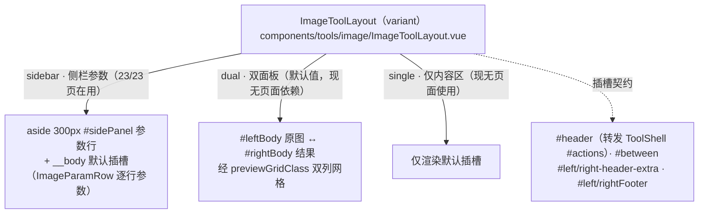
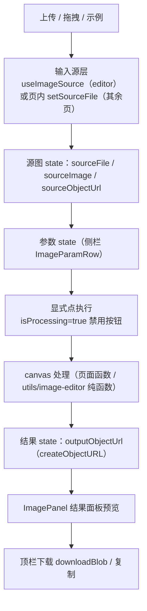

# 12 · 图片工具设计

> **一句话摘要**：image 25 页的设计——全站唯一的专用布局体系（ImageToolLayout 三变体，实测 23 页全部跑在 sidebar 分支）、ImagePanel 面板家族、显式执行 + isProcessing 契约与满高 fill 范式。
> **目标读者**：页面开发者 ｜ **关联文档**：[04 布局体系](04-布局体系与页面骨架.md) · [08 跨页面复用范式](08-跨页面复用范式.md) · [05 设计令牌](05-设计令牌与主题系统.md) · [16 已知坑](16-已知坑与规避清单.md) · [03 工具注册](03-工具登记体系与扩展SOP.md) · [14 测试策略](14-测试策略与质量守卫.md)

## 1. 概述

图片域是全站唯一拥有**专用布局组件**的分类：23 个 canvas 页统一经 `ImageToolLayout` 包装，另有 image-qrcode、image-avatar 两个生成器页为 workbench 独立页（catalog 注释明示不经 ImageToolLayout）。图片处理的「大画布 + 参数侧栏 + 原图/结果对照」形态与文本双栏本质不同，这是独立布局体系的理由（04 §4.4）。交接文档 `docs/HANDOFF.md`（仍现行）记录了图片分类统一 sidebar 三栏的历史改造——注意其写作时点是 26 页，其中 image-ascii、image-ocr、image-background-remover 三页现已下线，当前为 25 页（catalog `allTools` 共 142 项，image 项 25）。

规模实测（`wc -l src/views/tools/image/*.vue`）：23 个画布页合计 **23777 行**，单页中位数约 800 行；最大的 ImageEditorPage.vue 2795 行、ImageWatermarkPage.vue 1954 行、ImageCropPage.vue 1478 行。页面之重是本域一切约定（专用布局、显式执行、算法下沉）的根源。

## 2. 架构与数据流

### 2.1 三变体布局



图释：变体只改**骨架排布**，插槽契约不变——动作条一律在 `#header`（上传/示例/**执行按钮**/下载/清空）。`title/description/icon` props 已标 `@deprecated`（工具页元数据统一由 ToolHeader 呈现，重复传入是历史残留，勿再使用）。值得注意的实测事实：**23 个页面全部显式传 `variant="sidebar"`**（`grep 'variant="' src/views/tools/image/*.vue` 命中 23 处、全为 sidebar），`dual` 只是组件默认值、`single` 无任何调用方——三变体目前实际运行的是单变体。

`src/components/tools/image/ImageToolLayout.vue`（变体分支与插槽转发段，逐字摘录）：

```vue
<ToolShell :tool="tool">
  <!-- 页面动作（原 #header 插槽的 ToolActionBar）移入壳层头部动作区；
       FavoriteButton/同类工具下拉由 ToolHeader 内置 -->
  <template v-if="slots.header" #actions>
    <slot name="header" />
  </template>

  <div class="image-tool-layout" :class="`image-tool-layout--${variant}`">
    <div v-if="slots.between" class="image-tool-layout__between">
      <slot name="between" />
    </div>

    <!-- sidebar：左参数栏 + 右内容 -->
    <template v-if="variant === 'sidebar'">
      <div class="image-tool-layout__split">
        <aside v-if="slots.sidePanel" class="image-tool-layout__side">
          <div v-if="sidePanelTitle" class="image-tool-layout__side-head">
            <span class="image-tool-layout__side-title">{{ sidePanelTitle }}</span>
          </div>
          <slot name="sidePanel" />
        </aside>
        <div class="image-tool-layout__body">
          <slot />
        </div>
      </div>
    </template>
```

同文件 dual 分支（逐字摘录）——`shouldRenderPreview` 要求 `leftBody` 与 `rightBody` 同时传入，否则整个退化为默认插槽：

```vue
    <!-- dual：双面板预览 -->
    <template v-else-if="variant === 'dual'">
      <div v-if="shouldRenderPreview" :class="previewGridClass">
        <ImagePanel :title="leftTitle" :min-body-height="minBodyHeight">
          <template #header-extra>
            <slot name="left-header-extra" />
          </template>
          <slot name="leftBody" />
          <template v-if="$slots.leftFooter" #footer>
            <slot name="leftFooter" />
          </template>
        </ImagePanel>

        <ImagePanel :title="rightTitle" :min-body-height="minBodyHeight">
          <template #header-extra>
            <slot name="right-header-extra" />
          </template>
          <slot name="rightBody" />
          <template v-if="$slots.rightFooter" #footer>
            <slot name="rightFooter" />
          </template>
        </ImagePanel>
      </div>

      <slot v-else />
    </template>
```

**ImageToolLayout 插槽契约全表**（插槽名 ↔ 渲染位置 ↔ 典型内容）：

| 插槽 | 生效变体 | 渲染位置 | 典型内容（crop 页实例） |
|---|---|---|---|
| `#header` | 全部 | 经 `v-if="slots.header"` 转发到 ToolShell `#actions`（顶栏动作区） | ToolActionBar：上传 / 示例 / 示例裁剪 / **执行** / 下载 / 清空 |
| `#between` | 全部 | 页头与骨架之间的 `__between` 条（`flex-shrink: 0`） | `el-alert` 错误提示（`v-if="errorMessage"`） |
| `#sidePanel` | sidebar | 左侧 300px `aside.image-tool-layout__side`，自带 `overflow-y: auto` | 参数 section + ImageParamRow（`sidePanelTitle="裁剪参数"`） |
| 默认插槽 | sidebar / single / dual 兜底 | sidebar 右侧 `__body`；single 全区；dual 在 `shouldRenderPreview === false` 时全区 | sidebar 模式放双 ImagePanel 预览网格 |
| `#leftBody` / `#rightBody` | dual | 左右两块 ImagePanel 的 body | 原图画布选区 / 结果 ``（当前无页面使用） |
| `#left-header-extra` / `#right-header-extra` | dual | 左右面板头右侧 `header-extra` | 文件名 / 元信息（当前无页面使用） |
| `#leftFooter` / `#rightFooter` | dual | 左右面板底部 mono 统计条 | 尺寸 · 体积（当前无页面使用） |

props 一览（`withDefaults` 默认值逐字核对自源码）：`variant: 'dual'`、`showPreview: true`、`previewGridClass: 'grid flex-1 min-h-0 grid-cols-1 gap-4 lg:grid-cols-2'`、`leftTitle: '原图'`、`rightTitle: '结果'`、`minBodyHeight: 280`、`sidePanelTitle`（sidebar 左栏标题）、`title/description/icon` 已 `@deprecated`。

### 2.2 页面清单（25 页总表）

「变体」列实测自页面源码（23 页全部 `variant="sidebar"`）；「专属测试」列实测自 `find src -name "*.test.ts"`（41 个测试文件中与本域直接相关的如下表，其余 21 页依赖 `src/views/tools/allToolPages.dom.test.ts` 全量挂载冒烟兜底）。

| id | 名称 | layout | 变体 | 物理目录 / 文件 | 专属测试 | 一句话 |
|---|---|---|---|---|---|---|
| image-crop | 图片裁剪 | canvas | sidebar | views/tools/image/ImageCropPage.vue（1478 行） | 无（冒烟兜底） | 按像素/预设比例框选裁剪，拖拽选区 140ms 自动重裁 |
| image-resize | 图片尺寸缩放 | canvas | sidebar | views/tools/image/ImageResizePage.vue（1317） | 无 | 按像素或百分比缩放，保持或忽略比例 |
| image-compress | 图片压缩 | canvas | sidebar | views/tools/image/ImageCompressPage.vue（1233） | 无 | 降质减容，JPEG/PNG/WebP |
| image-favicon | Favicon 图标生成 | canvas | sidebar | views/tools/image/FaviconGeneratorPage.vue（1150） | 无 | 多尺寸 favicon ico/ png 输出 |
| image-placeholder | 占位图生成 | canvas | sidebar | views/tools/image/PlaceholderImageGeneratorPage.vue（778） | 无 | PNG / SVG 占位图实时生成 |
| image-convert | 图片格式转换 | canvas | sidebar | views/tools/image/ImageConvertPage.vue（1140） | 无 | PNG/JPEG/WebP 互转，单图与批量 |
| image-watermark | 图片水印 | canvas | sidebar | views/tools/image/ImageWatermarkPage.vue（1954） | 无 | 文字/图片水印、单点/平铺、批量导出 |
| image-merge | 图片拼接 | canvas | sidebar | views/tools/image/ImageMergePage.vue（1344） | 无 | 横/纵/宫格拼接，拖拽排序（页内 `dragSourceIndex` splice 实现） |
| image-base64 | 图片 Base64 互转 | canvas | sidebar | views/tools/image/ImageBase64Page.vue（637） | 无 | 图片 ↔ DataURL，批量 |
| image-gif | GIF 拆帧与合成 | canvas | sidebar | views/tools/image/ImageGifPage.vue（1417） | 无 | gifuct-js 拆帧 + gifenc 合成 |
| image-redact | 图片打码 | canvas | sidebar | views/tools/image/ImageRedactPage.vue（1129） | 无 | 马赛克/模糊/色块涂抹 |
| image-transform | 图片旋转翻转 | canvas | sidebar | views/tools/image/ImageTransformPage.vue（560） | 无 | 90°/180°/270° 与水平垂直翻转 |
| image-to-pdf | 图片转 PDF | canvas | sidebar | views/tools/image/ImageToPdfPage.vue（1011） | 无 | 多图合成 PDF（pdf-lib），页面排序 |
| image-palette | 图片颜色提取 | canvas | sidebar | views/tools/image/ImagePalettePage.vue（717） | 无 | 提取主色生成调色板 |
| image-slice | 长图切片 | canvas | sidebar | views/tools/image/ImageSlicePage.vue（709） | 无 | 按高度等分切片，`fill` + `__scroll` 内滚样板页 |
| image-grid-slice | 九宫格切图 | canvas | sidebar | views/tools/image/ImageGridSlicePage.vue（689） | 无 | 3×3 或自定义网格切分 |
| image-color-adjust | 图片色彩调整 | canvas | sidebar | views/tools/image/ImageColorAdjustPage.vue（729） | 无 | 亮度/对比度/饱和度/色相 |
| image-border | 图片边框与投影 | canvas | sidebar | views/tools/image/ImageBorderPage.vue（803） | 无 | 边框/圆角/阴影 |
| image-dedupe | 图片去重 | canvas | sidebar | views/tools/image/ImageDedupePage.vue（913） | 无 | 感知哈希检测重复相似图 |
| image-sprite | 雪碧图生成 | canvas | sidebar | views/tools/image/ImageSpritePage.vue（767） | 无 | 多图合并 Sprite + CSS |
| image-editor | 图片编辑器 | canvas | sidebar | views/tools/image/ImageEditorPage.vue（2795） | ImageEditorPage.dom.test.ts | 画笔/文字/形状/图层/撤销栈（useEditorHistory） |
| image-grayscale | 图片灰阶转换 | canvas | sidebar | views/tools/image/ImageGrayscalePage.vue（358） | 无 | 多种灰度算法 |
| image-svg-editor | SVG 编辑与压缩 | canvas | sidebar | views/tools/image/ImageSvgEditorPage.vue（149） | ImageSvgEditorPage.dom.test.ts | SVG 源码精简优化与预览导出 |
| image-qrcode | 二维码生成工具 | workbench | 独立页 | views/tools/generate/QrCodeGeneratorPage.vue（595） | 无 | 颜色/纠错级别二维码（qrcode 库） |
| image-avatar | 随机头像生成器 | workbench | 独立页 | views/tools/generate/AvatarGeneratorPage.vue | 无 | 渐变/几何/像素/首字母风格批量头像 |

注：`src/components/tools/image/ImageToolLayout.vue` 内有一行注释自称「28 个 image 页全部经它包装」——该数字已过期（实测 23），改注释时顺手修正即可，机制本身无影响。qrcode/avatar 两页的归属映射在 `src/config/tools/toolComponents.ts`（`'image-avatar': () => import('@/views/tools/generate/AvatarGeneratorPage.vue')` 等）。

### 2.3 处理管线



图释：全链路在浏览器内存完成（canvas / ArrayBuffer / object URL），无出站请求（01 §5.1 隐私边界）。两张图里的「显式执行」是 25 页统一契约：参数变更只写侧栏 state，必须点执行按钮才跑处理函数；处理期间 `isProcessing` 禁用执行/清空按钮防连点。object URL 是本域最常见的泄漏源——换图与卸载时的 revoke 收编在 useImageSource（editor 页）或页面 `onBeforeUnmount`（如 crop 页 `revokeOutputUrl()`）。

## 3. 核心实现

### 3.1 ImagePanel 面板家族契约

实测使用面（`grep -rln`，src/views 全量）：`ImagePanel` 21 文件引用（14 文件直接 import，其余经 ImageToolLayout dual 分支转发）；`ImageParamRow` / `ImageDropzone` / `ImageCanvasPreview` 各 12 文件。

| 组件 | props | slots | 样式特征 |
|---|---|---|---|
| ImagePanel | `title` `icon` `minBodyHeight=280` `fill=false` | 默认 body / `#header-extra` / `#footer` | 主色圆点 + caps 小标题；`__body` flex 居中 + `min-height:0`；`__footer` mono 统计条；`fill` 时 `flex:1` 拉伸 |
| ImageDropzone | `icon='ms:image'` `title='上传图片'` `hint` `accept='image/*'` `multiple=false` `compact=false` | 默认 / `#extra` | `<button>` 语义承载点击；虚线边框仅 hover/dragover 出现主色 |
| ImageParamRow | `label` `hint` `unit` `labelWidth=100` `disabled=false` | 默认（控件） | 以 `el-form-item` 承载 label 生成原生 `for` 关联；控件 + 单位同行，hint 次行 |
| ImageCanvasPreview | `src` `alt='preview'` `checkerboard=true` `maxHeight=0` `background='stage'\|'surface'` | 默认 | 透明棋盘格舞台（4 组 45° 渐变 20px 格）+ 内阴影光晕；`img` `object-fit: contain` |

ImagePanel 的 `fill` 契约（`src/components/tools/image/ImagePanel.vue` 逐字摘录）：

```ts
  /** 在 flex 列父容器（ImageToolLayout__body 等）中拉伸占满剩余高度，
   *  消除内容高度不足时的工作区底部死区（2026-09-26 布局审计收编）。
   *  注意：拉伸后根节点 overflow:hidden 不再放行页面级滚动——内容可能超出
   *  视口的页面必须自带内滚容器（slice/__scroll、grid-slice/__preview-area、
   *  watermark/__preview 等），带 #footer 的面板还需确认 body 可压缩 */
  fill?: boolean
```

```css
/* fill：flex 列父容器内拉伸满高（.image-panel 已有 min-height:0，flex:1 即可） */
.image-panel--fill {
  flex: 1;
}
```

配套的内滚样板（`src/views/tools/image/ImageSlicePage.vue:519` `<ImagePanel title="预览" fill>`，其内部容器样式）：

```css
.image-slice-page__scroll {
  height: 100%;
  overflow-y: auto;
}
```

ImageParamRow 的可访问性契约（组件头注释逐字摘录，源自 2026-09-23 无障碍改造，见 16 册 #25）：

```
 * 可访问性（2026-09-23）：label 改由 `el-form-item` 承载。EP 会把 label 的 id
 * 经 formItem context 下发给内部的 EP 表单控件（`useFormItemInputId`），
 * 渲染成 `<label for="…">` + 控件 `id="…"` 的原生关联 —— 此前手写 `<label>` 无 `for`，
 * 语义完全未生效，导致 24 个使用本组件的页面里控件普遍无可访问名。
 *
 * 两点约束：
 *  1. 该关联只对**消费 formItem context 的 EP 组件**有效（el-input / el-select /
 *     el-slider 等）。slot 内若是原生 `<input>`，仍需调用方补 `aria-label`。
```

要点：`el-slider` / `el-color-picker` **不注册 inputId**，`for` 会悬空——这类控件由脚本按 `label` prop 文本补了 `aria-label`（`docs/UI_AUDIT.md` P1-5 第四轮实测表：watermark 页 5 个 slider/color-picker 全部走该路径）。给 ImageParamRow 换内部控件时先查这条边界。

### 3.2 域 composables

- `src/composables/useImageTool.ts`：**导出名为 `useImageProcessingState`**（文件名与导出名不一致，import 一律 `from '@/composables/useImageTool'`）。返回 `errorMessage` / `isProcessing` / `setError` / `clearError` 四件套，刻意与页面既有命名对齐以零改动接入。实测 23 个页面消费（22 个 image 页 + `views/tools/color/ImageToGradientPage.vue`——它也做 canvas 处理，复用同款状态机）。
- `src/composables/useImageSource.ts`：源图关注点（校验 → 解码 → object URL 生命周期 → 拖拽）。**仅 ImageEditorPage 消费**。关键设计是 revoke 收口（逐字摘录）：

```ts
  function revoke(): void {
    if (sourceObjectUrl.value) {
      URL.revokeObjectURL(sourceObjectUrl.value)
      sourceObjectUrl.value = ''
    }
  }
```

```ts
    try {
      const loaded = await loadImageFromFile(file)
      // 换图前先释放上一张，否则 object URL 会一直占住内存
      revoke()
      sourceObjectUrl.value = loaded.objectUrl
```

  卸载兜底用 `getCurrentScope()` 判定后 `onScopeDispose(revoke)`——无 scope（单测直接调用）时跳过注册，这是它带 `.test.ts` 的原因。
- `src/composables/useLayerOrder.ts`：**只服务 ImageEditorPage** 的文字/贴纸图层栈顺序（`layerOrder` 存 `{type,id}` 引用，`cleanupLayerOrder()` 在每次增删后对齐顺序表与内容表）。注意：**merge / sprite 两页不用它**——拼接/雪碧图的条目顺序就是图片数组顺序，用页内 `dragSourceIndex` + `splice` 完成拖拽排序（ImageMergePage `onDropItem`），属一次性简单场景，不引入图层栈抽象。

### 3.3 canvas 管线走读（以 ImageCropPage 为例）

执行函数段（`src/views/tools/image/ImageCropPage.vue:761`，逐字摘录）——显式执行 + isProcessing + 「前置校验失败是 error、空结果重跑无害」的标准姿态：

```ts
const runCropCurrentImage = async (options?: { silentSuccessMessage?: boolean }) => {
  clearError()

  if (!sourceImage.value || !sourceDimensions.value || !currentCropRect.value) {
    errorMessage.value = '请先上传图片或加载示例。'
    return
  }

  isProcessing.value = true

  try {
    clampCropInputs()

    const outputType = activeOutputMimeType.value
    const { blob, outputMeta } = await buildCroppedBlob(
      sourceImage.value,
      currentCropRect.value,
      outputType
    )
    resetOutput()

    outputBlob.value = blob
    outputObjectUrl.value = URL.createObjectURL(blob)
```

canvas 处理段（同文件 `:359`，逐字摘录）——建离屏 canvas → 高质量平滑 → drawImage 九参裁剪 → `canvasToBlob`：

```ts
const buildCroppedBlob = async (
  image: HTMLImageElement,
  cropRect: CropRect,
  outputType: OutputMimeType
): Promise<{ blob: Blob; outputMeta: ImageDimensions }> => {
  const canvas = document.createElement('canvas')
  canvas.width = cropRect.width
  canvas.height = cropRect.height

  const ctx = canvas.getContext('2d')

  if (!ctx) {
    throw new Error('浏览器不支持 Canvas')
  }

  ctx.imageSmoothingEnabled = true
  ctx.imageSmoothingQuality = 'high'
  ctx.drawImage(
    image,
    cropRect.x,
    cropRect.y,
    cropRect.width,
    cropRect.height,
    0,
    0,
    cropRect.width,
    cropRect.height
  )

  const quality = outputType === 'image/png' ? undefined : clampQuality(qualityPercent.value / 100)
  const blob = await canvasToBlob(canvas, outputType, quality)
```

模板接线段（同文件 `:1060`，逐字摘录）——动作条经 `#header` 进 ToolShell 顶栏，执行按钮 `:disabled="isProcessing"`：

```vue
  <ImageToolLayout
    variant="sidebar"
    sidePanelTitle="裁剪参数"
    icon="ms:crop"
    title="图片裁剪工具"
    description="按像素设置裁剪区域，拖动选区实时预览并导出结果图片。"
  >
    <template #header>
      <ToolActionBar borderless>
        <el-upload :auto-upload="false" :show-file-list="false" accept="image/*" :multiple="false"
          @change="onUploadChange">
```

（`title/description/icon` 三行即 §3.1 所述 deprecated 残留的活样本：传了但不渲染。）crop 页另有两个交互细节被 `docs/HANDOFF.md` 固化为规约：**参数输入不触发自动重裁**（只有拖拽选区/键盘调整走 `scheduleAutoCrop()` 140ms 防抖；`AUTO_CROP_DELAY = 140`），以及选区八向手柄逐一 `aria-label`。

### 3.4 M3 容器阶梯别名（仅本域消费）

`src/assets/main.css:144-150` 逐字摘录：

```css
    /* M3 容器阶梯残档（Stitch 遗产，仅 image/* 家族消费）：
     * 主题相关重索引别名到主 surface 阶梯（dark 与 light 的映射档位不同），
     * 值与原字面量逐位等价。未消费的 container/container-high/highest/outline
     * 四档已删，勿凭空恢复；新代码直接用主阶梯。 */
    --color-surface-container-lowest-rgb: var(--color-background-rgb);
    --color-surface-container-low-rgb: var(--color-surface-rgb);
    --color-outline-variant-rgb: var(--color-surface-variant-high-rgb);
```

消费点实测（`grep -rln 'surface-container-lowest-rgb|surface-container-low-rgb|outline-variant-rgb' src/`，排除 main.css 自身定义）：ImageCanvasPreview.vue（8 处）、ImagePanel.vue（7）、ImageGifPage.vue（6）、ImageDedupePage.vue（6）、ImageBorderPage.vue（3）、ImageResizePage.vue（2）、ImageCompressPage.vue（2）、ImageWatermarkPage.vue（1）、ImageEditorPage.vue（1）——**全部落在 image 域**，与注释「仅 image/* 家族消费」一致。三档别名是 Stitch 时代遗留的重索引，dark/light 各自映射到主阶梯不同档位；新代码直接用主阶梯（05 §4），别恢复已删的四档。

### 3.5 域依赖（重库只进对应页面 chunk）

| 库 | 版本（package.json） | 被哪个文件 import | 用途 |
|---|---|---|---|
| gifenc | ^1.0.3 | 仅 `views/tools/image/ImageGifPage.vue:13` | GIF 编码（`GIFEncoder, applyPalette, quantize`） |
| gifuct-js | ^2.1.2 | 仅 `views/tools/image/ImageGifPage.vue:14` | GIF 解码（`decompressFrames, parseGIF`） |
| pdf-lib | ^1.17.1 | 仅 `views/tools/image/ImageToPdfPage.vue:20` | `PDFDocument` 合成 PDF |
| qrcode | ^1.5.4 | `views/tools/generate/QrCodeGeneratorPage.vue:4`、`views/tools/generate/WifiQrPage.vue:4` | `QRCode.toDataURL / toString`（后者属 network-wifi-qr，见 13 册） |

四个库均为页面级静态 import，随页面路由 chunk 懒加载，不入首屏 vendor。GIF 循环次数语义（gifenc 源码口径，HANDOFF 固化）：`-1` 播放一次、`0` 无限循环、`≥1` 循环 N 次，页面 hint 已写明，勿改反。

## 4. 设计决策与取舍

1. **独立布局体系而非套三模板**。Why：图片页的「画布占主体 + 参数侧栏 + 双面板对照」在 WorkbenchLayout 的 1.2fr/1fr 网格里做不出大画布；与其让 25 页各写定位，不如一套变体布局统一收编（04 §4.4）。代价：ImageToolLayout 是全站最复杂的布局组件（插槽最多），改动影响面 23 页。实测注脚：sidebar 已是唯一在用变体，若未来确认 dual/single 无回归需求，可在收编 23 页调用侧后裁剪分支、降低该组件复杂度（当前保留，因 previewGridClass + 双 ImagePanel 组合仍是「对照型」新页的现成路径）。
2. **qrcode/avatar 不进 ImageToolLayout**。Why：两者无画布对照需求，是「参数卡 + 结果」的生成器形态（catalog 注释「独立页，不经 ImageToolLayout」），硬套图片布局反而扭曲——**布局跟随信息形态，不跟随分类**。
3. **全显式执行**。Why：图片处理是贵计算（像素级操作）+ 批量副作用，自动执行会在拖参数时反复全量处理（08 §4.1 分界的「贵计算」端）。crop 页的 140ms 自动重裁是局部例外，且只挂在「拖拽/键盘改选区」这一低频路径上，参数输入框不挂。
4. **fill 满高范式**。Why：图片页价值在画布面积，满高最大化工作区；配套铁律（height:100% 勿 width:100%、fill 自带内滚）来自实际压瘪事故（04 §2.3、16 册 #6）。实现上故意做得极小——`flex:1` 一行 + 注释里写死「必须自带内滚」，把复杂度留给各页的内容容器。
5. **M3 容器阶梯别名仅本域消费**（§3.4 证据）：图片页的嵌套面板层级最多（布局 > 面板 > 画布容器 > 参数卡），历史上用掉了四档以上 surface 阶梯；别名组独立于主阶梯存在，注释明令「勿凭空恢复、新代码用主阶梯」。
6. **算法下沉边界**：跨页复用的像素算法进 `src/utils/image-editor/`（color / geometry / render / shared，四个模块各带 `.test.ts`）或 `src/utils/image-tools.ts`（`canvasToBlob / downloadBlob / formatBytes / validateImageFile / loadImageFromFile`）；页面只做 canvas 装配。一次性逻辑（如 merge 的拼接排布）留在页内，不预设抽象。

## 5. 边界情况与已知限制

- **大图内存**：canvas 处理受浏览器画布尺寸上限约束（常见 16384px 边界）；超大图先降采样是页面责任，现状各页未统一防护——批量处理大图有内存峰值风险（RUNTIME_AUDIT §5.2 亦声明「文件上传/canvas 绘制结果未验证」的覆盖盲区）。
- **GIF 合成帧数**：gifenc 编码长 GIF 耗时与内存线性增长，无进度中断；超长 GIF 建议分段。合成宽高 `0 = 按首帧尺寸`（`composeWidth.value || composeFrames.value[0].width`），HANDOFF 固化。
- **redact 的不可逆性**：打码是对像素的破坏性操作，「撤销」仅指本次会话内的历史步骤（editor 页 useEditorHistory），原图一旦被覆盖处理结果不可恢复——页面文案已提示，改动交互时保留提示。
- **EXIF 不剥离**：压缩/格式转换不保证剥离 EXIF（含 GPS）元数据；涉及隐私的场景用户应知晓，属已知改进空间。
- **deprecated props**：ImageToolLayout 的 title/description/icon 已废弃，传了也不渲染（§3.3 摘录即实例）；清理迁移时一并删除调用侧（23 页均有残留）。组件内「28 页」注释同批过期。
- **jsdom 测试盲区**：jsdom 的 `getContext('2d')` 恒为 null，凡 setup 阶段就写 2d context 的页面在 DOM 测试里挂不起来——`allToolPages.dom.test.ts` 的 SKIP 表以 `dev-screen-recorder` 为此理由跳过；image 页目前靠「不碰 setup 期 2d 上下文 + 结果断言绕开真实位图」维持在 jsdom 可测，新页若在 setup 画布会同时破坏全量冒烟（16 册 #26）。
- **专测覆盖极薄**：25 页中仅 editor / svg-editor 两页有专属 DOM 测试，其余依赖全量冒烟（只断言「能渲染出内容」）+ utils 单测；业务正确性（裁剪坐标、拼接种类等）无自动断言，改算法层时必须手测「上传 → 执行 → 下载」全链路。

## 6. 变更指引

1. **新增图片工具**：先判「画布处理 or 参数生成」——画布处理进 ImageToolLayout（当前事实标准是 `variant="sidebar"` + `sidePanelTitle`，对照型需求再用 dual 的 `#leftBody/#rightBody`），生成器形态学 image-qrcode/avatar 独立 workbench 页并在 `toolComponents.ts` 登记映射；接入 useImageProcessingState（错误 + 处理中），显式执行 + isProcessing；结果用 ImagePanel `fill` 并自带内滚。
2. **改 ImageToolLayout 插槽/骨架**：影响 23 页——先 `grep -rln ImageToolLayout src/views` 列清单，逐变体实测（当前只有 sidebar 有真实调用方）；deprecated props 顺手清理调用侧与过期注释。
3. **改 fill/满高规则**：遵守 04 §2.3 三铁律，改动后用最大尺寸图片实测滚动与并列面板不压瘪；新「fill + 内滚」样板看 ImageSlicePage（`__scroll`）。
4. **算法下沉**：像素处理逻辑进 `src/utils/image-editor/` 或 `src/utils/image-tools.ts` 配单测，页面只做 canvas 装配；object URL 的创建/revoke 成对书写，换图先 revoke。
5. **验证手段**：`pnpm test`（全量冒烟 + editor/svg-editor 专测 + image-editor/useImageSource/useLayerOrder/ImagePanel 单测）＋ 手测「上传 → 执行 → 下载」全链路与超大图降级表现；改 ImageParamRow 相关无障碍行为时对照 16 册 #25 的 formItem context 边界。
