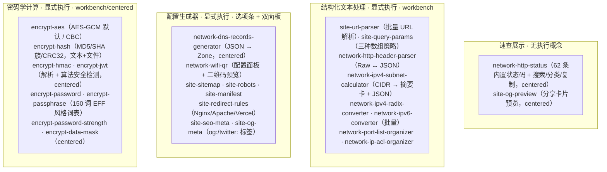
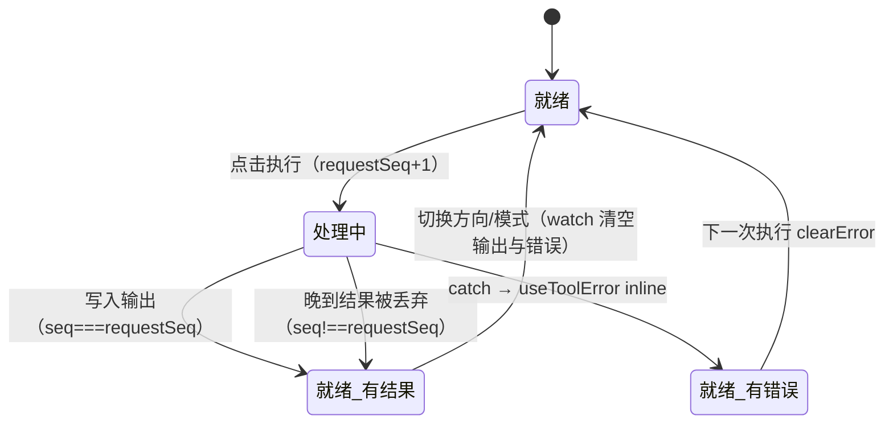
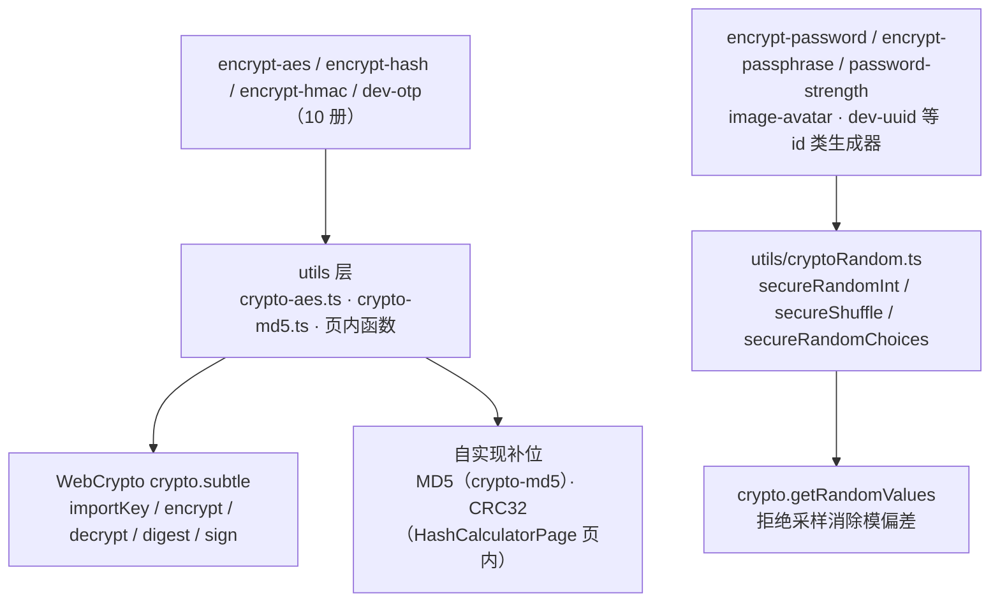

# 13 · 网络·网站·加密工具设计

> **一句话摘要**：network 9 + site 10 + encrypt 8 共 27 页的设计——速查/文本处理/配置生成/密码学计算四范式，密码学双底座（WebCrypto + 自实现补位）与 WebCrypto 的安全上下文约束。
> **目标读者**：页面开发者 ｜ **关联文档**：[08 跨页面复用范式](08-跨页面复用范式.md) · [01 系统总览](01-系统总览与技术选型.md)（隐私边界）· [04 布局体系](04-布局体系与页面骨架.md) · [16 已知坑](16-已知坑与规避清单.md) · [03 工具注册](03-工具登记体系与扩展SOP.md)

## 1. 概述

三分类合为一册因为它们共享同一组范式且规模适中。一个反直觉事实先立住：**network 域 9 页全部是本地计算**（IP/端口/Header 的解析换算），没有任何一页发出真实网络请求。出站流量精确核查（2026-09-27 实测）：

- `grep -rn "axios" src/` 的全部命中都是**代码生成字符串**——`utils/dev/openapiTools.ts`（生成 axios 片段文本）、`views/tools/generate/ApiRequestGeneratorPage.vue`（生成 axios 代码文本），**src 下没有任何一处运行时 `import axios`**（依赖虽在 package.json，仅服务生成文案的语义正确性）。
- 真实发请求的运行时 `fetch(` 全站只有一处：`views/tools/dev/ApiRequestDebuggerPage.vue:183`（10 册 §3）；`FaviconGeneratorPage.vue:366` 的 `fetch(dataUrl)` 拉的是本地 DataURL，不算出站。

本域的「网络」是网络知识域，不是网络访问。新增工具若引入真实出站，会打破 01 §5 隐私边界的表述口径（16 册 #23）。

## 2. 架构与数据流

### 2.1 四范式分组



图释：site 域 8 页集中在 G3——「按输入生成一段标准配置文本」是它的家族形态，sitemap/robots/manifest/redirect-rules 四页结构几乎同构（选项条 + 输入|输出双面板，catalog 改判注释互为参照「同 site-sitemap」）。encrypt 域横跨 G4：算法计算型（aes/hash/hmac）走 workbench 双面板，评分/检测型（strength/data-mask/jwt）走 centered 纵排。



图释：encrypt-aes 的运行期状态机（§3.4 摘录代码的图形化）。两个关键转移——「晚到结果被丢弃」保证连点时输出永远是最新一次计算的；「切换方向/模式即清空」防止密文挂在「解密结果」标题下误导。同构族其他 async 页面（hash/hmac）逻辑同型。

### 2.2 页面清单（27 页总表）

「测试」列实测自 `find src -name "*.test.ts"`（41 个测试文件中与本三域相关者）；其余页由 `src/views/tools/allToolPages.dom.test.ts` 全量挂载冒烟兜底。「物理文件」列实测自 `toolComponents.ts` 映射——**encrypt 8 页里 4 页、site 10 页里 1 页、network 9 页里 1 页物理上住在 `views/tools/generate/`**（双口径见 16 册 #21）。

| 分类 | id · layout | 物理文件（views/tools/…） | 测试 | 一句话（catalog） |
|---|---|---|---|---|
| network | network-http-status · c | network/HttpStatusCodePage.vue（696 行，62 条内置码） | 冒烟 | 状态码含义/分类/场景速查（静态） |
| network | network-ipv4-subnet-calculator · w | network/Ipv4SubnetCalculatorPage.vue（157） | network-tools.test.ts | CIDR → 掩码/网络/广播/主机范围 |
| network | network-http-header-parser · w | network/HttpHeaderParserPage.vue（158） | network-tools.test.ts | Raw Header 与 JSON 互转 |
| network | network-ipv4-radix-converter · w | network/Ipv4RadixConverterPage.vue（235） | network-tools.test.ts | IPv4 ↔ 十/十六/二进制 |
| network | network-ipv6-converter · w | network/Ipv6ConverterPage.vue（195） | network-tools.test.ts | 展开/压缩，按行批量 |
| network | network-port-list-organizer · w | network/PortListOrganizerPage.vue（177） | network-tools.test.ts | 端口/范围/协议解析去重 |
| network | network-dns-records-generator · c | network/DnsRecordsGeneratorPage.vue（279） | network-tools.test.ts | DNS JSON 模板 → Zone 文件 |
| network | network-ip-acl-organizer · w | network/IpAclOrganizerPage.vue（212） | network-tools.test.ts | IP 清单 → Nginx ACL/JSON |
| network | network-wifi-qr · w | generate/WifiQrPage.vue（597） | 冒烟 | WiFi 二维码，WPA/WEP/无加密（qrcode 库） |
| site | site-url-parser · w | site/UrlParserPage.vue（151） | 冒烟 | URL 各段解析，批量 |
| site | site-query-params · w | site/QueryParamsPage.vue（197） | 冒烟 | Query ↔ JSON，repeat/bracket/comma |
| site | site-sitemap · w | site/SitemapPage.vue（235） | 冒烟 | sitemaps.org 标准 XML |
| site | site-robots · w | site/RobotsPage.vue（187） | 冒烟 | User-agent/Crawl-delay/Sitemap |
| site | site-seo-meta · w | site/SeoMetaPage.vue（201） | 冒烟 | JSON 配置生成 head 片段 |
| site | site-manifest · w | site/ManifestPage.vue（169） | 冒烟 | manifest.webmanifest 生成 |
| site | site-redirect-rules · w | site/RedirectRulesPage.vue（214） | 冒烟 | Nginx/Apache/Vercel 重定向配置 |
| site | site-title-description · w | site/TitleDescriptionCheckerPage.vue（446） | 冒烟 | Title/Description 长度检错 |
| site | site-og-preview · c | site/OpenGraphPreviewPage.vue（368） | 冒烟 | 分享预览（静态表单） |
| site | site-og-meta · w | generate/OgMetaPage.vue | 冒烟 | og:/twitter: 标签生成 |
| encrypt | encrypt-aes · w | encrypt/AesEncryptPage.vue（176） | AesEncryptPage.dom.test.ts + crypto-aes.test.ts | AES-GCM（默认）/ AES-CBC 文本加解密 |
| encrypt | encrypt-hash · w | encrypt/HashCalculatorPage.vue（468） | crypto-md5.test.ts | MD5、SHA-1/256/384/512、CRC32，文本+文件 |
| encrypt | encrypt-hmac · w | encrypt/HmacCalculatorPage.vue（264） | 冒烟 | HMAC，Hex/文本输出 |
| encrypt | encrypt-jwt · c | encrypt/JwtToolPage.vue（550） | JwtToolPage.dom.test.ts | JWT 解析/算法安全检测/时间字段可视化 |
| encrypt | encrypt-password · w | generate/PasswordGeneratorPage.vue（783） | 冒烟 | 规则化强密码（设置 + 结果列表双栏） |
| encrypt | encrypt-passphrase · w | generate/PassphrasePage.vue（575） | 冒烟 | EFF 风格词表口令短语 |
| encrypt | encrypt-password-strength · c | generate/PasswordStrengthPage.vue | 冒烟 | 评分与改进建议 |
| encrypt | encrypt-data-mask · c | generate/MaskGeneratorPage.vue | MaskGeneratorPage.dom.test.ts | 脱敏规则与示例生成 |

layout 简写：w = workbench，c = centered。物理文件行数为 `wc -l` 实测。

## 3. 核心实现

### 3.1 密码学调用分层



图释：所有密码学原语收在两条路径——能用 WebCrypto 的一律 `crypto.subtle`（AES/HMAC/SHA 族），WebCrypto 不提供且需求合法的（MD5 校验和、CRC32）用**自实现**补位；一切随机性经 `utils/cryptoRandom.ts` 走 `crypto.getRandomValues`，页面禁止 `Math.random()`。该分层是 16 册 #27 规约「禁止自实现密码学原语」的边界：允许补位的是「WebCrypto 没有」的算法，不允许的是「WebCrypto 有但自己再写一遍」。

### 3.2 WebCrypto 底座（真实代码摘录）

AES-GCM/CBC 信封与加解密（`src/utils/crypto-aes.ts:51`，逐字摘录；输出统一为 `Base64(IV || 密文)`，GCM 附 16 字节认证标签）：

```ts
export async function encryptAesText(
  plainText: string,
  keyString: string,
  mode: AesMode = 'GCM'
): Promise<string> {
  const encoder = new TextEncoder()
  const iv = crypto.getRandomValues(new Uint8Array(mode === 'GCM' ? GCM_IV_BYTES : CBC_IV_BYTES))
  const key = await importAesKey(encoder.encode(keyString), mode)

  const params: AesGcmParams | AesCbcParams =
    mode === 'GCM' ? { name: 'AES-GCM', iv, tagLength: 128 } : { name: 'AES-CBC', iv }
  const encrypted = await crypto.subtle.encrypt(params, key, encoder.encode(plainText))
```

解密侧把 WebCrypto 的不可读错误翻译成「三要素不匹配」（同文件 `:90`，逐字摘录）——GCM 的认证失败（篡改/错钥）也落在这里，这是「GCM 默认」安全叙事的用户可感知面：

```ts
  let decrypted: ArrayBuffer
  try {
    decrypted = await crypto.subtle.decrypt(params, key, body)
  } catch {
    // WebCrypto 原始错误（OperationError: The operation failed…）对用户不可读，
    // 统一翻译为「三要素不匹配」提示；GCM 的认证失败（篡改/错钥）也落在这里。
    throw new Error(`密文、密钥或模式不匹配（${mode} 密文请用 ${mode} 模式解密）`)
  }
  return new TextDecoder().decode(decrypted)
```

HMAC 的 importKey/sign 形态（`src/views/tools/encrypt/HmacCalculatorPage.vue:91`，逐字摘录）——SHA 族摘要同理走 `crypto.subtle.digest`（HashCalculatorPage `:138`）：

```ts
    const cryptoKey = await crypto.subtle.importKey(
      'raw',
      keyData,
      { name: 'HMAC', hash: algorithm.value },
      false,
      ['sign']
    )
    const sig = await crypto.subtle.sign('HMAC', cryptoKey, msgData)
```

随机数底座（`src/utils/cryptoRandom.ts:17`，逐字摘录）——拒绝采样消除模偏差，`secureShuffle` / `secureRandomChoices` 建立其上，被 password/passphrase/strength、avatar、uuid 等 id 生成器共用：

```ts
export function secureRandomInt(max: number): number {
  if (!Number.isInteger(max) || max <= 0) {
    throw new Error(`secureRandomInt: max must be a positive integer, got ${max}`)
  }

  // max 超过 Uint32 上界时拒绝采样会产生负 limit，导致 do-while 死循环，提前拦截
  const maxUint32 = 0xffffffff
  if (max > maxUint32) {
    throw new Error(`secureRandomInt: max must not exceed 2^32 - 1, got ${max}`)
  }

  // max === 1 时只有一个取值 0，直接返回避免无谓的随机数消耗
  if (max === 1) return 0
  // limit 为最大可接受值：limit + 1 是 max 的整数倍，能被 max 整除
  const limit = maxUint32 - ((maxUint32 + 1) % max)

  const arr = new Uint32Array(1)
  let value: number
  do {
    crypto.getRandomValues(arr)
    value = arr[0]
  } while (value > limit)
```

### 3.3 自实现补位：MD5 与 CRC32（复核修正）

**注意：本册旧版称「`@noble/hashes` 补 WebCrypto 不提供的 MD5 与 CRC32」，与代码不符，已修正。** 实测 `grep -rn "@noble" src/`：`@noble/hashes` 在 `src` 下**零 import**（package.json ^2.2.0 的依赖实际未被消费，仅两处注释提及它）；MD5 用自有实现，CRC32 在页面内实现。

MD5 为什么自实现（`src/utils/crypto-md5.ts:1` 头注释，逐字摘录）：

```
 * ## 为什么自己实现
 *
 * MD5 不安全，不应再用于密码学场景 —— `@noble/hashes` v2 就因此**移除了 MD5**，
 * 项目里也没有现成实现。但校验文件完整性、对接遗留接口时仍常用，故保留一份。
 *
 * ## 为什么入参是字节而不是字符串
 *
 * 哈希计算器支持**文件输入**，而文件是二进制；若只接受字符串就得在调用处
 * 先做一次编码转换，且无法处理非 UTF-8 内容。因此核心函数以 `Uint8Array` 为入参。
```

调用侧的分派（`src/views/tools/encrypt/HashCalculatorPage.vue:129`，逐字摘录）——MD5/CRC32 走自实现，其余 SHA 族一条 `crypto.subtle.digest` 搞定；文件与文本两条输入路径共用同一份字节逻辑：

```ts
  try {
    let resultBytes: Uint8Array
    if (algorithm.value === 'MD5') {
      // MD5 不安全，@noble/hashes v2 已移除，故用 utils/crypto-md5 的自有实现。
      // 它接受字节，文件与文本两条输入路径共用同一份逻辑。
      resultBytes = md5Bytes(data)
    } else if (algorithm.value === 'CRC32') {
      resultBytes = computeCRC32(data)
    } else {
      const digest = await crypto.subtle.digest(algorithm.value, data)
      resultBytes = new Uint8Array(digest)
    }
```

CRC32 是页内函数（`HashCalculatorPage.vue:93` `computeCRC32`，多项式 `0xedb88320`），未下沉 utils——它是单页专用，无第二个消费方，下沉反而添一层间接。

### 3.4 encrypt-aes 页的连点防护

AesEncryptPage 用请求序号防「旧请求晚到覆盖新结果」（`src/views/tools/encrypt/AesEncryptPage.vue:25`，逐字摘录）——WebCrypto 加解密是异步的，这是所有「显式执行 + async 计算」页面的通用防连点姿态（jsdom 专测 `AesEncryptPage.dom.test.ts` 以 `vi.waitFor` 断言之）：

```ts
// 异步请求序号：只有最新一次计算的结果允许写入输出，避免连点「执行」时旧请求晚到覆盖新结果
let requestSeq = 0

// 切换方向/模式只是更换计算语境：旧结果在新语境下不再成立（例如加密出的密文会
// 挂在「解密结果」面板标题下造成误导）。清掉旧结果与报错，等待下一次「执行」
watch([direction, mode], () => {
  outputText.value = ''
  clearError()
})
```

### 3.5 site 同构族骨架

sitemap/robots/manifest/redirect-rules 四页共享同一骨架：**ToolShell `#actions` 选项条（参数控件 + 示例/执行/下载/清空）→ `#primary` 输入 ToolCodePanel → `#secondary` 输出 ToolCodePanel**，全部算法下沉 `src/utils/site/siteTools.ts`（850 行：`parseUrlText` / `transformQueryText` / `buildSitemapXml` / `buildRobotsTxt` / `buildSeoMetaSnippet` / `buildWebManifest` / `buildRedirectRules` + `siteToolSamples` 示例）。以 SitemapPage 为样板（逐字摘录）：

```vue
      <template #actions>
        <ToolActionBar borderless>
          <div class="sitemap-page__control sitemap-page__control--grow">
            <label>Base URL</label>
            <el-input aria-label="Base URL" v-model="baseUrl" type="text" placeholder="请输入" />
          </div>
          <div class="sitemap-page__control">
            <label>changefreq</label>
            <el-select aria-label="changefreq" v-model="changefreq">
              <el-option v-for="option in changefreqOptions" :key="option" :value="option"
                :label="option" />
            </el-select>
          </div>
```

```vue
      <template #primary>
        <ToolCodePanel title="URL / 路径清单" icon="ms:input" v-model="inputText"
          language="text" editable placeholder="请输入 URL 或路径清单" />
      </template>

      <template #secondary>
        <ToolCodePanel title="Sitemap XML 输出" icon="ms:output" :code="outputText"
          language="xml" placeholder="生成的 Sitemap XML 将显示在这里" />
      </template>
```

同构关系落点：四页的 setup 段结构一致（输入/输出 ref + `useToolError({ pattern: 'inline' })` + `handleAction`/`loadExample`/`clearAll`/`downloadOutput` 四函数）；差异只在选项条控件与 utils 函数签名。catalog 里 robots/manifest/redirect-rules 三条目注释「改判 workbench：同 site-sitemap」即是这份同构的登记。改骨架时四页联动（§6.3）。

### 3.6 network 计算组 utils 映射

全部 7 个计算/转换页的算法下沉在 `src/utils/network/network-tools.ts`（1213 行，带 `network-tools.test.ts`），页面只做「文本框 ↔ transform 函数 ↔ 摘要卡」装配。按行批处理的统一返回契约（`src/utils/network/network-tools.ts:4`，逐字摘录；`utils/site/siteTools.ts:6` 是同形状定义——两个 utils 域共用同一接口形状）：

```ts
export interface LineTransformResult {
  output: string
  transformedLineCount: number
}
```

页面据此渲染行数统计；单行格式错不中断整批，按行记录后继续转换其余行。各函数与消费页映射：

| utils 导出 | 消费页面 |
|---|---|
| `transformCidrText`（CIDR → 掩码/网络/广播/主机范围，`LineTransformResult` 按行） | Ipv4SubnetCalculatorPage |
| `transformHeadersText`（Raw ↔ JSON 双向，`HeaderDirection`） | HttpHeaderParserPage |
| `transformIpv4RadixText`（十/十六/二进制互转） | Ipv4RadixConverterPage |
| `transformIpv6Text`（expand/compress/both） | Ipv6ConverterPage |
| `transformPortListText`（端口/范围/协议，json/text 输出）+ `knownPorts` / `generateRandomPorts` / `parseExcludeSet` | PortListOrganizerPage |
| `transformDnsRecordsText`（JSON ↔ Zone） | DnsRecordsGeneratorPage |
| `transformIpAclText`（nginx/json 输出） | IpAclOrganizerPage |
| `decodeSafelink` | （安全链接解码辅助，无独立页面） |

### 3.7 secure-context 边界的代码证据

`crypto.subtle` 仅在安全上下文（HTTPS 或 localhost）存在，非安全上下文为 `undefined`。实测 `grep -rn "isSecureContext\|crypto.subtle" src/`：**encrypt 域四个算法页（aes/hash/hmac/jwt）没有任何 secure-context 预检测**——非 HTTPS 部署时 `crypto.subtle` 为 undefined，点击执行会落入各自 catch（AesEncryptPage 显示「加密失败: …」），功能整体失效，页面不会崩溃但不可用。全站唯一带显式降级守卫的形态出现在 generate 域两个脱敏页（`src/views/tools/generate/JsonAnonymizerPage.vue:170`，逐字摘录）：

```ts
const sha256 = async (text: string): Promise<string> => {
  if (typeof crypto !== 'undefined' && crypto.subtle) {
    const data = new TextEncoder().encode(text)
    const hashBuffer = await crypto.subtle.digest('SHA-256', data)
    return toHex(hashBuffer)
  }
  // 降级方案（非安全场景）
  let hash = 0
  for (let i = 0; i < text.length; i += 1) {
    hash = (hash << 5) - hash + text.charCodeAt(i)
    hash |= 0
  }
  return `fallback-${Math.abs(hash).toString(16).padStart(8, '0')}`
}
```

口径结论：encrypt 域**刻意不做降级**（降级加密是安全负资产），依赖部署侧保证 HTTPS（01 §5）；MaskGeneratorPage 有同款守卫（`:248`）。把这类守卫搬进 encrypt 域属于设计变更而非修补，勿顺手照抄。

## 4. 设计决策与取舍

1. **encrypt 的产品定位是「日常可信工具」**。Why：目标用户是开发者的日常需求（给配置加解密、算哈希、生成密码），不是企业级密码学；AES-GCM 补齐后达到「本地可信」标准。被否方案：集成非对称密钥对生成/加密全套——评估后裁撤（历史工具已下线），日常场景被 JWT 解析/哈希覆盖。
2. **弱算法明示保留**。MD5/SHA-1/CRC32 在页内标注「仅校验/兼容用途，非安全场景」——删掉它们会逼用户去找不可信的第三方站，保留并警示是更安全的产品选择。JWT 页同哲学：对 `alg=none` 给 danger 级告警、`HS256` 给 warning 级告警（`JwtToolPage.vue:104-117` 的 `algSecurity` computed），而不是拒绝解析。
3. **network 全本地化**。Why：「解析器/计算器」类需求不需要真实请求，本地化零延迟零隐私争议；真实请求调试已有 dev-api-debugger 承担，两域不重叠（§1 出站核查即该决策的持续验证手段）。
4. **site 域按输出形态归 workbench**。生成器族输出是「一段要复制的配置文本」，输入输出对照需求强于交付弹窗（08 §2.2），故 10 页里 9 页 workbench（仅静态预览的 og-preview 是 centered）。
5. **密码/passphrase 双页分工**。password 面向「机器可用的随机强密码」（字符集规则 + 强度检测联动），passphrase 面向「人可记忆的口令短语」——实现是**内置 150 词的 EFF 风格精简词表**（`PassphrasePage.vue:20` 注释逐字：「精简 EFF 风格词表（150 个常见英文单词，3-7 字母）」），不是 EFF 官方 7776 词表；两者强度哲学不同，不合为一页。评估真正的 EFF 词表（体积 ≈ 74KB 文本）属于功能升级，接入时必须继续走 `utils/cryptoRandom`。
6. **JWT 页是解析器而非验证器**。现状（代码为准）：三段 Base64 解码 + Header/Payload JSON 美化 + 签名段原样展示 + 算法安全检测 + exp/iat/nbf 时间可视化 + 示例令牌生成；**没有实现签名验证**（无 `crypto.subtle.verify`、无公钥导入）。catalog 描述里「生成、解析与验证」的「验证」目前由算法安全检测与时间合法性承担——补真验证（importKey SPKI/JWK + `verify`）是合法演进方向，但要按 §3.1 分层进 utils 并补测。

## 5. 边界情况与已知限制

- **WebCrypto 安全上下文**：`crypto.subtle` 仅在 HTTPS 或 localhost 可用——**生产部署必须 HTTPS**，否则 encrypt 域核心功能整体失效（§3.7：页面无预检测，失败形态是执行报错而非白屏）。静态托管 + CDN 场景天然满足，http 直连自建服务器会踩。
- **Zone 文件方言**：DNS 记录生成器输出标准 Zone 语法，BIND 之外的 DNS 服务商方言不保证兼容。
- **og-preview 是静态表单预览**：不抓取目标网页（无出站请求），用户粘贴什么预览什么——与「预览真实链接」的期望差距需页面文案说明。
- **wifi-qr 的编码口径**：WPA/WEP/无加密的转义规则按 WiFi 二维码通行规范实现，企业级 WPA2-Enterprise 不支持。颜色输入经 `validateColors()` 前置校验（复用 `utils/color-tools` 的 `hexToRgb`，RUNTIME_AUDIT P2-1 横向铺开至本页），非法输入给中文提示而非 qrcode 库英文原文。
- **AES 密钥口径**：密钥直接取输入字符串的 UTF-8 字节（16/24/32 字节 = AES-128/192/256），无 KDF——「随便输个密码当密钥」的熵问题由页面文案提示，模块注释明示该口径（crypto-aes.ts 头注释）。
- **CBC 仅作兼容**：旧版（2026-09-24 前）页面只产 CBC 密文，CBC 模式保留是为了这批历史密文可解；新密文一律建议 GCM（页面下拉标签「CBC（兼容旧密文）」）。
- **catalog 描述与实现的两处偏差**（改动时知悉，勿照抄文案）：encrypt-jwt 描述含「验证」但当前无签名验证（§4.6）；network-wifi-qr / encrypt-password 的 catalog 注记宽度（380px/420px）是改判时点的历史值，现实现为 grid `1fr 1fr` 双栏——布局描述以代码为准。

## 6. 变更指引

1. **新增工具**：先归 §2.1 四组之一——速查页抄 http-status 形态（内置数据 + 搜索/分类/复制）；文本处理抄同构族（parser/converter，算法进 utils 按行 transform）；配置生成器先看 site 族可否扩展同构骨架（§3.5 四页联动）；密码学工具必须走 §3.1 双底座，禁止自实现 WebCrypto 已有的原语，随机性一律 `utils/cryptoRandom`。
2. **改密码学实现**：只动 utils（`src/utils/crypto-aes.ts` / `src/utils/crypto-md5.ts` / `src/utils/cryptoRandom.ts`）并核对「GCM 默认、弱算法警示、随机数来源」三条不变量；任何涉及加解密的改动跑 encrypt 域全部测试（`AesEncryptPage.dom.test.ts` / `JwtToolPage.dom.test.ts` / `crypto-aes.test.ts` / `crypto-md5.test.ts`）+ 手测往返（加密→解密原文一致）。
3. **改 site 同构族**：一处骨架改进同步评估其余同构页（sitemap/robots/manifest/redirect-rules 四页联动）；算法改动只落 `utils/site/siteTools.ts`。
4. **出站流量纪律**：本三域新增任何真实网络请求都属**设计变更**——先更新 01 §5 隐私边界表述再动手；核查手段固定为 `grep -rn "axios" src/` 与 `grep -rn "fetch(" src/views src/utils`（预期仅 ApiRequestDebuggerPage 一处真实请求，见 §1）。
5. **验证手段**：`pnpm test` + 全页巡检；encrypt 域改动必须在 HTTPS 环境（或 localhost）手测，HTTP 环境会误判为功能故障；改 network/site 转换逻辑时先跑 `network-tools.test.ts` / 对照 `siteToolSamples` 示例输出。
