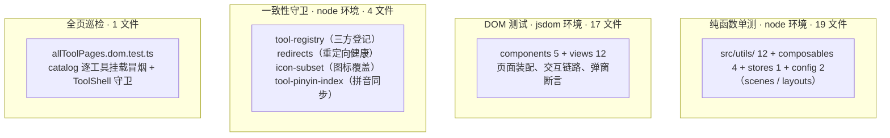
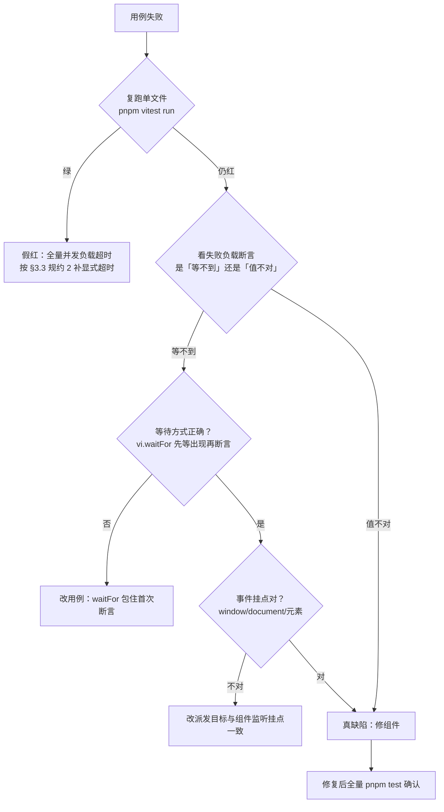

# 14 · 测试策略与质量守卫

> **一句话摘要**：41 个测试文件的分层——双环境机制、四组登记守卫、全页巡检，以及显式等待等书写规约。
> **目标读者**：维护者 + AI Agent ｜ **关联文档**：[03 登记体系](03-工具登记体系与扩展SOP.md) · [15 工程规范与 CI](15-工程规范与CI.md) · [16 已知坑](16-已知坑与规避清单.md)

## 1. 概述

测试体系围绕一个判断展开：**这个项目的质量风险不在业务逻辑复杂度，而在「142 页规模下的一致性漂移」**。因此资源投向守卫测试（防登记漂移）与全页巡检（防单页崩溃），而非追求覆盖率指标——没有任何覆盖率配置，这是有意决策（§4.5）。

规模底账（`find src -name "*.test.ts" | wc -l` 实测）：**41 个测试文件 = 23 个 node 环境 + 18 个 jsdom 环境**；按职能分 T1 纯函数 19、T2 DOM 17、T3 守卫 4、T4 巡检 1（明细见 §2.4 全量清单表）。用例底账（2026-09-27 本地全量实测）：**629 通过 + 2 跳过 = 631 条**，2 条跳过即巡检 SKIP 表的镜像留档用例（§3.2）。

## 2. 架构与数据流

### 2.1 测试分层



图释：T1 防算法错误（质量主防线，09/11 域的页面测试薄、靠这里兜底）；T2 防装配与交互错误；T3 防「规模性漂移」（本项目特色层）；T4 防任何一页白屏。四层各挡一类事故，互相不可替代。守卫全部跑在 node 环境（不需要 DOM），只有 icon-subset 例外地用 `node:fs` 直接读源码文件扫描。

### 2.2 双环境机制（vitest.config.ts 逐字摘录）

```ts
// vitest.config.ts（test 块与 monaco 别名，原文）
export default defineConfig({
  // 组件层测试要 import .vue，必须挂上 Vue 插件（vite.config.ts 里的插件不会自动继承）
  plugins: [vue()],
  resolve: {
    alias: [
      {
        // monaco-editor 的 package.json **只有 module 字段**（没有 main / exports / types），
        // vitest 的 SSR 式解析因此拿不到包入口，报
        // "Failed to resolve import \"monaco-editor\""。dev / build 走 Vite 客户端解析，
        // 本就能落到 module，无需此别名。
        // 替身而非真实模块：真实 monaco 是 3.7MB 的 ESM 图，内联转换会让单个用例文件从 ~2s
        // 涨到 ~21s；且 jsdom 没有 Worker，真实 Monaco 在测试里本来也无法工作。
        // 用带 $ 的正则而非字符串：字符串别名按前缀匹配，会把
        // `monaco-editor/esm/vs/.../xxx.worker?worker` 这类子路径一并改写坏。
        find: /^monaco-editor$/,
        replacement: fileURLToPath(new URL('./src/test/monaco-module-stub.ts', import.meta.url)),
      },
      { find: '@', replacement: fileURLToPath(new URL('./src', import.meta.url)) },
    ],
  },
  test: {
    environment: 'node',
    // 静音 jsdom 未实现 canvas 的噪音（内部有环境守卫，node 下安全）
    setupFiles: ['src/test/setup.ts'],
    include: ['src/**/*.{test,spec}.ts'],
    // 排除 SFC：组件本身不是测试文件，测试写在 *.dom.test.ts 里 import 它们
    exclude: ['**/*.vue', 'node_modules', 'dist', '.playwright-mcp'],
    // 只有组件层测试（*.dom.test.ts）才加载 jsdom
    environmentMatchGlobs: [['src/**/*.dom.test.ts', 'jsdom']],
    server: {
      deps: {
        inline: ['xiaoye-ui', 'element-plus'],
      },
    },
  },
})
```

四个机制逐一解读：

- **默认 node 环境**：不含 DOM 的用例跑得最快（utils/composables/config 的大多数）。
- **文件名即环境声明**：`environmentMatchGlobs` 把 `src/**/*.dom.test.ts` 切到 jsdom——想测 DOM，命名加 `.dom` 即可，零配置改动。个别文件也支持文件内注释覆盖（`allToolPages.dom.test.ts` 首行 `// @vitest-environment jsdom`，双保险写法）。
- **EP 内联**（`server.deps.inline`）：element-plus 与 xiaoye-ui 的 ESM 产物需内联转换才能在 jsdom 下正常挂载（vitest 配置注释：无扩展名 ESM 导入与级联 CSS 外部化时直入 Node loader 报 Unknown file extension）。
- **运行**：`pnpm test`（vitest run，CI 门禁）；`pnpm test:watch` 本地开发。无覆盖率配置。

### 2.3 测试基建：setup.ts 与 Monaco 桩

**setup.ts 全文三个 shim**（所有环境都会加载，故各有 `typeof` 守卫）：

```ts
// src/test/setup.ts（原文，三段合并展示）
if (typeof HTMLCanvasElement !== 'undefined') {
  HTMLCanvasElement.prototype.getContext = (() =>
    null) as unknown as HTMLCanvasElement['getContext']
}

if (typeof Element !== 'undefined' && !Element.prototype.scrollIntoView) {
  Element.prototype.scrollIntoView = () => {}
}

if (typeof globalThis.ResizeObserver === 'undefined') {
  class ResizeObserverStub {
    observe(): void {}
    unobserve(): void {}
    disconnect(): void {}
  }
  globalThis.ResizeObserver = ResizeObserverStub as unknown as typeof ResizeObserver
}
```

逐条解读：① canvas 的 `getContext` 返回 null——jsdom 不实现 canvas，静音策略配合页面侧 `if (!measureCtx) return 0` 防护；② `scrollIntoView` 是命令面板方向键导航的依赖，不补则键盘用例直接抛错；③ ResizeObserver 只需可调用，EP 组件挂载时观测尺寸用。

**Monaco 双层桩**。第一层是模块替身（`src/test/monaco-module-stub.ts`）——只保证「能解析、调用不抛错」，因为真实 monaco 的 alias 会让单文件从 ~2s 涨到 ~21s，且 jsdom 无 Worker：

```ts
// src/test/monaco-module-stub.ts（节选）
/** 编辑器实例替身：所有方法均为无害空实现 */
const editorInstanceStub = {
  dispose: () => {},
  onDidChangeModelContent: () => disposable,
  getValue: () => '',
  setValue: () => {},
  getModel: () => null,
  setModel: () => {},
  updateOptions: () => {},
  focus: () => {},
  layout: () => {},
}

export const editor = {
  create: () => editorInstanceStub,
  defineTheme: () => {},
  setTheme: () => {},
  setModelLanguage: () => {},
  getModels: () => [],
}
```

第二层是组件桩（`src/test/helpers.ts` 的 `MONACO_STUB`）——DOM 测试里把 `MonacoCodeEditor` 整个换成 textarea，v-model 链路不变，页面真实逻辑照跑：

```ts
// src/test/helpers.ts（节选）
export const MONACO_STUB = defineComponent({
  name: 'MonacoCodeEditor',
  props: { modelValue: { type: String, default: '' } },
  emits: ['update:modelValue'],
  setup(props, { emit }) {
    return () =>
      h('textarea', {
        class: 'monaco-stub',
        value: props.modelValue,
        onInput: (event: Event) =>
          emit('update:modelValue', (event.target as HTMLTextAreaElement).value),
      })
  },
})
```

`mountAtRoute()` 同样住在 helpers.ts：按 **catalog 真源**构造全部工具路由（带 `meta.title`，避免「页面应渲染出工具名」断言因测试路由不真实而假红）、装 Pinia、注册与 main.ts 同清单的 EP 组件（注释明言：main.ts 新增全局组件必须同步此清单，否则 el-* 静默渲染成未知元素、用例假绿）。

### 2.4 41 个测试文件全量清单表

| 路径 | 层 | 环境 | 测什么 |
|---|---|---|---|
| `src/assets/fonts/icon-subset.test.ts` | T3 | node | 源码 `ms:` 图标全部在子集字体清单内 + 字体体积防回退 |
| `src/components/layout/CommandPalette.dom.test.ts` | T2 | jsdom | 命令面板搜索/键盘导航/开关面板，window 与输入框双挂点回归 |
| `src/components/tools/FavoriteButton.dom.test.ts` | T2 | jsdom | 收藏按钮状态切换与持久化联动 |
| `src/components/tools/ToolHeader.dom.test.ts` | T2 | jsdom | 三套工具页模板共用页头的渲染契约 |
| `src/components/tools/ToolShell.dom.test.ts` | T2 | jsdom | ToolShell 模板装配（骨架/头部/内容插槽） |
| `src/components/tools/image/ImagePanel.dom.test.ts` | T2 | jsdom | ImagePanel fill 契约（满高范式不回退） |
| `src/composables/useEditorHistory.test.ts` | T1 | node | 编辑器撤销/重做历史栈（effect scope 包裹） |
| `src/composables/useImageSource.test.ts` | T1 | node | 图片来源加载：先 mock 解码再 import 被测模块 |
| `src/composables/useLayerOrder.test.ts` | T1 | node | 图层栈顺序行为 |
| `src/composables/useUrlState.test.ts` | T1 | node | URL 状态序列化/反序列化往返 |
| `src/config/scenes.test.ts` | T1 | node | 精选场景清单与 catalog 引用一致性 |
| `src/config/tools/layouts.test.ts` | T1 | node | getToolLayout 解析 + catalog layout 值校验 |
| `src/config/tools/tool-registry.test.ts` | T3 | node | catalog / TOOL_ROUTE_PATHS / toolComponents 三方登记一致 |
| `src/generated/tool-pinyin-index.test.ts` | T3 | node | 拼音索引与 catalog 工具集双向同步 |
| `src/router/routes/redirects.test.ts` | T3 | node | 39 条重定向目标存在、不撞真实页面、不成链 |
| `src/stores/settingsStore.test.ts` | T1 | node | 全局设置 store（含 codeIndent 缩进偏好） |
| `src/utils/analytics.test.ts` | T1 | node | 埋点核心契约：任何异常不得影响工具功能 |
| `src/utils/crypto-aes.test.ts` | T1 | node | AES 加解密往返 |
| `src/utils/crypto-md5.test.ts` | T1 | node | MD5 公开测试向量 |
| `src/utils/dev/devCodeTools.test.ts` | T1 | node | compressCssCode 等开发辅助纯函数 |
| `src/utils/dev/otp-time-step.test.ts` | T1 | node | TOTP 时间窗与剩余秒数计算 |
| `src/utils/fuzzy-match.test.ts` | T1 | node | 面板搜索的字段模糊匹配 |
| `src/utils/image-editor/color.test.ts` | T1 | node | 色彩矩阵/调整参数的像素运算 |
| `src/utils/image-editor/geometry.test.ts` | T1 | node | 坐标换算与边界判断 |
| `src/utils/image-editor/render.test.ts` | T1 | node | 图层绘制逻辑 |
| `src/utils/network/network-tools.test.ts` | T1 | node | parseExcludeSet 等网络工具解析 |
| `src/utils/palette-search.test.ts` | T1 | node | parsePaletteQuery / searchTools 搜索管线 |
| `src/utils/tool-preferences.test.ts` | T1 | node | 收藏/最近使用清单的 sanitize |
| `src/views/tools/ToolsHomePage.dom.test.ts` | T2 | jsdom | 首页两区架构（Hero + 分类全览）装配 |
| `src/views/tools/allToolPages.dom.test.ts` | T4 | jsdom | 全部工具页挂载冒烟 + layout 声明 ToolShell 守卫 |
| `src/views/tools/encode/UrlEncoderPage.dom.test.ts` | T2 | jsdom | URL 编解码输入输出链路 |
| `src/views/tools/encrypt/AesEncryptPage.dom.test.ts` | T2 | jsdom | AES 页显式执行交互模型 |
| `src/views/tools/encrypt/JwtToolPage.dom.test.ts` | T2 | jsdom | JWT 解析/校验链路（空态提示消失法断言） |
| `src/views/tools/generate/MaskGeneratorPage.dom.test.ts` | T2 | jsdom | 脱敏生成器弹窗模板 + 显式执行契约 |
| `src/views/tools/image/ImageEditorPage.dom.test.ts` | T2 | jsdom | 图片编辑器页冒烟 |
| `src/views/tools/image/ImageSvgEditorPage.dom.test.ts` | T2 | jsdom | SVG 编辑器冒烟 + 条件槽回归锁定 |
| `src/views/tools/json/JsonFormatPage.dom.test.ts` | T2 | jsdom | JSON 格式化 7 用例关键链路（含非法输入） |
| `src/views/tools/text/AsciiBinaryPage.dom.test.ts` | T2 | jsdom | ASCII/二进制转换行为 |
| `src/views/tools/text/Base64Page.dom.test.ts` | T2 | jsdom | Base64 行为测试（非挂载冒烟） |
| `src/views/tools/text/ColorConverterPage.dom.test.ts` | T2 | jsdom | 颜色格式互转行为 |
| `src/views/tools/text/TextCasePage.dom.test.ts` | T2 | jsdom | 命名风格转换行为 |

（T1 = 19，T2 = 17，T3 = 4，T4 = 1；与 §1 底账一致。）

### 2.5 守卫测试内容（与 03 §2.3 呼应）

| 守卫 | 位置 | 断言 |
|---|---|---|
| tool-registry | `config/tools/tool-registry.test.ts` | catalog / TOOL_ROUTE_PATHS / toolComponents 三方 id 集合一致、link 与路径真源匹配 |
| redirects | `router/routes/redirects.test.ts` | 39 条重定向目标存在、不与真实页面撞路径 |
| icon-subset | `assets/fonts/icon-subset.test.ts` | 源码引用的 `ms:` 图标全部在子集字体清单内 |
| tool-pinyin-index | `generated/tool-pinyin-index.test.ts` | 拼音索引与 catalog 工具集同步 |

## 3. 核心实现

### 3.1 四组守卫的断言逐字摘录与解读

**守卫一：tool-registry 三方一致性**——最核心的三条断言（`src/config/tools/tool-registry.test.ts`）：

```ts
// src/config/tools/tool-registry.test.ts（节选）
  it('router 中登记了每一条工具路由（无 404 路径）', () => {
    const missing = [...toolRoutePaths].filter((p) => !routerPaths.has(p))
    expect(
      missing,
      `以下工具路由未在 router/routes/tools.ts 中登记：${missing.join(', ')}`
    ).toEqual([])
  })

  it('catalog link 集合与 TOOL_ROUTE_PATHS path 集合完全一致', () => {
    expect([...catalogLinks].sort()).toEqual([...toolRoutePaths].sort())
  })

  it('每个工具都有对应的组件映射（缺映射会导致工具页白屏）', () => {
    const missing = allTools.filter((tool) => !toolComponents[tool.id]).map((tool) => tool.id)
    expect(missing, `以下工具缺少组件映射：${missing.join(', ')}`).toEqual([])
  })
```

解读：三条分别堵住「登记了路径但路由表没生成（404）」「路径真源与 catalog 拼写漂移（搜不到/卡片错链）」「有定义无组件（白屏）」三种登记事故；失败信息直接列出漏改的 id，免人工 diff。此外该文件还断言 id/link/key 无重复、每分类非空、路由 name 唯一且分类页保持 `ToolsCategory` 前缀。

**守卫二：redirects 重定向健康**（`src/router/routes/redirects.test.ts`，当前 39 条重定向）：

```ts
// src/router/routes/redirects.test.ts（节选）
  it('至少存在 1 条重定向（防止本文件被误删后守卫静默失效）', () => {
    expect(redirectRoutes.length).toBeGreaterThan(0)
  })

  it('每条重定向都指向真实存在的路由（不把用户送去 404）', () => {
    const broken: string[] = []
    for (const route of redirectRoutes) {
      const target = typeof route.redirect === 'string' ? route.redirect : ''
      if (!target) {
        broken.push(`${route.path} → (空)`)
        continue
      }
      if (!realPaths.has(norm(target))) {
        broken.push(`${route.path} → ${target}`)
      }
    }
    expect(broken, `以下重定向目标不存在：${broken.join(', ')}`).toEqual([])
  })

  it('重定向之间不重复', () => {
    const paths = redirectRoutes.map((route) => norm(String(route.path)))
    expect(new Set(paths).size).toBe(paths.length)
  })
```

解读：第一条「至少 1 条」防的是守卫本身被静默掏空——数组清空后其余断言全部空洞通过；「目标存在」堵「重定向指向已删页面」（2026-09 下线 18 个工具时它抓到 3 条死链先于发布）；「不重复」「不成链」防路由顺序匹配被重定向挡住与二跳。

**守卫三：icon-subset 图标覆盖**（`src/assets/fonts/icon-subset.test.ts`）——扫描源码里全部 `ms:` 引用比对烘焙清单：

```ts
// src/assets/fonts/icon-subset.test.ts（节选）
const ICON_NAME_PATTERN = /(?<![A-Za-z0-9_-])(?:ms|material-symbols):([a-z0-9_-]+)/g

  it('扫描正则不吃普通 CSS 文本：items:center 不算图标名', () => {
    // 回归样本：注释/样式里的 "align-items:center" 含前缀+center 拼接子串，
    // 无左边界时会被当成图标名而要求烘焙（曾逼停整条测试流水线）
    const sample = '/* align-items:center */ .x { color: red } icon="ms:image"'
    const names = [...sample.matchAll(ICON_NAME_PATTERN)].map((m) => m[1].replace(/-/g, '_'))
    expect(names).toEqual(['image'])
  })

  it('源码中出现的图标名都已烘焙进子集字体', () => {
    const missing = [...usedIcons.keys()].filter((name) => !baked.has(name)).sort()
    expect(
      missing,
      `以下图标未包含在子集字体中，会在页面上退化成文字：\n  ${missing.join('\n  ')}\n` +
        `请运行 \`pnpm icons:build\` 重新生成子集。`
    ).toEqual([])
  })
```

解读：正则的左边界 `(?<![A-Za-z0-9_-])` 是被真实事故逼出来的——`align-items:center` 曾被误当成图标名。体积断言（子集 < 200 KB）同时防「误换回 3.8 MB 全量字体」的反向事故。修复动作固定为跑 `pnpm icons:build`。

**守卫四：tool-pinyin-index 拼音同步**（`src/generated/tool-pinyin-index.test.ts`，全文 26 行）：

```ts
// src/generated/tool-pinyin-index.test.ts（节选）
  it('catalog 中每个工具都有拼音索引', () => {
    const missing = allTools.filter((t) => !toolPinyinIndex[t.id])
    expect(missing.map((t) => t.id), '缺少索引的工具，请运行 pnpm pinyin:build').toEqual([])
  })

  it('无过期键：索引不包含 catalog 已删除的工具', () => {
    const ids = new Set(allTools.map((t) => t.id))
    const stale = Object.keys(toolPinyinIndex).filter((id) => !ids.has(id))
    expect(stale, '过期索引条目，请运行 pnpm pinyin:build').toEqual([])
  })
```

解读：双向断言（不缺 key、无死 key）+ 两条拼音抽查样本（「日期时间转换器 → rqsjzhq」等），生成物漂移一律用 `pnpm pinyin:build` 再生成解决。

### 3.2 全页巡检 allToolPages.dom.test.ts 的机制

枚举方式是 **catalog 驱动而非 glob 文件名**——保证「测的就是线上真正会渲染的那个组件」，顺带校验映射表没串位：

```ts
// src/views/tools/allToolPages.dom.test.ts（节选）
const SKIP: Record<string, string> = {
  'dev-screen-recorder': 'jsdom 无真实 canvas 2d context（需 node-canvas）',
}

  it('工具数量与组件映射数量一致', () => {
    expect(allTools.length).toBeGreaterThan(100)
    expect(allTools.length).toBe(Object.keys(toolComponents).length)
  })

  for (const tool of allTools) {
    if (SKIP[tool.id]) {
      it.skip(`${tool.id} —— 跳过：${SKIP[tool.id]}`, () => {
        /* 留档：明确列出未覆盖项，避免"看起来全绿其实有洞" */
      })
      continue
    }

    it(`${tool.id} 能挂载并渲染出内容`, async () => {
      const loader = toolComponents[tool.id]
      expect(loader, `${tool.id} 缺少组件映射`).toBeTruthy()
      const module = (await loader!()) as unknown as { default: never }

      // Monaco 在 jsdom 下不可用，打成 textarea；其余页面不受影响
      const result = await mountAtRoute(module.default, tool.link, {
        global: { stubs: { MonacoCodeEditor: MONACO_STUB } },
      })
      wrapper = result.wrapper

      expect(wrapper.exists()).toBe(true)
      expect(wrapper.html().length, `${tool.id} 渲染结果为空`).toBeGreaterThan(0)
    }, 60000)
  }
```

机制要点：① 挂载断言只有两条——组件存在、渲染出的 HTML 非空，抓的是 import 错误、模板语法破坏、setup 抛错、组件缺失这类「重构最容易改坏」的事故；② SKIP 项以 `it.skip` **镜像留档**而非直接 continue，跳过原因在用例名可见（当前仅 dev-screen-recorder 一项）；③ 单用例超时 60s——全文件要挂载全部工具页，多数页面经 ToolCodePanel 间接拉入 Monaco 模块图，并行 30 文件时内存吃紧，个别页面挂载会超 20s，属资源竞争非页面缺陷；④ 文件内第二个 describe 是 **layout 声明守卫**：对声明了 `layout` 的工具逐个挂载，断言 `.tool-shell` 存在、`data-layout` 与声明一致、头部名称等于 catalog 名——catalog 的 layout 字段不产生约束，「声明了却没接」只有挂载能验证。

### 3.3 书写规约六条（各配真实用例片段）

1. **显式等待，禁固定 sleep**：异步出现的 UI（弹窗、结果）用 `vi.waitFor` 先等出现、再断言内容。真实片段（MaskGeneratorPage.dom.test.ts）：

   ```ts
   await actionButton('生成规则')!.trigger('click')
   // 先等弹窗真正出现——弹窗未渲染时提示语本就不在 DOM，直接断言「不含」会空洞通过
   await vi.waitFor(
     () => {
       expect(wrapper!.text()).toContain('生成结果')
     },
     { timeout: 3000 }
   )
   await vi.waitFor(
     () => {
       expect(wrapper!.text()).not.toContain(OUTPUT_HINT)
     },
     { timeout: 3000 }
   )
   ```

   先断言「不含 X」会得到空洞通过的假绿（弹窗还没渲染当然不含）——这两段 waitFor 的先后顺序就是这个规约的形状。

2. **显式超时下限**：重交互用例显式给 15s 超时。真实片段（同文件，用例收尾处）：

   ```ts
     }, 15_000)
   ```

   全量并发跑时机器负载会把默认 5s 压成假超时（历史上 7 条「失败」复跑全绿即此因，git 提交记录中「MaskGeneratorPage 四用例补 15s 显式超时」两次出现）；巡检文件更极端，单用例 60s（§3.2）。

3. **EP 弹窗断言走原位渲染**：弹窗统一 `append-to-body=false`，断言走 `wrapper.text()`。真实片段（MaskGeneratorPage.dom.test.ts 文件头注释）：

   ```ts
    * 输出面板在 el-dialog 内（EP 2.x 默认 append-to-body=false，弹窗原位渲染在
    * wrapper 子树里，只有下拉 popper 才 Teleport 到 body）；代码面板走语法高亮，
   ```

   不要假设弹层在 document.body——只有下拉 popper 是例外。

4. **键盘事件核对挂点**：window / document / 元素三种监听挂点行为不同，派发事件的目标必须与组件监听挂点一致。真实片段（CommandPalette.dom.test.ts，window 级与输入框级两组对照）：

   ```ts
   window.dispatchEvent(new KeyboardEvent('keydown', { key: 'ArrowDown', bubbles: true }))
   ```

   ```ts
   // 回归（2026-09 用户排查）：输入框 @keydown.stop 曾把面板键拦在 window
   // 监听之外——真实使用焦点始终在输入框，脚注标注的快捷键全部失效。
   // 以下三个用例从「输入框」派发事件，覆盖真实按键路径。
   it('输入框内 Esc 关闭面板（回归：@keydown 隔离不得吞掉面板键）', async () => {
     input.dispatchEvent(new KeyboardEvent('keydown', { key: 'Escape', bubbles: true }))
   ```

   CommandPalette 同时监听 window 级 keydown 与输入框路径——派发到组件根上两头都测不到，所以同一行为要有两组挂点用例。

5. **Monaco 桩的填充语义**：桩是受控 textarea，`setValue` 是**全量替换**而非追加——跨用例污染由 afterEach unmount 兜底；需要「空态」时显式清空再触发计算。真实片段（JsonFormatPage.dom.test.ts）：

   ```ts
   it('清空输入后回到空态', async () => {
     await mountPage()
     await typeJson('{"a":1}')
     expect(hasOutput()).toBe(true)

     // 清空：直接 setValue 后点格式化，应回到空态
     const textarea = wrapper!.find('textarea')
     await textarea.setValue('')
     expect(await clickButton('格式化'), '未找到「格式化」按钮').toBe(true)
     expect(hasOutput()).toBe(false)
   })
   ```

6. **守卫测试零容忍**：守卫失败不许 skip/改断言绕过。守卫文件自身也示范了「不许静默失效」：redirects 的第一条断言就是防守卫被掏空（§3.1 守卫二），巡检的 SKIP 用 `it.skip` 留档（§3.2）——它在保护登记体系，绕过等于拆警报器。

### 3.4 假红排查流程



图释：第一岔路口是「复跑」——本仓库的假红主因是全量并发的负载超时（§5），复跑确证后再排查真失败，避免对着幻影调试。第二岔路口区分「等不到」与「值不对」：前者九成是等待方式或挂点问题（规约 1/4），后者才指向组件缺陷。

## 4. 设计决策与取舍

1. **文件名定环境而非逐文件配置**。Why：零配置心智——看到 `.dom.test.ts` 就知道代价与前提；缺陷是命名不带 `.dom` 却摸了 DOM 的用例会在 node 环境假红，报错即纠正。
2. **守卫测试优先于类型约束**。Why：三方登记是三个独立数据结构，类型系统断言不了「集合相等」（03 §4.3）。
3. **全页巡检而非抽样**。Why：142 页每页都是独立 SPA 入口，任何一页白屏都是用户可达的事故；巡检挂在 jsdom 全量里成本可控（挂载冒烟，非交互遍历）。
4. **Monaco 打桩而非真加载**。Why：真 Monaco 在 jsdom 下不可运行且拖慢全量（单文件 ~2s → ~21s，monaco-module-stub.ts 头注释实测数字）；桩保住「页面装配正确」这个 T2 目标，编辑器内部行为不属于测试范围。
5. **无覆盖率配置**。Why：覆盖率数字会诱导为页面写低价值断言；本项目的等价物是「守卫 + 巡检 + 关键链路用例」（JsonFormatPage 7 用例即关键链路标准，正反路径都覆盖）。代价：单页算法回归靠 utils 单测兜底，页面层回归网较疏——接受。

## 5. 边界情况与已知限制

- **jsdom 不是真浏览器**：布局、滚动、canvas 像素、真实 Monaco 行为都测不到；图片域/画布交互的质量靠 `pnpm dev` 手测（16 册有手测清单）。巡检 SKIP 表的 dev-screen-recorder 即此边界的具名案例。
- **全量并发负载敏感性**：41 文件并发时重用例偶发假超时（§3.3 规约 2 的由来），复跑确证后再排查真失败。
- **巡检不等于交互测试**：allToolPages 只证明「能挂载」，不证明「按钮能用」——交互回归靠各域 DOM 测试 + 手测。
- **测试数据与真实数据漂移**：守卫测试断言的是结构一致性，catalog 内容错误（如分类归错）不在守卫射程内；巡检注释里也明言「卡片名与页面 H1 不一致」属设计决策，测试不替业务站队。

## 6. 变更指引

1. **新增页面**：至少一个 `*.dom.test.ts` 关键链路用例（输入 → 执行 → 输出，参照 JsonFormatPage 的 `typeJson` + 空态断言 + 非法输入三段式）；纯展示页可不写但巡检已覆盖挂载。
2. **新增 utils 模块**：node 环境单测跟随源码同目录（既有惯例），无 DOM 依赖不加 `.dom`。
3. **改测试基建**（setup/桩/环境匹配/helpers 的 EP 注册清单）：先跑全量确认无大面积假红，改动记录到本册 §2.2/§2.3。
4. **改登记体系**：任何改动以「守卫测试全绿 + `pnpm build`」为完成标准（03 SOP 步骤 10）；下线工具时 redirects 守卫会暴露指向它的死重定向，先清重定向再下线。
5. **验证手段**：本地 `pnpm test`；CI 中 test 门禁之前还有 format/lint/typecheck（15 §2.1）——本地先跑这三样可以省一轮 CI 往返。
