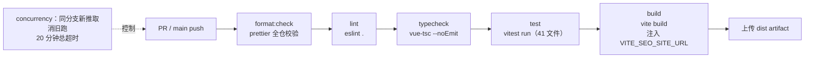
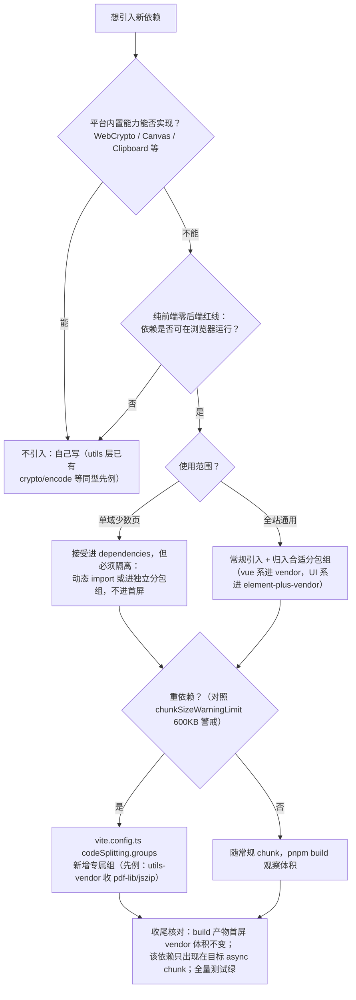

# 15 · 工程规范与 CI

> **一句话摘要**：质量门禁的完整定义——本地 scripts、ESLint 关键规约、CI 五道门禁、发布核对清单与代码惯例。
> **目标读者**：维护者 + AI Agent ｜ **关联文档**：[14 测试策略](14-测试策略与质量守卫.md) · [07 构建、预渲染与 SEO](07-构建预渲染与SEO.md) · [03 登记体系](03-工具登记体系与扩展SOP.md)

## 1. 概述

本项目无 pre-commit hook，质量门禁全部押在 **CI 五道门禁**上；本地纪律靠「提交前自查三件套」的惯例维持。本册是门禁的唯一权威清单——AI Agent 改完代码后按 §6.1 自查，等效于复现 CI。

环境锁定的三个锚点（package.json 原文）：`"packageManager": "pnpm@10.30.3"`、`"engines": { "node": ">=22.12.0" }`、browserslist `Chrome >= 111 / Firefox >= 113 / Safari >= 15`（autoprefixer 的前缀生成依据，见 07 §2.1.1）。

## 2. 架构与数据流

### 2.1 CI 流水线（`.github/workflows/ci.yml`）



图释：五道门禁按「便宜且快 → 贵且慢」排序，前一格失败即终止——格式问题不该浪费一次全量测试。环境为 pnpm + Node 22（与 package.json engines/packageManager 锁定一致，01 §4.9）。

**触发与并发**（ci.yml 原文）：

```yaml
# .github/workflows/ci.yml（节选）
on:
  push:
    branches: [main]
  pull_request:

# 同一分支的重复推送取消旧任务，避免排队
concurrency:
  group: ${{ github.workflow }}-${{ github.ref }}
  cancel-in-progress: true
```

**环境与超时预算**（原文）——超时注释给出了实测成本账：冷装约 3 分钟、全量测试约 85 秒：

```yaml
# .github/workflows/ci.yml（节选）
jobs:
  verify:
    name: lint / typecheck / test / build
    runs-on: ubuntu-latest
    # 时间预算：冷装依赖（含 monaco / tesseract / shiki / mermaid 等重依赖）约 3 分钟，
    # 测试是全量工具页冒烟（166 个页面逐个挂载）后约 85 秒 —— 两者相加后留足余量。
    # 若后续测试继续变慢，优先优化测试而非一味加大 timeout。
    timeout-minutes: 20

    steps:
      - uses: actions/checkout@v4

      # 版本取自 package.json 的 packageManager 字段，无需在此重复声明
      - uses: pnpm/action-setup@v4

      - uses: actions/setup-node@v4
        with:
          node-version: 22
          cache: pnpm

      - name: 安装依赖
        run: pnpm install --frozen-lockfile
```

**五步门禁与产物**（原文）——每步的注释都记录了它的「为什么」：

```yaml
# .github/workflows/ci.yml（节选）
      # 放在最前：最便宜的一道门禁，几秒内即可失败退出。
      # 此前缺此步骤，导致 src 下 117 个文件长期未过 Prettier（见 docs/UI_AUDIT.md P2-18）
      - name: 代码格式
        run: pnpm format:check

      - name: ESLint
        run: pnpm lint

      - name: 类型检查
        run: pnpm typecheck

      # 348 条用例，其中 167 条是 `allToolPages.dom.test.ts` 的全量工具页挂载冒烟
      # （jsdom 环境）。单测本身很快，耗时主要来自 166 个 .vue 的 transform。
      - name: 单元测试
        run: pnpm test

      # VITE_SEO_SITE_URL 未配置时会回落到占位域名 https://tools.example.com，
      # 构建不会失败。仓库变量配置后即用正式域名产出 canonical / sitemap。
      - name: 构建
        run: pnpm build
        env:
          VITE_SEO_SITE_URL: ${{ vars.VITE_SEO_SITE_URL }}

      - name: 上传构建产物
        uses: actions/upload-artifact@v4
        with:
          name: dist
          path: dist
          retention-days: 7
```

注：test/build 步骤注释里的「348 条用例 / 166 个页面」是写 workflow 时的历史基线；当前实测为 41 文件 629+2 用例（14 §1）、152 页预渲染产物（07 §3.3）。数字随 catalog 漂移，以实测为准，注释不必逐次追改。

### 2.2 本地 scripts 全表（package.json）

| 命令 | 作用 | 备注 |
|---|---|---|
| `dev` | Vite dev server，端口 **5560**（`vite --port 5560`） | 多实例会落到 5561，注意别测错实例 |
| `build` / `preview` | 构建 / 预览 dist | preview 冒烟清单见 07 §6.1 |
| `lint` / `lint:fix` | ESLint 检查 / 自动修 | |
| `format` / `format:check` | Prettier 写入 / 校验 | 作用域 `src/**/*.{ts,vue,js,css,json}` |
| `typecheck` | vue-tsc --noEmit | 全量类型检查 |
| `test` / `test:watch` | vitest run / watch | 分层见 14 |
| `icons:build` | `python3 build/fonts/build-icon-subset.py` | 图标字体子集生成；触发条件见 16 变更触发器表 |
| `pinyin:build` | `node build/pinyin/build-pinyin-index.mjs` | 拼音索引生成；同上 |

生成类脚本被守卫测试引用为修复动作：icon-subset 守卫的失败信息直接写「请运行 `pnpm icons:build`」，拼音守卫同理（14 §3.1）——门禁与生成脚本是一对。

## 3. 核心实现（ESLint 关键规约，eslint.config.js）

基础套件（原文摘录）：flat config = `js.configs.recommended` + `...tseslint.configs.recommended` + `...pluginVue.configs['flat/essential']`，末尾挂 `prettierConfig` 关掉格式类规则（格式化全部交给 Prettier，lint 与 format 职责分离）。

### 3.1 EP 按需引入门禁（no-restricted-imports + 动态 import 同口径）

```js
// eslint.config.js（节选，原文）
  {
    // element-plus 引入纪律（EP 全面化迁移 2026-09-22 起改口径）：
    // 旧规「业务代码禁止直接引入 EP」随 App* 包装层拆除决策废止——页面现直接
    // 写 el-* 组件。保留的纪律只剩「按需引入」：禁止全量默认导入
    // （app.use(ElementPlus)）与全量 index.css（对应 main.ts 头部注释的
    // 首屏预算约束），具名组件引入（import { ElTable } from 'element-plus'）
    // 与逐组件 style/css 引入为唯一合法形态。
    files: ['src/**/*.{ts,vue}'],
    rules: {
      'no-restricted-imports': [
        'error',
        {
          patterns: [
            {
              group: [
                'element-plus/dist/*',
                'element-plus/theme-chalk/index.css',
                'element-plus/full',
              ],
              message:
                '禁止全量引入 element-plus（dist/index.css、theme-chalk 全量包）：请用具名组件引入 + es/components/*/style/css 按需样式。',
            },
          ],
        },
      ],
      // 台账 #10 延续：动态 import 同口径封禁全量包（具名组件路径不受限）
      'no-restricted-syntax': [
        'error',
        {
          selector:
            "ImportExpression[source.value=/^(element-plus\\/(dist|theme-chalk)|element-plus\\/(lib|es)\\/index)/]",
          message:
            '禁止动态引入 element-plus 全量包：与静态 import 同口径，请按需引入。',
        },
      ],
    },
  },
```

解读：纪律经一次口径变更（2026-09-22 EP 全面化迁移，App* 包装层拆除）——从「禁止直接引入」收窄为「只禁全量」，但把静态 import 与动态 `import()` 双路都封死，逃逸口为零。作用域仅 `src/**`（build/scripts 下的 Node 代码不涉及）。

### 3.2 模板组件白名单（vue/no-undef-components）

```js
// eslint.config.js（节选，原文）
      // 模板引用了未注册的组件（如 <el-config-provider> 未在 main.ts 注册）是
      // typecheck 的盲区：vue-tsc 无法区分「未知 kebab-case 标签」与「原生自定义元素」，
      // 于是这类组件会静默退化成 DOM 元素（locale/功能失效 + 控制台警告）。
      // 全局注册的 EP 组件与框架内置组件在此白名单放行。
      'vue/no-undef-components': [
        'error',
        {
          ignorePatterns: [
            '^el-',
            '^El[A-Z]',
            '^Router(Link|View)$',
            '^Transition(Group)?$',
            '^KeepAlive$',
            '^Teleport$',
            '^Suspense$',
            '^component$',
          ],
        },
      ],
```

解读：这是 EP 漏注册静默失效的 lint 期防线（vue-tsc 的盲区，注释写明机理）。白名单按**前缀族**放行（所有 `el-*` / `El*`、Vue 内置组件、动态 `<component>`），不是逐组件枚举——好处是 main.ts 新增注册组件无需改 lint，坏处是「模板里写了但 main.ts 没注册」的 el-* 组件它也拦不住（真正的注册核对在测试侧 helpers.ts 的 EP 组件清单同步纪律，14 §2.3）。

### 3.3 规约速查表

| 规约 | 内容 | 为什么存在 |
|---|---|---|
| `no-restricted-imports` | 封禁 element-plus 全量引入（静态 + 动态双路，§3.1） | 按需注册纪律的门禁化（02 §4.1） |
| `vue/no-undef-components` | 模板组件白名单校验（§3.2） | EP 漏注册静默失效的 lint 期防线（02 §5.1） |
| `no-unused-vars` | `argsIgnorePattern: '^_', varsIgnorePattern: '^_'` | 占位参数的显式表达 |
| `no-explicit-any` | **warn 不 error** | 渐进收紧，存量 any 不阻塞门禁 |
| 关闭项 | `no-empty`、`@typescript-eslint/ban-ts-comment`（SFC 运行时依赖 `@ts-nocheck` 豁免动态类型）、`no-this-alias` 等逐条 off | 每条对应真实代码形态，非整体放水 |
| 作用域放宽 | `scripts/**/*.{cjs,js}` + `build/**/*.{ts,js}` 还原 Node 全局（require/process/__dirname 等），`build/**/*.mjs` 单独一块只补 Node 全局不设 sourceType | 生成脚本不是浏览器代码；.mjs 默认 module，与 commonjs 块互斥 |

后两条的真实原文：

```js
// eslint.config.js（节选，原文）
  {
    // Node 脚本（构建/分析用 CLI）：还原 Node 全局环境，避免误报 require/__dirname/process/console。
    files: ['scripts/**/*.cjs', 'scripts/**/*.js', 'build/**/*.ts', 'build/**/*.js'],
    languageOptions: {
      sourceType: 'commonjs',
      globals: {
        require: 'readonly',
        module: 'writable',
        exports: 'writable',
        __dirname: 'readonly',
        __filename: 'readonly',
        process: 'readonly',
        console: 'readonly',
        Buffer: 'readonly',
        global: 'readonly',
        setImmediate: 'readonly',
        clearImmediate: 'readonly',
      },
    },
    rules: {
      '@typescript-eslint/no-require-imports': 'off',
    },
  },
```

```js
// eslint.config.js（节选，原文）
      '@typescript-eslint/no-explicit-any': 'warn',
      'preserve-caught-error': 'off',
      '@typescript-eslint/no-unused-vars': [
        'error',
        { argsIgnorePattern: '^_', varsIgnorePattern: '^_' },
      ],
```

## 4. 设计决策与取舍

1. **无 pre-commit hook**。Why：不引入 git hooks 框架（husky/lefthook），克隆即用零配置；CI 是唯一权威终审。代价：本地漏跑由 CI 兜底，浪费一轮往返——用 §6.1 自查惯例对冲。
2. **门禁排序 = 成本升序**。Why：format/lint 秒级，typecheck 十秒级，test 分钟级（本地实测全量约 132s），build 最贵——失败反馈越早越便宜。
3. **concurrency 取消旧跑**。Why：同一分支连续推送只测最新 commit，省 CI 资源也缩短反馈。
4. **`no-explicit-any` 停在 warn**。Why：一次性改完存量 any 是高风险大 diff；warn 保持可见性，新代码惯例上不用 any。
5. **dist artifact 上传**。Why：门禁产物可直接下载做部署前预览（retention 7 天），避免「CI 绿但本地没 build 过」的发布意外；配合仓库变量 `VITE_SEO_SITE_URL`，artifact 里的 canonical/sitemap 即正式域名形态。
6. **ESLint 白名单按前缀族而非逐组件**。Why：main.ts 增删注册组件是高频操作，白名单不该成为每次注册的附带改动；「未注册却放行」的缺口由测试侧清单同步纪律补（§3.2 解读）。

## 5. 边界情况与已知限制

- **本地与 CI 的环境差**：Node 版本不一致可能导致 typecheck/build 结果不一致——用 engines 下限（22.12+）对齐。
- **dev 端口 5560/5561**：已有 dev server 未关时新起的实例落 5561，浏览器自动化与手测都要确认目标端口（历史踩坑）。
- **`vue/no-undef-components` 白名单**：按前缀族放行意味着它防不了「模板写 el-* 但 main.ts 漏注册」的全部情形（§3.2）；白名单本身要定期核对防止变成「豁免堆」。
- **Prettier 与手写 CSS**：format 会重排 main.css 等 CSS 文件的格式（不改值），review 时格式 diff 与语义 diff 要分看。
- **vite.config.ts 的 optimizeDeps 含失效条目**：dayjs 已随「时间戳」工具下线移出 package.json（src 无任何 import，lockfile 仅存 EP 传递依赖），但 `optimizeDeps.include` 仍列 6 个 dayjs 插件——dev 预打包阶段无害（包缺失只告警），下次动 vite.config.ts 时顺手清理。
- **CI 注释里的数字会过期**：用例数/页数随 catalog 漂移（§2.1 注），核对以实测命令为准，不为注释数字追改 workflow。

## 6. 变更指引

### 6.1 提交前自查三件套（等效复现 CI 前三门禁）

```bash
pnpm format:check || pnpm format   # 格式（有脏文件先写回）
pnpm lint                           # 规约
pnpm typecheck                      # 类型
pnpm test                           # 全量测试（登记改动必跑，14 §6.4）
```

涉及布局/样式/构建的改动追加 `pnpm build`；涉及部署的走 07 §6.1 发布核对清单。

### 6.2 改 CI 本身

改 `.github/workflows/ci.yml` 后用一次真实 PR 验证五门禁全绿（CI 无法本地预演）；超时/并发参数调整记录到本册 §2.1。

### 6.3 提交惯例（沿既有 git 风格）

`git log --oneline -10 | cut -c1-72` 实测输出（超长主题在此截断，完整原文可自行复核）：

```text
3fc3d1b feat(image): 图片家族布局审计收编——ImagePanel 补 fill 满高范式+10 页接入+图标守卫左边界
03b2875 feat(tools): 下线 18 个工具——图片 3（OCR 文字识别/背景擦除/ASCII 字符画）、encrypt 4（
5909194 feat(ui): 工具页标题栏整合+color 家族单列化+JSON 树页修复——全站 51 个 workbench 页 #o
5ae0325 refactor(tokens): 双表面/命名债/死梯子三专项清理——m3 阶梯并入主令牌（仅存 3 个被消费档位改为主题相关
657a9c5 fix(tokens): 令牌体系审计修复——浅色模式主色 hover/active 改「混黑加深」（.light 补覆盖，原混
e029d24 feat(settings): 代码缩进收进导航栏设置弹窗（全局格式化偏好）——settingsStore 新增 codeInd
1e477cb fix(controls): 工具类穿透块补全并移位——el-button/el-select 根上同样写死 font-body
4354037 fix(controls): 修复全站 el-input/el-textarea 上 font-mono 失效——皮肤层根节点
0959c2f feat(tools): 生成器家族统一显式执行模型——16 页移除挂载与参数自动执行，参数行末尾新增主色「执行」按钮（uuid
0d522cd test(encrypt): 数据脱敏页 dom 测试对齐弹窗模板——EP 弹窗 append-to-body=false 原位
```

从这批真实提交归纳的惯例（AI Agent 提交时必须遵守）：

1. **Conventional Commits 前缀 + 中文主题**：`type(scope): 主题`，type 取 feat/fix/refactor/test 等，scope 取域（tools/ui/tokens/settings/controls/image/encrypt）。
2. **单提交单一主题**：一个专项一个提交；`fix(controls)` 连续两条各自聚焦一个穿透问题，不混。
3. **主题行结构 = 「改了什么——细节展开」**：`——` 后接实现要点清单（分号分隔），如 `feat(tools): 下线 18 个工具——……三方登记同步删除……redirects 一致性守卫抓到 3 条死链先于发布`。
4. **描述尾部必带验证记录**：哪些关卡跑过、结果如何（`typecheck 零错误、622 测试全绿、构建 152 页预渲染` / `662 测试全绿一遍过` / `全量 656 通过`）——这是仓库既有的可追溯惯例。
5. 不与用户确认不擅自 `git commit`（用户明令的工作约定）。

### 6.4 新增依赖决策树



图释：前两道闸是价值观闸（平台优先、纯前端红线），后两道是体积闸（分包隔离 + 产物核对）。真实先例：pdf-lib/jszip 因体积进 `utils-vendor`；EP table/upload/color-picker 重组件下沉页面级按需引入（`element-plus-heavy`）；反面教训——OCR 页下线时 tesseract.js 独占依赖随页面一并移除（git 03b2875），说明「单域依赖」决策要记录、下线时要回收。

流程文字版：package.json 变更 → engines/CI Node 版本核对 → 重依赖评估分包组（07 §6.2 分包表）→ 仅某域使用的库确认不进主 chunk → 提交信息里写明「为什么需要它 + 体积核对结果」。

### 6.5 版本升级 runbook（大版本升级核对单）

本仓库已记录的升级伤疤都在配置注释里，升级前先核对这些坑是否被新版本重开：

1. **升级 Vite（参考 7→8 实录，vite.config.ts 注释原文为证）**：
   - `build.rollupOptions` 是否更名/废弃（8 更名 `rolldownOptions`，`manualChunks` 函数迁移为 `codeSplitting.groups`，groups 的 name 函数返回 null 等价原 undefined）；
   - CSS 压缩器语义：Oxc 压缩会删掉 `-webkit-backdrop-filter + backdrop-filter` 重复声明——升级后必须抽查产物里两条都在（07 §2.1.1 ③）；
   - 配置加载方式：`configLoader: 'native'` 下相对 import 扩展名不可省略（vite.config.ts 首个 import 的注释）；postcss 配置是否仍需在 `css.postcss` 显式声明；
   - 升级后跑 `pnpm build && pnpm preview`，核对分包产物（07 §3.3 页数账目 + 首载 waterfall）。
2. **升级 Element Plus**：
   - 组件默认行为变化点核对（先例：2.x `append-to-body` 默认 false 决定了弹窗断言策略，14 §3.3 规约 3）；
   - `vue/no-undef-components` 白名单与 main.ts 注册清单是否需要同步；
   - 重组件分包判定路径 `/components\/(table|upload|color-picker)\//` 是否仍匹配新版本的目录结构（vite.config.ts groups #5）；
   - helpers.ts 的 EP 注册清单与 main.ts 同步（14 §2.3 的假绿风险）。
3. **升级 Vue / vue-tsc / TS**：
   - `pnpm typecheck` 全绿是门槛；`vue/no-undef-components`、`flat/essential` 规则集随 eslint-plugin-vue 联动升级，勿单方面只升其一；
   - 测试栈兼容核对：@vue/test-utils 与 jsdom 版本随 Vue 大版本走，先跑全量 `pnpm test`（41 文件）确认无大面积假红再动代码；
   - Monaco 桩、`monaco-editor` 正则别名（`/^monaco-editor$/`）在依赖解析方式变化时是第一个爆点（vitest.config.ts §2.2 摘录的报错即此类）。
4. **通用收尾**：版本号落 package.json（不散落 lock 之外的引用）；提交信息按 §6.3 惯例写明升级范围 + 全关卡验证记录；本册 §2.2/§3 若有口径变化同步更新。
