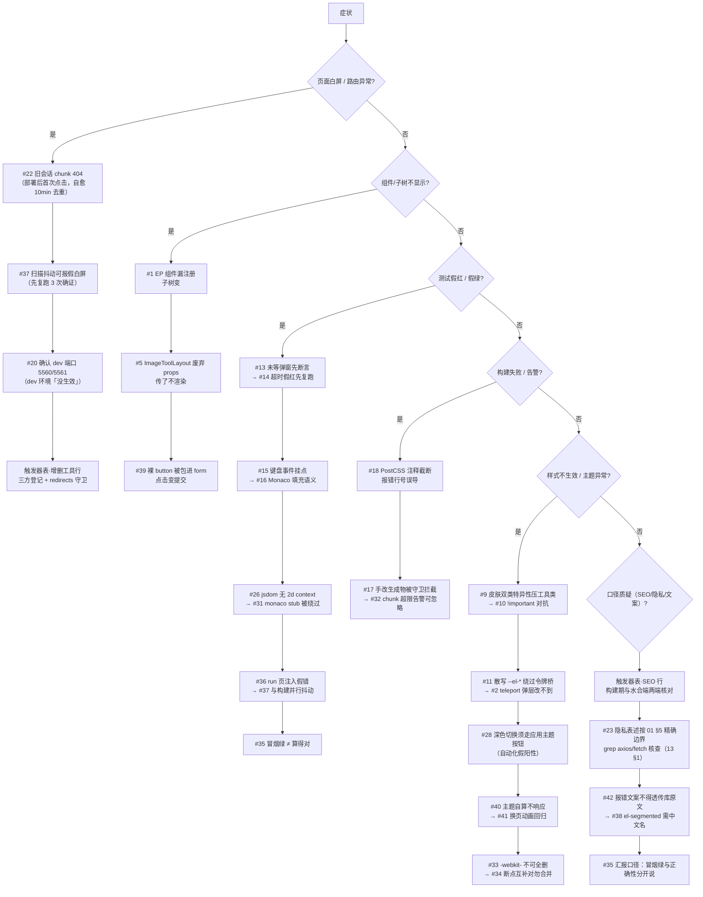

# 16 · 已知坑与规避清单

> **一句话摘要**：仍有效的踩坑规约（症状 → 根因 → 规避 → 验证方法，42 条）、逐字机制摘录、排查决策树与变更触发器表（什么改动必须连带做什么）——AI Agent 动手前先扫一遍本册。
> **目标读者**：AI Agent 优先 + 新工程师 ｜ **关联文档**：全部分册（坑都指向详情所在册）

## 1. 概述

本册收两类知识：**坑**（不规避会重复踩的机制性陷阱）与**触发器**（改 A 必须连带做 B 的联动关系）。条目提炼自 `docs/` 三份审计、2026-09 系列修复专项与各册正文；#25–#34 一批扩充自两份审计中「机制仍在、规避靠人」的实测条目，#35–#42 为第二批（每条标注来源审计与条目号），主机制已对照当前代码复核；「详见」列指向根因分析所在册。每条坑配一列**验证方法**：如何复现、如何确认已规避。

来源审计的修复状态口径（2026-09-27 复核）：RUNTIME_AUDIT 的 P1×2 / P2×4 与 UI_AUDIT 的 P0×2 / P1×10 主线均**已修复**，不登记为坑；登记的只有修复后机制仍存、需要人（或 AI）主动规避的规约。RUNTIME_AUDIT P1-1 的 Monaco AMD 竞态已随「Monaco → ESM 迁移」**结构性消除**（`suspendGlobalAmd` 整套约 70 行已删除），属于「根因被重构消除」的示例，按 §5.3 不再占坑位。

三份审计的规模与抽读复核结果（`wc -l` 实测）：

| 审计文档 | 行数 | 本册取材口径 |
|---|---|---|
| `docs/RUNTIME_AUDIT.md` | 437 | P1×2 / P2×4 已修复不收；登记 #26–#29、#31、#32、#35–#37、#42 |
| `docs/UI_AUDIT.md` | 640 | P0×2 / P1×10 已修复不收；登记 #25、#33、#34、#38–#41 |
| `docs/CODE_REVIEW.md` | 386 | 抽读复核：#1（CSS 压缩 url 截断）、#2（OTP 周期）、#6（chunk 无限刷新）、#7（runner 400ms）、#10（sanitize 正则改写）、#11（ReDoS）、#14（useTheme watch 作用域）均已修复——修复后代码注释明写「报告 #N 修复」逐一实证，**机制不存在，不占坑**（证据摘录见 §2.7 末两条） |

## 2. 坑清单

### 2.1 组件与渲染

| # | 坑 | 症状 | 根因 | 规避 | 验证方法 | 详见 |
|---|---|---|---|---|---|---|
| 1 | EP 组件漏注册 | 子树静默变 `<!---->`，无报错、errorHandler 无感 | Vue 把未注册组件当自定义元素渲染 | 重组件页面局部引入；lint `vue/no-undef-components` 白名单；排查用 `#app.__vue_app__` 替换 errorHandler 抓真栈 | `pnpm lint` 0 error；页面控制台无 "Failed to resolve component" | 02 §5.1 |
| 2 | ToolHeader 弹层样式改不到 | dropdown/popper 样式覆盖无效 | 弹层 teleport 到 body，脱离组件 scoped 作用域 | 一律经 `popper-class` 全局覆盖（`ToolHeader.vue` 的 `.tool-header__dropdown.el-popper` 块，注释明写「ElDropdown 弹层 teleport 到 body，须走全局样式」） | DevTools 确认弹层 DOM 挂在 body 且全局样式命中该类组合 | 04 §3 |
| 3 | vue-json-pretty 卫语句吞 0 | 「展开/折叠全部」按钮永远无效 | 库内 deep watch 带 truthy 卫语句，`0` 层级被当 falsy | 包装第三方组件时对 0/空数组等 falsy-but-legal 边界显式测试 | 层级输入 0 点「展开全部」应全展开 | 09 §3.3 |
| 4 | ToolCodePanel 定高失效 | 外部给定 height 被顶掉 | 组件根 `flex:1; min-height:0` 优先于外部 height（注释明写「作为 flex 容器子元素时填充剩余空间」） | 需定高时外层 `flex:none` 包裹 | 外层 flex:none 后量测面板高度等于给定值 | 04 §5 |
| 5 | ImageToolLayout 废弃 props | 传 title/description/icon/:subtitle 不渲染 | 已标 `@deprecated`，元数据统一走 ToolHeader（23 个 image 页调用侧均还有残留） | 不传；迁移时删除调用侧残留 | grep 调用侧无 `title=`/`description=` 残留（12 §2.1 台账清零） | 12 §2.1 |

### 2.2 布局与满高

| # | 坑 | 症状 | 根因 | 规避 | 验证方法 | 详见 |
|---|---|---|---|---|---|---|
| 6 | 行向 flex body 写 width:100% | 并列的 flex:1 兄弟被压瘪 | 纵向满高用错方向属性，宽度声明参与主轴分配 | 满高一律 `height:100%`；fill 面板自带内滚（min-height:0 + overflow，ImagePanel `fill` 注释即契约） | 双栏各自约 50% 无压瘪；DevTools 查 flex-basis | 04 §2.3 |
| 7 | workbench 行被内容撑破 | 双栏溢出、页脚被顶走 | grid 行未封顶 | 行保持 `minmax(0,1fr)`；页脚在固定高容器外 + `relative; z-index:0` | 粘贴超长内容进面板，页脚仍在视口内、双栏内滚 | 04 §2.3 |
| 8 | EP 下拉/弹窗异常 | 下拉打开但高度 0；弹窗断言取不到内容 | EP 定位机制 + append-to-body 差异 | 弹窗统一 `append-to-body=false` 原位渲染，断言走 `wrapper.text()`；手测时注意 EP 下拉打开但高度 0 是已知现象非数据丢失 | `wrapper.text()` 能取到弹窗文案；手测下拉展开有内容高度 | 14 §3.3 |

### 2.3 样式与令牌

| # | 坑 | 症状 | 根因 | 规避 | 验证方法 | 详见 |
|---|---|---|---|---|---|---|
| 9 | 工具类在带皮肤元素上失效 | `font-mono`/`text-xs`/`resize-none` 不生效 | 皮肤根节点双类（0-2-0）特异性压过单类工具类 | 走皮肤穿透块三条规则；穿透块必须排在全部根节点皮肤区之后 | 带皮肤元素上 `font-mono` 生效；穿透块在文件中位于皮肤区之后 | 05 §5 |
| 10 | 页面 `!important` 对抗皮肤 | 覆盖链失控、后续维护成本陡增 | 用特异性歧途解冲突 | 用「更高特异性 + 更晚位置」；存量 !important 已清理，禁止新增 | 页面 .vue 内 `grep "!important"` 为 0（main.css 基础层除外） | 05 §5 |
| 11 | 散写 `--el-*` 字面量 | 主题切换后颜色脱队 | 绕过令牌桥直接消费 EP 变量 | EP 变量一律经令牌桥映射（`src/assets/main.css:616`「Element Plus 令牌桥」注释块起的 `:root:root` 区段） | `--el-*` 新增只出现在 main.css 令牌桥区段（grep 文件名唯一） | 05 §4.3 |
| 12 | 浅色 hover「统一」成混白 | 浅底上 hover 反而变淡 | 两态策略有意不同（浅色混黑加深 / 暗色混白） | 改令牌前读 05 §3 浅色修正段，勿「顺手统一」 | 浅色下 hover 比静态更深、暗色下更亮，两态各自成立 | 05 §3 |

### 2.4 测试与工具链

| # | 坑 | 症状 | 根因 | 规避 | 验证方法 | 详见 |
|---|---|---|---|---|---|---|
| 13 | 断言「不含 X」假绿 | 弹窗内容空洞通过 | 未先等弹窗出现 | `vi.waitFor` 先等出现再断言内容（AesEncryptPage.dom.test.ts 三处即此写法） | 复跑用例；人为制造内容缺失确认会变红 | 14 §3.1 |
| 14 | 全量跑偶发超时假红 | 个别用例 CI/本地随机失败 | 并发负载把默认 5s 压爆 | 重交互用例显式 15s 超时（`MaskGeneratorPage.dom.test.ts` 四处 `}, 15_000)`）；假红先复跑确证 | 复跑 2~3 次；单文件 `-t` 定向跑稳定绿 | 14 §3.2 |
| 15 | 键盘事件用例测不到 | 派发了事件但处理器不触发 | 事件挂点（window/document/元素）与派发目标不一致 | 挂点与派发目标一致（CommandPalette 是 window 级监听，`window.addEventListener('keydown', …)`） | 对照监听挂点与 `trigger`/dispatch 目标一致 | 14 §3.4 |
| 16 | Monaco 自动化填充追加 | 填入内容叠在旧文本后 | Monaco 编辑器填充语义是插入 | 先清空再填充（手工/浏览器自动化同此） | 填充前 `setValue('')` 一次，读回模型值无叠加 | 14 §3.5 |
| 17 | 手改生成物 | 守卫测试红 / 改动被覆盖 | `generated/tool-pinyin-index.ts` 与图标子集是构建期产物 | 只跑 `pnpm pinyin:build` / `pnpm icons:build`（build/pinyin、build/fonts 脚本），不手改 | 重新 build 后 `git diff` 为空（产物与提交一致） | 03 §3 |
| 18 | dev PostCSS 报错行号误导 | CSS 500 报在无关行 | 块注释内容含 `*/` 序列截断注释 | 写注释先自查 `*/`；报错行号远离症状时先查上方注释块 | 报错行号上溯注释块找 `*/` 序列 | 05（构建期） |
| 19 | 批量 sed 改坏文件 | 替换后大面积误伤 | 替换目标存在顺序依赖 | 批量替换先小样本验证、控制顺序、替换后 typecheck+test | 小样本 diff 人工过目 + `pnpm typecheck && pnpm test` 全绿后再铺开 | 15 §6.1 |
| 20 | dev 端口测错实例 | 改动「没生效」 | 旧 dev server 未关，新实例落 5561 | 确认目标端口 5560（`package.json` dev 脚本与 vite.config.ts 均钉 5560，多实例时 5561） | `lsof -i :5560` 确认监听进程是本次 dev 实例 | 15 §5 |
| 21 | 按分类找页面文件落空 | 「text 分类工具怎么在 generate 目录」 | 双口径：categoryId（行为）≠ 物理目录（历史）——encrypt 8 页里 4 页、site/network 各 1 页住在 `views/tools/generate/`；color 域也有 2 页住在域外（#见 11 册 §1） | 判归属看 categoryId，找文件按 `toolComponents.ts` 的 id → 组件映射 | 按 `toolComponents.ts` 映射查文件（如 `'color-format-converter'` → `text/ColorConverterPage.vue`） | 03 §2.2 |
| 22 | 部署后旧会话白屏 | 点击路由报 chunk 404 | 静态托管部署即换文件，旧 chunk 清单失效 | 应用已自愈（reload + 10min 去重，`router/index.ts` sessionStorage 机制）；入口缓存失效盲区需手动刷新 | 部署新版后旧标签页点路由应自动 reload 一次且不再循环（§2.7 摘录） | 02 §3.2 |
| 23 | 隐私承诺表述过头 | 对外说「零出站」被抓例外 | 忽略两类合法出站（请求类工具/自托管埋点） | 对外表述以 01 §5 精确边界为准；核查手段见 13 册 §1（grep axios/fetch） | `grep -rn "axios\|fetch(" src` 逐条对照 01 §5 两类例外 | 01 §5 |
| 24 | 多会话并行改同一文件 | 提交互相覆盖/冲突 | 两个 AI 会话同时工作未协调 | 并行会话分域分工；提交前 `git status` 复核改动清单 | 提交前 `git status`/`git diff` 清单仅含本域文件 | 15 §6.3 |

### 2.5 测量、无障碍与自动化审计（第一批，来源两份审计）

| # | 坑 | 症状 | 根因 | 规避 | 验证方法 | 来源 |
|---|---|---|---|---|---|---|
| 25 | 给 ImageParamRow 内控件重复/漏配可访问名 | label 的 `for` 悬空；或无信息量的 `aria-label` 反而覆盖正确名称 | `el-form-item` 的原生关联只对消费 formItem context 的 EP 组件有效（el-input/el-select 等）；`el-slider`/`el-color-picker` 不注册 inputId；原生 `<input>` 也不在关联内 | slider/color-picker 按 `label` prop 文本补 `aria-label`；扫描判定时把 ImageParamRow 内控件视同「已有原生关联」（误判曾造成约 50 处误报） | 可访问树里 slider/color-picker 有名（UI_AUDIT 实测树样例）；扫描不把该容器报成缺名 | UI_AUDIT P1-5 第四轮实测表 + 第七轮「判定口径修正」 |
| 26 | 新页在 setup 期就写 2d context | 全量冒烟挂载即抛（jsdom `getContext('2d')` 恒为 null），连带 24 册守卫红 | jsdom 无真实 canvas 实现 | 页面把 canvas 调用放交互回调/懒初始化，setup 只建 state；jsdom 挂不起的页面进 `allToolPages.dom.test.ts` 的 SKIP 表并写明理由（现仅 dev-screen-recorder） | `pnpm test` 全页挂载绿；SKIP 表新增项必须带理由（§2.7 摘录） | RUNTIME_AUDIT §5.2（canvas 绘制未验证的覆盖盲区）+ SKIP 表注释 |
| 27 | 编辑器类页面自动化采样「文本量骤降」 | 扫描报告 9 条页面内容异常，逐条复测全部正常 | Monaco 转 ESM 后 dev 首渲染变慢，超出固定 1.1s 静默窗口，采到「还没渲染完」的中间态 | 编辑器页面采样窗口调大（`SCAN_SETTLE_MS=2600`）；产物扫描出异常先复跑确证再定性 | SCAN_SETTLE_MS=2600 复跑，异常归零（RUNTIME_AUDIT §7.2 实测 9 → 0） | RUNTIME_AUDIT §1（冒烟窗口）/ §7.1 / §7.2（最终 2.6s 窗口归零） |
| 28 | 脚本手动叠加 `.dark` 测深色模式 | 36/36 页报告「切换无效」的假阳性 | 主题机制是 `html.light` / `html.dark` **互斥类**，手动 add `.dark` 时 `.light` 仍在 | 自动化必须点击应用自身的主题按钮切换（实测 36/36 通过）；排查「深色失效」先确认用的是互斥类机制 | 点主题按钮后 body 底色在 `rgb(9,9,11)`（暗）↔ `rgb(250,250,250)`（浅）翻转（§2.7 摘录互斥类源码） | RUNTIME_AUDIT §4（假阳性表）+ §7（正向确认） |
| 29 | 把 `/run/*` 的 `net::ERR_ABORTED` 当回归 | 扫描偶报 1~2 条「请求失败」，且落在 react/web/vue 间漂移 | iframe 初始导航被 `srcdoc` 取代，属预期行为 | 已知假阳性，无需处理；判定口径：`type: Document` + `canceled: true` 且仅限 run 页 | 条目满足上述判定口径 → 忽略；落在非 run 页才立案 | RUNTIME_AUDIT §4 + §7.2 |
| 30 | 用「页面文本长度」断言功能生效 | chmod 页输入 7777 报「输出未变」的假缺陷 | 部分页面（权限矩阵等）字符数天然不变，该指标不敏感 | 交互断言改用具体 DOM 特征（矩阵值、结果面板选择器）；「点执行但输出未变」先想测量局限再想缺陷 | 换 DOM 特征断言（chmod 页用权限矩阵 `rwx/r-x/r-x` 值）；文本长度指标对本页弃用 | RUNTIME_AUDIT §3 P2-4（定性过程） |
| 31 | 删掉/绕过 vitest 的 monaco stub | 单文件测试 2s → 21s，全量超时 | `monaco-editor` 的 package.json 只有 `module` 字段，vitest SSR 式解析拿不到入口；alias 指真实模块会被内联转换 3.7MB | 保留 `vitest.config.ts` 的锚定正则 alias → `src/test/monaco-module-stub.ts`；DOM 用例用 `MONACO_STUB`（`src/test/helpers.ts`） | 单文件用例 ≤3s；`grep "monaco-editor" vitest.config.ts` 锚定正则别名在位（§2.7 摘录） | RUNTIME_AUDIT §6 测试配套（恢复 635 passed 的关键） |
| 32 | 把构建输出里的 monaco-vendor 告警当新问题 | `pnpm build` 报 chunk 超 `chunkSizeWarningLimit: 600` | Monaco ESM 全量懒加载 chunk 实测 3.78MB，超提示阈值是已知且可接受的（仅编辑器页面加载） | 告警可忽略；若首屏预算收紧再做按语言裁剪（RUNTIME_AUDIT 后续待办 #1/#2） | build 日志 monaco-vendor ≈3.78MB 且为懒加载 chunk → 忽略 | RUNTIME_AUDIT §6 第二轮 + 后续待办 |
| 33 | 「清理 -webkit-」一刀切 | 删掉不可移除前缀后 Safari 破版 | 只有 `background-clip: text` / `mask-image` 两类 Autoprefixer 会按 browserslist 补齐；`-webkit-text-fill-color`（无标准对应）、`::-webkit-scrollbar*`（伪元素）、`display:-webkit-box` + `-webkit-line-clamp`（Autoprefixer 不处理 line-clamp）不可移除 | 清理前先离线跑 Autoprefixer 验证会补出，再动手 | 离线 Autoprefixer 输出对照；清理后对 dist 产物 CSS 计数对比（UI_AUDIT 第五轮方法） | UI_AUDIT P2-3（分类与离线验证表） |
| 34 | 「断点体系不统一」顺手统一 | 640/768/1024/1280 及 659 等值被合并，支持范围内视口回归 | 实测为「4 组互补对 + 3 个布局专用值」的有意设计（如 1023/1024 成对、1280 为 image 分栏专用、659 对应「<660 不支持」口径） | 断点阶梯已在 `main.css` 文档化；增断点先对照阶梯，勿合并互补对 | 对照 main.css 断点阶梯注释；合并前确认不是互补对成员 | UI_AUDIT P2-10（结论修正） |

### 2.6 执行与运行期规约（第二批，来源两份审计）

| # | 坑 | 症状 | 根因 | 规避 | 验证方法 | 来源 |
|---|---|---|---|---|---|---|
| 35 | 把冒烟/交互扫描绿灯当「计算结果正确」 | 「全量扫描全绿」被引用为业务正确性证据 | 交互注入的是通用样例值，只能证明「不崩、有反馈」；RUNTIME_AUDIT §5 明列「业务正确性未做断言」 | 数值/格式正确性走单测与人工黄金用例；汇报口径把「冒烟绿」与「算得对」分开表述 | 抽任一工具对已知答案人工核对（如 Base64 编码 `hello`），即证冒烟不含此断言 | RUNTIME_AUDIT §5 局限 1 |
| 36 | `/run/web`、`/run/vue` 的自动化「报错」当回归 | 交互扫描报 `ReferenceError: f is not defined` 或 SFC 编译错误 | 交互脚本为触发交互把 Monaco 模型替换成示例代码，注入内容本身非法（RUNTIME_AUDIT §4 第 2/3 行；未注入时无任何错误） | run 页定性一律先跑「未注入」版本；页面能正确捕获并展示编译器错误属正向表现 | 未注入直接点「运行」→ 无错误提示，即假阳性 | RUNTIME_AUDIT §4 |
| 37 | 扫描与构建/测试并行跑产生采集抖动 | 扫描偶报「文本量骤降」甚至假白屏（`#app` 子节点 0），逐条复测全部正常 | 该轮扫描与 `pnpm build` / `pnpm test` 并行，CPU 争抢拖慢渲染超出静默窗口（§7 实测 3 条假异常，复测 5463 vs 5462 等与基线一致） | 全量扫描独占执行；异常条目复跑 ≥3 次且与基线一致才可定性 | 单独重跑同路由清单，指标回到基线值 | RUNTIME_AUDIT §7 |
| 38 | `el-segmented` 不传可访问名 | 读屏念出无意义的英文 "segmented" | EP 内部实现为 `aria-label: props.ariaLabel \|\| "segmented"`，未传名时回落英文默认值（全站 27 处已补中文组名） | 每处 `el-segmented` 显式传中文 `aria-label`（会正确映射到 ariaLabel prop）；review 新页时对着可访问树看一眼 | DevTools/可访问树查该组 `aria-label` 是中文组名而非 "segmented" | UI_AUDIT 第七轮「两个新发现」 |
| 39 | `<button>` 缺 `type="button"` | 一旦被包进 `<form>`，点击即触发表单提交 | HTML 默认 `type="submit"`；当前全站 0 个 `<form>`（UI_AUDIT P2-23 实测）暂无害，机制风险靠人守 | 新写 `<button>` 一律带 `type="button"`；勿随手用 form 包裹工具页控件 | 多行扫描 `<button` 无 `type=` 全站仅剩 WebRunnerPage 演示字符串 1 处（实测） | UI_AUDIT P2-23（实测 25 个中 17 已有、修 7 处、1 处为演示字符串） |
| 40 | 组件里自算主题状态 | 主题切换后该块配色不更新（UniversalCodeBlock 曾中招） | 自建 `isDark` 读 `document.documentElement.classList` 是非响应式快照；P2-26 顺带修掉的真实缺陷，规约适用于一切新代码 | 主题判定一律 `useTheme()` 的 `isDark` / `isLight` 模块级 computed 单例，勿读 classList 自算 | 切主题后使用方 UI 跟随刷新；`grep classList` 的组件级主题自算仅存在于 useTheme 内部（§2.7 摘录） | UI_AUDIT P2-26 |
| 41 | 路由 `scrollBehavior` 漏 `behavior: 'instant'` | 换页出现整页平滑滚动动画 | `html { scroll-behavior: smooth }` 为页内锚点保留、长期存在（`main.css:313`）；路由返回值不带 instant 就与它叠加成换页动画（P2-25） | `scrollBehavior` 两个返回分支都带 `behavior: 'instant'`（现值即此写法）；改路由守卫时保留 | 侧栏换页瞬时归位无动画；`grep "instant" src/router/index.ts` 两处在位（§2.7 摘录） | UI_AUDIT P2-25 |
| 42 | 第三方库英文报错原文透传 | 页面提示 `生成失败: Invalid hex color: test value 123`（英文 + 回显输入） | 输入未预校验直接交给库，catch 后把库异常塞给用户（P2-1 定性；QrCode/WifiQr 两页已修，规约适用于一切新接入的解析/生成库） | 接库前先本地预校验——复用项目既有解析器（如 color-tools 的 `hexToRgb`）+ `useToolError` 中文文案、分别指明字段（§2.7 摘录） | 非法输入触发的是中文提示（「无法识别的颜色格式，前景色请输入 #RGB 或 #RRGGBB」）而非库原文 | RUNTIME_AUDIT §3 P2-1 |

**审计中的「已裁决勿动」清单**（防止把裁决过的设计当缺陷再改一遍）：

| 项 | 裁决 | 来源 |
|---|---|---|
| 全站 97 处半透明表面背景（无模糊） | 保留——属既有材质语言，玻璃退役针对的是「模糊」 | UI_AUDIT N-2 |
| `el-alert` 错误区 | 勿再加 `role="alert"`——EP 内部已内置，全站 84 处早已具备播报语义 | UI_AUDIT P1-7 范围修正 |
| `el-upload` | 勿补可访问名——其 `<input type="file">` 为 `display:none`，不进可访问性树 | UI_AUDIT 第七轮 |
| 哈希页字节数/字符数、runner 日志行数 | 刻意不加 `aria-live`——连续重算值播报属噪音回归 | UI_AUDIT P1-7 范围修正 |
| 自定义互斥 pill 切换 | 勿改回 `tablist`/`tab`——模式切换内容分散多容器、无单一 tabpanel，`AppTabGroup` 的 radiogroup 方案经可访问树实测（/dev/ulid）成立 | UI_AUDIT P1-6 方案修正 |
| `el-empty` 自定义 `#image` 插槽 | 勿再传 `image-size`——该 prop 只作用于默认插槽内的 ``（P2-8 已删该 prop，零视觉变更） | UI_AUDIT P2-8 |
| encrypt 域 secure-context | 刻意不做非 HTTPS 降级（降级加密是安全负资产）；`JsonAnonymizerPage`/`MaskGeneratorPage` 的降级守卫**勿照抄进 encrypt 域** | 13 §3.7 |
| M3 容器阶梯别名三档 | 仅 image 域消费、勿恢复已删四档、新代码用主阶梯 | 12 §3.4 + main.css:144 注释 |

### 2.7 机制摘录（逐字，供排查时对照）

以下摘录全部逐字取自仓库当前文件（标注来源路径与行号），是上表各条「机制仍在」或「规避范式」的直接证据。

**#28 / #40 —— 主题互斥类与防闪烁脚本**（`index.html:26-41`；`html.light`/`html.dark` 互斥是自动化假阳性的根因，`system` 分支是 P1-9 修复现场）：

```html
      // 漏掉 'system' 分支会导致「曾选过跟随系统 + 系统深色」的用户每次加载先闪浅色。
      ;(function () {
        const theme = localStorage.getItem('tools-theme')
        const prefersDark = window.matchMedia('(prefers-color-scheme: dark)').matches
        const isDark = theme === 'dark' || ((!theme || theme === 'system') && prefersDark)
        const root = document.documentElement
        if (isDark) {
          root.classList.add('dark')
          root.setAttribute('data-theme', 'dark')
        } else {
          root.classList.add('light')
          root.setAttribute('data-theme', 'light')
        }
      })()
```

**#40 —— 主题判定的唯一范式**（`src/composables/useTheme.ts:18-23`）：

```ts
// 主题判定的唯一来源：模块级 computed（单例、响应式）。
// 此前是 () => theme.value === 'dark' 的函数形式，导致全站三种写法并存
// （函数调用 / 组件内自建 computed / 直接比较 theme.value），其中
// UniversalCodeBlock 的自建实现读的是 document classList，主题切换后不更新。
export const isDark = computed(() => theme.value === 'dark')
export const isLight = computed(() => theme.value === 'light')
```

同文件 effectScope 段（注释明写「报告 #14 修复」）——CODE_REVIEW #14 的「watch 绑在首个调用组件作用域」机制已结构性消除：

```ts
// 报告 #14 修复：原实现把 `watch(theme, applyTheme)` 延迟到首次 useTheme() 调用
// 时注册，被绑定到该组件作用域；若该组件卸载（如 HMR 重建），watch 被 stop，
// 后续切换主题再也不会同步到 DOM。改用独立 effectScope，把响应式副作用与组件
// 生命周期解耦，watch 永不停止。
const themeScope = effectScope(true)
let themeWatchInitialized = false

themeScope.run(() => {
  watch(theme, applyTheme, { immediate: true })
  themeWatchInitialized = true
})
```

**#31 —— vitest 的 monaco 锚定正则别名**（`vitest.config.ts:13-26`；「带 $ 的正则而非字符串」是恢复 635 passed 的关键）：

```ts
    alias: [
      {
        // monaco-editor 的 package.json **只有 module 字段**（没有 main / exports / types），
        // vitest 的 SSR 式解析因此拿不到包入口，报
        // "Failed to resolve import \"monaco-editor\""。dev / build 走 Vite 客户端解析，
        // 本就能落到 module，无需此别名。
        // 替身而非真实模块：真实 monaco 是 3.7MB 的 ESM 图，内联转换会让单个用例文件从 ~2s
        // 涨到 ~21s；且 jsdom 没有 Worker，真实 Monaco 在测试里本来也无法工作。
        // 用带 $ 的正则而非字符串：字符串别名按前缀匹配，会把
        // `monaco-editor/esm/vs/.../xxx.worker?worker` 这类子路径一并改写坏。
        find: /^monaco-editor$/,
        replacement: fileURLToPath(new URL('./src/test/monaco-module-stub.ts', import.meta.url)),
      },
```

**#26 —— 全页冒烟的 SKIP 表与覆盖范围自述**（`src/views/tools/allToolPages.dom.test.ts:28-40`）：

```ts
const SKIP: Record<string, string> = {
  'dev-screen-recorder': 'jsdom 无真实 canvas 2d context（需 node-canvas）',
}

/**
 * 全量工具页冒烟：逐个挂载，断言能渲染出内容。
 *
 * ## 覆盖范围
 *
 * 只做「挂载 + 渲染出内容」断言，不校验像素或运行结果：jsdom 不实现 canvas，
 * `getContext('2d')` 恒为 null。能抓到的是 import 错误、模板语法破坏、
 * setup 阶段抛错、组件缺失 —— 重构里最容易改坏的那几类。
```

**#41 —— instant 与 smooth 的分工**（`src/router/index.ts:25-29` 与 `src/assets/main.css:312-316`，两端缺一即回归 P2-25）：

```ts
    // 显式 instant 让路由跳转瞬时归位，平滑只留给页内锚点。
    if (savedPosition) return { ...savedPosition, behavior: 'instant' }
    await new Promise((resolve) => requestAnimationFrame(resolve))
    return { top: 0, behavior: 'instant' }
  },
```

```css
  html {
    scroll-behavior: smooth;
    -webkit-font-smoothing: antialiased;
    -moz-osx-font-smoothing: grayscale;
  }
```

**#42 —— 接库前本地预校验的规避范式**（`src/views/tools/generate/QrCodeGeneratorPage.vue:88-100`）：

```ts
 * 这里先拦一道并给中文提示，文案与项目其他颜色工具（ColorConverterPage / ColorHarmonyPage）保持一致。
 * 复用 color-tools 的 hexToRgb（3 位 / 6 位、可带 #），避免另写一套正则。
 */
const validateColors = (): boolean => {
  if (!hexToRgb(fgColor.value)) {
    setError('无法识别的颜色格式，前景色请输入 #RGB 或 #RRGGBB')
    return false
  }
  if (!hexToRgb(bgColor.value)) {
    setError('无法识别的颜色格式，背景色请输入 #RGB 或 #RRGGBB')
    return false
  }
  return true
```

**#22 —— chunk 404 自愈的去重机制**（`src/router/index.ts:47-57`；「10 分钟最多 1 次」是防无限刷新的关键参数）：

```ts
// 检测动态 import 失败（如部署后旧 chunk 失效），自动刷新页面。
// **报告 #6 修复**：用 sessionStorage 持久化重试状态，避免持续失败场景下无限 reload 循环。
// 同一来源（pathname）10 分钟内最多自动 reload 1 次；超限后保留在错误态，由用户手动刷新。
const RELOAD_DEDUPE_KEY = 'tools:chunk-reload-dedupe'
const RELOAD_DEDUPE_WINDOW_MS = 10 * 60 * 1000

const shouldAutoReload = (): boolean => {
  if (typeof window === 'undefined') return false
  const last = Number(window.sessionStorage.getItem(RELOAD_DEDUPE_KEY) ?? 0)
  return !Number.isFinite(last) || last === 0 || Date.now() - last > RELOAD_DEDUPE_WINDOW_MS
}
```

**CODE_REVIEW #7 已修复实证**（`src/composables/use-runner-preview.ts:38-46`；runner「400ms 强制 isRunning=false」机制已移除，不占坑）：

```ts
  // 只保留真正的超时定时器（previewMessageTimer）。
  // 历史 bug（报告 #7）：原实现另设 `loadingStateTimer`，在 `loadingIndicatorDelayMs`
  // 后无条件把 `isRunning` 置为 false。但 React/TS 加载 vendor（~9.4MB）+ 编译远超 400ms，
  // 期间运行按钮（`:disabled="isRunning"`）会提前可点，用户连点即叠加多次运行。
  // 现在 isRunning 仅由「收到 ready/error 消息」「超时」「主动取消/清空」终止；
  // 加载指示的视觉延迟如有需要可由调用方在 UI 层另实现。
  let previewMessageTimer: ReturnType<typeof setTimeout> | null = null
```

**CODE_REVIEW #10 已修复实证**（`src/utils/sanitize.ts:54-64`；「正则二次改写 HTML」已改为 DOM 节点操作，不占坑）：

```ts
/**
 * 在 DOM 节点上为 <a> 合并补全 `rel="noopener noreferrer"`，防止钓鱼和反向 tabnabbing。
 *
 * **报告 #10 修复**：原实现是「DOMPurify 输出字符串后用正则二次改写 HTML」——
 * HTML 序列化时属性值里的 `>` 不会被转义（只转义 `&` 和 `"`），因此
 * `<a title="a>b" href="/x">` 会被 `<a\b([^>]*)>` 在 `>` 处截断，生成畸形标签；
 * 再次插入 innerHTML 时可能产生意外的属性解析。改为在 DOM 节点上操作，
 * 再序列化输出，彻底避免「用正则解析 HTML」。
 *
 * SSR / 非 DOM 环境降级为 noop（保持原 dirty）。
 */
```

## 3. 排查决策树



图释：第一层按「白屏 → 组件 → 测试 → 构建 → 样式 → 口径」分流，节点内编号即 §2 坑条目，先查编号再翻「详见」册。三条经验规则贯穿全树：**自动化测量的异常先复跑确证**（#27/#29/#36/#37 四类假阳性都发生过），**先查是否「已裁决勿动」再动手**（§2.6 末清单），**「绿灯」只证不崩不证算对**（#35）。决策树不覆盖的新症状按 §5.2 登记流程入册。

## 4. 变更触发器表

守卫/验证列的测试路径均已核对真实存在（`find src -name "*.test.ts"` 实测 **42 个**测试文件，表内引用路径全部在列；`src/composables/useUrlState.test.ts` 等 composable 层测试亦在列）。

| 改动 | 必须连带做 | 守卫/验证 |
|---|---|---|
| **增删工具 / 工具改名** | 三方登记同步（03 §6 步骤单：`src/config/tools/routes.ts` + `catalog.ts` + `toolComponents.ts`）＋ `pinyin:build` ＋ redirects ＋ seo overrides / scenes 精选位清理；改名另加 `useToolPreferences.ts` 的 `RENAMED_TOOL_IDS` | `src/config/tools/tool-registry.test.ts` + `src/router/routes/redirects.test.ts` + `src/generated/tool-pinyin-index.test.ts` + build 页数核对 |
| **新增/改名图标** | `pnpm icons:build` | `src/assets/fonts/icon-subset.test.ts` |
| **新增全局 EP 组件** | main.ts 注册 + 逐组件样式（重组件保持页面局部引入） | lint no-undef-components + 全页巡检 |
| **改 catalog layout 字段** | catalog 注释写改判理由；双模板形态实测 | `src/config/tools/layouts.test.ts`（assertLayouts）+ 手测 |
| **改 main.css 令牌/皮肤层** | 暗/浅双态实测；穿透块位置核对（#9）；EP 桥映射跟进（#11） | 全页巡检 + 像素抽查 |
| **改 SEO 数据结构** | 构建期入口（`src/config/seo/`）与 usePageSeo 水合端两端同步 | build + view-source 抽查 JSON-LD |
| **改 useUrlState 编码格式 / 键名 / 默认值裁剪** | 旧 hash 链接兼容评估（4 个消费页 `UrlEncoderPage` / `TextCasePage` / `RegexLabPage` / `CodeImageGeneratorPage` 的存量分享链接须能还原）；保持 `history.replaceState` 直写不惊动路由的约定（否则 afterEach 重复上报埋点，见 `useUrlState.ts` 头注释） | `src/composables/useUrlState.test.ts` + `src/views/tools/encode/UrlEncoderPage.dom.test.ts` + `src/views/tools/text/TextCasePage.dom.test.ts` |
| **改 runner 消息协议** | controller / preview / 三个 iframe 模板四端同步 | run 页手测超时与连点路径（10 §6.1） |
| **升级依赖** | engines/CI Node 版本、browserslist、分包 groups 三处联动 | typecheck + test + build 全量 |
| **发布上线** | `VITE_SEO_SITE_URL` 正式域名 + rebuild + dist 页数/sitemap 核对 | CI 五门禁 + 07 §6.1 清单 |
| **改 WorkbenchLayout / 满高规则** | 104 页（77 workbench + 27 canvas，catalog 实测 77/38/27）影响面评估，逐布局类型实测 | 手测 ≤1024px 单列 + 全页巡检 |
| **改 ImageToolLayout / ImagePanel 契约** | 23 个 image 页影响面评估；fill 自带内滚铁律复核（#6） | `src/components/tools/image/ImagePanel.dom.test.ts` + 逐页手测上传→执行→下载（12 §6） |
| **改 crypto utils / site·network 转换算法** | 核对「GCM 默认、弱算法警示、随机数来源」三不变量（13 §6.2） | `src/utils/crypto-aes.test.ts` + `src/utils/crypto-md5.test.ts` + `src/utils/network/network-tools.test.ts` + AesEncryptPage/JwtToolPage DOM 测试 |
| **改自动化扫描/巡检脚本** | 编辑器类页面窗口 ≥2.6s（#27）；深色切换走应用主题按钮（#28）；run 页 ERR_ABORTED 白名单（#29）；不与 build/test 并行（#37） | 冒烟产物逐条复跑确证后再定性 |
| **新接第三方解析/生成库** | 输入先本地预校验（复用既有 utils 解析器）+ `useToolError` 中文文案、指明字段（#42） | 非法输入手测提示为中文且不回显原文 |

## 5. 使用方式与维护

1. **AI Agent 排序**：动手前扫 §2 对应小节（每条的「验证方法」即完成后自查手段）与 §3 决策树；改完扫 §4 触发器表逐行核对——这张表是「改 A 必做 B」的机器可执行清单。
2. **新增条目**：踩坑修复后若机制性原因仍在（不是一次性失误），登记 §2 并给「详见」指向；一次性事故不登记。来源为 docs/ 审计的条目必须标注审计文档与条目号（照 §2.5/§2.6 格式），并在登记前按 §1 的复核口径确认「机制仍在」——修复后代码注释通常明写「报告 #N 修复」（§2.7 两条例证即此格式）。
3. **过期条目**：根因被重构消除的条目应删除而非保留「历史纪念」——本册的价值与准确性成正比（RUNTIME_AUDIT P1-1 即按此出册，见 §1；CODE_REVIEW #1/#2/#6/#7/#10/#11/#14 亦按此未收）。两份审计后续有新修复轮次时，先复核 §2.5/§2.6 各条机制是否仍在。
4. **与 docs/ 旧审计的关系**：RUNTIME_AUDIT / UI_AUDIT 的已修复项不收进本册（已失效）；只收「机制仍在、规避靠人」的条目（00 册 §7 引用规则）。审计正文里的「实测修正/方案修正」小节往往比主结论更准（如 P2-10、P2-15 的范围更正），引用时以修正后口径为准。
