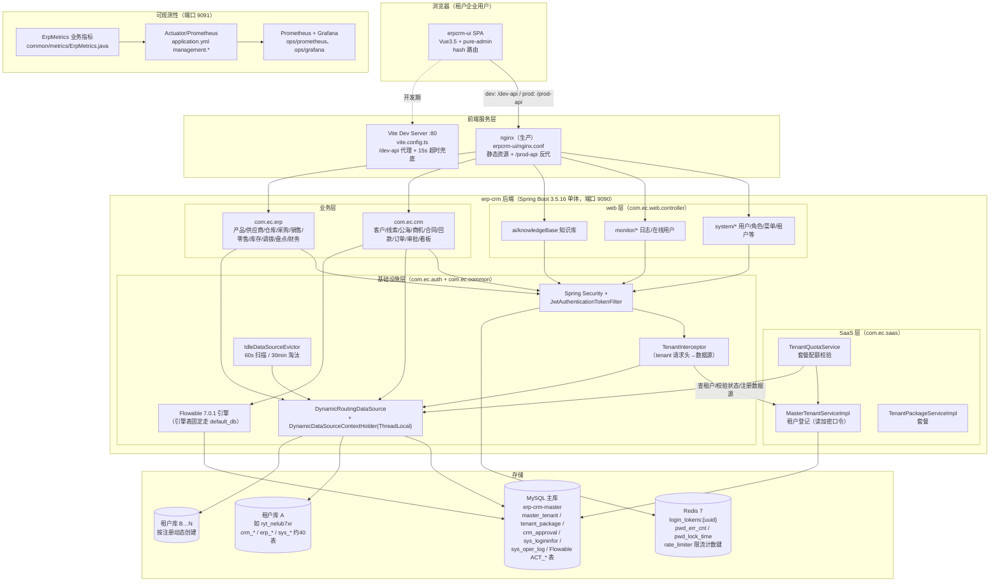

# 01-系统架构

> 项目：ERP-CRM ｜ 版本：v1.1 ｜ 生成日期：2026-10-05 ｜ 依据：源码分析（v1.1：2026-10-06 一致性回刷，与 16-20 篇对齐）

## 1. 整体架构图

系统为前后端分离的单体应用（Single JAR + SPA），外加 MySQL（主库 + N 个租户库）、Redis、可选的 Prometheus/Grafana 监控栈与 nginx。以下 mermaid 图中的所有组件均对应真实文件/配置项。

图上有两条独立的"库选择"路径值得先记住：其一是**每请求租户路由**——`TenantInterceptor` 在进入 Controller 前把租户名放入 `DynamicDataSourceContextHolder`（ThreadLocal），业务 SQL 经 `DynamicRoutingDataSource.determineCurrentLookupKey()` 落到对应租户库；其二是**主库操作重锚**——`MasterTenantServiceImpl` 的每个方法都标注 `@DataSource(DataSourceType.MASTER)`，由 `DataSourceAspect` 临时把 ThreadLocal 切到 `default_db` 并在方法返回后**恢复原值**（`erp-crm/src/main/java/com/ec/auth/aspectj/DataSourceAspect.java` 的 around 通知专门保存/恢复 previousKey，注释明确说明"否则租户请求中途调用过一次主库服务后，后续查询会静默落到默认数据源（主库）"）。

## 2. 分层与模块职责详解

后端名义上是单 Maven 模块，但包结构完整保留了原七模块划分（AGENTS.md："包结构沿用旧模块划分"），形成清晰的单体内的逻辑分层：

| 包 | 职责 | 关键类（均位于 `erp-crm/src/main/java/com/ec/` 下） |
|---|---|---|
| `com.ec.auth` | 安全 + 数据源 + 拦截器（原 auth 模块） | `config/SecurityConfig`（安全链、匿名放行清单）、`security/filter/JwtAuthenticationTokenFilter`（每请求解析 JWT 并装填 SecurityContext）、`web/service/TokenService`（签发/续期/吊销）、`web/service/SysLoginService`（登录编排：租户校验→锁定检查→AuthenticationManager→签发）、`web/service/UserDetailsServiceImpl`（查租户库 sys_user）、`interceptor/TenantInterceptor`、`datasource/*`、`aspectj/{DataSourceAspect,DataScopeAspect,LogAspect,RateLimiterAspect}`、`web/exception/GlobalExceptionHandler` |
| `com.ec.common` | 横切通用（原 common 模块） | `annotation/`（`@DataSource`、`@Log`、`@RateLimiter`、`@RepeatSubmit`、`@DataScope`、`@Excel`）、`core/domain/AjaxResult` 与 `core/page/TableDataInfo`（统一响应）、`core/controller/BaseController`（`startPage()`/`getDataTable()`/`toAjax()`）、`core/redis/RedisCache`、`utils/poi/ExcelUtil`、`filter/XssFilter`、`metrics/ErpMetrics`、`config/EcProdConfigVerifier`（prod 启动密钥 fail-fast 校验） |
| `com.ec.saas` | 主库 SaaS 域（原 saas 模块） | `domain/MasterTenant`、`domain/TenantPackage`、`mapper/MasterTenantMapper`（XML 含 package_id 列）、`service/impl/MasterTenantServiceImpl`（读写路径统一加解密）、`security/TenantDbPasswordCipher`（AES-256-GCM，`enc:v1:` 前缀格式）、`security/MasterTenantPasswordMigrator`（启动时把历史明文口令改写为密文）、`job/TenantExpirationJob`、`controller/SaasPackageController` |
| `com.ec.sys` | 系统域 service/mapper（原 system 模块） | `service/impl/SysUserServiceImpl`、`SysRoleServiceImpl`、`SysMenuServiceImpl`（`buildMenus` 产出 RouterVo 树）、`SysDeptServiceImpl`（DataScope 数据权限）、`KnowledgeBaseServiceImpl` 等 |
| `com.ec.web` | 面向前端的 Controller 层（原 center 模块） | `controller/system/*`（用户/角色/菜单/部门/岗位/字典/参数/通知/租户/注册/登录/个人中心）、`controller/monitor/*`（操作日志/登录日志/在线用户）、`controller/common/CommonController`（上传下载）、`controller/ai/KnowledgeBaseController`、`service/TenantQuotaService` |
| `com.ec.crm` | CRM 业务（原 crm 模块） | `controller/`：CrmCustomer/CrmClues/CrmPool/CrmComment/CrmOpportunity/CrmContract/CrmReceivable/CrmOrder/CrmApproval/IndexData/Owner；`service/impl/CrmApprovalServiceImpl`（Flowable 跨库编排，见 05 篇）；`domain/enums/CustomerFolder`（线索/客户/公海三态枚举） |
| `com.ec.erp` | ERP 业务（原 erp 模块） | 16 组 controller/service/mapper：product、supplier、warehouse、stock（采购单+明细）、payment、order（销售）、retail、sn（序列号）、flow（库存流水）、transfer（调拨）、adjustment（盘点）、client、tax（开票信息）、tags、map（标签映射）、finance（财务总览） |

前端分层（`erpcrm-ui/src/`）为"TS 基座 + JS 业务"双轨：

| 层 | 目录 | 说明 |
|---|---|---|
| 基座（TS） | `layout/`、`router/`、`store/modules/*.ts`、`config/`、`style/`、`components/Re*` | pure-admin 模板自带，含 `store/modules/user.ts`（登录态、`loginByUsername`、`logOut`）、`router/utils.ts`（`initRouter` 拉动态路由并 `handleAsyncRoutes`） |
| 适配层 | `api/user.ts`、`api/routes.ts`、`utils/request.js`、`utils/svgSprite.js` | 两个体系的"翻译官"：`user.ts` 把 RuoYi 的 `/login`+`/getInfo` 组装成 pure-admin 期望的 `UserResult` 结构；`routes.ts` 把后端 RuoYi RouterVo 树转成 pure-admin 路由（绝对路径、名称去重、InnerLink→iframe、外链 isLink）；`request.js` 统一注入 `Authorization: Bearer` 与 `tenant` 头 |
| 业务层（JS） | `views/`（86 页）、`api/`、`components/`（RuoYi 系）、`composables/`、`directive/`、`plugins/*.js` | 页面一律 `<script setup>`；列表页复用 `composables/useTable.js`，字典复用 `composables/useDict.js`（模块级 Map 缓存 Promise，同字典全局只请求一次） |

## 3. 数据流向图

```mermaid
flowchart LR
    A["浏览器请求<br/>Authorization + tenant 头"] --> B["JwtAuthenticationTokenFilter<br/>解析 token → Redis 取 LoginUser"]
    B --> C{"SecurityFilterChain<br/>授权规则"}
    C -->|"匿名路径 /login /register<br/>/saas/package/list /druid 等"| D["Controller"]
    C -->|"其余 anyRequest.authenticated"| D
    D --> E["TenantInterceptor.preHandle<br/>① 无 tenant 头→拒绝<br/>② 未注册→查 master_tenant<br/>   （校验存在/未停用/未过期）<br/>③ 创建 Druid 租户池并缓存<br/>④ ThreadLocal.setDataSourceKey(tenant)"]
    E --> F["Controller 方法<br/>@PreAuthorize 按钮级鉴权<br/>@Log 操作日志<br/>@RateLimiter 限流"]
    F --> G["Service<br/>@DataSource(MASTER) 方法<br/>→ DataSourceAspect 切 default_db<br/>并在 finally 恢复租户键"]
    G --> H["Mapper（MyBatis XML）<br/>PageHelper 分页"]
    H --> I{"DynamicRoutingDataSource<br/>determineCurrentLookupKey()"}
    I -->|"default_db"| J[("主库 erp-crm-master")]
    I -->|"tenant 名"| K[("租户库 ryt_*")]
    J -.->|"ACT_* 引擎表"| L["Flowable 引擎<br/>（审批固定走主库）"]
    B -.->|"login_tokens:{uuid}"| R[("Redis")]
    F -.->|"@Log 异步落库"| J
    M["IdleDataSourceEvictor<br/>@Scheduled(fixedDelay=60s)"] -->|"闲置>30min 整池关闭"| I
```

一次典型读请求的完整数据流：前端 `views/crm/customer/list.vue` 调 `src/api/crm/customer.js` 的 `listCustomer` → `utils/request.js` 拦截器补 `Authorization` 与 `tenant`（取 cookie）头 → 后端 Security 链通过 → `TenantInterceptor` 确保租户池存在并绑定 ThreadLocal → `CrmCustomerController.list()` 里 `startPage()`（PageHelper 从请求参数取 pageNum/pageSize）→ `CrmCustomerServiceImpl.selectCrmCustomerList()` → `CrmCustomerMapper.xml` 的 `selectCrmCustomerList`（left join 关联查询）→ 经 `DynamicRoutingDataSource` 命中租户库 → `getDataTable()` 包成 `{code:200, msg:"查询成功", rows, total}` → 前端响应拦截器按业务码处理，`useTable` 把 `res.rows/res.total` 填进表格状态。请求结束时 `TenantInterceptor.afterCompletion` 清 ThreadLocal、`PageClearInterceptor` 兜底清理分页残留（AGENTS.md 后端约定，防容器线程复用串页）。

## 4. 关键设计决策与设计模式

1. **独立数据库物理隔离（Database-per-Tenant）**。选择隔离性最强、运维成本也最高的方案（对比笔记/未命名.md 中梳理的三种多租户隔离策略），换取租户数据完全隔离与按租户备份/迁移的便利。落地依赖三件套：登记表 `master_tenant`、请求头路由 `TenantInterceptor`、动态数据源 `DynamicRoutingDataSource`。
2. **AbstractRoutingDataSource + ThreadLocal 的动态数据源模式**。`DynamicRoutingDataSource`（`auth/datasource/DynamicRoutingDataSource.java`）继承 Spring 的 `AbstractRoutingDataSource`，路由键来自 `DynamicDataSourceContextHolder` 的 ThreadLocal。细节处理相当讲究：
   - `addDataSource` 用 `putIfAbsent` 保证**并发首访只注册一个池**，后到者关闭自己刚创建的池（防孤儿池泄漏）；
   - `lastAccessMillis` 记录每个池最近路由时间，作为淘汰依据；
   - `evictIdleDataSources` 为 synchronized 方法，与 add 并发时靠 `remove` 的原子性避免重复关闭。
3. **闲置淘汰（对象池 + 定时任务模式）**。`IdleDataSourceEvictor` 以 `@Scheduled(fixedDelay=60_000, initialDelay=120_000)` 串行扫描，把闲置超过 `ec.datasource.idle-evict-minutes`（默认 30 分钟）的租户池整体 close 并移除，下次访问自动重建。这是"每租户一池"方案能否撑住规模的关键：租户池规格被刻意压小（`application-druid.yml` 的 `spring.datasource.druid.tenant.*`：initialSize=1、minIdle=1、maxActive=10），注释直言"规格必须远小于主库池，否则租户增长会打爆 MySQL 连接数"。
4. **AOP 注解驱动的数据源切换（声明式模式）**。`@DataSource(DataSourceType.MASTER)` + `DataSourceAspect`（`@Order(1)`）实现主库操作声明化；切面在 finally 中**恢复**而非清除先前键，修正了"切完不还原"的经典缺陷。与之配套的已知陷阱也被文档化（AGENTS.md 多租户第 6 条）：`@Transactional` 方法内切换 `@DataSource(MASTER)` 不会更换已绑定的连接——跨库操作必须用独立非事务方法封装，`SysLoginService.login` 中 `try/finally` 恢复租户键（其第 100-104 行）就是范本。
5. **代码生成机制（模板式生成器）**。`erp-crm/gen_business_modules.py` 以声明式 `MODULES` 数组（实体名/表名/列元数据/join 关系）驱动六个模板函数 `gen_domain/gen_mapper_iface/gen_mapper_xml/gen_service_iface/gen_service_impl/gen_controller`，一次产出符合 RuoYi 规范的完整模块（含 `@PreAuthorize` 权限串、`@Log` 注解、PageHelper 分页、left join 关联列 resultMap）。生成的 `CrmOpportunity/CrmContract/CrmReceivable` 三模块与手写模块结构完全一致，保证了风格统一。这是"生成后即固化"的模式：产物入库、生成器保留备查，运行时无任何代码生成依赖。
6. **跨库最终一致（补偿事务/Saga 思想）**。合同审批横跨租户库（业务数据）与主库（Flowable 引擎表），无法共用本地事务。`CrmApprovalServiceImpl` 的策略是**租户库回写先行、引擎操作最后执行、引擎失败则补偿回退**（`submitContractApproval` 失败时 `revertReviewStatus` + 删除留痕；`approve` 失败时同样双回退），类注释明确了取舍："避免引擎已推进、业务数据卡在待审且无法重试的死锁"；若在回写后、引擎前崩溃，重试审批可自愈（回写幂等）。
7. **CAS 认领防并发重复**。采购入库 `ErpStockOrderServiceImpl.stockIn` 与调拨执行 `ErpTransferOrderServiceImpl.doExecuteTransfer` 都先执行 `claimForStockIn/claimForExecute`（乐观 UPDATE 状态）抢占，抢不到即拒绝；调拨还在出库后**复检负库存**，不同调拨单并发挪同一批库存可能超调时整体回滚（`doExecuteTransfer` 末段）。
8. **静态加密 + 启动迁移**。主库中的租户库口令以 AES-256-GCM 加密存储（`TenantDbPasswordCipher`，格式 `enc:v1:<iv>:<密文>`，密钥经 SHA-256 派生自 `EC_TENANT_PASSWORD_KEY`），`MasterTenantServiceImpl` 在读写路径统一加解密（历史明文读取时透传），`MasterTenantPasswordMigrator` 在应用启动时把明文行批量改写为密文——形成"新写入即密文 + 存量启动迁移"的收敛闭环。
9. **配置外置与 fail-fast**。所有密钥走 `.env`（`spring.config.import: optional:file:./.env[.properties]`，`application.yml` 第 58-61 行）或环境变量；`EcProdConfigVerifier` 在 prod profile 下逐项校验必需密钥（如 JWT ≥64 字节、租户加密密钥必配），缺失即启动失败；`application-prod.yml.example` 还强制关闭 springdoc 与 Druid 控制台。
10. **可观测性内建**。`ErpMetrics` 用 Micrometer 注册业务指标：`erp.login.total{tenant,result}`、`erp.approval.total{tenant,action,result}`、`erp.transfer.executed.total`、`erp.tenant.register.total`、`erp.tenant.expired.disabled.total`，以及两个 Gauge（`erp.datasource.pools.active` 当前缓存池数、`erp.tenant.expiring.total` 临期租户数）；标签值经正则 `[a-zA-Z0-9_-]{1,32}` 归一化防"随机值制造无上限时间序列"。指标暴露在独立端口 9091，`ops/prometheus/`、`ops/grafana/` 提供抓取配置与看板。

## 5. 多租户设计（源码证据链）

多租户是本系统架构核心，以下六点均有直接源码依据：

1. **租户标识**：请求头 `tenant`。`TenantInterceptor.preHandle` 第一步即 `request.getHeader("tenant")`，缺失抛 `ServiceException("请求缺少租户信息")`；前端 `utils/request.js` 对**所有请求**（含匿名接口）注入 cookie `tenant`，调用方显式指定的 tenant 头优先（登录页提交新租户依赖此行为）。
2. **租户登记**：主库 `master_tenant` 表（`sql/erp-crm-master.sql` 第 21-35 行）字段含 `tenant/url/username/password/database_name/status/expiration_date/package_id`，`tenant` 列有唯一键 `uk_tenant`；口令列被 `MasterTenantServiceImpl` 读写路径透明加解密。
3. **请求期路由**：`TenantInterceptor` → 未注册则 `masterTenantService.selectMasterTenant(tenant)` 校验（不存在/停用/过期分别抛错）→ `dynamicRoutingDataSource.addDataSource(tenant, map)` → ThreadLocal 绑定；`afterCompletion` 清理（类注释特别说明必须用 afterCompletion 而非 postHandle，因 Controller 抛异常时 postHandle 不执行，会导致租户标识残留在复用线程上）。
4. **注册即建库**：`SysRegisterController.registerTenant`（IP 限流 5 次/小时，注释"每成功一次即真实建库建用户…防资源耗尽"）→ `TenantRegisterService.initDatabase`：`CREATE DATABASE`（utf8mb4）→ `CREATE USER` + 只授 select/insert/update/delete → 执行 `init-sql-script/erp-crm-tenant-sample.sql`（MyBatis `ScriptRunner`）→ 参数化插入租户部门与管理员（密码 BCrypt）→ 失败回滚 `DROP DATABASE/DROP USER` 防孤儿资源 → `MasterTenantServiceImpl.insertMasterTenant` 登记主库（无套餐默认有效期 7 天，有套餐按 `duration_days` 计算）。
5. **生命周期治理**：`TenantExpirationJob.sweepBySchedule`（cron `ec.tenant.expiration-job-cron` 默认 `0 0 3 * * ?`）每日巡检：过期→`status=2` 停用 + 指标计数；临期（`ec.tenant.expiration-remind-days` 默认 7 天）→ 日志提醒 + 刷新 gauge；拦截器在请求时本就拒绝过期租户（双保险）。测试入口为 `sweepOnce()`。
6. **套餐配额**：`TenantQuotaService.checkUserQuota(tenant, addingCount)` 读取 `master_tenant.package_id → tenant_package.max_users`，与租户库 `userService.countUsers()` 比较；未绑定套餐或 maxUsers≤0 视为不限制。新增用户与批量导入两个入口统一走它（`web/service/TenantQuotaService.java` 注释）；方法内 try/finally 重锚租户键的写法再次体现了第 4 条设计决策的纪律。种子数据含三档套餐：基础版（7 天/5 用户/免费）、专业版（365 天/50 用户/2999 元）、旗舰版（365 天/200 用户/9999 元）。

多租户下的一个重要边界是 **Flowable 引擎表固定落主库**：`application.yml` flowable 段注释"引擎表统一落在默认数据源 master 库，按 tenantId 区分租户"；`CrmApprovalServiceImpl` 用 `useMaster()/useTenant()` 显式来回切换，并以 `businessKey = "tenant:contractId"` 编码租户，查询时 `processInstanceBusinessKeyLike(tenant + ":%")` 过滤（类注释：用"引擎表单列谓词"避免按租户变量过滤的变量表 join）。

## 6. 安全架构要点

- **过滤器链**（`auth/config/SecurityConfig.java`）：CSRF 关闭（JWT 无状态）、`SessionCreationPolicy.STATELESS`、匿名放行 `/login`、`/register`、`/saas/package/list`、静态资源与 `/profile/**`、Swagger/Druid、`/actuator/**`（仅 9091 端口暴露）；`JwtAuthenticationTokenFilter` 插在 `UsernamePasswordAuthenticationFilter` 之前，CORS 过滤器再插在它之前。
- **鉴权模型**：RBAC——用户→角色→菜单（权限串如 `crm:customer:add`）。后端方法级 `@PreAuthorize("@ss.hasPermi('...')")`（`PermissionService.hasPermi`），前端按钮级 `v-hasPermi` 指令（`erpcrm-ui/src/directive/`）；行级数据权限由 `@DataScope` + `DataScopeAspect` 按角色拼部门过滤条件；业务归属校验（防越权改他人记录）在 service 层显式实现，如 `CrmCustomerServiceImpl.transferCrmCustomerByIds` 对非管理员强制 `restrictOwner=true`。
- **防暴力破解**：`/login` IP 限流 30 次/分（`@RateLimiter(limitType=IP, time=60, count=30)`）；密码连续错 5 次锁定 10 分钟（Redis 键 `pwd_err_cnt:{tenant}:{username}` 计数、`pwd_lock_time:{tenant}:{username}` 存锁定截止时间戳，`SysLoginService` 常量 `PASSWORD_MAX_RETRY_COUNT/PASSWORD_LOCK_MINUTES`）；`/register` IP 限流 5 次/小时。
- **会话吊销**：JWT 本身无状态，但 LoginUser 存 Redis（`login_tokens:{uuid}`），登出走 `LogoutSuccessHandlerImpl` 删除该键，`/monitor/online` 可强制下线（`SysUserOnlineController` DELETE）。
- **其他**：XSS 过滤器仅覆盖 `/system`、`/monitor`、`/tool`（`application.yml` xss.urlPatterns；AGENTS.md 记录了"有意不扩大到 crm/erp"的评估结论）；上传扩展名白名单在 `MimeTypeUtils`；防重复提交注解 `@RepeatSubmit` + 前端 request.js 的 1 秒内存 Map 窗口双保险。
