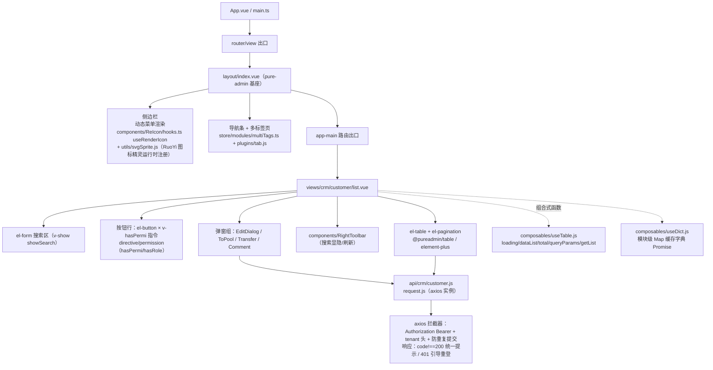
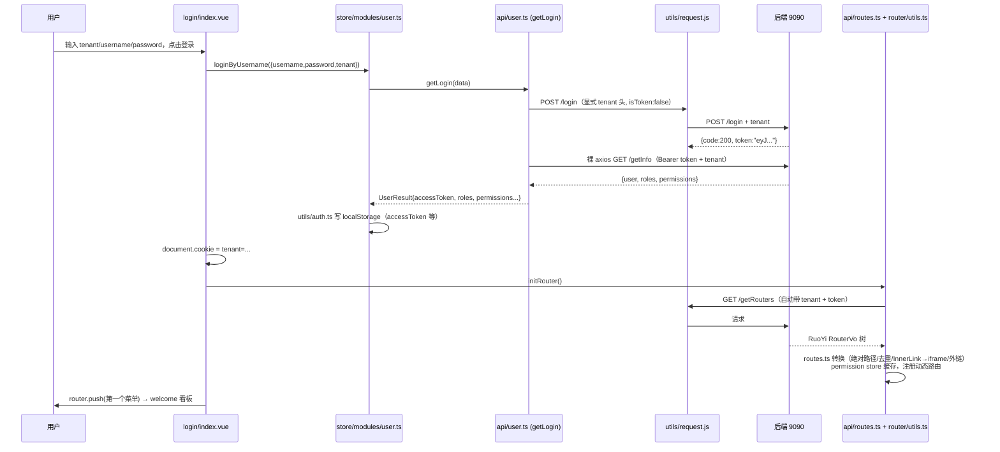
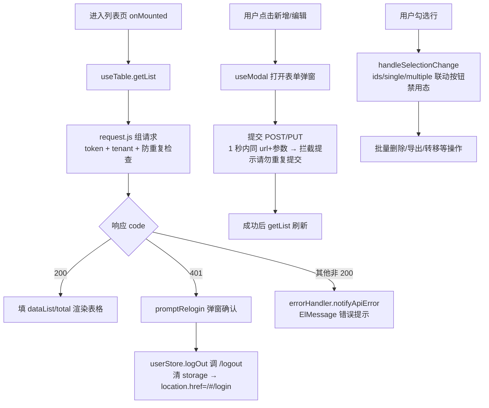

# 02-页面设计

> 项目：ERP-CRM ｜ 版本：v1.1 ｜ 生成日期：2026-10-05 ｜ 依据：源码分析（v1.1：2026-10-06 一致性回刷，与 16-20 篇对齐）

## 1. 前端总体形态

前端（`erpcrm-ui/`）是 pure-admin 底座的管理后台 SPA：登录后由后端 `GET /getRouters` 下发**动态菜单**（RuoYi RouterVo 树），经 `src/api/routes.ts` 转成 pure-admin 路由后挂载；页面主体为"搜索表单 + 操作按钮行 + 数据表格 + 分页 + 新增/编辑弹窗"的 RuoYi 风格列表页。路由使用 **hash 模式**（`erpcrm-ui/.env` 的 `VITE_ROUTER_HISTORY=hash`，401 重登时跳 `/#/login` 亦依赖此约定，见 `utils/request.js` 响应拦截器注释）。`src/views/` 下共 86 个 `.vue` 页面文件，覆盖登录/注册、工作台看板、CRM 11 页、ERP 17 页、系统管理 20 页、系统监控 8 页、平台工具 12 页与错误页。

## 2. 路由与页面总表

静态路由只有 5 条（`src/router/modules/remaining.ts`：`/login`、`/access-denied`、`/server-error`、`/redirect/:path`、`/register`）加上 `home.ts` 的首页；其余全部由菜单表驱动动态注册，页面 path 即菜单表 `sys_menu.component` 列（如 `crm/customer/index` → `views/crm/customer/index.vue`，实际列表页多用 `list.vue` 并由同目录辅助组件配合）。下表按业务域归并（组件路径相对 `erpcrm-ui/src/views/`）：

| 业务域 | 页面（组件路径） | 路由/权限标识 | 功能与交互要点 |
|---|---|---|---|
| 认证 | `login/index.vue` | `/login`（匿名） | 租户+账号+密码三段式表单；记住账号（localStorage `login-remembered-username`，只存租户与用户名、不存密码）；登录成功写 `document.cookie = tenant=...` 再 `initRouter()` 拉菜单并跳首个菜单；Enter 键防抖提交（`debounce(…,1000,true)`）；右上角明暗主题开关 |
| 认证 | `register.vue` | `/register`（匿名） | 租户 ID + 管理员账号/密码/确认密码 + **套餐卡片单选**（调 `GET /saas/package/list` 渲染三档价格/天数/人数），提交即真实建库，成功后跳登录 |
| 工作台 | `welcome/index.vue` | `/welcome`（首页菜单） | 数据看板：`PanelGroup` 指标卡 + 三张 pie/line 图（客户状态、线索来源、近半年新增客户）+ 双轴柱状图（近半年订单金额/单数）+ 今日待办/今日提醒/跟进动态三卡；数据来自 `/crm/index-data/info` 与 `/crm/index-data/stats`；图表组件在 `views/dashboard/{PieChart,LineChart,BarChart,RaddarChart}.vue` |
| CRM | `crm/customer/list.vue` | `crm:customer:*` | 客户主列表：按日期/名称/电话/级别/状态筛选；操作含新增、**移入公海**（ToPool 弹窗选公海类型）、**转移客户**（Transfer 弹窗选新负责人）、删除、导出；行操作含跟进（Comment 组件） |
| CRM | `crm/customer/person-list.vue` | `crm:customer:list` | "我的客户"视图，同结构，按当前用户过滤 |
| CRM | `crm/customer/deal-list.vue` | — | 成交客户视图 |
| CRM | `crm/customer/{Comment,ToPool,Transfer}.vue` | — | 客户跟进记录弹窗、移入公海弹窗、转移弹窗（列表页同目录复用） |
| CRM | `crm/clues/{list,person-list,ToCustomer,Transfer}.vue` | `crm:clues:*` | 线索管理：公共线索池/我的线索；`ToCustomer.vue` 把线索转成客户（`PUT /crm/clues/to-customer`） |
| CRM | `crm/pool/{index,list}.vue` | `crm:pool:list` | 公海池：列表 + **领取**（`POST /crm/pool/receive/{id}`），领取后客户进入个人名下 |
| CRM | `crm/opportunity/index.vue` | `crm:opportunity:*` | 商机 CRUD（生成器产出的标准列表页形态） |
| CRM | `crm/contract/index.vue` | `crm:contract:*` | 合同 CRUD，含 `review_status` 审批状态列（字典 `contract_review_status`），可发起审批 |
| CRM | `crm/approval/index.vue` | `crm:approval:list/approve` | 审批中心：待办/已办 Tab（`status=0` 待办，1 通过 / 2 驳回已办），标题搜索、分页；对任务执行通过/驳回（驳回必填意见） |
| CRM | `crm/receivable/index.vue` | `crm:receivable:*` | 回款 CRUD（关联合同展示合同编号/客户名） |
| CRM | `crm/order/{list,person-list}.vue` | `crm:order:*` | CRM 订单（0 待审核/1 通过/2 不通过） |
| ERP | `erp/product/index.vue` | `erp:product:*` | 产品主数据；支持按标签查询（`POST /erp/product/querPorductByTags`，源码即此拼写） |
| ERP | `erp/supplier/index.vue`、`erp/warehouse/index.vue` | `erp:supplier:*`、`erp:warehouse:*` | 供应商与仓库维护；仓库页另有 `/options` 下拉数据源 |
| ERP | `erp/stock/index.vue` | `erp:stock:*` | 采购单：录入采购单+多明细（商品×数量×单价），**入库**按钮触发 `PUT /erp/stock/stock-in/{id}` |
| ERP | `erp/payment/index.vue` | `erp:payment:*` | 采购付款记录 |
| ERP | `erp/order/{index,bussiness,manager,orderDialog}.vue` | `erp:order:*` | 销售订单三种视图（通用列表/业务视图/管理视图）+ 下单弹窗（选客户、开票信息、商品） |
| ERP | `erp/retail/index.vue` | `erp:retail:*` | 零售出库（按商品 SN 条码） |
| ERP | `erp/sn/index.vue` | `erp:sn:*` | 商品 SN 条码（在库/出库状态） |
| ERP | `erp/flow/index.vue` | `erp:flow:*` | 库存流水（按仓库过滤，0 出库/1 入库/2 期初） |
| ERP | `erp/transfer/index.vue` | `erp:transfer:*` | 调拨单：新建（校验调出≠调入）、**执行**按钮 `PUT /erp/transfer/execute/{id}` |
| ERP | `erp/adjustment/index.vue` | `erp:adjust:list/add` | 库存盘点调整（盘盈入库/盘亏出库，字典 `stock_adjust_type`） |
| ERP | `erp/finance/index.vue` | — | 财务总览：`/erp/finance/overview` 应收/库存资产 + `/erp/finance/stock-summary` 库存汇总 |
| ERP | `erp/client/index.vue`、`erp/info/index.vue`、`erp/tags/index.vue`、`erp/map/index.vue` | — | 零售客户、开票信息、标签、标签映射维护 |
| 系统管理 | `system/user/index.vue`（+`profile/*` 4 页、`authRole.vue`） | `system:user:*` | 用户管理：CRUD、导入导出（`importData/importTemplate`）、重置密码、状态切换、分配角色；**新增/导入受套餐配额约束**（后端 `TenantQuotaService`） |
| 系统管理 | `system/role/index.vue`（+`authUser/selectUser`） | `system:role:*` | 角色管理 + 数据权限 + 分配用户 |
| 系统管理 | `system/menu/index.vue` | `system:menu:*` | 菜单管理（决定所有租户的动态菜单树） |
| 系统管理 | `system/dept/index.vue` | `system:dept:*` | 部门树管理 |
| 系统管理 | `system/dict/{index,data}.vue` | `system:dict:*` | 字典类型/数据维护（业务枚举如客户级别、审批状态均走字典） |
| 系统管理 | `system/config/index.vue`、`system/post/index.vue`、`system/notice/index.vue` | — | 参数配置、岗位、通知公告 |
| 系统管理 | `system/tenant/list.vue` | `/system/tenant` | 平台级租户管理：列表、改套餐（PUT）、删除、配额查询 `/quota` |
| 监控 | `monitor/{operlog,logininfor,online,server,cache,druid,job,job/log}.vue` | `monitor:*` | 操作日志、登录日志、在线用户（强踢）、Druid 内链 iframe；`server`/`cache`/`job`（含 job/log）为 RuoYi 遗留死页——后端 monitor 域仅 operlog/logininfor/online 三组端点（15 篇第 3 节、13 篇 D19） |
| 平台工具 | `tool/{gen/*,build/*,swagger}` 12 页 | `tool:*` | RuoYi 代码生成/表单构建/swagger 内链；`gen` 为死页（后端生成接口未随单模块迁移，13 篇 D19），模块生成走 `gen_business_modules.py`（16 篇 ADR-004） |
| 错误页 | `error/{403,404,500}.vue` | `/access-denied` 等 | 全屏错误页 |

## 3. 逐个核心页面详解

### 3.1 登录页 `views/login/index.vue`

布局为 pure-admin 经典左右结构：左侧插画、右侧登录卡片（logo 72px 方形圆角、标题、三个 `el-input`、记住账号复选框、全宽登录按钮、页脚版权）。状态量极少：`loading/disabled/checked` + `ruleForm{tenant, username, password}`。交互细节：

- **记住账号**：登录成功后按勾选态写/删 localStorage `login-remembered-username`（`JSON.stringify({tenant, username})`），进入页面时回填并勾选；刻意不启用 pure-admin 的免登录（文件内 watch 注释说明原因：后端 JWT 有过期与 401 语义，自动登入会频繁失败）。
- **租户 cookie 同步**：登录成功第一步 `document.cookie = 'tenant=...'`，因为 `utils/request.js` 对所有请求注入 cookie `tenant`，后续 getInfo/getRouters 必须带上正确租户。
- **提交流程**：`useUserStoreHook().loginByUsername(...)`（`store/modules/user.ts`）→ `api/user.ts getLogin`：先 `POST /login`（显式传 tenant 头、`isToken:false`），拿到 `token` 后再用**裸 axios**（此时 token 尚未落存储）调 `/getInfo` 组装 `UserResult`（roles/permissions 单项失败不阻断登录，降级为空数组）；随后 `initRouter()` 触发 `api/routes.ts` 的菜单拉取与转换，`router.push(getTopMenu(true).path)` 落到第一个可访问菜单。

### 3.2 注册页 `views/register.vue`

除表单外，特色是**套餐选择卡片区**：`onMounted` 调 `/saas/package/list` 渲染 `package-cards`，每张卡展示套餐名/价格/每天数/最大用户数，点击置 `registerForm.packageId`。提交字段为 `{tenantName, adminName, adminPass, confirmPassword, packageId}`（自定义校验：确认密码一致、租户名 2-30 字符等前端规则与后端 `TenantRegisterBody` 的 `@Pattern` 呼应）。提交成功后路由跳转登录页——注意后端注册接口对同一 IP 限流 5 次/小时，注册即真实建库，前端重复点击会被 `request.js` 的防重复提交（1 秒窗口）先挡一层。

### 3.3 客户列表 `views/crm/customer/list.vue`（列表页范式）

642 行的标准列表页，可作为所有列表页的模板理解：

- **结构**：`el-form`（inline 搜索区，`v-show="showSearch"`）→ `el-row`（按钮行：新增/移入公海/转移客户/删除/导出，全部带 `v-hasPermi` 指令；末尾 `<right-toolbar>` 控制搜索区显隐与刷新）→ `el-table`（多选列 + 数据列，`v-loading`）→ `pagination` 组件。
- **状态来源**：`useTable(listCustomer, {...})` 提供 `loading/dataList/total/queryParams/getList/handleQuery/resetQuery/handleSelectionChange`；字典 `useDict(["customer_rank","customer_status"])` 提供下拉与标签翻译。
- **特有交互**：移入公海（`ToPool.vue` 选公海类型 → `toPoolCustomer({ids, poolType})`）、转移（`Transfer.vue` 选新负责人 → `transferCustomer({ids, newOwner})`）、跟进（`Comment.vue` 弹窗读写 `/crm/comment/customer/{customerId}`）。
- **权限联动**：按钮显隐由前端 `v-hasPermi` 控制，但真正的防线是后端同名 `@PreAuthorize`；非管理员操作他人记录时后端 service 层还会做归属校验（`CrmCustomerServiceImpl.deleteCrmCustomerByIdsForOwner` 逐条比对 owner）。

### 3.4 审批中心 `views/crm/approval/index.vue`

待办/已办两个 Tab 共用一张列表，`status` 参数（0 待办 / 1 通过 / 2 驳回）直传 `GET /crm/approval/list`。行操作：待办行提供"通过/驳回"，驳回弹出意见输入框（后端 `CrmApprovalServiceImpl.approve` 校验驳回必填意见，缺失抛"驳回时请填写审批意见"）。该页面是全站唯一一个直接消费 Flowable 流程状态的页面，字段（taskId/title/applicant/status/opinion/approveTime）由 `CrmApprovalServiceImpl.selectApprovalList` 聚合流程引擎与租户库合同数据拼装。

### 3.5 工作台 `views/welcome/index.vue`

纯展示型页面，`onMounted` 并行拉两个接口：`indexData()`（`customer_info` 指标、`followup_info` 待办统计、`today_followup_list` 今日跟进提醒、`today_updates` 跟进动态）与 `dashboardStats()`（`customer_status/clues_source/months/new_customers/order_amounts/order_counts`）。图表全部从 `@/plugins/echarts.ts` 按需导入（Pie/Bar/Line/Radar/Gauge + macarons 主题已注册），布局用 `el-row/el-col` 响应式三等分（`md=8/sm=24/xs=24`），窄屏自动堆叠。

## 4. 组件树

以下组件树描述一次典型业务页面的运行时结构（以客户列表为例），`Layout` 与基座组件为 TS，业务组件为 JS：

iframe 菜单（如 Druid 监控）走独立出口：`routes.ts` 将内链合成 `/iframe/<name>` 路由指向 `views/iframe/index.vue`，真实 URL 存 `meta.iframeLink`；外链则不注册路由，仅出现在菜单中（`meta.isLink`）。

## 5. 状态管理设计

前端状态分四层，刻意保持轻量：

1. **Pinia 全局态（TS，pure-admin 基座）**：`store/modules/user.ts`（accessToken/refreshToken/username/roles/permissions，持久化经 `utils/auth.ts` 写 localStorage `user-info`，多标签同步键 `multiple-tabs`）、`permission.ts`（动态路由/缓存页面集合）、`app.ts`（侧边栏折叠、设备类型）、`epTheme.ts`/`settings.ts`（主题）、`multiTags.ts`（页签）。业务代码一般只接触 `user.ts` 的 `loginByUsername/logOut`。
2. **页面局部态（JS）**：列表页的表格状态全部收敛在 `useTable` 返回的 refs 里；弹窗开关用 `useModal`（`composables/useModal.js`）管理 `visible` 标志。跨组件一次性通信用 `utils/mitt.ts` 事件总线（基座遗留，业务少用）。
3. **字典缓存（模块级单例）**：`useDict.js` 顶层 `const dictCache = new Map()` 缓存各类型字典的请求 Promise——同类型字典跨页面/跨实例只发一次请求，失败不缓存以便重试（代码注释明确记录了这一优化动机）。字典数据本身后端也有 Redis/本地缓存（`DictUtils` + `sys_dict` 的 `refreshCache` 接口）。
4. **工具态注入**：`plugins/appContext.js` + `composables/useAppContext.js` 把 `parseTime/download/handleTree` 等 RuoYi 全局工具改造为组合式 API 供 `<script setup>` 页面使用（替代 Vue2 的 `Vue.prototype` 挂载）。

没有引入 Vuex/Pinia 业务 module 的原因：后端每次请求都携带 tenant 头且页面数据天然按租户隔离，无需全局业务缓存；这使前端"刷新即一致"，状态管理成本极低。

## 6. 关键 UI 交互流程

### 6.1 登录到看到首屏

### 6.2 列表页增删改查与 401 处理

补充两个容易踩坑的交互契约：其一是 **401 语义**——后端 `AuthenticationEntryPointImpl` 始终返回 HTTP 200 + body `code:401`（`ServletUtils.renderString` 硬编码 `response.setStatus(200)`），前端 `request.js` 按**业务码**而非 HTTP 状态码识别会话过期；其二是 **blob 下载**——`download()` 方法把超时放宽到 60 秒并用 `blobValidate` 区分"真文件"与"包成 JSON 的错误响应"（导出失败时能弹出后端 msg 而不是把错误 JSON 存成文件）。
