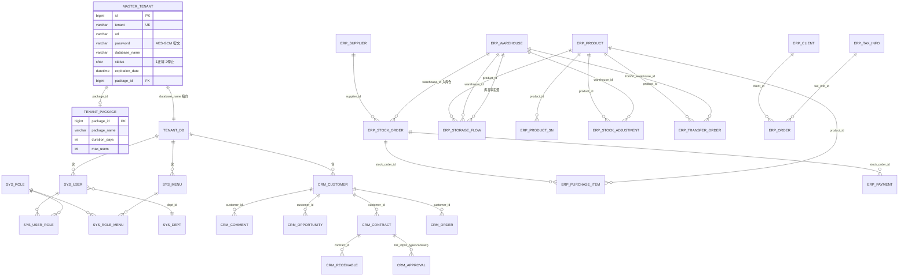

# 04-数据模型

> 项目：ERP-CRM ｜ 版本：v1.1 ｜ 生成日期：2026-10-05 ｜ 依据：源码分析（v1.1：2026-10-06 一致性回刷，与 16-20 篇对齐）

## 1. 存储方案总览

系统采用 **"1 主库 + N 租户库"的独立数据库物理隔离**方案，全部使用 MySQL 8.4（InnoDB / utf8mb4），Redis 7 仅作缓存与会话存储、不落业务数据。

- **主库 `erp-crm-master`**：由 `erp-crm/sql/erp-crm-master.sql` 初始化，共 5 张业务表——`master_tenant`（租户登记）、`tenant_package`（套餐）、`crm_approval`（审批留痕，主/租户库各有一份，见下文）、`sys_logininfor`（登录日志，全局链路）、`sys_oper_log`（操作日志表结构，实际 `@Log` 写入当前租户库）。此外 **Flowable 7.0.1 的 ACT_* 引擎表也建在主库**（`application.yml` flowable 段 `database-schema-update: true` 启动自动建表；`CrmApprovalServiceImpl` 的 `useMaster()` 与类注释"引擎表统一落在 master 库，按 tenantId 区分租户"）。
- **租户库**（库名 `ec_<8位随机串>`，历史数据为 `ryt_*`）：由注册流程 `TenantRegisterService` 按 `src/main/resources/init-sql-script/erp-crm-tenant-sample.sql` 模板创建，共 **40 张表**——CRM 7 张（customer/clues 同表复用、comment、opportunity、contract、receivable、order、approval）、ERP 16 张、系统 15 张（RuoYi 标准 sys_* 全家桶）、以及 `analysis_report`、`knowledge_base`。每个租户库还预置菜单（`sys_menu`）、字典（`sys_dict_*`）、角色（含普通销售角色 role_id=3）等种子数据，使新租户开箱即用。
- **同一业务表双库存在的特例**：`crm_approval` 在主库模板（`sql/erp-crm-master.sql` 第 106-120 行）与租户模板（`init-sql-script/erp-crm-tenant-sample.sql` 第 24-38 行）结构完全一致——租户库那份是"审批留痕"（`CrmApprovalServiceImpl.submitContractApproval` 先写租户库），主库那份保持结构对齐以便后续把审批中心整体迁到主库（脚本注释"业务表落主库；与 db-backup/upgrade_approval.sql 保持一致"）。
- **Redis 键空间**（`SysLoginService`/`TokenService`/`RateLimiterAspect`/`DictUtils`）：`login_tokens:{uuid}`（会话）、`pwd_err_cnt:{tenant}:{username}`（密码错误计数）、`pwd_lock_time:{tenant}:{username}`（锁定截止时间戳）、限流键、字典缓存键、参数配置缓存键。

数据访问层为 MyBatis XML（`src/main/resources/mapper/{sys,crm,erp,saas}/*.xml`，共 43 个映射文件），主键策略以自增 `AUTO_INCREMENT` 为主（`erp_product_sn` 用 UUID 字符串主键 `sn_uuid`、`erp_tags` 用 `tag_uuid`）；实体继承 `common/core/domain/BaseEntity`（createBy/createTime/updateBy/updateTime/remark/params 公共字段）或 `ErpBaseEntity`。

## 2. 主库表结构

### 2.1 master_tenant（租户登记表，`sql/erp-crm-master.sql` 第 21-35 行）

| 字段 | 类型 | 约束 | 说明 |
|---|---|---|---|
| id | bigint | PK, AUTO_INCREMENT | 主键 |
| tenant | varchar(32) | UNIQUE KEY `uk_tenant` | 租户标识（即请求头 `tenant` 值，与租户企业名一致） |
| url | varchar(255) | | 租户库 JDBC URL（含库名与时区参数） |
| username / password | varchar(255) | | 租户库账号；**password 为 AES-256-GCM 密文**（`enc:v1:<iv>:<cipher>`，`TenantDbPasswordCipher`；历史明文由 `MasterTenantPasswordMigrator` 启动迁移） |
| database_name | varchar(64) | | 租户库名（备份脚本 `ops/backup.sh` 据此枚举备份目标） |
| host_name | varchar(64) | 可空 | 登记用主机名 |
| create_time | datetime | | 创建时间 |
| status | char(1) | 默认 '1' | 状态（1 正常 2 停止；到期巡检 `TenantExpirationJob` 自动置 2） |
| expiration_date | datetime | 可空 | 到期日期（注册按套餐 `duration_days` 计算，无套餐默认 7 天） |
| package_id | bigint | 可空 | 关联 `tenant_package.package_id`（改套餐经 `updateMasterTenant`） |

### 2.2 tenant_package（租户套餐表，`sql/erp-crm-master.sql` 第 126-135 行）

| 字段 | 类型 | 约束 | 说明 |
|---|---|---|---|
| package_id | bigint | PK, AUTO_INCREMENT | 主键 |
| package_name | varchar(50) | NOT NULL | 套餐名 |
| price | decimal(10,2) | 默认 0.00 | 价格 |
| duration_days | int | NOT NULL, 默认 30 | 有效天数（注册时换算 expiration_date） |
| max_users | int | NOT NULL, 默认 10 | 用户数上限（≤0 或未绑定视为不限制，`TenantQuotaService`） |
| remark / create_time | varchar(500) / datetime | | 备注/创建时间 |

种子三档（同脚本第 140-143 行）：基础版 0 元/7 天/5 用户；专业版 2999 元/365 天/50 用户；旗舰版 9999 元/365 天/200 用户。

### 2.3 其余主库表

- `sys_logininfor`：`info_id` PK、`user_name/ipaddr/login_location/browser/os/status(0成功 1失败)/msg/login_time`——由 `AsyncFactory.recordLogininfor` 异步写，记录**所有租户**的登录事件（主库表，天然全局）。
- `sys_oper_log`：`oper_id` PK、`title/business_type/method/request_method/operator_type/oper_name/oper_url/oper_ip/oper_param/json_result/status/error_msg/oper_time`——`@Log` 注解经 `LogAspect` + `AsyncManager` 写入（实体定义于 `sys/domain/SysOperLog.java`）。
- `crm_approval`：`id/biz_type(默认 contract)/biz_id/title/applicant/approve_by/status(0待 1通过 2驳回)/opinion/create_time/update_time`，索引 `idx_biz(biz_type,biz_id)` 与 `idx_status`。
- Flowable 自动建表：`ACT_RE_*`（运行时）、`ACT_HI_*`（历史）、`ACT_GE_*`（通用/资源，含 `ACT_GE_BYTEARRAY` 存 `processes/contract-approval.bpmn20.xml` 编译产物）、`ACT_ID_*` 等。

## 3. 租户库核心表结构

以下为业务价值最高的表（均出自 `init-sql-script/erp-crm-tenant-sample.sql`，行号随表标注；⚠️ 该模板内部分注释为乱码——历史 GBK→UTF8 转码遗留，`db-backup/repair_mojibake_20260907.sql` 即为修复产物，不影响字段使用）。

### 3.1 crm_customer（客户表，第 81-114 行；线索与公海同表复用）

| 字段 | 类型 | 约束/默认 | 说明 |
|---|---|---|---|
| id | bigint | PK, AUTO_INCREMENT | 客户 ID |
| code / name | varchar(32)/(64) | | 客户编号/名称（`idx_name`） |
| linkman / phone / region | varchar(64) | | 联系人/电话（`idx_phone`）/地区 |
| customer_industry / customer_rank / customer_status | varchar(64) | | 行业/级别/状态（字典 customer_*） |
| clues_name / clues_source / clues_status | varchar(64) | | 线索名/来源/状态（字典 clues_*，status=0 时生效） |
| deal_status | char(1) | '0' | 是否成交（0 未成交 1 成交） |
| status | char(1) | '1' | **归属态（0 线索 1 客户 2 公海）**——`domain/enums/CustomerFolder` 枚举即此三态，是线索→客户→公海流转的核心字段 |
| owner / pre_owner | varchar(64) | | 当前/前任负责人（转移留痕） |
| del_flag | char(1) | '0' | 逻辑删除（0 存在 2 删除） |
| version | int | 0 | 乐观锁版本 |
| last_update_record / last_followup_time / next_followup_time | varchar(255)/datetime | | 最近跟进摘要与时间（首页"今日提醒"数据源） |
| to_pool_time / to_customer_time / pool_type | datetime/varchar(64) | | 转公海/转客户时间、公海类型 |
| create_by/create_time/update_by/update_time/remark | — | | BaseEntity 公共字段 |

### 3.2 CRM 其余表

| 表 | 关键字段 | 说明 |
|---|---|---|
| crm_comment（第 43 行） | id、customer_id、content varchar(512)、BaseEntity 字段 | 客户跟进记录（Comment 弹窗），XML 写入时同步更新客户表的跟进三字段 |
| crm_opportunity（第 119 行） | id、name、customer_id、amount decimal(12,2)、stage、expected_date、owner | 商机（生成器产物；`idx_customer`） |
| crm_contract（第 57 行） | id、contract_no、name、customer_id、amount、sign_date/start_date/end_date、status(0 执行中 1 已完成 2 作废)、**review_status(0 待审批 1 通过 2 驳回 NULL 未提交)**、owner | 合同；`review_status` 由 `db-backup/upgrade_approval.sql` 的 `ALTER TABLE ... AFTER status` 增量加入，是审批流程的业务状态位 |
| crm_receivable（第 159 行） | id、contract_id、amount、receivable_date、owner | 回款（`idx_contract`） |
| crm_order（第 139 行） | id、order_no **UNIQUE `idx_order_no`**、customer_id、amount decimal(19,2)、status(0 待审核 1 通过 2 不通过)、owner | CRM 订单（与 ERP 销售订单是两套，注意区分） |
| crm_approval（第 24 行） | 同主库版本 | 审批留痕（租户库） |

### 3.3 ERP 表

| 表 | 关键字段 | 说明 |
|---|---|---|
| erp_product（第 224 行） | id、product_name/model/unit、product_price double(16,2) unsigned、**safety_stock int 默认 0** | 产品；safety_stock 由 `upgrade_supply_finance.sql` 增量加入 |
| erp_supplier（第 331 行） | id、supplier_code/supplier_name NOT NULL、contact/phone/address、status(0 启用 1 停用) | 供应商 |
| erp_warehouse（第 402 行） | id、warehouse_code/warehouse_name NOT NULL、address、status | 仓库（`upgrade_warehouse_transfer.sql` 引入，预置"默认仓库"） |
| erp_stock_order（第 297 行） | id、flow_id、**order_no、supplier_id、warehouse_id、status(0 待入库 1 已入库 2 已作废)**、total_price/actual_payment、supplier_name、handler_name | 采购单；status 是入库 CAS 认领位（`claimForStockIn`） |
| erp_purchase_item（第 250 行） | id、stock_order_id、product_id、amount、price decimal(12,2)，`idx_po` | 采购明细（随单整删整插：`saveItems` 先 delete 再 batchInsert） |
| erp_payment（第 208 行） | id、stock_order_id、amount NOT NULL、pay_date、handler_name | 采购付款 |
| erp_order（第 189 行） | id、order_name、client_id、tax_info_id、tax_need、total_price/actual_payment、handler_name、order_no、detail_id | 销售订单 |
| erp_storage_flow（第 316 行） | id、product_id、amount、**order_type(0 出库 1 入库 2 期初)**、price、order_id、**warehouse_id bigint 默认 1** | 库存流水（一切库存变动的唯一事实源；warehouse_id 由调拨升级脚本补列并回填 1） |
| erp_transfer_order（第 384 行） | id、transfer_no NOT NULL、product_id、amount、from/to_warehouse_id、status(0 待执行 1 已执行 2 作废)、handler_name | 调拨单（`claimForExecute` 认领位） |
| erp_stock_adjustment（第 277 行） | id、adjust_no NOT NULL、product_id、warehouse_id、adjust_type(2 盘盈 3 盘亏)、amount、before_qty/after_qty、reason | 盘点调整 |
| erp_retail（第 263 行） | id、flow_id、actual_payment、handler_name、sn_uuid | 零售出库单 |
| erp_product_sn（第 238 行） | **sn_uuid varchar(255) PK**、sn_code、product_id、status(0 在库 1 出库) | 序列号 |
| erp_client / erp_tax_info / erp_tags / erp_tags_map（第 177/370/350/362 行） | 零售客户（昵称/手机/地址/性别）、开票信息（纳税人识别号/公司/银行）、标签（tag_uuid PK/名称/颜色）、标签-产品映射 | 销售辅助主数据 |

### 3.4 系统表（RuoYi 标准，租户库）

`sys_user`（第 633 行，user_id PK、dept_id、user_name、nick_name、password（BCrypt）、status、del_flag、login_ip/login_date 等）、`sys_role`（第 594 行，含 data_scope）、`sys_menu`（第 511 行，menu_id/menu_name/parent_id/path/component/perms/menu_type 等——动态菜单与权限串的源头）、`sys_dept`（第 436 行，ancestors 祖级列表）、`sys_user_role`/`sys_role_menu`/`sys_role_dept`/`sys_user_post` 四张关联表、`sys_dict_type`/`sys_dict_data`、`sys_config`、`sys_post`、`sys_notice`、`sys_logininfor`/`sys_oper_log`（租户库各一份）。另有 `analysis_report`（第 685 行）与 `knowledge_base`（第 699 行）两张扩展表。

## 4. ER 图

读图要点：① 跨租户的"实体关系"只有 `master_tenant.package_id → tenant_package` 一条真实外键语义（数据库层面均无 FK 约束，关系由应用层与 XML join 维护，RuoYi 惯例 `SET FOREIGN_KEY_CHECKS=0`）；② `crm_customer.status` 三态让"线索/客户/公海"共用一张表，所有归属查询都带 owner/status 谓词；③ `erp_storage_flow` 是库存数量的唯一事实源——某仓某品的现存量 = 该 (product_id, warehouse_id) 下 `sum(order_type in (1,2)) - sum(order_type=0)`（`ErpTransferOrderMapper.selectStockQtyInWarehouse` 即此口径）。

## 5. 数据生命周期与增量迁移机制

### 5.1 数据生命曲线

1. **租户库诞生**：注册成功瞬间由 `TenantRegisterService.executeInitScript` 执行模板 SQL 建全量表并种入部门/管理员/菜单/字典/角色，随后登记 `master_tenant`（无套餐 7 天试用期）。
2. **活跃期**：业务数据只落租户库；登录/审批两类"跨租户"痕迹落主库；Redis 会话按 TTL 自然过期（120 分钟滑动）。
3. **临期/到期**：`TenantExpirationJob` 每日 03:00 巡检，临期提醒（7 天窗口）、到期置 `status=2`；此后 `TenantInterceptor` 直接拒绝该租户的一切请求（数据仍在，续费改回 status/expiration_date 即恢复）。
4. **数据源回收**：闲置 30 分钟的租户连接池被 `IdleDataSourceEvictor` 关闭——注意这**只是连接池回收，不是数据删除**，库与表永久保留。
5. **备份与归档**：`ops/backup.sh` 每日（建议 crontab 02:30）把主库与全部启用租户库 dump→gzip→AES-256 加密，落 `db-backup/auto/`，保留 14 天（`--keep-days` 可调）；`db-backup/` 顶层另有手工快照与加密归档。
6. **退出**：`DELETE /system/tenant/{id}` 仅删主库登记行（并校验存在性），租户库本身保留，需 DBA 手工 DROP——这是"登记与物理库解耦"的刻意设计，防误删。

### 5.2 增量迁移机制（upgrade_*.sql）

本项目的 schema 演进**没有引入 Flyway/Liquibase**，而是采用"幂等 SQL 脚本 + 手工/CI 执行"的轻量模式，脚本集中在 `db-backup/upgrade_*.sql`（其中与 `sql/demo-data/` 重叠的两份为同一文件的副本）。已沉淀五批迁移，命名与主题一一对应：

| 脚本（db-backup/ 下） | 内容 | 幂等手法 |
|---|---|---|
| `upgrade_business_modules.sql` | 新增 `crm_opportunity/crm_contract/crm_receivable` 三表 + 字典（opportunity_stage/contract_status）+ 菜单/按钮（menu_id 2100 段） | `CREATE TABLE IF NOT EXISTS`；字典与菜单插入前 `WHERE NOT EXISTS (SELECT 1 ...)` 探重 |
| `upgrade_approval.sql` | `crm_contract` 加列 `review_status`（AFTER status）+ 新建 `crm_approval` + 字典 `contract_review_status` + 菜单 2126/2127（并先 DELETE 同 id 防残留） | 同上；加列前无 IF NOT EXISTS（MySQL 8.0 不支持 ADD COLUMN IF NOT EXISTS，重复执行会报错，需人工判断；已确认项目无包装脚本，见 13 篇 D07） |
| `upgrade_supply_finance.sql` | `erp_stock_order` 加 order_no/supplier_id/status 三列、`erp_product` 加 safety_stock、新建 `erp_supplier`/`erp_purchase_item`、字典与菜单 | 表用 IF NOT EXISTS；加列为裸 ALTER |
| `upgrade_warehouse_transfer.sql` | 新建 `erp_warehouse`（预置默认仓库）、`erp_storage_flow` 补 warehouse_id 列并回填 1、新建 `erp_transfer_order`、菜单 | 同上 |
| `upgrade_stock_adjust.sql` | 新建 `erp_stock_adjustment` + 字典 stock_adjust_type + 菜单 2130-2132 | 同上 |

这批脚本同时承担**两个职责**：对存量租户库（如 `ryt_nelub7xr`）执行增量升级；以及作为"模板已更新到最新结构"的对照——`erp-crm-tenant-sample.sql` 已把这些变更合入（新注册租户直接拿到含 review_status、warehouse_id、safety_stock 的最新结构），因此**新租户不需要再跑 upgrade 脚本，只有存量库需要**。`db-backup/upgrade_demo_data.sql`（约 11 万字符）与 `gen_demo_data.py` 则是演示数据灌入工具，与 schema 迁移无关。

### 5.3 迁移操作规程（维护者视角）

1. 改表时**三处同步**：租户模板 `init-sql-script/erp-crm-tenant-sample.sql`、新写 `db-backup/upgrade_xxx.sql`（幂等风格照抄上表）、必要时主库脚本 `sql/erp-crm-master.sql`；漏改模板会导致"老租户有、新租户没有"的结构漂移。
2. 执行顺序：先备份（`ops/backup.sh --out /tmp`）→ 逐租户库执行 upgrade 脚本 → 主库如涉及则一并执行 → 用 `erp-crm` 应用冒烟（登录 tenant1 打开相关页面）。
3. 多租户批量执行可借助 `master_tenant.database_name` 枚举（`ops/backup.sh` 第 65-67 行的 UNION 查询可直接改造为迁移游标）。
4. 版本对照：备份文件名带时间戳（`<库名>_YYYYMMDD_HHMMSS.sql.gz.enc`），`db-backup/ryt_nelub7xr_before_demo_upgrade.sql` 即"演示数据升级前"的留档，可用于回滚比对。

### 5.4 与实体类的映射约定

domain 实体与表一一对应（同名单数风格，如 `erp/crm/domain/CrmCustomer.java` ↔ `crm_customer`）；关联名称（客户名、合同号）通过 XML resultMap 的 `<result property="customerName" column="customer_name"/>` + left join 注入（`gen_business_modules.py` 的 `JOIN/JOIN_COLS/EXTRA_RESULT` 字典即此模式的生成源头）；`@Transient` 标注非表字段。新增字段时注意同步：domain 字段 → XML 的 resultMap/selectVo/insert/update 四处 →（可选）`@Excel` 注解以支持导出。
