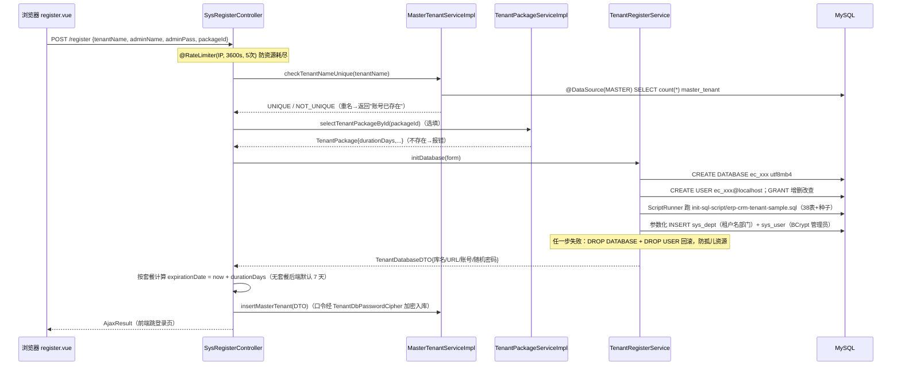
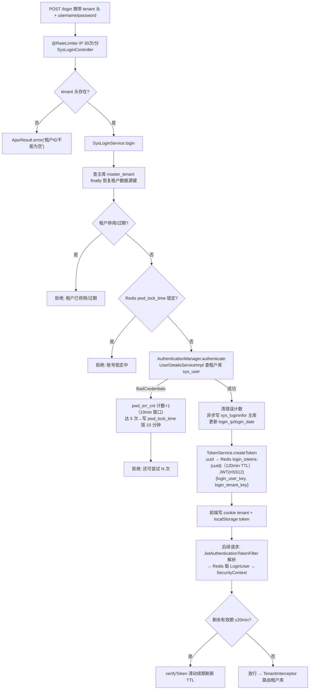
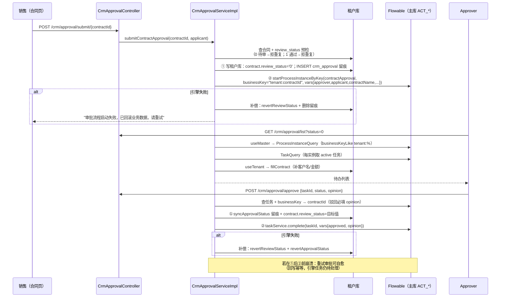

# 05-核心流程

> 项目：ERP-CRM ｜ 版本：v1.0 ｜ 生成日期：2026-10-05 ｜ 依据：源码分析

本篇选取 5 个最具业务价值的端到端流程：① 租户注册（SaaS 增长入口）② 登录认证（一切请求的前置）③ 合同审批（跨库一致性最复杂）④ 采购入库与库存调拨（ERP 库存闭环，含并发防护）⑤ 线索→客户→公海流转（CRM 销售主线）。每个流程配图 + 分步说明 + 涉及文件清单。

## 流程一：租户注册（自助开戶）



分步说明：

1. **入口与限流**：`web/controller/system/SysRegisterController.registerTenant` 标注 `@RateLimiter(limitType = LimitType.IP, time = 3600, count = 5)`，注释明确"每成功一次即真实建库建用户…防资源耗尽"。表单校验靠 `TenantRegisterBody` 的 JSR-303 注解（租户名 2-30 字符、仅中英数字下划线中划线；管理员名仅字母数字下划线中划线；密码 5-20 位）。
2. **唯一性前置检查**：`MasterTenantServiceImpl.checkTenantNameUnique`（MASTER 数据源）防重名租户。
3. **建库事务**：`auth/web/service/TenantRegisterService.initDatabase` 用原生 JDBC（`DriverManager` + 建库凭据 `tenant.database.*` 配置）执行五步——建库、建同名 MySQL 用户并仅授予该库增删改查、`setCatalog` 切库、`ScriptRunner` 执行租户模板（`Resources.getResourceAsReader("init-sql-script/erp-crm-tenant-sample.sql")`）、`SqlRunner` **参数化**插入部门与管理员（代码注释特别说明"tenantName 来自匿名注册表单，必须参数化防注入"）。catch 分支回滚 `DROP DATABASE IF EXISTS` + `DROP USER IF EXISTS`。
4. **登记主库**：`MasterTenantServiceImpl.insertMasterTenant(TenantDatabaseDTO)` 写 `master_tenant`——password 字段先经 `passwordCipher.encrypt()`（AES-256-GCM）；`expiration_date` 优先取套餐换算值，否则 `DateUtils.addDays(now, 7)`。注册成功/失败均打点 `erp.tenant.register.total`。
5. **登录验证**：注册完成后即可用 `tenant=<tenantName>` + 管理员账号登录新库。

涉及文件：`erp-crm/src/main/java/com/ec/web/controller/system/SysRegisterController.java`、`erp-crm/src/main/java/com/ec/auth/web/service/TenantRegisterService.java`、`erp-crm/src/main/java/com/ec/saas/service/impl/MasterTenantServiceImpl.java`、`erp-crm/src/main/java/com/ec/saas/security/TenantDbPasswordCipher.java`、`erp-crm/src/main/resources/init-sql-script/erp-crm-tenant-sample.sql`、`erpcrm-ui/src/views/register.vue`、`erpcrm-ui/src/api/login.js`（`register()`）。

## 流程二：登录认证与会话维持



分步说明：

1. **双库参与**：登录是少数同时触碰主库（租户状态校验 + 登录日志）与租户库（sys_user 比对）的流程。`SysLoginService.login` 第 96-104 行用 `try/finally` 保证查完主库后把 ThreadLocal 重锚回租户键——这是 AGENTS.md 事务陷阱条款的标准规避写法。
2. **防暴力破解三件套**：IP 限流（`@RateLimiter`）、按"租户:用户名"的密码错误计数与锁定（Redis 键 `pwd_err_cnt:` / `pwd_lock_time:`，常量 `PASSWORD_MAX_RETRY_COUNT=5`、`PASSWORD_LOCK_MINUTES=10`）、失败消息分级透传（用户不存在等业务语义由 `InternalAuthenticationServiceException` 携带并原样返回，其余内部异常统一"登录失败，请稍后再试"防探测）。
3. **令牌签发**：`TokenService.createToken` 生成 UUID 作为会话句柄，LoginUser（含 tenant、权限集、UA/IP）整体存 Redis 并设 120 分钟 TTL；JWT 里只放 uuid 与租户名。登录成功/失败打点 `erp.login.total{tenant,result}`。
4. **会话维持**：每请求 `JwtAuthenticationTokenFilter` 解析 JWT → Redis 取 LoginUser → `verifyToken` 判断剩余 ≤20 分钟（`MILLIS_MINUTE_TEN`）则 `refreshToken` 重置 TTL——活跃用户不掉线、闲置 120 分钟后 401。前端 401 处理见 02 篇 6.2。
5. **登出**：`LogoutSuccessHandlerImpl` 删除 Redis 会话键（前端 `userStore.logOut()` 内部调 `POST /logout`）。

涉及文件：`erp-crm/src/main/java/com/ec/web/controller/system/SysLoginController.java`、`erp-crm/src/main/java/com/ec/auth/web/service/{SysLoginService,TokenService,UserDetailsServiceImpl}.java`、`erp-crm/src/main/java/com/ec/auth/security/filter/JwtAuthenticationTokenFilter.java`、`erp-crm/src/main/java/com/ec/auth/config/SecurityConfig.java`、`erpcrm-ui/src/api/user.ts`、`erpcrm-ui/src/store/modules/user.ts`。

## 流程三：合同审批（Flowable，跨主库/租户库）



分步说明：

1. **流程定义**：`erp-crm/src/main/resources/processes/contract-approval.bpmn20.xml`，key=`contractApproval`，"开始 → 审批人处理 → 网关按 approved 分流 → 结束"（`CrmApprovalServiceImpl` 类注释概括）；`application.yml` 的 `flowable.database-schema-update: true` 让引擎表启动时自动建在**主库**。
2. **租户隔离编码**：`businessKey = tenant + ":" + contractId`；列表查询用 `processInstanceBusinessKeyLike(tenant + ":%")` 单列谓词过滤，避免变量表 join（类注释明示该取舍）。
3. **跨库一致性策略（补偿式）**：两阶段"租户库先行、引擎殿后、失败回退"。提交侧失败回退 = `revertReviewStatus(contractId, prevStatus)` + `deleteCrmApprovalById`；审批侧失败回退 = `revertReviewStatus` + `revertApprovalStatus`。两次回退后均打点 `erp.approval.total{tenant,action,result=rolled_back}`。
4. **列表聚合**：待办走 `RuntimeService` + `TaskService`（引擎实时态），已办走 `HistoryService`（`finished()` + 按 `approved` 变量过滤 1/2）；每行再切回租户库 `fillContract` 补客户名与合同金额。方法内 `useMaster()/useTenant()` 成对出现，注释提醒"上一轮 useTenant() 后 Flowable 查询必须切回 master 库"。
5. **前端**：`views/crm/approval/index.vue` 的待办/已办 Tab 直接映射 `status` 参数；合同页 `views/crm/contract/index.vue` 以 `review_status` 字典标签展示状态并承载"提交审批"按钮。

涉及文件：`erp-crm/src/main/java/com/ec/crm/controller/CrmApprovalController.java`、`erp-crm/src/main/java/com/ec/crm/service/impl/CrmApprovalServiceImpl.java`、`erp-crm/src/main/resources/processes/contract-approval.bpmn20.xml`、`erp-crm/src/main/resources/mapper/crm/CrmApprovalMapper.xml`（`syncApprovalStatus/revertApprovalStatus` 幂等 SQL）、`db-backup/upgrade_approval.sql`、`erpcrm-ui/src/api/crm/approval.js`、`erpcrm-ui/src/views/crm/approval/index.vue`。

## 流程四：采购入库与库存调拨（ERP 库存闭环）

```mermaid
flowchart TD
    subgraph SG1["采购入库"]
    A1[新增采购单<br/>POST /erp/stock] --> A2[ErpStockOrderServiceImpl.insertErpStockOrder<br/>按明细算 totalPrice；整删整插 erp_purchase_item]
    A2 --> A3["PUT /erp/stock/stock-in/{id}"]
    A3 --> A4{校验: 单存在? 指定仓库? 有明细?}
    A4 --> A5[CAS 认领 claimForStockIn<br/>UPDATE ... SET status='1' WHERE status='0']
    A5 -->|认领失败| A6[拒绝: 仅待入库状态可入库]
    A5 -->|成功| A7[逐明细写 erp_storage_flow<br/>type=1 入库, warehouse_id=采购单指定仓]
    end
    subgraph SG2["库存调拨"]
    B1[新建调拨单<br/>校验 from≠to, 单号 DB+时间戳+随机] --> B2["PUT /erp/transfer/execute/{id}"]
    B2 --> B3{status='0'? 调出仓库存充足?}
    B3 --> B4[CAS 认领 claimForExecute]
    B4 --> B5[写两条流水: 出库 type=0 到 from 仓<br/>入库 type=1 到 to 仓]
    B5 --> B6{复检: from 仓现存量 < 0?}
    B6 -->|是| B7[抛异常→整个事务回滚<br/>防并发超调]
    B6 -->|否| B8[提交, status=1 已执行]
    end
    A7 --> F[erp_storage_flow = 库存唯一事实源<br/>现存 = Σ入库(1,2) − Σ出库(0) 按仓聚合]
    B8 --> F
    F --> G[erp/finance/stock-summary 财务汇总<br/>低库存对照 product.safety_stock]
```

分步说明：

1. **采购单**：`ErpStockOrderServiceImpl.insertErpStockOrder` 在事务内用明细流计算 `totalPrice`（`price × amount` 求和）并整删整插明细；修改同理（`saveItems`）。
2. **入库的并发防护**：`stockIn` 的四连校验（存在/仓库/明细/状态）中，状态校验不是"查出来再比"而是 `claimForStockIn` 的**条件 UPDATE 认领**——两个并发请求只有一个能把 status 从 0 改为 1，失败方直接抛错，杜绝重复写流水。流水必须落采购单指定仓库（`flow.setWarehouseId(order.getWarehouseId())`，注释强调）。
3. **调拨的并发防护更进一层**：`doExecuteTransfer` 先查 `selectStockQtyInWarehouse` 预检库存，再 CAS 认领，写一出一入两条流水后**复检负库存**——因为两笔不同调拨单可能并发挪同一批库存，各自预检都通过、合计却超调；复检失败抛异常令整个 `@Transactional` 回滚（两条流水一并消失）。执行成功/失败打点 `erp.transfer.executed.total`。
4. **单据保护**：已入库采购单、已执行调拨单禁止删除（`deleteErpStockOrderByIds`/`deleteErpTransferOrderById` 显式校验 status），保证"单据-流水"可追溯。
5. **零售出库补充**：`erp/retail` 按 SN 出库（`erp_product_sn.status` 0→1），同样产生出库流水；盘点调整（`erp_stock_adjustment`）产生盘盈/盘亏流水并记录 before/after_qty。

涉及文件：`erp-crm/src/main/java/com/ec/erp/service/impl/{ErpStockOrderServiceImpl,ErpTransferOrderServiceImpl,ErpStorageFlowServiceImpl,ErpRetailServiceImpl,ErpStockAdjustmentServiceImpl}.java`、`erp-crm/src/main/resources/mapper/erp/{ErpStockOrderMapper,ErpTransferOrderMapper,ErpStorageFlowMapper}.xml`（认领 SQL）、`erpcrm-ui/src/views/erp/{stock,transfer,flow,retail,adjustment}/index.vue`、`erpcrm-ui/src/api/erp/{stock,transfer,flow}.js`。

## 流程五：线索 → 客户 → 公海流转（CRM 销售主线）

```mermaid
flowchart LR
    L0[线索录入<br/>POST /crm/clues<br/>crm_customer.status=0] -->|个人线索视图<br/>person-list| L1{跟进转化}
    L1 -->|PUT /crm/clues/to-customer<br/>ToCustomer.vue| C1[转为客户<br/>status: 0→1<br/>owner=新负责人<br/>to_customer_time=now]
    C1 --> C2[我的客户 person-list<br/>跟进 Comment<br/>写 crm_comment + 刷新客户三字段]
    C2 -->|POST /crm/customer/to-pool<br/>ToPool.vue 选 pool_type| P1[移入公海<br/>status: 1→2<br/>pre_owner=原 owner, owner 置空<br/>to_pool_time=now]
    P1 -->|公海池 crm/pool| P2{领取<br/>POST /crm/pool/receive/{id}}
    P2 -->|status: 2→1<br/>owner=当前用户| C3[再次成为私海客户]
    C2 -->|POST /crm/customer/transfer| C4[转移客户<br/>owner=newOwner, pre_owner=oldOwner]
    L0 -->|DELETE /crm/clues/person/{ids}| X[删除（归属校验）]
```

分步说明：

1. **单表三态**：`crm_customer.status`（0 线索 / 1 客户 / 2 公海，枚举 `crm/domain/enums/CustomerFolder`）驱动全部流转；各视图（`/crm/clues/list`、`/crm/customer/list`、`/crm/pool/list`）本质是同一张表加不同 status/owner 谓词的查询。
2. **权限与归属**：转移/入池/删除都区分管理员与普通用户——`CrmCustomerServiceImpl.transferCrmCustomerByIds/customerToPoolByIds` 以 `SecurityUtils.isAdmin(getUserId())` 决定是否给 mapper 传 `restrictOwner=true`（非管理员只能操作自己名下记录）；`deleteCrmCustomerByIdsForOwner` 逐条比对 owner，"无权删除他人名下的记录"。集成测试 `CrmCustomerOwnerGuardIntegrationTest` 专门覆盖该守卫。
3. **跟进沉淀**：`CrmCommentController` 的写路径在插入 `crm_comment` 的同时回写客户的 `last_update_record/last_followup_time/next_followup_time`（`CrmCommentMapper.xml`），支撑首页"今日待办/今日提醒/跟进动态"三个卡片（`CrmStatisticServiceImpl.followupInfo/todayFollowupList`）。
4. **看板联动**：`/crm/index-data/stats` 的 `customer_status/clues_source` 分布与 `new_customers` 月度趋势都来自 `crm_customer` 聚合查询（`CrmStatisticServiceImpl.dashboardStats`，第 211 行实现）；订单趋势来自 `crm_order`。

涉及文件：`erp-crm/src/main/java/com/ec/crm/controller/{CrmCluesController,CrmCustomerController,CrmPoolControler,CrmCommentController,IndexDataController}.java`、`erp-crm/src/main/java/com/ec/crm/service/impl/{CrmCustomerServiceImpl,CrmStatisticServiceImpl}.java`、`erp-crm/src/main/java/com/ec/crm/domain/enums/CustomerFolder.java`、`erp-crm/src/main/resources/mapper/crm/CrmCustomerMapper.xml`（`transferCrmCustomerByIds/customerToPoolByIds/receiveCustomerById` 带 restrictOwner 参数）、`erpcrm-ui/src/views/crm/{clues,customer,pool}/*.vue`、`erp-crm/src/test/java/com/ec/crm/CrmCustomerOwnerGuardIntegrationTest.java`。

## 测试对核心流程的保障

以上流程均有自动化测试锚定（`erp-crm/src/test/java/com/ec/`）：`LoginAuthChainIntegrationTest`（流程二全链路，含锁定）、`TenantRegisterIntegrationTest`（流程一）、`CrmApprovalFlowIntegrationTest`（流程三，含补偿回退）、`ErpStockInIntegrationTest` 与 `ErpTransferExecuteIntegrationTest`（流程四，含并发认领）、`CrmCustomerOwnerGuardIntegrationTest`（流程五越权守卫）、`TenantExpirationJobIntegrationTest`（生命周期）、`TenantQuotaIntegrationTest`（配额）、`TenantDbPasswordCipherTest`/`MasterTenantPasswordMigratorTest`（口令加密与迁移）、`EcProdConfigVerifierTest`（生产配置校验）。公共基座 `AbstractIntegrationTest` 复用本机 MySQL/Redis（CI 用服务容器跑同一套件），fixture 直接调用 `sweepOnce()` 等方法而非等待定时器。
