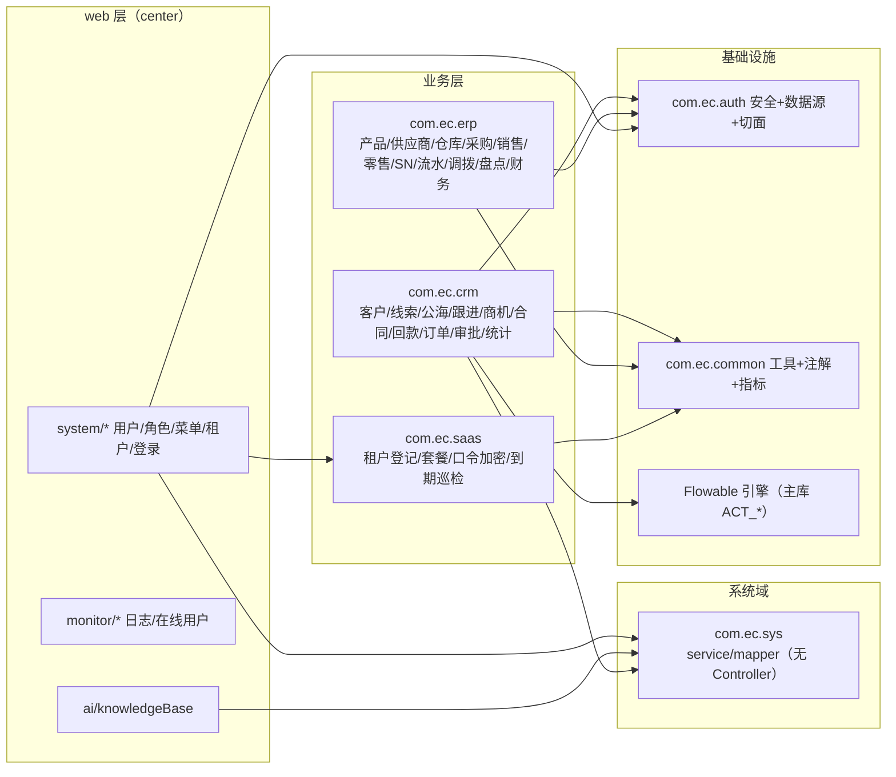
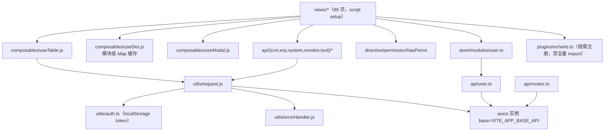

# 07-模块详解

> 项目：ERP-CRM ｜ 版本：v1.2 ｜ 生成日期：2026-10-06 ｜ 依据：源码分析（v1.2：2026-10-06 一致性回刷——生成器行数 452→451，以 18 篇走读实测为准）

本篇是旧篇（设计/全景）之上的**深读手册**：把 `erp-crm/` 后端的各业务域逐个拆开，给出模块职责、关键类与方法清单、内部机制与模块间交互；再深读前端核心模块；最后完整拆解 `erp-crm/gen_business_modules.py` 代码生成器。接口路径与入参的全量速查见《15-接口全量参考》，端到端流程图见《05-核心流程》，本篇不重复。

## 1. 模块地图与交互总览

后端共 45 个 `@RestController`，按包聚合为七个业务域。所有业务域共享同一套基础设施（`com.ec.auth` 的租户路由与安全、`com.ec.common` 的横切能力），这是理解"模块间交互"的关键：**业务域之间几乎不直接互相调用，它们通过数据库外键语义（XML join）与基础设施层间接协作**。目前源码中唯一显式的业务域纵向依赖是 `CrmStatisticServiceImpl` 注入 `CrmCustomerServiceImpl` 与 `ICrmOrderService`（`crm/service/impl/CrmStatisticServiceImpl.java` 第 24-32 行），用于首页看板聚合。

读图的要点：`com.ec.sys` 只有 service/mapper 没有 Controller，它的 HTTP 入口全部在 `com.ec.web.controller.*`；`com.ec.saas` 反而自带 `SaasPackageController`（因为套餐列表是注册页的匿名接口，独立于租户会话）；CRM 对 Flowable 的依赖不经过 saas 包，而是直接注入引擎的 `RuntimeService/TaskService/HistoryService` 并用 `DynamicDataSourceContextHolder` 手工切换主/租户库。

## 2. CRM 业务域深读

CRM 域位于 `erp-crm/src/main/java/com/ec/crm/`，11 个 Controller 对应 7 张业务表（`crm_customer` 单表三态承载线索/客户/公海）。下表先给全量类清单，再对核心模块展开。

| 子域 | Controller | Service 实现类（行数） | 核心职责 |
|---|---|---|---|
| 客户 | `CrmCustomerController` | `CrmCustomerServiceImpl`（169 行） | 客户 CRUD、五种列表视图、转移、入公海、归属校验删除、公海领取、今日动态 |
| 线索 | `CrmCluesController` | 复用 `CrmCustomerServiceImpl` | 线索即 `crm_customer.status='0'` 的行：列表/导出/转客户/转移/删除 |
| 公海 | `CrmPoolControler`（注意类名少一个 l） | 复用 | 公海池列表与领取 |
| 跟进 | `CrmCommentController` | `CrmCommentServiceImpl`（126 行） | 跟进记录 CRUD + 写入时回写客户跟进三字段 |
| 商机 | `CrmOpportunityController` | `CrmOpportunityServiceImpl`（47 行，生成器产物） | 标准 CRUD + left join 客户名 |
| 合同 | `CrmContractController` | `CrmContractServiceImpl`（47 行，生成器产物） | 标准 CRUD + `review_status` 审批状态位 |
| 回款 | `CrmReceivableController` | `CrmReceivableServiceImpl`（47 行，生成器产物） | 标准 CRUD + 关联合同号/客户名 |
| CRM 订单 | `CrmOrderController` | `CrmOrderServiceImpl`（124 行） | CRUD + `PUT /approve/{id}` 订单审核 |
| 审批 | `CrmApprovalController` | `CrmApprovalServiceImpl`（311 行） | Flowable 跨库审批编排（见下文 2.2） |
| 看板 | `IndexDataController` | `CrmStatisticServiceImpl`（211 行） | 首页指标与统计 |
| 负责人 | `OwnerController` | —（直查 mapper） | 负责人下拉数据源 |

### 2.1 客户模块（含线索/公海三态流转）

单表三态的设计已在《04-数据模型》讲过，本节只讲实现层的机制。**"管理员还是普通用户"的判定发生在 service 层**：`transferCrmCustomerByIds` 与 `customerToPoolByIds` 都调用 `SecurityUtils.isAdmin(SecurityUtils.getUserId())` 得到 `restrictOwner` 布尔值，再传给 mapper；XML 侧用 `<if test="restrictOwner"> and owner = #{oldOwner}</if>` 把"越权操作"静默降级为"影响 0 行"（`resources/mapper/crm/CrmCustomerMapper.xml` 第 394-415 行）。删除走的则是另一条更严格的路径：`deleteCrmCustomerByIdsForOwner` 逐条查记录比对 owner，非本人名下直接抛"无权删除他人名下的记录"——即转移/入池用 SQL 谓词防越权，删除用应用层逐条校验，两种风格并存。集成测试 `CrmCustomerOwnerGuardIntegrationTest` 同时覆盖了这两类守卫。

关键方法清单（`CrmCustomerServiceImpl`）：

| 方法 | 事务 | 机制要点 |
|---|---|---|
| `selectCrmCustomerList(CrmCustomer)` | 无 | 同一方法服务五种视图（全部/我的/成交/线索/公海），靠 status/owner/deal_status 谓词区分；分页由 Controller 层 `startPage()` 接管 |
| `insertCrmCustomer` | 无 | 强制 `createTime=now()`；`status` 由前端表单给定（线索页传 0、客户页传 1） |
| `transferCrmCustomerByIds` | `@Transactional` | `pre_owner=owner, owner=newOwner` 留痕 + restrictOwner 谓词 |
| `customerToPoolByIds` | `@Transactional` | 置 `status='2'`、owner 清空、`to_pool_time=now()`；XML 里 `where status='1'` 保证只有客户态可入池 |
| `deleteCrmCustomerByIdsForOwner` | 无 | 逐条归属校验后删除 |
| `receiveCustomerById` | 无 | 公海领取：`status 2→1`、owner=当前用户 |
| `todayUpdates(owner)` | 无 | 首页"跟进动态"：按更新时间倒序取本人名下最近变更 |

### 2.2 审批模块（全项目最复杂的模块）

`CrmApprovalServiceImpl` 是跨主库/租户库的编排器，四个公开方法对应审批中心的四个接口。内部机制有三个支柱：

1. **库切换原语**：私有方法 `useMaster()` 把 ThreadLocal 键设为 `default_db`，`useTenant()` 设回 `SecurityUtils.getLoginUser().getTenant()`。每个引擎操作前必须 `useMaster()`（引擎表在主库），每次 `fillContract` 前必须 `useTenant()`——`selectApprovalList` 循环体内成对出现 6 次切换，注释反复强调"上一轮 useTenant() 后 Flowable 查询必须切回 master 库"。
2. **businessKey 编码**：流程实例 businessKey = `tenant + ":" + contractId`；租户过滤用 `processInstanceBusinessKeyLike(tenant + ":%")` 单列谓词；解析用 `parseContractId()`，且**兼容历史无前缀数据**（无冒号时整串当 contractId）——这是迁移期遗留数据的容错。
3. **补偿式一致**：提交与审批都是"租户库先行、引擎殿后、失败回退"，回退动作是幂等 SQL（`CrmApprovalMapper.xml` 的 `revertReviewStatus/revertApprovalStatus`），详见《05-核心流程》流程三，此处不重复。

一个高频使用坑：`GET /crm/approval/{id}` 的 `{id}` 是 **Flowable 任务 ID（UUID 字符串）**，而非 `crm_approval.id` 自增主键——`selectCrmApprovalById(String taskId)` 直接把它喂给 `taskService.createTaskQuery().taskId(...)`。误传留痕表主键会得到空对象而非报错。

### 2.3 统计看板模块（性能敏感点）

`CrmStatisticServiceImpl` 的四个方法全部以"把实体查询结果整体拉到内存再计算"的方式实现：`customerInfo` 对线索/客户/公海三种 status 各执行一次 `selectCrmCustomerList`（无分页，全量行进 JVM），"我的/总数"的区分靠 Java stream filter；`followupInfo` 的"跟进率"是先取"今日已跟进"与"今日待跟进"两个列表再 `size()`。数据量小时无感，客户表上万后这四个接口会同时成为慢查询与内存热点——优化建议见《10-性能设计与优化》第 4 节。

## 3. ERP 业务域深读

ERP 域位于 `erp-crm/src/main/java/com/ec/erp/`，16 组 controller/service/mapper。与 CRM 的"重流转"不同，ERP 的复杂度集中在**库存流水的一致性**上。

| 子域 | Controller → 路由 | 关键机制 |
|---|---|---|
| 产品 | `ErpProductController` → `/erp/product` | CRUD + `POST /querPorductByTags`（按标签查产品，方法名拼写沿用源码）；`safety_stock` 支撑低库存告警口径 |
| 供应商 | `ErpSupplierController` → `/erp/supplier` | CRUD + `/options` 下拉 |
| 仓库 | `ErpWarehouseController` → `/erp/warehouse` | CRUD + `/options`；预置"深圳主仓/次品仓/中转仓"三仓种子（`db-backup/upgrade_warehouse_transfer.sql`） |
| 采购 | `ErpStockOrderController` → `/erp/stock` | 单+明细整删整插；`PUT /stock-in/{id}` CAS 认领入库 |
| 付款 | `ErpPaymentController` → `/erp/payment` | 按采购单记付款，`idx_po` 关联 |
| 销售 | `ErpOrderController` → `/erp/order` | 关联客户（`erp_client`）与开票信息（`erp_tax_info`） |
| 零售 | `ErpRetailController` → `/erp/retail` | 按 SN 出库；`insertErpRetail` 写零售单+出库流水+SN 状态翻转 |
| 序列号 | `ErpProductSnController` → `/erp/sn` | 主键 `sn_uuid`（UUID 字符串），status 0 在库/1 出库 |
| 流水 | `ErpStorageFlowController` → `/erp/flow` | 库存唯一事实源，只读为主（手工 add 仅期初） |
| 调拨 | `ErpTransferOrderController` → `/erp/transfer` | `PUT /execute/{id}`：预检→CAS→两条流水→负库存复检回滚 |
| 盘点 | `ErpStockAdjustmentController` → `/erp/adjust` | 仅 list/get/add 三个端点（无编辑删除，留痕单据不可改）；`insertErpStockAdjustment` 记录 before/after_qty 并产生盘盈/盘亏流水 |
| 辅助主数据 | client/tax/tags/map 四组 | 零售客户、开票信息、标签（`tag_uuid` 主键）、标签-产品映射 |

### 3.1 库存闭环的内部机制

一切库存变动最终都落到 `erp_storage_flow` 一张表（order_type：0 出库 / 1 入库 / 2 期初），"某仓某品现存量 = Σ(1,2) − Σ(0)"，这个口径固化在 `ErpTransferOrderMapper.selectStockQtyInWarehouse` 的聚合 SQL 里。三个写入方分别有不同的并发防护强度：

- **采购入库**（`ErpStockOrderServiceImpl.stockIn`，第 107-143 行）：四连校验后 `claimForStockIn` 条件 UPDATE 认领（`UPDATE erp_stock_order SET status='1' WHERE id=? AND status='0'`），认领失败即拒绝；流水落采购单指定仓库。
- **调拨执行**（`ErpTransferOrderServiceImpl.doExecuteTransfer`，第 62-102 行）：在入库的基础上多两层——执行前 `selectStockQtyInWarehouse` 预检、出库后**负库存复检**（防两笔调拨并发挪同一批库存各自预检通过、合计超调），复检失败抛异常令整个事务回滚。
- **零售/盘点**（`ErpRetailServiceImpl`/`ErpStockAdjustmentServiceImpl`）：串行单条写入，无 CAS——因为 SN 扫码与盘点录入天然是单用户操作，并发冲突面小。⚠️ 待确认：`ErpStockAdjustmentServiceImpl.insertErpStockAdjustment` 未做"调整后数量复检"，与调拨的兜底强度不一致。

单据保护规则：已入库采购单、已执行调拨单禁止删除（删除方法显式校验 status 并抛 `ServiceException`），保证"单据-流水"可追溯。

### 3.2 财务总览模块

`ErpFinanceServiceImpl` 只有两个方法（`overview`/`stockSummary`，共 32 行），全部逻辑在 `ErpFinanceMapper.xml` 的聚合 SQL：overview 汇总应收（销售单 `total_price` − `actual_payment`）与库存资产（流水聚合 × 产品单价）；stockSummary 输出各仓各品现存并对照 `safety_stock`。它是纯读模块，不产生任何流水。

## 4. SaaS 与系统域（简述，详见《08-安全与权限设计》）

`com.ec.saas` 的类清单与加解密机制在 08 篇展开；`com.ec.web` 的 20 个系统 Controller 是 RuoYi 标准形态，其中有两个非常规点值得记录：其一，`SysTenantController` 是**平台级** Controller，但它的数据落在主库（service 层 `@DataSource(MASTER)`），与同包的租户库 Controller 混在一起，读代码时容易误判数据落点；其二，`SysUserController.getInfo` 用 `value = {"/", "/{userId}"}` 让"查自己"与"查指定用户"共用映射（第 100-102 行），新增类似接口时不要破坏这个约定。

## 5. 前端核心模块深读

前端遵循"TS 基座 + JS 业务"双轨（《01-系统架构》第 2 节），本节只深读业务层四个承重模块。

### 5.1 请求层 `src/utils/request.js`（189 行）

全站唯一的 axios 实例，四个职责：

| 职责 | 实现要点 |
|---|---|
| 凭证注入 | 请求拦截器对一切请求补 `Authorization: Bearer`（`utils/auth.ts` 从 localStorage 取）与 `tenant` 头（js-cookie 读 cookie；调用方显式指定的 tenant 头优先——登录页提交新租户依赖此行为） |
| 防重复提交 | 模块级 `repeatSubmitMap`（内存 Map，键 = url+序列化参数体），1000ms 窗口内重复提交直接 reject；Map 超 200 条时顺带清理过期键防泄漏 |
| 业务码分发 | 响应拦截器按 `res.data.code` 分流：401 弹 `promptRelogin` 确认后登出并跳 `/#/login`（hash 路由约定）；非 200 走 `errorHandler.notifyApiError` 统一 ElMessage |
| blob 下载 | `download()` 把超时放宽到 60s，`blobValidate` 区分真文件与"包成 JSON 的错误响应"，导出失败能弹出后端 msg |

注意超时参数：全局 timeout 10000ms，仅下载放宽——如果有长耗时接口（如大批量导入），需要在调用处单独覆盖 timeout。

### 5.2 表格 CRUD 组合式函数 `src/composables/useTable.js`（114 行）

86 个列表页的状态中枢。输入 api 函数与初始查询参数，返回 `loading/dataList/total/queryParams/ids/single/multiple` 等响应式状态与 `getList/handleQuery/resetQuery/handleSelectionChange/handlePagination` 动作。两个设计细节：`resetQuery` 只重置业务字段而保留分页游标再由 `handleQuery` 归一 pageNum；`options.transformQuery` 钩子供日期范围等参数拼装，避免每页重写 getList。`handleSelectionChange` 里 `ids` 的取法是 `item.id || item[Object.keys(item)[0]]`——这使 SN/标签等 UUID 主键页面无需改造即可复用。

### 5.3 字典缓存 `src/composables/useDict.js`（84 行）

模块顶层 `const dictCache = new Map()` 缓存各字典类型的请求 Promise：同类型字典跨页面/跨实例只发一次请求，失败不缓存以便重试（注释明示该动机）。配套测试 `useDict.test.js` 是前端唯二的 vitest 用例之一。字典的"源头"在租户库 `sys_dict_data`，后端另有 `DictUtils` Redis 缓存层，两级缓存意味着改字典后要调 `DELETE /system/dict/type/refreshCache` 并刷新页面。

### 5.4 登录适配层 `src/api/user.ts` + 菜单转换 `src/api/routes.ts`

这两个 TS 文件是 RuoYi 后端与 pure-admin 基座之间的"翻译官"：`user.ts` 的 `getLogin` 先 `POST /login`（显式 tenant 头、`isToken:false`），拿到 token 后用**裸 axios**（绕过请求实例，避免此时还没有 token）调 `/getInfo`，把 RuoYi 的 `{user, roles, permissions}` 组装成 pure-admin 期望的 `UserResult`，roles/permissions 单项失败降级为空数组不阻断登录；`routes.ts` 把后端 RouterVo 树转成 pure-admin 路由：路径绝对化、组件名去重、`InnerLink` 合成 `/iframe/<name>` 路由、外链只进菜单不注册路由。

### 5.5 按钮权限指令 `src/directive/permission/`

`hasPermi.js`（31 行）：挂载时比对 `useUserStoreHook().permissions` 是否包含指令值（支持 `*:*:*` 超管通配），不包含则 `el.parentNode.removeChild(el)` 物理移除按钮节点。真正的防线仍是后端同名 `@PreAuthorize`，指令只是体验层。

### 5.6 前端模块依赖图

## 6. gen_business_modules.py 代码生成器详解

`erp-crm/gen_business_modules.py`（451 行）是一次性开发期工具：它生成了商机/合同/回款三个 CRM 模块的六件套产物，产物已固化入库，生成器本身不参与运行时。理解它的价值在于两点——读懂生成模块的代码形态，以及未来用它（或仿写它）批量产出新模块。

### 6.1 输入模型

生成器的全部输入是模块级常量：

| 常量 | 结构 | 作用 |
|---|---|---|
| `BASE/PKG/RES` | 路径字符串（写死了本机绝对路径 ⚠️） | 产物输出目录：domain/mapper/service/controller 到 `src/main/java/com/ec/crm/`，XML 到 `src/main/resources/mapper/crm/` |
| `MODULES` | 数组，每项含 `entity/table/cn/route/cols/extra_transient` | 声明式模块定义。`cols` 每列为四元组 `(java名, java类型, 中文注释, db列名)`，db 列名为 `True` 表示该列是自增主键；`extra_transient` 声明 join 注入的非表字段（自动加 `@Transient`） |
| `FIELD_TYPE_IMPORT` | Map | 需要额外 import 的类型（BigDecimal/Date） |
| `JOIN / JOIN_COLS / EXTRA_RESULT` | 按实体名索引的 Map | 关联查询三件套：join 从句（如 `left join crm_customer c on c.id = o.customer_id`）、select 别名列、resultMap 额外 `<result>` 行。回款的二跳关联（回款→合同→客户）直接写两行 join |

### 6.2 六个模板函数与产物形态

| 函数 | 产物 | 形态要点 |
|---|---|---|
| `gen_domain` | `{Entity}.java` | 继承 `BaseEntity`；非主键且非 remark 的列自动加 `@Excel(name=中文)` 支撑导出；`extra_transient` 字段加 `@Transient`（注意：用的是 `org.springframework.data.annotation.Transient`） |
| `gen_mapper_iface` | `{Entity}Mapper.java` | RuoYi 标准六方法：selectById/selectList/insert/update/deleteById/deleteByIds |
| `gen_mapper_xml` | `{Entity}Mapper.xml` | resultMap（含 EXTRA_RESULT 注入列）+ `<sql id="selectVo">` 片段（`select o.*, join别名列 from 表 o JOIN`）；`selectList` 的 `<where>` 对每个 String 列生成 `<if test="x != null and x != ''">` 等值过滤；insert 带 `useGeneratedKeys` 回填主键；update 用 `<set>` 全量更新 |
| `gen_service_iface` / `gen_service_impl` | I{Entity}Service + Impl | 纯透传（无任何业务逻辑），`@Service` 注册 |
| `gen_controller` | {Entity}Controller | 五端点：list（`startPage()+getDataTable`）、getInfo、add（`setCreateBy(getUsername())`）、edit（`setUpdateBy`）、remove（`@PathVariable Long[] ids`）；每个端点 `@PreAuthorize("@ss.hasPermi('crm:{route}:*')")`，写端点带 `@Log(title, businessType)` |

### 6.3 使用规程与边界

生成器按 `MODULES` 顺序对每模块写 6 个文件并打印 `Xxx: 6 files written`，最后 `ALL DONE`。复用它的完整 SOP（含改 BASE 路径、生成后补字典/特殊端点/菜单 SQL 等步骤）见《11-扩展开发指南》SOP-2。它的能力边界也要记住：**不生成**前端页面/api.js、不生成菜单与字典 SQL、不生成测试、不支持非等值查询条件（like/范围）、不支持复合主键。合同模块后来的 `review_status` 字段就不是生成的（生成器定义里没有该列），是审批升级时手工补的——这提示"生成后即固化"模式下，生成器与产物会逐渐脱节，再跑一次会覆盖手写改动，切勿在生产仓库直接重跑。

## 7. 模块间交互规则小结

把全篇归纳成四条可操作的纪律，改代码前对照：

1. **业务域不横向 import**：CRM 与 ERP 之间零依赖；跨域统计（如 `CrmStatisticServiceImpl`）是唯一例外，新增聚合时优先在 mapper 层 join 而不是 service 互调。
2. **跨主库/租户库必须显式切键**：只要一个方法里同时出现引擎表（主库）与业务表（租户库），就必须像 `CrmApprovalServiceImpl` 那样 `useMaster()/useTenant()` 成对出现，且事务方法内不得切键（《01-系统架构》第 4 节陷阱条款）。
3. **写流水必经校验+认领**：任何新增的库存变动入口（例如未来的"销售出库"）都应复用 `claimForXxx` CAS 模板与"写后复检"兜底，不要直接 insert 流水。
4. **生成器产物不再手改字段定义**：需要加列时按《11-扩展开发指南》的迁移三处同步流程改 domain/XML/模板 SQL 四处，保持生成产物与手写补丁可追溯。
