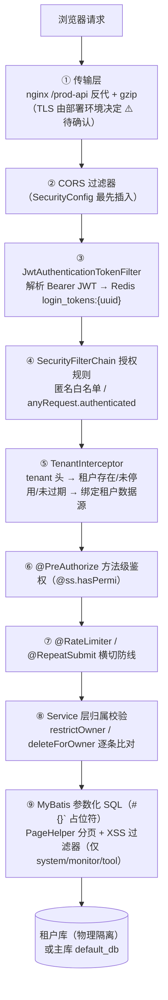

# 08-安全与权限设计

> 项目：ERP-CRM ｜ 版本：v1.1 ｜ 生成日期：2026-10-06 ｜ 依据：源码分析

本篇是安全专题的**深读篇**：以"一个请求从浏览器到数据库要过几道闸"为主线，覆盖多租户物理隔离、认证与会话、RBAC 功能权限、数据权限（角色范围 + 行级归属）、输入校验、敏感信息管理（口令哈希、AES-GCM 静态加密与 2026-09 的口令轮换史），最后给出已知的隐患清单。全景描述见《01-系统架构》第 6 节，本篇不重复其结论，只展开机制与证据。

## 1. 纵深防御分层总览

九道闸各自独立失效不会连锁：token 伪造过不了 ④（需要 Redis 里真有会话）；租户头伪造过不了 ⑤（要查主库登记）；权限串伪造过不了 ⑥；越权 id 过不了 ⑧；SQL 注入过不了 ⑨ 的参数化。下面逐层展开。

## 2. 多租户隔离（独立数据库物理隔离）

### 2.1 隔离模型

选择的是三种经典隔离方案中最重的一种（三方案对比见 `笔记/未命名.md` 与《01-系统架构》）：每个租户一个独立 MySQL 库。隔离边界由三件东西构成：

1. **登记表** `master_tenant`（主库）：每行一个租户，含 `url/username/password/database_name/status/expiration_date`，`tenant` 列唯一键 `uk_tenant`。口令列为 AES-256-GCM 密文（见第 7 节）。
2. **请求期路由**：`TenantInterceptor.preHandle`（`auth/interceptor/TenantInterceptor.java`）对一切路径生效——缺 `tenant` 头抛"请求缺少租户信息"；租户不存在/已停用/已过期分别抛专属消息（用 `ServiceException` 保证消息原样透传前端，这是 03 篇记录过的消息协议）。校验通过后才允许注册数据源并 `DynamicDataSourceContextHolder.setDataSourceKey(tenant)`。清理放在 `afterCompletion` 而非 `postHandle`，因为 Controller 抛异常时 postHandle 不执行，会把租户键残留在容器复用线程上（类注释明示）。
3. **数据库账号最小授权**：注册建库时 `TenantRegisterService` 为每个租户创建同名 MySQL 用户并**仅授予该库的 select/insert/update/delete**（`GRANT` 语句见 `auth/web/service/TenantRegisterService.java`）——即使应用被攻破拿到某租户连接串，也只能碰该租户自己的库。

### 2.2 隔离的强度与边界

物理隔离的强度很高：跨租户数据泄露需要同时拿到主库读权（查 `master_tenant`）与租户口令密钥（`EC_TENANT_PASSWORD_KEY`）。但边界同样要清楚：

- **Flowable 引擎表共享主库**：所有租户的审批流程实例都在主库 ACT_* 表中，租户隔离靠 businessKey 前缀 `tenant:contractId` 的**应用层约定**（`CrmApprovalServiceImpl` 查询时 `businessKeyLike(tenant + ":%")`）。这意味着审批域的隔离弱于业务域——任何能直连主库的角色（平台管理员）天然可见全部租户的流程变量。
- **登录日志 `sys_logininfor` 在主库**：全租户登录事件集中一处（设计使然，便于平台审计），但 `/monitor/logininfor` 接口并未按租户过滤——租户管理员理论上能看到其他租户的登录记录 ⚠️ 待确认（前端菜单是否对该页授权由租户菜单种子决定，租户模板的 `sys_menu` 中 monitor 菜单默认是否下发需逐库核对）。
- **ThreadLocal 键的正确性完全依赖纪律**：`@Transactional` 方法内切 `@DataSource(MASTER)` 不会更换已绑定的连接（AGENTS.md 陷阱条款），写错会把主库查询静默打到租户库（报"表不存在"）或反之。`SysLoginService.login` 第 99-104 行的 try/finally 重锚是标准写法。

## 3. 认证与会话

### 3.1 令牌结构：JWT 只当"钥匙"，会话在 Redis

`TokenService.createToken`（`auth/web/service/TokenService.java` 第 128-139 行）的逻辑：生成随机 UUID → 把完整 `LoginUser`（含 tenant、用户、权限集、IP/UA）序列化进 Redis `login_tokens:{uuid}`，TTL=120 分钟 → JWT payload 只放两个 claim：`login_user_key=uuid` 与 `login_tenant_key=租户名`，用 HS512 签名（密钥 `EC_TOKEN_SECRET` ≥64 字节，jjwt 0.12 硬性要求）。这个设计的攻防含义：

- JWT 无法单独伪造会话（还需 Redis 里有对应键），**删除 Redis 键即可立即强制下线**（`/monitor/online` 强踢即此原理）；
- 但 JWT 签发后在有效期内**无法单独作废**——若只删 Redis 键，持 JWT 者重新请求时 `getLoginUser` 返回 null，等效失效，因此实际语义是"会话吊销粒度 = Redis 键"；
- 密钥泄露 = 全部会话可伪造，轮换密钥即全量登出（`config/README.md` 明确了轮换规程）。

### 3.2 会话续期与过期语义

每请求 `JwtAuthenticationTokenFilter` 解析 JWT → Redis 取 LoginUser → `verifyToken` 判断剩余有效期 ≤20 分钟（`MILLIS_MINUTE_TEN`）则 `refreshToken` 重置 TTL 为 120 分钟。活跃用户永不掉线、闲置 120 分钟后失效。**401 的协议形态是 HTTP 200 + body `code:401`**（`AuthenticationEntryPointImpl` + `ServletUtils.renderString` 硬编码 `setStatus(200)`），前端 axios 按业务码识别并弹重登确认框（`utils/request.js` 响应拦截器），hash 路由下重登跳 `/#/login`。

### 3.3 防暴力破解三件套

| 防线 | 参数 | 实现位置 |
|---|---|---|
| IP 限流（登录） | 30 次/分 | `@RateLimiter(limitType=IP, time=60, count=30)`，`SysLoginController.login`；Redis 计数实现于 `RateLimiterAspect` |
| 密码错误锁定 | 错 5 次锁 10 分钟 | `SysLoginService` 常量 `PASSWORD_MAX_RETRY_COUNT/PASSWORD_LOCK_MINUTES`；Redis 键 `pwd_err_cnt:{tenant}:{username}`（10 分钟滑动窗口）与 `pwd_lock_time:{tenant}:{username}`（锁定截止时间戳）；锁定命中时返回剩余分钟数；认证成功清计数 |
| IP 限流（注册） | 5 次/时 | `@RateLimiter(limitType=IP, time=3600, count=5)`，`SysRegisterController`——注释明示"每成功一次即真实建库建用户，防资源耗尽" |

登录失败的报错分级也值得记录：`BadCredentialsException` 返回"用户名或密码错误，还可尝试 N 次"（有信息量但可接受）；`InternalAuthenticationServiceException`（用户不存在/停用）原样透传业务消息 ⚠️ 待确认（该行为允许攻击者探测"用户名是否存在"，RuoYi 上游即如此）；其余内部异常统一"登录失败，请稍后再试"防细节泄露。成功与失败均打点 `erp.login.total{tenant,result}`。

### 3.4 图形验证码：已移除（重要事实）

AGENTS.md 与旧文档描述的 `GET /captchaImage` + Redis `captcha_codes:{uuid}` 验证码链路**在当前源码中不存在**：全库 grep 仅剩未被引用的工具类 `common/utils/VerifyCodeUtils.java`，`LoginBody` 只有 username/password 两字段，登录页只有租户/账号/密码三个输入框。这意味着防暴力破解目前完全依赖 IP 限流 + 账号锁定两件套，分布式慢速撞库（每 IP 每分钟 29 次、换 IP 绕过）理论上可行——补齐方案与优先级见《13-技术债务与演进建议》。

## 4. RBAC 功能权限模型

### 4.1 模型结构与判定链

标准的 RuoYi RBAC：用户 →（sys_user_role）→ 角色 →（sys_role_menu）→ 菜单/按钮（`sys_menu.perms` 权限串，如 `crm:customer:add`）。运行时判定链：

1. 登录时 `SysPermissionService.getMenuPermission` 把用户全部权限串装入 `LoginUser.permissions`（超管 admin 得到 `*:*:*`）；
2. 后端方法级 `@PreAuthorize("@ss.hasPermi('crm:customer:add')")` 调 `PermissionService.hasPermi`（`auth/web/service/PermissionService.java`），与 LoginUser.permissions 比对，无权限抛 `AccessDeniedException`；
3. `GlobalExceptionHandler` 把它转为 body `code:403`（HTTP 仍 200），消息"没有权限，请联系管理员授权"；
4. 前端 `v-hasPermi` 指令做同源比对，无权限直接移除按钮 DOM 节点。

**两端权限串必须一字不差**（含大小写），且新按钮要在租户模板 `sys_menu` 中插入 `menu_type='F'` 的权限行并经角色关联才对非 admin 生效——`db-backup/upgrade_approval.sql` 末段的 `INSERT INTO sys_menu ... INSERT INTO sys_role_menu (role_id=3)` 就是给"普通销售"角色补授权的标准写法。

### 4.2 权限串目录约定

| 前缀 | 覆盖 | 典型串 |
|---|---|---|
| `system:*` | 用户/角色/菜单/部门/岗位/字典/参数/通知/租户 | `system:user:resetPwd`、`system:tenant:edit` |
| `monitor:*` | 操作日志/登录日志/在线用户 | `monitor:online:forceLogout` |
| `crm:*` | 客户/线索/公海/跟进/商机/合同/回款/订单/审批/看板/负责人 | `crm:customer:toPool`、`crm:clues:tocustomer`（注意小写）、`crm:approval:approve` |
| `erp:*` | 产品/供应商/仓库/采购/销售/零售/SN/流水/调拨/盘点/财务/辅助 | `erp:stock:edit`（入库复用 edit）、`erp:transfer:execute` |
| `ai:*` | 知识库 | `ai:knowledgeBase:*` |

两处易踩的不规则命名：线索转客户是 `crm:clues:tocustomer`（非 `to-customer`）；入库按钮权限是 `erp:stock:edit` 而非独立 `stock:in`——照抄生成器模板加新端点时要注意与既有串对齐。

## 5. 数据权限（两层）

### 5.1 角色数据范围 @DataScope（部门维度）

`common/annotation/DataScope` + `auth/aspectj/DataScopeAspect`：角色表 `sys_role.data_scope` 五档——1 全部、2 自定义（按 sys_role_dept）、3 本部门、4 本部门及以下、5 仅本人。切面在方法执行前按角色拼 `OR dept_id = ...` / `OR dept_id IN (SELECT dept_id FROM sys_dept ...)` SQL 片段塞进 `params.dataScope`，mapper XML 以 `${params.dataScope}` 拼接。当前项目中该机制随 RuoYi 系统模块保留，**CRM/ERP 业务查询并未使用 @DataScope**——业务维度的"谁能看谁的数据"由下一层的归属校验承担。使用 `${}` 拼接的注入风险由"片段只能由切面生成、不接受用户输入"这一前提兜住，改动时勿把用户参数并进 dataScope 字符串。

### 5.2 行级归属校验（业务维度，CRM 独有）

见《07-模块详解》2.1：转移/入池用 `restrictOwner` SQL 谓词静默降级为 0 行，删除用 `deleteCrmCustomerByIdsForOwner` 逐条比对并抛错。管理员判定锚点是 `SecurityUtils.isAdmin(getUserId())`（user_id=1 或权限串 `*:*:*`）。该守卫有集成测试锚定（`CrmCustomerOwnerGuardIntegrationTest`）。缺口：商机/合同/回款/CRM 订单四个生成器产出的模块**没有**归属校验，任何有编辑权限的用户可改任意 owner 的记录 ⚠️ 待确认是否为产品预期。

## 6. 输入校验与注入防护

| 防线 | 机制 | 覆盖范围与缺口 |
|---|---|---|
| JSR-303 Bean Validation | `@Validated @RequestBody` + `TenantRegisterBody` 的 `@Pattern`（租户名 2-30 字符等） | 仅注册、系统管理部分接口；CRM/ERP 业务实体基本无注解校验，长度/格式依赖数据库列宽 |
| SQL 注入 | MyBatis 全量 `#{}` 参数化；`${}` 仅见于 orderBy 白名单与 dataScope 切面片段 | `SqlUtil.escapeOrderBySql` 对排序字段做正则白名单；动态排序若新增需走同一工具 |
| XSS | `XssFilter` + `XssHttpServletRequestWrapper`，`application.yml` `xss.urlPatterns: /system/*,/monitor/*,/tool/*`，excludes `/system/notice` | **有意不覆盖 crm/erp**（业务 JSON 含合法 `<>`，且前端无 v-html 消费点，2026-09 评估结论）；若前端未来引入富文本/HTML 渲染需重新评估 |
| 文件上传 | `FileUploadUtils` + `MimeTypeUtils` 扩展名白名单（已移除 html/htm），单文件 10MB/请求 20MB；头像仅 `IMAGE_EXTENSION` | 上传产物经 `/profile/**` **匿名 GET 直出**（SecurityConfig permitAll）——任何知道文件名的人可下载上传件 ⚠️ 待确认业务预期 |
| 防重复提交 | `@RepeatSubmit`（`SameUrlDataInterceptor`）+ 前端 1 秒内存窗口 | 后端注解仅标注在部分写接口；前端窗口只防手抖不防并发脚本 |
| CSRF | 关闭（JWT 无状态、token 走 Authorization 头不落 cookie） | 租户 cookie 仅用于路由不用于凭证，CSRF 面小 |

## 7. 敏感信息管理

### 7.1 三类口令、三种处理

| 口令 | 存储 | 处理 |
|---|---|---|
| 用户登录口令 | 租户库 `sys_user.password` | BCrypt 哈希（`SecurityConfig.bCryptPasswordEncoder`，强度默认 10）；重置/新增经同一编码器 |
| 租户库连接口令 | 主库 `master_tenant.password` | AES-256-GCM 静态加密，密文格式 `enc:v1:<base64(iv)>:<base64(密文+tag)>`（`saas/security/TenantDbPasswordCipher.java`，IV 12 字节随机、tag 128 位、密钥经 SHA-256 派生自 `EC_TENANT_PASSWORD_KEY`）；读写路径统一封在 `MasterTenantServiceImpl`，**直连 `MasterTenantMapper` 会绕过加解密层**（AGENTS.md 明示的禁手）；历史明文由 `MasterTenantPasswordMigrator` 启动时批量改写为密文；未配钥时直通（本地/CI），但**密文值直通会把密文当口令用**，故障表现为费解的 JDBC Access denied——`decrypt` 里对该情形有显式 warn 日志把静默故障变成可排查信号 |
| 备份加密口令 | `~/.erpcrm-backup-passwd` 或 `EC_BACKUP_PASSWD` | `ops/backup.sh` 用 `openssl enc -aes-256-cbc -pbkdf2` 对 mysqldump 产物整体加密；mysqldump 凭据经 `MYSQL_PWD` 环境变量传递避免进进程列表 |

### 7.2 口令轮换史（db-backup 的证据）

`db-backup/README.md` 记录：**2026-09-11 曾对历史口令做全量轮换，旧库内明文口令均已失效**；含口令清单的备份以 `*.enc` 加密归档（解密口令只在本机 `~/.erpcrm-backup-passwd`，不入仓库）；`erp-crm/sql/erp-crm-master.sql` 种子里 tenant1 的口令列为 `ROTATED` 占位符，真实凭据只走 `.env`。这构成一条完整的"泄露面收敛"时间线：课程期明文（legacy-sql/ 中 2025-01 的快照仍是明文）→ 2026-09-07 快照 → 2026-09-11 轮换+密文化 → 2026-09-28 自动备份全加密（`db-backup/auto/` 下产物均为 `.sql.gz.enc`，权限 600）。遗留风险：`db-backup/legacy-sql/` 与顶层两份 `ryt_nelub7xr_2026*.sql` **仍是明文快照**，虽只含演示账号 BCrypt 哈希，但含完整业务结构，建议按 README 建议加密归档（见 13 篇）。

### 7.3 密钥配置的 fail-fast

`common/config/EcProdConfigVerifier` 在 prod profile 下逐项校验必需密钥（JWT ≥64 字节、租户加密密钥必配等），缺失即启动失败；`config/application-prod.yml.example` 同时强制关闭 springdoc 与 Druid 控制台。本地/CI 不配 `EC_TENANT_PASSWORD_KEY` 属于合法状态（直通），这是唯一"宽松但不报错"的安全配置，迁移到生产时最容易漏。

## 8. 攻击面清单与已知隐患

| # | 隐患 | 位置 | 影响 | 缓解/建议 |
|---|---|---|---|---|
| 1 | 无图形验证码 | 登录/注册 | 撞库与脚本注册只受 IP 限流约束 | 见 13 篇路线图（优先级高） |
| 2 | `/profile/**` 匿名直出上传件 | `SecurityConfig` | 未授权下载（需猜中文件名） | 改为认证后访问或随机文件名（现为日期+随机后缀 ⚠️ 待确认） |
| 3 | X-Frame-Options 关闭 | `SecurityConfig.headers` | 点击劫持面（iframe 内嵌 Druid/内链菜单需要） | 若下线 iframe 菜单应改回 DENY |
| 4 | Swagger dev 全开 | `application.yml` springdoc | 信息泄露 | prod 已强制关闭（EcProdConfigVerifier） |
| 5 | Druid 控制台 dev 开启 | `application-druid.yml` statViewServlet | 弱口令+SQL 明细 | 白名单默认 127.0.0.1；prod 关闭 |
| 6 | Actuator permitAll | `SecurityConfig` | 9091 端口暴露健康/指标 | 独立端口 + prod 建议绑内网（模板已注释提示） |
| 7 | 401 走 HTTP 200 | `AuthenticationEntryPointImpl` | 中间件/网关无法按状态码统计攻击 | 前端按业务码处理是既定协议，改动需前后端同步 |
| 8 | 审批引擎表跨租户共享主库 | Flowable ACT_* | 隔离弱于业务库 | businessKey 前缀过滤；长期可迁租户引擎配置 |
| 9 | 生成器四模块无归属校验 | opportunity/contract/receivable/order | 横向越权编辑 | 复刻 restrictOwner 模式（见 13 篇） |
| 10 | 登录日志未按租户过滤 | `/monitor/logininfor` | 租户管理员或见他租户登录记录 ⚠️ 待确认菜单种子 | service 层补 tenant 谓词 |

结论：本系统的安全设计在"租户隔离 + 口令治理"两件事上是超出一般课程项目水准的（加密迁移闭环、fail-fast、备份加密都有完整实现），但在"应用层输入侧"（验证码、业务实体校验、归属校验覆盖面）仍有明确的补课清单，逐项处置计划见《13-技术债务与演进建议》第 3 节。
