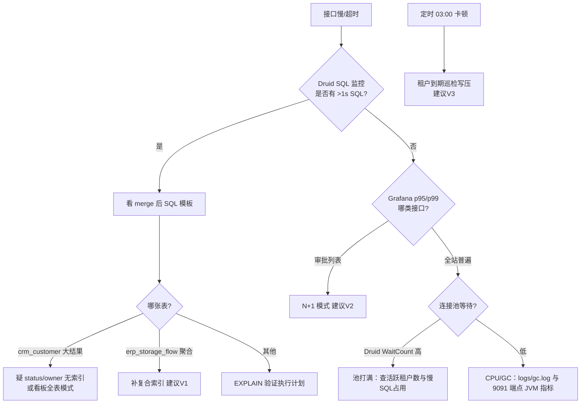

# 10-性能设计与优化

> 项目：ERP-CRM ｜ 版本：v1.2 ｜ 生成日期：2026-10-06 ｜ 依据：源码分析（v1.2：2026-10-06 一致性回刷——排查路径图中移除对已消失端点 /monitor/server 的引用）

本篇从四个层面盘点系统的性能设计与瓶颈：数据库（连接池、租户库拆分的性能账、慢查询与索引）、应用（缓存、批处理与巡检任务、聚合查询的内存模式）、前端（构建产物与加载路径），最后给出一组按优先级排序的优化建议。所有论断均给出源码位置；尚未发生但按增长曲线必然到来的问题标注为"预警"。

## 1. 连接池与多租户的性能账

### 1.1 两档池规格的设计意图

数据源规格集中在 `erp-crm/src/main/resources/application-druid.yml`，经 `auth/config/properties/DruidProperties` 在编程式创建数据源时应用为两档：

| 档 | 规格 | 适用 | 依据 |
|---|---|---|---|
| 主库 | initialSize=5 / minIdle=10 / maxActive=20 | 单池常驻 | yml 第 19-24 行 |
| 租户库 | initialSize=1 / minIdle=1 / maxActive=10 | 每租户一池 | yml 第 25-30 行，注释直言"常驻连接数 ≈ 活跃租户数 × minIdle，规格必须远小于主库池，否则租户增长会打爆 MySQL 连接数" |

这是租户库拆分方案的第一笔性能账：**MySQL 默认 `max_connections=151`，扣除主库 10 个常驻与系统开销，租户侧的理论安全水位约 130 个 minIdle 连接 ≈ 130 个常驻活跃租户**。该方案的配套机制是闲置淘汰：`IdleDataSourceEvictor`（`auth/datasource/IdleDataSourceEvictor.java`）以 `@Scheduled(fixedDelay=60_000, initialDelay=120_000)` 串行扫描，把闲置超过 `ec.datasource.idle-evict-minutes`（默认 30 分钟）的租户池整体 close 并移除，下次访问自动重建。淘汰判据是 `DynamicRoutingDataSource.lastAccessMillis`——每次 `determineCurrentLookupKey()` 都刷新（该类第 45-53 行），因此"闲置"的粒度是**最后一次 SQL**，而非最后一次 HTTP 请求。

并发正确性也做了性能取向的设计：`addDataSource` 用 `putIfAbsent` 保证并发首访只注册一个池（后到者关闭自己刚建的池，防孤儿池泄漏）；`evictIdleDataSources` 为 synchronized，与 add 并发时靠 `remove` 原子性避免重复关闭（`DynamicRoutingDataSource.java` 第 67-126 行注释）。代价是注册/淘汰路径上有全局锁，但这两条路径频率极低（每租户 30 分钟至多一次），不构成热点。

### 1.2 池参数与故障语义

其余参数的故障语义值得记住：`maxWait=60000`——租户池打满时请求会**挂 60 秒**才抛获取连接超时，表现为"接口偶发卡一分钟然后 500"，排查先看 Druid 控制台的池监控；`testWhileIdle=true / testOnBorrow=false`（第 45-49 行注释解释了取舍）——空闲连接由 `timeBetweenEvictionRunsMillis=60s` 心跳检测兜底，MySQL `wait_timeout` 断掉的死连接要等下一轮心跳才被清，高并发下偶发"Communications link failure"属此窗口 ⚠️ 待确认（Druid 1.2.25 对该组合有自动断连重试，实际影响需压测验证）。Tomcat 侧 `max=800` 线程 / `accept-count=1000`（`application.yml` 第 32-41 行），远高于两档池的连接供给——真正的瓶颈在连接池而非线程，压测时不要被线程数误导。

## 2. 数据库层：慢查询与索引现状

### 2.1 慢 SQL 观测入口

Druid `stat` filter 已开 `log-slow-sql: true, slow-sql-millis: 1000, merge-sql: true`（`application-druid.yml` 第 66-73 行）：超过 1 秒的 SQL 会进日志与 Druid 控制台"SQL 监控"页（merge 后按 SQL 模板聚合）。Actuator 侧 `http.server.requests` 开了 percentiles 直方图（p95/p99，`application.yml` 第 161-166 行），接口级耗时可在 Prometheus/Grafana 看（栈见《06-部署运行》4.3）。**两层观测都已就位，缺的是"谁来看"——没有配置任何慢 SQL 告警规则**（`ops/prometheus/rules/` 需核对是否已有 ⚠️ 待确认）。

### 2.2 索引盘点：两张热点表裸奔

以租户模板 `init-sql-script/erp-crm-tenant-sample.sql` 为准（它已合入全部 upgrade 变更，是最新结构的权威）：

| 表 | 已有索引 | 缺口评估 |
|---|---|---|
| `crm_customer` | `idx_name`、`idx_phone` | **无 (status, owner) 复合索引**——五类列表视图、公海领取、统计看板全部按 status/owner 谓词查询，这是全系统扫描量最大的表；行数过万后为首要索引缺口 |
| `crm_order` | `idx_order_no`(UNIQUE)、`idx_customer_id` | 基本够用 |
| `crm_opportunity/contract` | `idx_customer` | 够用（join 路径） |
| `crm_receivable` | `idx_contract` | 够用 |
| `crm_approval` | `idx_biz(biz_type,biz_id)`、`idx_status` | 够用（sync/revert 幂等 SQL 的 where 命中） |
| `erp_stock_order` / `erp_purchase_item` / `erp_payment` | 仅明细/付款表有 `idx_po`；**采购单主表无任何二级索引** | 主表按 order_no/supplier_id/warehouse_id 过滤会全表扫（当前量级可忍） |
| `erp_storage_flow` | **仅主键** | 预警：`selectStockQtyInWarehouse` 按 (product_id, warehouse_id) 聚合是调拨执行/库存推导的高频 SQL，流水表是只增表，行数随每笔出入库线性增长，是最需要 (product_id, warehouse_id) 复合索引的表 |
| `erp_transfer_order` | **仅主键** | `status='0'` 列表与 CAS 认领（id 主键）影响小，低优先 |
| `erp_product_sn` | 仅主键（sn_uuid） | 按 sn_code 扫码查询建议加唯一索引 |

结论：**索引债集中在 ERP 侧**，且恰好落在"唯一事实源"流水表上。数据量千级以内无感，万级流水后调拨执行的预检/复检 SQL 将进入 Druid 慢日志。具体补法见第 6 节建议 1。

### 2.3 分页机制的成本

`PageUtils.startPage()` 从请求参数取 `pageNum/pageSize` 且**钳制 pageSize ≤500**（防 `pageSize=100000` 拖库）；`PageClearInterceptor` 在请求结束兜底清理 PageHelper 的 ThreadLocal 残留（防容器线程复用串页，AGENTS.md 后端约定）。成本点在 PageHelper 的 count 查询：每个分页列表都是"count(*) + limit 查询"两条 SQL，对 `crm_customer` 这类带 left join 的列表 SQL 意味着 join 被执行两遍 ⚠️ 待确认（RuoYi 的 PageUtils 用 PageHelper 默认 count 改写，复杂 join 时 count 可手动优化）。前端 `useTable` 的 pageNum/pageSize 默认 10，正常使用不触雷。

## 3. 应用层：缓存与批处理

### 3.1 三级缓存盘点

| 缓存 | 层 | 机制 | 失效方式 |
|---|---|---|---|
| 字典（后端） | Redis | `DictUtils` 按 `sys_dict:{dictType}` 缓存，`SysDictTypeServiceImpl.refreshCache` 全量重建 | `DELETE /system/dict/type/refreshCache` |
| 参数配置（后端） | Redis | `SysConfigServiceImpl` 同上 | `DELETE /system/config/refreshCache` |
| 字典（前端） | 浏览器内存 | `useDict.js` 模块级 Map 缓存 Promise，同字典全局只请求一次，失败不缓存 | 刷新页面 |
| 会话 | Redis | `login_tokens:{uuid}` TTL 120 分钟滑动 | 登出/强踢/过期 |
| 限流/锁定计数 | Redis | `RateLimiterAspect` 计数键、`pwd_err_cnt/pwd_lock_time` | TTL 自然过期 |

没有业务数据缓存（商品/客户等直接查库）——这是刻意保持的"刷新即一致"（《02-页面设计》第 5 节），当前读负载下合理；若未来出现高频读热点（如产品列表被零售页高频拉取），优先在 service 层加 Redis 缓存而不是动数据库。

### 3.2 批处理与巡检任务

系统的"批"只有两类，都很克制：

1. **租户到期巡检**：`TenantExpirationJob.sweepOnce()` 全量拉 `master_tenant` 逐行判断（`saas/job/TenantExpirationJob.java` 第 44-69 行），每日 03:00 一次。它执行的是**逐行 UPDATE**（每个到期租户一条 `updateMasterTenant`），租户数到千级且集中过期时会产生一波主库写压 ⚠️ 待确认（当前租户规模个位数，无实际影响）；届时可改为单条 `UPDATE ... WHERE expiration_date < NOW()` 集合式停用。
2. **明细整删整插**：采购单保存时 `saveItems` 先 `delete` 后 `batchInsert`（`ErpStockOrderMapper.xml`），明细数十条内最优；数百条明细的单子会产生可观的 binlog 与锁窗口，当前业务形态（采购单明细个位数）无问题。

数据源池淘汰（60s 一次）也属常驻批处理，成本为每分钟一次内存遍历，可忽略。

### 3.3 预警：看板与审批列表的内存/查询模式

两处实现是应用层最大的性能隐患，当前数据量小所以未爆：

- **看板全表进内存**（`crm/service/impl/CrmStatisticServiceImpl.java`）：`customerInfo` 对线索/客户/公海三种 status 各执行一次无分页 `selectCrmCustomerList`（全量行反序列化进 JVM），"我的/总数"用 Java stream filter；`followupInfo`/`todayFollowupList` 同模式。客户 1 万行时，一次首页加载 ≈ 4 次全表查询 + 数万对象分配。
- **审批列表 N+1**（`CrmApprovalServiceImpl.selectApprovalList`）：待办页对**每个流程实例**发一次 TaskQuery、对**每一行**切租户库查一次合同（`fillContract`）——每页 10 行 = 1 次 count + 1 次实例分页 + 10 次 task 查询 + 10 次合同查询。页深越大越慢。

两者的改造方案见第 6 节建议 3/4。

## 4. 前端加载性能

构建配置（`erpcrm-ui/vite.config.ts` + `.env*`）已经做了成体系的优化，逐项列表：

| 措施 | 配置位置 | 效果 |
|---|---|---|
| echarts 按需注册 | `src/plugins/echarts.ts`，约定禁止 `import * as echarts` | 避免全量引入把 chunk 撑回 1MB+（AGENTS.md 前端约定） |
| 压缩产物 | `.env.production` `VITE_COMPRESSION=both` | 产物同时出 gzip + brotli，nginx/CDN 直接发预压缩文件 |
| 图片内联阈值下调 | `build.assetsInlineLimit: 1024`（vite 默认 4096） | 2~4KB 图片不再被 base64 内联进 CSS，可独立并行加载与缓存（配置注释明示动机） |
| 分包 | `rolldownOptions.advancedChunks` | 拆 vendor/业务 chunk；`chunkSizeWarningLimit: 1000` 作回归告警。⚠️ rolldown 1.2.5 中 `advancedChunks` 是弃用名且会**静默吞构建错误**（vite.config.ts 第 90-92 行与 AGENTS.md 双重记录），升级 rolldown 后迁移到 `codeSplitting` API |
| dev 预热 | `server.warmup.clientFiles: ["./index.html", "./src/{views,components}/**"]` | 提前转换高频文件，降冷启动瀑布 |
| 依赖预构建 | `optimizeDeps.include/exclude`（`build/optimize.ts`） | 减少 dev 首访二次打包 |
| sourcemap | `build.sourcemap: "hidden"` | 生成 map 不注入链接，线上报错可回溯且不暴露源码 |
| 构建目标 | `build.target: "es2020"` 与 browserslist 对齐 | 避免为 IE11 降级造成的产物膨胀 |
| 代理容错 | dev proxy 15s 超时 + 502 JSON | 后端挂掉不拖死 dev server |
| 运行时 | axios 全局超时 10s（下载 60s）；`useDict` 请求合并 | 防长尾请求拖住交互 |

剩余的加载短板：首屏需要串行完成"登录→getInfo→getRouters→动态注册路由→首屏数据"五步（`store/modules/user.ts` + `router/utils.ts`），其中菜单树是每会话必拉且后端每次现算（`SysMenuServiceImpl.buildMenus`）；86 个页面按路由懒加载已由 pure-admin 基座默认处理，`welcome` 看板的 6 张 echarts 图集中在首屏是主要渲染成本。

## 5. 性能问题排查路径

## 6. 优化建议清单（按优先级）

| 优先级 | 建议 | 动作 | 预期收益 | 依据 |
|---|---|---|---|---|
| V1 | 补 `erp_storage_flow(product_id, warehouse_id)` 复合索引；`crm_customer(status, owner)` 复合索引 | 新写 `db-backup/upgrade_performance_index.sql`（MySQL 8.0 加索引无 IF NOT EXISTS，需 `WHERE NOT EXISTS (INFORMATION_SCHEMA.STATISTICS)` 探重，照抄 upgrade 脚本的幂等风格）+ 同步租户模板 | 调拨/库存推导与五类客户视图在十万行级保持毫秒 | 2.2 节缺口 |
| V2 | 审批列表去 N+1 | 待办页把 TaskQuery 改为 `taskService.createTaskQuery().processInstanceBusinessKeyLike(...).listPage()` 一次取任务再按 processInstanceId 分组；`fillContract` 批量化（`selectCrmContractByIds`） | 每页 10 行从 22 条 SQL 降到 3~4 条 | 3.3 节 |
| V3 | 看板聚合下推 SQL | `customerInfo` 改为一条 `GROUP BY status` 聚合；"我的/总数"改 `count(*) ... where owner`；到期巡检改集合式 UPDATE | 首页从 4 次全表降到 1~2 条聚合 SQL | 3.3 节 |
| V4 | 慢 SQL 告警 | `ops/prometheus/rules/` 增加规则：Druid slow-sql 日志关键字告警或 `http_server_requests_seconds{quantile=0.99} > 1` | 把 2.1 节"缺的谁来看"补上 | 2.1 节 |
| V5 | 客户列表 count 优化 | 复杂 join 的列表 SQL 为 count 提供精简版（去掉只影响列不影响行数的 join） | 分页接口减半 join 成本 | 2.3 节 |
| V6 | 首屏瘦身（可选） | welcome 看板图表按需串行加载或骨架屏；`/getRouters` 结果前端 sessionStorage 会话级缓存 | 首屏可感知提速 | 4 节 |
| V7 | rolldown 升级 | 锁定解除后升 rolldown 并迁移 `advancedChunks`→`codeSplitting`，消除静默吞错 | 构建可靠性与分包调优空间 | 4 节 |

总评：系统的性能设计在**多租户资源治理**上相当成熟（两档池规格 + 闲置淘汰 + 分页钳制是一套自洽的组合拳），数据库索引债与应用层聚合模式是仅有的两处"随数据增长必然爆"的点，且都有低成本解法——V1/V2/V3 三项合计约一天工作量，建议在业务数据达到万级之前完成。
