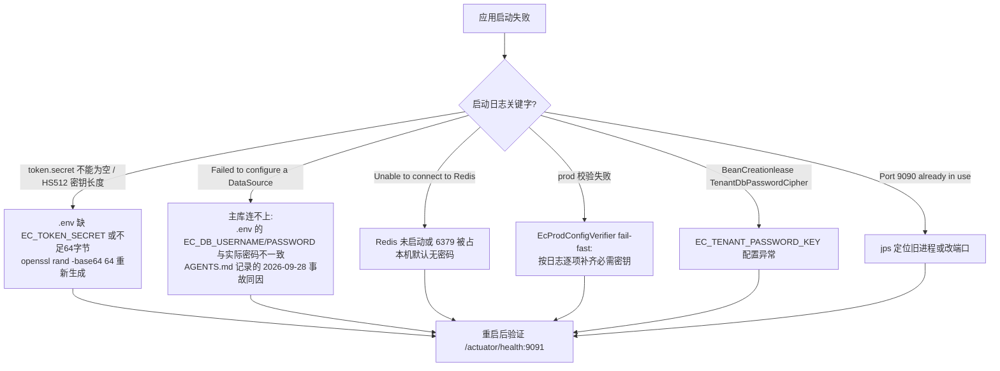
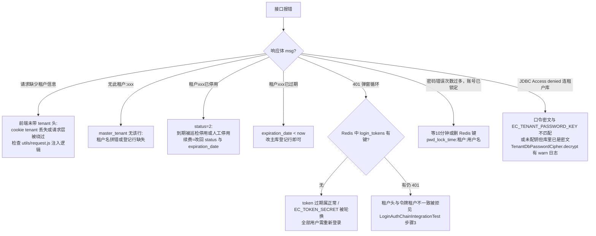
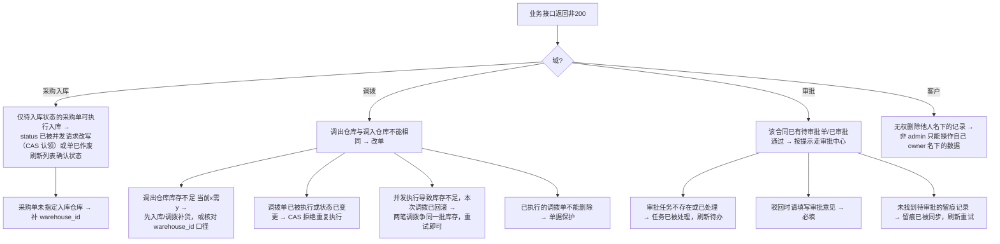

# 12-FAQ与故障排查

> 项目：ERP-CRM ｜ 版本：v1.2 ｜ 生成日期：2026-10-06 ｜ 依据：源码分析（v1.2：2026-10-06 一致性回刷——坑 12 的交叉引用由"03 篇 ⚠️"改指 02 篇第 2 节与 13 篇 D19）

本篇是排障手册：先给"日志与观测入口"清单，再用 mermaid 决策树覆盖三类典型故障（起不来、连不上、用不了），最后按业务域罗列高频报错与已知坑。所有报错文案均摘自源码字符串，可直接全文搜索定位。

## 1. 日志与观测入口

| 入口 | 位置 | 用途 |
|---|---|---|
| 应用日志（信息） | `${user.dir}/logs/sys-info.log`（`src/main/resources/logback.xml` 第 4 行定义，即**启动 java 命令所在目录**下的 `logs/`；仓库内已有 `erp-crm/logs/`） | 业务日志、租户数据源注册/淘汰（"已注册租户数据源"/"已淘汰闲置租户数据源"）、巡检结果 |
| 应用日志（错误） | 同目录 `sys-error.log` | 异常堆栈（GlobalExceptionHandler 兜底打印） |
| 登录专用日志 | 同目录 `sys-user.log` | 登录行为独立 appender（logback.xml 第 61-72 行） |
| 控制台 | stdout（`erpcrm.sh start` 时重定向到 /dev/null，**用脚本启动请看文件日志**） | 前台排障 |
| 滚动策略 | 按天滚动、`maxHistory=60`（保留 60 天） | 三类日志同策略 |
| 日志格式 | `HH:mm:ss.SSS [线程] [traceId:%X{traceId}] 级别 logger - [方法,行号] 消息` | traceId 由 `common/filter/TraceIdFilter` 注入 MDC，可串联一次请求 |
| 慢 SQL | Druid 控制台 `http://localhost:9090/druid/index.html`（账号 `.env` 的 `EC_DRUID_USER/PASSWORD`）→ SQL 监控 | >1s SQL 自动标记（`slow-sql-millis: 1000`），merge-sql 聚合 |
| 接口耗时 | `http://localhost:9091/actuator/prometheus`（p95/p99 直方图）+ Grafana 看板 | 接口级性能（见《10-性能设计与优化》2.1） |
| 业务日志表 | 租户库 `sys_oper_log`（@Log 异步写）、主库 `sys_logininfor`（登录全局链路） | "谁在什么时候干了什么"的权威记录（`/monitor/*` 页面） |
| 启停脚本日志 | crontab 备份日志 `/tmp/erpcrm-backup.log` | `ops/backup.sh` 的每日输出 |

## 2. 故障决策树

### 2.1 后端起不来（启动期失败）

### 2.2 起来了但登录/接口报错（运行期路由与会话）

### 2.3 业务操作被拒（业务校验类）

## 3. 高频报错速查表（按出现频次与坑度排序）

| 报错/现象 | 真实原因 | 处置 |
|---|---|---|
| `请求缺少租户信息` | 请求头无 `tenant`（`TenantInterceptor` 第 124 行） | 浏览器直连接口调试时手动加头；前端检查 cookie |
| 401 循环弹窗 | `EC_TOKEN_SECRET` 轮换后旧 token 全失效；或 Redis 被清 | 重新登录即可；服务端无需处理 |
| `密码错误次数过多，账号已锁定，请约 N 分钟后再试` | 5 次错密触发 10 分钟锁 | 等待，或运维删 Redis 键 `pwd_lock_time:{tenant}:{username}` |
| 登录报"用户名或密码错误，还可尝试 N 次"但密码正确 | 连的不是你以为的租户库（tenant 头错） | 核对租户名；admin 账号是**每租户库各一份**的 |
| `JDBC Access denied for user ...`（仅租户接口） | `master_tenant.password` 密文与当前 `EC_TENANT_PASSWORD_KEY` 不匹配；或未配钥但存量已是密文（`TenantDbPasswordCipher.decrypt` 的 warn 日志明说"会以密文连接租户库并失败"） | 配齐密钥；或按 `config/README.md` 的口令轮换规程重写登记行 |
| `仅有待入库状态的采购单可执行入库` | CAS 认领失败：单据状态已被改 | 刷新确认；并发点击场景属正常防护 |
| `调出仓库库存不足（当前 x，需 y）` | 流水推导库存不足；注意口径是**指定仓**而非全局 | 见 2.3 决策树 |
| `该合同已有待审批单，请勿重复提交` | `review_status='0'` | 走审批中心处理在途单 |
| `审批流程启动失败，已回滚业务数据，请重试` | 引擎启动异常（常见：主库 ACT_* 表异常/Flowable 依赖问题），租户库已补偿回退 | 看 sys-error.log 的根因堆栈后重试 |

## 4. 已知坑（源码确认，改代码前必读）

1. **`GET /crm/approval/{id}` 的 `{id}` 是 Flowable 任务 ID（UUID 字符串），不是 `crm_approval.id`**。`CrmApprovalController.getInfo` 把路径变量原样传给 `CrmApprovalServiceImpl.selectCrmApprovalById(String taskId)` → `taskService.createTaskQuery().taskId(...)`；误传留痕表自增主键会得到**空对象**而非报错（task == null 分支静默返回壳 VO）。同理 `POST /crm/approval/approve` 的 body `taskId` 也是引擎任务 ID。留痕表主键在审批接口层完全不可见，两套 ID 不可混用。
2. **401 是 HTTP 200 + body code 401**：`AuthenticationEntryPointImpl` + `ServletUtils.renderString` 硬编码 `setStatus(200)`。用 curl/Postman 判断会话失效要看响应体不是状态码；网关层做失败统计也要按业务码。
3. **前端超时 10 秒**：`utils/request.js` 全局 timeout=10000，仅 `download()` 放宽到 60 秒。长耗时操作（大批量导入）会前端报超时而后端仍在执行——重试前先查数据是否已写入。
4. **分页残留**：任何绕过 `startPage()`→立即查询顺序的写法（中间插了别的 SQL）会把分页参数染给后者，表现为"莫名只返回 10 条"。`PageClearInterceptor` 只是兜底，根因在代码顺序（AGENTS.md 后端约定）。
5. **`@Transactional` 内切 `@DataSource(MASTER)` 不换连接**：主库查询会静默落到当前租户库。症状是"表不存在"异常出现在错误的库里。跨库操作必须拆独立非事务方法（AGENTS.md 多租户第 6 条）。
6. **直连 `MasterTenantMapper` 绕过口令加解密**：读写 `master_tenant` 必须经 `MasterTenantServiceImpl`。绕过层的写入若存了明文，启动迁移器会再加密一次造成双重加密，该行从此解不开。
7. **字典改了两级缓存都不自动失效**：后端 Redis 缓存要调 `DELETE /system/dict/type/refreshCache`，前端内存缓存（useDict 模块级 Map）要刷新页面。改完字典"没生效"多半是漏了其中一级。
8. **`GET /system/user/` 与 `GET /system/user/{userId}` 共用映射**（`SysUserController` 第 101 行 `value = {"/", "/{userId}"}`）：为"查当前用户"与"查指定用户"服务，新增路径时勿破坏。
9. **构建静默失败**：前端 `vite.config.ts` 的 `advancedChunks`（rolldown 1.2.5 弃用名）会吞掉部分构建错误，表现为 rendering chunks 阶段无诊断失败——排查时先临时注释它再看真实报错（AGENTS.md + 配置注释双重记录）。
10. **`mvn -q package 2>&1 | tail` 会吞退出码**：package 失败时旧 jar 仍在，"启动成功但行为没变"多半是跑了旧包（AGENTS.md 警告）。
11. **XSS 过滤只覆盖 `/system/*`、`/monitor/*`、`/tool/*`**：crm/erp 接口不做转义（2026-09 评估结论，业务 JSON 含合法 `<>`）。在 crm/erp 输入里粘贴 HTML 不会被过滤是**设计如此**，不是漏洞 regression（改动前重读 AGENTS.md 的评估）。
12. **`/monitor` 下的 quartz 任务页是 RuoYi 遗留**：后端 quartz 模块未迁移（02 篇第 2 节、13 篇 D19 记录），页面对应接口不存在，访问会 404/500——不是环境坏了。
13. **登录日志在主库、操作日志在租户库**：查"谁登录过"去主库 `sys_logininfor`，查"干了什么"去当前租户库 `sys_oper_log`，两库口径不同（04 篇第 1 节）。
14. **种子口令是 `ROTATED` 占位**：新环境按《06-部署运行》2.1 修 tenant1 登记行并补种 admin，不要试图用文档里的任何"示例密码"登录生产库。

## 5. 三个典型排障案例（复盘式）

**案例一：换机部署后租户接口全报 Access denied。** 现象是登录正常（登录只碰主库与租户库 sys_user，而 tenant1 的主库登记行还是明文口令），但一进业务页就 500。排查路径：先看 sys-error.log 发现 `JDBC Access denied for user 'ec_tenant1'`；再想到该机器配了 `EC_TENANT_PASSWORD_KEY`，而导入的 master_tenant 数据是从旧机器 mysqldump 来的——旧密文用旧钥加密，新钥自然解不开（`TenantDbPasswordCipher.decrypt` 对 GCM tag 校验失败会显式抛"租户库口令解密失败：密钥不匹配或密文损坏"，日志里能搜到）。修复两条路：把旧机器的 `EC_TENANT_PASSWORD_KEY` 带过来，或按《14-配置与环境详解》8 节把 tenant1 登记行的 password 改回明文让启动迁移器重新加密。教训：**跨机迁移主库数据时，租户口令加密密钥必须随迁**。

**案例二：调拨单"明明有库存"却报库存不足。** 用户在调拨页选了产品与数量，提交执行报"调出仓库库存不足（当前 3，需 10）"，但产品详情里显示库存 15。排查路径：先理解口径——系统没有"库存字段"，现存是按 `(product_id, warehouse_id)` 从流水推导的（《07-模块详解》3.1）；产品详情显示的 15 是**全部仓库**合计，调拨预检查的是**指定调出仓**。查流水发现该产品的入库流水全挂在仓库 1，而调拨单选的是仓库 2。修复：改调拨单调出仓为仓库 1，或先做一笔调拨/期初把库存落到仓库 2。教训：所有库存问题的第一问都是"哪个仓库的"，第二问才是"多少"。

**案例三：审批中心详情接口返回空对象。** 前端想给审批列表加"详情抽屉"，拿列表行的自增 id 去调 `GET /crm/approval/{id}`，每次都得到壳对象。排查路径：读 `CrmApprovalController.getInfo` 发现 `{id}` 直接传给 `selectCrmApprovalById(String taskId)`，后者喂给 Flowable 的 `taskService.createTaskQuery().taskId(...)`——参数语义是**引擎任务 ID**（UUID 字符串），而列表行里的 `taskId` 字段才是它。这是一个接口设计层面的历史坑：路径参数名 `{id}` 与业务表主键 `id` 同名诱导了误用。修复：前端改传行的 `taskId` 字段；长期修复见《13-技术债务与演进建议》路线图（考虑把路径改为 `{taskId}` 并对非法格式报错）。

## 6. 排障工作流建议

标准顺序：① 复现并抄下**响应体 msg**（本系统 msg 即源码字符串，全文搜索即可定位抛出点，推荐 `grep -rn "报错文案" erp-crm/src/main/java`）；② 打开对应入口——业务校验类看第 4 节，连接/会话类看 2.1/2.2 决策树；③ 需要 SQL 证据时开 Druid 控制台看该接口实际执行的 SQL 与耗时；④ 涉及跨库/补偿逻辑时按 traceId 串联 sys-info.log 与 sys-error.log；⑤ 修完必须有测试锚定（新增用例参照《09-测试与质量保障》第 3 节的三个模板），防止同类问题复发。

再补充三条经验法则。**先分层后深入**：本系统的故障几乎总能归入四层之一——前端交互层（防重复提交误拦、401 弹窗）、网关代理层（dev 代理 15 秒超时、nginx 50m 上限）、应用层（业务校验拒绝、补偿回退）、基础设施层（连接池打满、Redis 掉线、MySQL 口令），先用"哪一层"缩小范围再查根因，比逐行读代码快得多。**善用日志的三条专属线索**：`已注册租户数据源` 意味着该租户是本次启动后首次访问（之后不应再出现，除非被闲置淘汰）；`已淘汰闲置租户数据源` 之后紧跟的报错优先怀疑连接重建期；`租户[xxx]已于 ... 到期，已自动停用` 直接解释"昨天还好好的今天全挂"类工单。**区分三类"非故障"**：CAS 拒绝类报错（入库/调拨/审批重复提交）是并发防护正常工作，向用户解释即可不必修代码；补偿回退类报错（"已回滚业务数据，请重试"）说明一致性机制生效，但若频发要查引擎侧根因；死页面 404（monitor/server、tool/gen、monitor/job）是已知遗留，见第 4 节坑 12。
