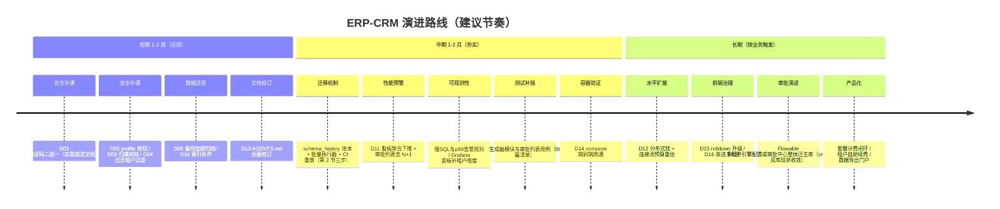

# 13-技术债务与演进建议

> 项目：ERP-CRM ｜ 版本：v1.1 ｜ 生成日期：2026-10-06 ｜ 依据：源码分析

本篇把散落在前八篇与旧篇中的 ⚠️ 项、`db-backup/` 里暴露的问题逐条汇总为技术债务台账（每条给出证据、影响、偿还成本），对"无迁移框架的 upgrade 脚本机制"做专门的技术债分析，最后给出三阶段演进路线图。台账按"安全 > 正确性 > 可维护性 > 效率"排序，编号 D01 起。

## 1. 技术债务台账

先交代台账的口径。这里只收"有源码或仓库证据"的债，每条按证据、影响、偿还成本三段记录；纯风格偏好不收，"改了会破坏既有 API 契约"的项会显式标注。汇总 ⚠️ 项的来源有三处：旧篇（00-06）标注的待确认点、本套新篇（07-15）深读中新发现的问题、以及 `db-backup/` 目录自带的物证（README 自述、文件命名与时间戳、脚本内容本身）。台账按"安全 > 正确性 > 可维护性 > 效率"排序，编号 D01 起，便于在 issue/commit 里直接引用（如 `refactor: resolve D07`）。

### 1.1 安全类

| # | 债项 | 证据 | 影响与成本 |
|---|---|---|---|
| D01 | **图形验证码缺失且文档口径漂移** | 源码无 `/captchaImage` 端点、`LoginBody` 仅两字段、登录页三个输入框；但 AGENTS.md 认证流程节仍描述完整验证码链路，`common/utils/VerifyCodeUtils.java` 成为孤儿工具类；`LoginAuthChainIntegrationTest` 类注释明写"图形验证码已按产品决策移除" | 防暴力破解只剩 IP 限流 + 账号锁定，分布式慢速撞库（换 IP 绕限流）理论可行；更大的成本是**文档与代码互相矛盾**，新人按 AGENTS.md 排障会走进死胡同。偿还：要么重新实现（后端端点 + Redis `captcha_codes:{uuid}` + 前端图形框，约一天，工具类还在），要么正式修订 AGENTS.md 与本套文档统一口径 |
| D02 | **`/profile/**` 匿名直出上传件** | `SecurityConfig` 对 `GET /profile/**` permitAll；上传文件名含日期与随机后缀 | 知道/猜到文件名即可未授权下载。偿还：改为认证后访问（自定义 Resource 处理器）或上传时生成不可猜测的 UUID 路径；半天 |
| D03 | **生成器四模块无行级归属校验** | `CrmOpportunity/CrmContract/CrmReceivable/CrmOrder` 的 Controller/Service 均为生成器原样产物，无 restrictOwner | 有编辑权限的用户可改任意 owner 的记录，横向越权面 ⚠️ 待确认是否产品预期。偿还：复刻 `CrmCustomerServiceImpl.transferCrmCustomerByIds` 的模式，一天内 |
| D04 | **`/monitor/logininfor` 未按租户过滤** | 数据落主库（全局链路是设计使然），但接口未加 tenant 谓词 | 租户管理员或见其他租户登录记录 ⚠️ 待确认租户菜单是否下发该页。偿还：service 层补租户过滤，半天 |
| D05 | **X-Frame-Options 关闭** | `SecurityConfig.headers.frameOptions.disable()`（iframe 菜单需要） | 点击劫持面。若未来下线 iframe 菜单（Druid 内链）应改回 DENY/SAMEORIGIN，半小时 |

### 1.2 正确性与数据类

| # | 债项 | 证据 | 影响与成本 |
|---|---|---|---|
| D06 | **db-backup 明文快照仍在仓库** | `db-backup/ryt_nelub7xr_20260907.sql`、`ryt_nelub7xr_before_demo_upgrade.sql` 及 `legacy-sql/` 下三份历史快照均为明文 .sql（README 自述"仅含演示账号 bcrypt 哈希"，且 2026-09-11 已全量轮换口令，旧凭据失效） | 结构与业务数据可被完整还原，属低危但非零的泄露面；且与"备份一律加密"的既定方针（auto/ 全是 .enc）不一致。偿还：按 README 自己给出的 `.enc` 方式加密归档并从仓库移除明文，一小时 |
| D07 | **迁移脚本部分非幂等** | `upgrade_approval.sql`/`upgrade_supply_finance.sql`/`upgrade_warehouse_transfer.sql` 的 `ALTER TABLE ... ADD COLUMN` 为裸语句（MySQL 8.0 无 ADD COLUMN IF NOT EXISTS），重复执行报 Duplicate column | 半自动化执行（脚本/CI 批量跑）时会在中途失败留下半截状态。详见第 2 节 |
| D08 | **演示数据脚本与 schema 迁移混放** | `db-backup/upgrade_demo_data.sql`（11 万字符）与 `gen_demo_data.py` 是数据灌入工具，却与结构迁移脚本同名前缀混在一处；`04-数据模型.md` 5.2 需要专门一句澄清"与 schema 迁移无关" | 新人易把演示数据脚本当迁移跑进生产库。偿还：改名（如 `seed_demo_data.sql`）或挪入 `sql/demo-data/`，十分钟 |
| D09 | **租户模板乱码注释未修复** | `erp-crm-tenant-sample.sql` 大量列注释为 GBK→UTF8 转码乱码（实测 erp_storage_flow 等表）；`db-backup/repair_mojibake_20260907.sql` 只是历史修复产物，模板本体未回填 | 不影响结构，但按注释理解表语义会踩空；SOP-5 改模板时"勿以乱码注释为准"（《06-部署运行》第 7 条）是口头纪律。偿还：把 repair 脚本中已修复的 COMMENT 回填模板，半天 |
| D10 | **热点表缺二级索引** | `erp_storage_flow`/`erp_transfer_order`/`erp_stock_order` 仅主键；`crm_customer` 无 (status,owner) 复合索引 | 万级数据后的必然慢查询（证据链与方案见《10-性能设计与优化》2.2 与建议 V1）。偿还：一个幂等 upgrade 脚本，半天 |
| D11 | **看板/审批列表的聚合实现不可扩展** | `CrmStatisticServiceImpl` 全表进内存、`CrmApprovalServiceImpl` 列表 N+1 | 性能预警而非缺陷，方案见《10-性能设计与优化》建议 V2/V3。偿还：合计约一天 |
| D12 | **单实例假设硬编码在两处常驻任务** | `IdleDataSourceEvictor`（内存扫描连接池）与 `TenantExpirationJob`（无分布式锁）都假设单实例 | 当前单 jar 部署正确；一旦多实例水平扩容，巡检会重复执行（幂等所以无害）但闲置淘汰各自为政（也无害），真正的坑是**多实例时连接池总量翻倍**。偿还：上多实例前给巡检加 ShedLock 类机制并重估池规格，一天 |

### 1.4 db-backup 目录问题的专门分析

`db-backup/` 值得单独一节，因为它是全仓库唯一"既是工具又是数据"的目录，几类问题在上面叠加。**第一类是敏感度分层未完成**：目录的既定方针是"含口令清单的备份必须加密"（README 第一条、auto/ 产物全部 .enc、顶层 master 快照已加密），但执行不彻底——顶层两份 2026-09-07 的租户库快照与 legacy-sql/ 三份历史快照仍是明文（D06）。虽然 2026-09-11 的全量口令轮换让旧凭据失效、快照里也只有演示账号的 BCrypt 哈希，风险被压到很低，但"方针已定而存量未清"本身就是债。**第二类是目录职责蔓延**：它同时承担自动备份落点（auto/）、手工快照归档（顶层与 legacy-sql/）、增量迁移脚本（upgrade_*.sql）、演示数据工具（upgrade_demo_data.sql + gen_demo_data.py）、结构修复产物（repair_mojibake_20260907.sql）五种角色，命名前缀（upgrade_*）无法区分"结构迁移"与"数据灌入"，这正是 D08 的根源。**第三类是迁移语义仅存在于文件名时间戳**：五个 upgrade 脚本的执行顺序只能靠文件修改时间推断（9 月 8 日凌晨到早上按小时递进，与业务上线节奏吻合），没有版本号也没有账本——这是第 2 节专项分析的对象。**第四类是与后端仓库的耦合**：repair 脚本对应的是租户模板的历史乱码（模板本体未回填，D09），demo 数据脚本里写死了 `ryt_nelub7xr` 这个特定租户库——目录内容与具体环境强耦合，换环境部署时整目录都不可照搬，需要逐文件判断"这是工具还是数据"。

### 1.5 可维护性类

| # | 债项 | 证据 | 影响与成本 |
|---|---|---|---|
| D13 | **AGENTS.md 多处滞后于源码** | ①验证码（D01）；②包结构写 `com.ec.system` 实为 `com.ec.sys`；③登录 body 写含 code/uuid；④前端登录页描述含验证码图形 | AGENTS.md 是 AI 代理与新成员的第一入口，滞后描述会系统性地误导后续改动。偿还：一次全面校订（以本套文档为基准），两小时 |
| D14 | **compose 栈未实测** | `ops/deploy/docker-compose.yml` 仅过 YAML 语法校验（本机无 Docker daemon，AGENTS.md 记录） | 首次容器化部署需预留验证时间；db-init 的 heredoc 与 CI 逻辑同源但未经端到端验证。偿还：有 Docker 环境后跑通一轮，半天 |
| D15 | **前端构建链钉在 rolldown 1.2.5** | `package.json` `pnpm.overrides`；`advancedChunks` 为弃用名且静默吞构建错误 | 阻塞 vite/rolldown 升级；构建错误诊断体验差。偿还：升级并迁移 `codeSplitting` API，半天（含回归） |
| D16 | **业务 JS 不在 typecheck 范围** | `tsconfig` exclude `**/*.js`；86 页业务代码零类型检查 | 靠 lint + 两个 vitest 文件兜底；重构风险随页面数增长。偿还：长期决策——要么渐进 TS 化（pure-admin 基座已是 TS），要么补关键 composable 的单测（成本见《09-测试与质量保障》第 5 节） |
| D17 | **生成器与产物脱节 + 绝对路径** | `gen_business_modules.py` 的 BASE/PKG/RES 写死作者机器路径；产物已被手工改（CrmContract.review_status 不在生成器定义中） | 重跑即覆盖手写补丁；换机器无法直接使用。偿还：路径参数化 + 文件头加"勿重跑"警示注释，半小时 |
| D18 | **命名遗留不一致** | `CrmPoolControler`（少一个 l）、`POST /erp/product/querPorductByTags`（拼写）、`crm:clues:tocustomer`（小写）等 | 无功能影响，但新人易"顺手纠正"引发前后端不一致。偿还：保持现状并在这类符号处加注释说明"拼写沿用于既有 API 契约"，或集中一次性重命名（前后端+菜单权限串同步，半天） |
| D19 | **RuoYi 遗留死页面** | `views/tool/gen/*`、`views/monitor/job/*` 等页面对应的后端生成/quartz 接口未随单模块迁移 | 菜单里的死入口，误点报错。偿还：从租户模板 sys_menu 摘除并出 upgrade 脚本，半小时 |
| D20 | **仓库混入非代码物料** | `erp-crm/homework/`（课程作业/简历资料）、`笔记/` 含本机绝对路径的图片引用 | 无害但增加仓库噪音。偿还：移出仓库或移入独立文档库，十分钟 |

## 2. 专项分析：无迁移框架的 upgrade 机制

现状：schema 演进靠 `db-backup/upgrade_*.sql` 幂等脚本 + 手工/CI 执行，五批范本（business_modules → approval → supply_finance → warehouse_transfer → stock_adjust，按文件时间戳即执行顺序）。这套轻量机制的真实债务不是"没有 Flyway"本身，而是它**隐含了三条未经工具保证的纪律**：

1. **"已执行到哪"没有账本**。哪个租户库跑过哪个脚本，只存在于执行者的记忆与备份时间戳里。新接手者面对一个库无法回答"这个库是什么结构版本"——只能靠 `SHOW COLUMNS` 逐项比对模板。Flyway/Liquibase 用 schema_version 表解决的就是这个问题；自建等价物只需一张 `schema_history(version, applied_at)` 表 + 升级脚本头部插入记录，成本一个下午，比引入框架轻得多。
2. **幂等性靠风格自律**。CREATE TABLE/INSERT 都有范本可抄，唯独 ADD COLUMN 无法幂等（D07），五批脚本里有三批带裸 ALTER。执行顺序上"先跑的脚本给后跑的脚本铺列"（如 supply_finance 给 stock_order 加的 status 列，被 warehouse_transfer 之后的逻辑依赖），跳序执行会得到不同的失败点。这与 1 是同一根源：没有版本账本，顺序只能靠文件名时间戳约定。
3. **"三处同步"靠人肉检查**。租户模板、upgrade 脚本、实体四处（domain/XML/insert/update）必须一致，漏一处就是"老租户有、新租户没有"的结构漂移（SOP-5 的最大翻车点）。目前唯一自动化的环节是 CI 每次从零执行模板建租户库，等于持续验证"新租户路径"——但"upgrade 路径"（存量库升级）没有任何自动化验证。

**偿还路径建议**（按渐进顺序）：第一步建 `schema_history` 账本表 + 把既有五批脚本补登记为已应用（半天）；第二步写一个 30 行的批量执行器（读 `master_tenant.database_name` 枚举租户库，按序执行未登记脚本并记账），替换人肉循环（半天）；第三步在 CI 中加"upgrade 重放"作业——从模板建一个影子库跑完全部 upgrade 脚本比对结构一致（一天）。三步做完，这套机制的可信度接近 Flyway 而复杂度远低于引入框架；若租户数量与变更频率继续增长，再考虑正式引入 Flyway 的 tenant-specific 迁移（其社区版对多库编排支持一般 ⚠️ 待确认届时选型）。

## 3. 演进路线图

路线图的三条主线逻辑：**短期只还"会出事故"的债**（安全四项 + 索引 + 文档口径，全部是一天以内的小改动，性价比最高）；**中期还"随增长必然爆"的债**（迁移账本、性能预警、告警缺失）；**长期项一律由业务信号触发**（多实例、租户规模、审批复杂度），避免为想象中的规模提前建设。每完成一项，请同步更新本台账的状态与本套文档相应篇目，让文档与代码始终保持《00-项目总览》确立的"以源码为准"的口径。

对三阶段的取舍再展开几句。短期清单里把 D01（验证码）放在第一位，不是因为它风险最高（D02/D03 的越权面其实更实），而是因为它是**唯一一个文档、代码、测试三方各执一词**的债——AGENTS.md 说有、源码说没有、测试注释说"按产品决策移除"，只要它悬而未决，每个新接触项目的人都要重新考证一遍，沟通成本持续发生；所以无论最终"实现"还是"改文档"，先把它变成一个有结论的事。中期把迁移机制排在性能之前，理由是顺序依赖：D10 补索引、V2/V3 改聚合都要产出新的 upgrade 脚本，若账本机制先就位，这些脚本一出生就被记账和 CI 重放保护，反过来若先做性能再补账本，中间窗口期产出的脚本又要人工补登记。长期项的"业务触发"标准建议量化：连接池预算方面，活跃租户数过 50（约需重估 MySQL `max_connections` 与租户池规格）即启动 D12；审批复杂度方面，出现第二个流程定义需求时再评估"引擎表落主库"是否仍是正确取舍——届时crm_approval 双库现状（主库一份结构与租户库一份留痕）也应一并收敛，避免三处结构对齐的持续成本。

最后说明本台账的维护方式：建议每季度复核一次，已偿还项移入文末"已偿还记录"（保留编号与一句话方案），新增 ⚠️ 项按同样三段式（证据/影响/成本）入册；凡是本套文档（00-15）中新出现的"⚠️ 待确认"标记，复核时都应给出结论并消号——待确认项不是永久状态，而是等待证据的临时标记。
