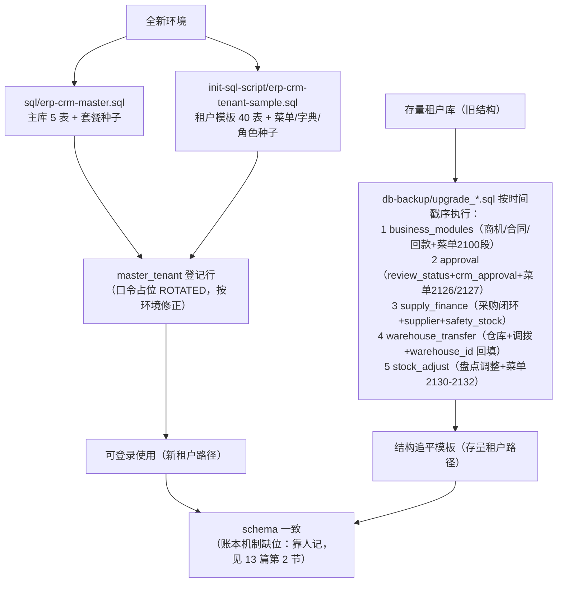

# 14-配置与环境详解

> 项目：ERP-CRM ｜ 版本：v1.2 ｜ 生成日期：2026-10-06 ｜ 依据：源码分析（v1.2：2026-10-06 一致性回刷——6.1 图中租户模板表数 38→40，以模板实测为准）

本篇是配置的**逐文件走读手册**：后端从 `application.yml`、`application-druid.yml`、`config/`、`.env`、启停脚本到 Docker 栈；数据库迁移与备份机制的完整操作视角（upgrade 脚本序列时间线、backup.sh 逐段拆解）；前端三份 env 与构建配置。环境变量速查已见《06-部署运行》第 3 节，本篇不重复表格，只讲"每个配置为什么是这样、改它会发生什么"。

## 1. 配置加载机制与优先级

后端配置的加载链是理解一切的前提：`application.yml` 第 59-61 行声明 `spring.config.import: optional:file:./.env[.properties]`——把仓库根的 `.env`（KEY=VALUE properties 格式，已 gitignore）作为属性源导入，`application*.yml` 里的 `${EC_*}` 占位符从中取值。**优先级为：真实环境变量 > `.env` > yml 默认值**（Spring 标准规则），这意味着三件事：改 `.env` 后重启即生效、无需重新打包（`config/README.md` 明示）；docker-compose 场景用真实环境变量覆盖 `.env` 里的本机地址（compose 里 `EC_DB_URL=jdbc:mysql://mysql:3306/...` 的写法即此）；`optional:` 前缀保证 `.env` 不存在时应用仍能以纯环境变量方式启动（CI 就是这样）。`.env` 同时被 `erpcrm.sh`/`erpcrm.bat`（source 后 export 给 java 进程）与 `ops/backup.sh`（第 35-37 行 `set -a; source`）三方消费，是全项目唯一的事实密钥清单。

## 2. application.yml 逐段走读

| 段 | 关键项 | 说明与改动影响 |
|---|---|---|
| `ec.*`（项目自定义） | `name/version/demoEnabled`、`profile: ${EC_UPLOAD_DIR:upload}`、`security.tenant-db-password-key: ${EC_TENANT_PASSWORD_KEY:}`、`tenant.expiration-remind-days: 7`、`tenant.expiration-job-cron: "0 0 3 * * ?"` | 租户加密密钥**默认空**＝加解密直通（本地/CI 合法状态，prod 由校验器强制）；巡检参数可在不重启代码的情况下按部署环境调整 |
| `server` | `port: 9090`、tomcat `threads.max: 800`、`accept-count: 1000` | 线程数远大于连接池供给，压测瓶颈在池（《10-性能设计与优化》1.2） |
| `logging` | `com.ec: debug` | 应用日志级别 debug；但 logback.xml 的 `<logger name="com.ec" level="info"/>` 对文件输出收口为 info，控制台与文件级别不同属刻意设计 |
| `spring.data.redis` | host 127.0.0.1、password `${EC_REDIS_PASSWORD:}`、lettuce 池 max-active 8 | **SB3 前缀是 `spring.data.redis`**（AGENTS.md 后端约定，改配置时最易写回旧前缀）；lettuce 池 8 个连接对单应用足够 |
| `token` | `header: Authorization`、`secret: ${EC_TOKEN_SECRET}`（无默认值，缺则启动失败）、`expireTime: 120` | expireTime 注释记录了 2026-09-28 应用户要求 30→120 的变更史；剩余 ≤20 分钟滑动续期逻辑在 TokenService |
| `mybatis` | typeAliasesPackage `com.ec.**.domain`、mapperLocations `classpath*:mapper/**/*Mapper.xml`、configLocation | 新增 mapper XML 放对目录即被扫描，无需登记 |
| `pagehelper` | helperDialect mysql、`supportMethodsArguments: true` | 后者让 PageHelper 从请求参数自动取 pageNum/pageSize——`startPage()` 能生效的前提 |
| `springdoc` | api-docs/swagger-ui enabled true | prod 由外置模板强制关闭（第 5 节） |
| `xss` | `urlPatterns: /system/*,/monitor/*,/tool/*`、`excludes: /system/notice` | 覆盖范围是有意收窄的（AGENTS.md 评估结论），扩大前必须重新评估 |
| `flowable` | `database-schema-update: true`、`async-executor-activate: false`、`check-process-definitions: true` | 引擎表启动自动建**主库**；异步执行器关闭＝审批全同步执行（`CrmApprovalServiceImpl` 的 complete 调用是同步语义的前提） |
| `management` | `server.port: 9091`、expose health/info/prometheus、http.server.requests p95/p99 直方图 | 指标独立端口，prod 建议绑内网（模板注释） |
| `spring.servlet.multipart` | 单文件 10MB / 请求 20MB | 与前端 nginx `client_max_body_size 50m` 匹配（后端是更紧的闸门） |
| `spring.profiles.active: druid` | 默认激活 druid profile | 数据源配置因此拆在 application-druid.yml |

## 3. application-druid.yml 与租户建库参数

该文件三段各有明确分工：`spring.datasource.druid.master`（主库 URL/凭据，URL 默认值含 `serverTimezone=GMT%2B8` 等 JDBC 参数）；`spring.datasource.druid.tenant`（租户池小规格 1/1/10，注释给出连接数账）；`tenant.database`（**注册建库**用的高敏感凭据 `EC_TENANT_DB_USERNAME/PASSWORD` 与 host/port——它不是连接池配置，而是 `TenantRegisterService` 执行 `CREATE DATABASE/CREATE USER` 的管理员凭据）与 `tenant.prefix`（库名前缀，默认 `ec_`）。注意区分两组凭据的用途：`EC_DB_*` 是应用日常连主库的凭据，`EC_TENANT_DB_*` 是注册建库的根级凭据（权限要求最高，泄露影响最大，`.env.example` 注释标"最高敏感级"）。其余 Druid 参数（maxWait 60s、三层空闲淘汰 60s/300s/900s、testWhileIdle、stat 慢 SQL 1s、wall 防火墙 multi-statement-allow）的故障语义见《10-性能设计与优化》1.2。`DruidMonitorConfig` 把控制台账号/白名单也接到了 `EC_DRUID_*` 三个变量上。

## 4. 启停脚本与部署形态

### 4.1 erpcrm.sh（Linux/Mac，~100 行）

四动作 `start|stop|restart|status`。要点：头部 JVM 参数已按 JDK17 修正（注释明示 UseParallelOldGC 已废弃，统一日志 `-Xlog:gc*:file=.../gc.log:time,tags:filecount=5,filesize=10m`，GC 交给默认 G1；堆 512m-1024m，Metaspace 128m-512m，HeapDumpOnOutOfMemoryError 开启）；`set -a; . .env; set +a` 加载密钥；start 用 `nohup java $JVM_OPTS -jar $AppName > /dev/null 2>&1 &`——**stdout 丢弃，排障必须看 `logs/` 文件日志**；stop/restart 用 `ps -ef | grep` 定位 PID 后 kill。两个已知坑：`APP_HOME=pwd` 要求**必须在 jar 所在目录执行脚本**；日志重定向到 /dev/null 使启动期异常（如配置错）不留控制台痕迹，启动失败先 `java -jar target/erpcrm.jar` 前台跑一次。

### 4.2 erpcrm.bat（Windows）

注释明示"keep this file ASCII-only so it survives any encoding"——整文件不用中文规避编码问题。交互式菜单 [1]start…[5]exit，进程定位用 `jps -l | findstr`（比 tasklist 可靠），启动用 `javaw`（无控制台窗口）。JVM 参数与 sh 版本一致（但无 GC 日志项）。

### 4.3 Docker 形态

后端 `Dockerfile` 两阶段：`maven:3.9-eclipse-temurin-17` 先拷 pom 执行 `dependency:go-offline`（利用层缓存离线依赖），再拷 src 打包（测试归 CI）；运行阶段 `eclipse-temurin:17-jre`，EXPOSE 9090/9091。前端 `Dockerfile`：node:22-alpine + corepack 钉 pnpm 10.34.5 → `pnpm install --frozen-lockfile && pnpm build` → nginx:stable-alpine 托管 dist + `nginx.conf`（`/static/` 30 天 immutable、`/prod-api/` 反代 `host.docker.internal:9090`、`client_max_body_size 50m`、SPA fallback、gzip）。`ops/deploy/docker-compose.yml` 五服务（mysql/redis/db-init/backend/frontend）的职责与已知风险（未实测）见《06-部署运行》4.2，此处不重复。

## 5. 生产外置配置（config/）

`config/application-prod.yml.example` 是 prod profile 的模板（复制为同目录 `application-prod.yml`，该文件 gitignore）。内容三件事：关闭 Druid 控制台（`spring.datasource.druid.statViewServlet.enabled: false`）、强制关闭 springdoc、把 `ec.profile` 重定向到 `/data/erpcrm/upload`。激活方式 `SPRING_PROFILES_ACTIVE=prod,druid`。模板头部注释列出了 prod 必需密钥清单，并建议额外收紧 `management.server.address` 绑内网。`EcProdConfigVerifier`（`common/config/`）在 prod 激活时逐项校验（JWT ≥64 字节、租户加密密钥必配等），缺失即启动失败——这是"配置错误必须在启动期暴露"的落点，配套测试 `EcProdConfigVerifierTest`。`config/README.md` 另外记录了 JWT 密钥轮换规程（换 `EC_TOKEN_SECRET` 重启，全部用户重登）与租户口令加密密钥的轮换约束（**轮换后需同步重写主库口令或清空重灌**——AES-GCM 密文无法用新钥解开旧文，这是密钥轮换的唯一硬约束）。

## 6. 数据库初始化、迁移与备份机制

### 6.1 初始化与迁移脚本全景

两条路径的分工已在《04-数据模型》5.2 讲过；本篇补充操作视角的四个细节：① 模板内部仍带乱码注释（历史转码遗留，`repair_mojibake_20260907.sql` 是修复产物未回填），改动时勿以乱码注释为准；② 加列语句是裸 ALTER，重跑报 Duplicate column，执行前先看目标库有没有该列；③ 菜单插入普遍先 `DELETE ... WHERE menu_id IN (...)` 再插，半截执行可安全重跑，唯独裸 ALTER 不行；④ 演示数据（`upgrade_demo_data.sql` + `gen_demo_data.py`）与结构迁移同目录但**性质不同**，灌演示数据前确认目标库是演示环境。

### 6.2 backup.sh 逐段拆解

`erp-crm/ops/backup.sh`（96 行）是备份机制的全部实现，结构上是一段可直接照抄的 mysqldump 管道范本：

1. **参数与环境**（第 16-58 行）：`--keep-days`（默认 14）/`--out`（默认 `../db-backup/auto`）；凭据从 `.env` source（缺失即 `:?` 报错退出）；加密口令优先 `EC_BACKUP_PASSWD` 环境变量、否则 `~/.erpcrm-backup-passwd` 文件（与 db-backup 目录惯例一致），两者皆无直接失败——**宁可不备份，不落明文备份**。
2. **库清单**（第 62-67 行）：目标库 = 主库 + `master_tenant` 中 `status='1'` 且 `database_name` 非空的库名，再与 `SHOW DATABASES` 实际结果求交集——指向已不存在库的历史租户行自动跳过（日志明说"跳过（库不存在，多为历史遗留租户）"）。
3. **逐库管道**（第 78-89 行）：`mysqldump --single-transaction --routines --triggers --hex-blob` → `gzip` → `openssl enc -aes-256-cbc -pbkdf2 -salt` → `<库名>_时间戳.sql.gz.enc`，随后 `chmod 600`。两个安全细节：凭据经 `MYSQL_PWD` 环境变量传递（不进进程列表）；**管道任一环失败就删除 openssl 可能已写出的空壳文件**（注释："避免把空备份当真"）——这是 `set -euo pipefail` 之外的必要防线，因为 openssl 的退出码不能完全反映上游 mysqldump 的失败。
4. **清理**（第 93 行）：`find -mtime +KEEP_DAYS -delete`。

运维接入：crontab `30 2 * * 0`（示例为每日 02:30，脚本头部有原文）。恢复演练命令（解密→解压→灌库）在脚本头部注释与《06-部署运行》5 都有现成命令。当前 `db-backup/auto/` 里已有 2026-09-28 的四次手动产物可作格式样例。

## 7. 前端配置详解

| 文件 | 要点 |
|---|---|
| `.env` / `.env.development` / `.env.production` | 三份 env 分工：公共值（`VITE_PORT=80`、`VITE_ROUTER_HISTORY=hash`）、dev（`VITE_APP_BASE_API=/dev-api`）、prod（`/prod-api`、`VITE_COMPRESSION=both`、`VITE_CDN=false`）。`.env.production` 注释明示"VITE_PORT 两处保持一致防漂移"——改 dev 端口时三个文件要同步 |
| `vite.config.ts` | 代理（`/dev-api` → `127.0.0.1:9090`，rewrite 去前缀，15s 超时，后端不可用回 502 JSON 不打崩 dev server）；`server.warmup` 预热；`resolve.extensions` 追加 `.vue`（兼容存量不带扩展名的相对导入，注释明示）；build 段 `target es2020`、`sourcemap hidden`、`chunkSizeWarningLimit 1000`、`assetsInlineLimit 1024`、`rolldownOptions.advancedChunks`（弃用名，静默吞错，见 13 篇 D15） |
| `build/`（plugins.ts / optimize.ts / utils.ts） | 插件清单、依赖预构建 include/exclude、env 包装与别名集中在此，改构建行为先看这里 |
| `package.json` | scripts：`dev`（4G 内存上限）、`build`（8G + rimraf + generate-version-file 发版提示）、`lint`（eslint --max-warnings 0 + prettier）、`typecheck`（vue-tsc）、`test`（vitest run）、`preinstall: npx only-allow pnpm`（强制包管理器）；`engines.node >=22.22.1`；`pnpm.overrides` 钉 rolldown 1.2.5 |
| `vitest.config.ts` / `tsconfig.json` | vitest 环境配置；tsconfig exclude `**/*.js`（业务 JS 不做类型检查的出处） |
| `nginx.conf` | 见 4.3；生产部署真正的请求闸门（50m）与静态资源缓存策略（30 天 immutable）都在这 |
| `.github/workflows/frontend.yml` | CI 门禁链：install --frozen-lockfile → lint → typecheck → test → build |

## 8. 配置排障速记

改配置类问题的三条经验：其一，**"改了没生效"先查优先级**——真实环境变量会压过 `.env`（shell 里残留的 export 是常见元凶），`.env` 压过 yml 默认值；其二，**"起了但连不上"先分清是哪段凭据**——主库（EC_DB_*）、租户建库（EC_TENANT_DB_*）、租户运行时（master_tenant 表里的行）、Redis（EC_REDIS_PASSWORD）四段凭据各自独立，报错信息里的库/用户名能直接对号；其三，**prod 相关的失败都是 fail-fast**——`EcProdConfigVerifier` 的报错会把缺失项名列出来，照补即可，不要试图绕过校验器。所有密钥的实际取值只存在于部署机 `.env` 与 `~/.erpcrm-backup-passwd`，任何文档（包括本篇）都不应出现真实值。
