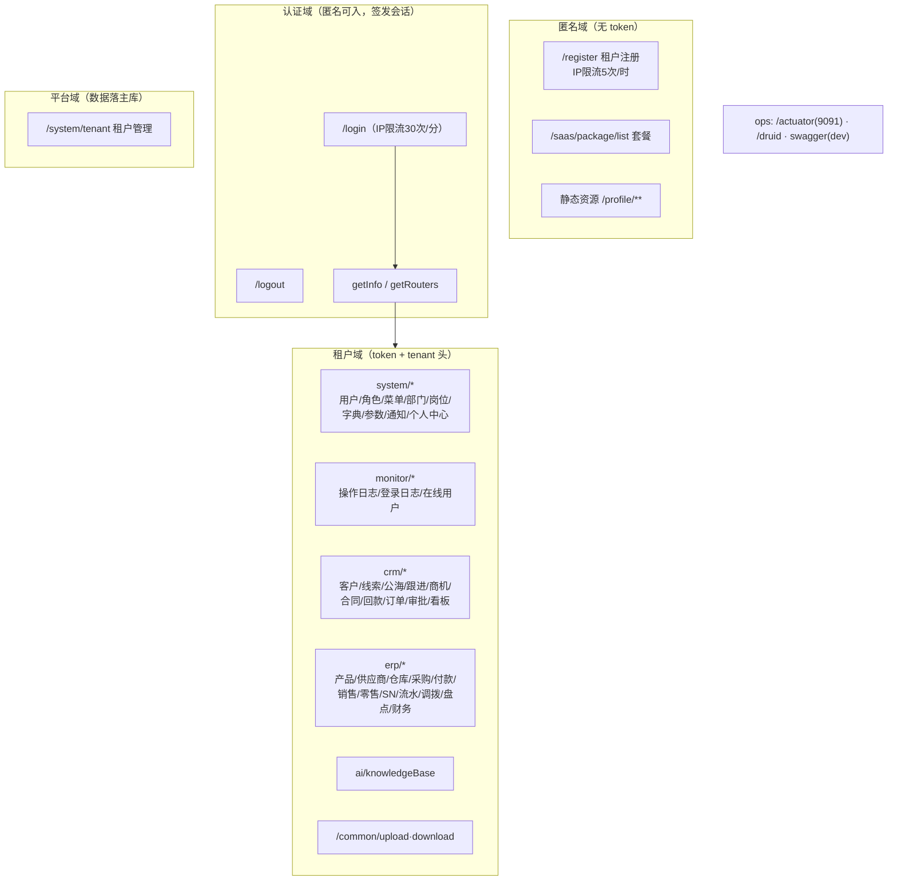

# 15-接口全量参考

> 项目：ERP-CRM ｜ 版本：v1.2 ｜ 生成日期：2026-10-06 ｜ 依据：源码分析（v1.2：2026-10-06 一致性回刷——/monitor/server 行的域对象路径精确化）

本篇是全部 45 个 Controller、约 170 个端点的**速查总表**，按业务域分组，列为：方法 / 路径 / 入参要点 / 响应要点 / 鉴权。开头一张业务域总览图；风格约定（响应包裹、401 语义、分页契约）请先读《03-接口设计》第 1 节，本篇表内以缩写约定：**鉴权列**写 `权限串`＝`@PreAuthorize("@ss.hasPermi('...')")`，`登录`＝仅要求已认证，`匿名`＝SecurityConfig 白名单；**库**列标数据落点 MASTER/TENANT。全部路径相对后端根（9090），每个请求必须带 `tenant` 头。

使用本篇前建议先记住三条横切规则，它们决定了所有端点的公共行为，各表不再重复。第一，**一切写接口默认带审计**——标注了 `@Log` 的端点会异步向当前租户库 `sys_oper_log` 写一条操作记录（含请求参数与结果），删数据前可先去操作日志页确认影响面；未标注 `@Log` 的写端点（多为生成器产物与系统管理 CRUD 的一部分）不落审计，属已知不一致。第二，**删除端点普遍是物理删除**——RuoYi 惯例没有逻辑删除开关（仅 `crm_customer` 表自带 del_flag 但业务代码未使用），数据删除不可逆，高危删除（租户登记、用户、角色）在 service 层有存在性或状态校验兜底。第三，**导出端点两种形态并存**——CRM 与系统管理用 `POST + HttpServletResponse` 直写流（前端走全局 `download()`），ERP 主数据用 `GET + AjaxResult` 包裹（`ExcelUtil.exportExcel` 返回 ajax 拼装结果），对接新导出需求时先确认对齐哪一种。

## 0. 业务域总览

## 1. 认证与平台域

| 方法 | 路径 | 入参要点 | 响应/错误要点 | 鉴权 / 库 |
|---|---|---|---|---|
| POST | `/login` | 头 `tenant`；body `{username,password}`；IP 限流 30/分 | `{code:200,token}`；500 携带锁定/计数类 msg | 匿名 / TENANT+MASTER |
| POST | `/logout` | token | 删 Redis 会话 | 登录 / REDIS |
| GET | `getInfo` | token | `{user,roles[],permissions[]}`；401 语义 | 登录 / TENANT |
| GET | `getRouters` | token | `data:RouterVo[]` | 登录 / TENANT |
| POST | `/register` | body `{tenantName,adminName,adminPass,confirmPassword?,packageId?}`（JSR-303）；IP 限流 5/时 | 成功即真实建库；重名报"账号已存在" | 匿名 / MASTER+新 TENANT |
| GET | `/saas/package/list` | — | `data:TenantPackage[]`（三档种子） | 匿名 / MASTER |
| GET | `/` | — | SysIndexController 欢迎信息 | 匿名 / — |
| GET | `/system/tenant/list` | 分页/筛选 | 租户登记分页 | `system:tenant:list` / MASTER |
| GET | `/system/tenant/{id}` | id | 单条 | `system:tenant:query` / MASTER |
| PUT | `/system/tenant` | `MasterTenant`（改套餐/状态/有效期） | — | `system:tenant:edit` / MASTER |
| DELETE | `/system/tenant/{id}` | id（数组） | 仅删登记行，不 DROP 库 | `system:tenant:remove` / MASTER |
| GET | `/system/tenant/quota` | — | `{maxUsers,used}` 语义 | 登录 / MASTER+TENANT |
| POST | `/common/upload` | multipart `file`（10MB/20MB 上限，扩展名白名单） | `{url,fileName,newFileName}` | 登录 / 本地盘 |
| GET | `/common/download` | `fileName`、`delete` | 文件流 | 登录 / 本地盘 |
| GET | `/common/download/resource` | `resource` | 文件流（`/profile/**` 本身匿名 GET） | 登录 / 本地盘 |

> 图形验证码 `GET /captchaImage` 已不存在于源码（相关文档口径见《08-安全与权限设计》3.4 与《13-技术债务与演进建议》D01）。

## 2. 系统管理域（租户库，RuoYi 标准）

系统管理域的端点几乎原样保留了 RuoYi 的形态，因此本节按"组合约定"压缩呈现，只展开两处非常规点。其一，用户详情的"双路径共用映射"：`GET /system/user/`（无路径变量）与 `GET /system/user/{userId}` 由 `SysUserController` 第 101 行的 `value = {"/", "/{userId}"}` 合并处理，前者返回当前登录用户（供个人中心/下拉回显），后者按 id 查任意用户——对接时不要为"查自己"再造端点。其二，权限粒度的不均匀：同一 Controller 内，查询类端点（treeselect、optionselect、configKey、dict type/{dictType}）多为"登录即可"而未挂权限串，这与 RuoYi 上游一致，属"读操作低敏感"的既定取舍；新增读端点时可参照，但涉及跨租户聚合的读操作仍应挂串。以下各表的行格式与第 1 节一致（方法/路径/入参要点/鉴权）。

### 2.1 用户 `/system/user`

| 方法 | 路径 | 入参要点 | 鉴权 |
|---|---|---|---|
| GET | `/system/user/list` | 分页+deptId/userName/status 筛选 | `system:user:list` |
| POST | `/system/user/export` | 同查询条件 | `system:user:export` |
| POST | `/system/user/importData` | multipart `file`、`updateSupport`；受套餐配额约束 | `system:user:import` |
| POST | `/system/user/importTemplate` | — | 登录 |
| GET | `/system/user/` 与 `/{userId}` | 共用映射：无 id 查自己 | `system:user:query` |
| POST/PUT | `/system/user` | `SysUser`（新增/导入先过 `TenantQuotaService`） | `system:user:add` / `system:user:edit` |
| DELETE | `/system/user/{userIds}` | ids | `system:user:remove` |
| PUT | `/system/user/resetPwd`、`/changeStatus`、`/authRole` | userId+新值 | `system:user:resetPwd` / `system:user:edit` / `system:user:edit` |
| GET/PUT | `/system/user/profile`、`/updatePwd`、`/avatar` | 个人中心；头像限图片扩展名 | 登录 |

### 2.2 角色 `/system/role`

| 方法 | 路径 | 要点 | 鉴权 |
|---|---|---|---|
| GET | `/list`、`/{roleId}`、`/optionselect`、`/authUser/allocatedList`、`/authUser/unallocatedList` | 列表/详情/下拉/已分配与未分配用户（`system:role:list/query`） |
| POST/PUT | `/`、`/dataScope`、`/changeStatus` | 新增/修改/数据权限（`@DataScope`）/状态 | `system:role:add` / `system:role:edit` |
| DELETE | `/{roleIds}` | — | `system:role:remove` |
| PUT | `/authUser/cancel`、`/authUser/cancelAll`、`/authUser/selectAll` | 取消/批量取消/批量授权 | `system:role:edit` |

### 2.3 菜单/部门/岗位/字典/参数/通知

| Controller | 端点要点 | 鉴权前缀 |
|---|---|---|
| `SysMenuController` `/system/menu` | `list`、`{menuId}`、`treeselect`（登录）、`roleMenuTreeselect/{roleId}`（登录）、CRUD；修改联动子菜单 | `system:menu:list/query/add/edit/remove` |
| `SysDeptController` `/system/dept` | `list`、`list/exclude/{deptId}`、`{deptId}`、`treeselect`、`roleDeptTreeselect/{roleId}`、CRUD（树形 ancestors） | `system:dept:*` |
| `SysPostController` `/system/post` | CRUD + `export` + `optionselect`（登录） | `system:post:*` |
| `SysDictTypeController` `/system/dict/type` | CRUD + `export` + `refreshCache` + `optionselect`（登录） | `system:dict:*` |
| `SysDictDataController` `/system/dict/data` | CRUD + `export` + `type/{dictType}`（登录，前端 useDict 的数据源） | `system:dict:*` |
| `SysConfigController` `/system/config` | CRUD + `export` + `configKey/{configKey}`（登录）+ `refreshCache` | `system:config:*` |
| `SysNoticeController` `/system/notice` | CRUD（XSS excludes 例外见 yml） | `system:notice:*` |

## 3. 监控审计域

| 方法 | 路径 | 入参要点 | 响应/库 | 鉴权 |
|---|---|---|---|---|
| GET | `/monitor/operlog/list` | 分页+title/operName/businessType/时间 | 租户库操作日志分页 | `monitor:operlog:list` |
| POST | `/monitor/operlog/export` | 同上 | xlsx | `monitor:operlog:export` |
| DELETE | `/monitor/operlog/{operIds}`、`/clean` | ids / 清空 | — | `monitor:operlog:remove` |
| GET | `/monitor/logininfor/list` | 分页+userName/ipaddr/status/时间 | **主库**登录日志（全租户链路） | `monitor:logininfor:list` |
| POST/DELETE | `/monitor/logininfor/export`、`/{infoIds}`、`/clean` | — | — | `monitor:logininfor:*` |
| GET | `/monitor/online/list` | `ipaddr`、`userName` | 遍历 Redis `login_tokens:*` | `monitor:online:list` |
| DELETE | `/monitor/online/{tokenId}` | sessionId | 强制下线（删 Redis 键） | `monitor:online:forceLogout` |
| — | `/monitor/server` | **当前源码无此端点**（oshi 域对象 `auth/web/domain/Server.java` 及 `domain/server/*` 子包仍在、无任何调用方，前端 `monitor/server.vue` 为遗留死页 ⚠️ 待确认是否恢复） | 404 | — |
| GET | `/actuator/health`、`/actuator/prometheus` | — | 仅 9091 端口暴露 | permitAll（端口隔离） |

## 4. CRM 域（租户库）

CRM 域的端点设计有两条主线，读表前先点破。其一，**"列表即视图"**：客户/线索/公海物理上是同一张表，`/crm/customer/*`、`/crm/clues/*`、`/crm/pool/*` 三组端点是三套权限串包着的三种查询口径，同一条数据在不同组里流转时主键 id 不变——这意味着前端跨视图跳转可以直接复用 id，也意味着误删一条"线索"等于删了一条"客户"。其二，**"动作即端点"**：转移、入池、领取、转客户、提交审批、审批六个业务动作全部是独立动词端点而非复用 PUT，这是有意为之——这些动作都伴随多字段联动（owner/pre_owner/status/时间戳），独立的入参与权限串使审计与鉴权粒度与业务动作对齐。

### 4.1 客户 `/crm/customer`（`CrmCustomerController`）

| 方法 | 路径 | 入参要点 | 响应/备注 | 鉴权 |
|---|---|---|---|---|
| GET | `/list` | 分页+name/phone/customerRank/customerStatus/region 等 | 全部客户（status=1 口径） | `crm:customer:list` |
| GET | `/person-list` | 分页+筛选 | 我的客户（owner=当前用户） | `crm:customer:person:list` |
| GET | `/person-customers` | 同上不分页 | 下拉数据源 | `crm:customer:person:list` |
| GET | `/deal-list` | 分页 | 成交客户（deal_status=1） | `crm:customer:deal:list` |
| POST | `/export` | 查询条件 | xlsx blob | `crm:customer:export` |
| GET/POST/PUT/DELETE | `/{id}`、``、``、`/{ids}` | 标准 CRUD | 删除走归属校验（非本人名下报"无权删除他人名下的记录"） | `crm:customer:query/add/edit/remove` |
| POST | `/transfer` | query `ids[]`、`owner`（新负责人） | 非管理员限本人名下（restrictOwner） | `crm:customer:transfer` |
| POST | `/to-pool` | query `ids[]`、`poolType` | 仅 status=1 可入池 | `crm:customer:toPool` |

### 4.2 线索 `/crm/clues`、公海 `/crm/pool`、跟进 `/crm/comment`

| 方法 | 路径 | 入参要点 | 响应/备注 | 鉴权 |
|---|---|---|---|---|
| GET | `/crm/clues/list` | 分页+clues 筛选 | 公共线索（status=0） | `crm:clues:list` |
| GET | `/crm/clues/person-list` | 分页 | 我的线索 | `crm:clues:person:list` |
| POST | `/crm/clues/export` | 查询条件 | xlsx | `crm:clues:export` |
| GET/POST/PUT | `/{id}`、``、`` | CRUD（新增 status=0） | — | `crm:clues:query/add/edit` |
| DELETE | `/crm/clues/{ids}` | ids | 公共线索删除 | `crm:clues:remove` |
| DELETE | `/crm/clues/person/{ids}` | ids | 我的线索删除（归属校验） | `crm:clues:person:remove` |
| POST | `/crm/clues/transfer` | query `ids[]`、`owner` | 转移线索 | `crm:clues:transfer` |
| PUT | `/crm/clues/to-customer` | body `ToCustomerDTO{ids[],newOwner}` | status 0→1，写 to_customer_time | `crm:clues:tocustomer` |
| GET | `/crm/pool/list` | 分页 | 公海池（status=2） | `crm:pool:list` |
| POST | `/crm/pool/receive/{id}` | id | 领取：status 2→1，owner=当前用户 | `crm:pool:list`（复用） |
| GET | `/crm/comment/list`、`/customer/{customerId}` | 分页/customerId | 跟进记录 | `crm:comment:list` |
| POST | `/crm/comment` | body `CommentDTO`（含 nextFollowupTime） | 事务：插记录+回写客户跟进三字段 | `crm:comment:add` |
| POST/GET/PUT/DELETE | `/crm/comment/export`、`/{id}`、``、`/{ids}` | — | — | `crm:comment:export/query/edit/remove` |

### 4.3 商机/合同/回款/订单（生成器产物 + 审批扩展）

| 方法 | 路径 | 要点 | 鉴权 |
|---|---|---|---|
| GET/POST/PUT/DELETE | `/crm/opportunity`（list、`{id}`、新增、修改、`/{ids}`） | 标准 CRUD，list 关联客户名 | `crm:opportunity:*` |
| GET/POST/PUT/DELETE | `/crm/contract`（同上五端点） | 标准 CRUD + `review_status` 展示（字典 contract_review_status） | `crm:contract:*` |
| GET/POST/PUT/DELETE | `/crm/receivable`（同上五端点） | list 关联合同号+客户名 | `crm:receivable:*` |
| GET | `/crm/order/list`、`/person-list` | 分页（全部/我的） | `crm:order:list`、`crm:order:person:list` |
| POST | `/crm/order/export` | — | `crm:order:export` |
| GET/POST/PUT/DELETE | `/crm/order/{id}`、``、``、`/{ids}` | CRUD（order_no 唯一键） | `crm:order:query/add/edit/remove` |
| PUT | `/crm/order/approve/{id}` | 订单审核（status 0→1） | `crm:order:approve` |

### 4.4 审批 `/crm/approval`（Flowable）

| 方法 | 路径 | 入参要点 | 响应/错误要点 | 鉴权 / 库 |
|---|---|---|---|---|
| GET | `/crm/approval/list` | query `status`（0 待办，1/2 已办）、`title`（模糊）、分页 | `TableDataInfo`，行含 taskId/title/applicant/customerName/contractAmount | `crm:approval:list` / MASTER+TENANT |
| GET | `/crm/approval/{id}` | **`{id}`＝Flowable 任务 ID（UUID），非 crm_approval.id**（《12-FAQ》坑 1） | 单条；误传留痕主键得空对象 | `crm:approval:list` / MASTER |
| POST | `/crm/approval/submit/{contractId}` | contractId | 预检拒绝：待审中/已通过重复提交；引擎失败自动补偿回退 | `crm:contract:edit` / TENANT→MASTER |
| POST | `/crm/approval/approve` | body `CrmApproval{taskId,status:"1"/"2",opinion}` | 驳回必填 opinion；任务不存在报"审批任务不存在或已处理" | `crm:approval:approve` / MASTER→TENANT |

### 4.5 看板与负责人

| 方法 | 路径 | 响应要点 | 鉴权 |
|---|---|---|---|
| GET | `/crm/index-data/info` | `customer_info`（线索/客户/公海 我的与总数）、`followup_info`（今日跟进/待跟进/跟进率）、`today_followup_list`、`today_updates` | `crm:index:data` |
| GET | `/crm/index-data/stats` | `customer_status/clues_source` 分布、`months/new_customers` 趋势、`order_amounts/order_counts` | 登录（无 @PreAuthorize） |
| GET | `/crm/owner/list` | 负责人下拉 | `crm:owner:list` |

## 5. ERP 域（租户库）

ERP 域的端点形态与 CRM 有一处结构性差异需要先说明：**ERP 的"状态推进"端点比 CRM 少而克制**。CRM 把六个业务动作做成动词端点，ERP 只有入库（stock-in）与调拨执行（execute）两个——而 `crm/order/approve` 的订单审核语义落在 CRM 侧，ERP 销售订单没有对应端点。原因在数据模型：ERP 的关键状态位（采购单 status、调拨单 status）承担并发认领职责，推进动作必须是"条件 UPDATE"式的独立事务（《07-模块详解》3.1），而其余单据（零售、付款）是即时生效型，无需状态机。读表时凡是出现动词子路径的端点，都对应一段带并发防护的服务端逻辑，调用方应预期"合法但被拒"（409 语义用 200+msg 表达）的响应。

### 5.1 主数据七组

| 方法 | 路径 | 特殊端点 | 鉴权 |
|---|---|---|---|
| 产品 | `/erp/product`（CRUD+export） | `POST /querPorductByTags`（按标签查，body `ErpProduct`，源码拼写如此） | `erp:product:*` |
| 供应商 | `/erp/supplier`（CRUD） | `GET /options`（下拉） | `erp:supplier:*` |
| 仓库 | `/erp/warehouse`（CRUD） | `GET /options`（下拉） | `erp:warehouse:*` |
| 零售客户 | `/erp/client`（CRUD+export） | — | `erp:client:*` |
| 开票信息 | `/erp/info`（CRUD+export） | — | `erp:info:*` |
| 标签 | `/erp/tags`（CRUD+export） | 主键 `tagUuid`（路径 `/{tagUuid}`、`/{tagUuids}`） | `erp:tags:*` |
| 标签映射 | `/erp/map`（CRUD+export） | 主键 `tagUuid` 同上 | `erp:map:*` |
| 序列号 | `/erp/sn`（CRUD+export） | 主键 `snUuid`；status 0 在库/1 出库 | `erp:sn:*` |

### 5.2 交易与库存

| 方法 | 路径 | 入参要点 | 响应/错误要点 | 鉴权 |
|---|---|---|---|---|
| GET/POST/PUT/DELETE | `/erp/stock`（list、`{id}`、新增、修改、`/{ids}`） | 新增 body 含 `items[]` 明细（整删整插） | 已入库单禁删 | `erp:stock:*` |
| PUT | `/erp/stock/stock-in/{id}` | id | CAS 认领；"仅待入库状态的采购单可执行入库"、"采购单未指定入库仓库…" | `erp:stock:edit` |
| GET | `/erp/stock/export` | — | — | `erp:stock:export` |
| CRUD | `/erp/payment`（list、`{id}`、新增、修改、`/{ids}`） | 关联 stockOrderId | — | `erp:payment:*` |
| CRUD | `/erp/order`（list、export、`{id}`、新增、修改、`/{ids}`） | 关联 client_id/tax_info_id | — | `erp:order:*` |
| CRUD | `/erp/retail`（list、export、`{id}`、新增、修改、`/{ids}`） | 按 SN 出库，写流水+SN 状态翻转 | — | `erp:retail:*` |
| CRUD | `/erp/flow`（list、export、`{id}`、新增、修改、`/{ids}`） | order_type 0 出/1 入/2 期初；按 warehouseId 过滤 | 库存唯一事实源 | `erp:flow:*` |
| GET | `/erp/transfer/list`、`/{id}` | — | — | `erp:transfer:list/query` |
| POST | `/erp/transfer` | body 校验 from≠to；单号自动生成 | "调出仓库与调入仓库不能相同" | `erp:transfer:add` |
| PUT | `/erp/transfer/execute/{id}` | id | 预检→CAS→双流水→负库存复检；错误文案见《12-FAQ》2.3 | `erp:transfer:execute` |
| DELETE | `/erp/transfer/{id}` | id | 已执行禁删 | `erp:transfer:remove` |
| GET | `/erp/adjust/list`、`/{id}` | 分页+adjust_type 筛选 | — | `erp:adjust:list/query` |
| POST | `/erp/adjust` | body 含 before/after_qty、reason | 仅此三端点（留痕单据无改删） | `erp:adjust:add` |
| GET | `/erp/finance/overview` | — | 应收/库存资产聚合 | `erp:finance:overview` |
| GET | `/erp/finance/stock-summary` | — | 各仓各品现存 vs safety_stock | `erp:finance:overview` |

## 6. AI 知识库（租户库）

| 方法 | 路径 | 要点 | 鉴权 |
|---|---|---|---|
| GET | `/ai/knowledgeBase/list` | 分页+标题筛选 | `ai:knowledgeBase:list` |
| POST | `/ai/knowledgeBase/export` | — | `ai:knowledgeBase:export` |
| GET/POST/PUT/DELETE | `/{knowledgeId}`、``、``、`/{knowledgeIds}` | 标准 CRUD | `ai:knowledgeBase:query/add/edit/remove` |

## 7. 端点统计与维护提示

统计：45 个 Controller——web 层 20（system 14 + monitor 3 + common 1 + ai 1 + SwaggerConfig 配置类）、CRM 11、ERP 16、saas 1、登录/注册/首页 3。端点约 170 个，其中标准 CRUD 五件套约 30 组。

维护提示（与《11-扩展开发指南》呼应）：① 新增端点必须显式 `@PreAuthorize`，否则任何登录用户可调；② 权限串要在租户模板 `sys_menu` 落一条 `menu_type='F'` 记录并授权角色，前端 `v-hasPermi` 才可见；③ 本表与源码可能随演进漂移，权威清单以 springdoc（dev：`/swagger-ui/index.html`）+ `grep -rn "@RequestMapping\|Mapping(" erp-crm/src/main/java/com/ec/*/controller` 为准；④ 表格内错误文案均可在源码中全文搜索定位到抛出点。
