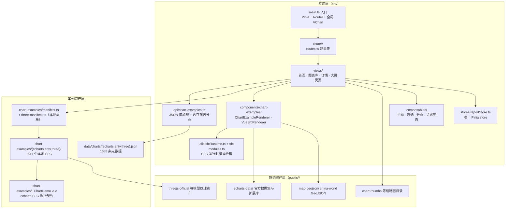
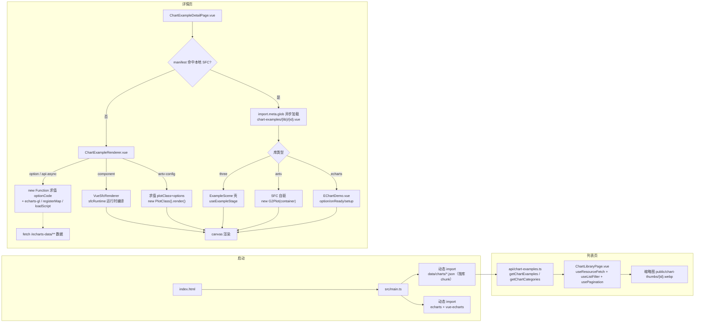

# 01 系统架构

> 项目：html5-dataviz ｜ 版本：v1.0 ｜ 生成日期：2026-10-05 ｜ 依据：源码分析

## 1. 整体架构图

项目是单页应用（SPA）+ 纯静态资产的双层结构：Vue 应用层负责路由、检索与渲染调度；资产层（`src/chart-examples/` 的 SFC 与 `public/` 的数据文件）在运行时按需拉取。下图按运行时职责划分：

架构上有三条贯穿性的设计约束（均可在源码中找到直接证据）：

1. **去后端化**：`src/api/chart-examples.ts` 以内存计算模拟原后端的 `getChartExamples`（分页/筛选/搜索，语义注释明确写着"与原 filterLibrary 语义一致"）、`getChartExample`、`getChartCategories` 三个接口，函数签名对齐 REST 风格，调用方（视图层）无感知。
2. **懒加载一切重资产**：三个元数据 JSON 用动态 `import()` 切成独立 chunk（`src/api/chart-examples.ts` 注释："JSON 不再静态 import（曾把 ~20MB 打进 base chunk）"）；echarts/vue-echarts/three/g2plot 全部动态引入；1617 个示例 SFC 经 `import.meta.glob`（非 eager）按路由懒加载。
3. **运行时零外链**：`vite.config.ts` 的 alias 把五个 jsdelivr CDN import 重写到 npm 包（opentype.js、mp4box、lottie-web、polyslice、three-raycaster-helper），把 `three/examples/jsm/libs/ecsy.module.js`、`AmmoPhysics.js` 重写到 `src/chart-examples/three/vendor/` 本地副本；`scripts/smoke.mjs` 用正则 `/jsdelivr\.net|aliyun\.com|youbao\.xyz|alipayobjects\.com/` 断言外链请求为 0。

## 2. ECharts 封装层详解

ECharts 封装是本项目最核心的横切层，由四个文件构成同心圆结构。

### 2.1 第一圈：全局注册源 `src/utils/v-chart.ts`

全站 14 行的极简模块，却解决了一个真实事故：多个大屏组件模板里写了 `<v-chart>` 但从未注册，导致"图表静默空白"。它的实现是 `defineAsyncComponent` 包装两级动态 import——先 `import('echarts')` 再 `import('vue-echarts')`——并在 `src/main.ts` 中 `app.component('VChart', VChart)` 全局注册。效果是：**echarts 全量与 vue-echarts 都不进首屏入口 chunk，只有真正渲染到 `<v-chart>` 的页面（各大屏、示例沙箱）才拉取图表 chunk**。

### 2.2 第二圈：执行契约 `src/chart-examples/EChartDemo.vue`

这是 294 个 echarts 本地 SFC 的统一渲染容器（文件头注释自述"294 个 SFC 的执行契约"）。契约的稳定性被明确约束："option/onReady/setup/scripts 的语义被 294 个生成 SFC 依赖，只能收紧不能变更"。它承载：

- **三种执行模式**（互斥或组合）：
  - `option`：静态 option 对象（支持 Ref 自动解包），实例就绪后直接 `setOption`；
  - `onReady(ctx)`：异步初始化钩子，返回 option 则代为 setOption；
  - `setup(ctx)`：业务钩子，承接原官方脚本 onMounted 内的差异代码，可返回清理函数（如清除定时器），重试与卸载时统一调用。
- **统一上下文 `ChartContext`**：`echarts`（全量命名空间）、`myChart`（对 vue-echarts 底层实例的延迟解析 Proxy——实例未就绪时返回 no-op 并告警，就绪后转发 setOption/getOption/resize/on/off/dispose）、`setOption`、`registerMap`、`registerTransform`、`loadScript`（动态引 `./loadScript`）、`fetchJson`（固定挂到 `/echarts-data` 前缀）。
- **就绪竞态治理**：`waitForInstance()` 以 32ms 步进轮询、1500ms 超时，替代"单次 nextTick 探测"——后者曾是"图表实例未初始化"竞态的来源（源码注释原文）。
- **运行态呈现**：加载中（旋转图标）与渲染失败（错误信息 + 重试按钮）两种覆盖态，重试按钮直接重跑 `run()`。

### 2.3 第三圈：主题 `src/utils/echarts-theme.ts` 与 `src/config/dashboardDark.ts`

`echarts-theme.ts` 导出 `darkEchartsTheme` 完整主题对象（8 色板、透明背景、轴/图例/提示框暗色样式），供大屏通过 `echarts.registerTheme` 消费；`src/config/dashboardDark.ts` 仅 3 行，是对它的再导出引用。

### 2.4 第四圈：兜底求值 `src/components/chart-examples/ChartExampleRenderer.vue` 中的 `renderEchartsOption()`

对无本地 SFC 的 54 个 echarts 兜底条目，该函数承担"宿主职责"：`requiresGl` 为真时先 `import('echarts-gl')`（GL 系列不在核心包）；`requiresMap` 为真时预注册 `china`、`world` 两张地图（数据来自 `/map-geojson/*.json`，单张失败不阻断）；检测 optionCode 中引用了 `ecStat`/`ecSimpleTransform`/`ecSimpleOptionPlayer` 时先用 `loadScript` 挂载对应全局库；随后用 `new Function` 注入 `echarts/myChart/setOption/fetchJson/loadScript/registerMap/registerTransform/ROOT_PATH/console` 九个形参执行脚本，若脚本以 `option = {...}` 收尾则取值回填 `chart.setOption(option, true)`。

### 2.5 改写规范 `docs/CODE_TO_VCHART_GUIDE.md`

这份手册定义了"官方示例脚本 → `<v-chart>` 响应式 SFC"的八条改写规则（option 定义、setOption→option.value、定时器→onMounted/onBeforeUnmount、事件→`@事件名`、registerMap、echarts-gl 引入顺序、异步数据、实例 API），并给出禁止事项（不得再用 new Function 包原脚本、不得保留 EChartDemo 标签以外的旧路径、不得删改视觉逻辑）。它是理解 echarts 本地 SFC 为什么呈现"模板 + ref option"统一形态的权威依据。注意：手册中提到的 `echarts-setup.ts` 已不在当前源码中（现状是 `EChartDemo.vue` 顶部静态 `import * as echarts from 'echarts'`），该文档存在轻微漂移，⚠️ 待确认是否需要同步更新。

## 3. 数据流向图

数据流的三个关键节点：

- **`datasetCache`（Map 缓存 Promise）**：`src/api/chart-examples.ts` 以"缓存 Promise 而非数据"的方式实现库级单次加载，失败时清缓存允许重试；
- **`renderSeq`/`compileSeq` 渲染代次**：`ChartExampleRenderer.vue` 与 `VueSfcRenderer.vue` 各自维护递增代次号，旧渲染在每个 await 续体处比对代次、过期自弃（dispose 自建实例、不写状态），保证"最后请求胜出"——这是快速切换示例时防实例泄漏、防画面串台的核心机制；
- **资产路径约定**：ECharts 官方数据固定挂 `/echarts-data` 前缀（`EChartDemo.fetchJson` 与 `ChartExampleRenderer.fetchJson` 语义一致：相对路径挂前缀、绝对/外链直取）；GeoJSON 固定 `/map-geojson/`；缩略图固定 `/chart-thumbs/{id}.webp` 兜底（`ChartLibraryPage.getThumbSrc`）。

## 4. 分层职责总表

| 层 | 目录/文件 | 职责 | 关键约束 |
| --- | --- | --- | --- |
| 入口层 | `src/main.ts`、`src/App.vue` | 装配 Pinia/Router/全局 VChart；全局布局与 KeepAlive | VChart 必须全局注册（大屏沙箱模板依赖） |
| 路由层 | `src/router/routes.ts`、`index.ts` | 9 条路由 + 3 条兼容重定向 + 404；标题守卫；chunk 失败自愈 | 路由表独立成文件供测试引用 |
| 数据访问层 | `src/api/chart-examples.ts` | JSON 懒加载、内存筛选/分页/搜索、分类聚合 | 语义对齐原后端；未知库返回空集 |
| 案例资产层 | `src/chart-examples/**` | 1617 个本地 SFC + manifest + EChartDemo 契约 + three 壳组件 | 脚本生成区，eslint 豁免，勿手改 manifest |
| 渲染链层 | `src/components/chart-examples/**` | loaderKind 分派、SFC 沙箱编译、源码弹窗 | 渲染代次竞态保护；错误就地隔离 |
| 视图层 | `src/views/**` | 4 个顶层页面 + 22 个大屏 + 大屏壳页 | 大屏迁移存量 eslint 豁免（business/report/dashboard 除外） |
| 通用组件层 | `src/components/{common,layout,datav}` | UI 原子组件、布局件、大屏缩放/装饰件 | Element Plus 按需自动引入 |
| 组合函数层 | `src/composables/**` | 主题/筛选/分页/竞态请求/地图注册/大屏模拟数据 | 无全局状态副作用（useTheme 用独立 effectScope） |
| 状态层 | `src/stores/reportStore.ts` | report 大屏三路静态 JSON 加载（并发保护） | 全站唯一 Pinia store |
| 工具层 | `src/utils/**` | v-chart 注册、SFC 沙箱、主题、高亮、坐标数据 | — |

## 5. 关键设计决策与设计模式

1. **清单 + 约定路由（Registry Pattern）**：`manifest.ts` 的 `LOCAL_LIBRARY_MANIFESTS` 与 `import.meta.glob('@/chart-examples/**/*.vue')` 配合，以"id 即文件名"的约定完成 1617 个案例的零注册接入——新增案例不需要改任何路由或组件注册代码（详见 06 篇标准操作流程）。
2. **策略分派（Strategy Pattern）**：`ChartExampleRenderer` 以 `loaderKind` 为判别字段在 `renderEchartsOption`/`renderAntvConfig`/`VueSfcRenderer` 三种渲染策略间分派，并有意识地做"类型优先路由"——即使迁移遗留数据同时带 `componentCode` 与 `optionCode`，已知 option 类型也优先走本职链路（注释：曾把 54 个兜底条目全部劫持进 SFC 编译链导致渲染空白）。
3. **延迟代理（Proxy Pattern）**：`EChartDemo.buildMyChartProxy()` 用 ES Proxy 保持原示例 `myChart.setOption(...)` 的书写语义，同时把"实例未就绪"降级为 no-op + 告警，消除初始化时序差异。
4. **代次化竞态保护（Last-Request-Wins）**：三处独立实现同一模式——`useResourceFetch` 的 `requestId`、`ChartExampleRenderer` 的 `renderSeq`、`VueSfcRenderer` 的 `compileSeq`、`useMapGeoJson` 的 `loadId`。这是本项目对抗"快速切换示例/快速切换地图"的核心防御工事。
5. **沙箱化运行时编译（Interpreter Pattern）**：`src/utils/sfcRuntime.ts` 用 @vue/compiler-sfc 在浏览器端完成 parse → compileScript → compileTemplate → compileStyle，经 `rewriteScriptImports`/`rewriteDynamicImports` 重写模块引用后，在 `new Function` 沙箱体中执行（屏蔽 `parent/top/opener`、替换 `eval/arguments`、超 50 万字符拒绝、9 类危险模式正则拦截，见 `DANGEROUS_RUNTIME_PATTERNS`），最终由 `buildSfcComponent` 包装出带 `__scopeId` 与组件注册表的正式 Vue 组件。模块解析由 `src/utils/sfc-modules.ts` 提供：npm 白名单（echarts/echarts-gl/g2plot/three/gsap/pinia/vue-router 等）+ `@/` 别名 glob 自动发现 + 资源导入转 URL。
6. **失败可见原则**：渲染链路各环节拒绝静默失败——`renderAntvConfig` 对缺 `plotClass` 抛错（注释："静默返回会让用户面对无解释的空白画布"）；`ChartExampleRenderer` 桥接 `unhandledrejection` 把官方脚本异步取数失败转为可见错误态；`VueSfcRenderer.onErrorCaptured` 捕获卡片级错误防止一个坏卡片拖垮整页。
7. **vendor 分包治理**：`vite.config.ts` 的 `manualChunks` 把 node_modules 归入 echarts-gl-vendor / echarts-vendor / antv-vendor / three-vendor / vendor（框架运行时）五个桶，且明确"仅归组三方依赖；src 代码不进 vendor 桶"——注释记录了此前 Vue 运行时被并进 echarts-vendor、入口静态依赖 9.3MB echarts 的事故与修复。
