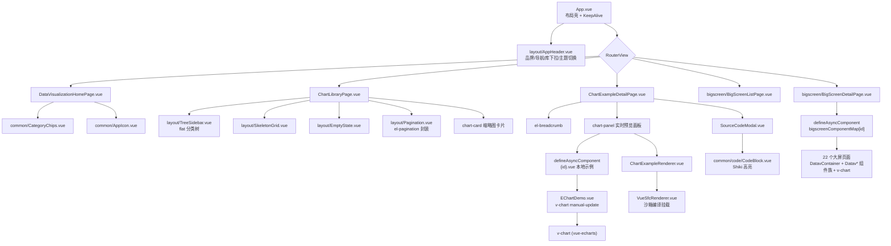
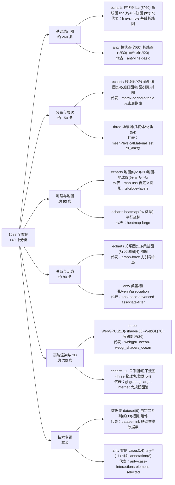

# 02 页面设计

> 项目：html5-dataviz ｜ 版本：v1.0 ｜ 生成日期：2026-10-05 ｜ 依据：源码分析

## 1. 路由与页面总表

路由定义集中在 `src/router/routes.ts`（独立成文件以便测试直接引用真实路由表做回归校验），实例化在 `src/router/index.ts`（history 模式、`scrollBehavior` 列表→详情复位/前进后退恢复、`beforeEach` 设置 `document.title`、`onError` 对 chunk 动态加载失败执行整页刷新自愈）。

| 路径 | 名称 | 组件（src/views/…） | meta / props | 页面职责 |
| --- | --- | --- | --- | --- |
| `/` | DataVizHome | `DataVisualizationHomePage.vue` | title: 数据可视化 | 模块导航首页 |
| `/bigscreen` | BigScreenList | `bigscreen/BigScreenListPage.vue` | title: 大屏可视化 | 22 个大屏卡片列表（分类筛选） |
| `/bigscreen/:id` | BigScreenDetail | `bigscreen/BigScreenDetailPage.vue` | hideHeader: true, props: true | 全屏挂载单个大屏组件 |
| `/charts` | — | — | redirect → `/charts/echarts` | 库缺省重定向 |
| `/charts/:library` | ChartLibrary | `ChartLibraryPage.vue` | keepAliveComponent: 'ChartLibraryPage' | 示例列表（侧栏+网格+分页） |
| `/charts/:library/:id` | ChartExampleDetail | `ChartExampleDetailPage.vue` | props: true | 示例实时预览 + 源码 |
| `/business`、`/report`、`/dashboard` | — | — | redirect → `/bigscreen/*` | 历史独立大屏入口兼容 |
| `/:pathMatch(.*)*` | NotFound | `NotFoundPage.vue` | title: 页面不存在 | 404 兜底 |

全局壳 `src/App.vue` 依据 `route.meta.hideHeader` 决定是否渲染 `AppHeader`（大屏详情隐藏头部实现纯全屏），并通过 `router.getRoutes()` 动态收集所有标记 `meta.keepAliveComponent` 的路由作为 `<KeepAlive :include>` 名单——当前仅图表库列表页被缓存，配合其内部 `onActivated/onDeactivated` 中的滚动位置恢复（`savedScrollPosition`）实现"列表→详情→返回"的体验闭环。

## 2. 案例总览页（ChartLibraryPage）设计详解

文件：`src/views/ChartLibraryPage.vue`（1011 行，本站交互最重的页面）。

**布局**：左右两栏。左侧 `TreeSidebar`（`src/components/layout/TreeSidebar.vue`，flat 模式）渲染分类树，每项带 material-symbols 图标（`CATEGORY_ICONS` 映射表收录 78 个中英文分类名到图标的映射，缺省回落 `apps` 图标）与数量徽标，"全部"项聚合总数；右侧主区在"全部"态显示大头部（库品牌图标、描述、搜索框、示例/分类/库三项统计），在选中分类态切换为紧凑 sub-header（分类图标 + 标题 + 数量 + 行内搜索）。内容区为缩略图卡片网格（每页 24 条）+ 底部 `Pagination` 分页器。

**交互与状态**（组合函数分工）：

- 筛选：`useListFilter`（`src/composables/useListFilter.ts`）管理 `search` + `category`，输入实时写入 `filters`，300ms 防抖后写入 `debouncedFilters`；`syncUrl: true` + `urlKeys { search:'q', category:'cat' }` 把筛选同步进 URL query（`history.replaceState`，空值删参保持 URL 干净），刷新/分享可恢复。
- 分页：`usePagination`（`src/composables/usePagination.ts`）提供 `page/pageSize/totalPages` 与 clamp 后的 `setPage/setPageSize`；页码同步进 URL `?page=`（第 1 页不落参数）；`resetOnTotalChange: false` 保持原 API 语义。
- 加载：`useResourceFetch`（`src/composables/useResourceFetch.ts`）封装 `loading/error/refresh` 与 last-request-wins 竞态保护（`requestId` 比对 + AbortController），watch `library/page/category` 三个源自动重载；搜索防抖变化显式重置页码后触发。
- 库校验：`isValidLibrary` 校验 `route.params.library` 是否在 `CHART_LIBRARIES`（`src/config/chartLibraries.ts`）内，非法库（如已下线的 d3）直接渲染"未找到该图表库"空态，不发请求。
- 缩略图容错：`failedThumbnails`（响应式 Set）记录加载失败的示例 id，卡片回落 📊 占位符；`getThumbSrc` 以 `example.thumbnail` 优先、`/chart-thumbs/{id}.webp` 兜底。
- 生命周期：`onMounted` 先 `loadCategories()` 再 `refreshExamples()`；`onDeactivated` 存滚动位置，`onActivated` 恢复。

**状态清单**：`chartCategories`（分类统计）、`examples`/`total`（列表）、`failedThumbnails`、来自组合函数的 `filters/debouncedFilters/page/pageSize/totalPages/loading/fetchError`。无组件外全局状态。

## 3. 案例详情页（ChartExampleDetailPage）设计详解

文件：`src/views/ChartExampleDetailPage.vue`（584 行）。

**数据装配（双链路分叉点）**：模块顶层建立两个 `import.meta.glob`——`localModules`（组件加载器）与 `localSources`（`?raw` 源码字符串加载器）。`loadExample(id)` 流程：

1. 库合法性检查（不在 `LOCAL_LIBRARY_MANIFESTS` 直接报"该图表库不存在"，避免请求已下线库的残留数据）；
2. `tryLoadLocal(id)`：manifest `ids.has(id)` 且 `findLocalModule` 找到 `{id}.vue`（先精确 `/ + file` 后缀匹配，防 `xx-{id}.vue` 误命中；无精确命中再宽松匹配）→ 用 `defineAsyncComponent` 包组件、拉取 raw 源码，并以 manifest 元数据现场合成 `ChartExample` 对象（`loaderKind: 'local'`，`componentCode` 填 raw 源码，three 库附加 `globals` 资产根路径）；
3. 未命中 → `getChartExample(id, library)` 走 JSON 数据集，渲染交给 `ChartExampleRenderer`。

**布局**：面包屑（el-breadcrumb：首页 / 图表库 / 示例名）→ 标题行（返回按钮 + 渐变大标题 + 元信息胶囊：分类、难度 DIFFICULTY_META 三档色、前 4 个标签 + 右侧四个操作按钮）→ 单列主区"实时预览"面板（高度 `clamp(420px, 62vh, 720px)`，面板头带标签，面板体挂本地组件或 Renderer）。

**交互**：查看源代码（`SourceCodeModal` 只读弹窗，Shiki 高亮，Esc/遮罩/按钮三种关闭方式，打开期间锁定页面滚动）、刷新预览（本地组件递增 `renderKey` 强制重挂载；Renderer 走 `refresh()`）、下载源码（Blob 下载 `{id}.vue` 或 `.js`）、全屏预览（原生 Fullscreen API + `fullscreenchange` 同步状态）。错误处理用页级 `onErrorCaptured` 就地转 EmptyState（`return false` 阻止冒泡），覆盖"本地 SFC 直挂路径没有沙箱链错误捕获"的缺口。

**状态清单**：`example`（元数据）、`localComp`（shallowRef 异步组件，避免深度代理）、`localSource`、`renderKey`、`loading/error`、`sourceModalOpen`、`isFullscreen`。

## 4. 组件树图

以详情页与列表页两条主干绘制的组件树（实线为模板父子关系，虚线为动态挂载）：

## 5. 状态管理设计

本项目刻意收缩了全局状态，形成"1 个 store + 12 个 composable"的轻量格局：

- **Pinia**：仅 `src/stores/reportStore.ts`，为 report 大屏管理 `reportData/wordCloudData/mapData` 三路数据及对应 `loading/errors`，直连 `public/report/` 下静态 JSON（注释说明原 `/api` 前缀请求 404 已修复），`loadReportData` 等动作内置并发保护（loading 中直接返回）。
- **模块级单例 composable**：`useTheme`（`src/composables/useTheme.ts`）是最精巧的一个——`useStorage('devcanvas-theme')` 持久化 `'dark'|'light'|'system'` 三态，`usePreferredColorScheme` 跟随系统；watch 放在模块级 `effectScope(true)`（detached）中执行，注释解释了原因：调用方（AppHeader、CodeBlock）会随路由卸载，若 watch 寄宿组件作用域会导致主题切换全站失效。
- **组件内 composable**：`useResourceFetch`（竞态请求）、`useListFilter`（防抖筛选 + URL 同步）、`usePagination`（分页 clamp）、`useMapGeoJson`（GeoJSON 校验 + registerMap + loadId 竞态）、`useScreenData`（大屏模拟数据 3 秒定时自增）、`useBdpData`、`useToast`、`useCopy`、`useDateTime`、`useIntervalUpdate`，以及大屏内部的 `useMoveTo`/`useRafInterval`（sc-datav-demo0/1）。
- **跨页状态恢复**：列表页依赖 KeepAlive + 滚动位置模块变量 + URL query 三件套；详情页不做缓存（每次进入重新装配，靠渲染代次防串台）。

## 6. 案例类别与代表页面归纳

按图表类型/技术主题归纳三大库（数量见 00 篇统计表），每类挑代表案例深入拆解。下图按"主题域"重组 149 个分类：

代表案例深入拆解（三个链路各取其一）：

- **`src/chart-examples/echarts/line/line-simple.vue`（本地 SFC 静态 option 模式）**：模板只有 `
<EChartDemo :option="option" />
`；脚本导入 `../../EChartDemo.vue`，导出一个普通对象 option（xAxis 类目轴 + line 系列 7 点数据）。它是 294 个 echarts SFC 的最小形态——数据构造内联、无交互、无定时器，由 EChartDemo 负责 v-chart 挂载与 setOption 时机。
- **`src/chart-examples/antv/line/antv-line-basic.vue`（本地 SFC 自驱模式）**：antv SFC 不经 EChartDemo，直接 `onMounted` 中 `new Line(containerRef.value, { data, xField: 'month', yField: 'value', smooth: true, ... })` 并 `render()`。数据是七元素 `{month, value}` 对象数组，体现 G2Plot"语义化配置"风格。注意其与 antv.json 中 `loaderKind: 'component'` 的 8 个兜底条目的区别——后者走 VueSfcRenderer 运行时编译。
- **`src/chart-examples/three/threejs-lesson/03-basics/dpr.vue`（three 壳组件模式）**：模板 `<ExampleScene camera="perspective" :camera-position="[0,0,5]" :max-pixel-ratio="devicePixelRatio" @ready="onReady" />`；`onReady(ctx)` 从 ctx 拿 `scene` 与 `addUpdateCallback`，创建三个 Mesh 立方体并注册逐帧旋转回调。`ExampleScene.vue`（`src/chart-examples/three/`）内部由 `stage/useExampleStage.ts` 统一管理 WebGLRenderer、OrbitControls、CSS2D/3D 渲染器、渲染循环与 dispose（追加 `forceContextLoss` 防止反复重挂载撞浏览器 WebGL context 上限，见文件头注释）。

## 7. 大屏页面设计（BigScreenList / BigScreenDetail）

- **列表页** `src/views/bigscreen/BigScreenListPage.vue`（411 行）：按 `bigscreenList` 渲染卡片（webp 缩略图 + 标题 + 描述 + 分类），支持分类筛选；卡片点击跳 `/bigscreen/:id`。
- **详情页** `src/views/bigscreen/BigScreenDetailPage.vue`（55 行，刻意薄壳）：`bigscreenComponentMap`（`src/config/bigscreenComponents.ts`）提供 id → 懒加载器映射，`getAsyncComponent()` 用模块级 Map 缓存 `defineAsyncComponent` 产物避免 computed 重复创建；`isValidScreen` 校验 id 在清单内，否则渲染 EmptyState（"大屏未找到"）+ 返回按钮。meta `hideHeader` 让 `App.vue` 隐藏头部，大屏组件自身铺满 100vh。
- **大屏内部约定**：统一用 `src/components/datav/DatavContainer.vue` 做缩放（组件头注释：按视口宽高分别计算 scale、transform 等比缩放、MutationObserver + 防抖 resize 监听、默认深色底 `#050914`）；辅以 `DatavBorderBox/DatavDecorations/DatavPanel/DatavCountTo/DatavScrollTable/DatavLoading` 构建视觉；ECharts 图表直接写 `<v-chart>`（消费 `src/utils/v-chart.ts` 的全局注册与 `echarts-theme.ts` 暗色主题）。以 `sales-analysis/SalesAnalysisPage.vue` 为例：页面级组件负责时间戳定时刷新（onMounted setInterval / onUnmounted 清理），五个业务图表子组件（`components/OrderCategoryChart.vue` 等）各自封装 option。
