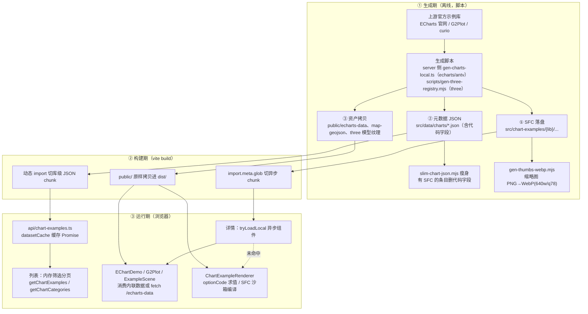

# 04 数据模型

> 项目：html5-dataviz ｜ 版本：v1.0 ｜ 生成日期：2026-10-05 ｜ 依据：源码分析

本项目没有传统意义的"业务数据库"，数据模型由四部分组成：案例元数据（三个 JSON 数据集 + 内存清单 manifest）、大屏元数据（bigscreenData 清单）、静态资产数据（public/ 下的数据集文件）、运行时状态模型（Pinia store 与 composable 状态形状）。类型定义集中在 `src/types/`（`chart-examples.ts`、`ui.ts`、`datav.ts`、`datavDashboard.ts`、`echarts.d.ts`）。

## 1. 案例元数据结构（ChartExample）

三个数据集 `src/data/charts/echarts.json`（348 条）、`antv.json`（351 条）、`three.json`（989 条）共用同一 schema，定义于 `src/types/chart-examples.ts` 的 `ChartExample` 接口。必需键集合被 `src/data/charts/__tests__/charts-data.test.ts` 的 `REQUIRED_KEYS` 逐条锁定：

| 字段 | 类型 | 必有 | 说明 | 示例值 |
| --- | --- | --- | --- | --- |
| `id` | string | 是 | 全局唯一标识；本地 SFC 文件名 `{id}.vue`、缩略图名与之联动 | `"area-simple"` |
| `library` | string | 是 | 所属库：`echarts` / `antv` / `three` | `"echarts"` |
| `title` | string | 是 | 中文标题 | `"大数据量面积图"` |
| `titleEn` | string \| null | 是 | 英文标题（three 库多为 null） | `"Large-scale Area Chart"` |
| `description` | string | 是 | 描述；echarts 条目惯用"英文名 - 难度 N - 标签"拼接格式 | `"Aggregate Morphing ... - 难度 9 - 异步数据"` |
| `category` | string | 是 | 分类名（echarts 37 类 / antv 51 类 / three 61 类） | `"折线图"` |
| `loaderKind` | string | 是 | 渲染分派判别字段：`local`/`option`/`api-async`/`antv-config`/`component` | `"option"` |
| `tags` | string[] | 是 | 标签（搜索域 + 详情页胶囊） | `["折线图","数据缩放"]` |
| `difficulty` | string \| null | 是 | 难度：`beginner`/`intermediate`/`advanced` 或 null（详情页映射入门/进阶/高级三色胶囊） | `"advanced"` |
| `sourceUrl` | string \| null | 是 | 官方示例来源链接（多为 null，⚠️ 仅少量条目可观察到非空值） | `null` |
| `sortOrder` | number | 是 | 排序权重（当前列表排序按 JSON 数组原序 + 分类聚合排序，sortOrder 实际影响 ⚠️ 待确认） | `0` |
| `status` | string | 是 | 发布状态，观察值为 `"published"` | `"published"` |
| `requiresGl` | boolean | 是 | 是否依赖 echarts-gl（Renderer 据此预载 GL 扩展） | `false` |
| `requiresMap` | boolean | 是 | 是否需要 registerMap（Renderer 据此预注册 china/world） | `false` |
| `thumbnail` | string \| null | 是 | 缩略图路径（three 条目形如 `/example-thumbs/threejs-lesson/02-machineroom/machineRoom.jpg`；null 时列表页回落 `/chart-thumbs/{id}.webp`） | `"/chart-thumbs/area-simple.webp"` |
| `optionCode` | string | 条件 | 兜底条目的 ECharts option/脚本字符串（有本地 SFC 的条目已被 `scripts/slim-chart-json.mjs` 删除） | 见 1.1 |
| `componentCode` | string | 条件 | 兜底条目的 SFC 源码字符串（8 个 antv `component` 条目） | 见 1.2 |
| `initCode` | string | 条件 | 兜底条目的初始化补充脚本（在 option 求值后以 `(chart, echarts, option, myChart, fetchJson)` 执行） | 少见 |
| `createdAt` / `updatedAt` | string | 是 | ISO 时间戳（three.json 观察到生成时刻 `2026-10-05T12:48:10.604Z`） | — |
| `globals` | Record<string,string> | 否 | three 专用资产根（manifest 侧字段；JSON 侧对应字段为 `__source`，见第 2 节） | — |

**代码字段示例**（`echarts.json` 中 `archive-custom-aggregate-scatter-bar` 条目的 `optionCode` 节选，典型多语句官方脚本）：

```js
var SCATTER_COLORS = ['#5470c6', '#91cc75', ...];
var RAW_DATA = [[1425139200000, 34, 0.13, 2, 'MD', 'ZD', 'P0'], ...];
// ... 数十行声明与 echarts.init / myChart.setOption(option) 逻辑
```

`ChartExampleRenderer.renderEchartsOption` 以 `new Function('echarts','myChart','setOption','fetchJson','loadScript','registerMap','registerTransform','ROOT_PATH','console', '"use strict"; var option;\n' + optionCode + '\n;return (...option非Promise则返回...)')` 的方式执行——所以 `optionCode` 的隐式契约是：**脚本最终要么留下 `option` 变量，要么自行完成 setOption**。

## 2. 本地清单模型（ChartExampleLocalMeta）与 three 的 `__source`

manifest 条目是 JSON 条目的投影子集（`id/title/category/tags` + 可选 `globals`），见 03 篇 1.1 节。three.json 额外携带一个 schema 外字段 `__source`（`"threejs-official" | "three-cesium-examples" | "three-project" | "threejs-lesson" | "earth-lessons" | "granary-3d"`），记录迁移源，条数分布为 582/263/108/29/6/1。它由 `scripts/gen-three-registry.mjs` 写入，用于溯源与按源合并重跑，运行时渲染不消费该字段。

## 3. 数据集格式：案例运行时消费的三类数据

### 3.1 图表业务数据（public/echarts-data/，约 71MB）

ECharts 官方示例的取数文件。运行时统一以 `/echarts-data` 为根：

- `EChartDemo.fetchJson(path)` 拼接 `/echarts-data + path`；
- `ChartExampleRenderer.fetchJson(path)` 语义一致：绝对路径/外链直取，相对路径挂 `/echarts-data/` 前缀；
- `sfcRuntime.executeRuntimeBody` 在沙箱体中注入 `var ROOT_PATH="/echarts-data"`；
- 扩展库位于 `/echarts-data/lib/`（`ecStat.min.js`、`ecSimpleTransform.js`、`ecSimpleOptionPlayer.min.js`），由 Renderer 按 optionCode 内容检测后经 `loadScript` 挂载。

### 3.2 地理数据（public/map-geojson/ + src/assets/geo/）

`china.json` 与 `world.json` 双份存放：`public/map-geojson/` 供 Renderer 预注册与运行时 fetch（`useMapGeoJson` 校验 FeatureCollection + 非空 features 后 `echarts.registerMap`）；`src/assets/geo/` 供构建期内联（大屏组件静态 import）。这是"同一地理数据、两种消费时机"的双轨设计。

### 3.3 大屏静态数据

report 大屏经 `src/stores/reportStore.ts` 直连 `public/report/data.json` 等（`fetchStaticJson` 工具函数，非 2xx 抛错）；ioftv-screen 大屏自带 `api/`、`stores/setting/` 目录自成一体；其余大屏多为组件内联模拟数据（如 `useScreenData` 每 3 秒自增 10 的模拟实时数据）或 `src/utils/map-data.ts` 的常量坐标表（`geoCoordMap` 省市经纬度、`salesData` d1~d6 销售数据）。

## 4. 大屏元数据模型（BigScreenConfig）

`src/config/bigscreenData.ts`：

| 字段 | 类型 | 说明 | 示例 |
| --- | --- | --- | --- |
| `id` | string | 路由参数与组件映射键 | `"sales-analysis"` |
| `title` | string | 大屏名 | `"销售大数据分析"` |
| `description` | string | 一句话描述（列表卡片正文） | `"销售数据可视化大屏，包含世界地图、数据图表。"` |
| `category` | string | 行业分类（数据仪表盘/政务/工业/公安/金融/消防/农业/物流/生态/物联网/3D可视化/企业通用） | `"企业通用"` |
| `thumbnail` | string | `/bigscreen-thumbnails/{id}.webp` | — |

与 `src/config/bigscreenComponents.ts` 的 `bigscreenComponentMap: Record<string, () => Promise<Component | {default: Component}>>` 键一一对应，对应关系由 `src/config/__tests__/bigscreenComponents.test.ts` 锁定（头注释："两边不漂移由测试锁定"）。

## 5. 数据生命周期



生命周期四阶段要点：

1. **生成期**：案例的"真源"是上游官方示例。echarts/antv 由 server 侧脚本生成 SFC 与 manifest（manifest.ts 头注释："本文件由 server/scripts/gen-charts-local.ts 自动生成，请勿手改"；⚠️ 该 server 仓库不在本项目内）；three 由 `scripts/gen-three-registry.mjs` 从 curio 仓库迁移（拷贝组件、生成 JSON、裁剪拷贝被引用资产、四项一致性校验）。`slim-chart-json.mjs` 最后把有 SFC 条目的代码字段从 JSON 中删除（文件头注释："SFC 是唯一真源"），并把守恒关系固化进 `charts-data.test.ts`。
2. **构建期**：`import.meta.glob`（非 eager）让 1617 个 SFC 各自成异步 chunk；`DATASET_LOADERS` 的动态 `import()` 把三个 JSON 切成库级 chunk；`vite.config.ts` manualChunks 把 node_modules 归入五个 vendor 桶。
3. **运行期**：JSON Promise 进 `datasetCache`（失败清除可重试）；SFC 编译产物进 `sfcRuntime.compilerCache`（键为 demoId）；`loadScript` 与模块解析进 `sfc-modules.moduleCache`。三层缓存均为会话级内存缓存，无持久化。
4. **销毁期**：渲染代次机制保证切换示例时旧实例 dispose（Renderer `cleanupChart` 调 destroy；three 壳 `useExampleStage.dispose` 追加 `forceContextLoss`）；`VueSfcRenderer` 卸载时移除注入的 style 元素；KeepAlive 仅保留列表页实例。

## 6. 运行时状态模型

| 模型 | 位置 | 形状 |
| --- | --- | --- |
| report 大屏数据 | `src/stores/reportStore.ts` | `state: { reportData: Record<string,unknown>, wordCloudData: unknown[], mapData: Record<string,unknown>, loading: {reportData,wordCloudData,mapData}, errors: {...} }`；getter `isLoading`/`hasError` |
| 主题 | `useTheme` 模块级 | `'dark'\|'light'\|'system'` 持久化于 localStorage `devcanvas-theme`；派生 `theme: 'dark'\|'light'` |
| 列表筛选 | `useListFilter` | `filters {search, category}` + `debouncedFilters` 防抖副本；URL 键 `q`/`cat`/`page` |
| 大屏模拟数据 | `src/composables/useScreenData.ts` | `{totalDevices, devices[{key,value}], ages[{startValue,value,axis,color}], genders, ...}`，每 3 秒自增 10 |
| 缩略图失败集 | ChartLibraryPage | `Set<string>`（不可变更新触发响应式） |

## 7. 数据一致性保障

- **守恒测试**：`charts-data.test.ts` 断言三库条数（348/351/989）与 `FILES` 常量一致、SFC 目录扫描 id 集与 JSON id 集互不缺、代码字段与"是否有本地 SFC"严格对应；`three-data.test.ts` 锁定 three.json 与 three-manifest.ts 对齐。
- **清单-映射对齐测试**：`bigscreenComponents.test.ts` 锁定 22 个大屏的清单/组件映射不漂移。
- **缩略图存在性**：`gen-three-registry.mjs` 第 4 步对 three 案例校验缩略图文件存在（失败退出码 1）；`bigscreenThumbnails.test.ts` 对大屏缩略图做同类校验。
- **冒烟断言**：`scripts/smoke.mjs` 断言详情页 canvas 存在、无"渲染失败"文案、`/echarts-data` 资产不缺失（GL globe 用例覆盖"数据文件加载失败"分支）。

综上，数据模型的核心设计取向是：**以文件系统为数据库、以测试为约束、以缓存 Promise 为一致性手段**——接手者新增/修改数据时，务必同时满足第 1 节 schema、第 7 节守恒关系与对应缩略图资产。
