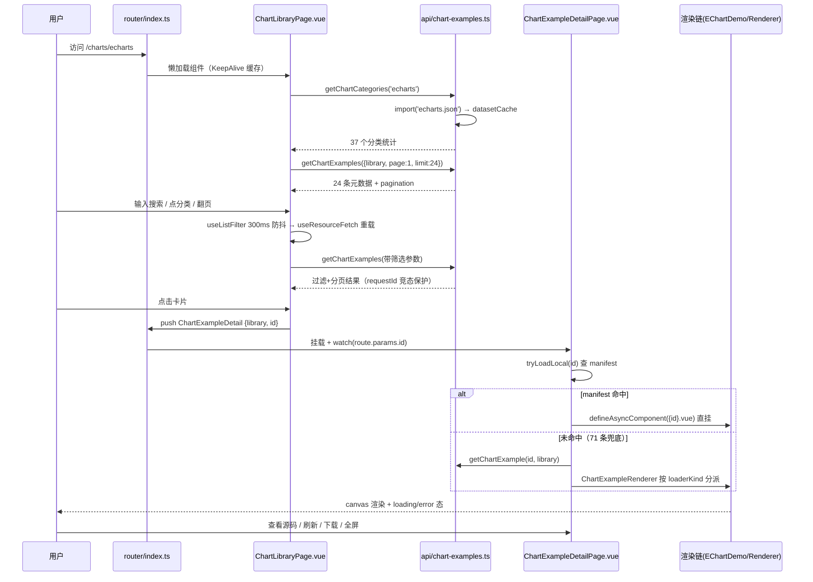
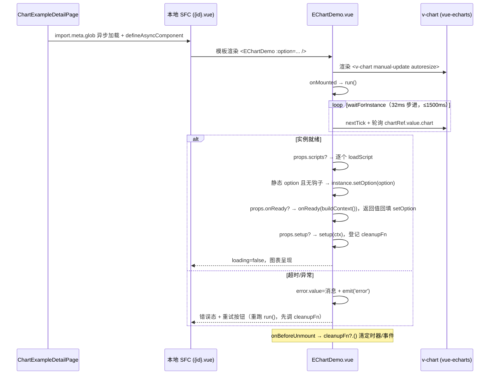
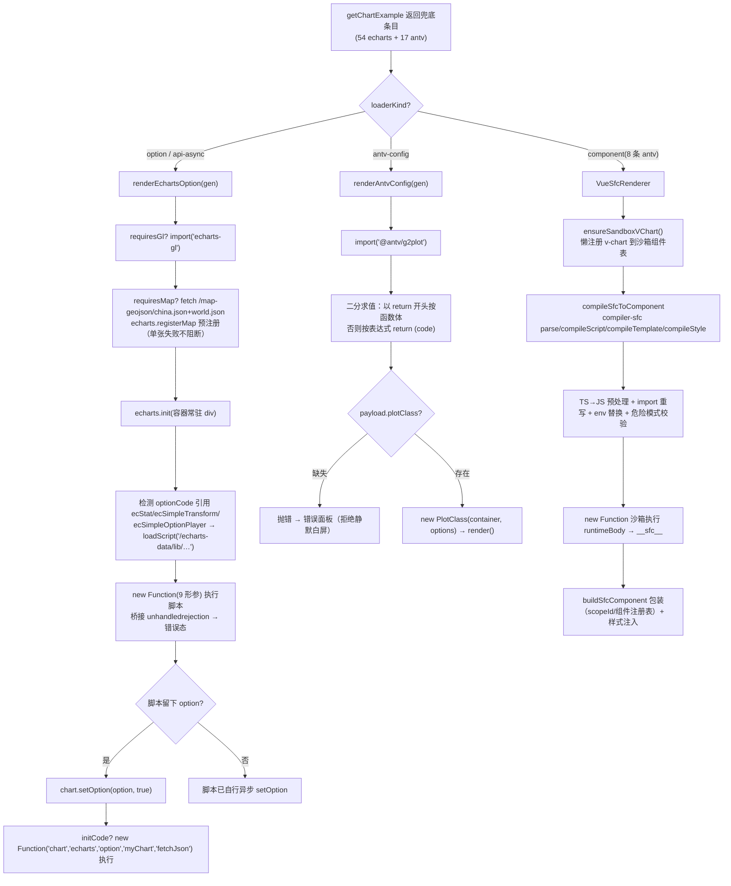
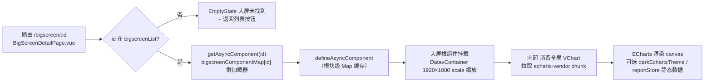

# 05 核心流程

> 项目：html5-dataviz ｜ 版本：v1.0 ｜ 生成日期：2026-10-05 ｜ 依据：源码分析

本章拆解五个端到端流程：①示例发现→列表→渲染→交互主链路；②本地 SFC 渲染链路（以 echarts 为例，含 EChartDemo 执行时序）；③JSON 兜底渲染链路（optionCode 求值与 SFC 沙箱编译）；④数据集懒加载与库切换流程；⑤大屏装载流程。每个流程配图、分步说明与涉及文件清单。

## 流程一：示例发现 → 渲染 → 交互（主链路）

分步说明：

1. **发现**：首页 `/` 的模块卡片（`DataVisualizationHomePage.vue` 的 `modules` 数组）或 AppHeader 的"图表库"下拉（数据源 `src/config/chartLibraries.ts`，`nav: 'standalone'` 的 three 渲染为顶级项）进入 `/charts/:library`。`routes.ts` 中 `/charts` 无名路由重定向到 `/charts/echarts`。
2. **列表装配**：`ChartLibraryPage.onMounted` 先 `loadCategories()`（驱动左侧 TreeSidebar）再 `refreshExamples()`。所有数据经 `useResourceFetch` 写入 `examples/total`，其 `requestId` 比对保证快速连续操作时"最后请求胜出"。
3. **交互**：搜索输入走 `filters` 实时态 → `watchDebounced` 300ms → `debouncedFilters` → 显式 `setPage(1)` 或直接刷新；筛选与页码双向同步 URL（`?q=&cat=&page=`，`history.replaceState`，不产生历史记录）。
4. **进入详情**：`handleChartExampleClick` push `ChartExampleDetail`；列表页因 KeepAlive 进入 deactivated，滚动位置存模块变量，返回时 `onActivated` 恢复。
5. **交互反馈**：详情页四个操作（源码弹窗/刷新/下载/全屏）不依赖渲染链内部状态，本地组件刷新靠 `renderKey++` 重挂载、Renderer 刷新靠 `defineExpose({refresh})`。

涉及文件：`src/views/DataVisualizationHomePage.vue`、`src/components/layout/AppHeader.vue`、`src/config/chartLibraries.ts`、`src/views/ChartLibraryPage.vue`、`src/composables/{useListFilter,usePagination,useResourceFetch}.ts`、`src/api/chart-examples.ts`、`src/views/ChartExampleDetailPage.vue`、`src/router/{routes,index}.ts`。

## 流程二：本地 SFC 渲染链路（echarts，EChartDemo 执行时序）

分步说明：

1. **装配**：详情页 `findLocalModule(id)` 从两个 glob 表取出组件加载器与 `?raw` 源码加载器，`defineAsyncComponent(loader)` 存入 `localComp`（shallowRef），同时拉源码供源码弹窗与下载。
2. **执行契约**：SFC 把 option/钩子交给 EChartDemo；`buildContext()` 提供的 `myChart` 是 Proxy 延迟代理——实例未就绪时调用返回 no-op 并 `console.warn`，就绪后 `setOption` 转发到 vue-echarts 组件方法（默认 merge）、其余 API bind 到原生实例。
3. **就绪等待**：`waitForInstance` 解决"v-chart 挂载与 ECharts init 存在异步间隙"的竞态（源码注释指出单次 nextTick 探测曾是"图表实例未初始化"错误的来源）。
4. **三段式执行**：scripts 预载 → 静态 option 直设 → onReady → setup，顺序固定；setup 返回的清理函数在重试（`run()` 开头 `cleanupFn?.()`）与卸载（`onBeforeUnmount`）两个时机统一调用，防定时器叠加。
5. ** echarts 全量注册的确定性**：EChartDemo 顶部 `import * as echarts from 'echarts'`（注释："全量 echarts 已在模块顶部静态引入（painter 注册时序确定）"）——ctx.echarts 与图表系列注册顺序由此保证。

代表案例：`src/chart-examples/echarts/line/line-simple.vue`（静态 option）、含 setup 的动态案例（如动态排序/定时更新类示例）走第 4 步的 setup 分支。

涉及文件：`src/chart-examples/EChartDemo.vue`、`src/chart-examples/loadScript.ts`、`src/utils/v-chart.ts`、`src/views/ChartExampleDetailPage.vue`、`docs/CODE_TO_VCHART_GUIDE.md`。

## 流程三：JSON 兜底渲染链路

分步说明：

1. **代次保护贯穿全程**：每个 `await` 之后都比对 `gen !== renderSeq`（`ChartExampleRenderer` 顶部注释：过期则"dispose 自己创建的实例、不写 error/loading"），示例快速切换时旧链路各续体点自弃。
2. **echarts 兜底**：容器 div 用 `v-show` 而非 `v-if` 常驻（模板注释：条件分支会让 ref 恒为 null，echarts init 静默跳过）；GL 扩展必须在 init 前注册；地图注册责任在宿主——官方脚本自身不含 registerMap，预注册 china/world 两张常用图，用不到的注册被 echarts 忽略。
3. **antv 兜底**：官方脚本主流是 `return { plotClass, options }` 函数体形态，少数是无 return 的裸对象字面量，故必须"二分求值"（注释：`return (code)` 的表达式包装对 return 语句必然语法错误）。
4. **SFC 沙箱**：`sfcRuntime.compileSfcToComponent`（`src/utils/sfcRuntime.ts`）流程：`loadSfcCompiler` 懒加载 compiler-sfc → `lang="ts"` 时 `preprocessSfcTsToJs` 降级 → `parse` → `compileScript`（得 bindingMetadata）→ `compileTemplate`（render 函数改名为 `__sfc_render__`）→ `compileStyle` → `collectModuleDeps`（静态/动态 import 源收集，经 `sfc-modules.ensureModule` 解析：npm 白名单、`@/` 别名 glob 自动发现、资源扩展名转 URL）→ `rewriteScriptImports/rewriteDynamicImports` + `import.meta.env` 替换 → 拼接 runtimeBody（含 `__dynamicImport__` 白名单闸门）→ `validateRuntimeBody`（50 万字符上限 + 9 类危险模式：eval/new Function/WebSocket/document.write/location 赋值/top·parent 访问等）→ `new Function` 执行 → `buildSfcComponent` 包装。编译结果按 demoId 进 `compilerCache`。
5. **错误可见与隔离**：沙箱链 `onErrorCaptured` 就地拦截卡片级错误（`return false` 阻断冒泡，注释："避免一个坏卡片拖垮整页"）；echarts 兜底链把官方脚本异步取数的 `unhandledrejection` 桥接为错误态（仅渲染进行中认领，正则匹配 `/echarts-data|Failed to fetch|加载资源失败|not exists/i`）。

涉及文件：`src/components/chart-examples/ChartExampleRenderer.vue`、`src/components/chart-examples/VueSfcRenderer.vue`、`src/utils/sfcRuntime.ts`、`src/utils/sfc-modules.ts`、`src/utils/sfc-typescript.ts`、`src/chart-examples/loadScript.ts`、`public/map-geojson/`、`public/echarts-data/lib/`。

## 流程四：数据集懒加载与库切换

1. 首次访问某库列表/详情时，`src/api/chart-examples.ts` 的 `loadLibrary(library)` 触发对应 `DATASET_LOADERS[library]` 动态 `import('@/data/charts/{lib}.json')`；返回的 Promise 存入 `datasetCache`，后续同库调用直接命中（缓存的是 Promise，天然去重并发）。
2. 未知库（不在加载器表）返回空集而非报错——列表页配合 `isValidLibrary` 前置拦截，双保险。
3. 加载失败时 catch 分支先 `datasetCache.delete(library)` 再 rethrow（注释："失败时清出缓存，允许下次重试"），下一次 `refreshExamples()` 会重新发起。
4. 库切换（`watch(library)`，`ChartLibraryPage.vue`）：重置 search/category → 重新 `loadCategories()` → 页码归 1 或显式刷新；`useResourceFetch` 的 watch 数组 `[library, page, () => filters.category]` 任一变化都自动重载。
5. JSON chunk 由 vite 按 `import()` 边界自动切分，配合 `vite.config.ts` manualChunks，echarts/antv/three 的元数据与 vendor 各自独立成 chunk，互不拖累首屏。

涉及文件：`src/api/chart-examples.ts`、`src/views/ChartLibraryPage.vue`、`src/data/charts/*.json`、`vite.config.ts`。

## 流程五：大屏装载（/bigscreen/:id）

分步说明：

1. **id 校验**：`isValidScreen` 对 `bigscreenList`（`src/config/bigscreenData.ts`）做 `some` 匹配；未命中渲染 `EmptyState`（src/views/bigscreen/BigScreenDetailPage.vue），与 NotFound 路由无关。
2. **懒加载缓存**：`getAsyncComponent` 把 `defineAsyncComponent` 产物缓存在模块级 Map（注释："避免每次 computed 重新创建"）。
3. **缩放适配**：`DatavContainer`（`src/components/datav/DatavContainer.vue`）以 1920×1080 设计稿为基准，按视口宽高分别计算 scale 后 transform 缩放，监听窗口 resize（防抖）与 DOM 属性变化（MutationObserver）。
4. **数据装配**：三种模式——组件内联模拟数据（多数）、`useScreenData` 定时自增模拟实时流、Pinia `reportStore` 直连 `public/report/` 静态 JSON（并发保护：loading 中重复调用直接返回）。
5. **回归保障**：`scripts/smoke.mjs` 对 `/bigscreen/sales-analysis` 断言 canvas 数量 > 0；`.github/workflows/ci.yml` 在 lint/typecheck/test 后执行 build，保证大屏分包（逐屏 chunk）可持续构建。

涉及文件：`src/views/bigscreen/BigScreenDetailPage.vue`、`src/config/{bigscreenData,bigscreenComponents}.ts`、`src/components/datav/DatavContainer.vue`、`src/utils/v-chart.ts`、`src/utils/echarts-theme.ts`、`src/stores/reportStore.ts`、`src/composables/useScreenData.ts`。
