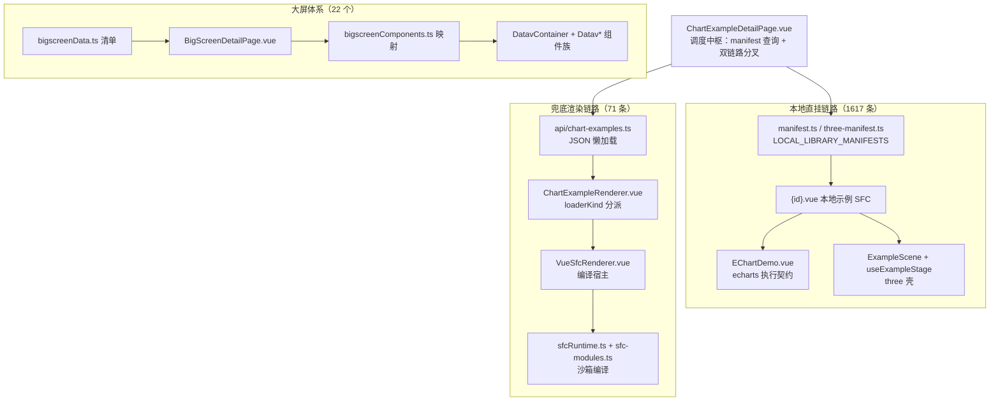

# 07 模块详解

> 项目：html5-dataviz ｜ 版本：v1.1 ｜ 生成日期：2026-10-06 ｜ 依据：源码分析

## 1. 本章定位与模块地图

01 篇从架构视角给出了分层职责总表，05 篇从流程视角走读了五条端到端链路；本章则下沉到**模块内部**，对六个最核心的模块逐一做"深读"：manifest 清单机制、ChartExampleRenderer 分派器、EChartDemo 执行契约、sfcRuntime 沙箱编译、bigscreen 大屏体系，以及贯穿渲染链的"渲染代次竞态保护"。每个模块按"职责一句话 → 关键文件与函数清单 → 机制走读 → 与其他模块的交互"四段展开。整体模块协作关系如下图（详情页为调度中枢，双链路在其分叉）：

阅读本章的建议姿势：先读第 2 节理解"id 如何被路由到文件"，再读第 3、4 节理解"文件如何被执行"，第 5 节是执行形式最特殊的一支（浏览器端编译），第 6 节是独立于图表库的平行体系，第 7 节则是所有模块共享的横切防御机制。

## 2. manifest.ts 清单机制

**职责一句话**：以极小的内存清单回答"某个 id 是否有本地 SFC、它的元信息是什么"，让详情页在不加载任何 JSON 的情况下完成"本地直挂 or JSON 兜底"的路由判断。

### 2.1 关键文件与函数清单

| 文件/符号 | 位置 | 说明 |
| --- | --- | --- |
| `ChartExampleLocalMeta` | `src/chart-examples/manifest.ts` 头部 | 清单条目类型：`id/title/category/tags` + 可选 `globals` |
| `echartsLocalManifest` | 同文件 | 294 条 echarts 本地案例清单（脚本生成） |
| `antvLocalManifest` | 同文件 | 334 条 antv 本地案例清单（脚本生成） |
| `echartsLocalIds` / `antvLocalIds` | 同文件尾部 | 由 manifest 数组 map 出的 `Set<string>`，供 O(1) 命中判断 |
| `threeLocalManifest` / `threeLocalIds` | `src/chart-examples/three-manifest.ts`（6786 行，由 `scripts/gen-three-registry.mjs` 生成后 re-export） | 989 条 three 清单，多数条目携带 `globals.ASSET_HOST` |
| `LOCAL_LIBRARY_MANIFESTS` | manifest.ts 尾部 | `Record<库 id, { manifest, ids }>` 统一出口，详情页唯一消费入口 |

### 2.2 机制走读

manifest 的设计核心是**"清单与文件系统的双保险"**。清单本身由生成器产出：`manifest.ts` 第 1~2 行注释写明"本文件由 server/scripts/gen-charts-local.ts 自动生成，请勿手改"，three 侧则由仓库内的 `scripts/gen-three-registry.mjs` 生成。但清单并不单独可信——`src/data/charts/__tests__/charts-data.test.ts` 的 `localSfcIds()` 会真实扫描 `src/chart-examples/{lib}` 目录下的 `.vue` 文件并与 JSON 对账，`three-data.test.ts` 再锁 three.json 与 three-manifest 的逐字段一致。也就是说：**清单骗得了运行时，骗不了测试**。若有人手改清单加了一条而没放对应 SFC，详情页 `tryLoadLocal` 会在 `findLocalModule` 处返回 null 安全回落到 JSON 兜底，不会被"幽灵条目"打崩。

`globals` 字段是 three 库的专属通道：迁移自 curio 的示例组件原来从全局变量 `ASSET_HOST` 等读取资产根路径，迁移后由详情页在 `tryLoadLocal` 里把它塞进现场合成的 `ChartExample` 对象透传给组件（`ChartExampleDetailPage.vue` 的注释称之为"详情页给组件注入资产根路径的唯一通道"），`three-data.test.ts` 专门断言 manifest 与 three.json 的 `globals` 逐字段相等，因为"两侧漂移 = 运行时 undefined 拼路径"。

### 2.3 模块间交互

manifest 的消费方有四个：详情页（`tryLoadLocal` 命中判断 + 元信息合成）、`charts-data.test.ts`（模板表达式防回归测试遍历三个 manifest 的 title）、`three-data.test.ts`（对齐校验）、以及潜在的新增工具脚本。它不依赖任何运行时模块，是纯数据文件——这也是它能被 3812 行地静态写在源码里而毫无副作用的原因。与 JSON 数据集的分工：JSON 服务列表页（需要全量 19 字段），manifest 只服务详情页路由判断（4 字段投影），两者靠 `charts-data.test.ts` 的"SFC↔JSON 互不缺"断言保持守恒。

## 3. ChartExampleRenderer 分派器

**职责一句话**：对 71 个无本地 SFC 的兜底条目，按 `loaderKind` 把渲染分派给三种策略之一，并提供加载/错误/全屏等运行态容器。

### 3.1 关键文件与函数清单

| 函数/常量 | 位置（`src/components/chart-examples/ChartExampleRenderer.vue`） | 说明 |
| --- | --- | --- |
| `usesSfc`（computed） | 脚本中段 | 是否走 SFC 编译链路的唯一判据：有 `componentCode` 且不属于"类型优先"豁免 |
| `OPTION_KINDS` | `usesSfc` 上方 | `['option', 'api-async', 'antv-config']`，已知 option 类型即使带了 `componentCode` 也不进编译链 |
| `renderEchartsOption(gen)` | 主区 | option/api-async 两类条目的求值执行器 |
| `renderAntvConfig(gen)` | 主区 | antv-config 条目的 G2Plot 实例化执行器 |
| `cleanupChart()` | 脚本头部 | destroy echarts 实例与 antv plot 实例，双字段都置 null |
| `fetchJson(path)` | 脚本头部 | 绝对路径/外链直取，相对路径挂 `/echarts-data/` 前缀 |
| `renderExample()` | 主分派 | `++renderSeq` 开新代次 → 分派 → catch 写 error → finally 关 loading |
| `refresh()`（defineExpose） | 脚本尾部 | 清实例 + 触发 SFC 刷新 + nextTick 重跑 |
| `activeRejectionHandler` | 模块级变量 | 官方脚本异步取数失败的 `unhandledrejection` 桥接监听 |

### 3.2 机制走读

**分派判据是"类型优先"而非"字段优先"**。`usesSfc` 的逻辑不是简单判断 `componentCode` 是否存在，而是先豁免：`loaderKind` 属于 `OPTION_KINDS` 且同时有 `optionCode` 的条目一律走本职求值链路。文件注释还原了事故背景——迁移遗留数据中部分条目同时带 `componentCode` 与 `optionCode`，早期按字段优先路由曾把 54 个兜底条目全部劫持进 SFC 编译链，表现为"渲染空白 + 缺失 componentPath 徽章"。这是本项目"失败可见"原则的又一案例：分派器宁可多写一个豁免表，也不让错误的链路静默吞掉渲染。

**renderEchartsOption 的七步走读**（对应源码行号顺序）：①`requiresGl` 为真先 `import('echarts-gl')`——GL 系列必须赶在 `echarts.init` 之前完成系列注册；②`requiresMap` 为真预注册 china/world 两张图（宿主负责注册，因为官方脚本自身不含 registerMap；单张失败 try-catch 不阻断）；③`echarts.init(container)`——容器是 `v-show` 常驻 div 而非条件分支，模板注释解释"若走条件分支则 ref 恒为 null，init 会静默跳过"；④挂 `unhandledrejection` 监听，正则 `/echarts-data|Failed to fetch|加载资源失败|not exists/i` 且仅 loading 进行中才认领，把官方脚本 `fetch().then()` 链的异步失败转成可见错误态；⑤按 optionCode 内容检测 `ecStat`/`ecSimpleTransform`/`ecSimpleOptionPlayer` 并 `loadScript` 预挂全局库；⑥`new Function` 注入九个形参执行脚本，末尾的 return 表达式只在 option 非 Promise 时取值；⑦有 `initCode` 再以五形参补跑一次。

**renderAntvConfig 的二分求值**：官方 antv 脚本主流是函数体形态（`return { plotClass, options }`），少数是无 return 的裸对象字面量。前者用 `return (code)` 的表达式包装必然语法错误，所以按"是否以 return 开头/含换行 return"二分为函数体执行与表达式求值两种包装。缺 `plotClass`、`plotClass` 不在 g2plot 命名空间、缺 `options` 三种情况都直接 throw——注释原话："静默返回会让用户面对无解释的空白画布"。

### 3.3 模块间交互

向上，它被详情页以 `example` prop 单向喂数据（`showToolbar: false`，工具按钮在页头）；对 `component` 类条目它把 `componentCode` 包成 `{ raw, componentPath: 'json/{library}/{id}.vue' }` 交给 `VueSfcRenderer`，并透传 `#loading/#fallback` 插槽；对下，它动态 import `echarts`/`echarts-gl`/`@antv/g2plot` 与 `@/chart-examples/loadScript`。`refresh()` 用 `defineExpose` 暴露给详情页的"刷新预览"按钮。卸载钩子做两件事：`cleanupChart` 与移除 rejection 监听——后者是容易被忽视的生命周期细节，桥接监听是 window 级的，若不摘除会在切页后继续认领其他页面的 rejection。

## 4. EChartDemo 执行契约

**职责一句话**：作为 294 个 echarts 本地 SFC 的统一渲染容器，把"示例作者只声明 option/钩子"与"实例挂载时序/清理/错误呈现"解耦。

### 4.1 关键文件与函数清单

| 符号 | 位置（`src/chart-examples/EChartDemo.vue`） | 说明 |
| --- | --- | --- |
| `ChartContext` | 文件头导出 | `echarts/myChart/setOption/registerTransform/registerMap/loadScript/fetchJson` 七件套 |
| `ChartSetup` | 文件头导出 | `(ctx) => void \| Promise<void \| (() => void)>`，返回清理函数 |
| `props` | `defineProps` | `option`（支持 Ref）/`onReady`/`setup`/`scripts` 四项 |
| `waitForInstance(timeoutMs=1500)` | 脚本中部 | 32ms 步进轮询 `chartRef.value.chart`，替代单次 nextTick |
| `buildMyChartProxy()` | 脚本中部 | Proxy 延迟代理：未就绪 no-op + warn，就绪后转发 |
| `normalizeOption()` | 脚本中部 | 判 `'value' in o` 解 Ref，兜底原对象 |
| `run()` | 主执行 | 清理上轮 → 等实例 → scripts 预载 → 三段式执行 → finally 关 loading |
| 模板 | `<v-chart manual-update autoresize>` | 以空 option 骨架 `{xAxis:{},yAxis:{},series:[]}` 挂载 |

### 4.2 机制走读

契约的执行顺序是刚性的：`run()` 开头先调 `cleanupFn?.()`（重试场景防定时器叠加）→ `waitForInstance` → `props.scripts` 并行预载 → 静态 option 且无任何钩子时直接 `instance.setOption` → `onReady(ctx)`（返回值非空则代为 setOption）→ `setup(ctx)`（登记 cleanupFn）。注意静态 option 分支的条件是 `!props.onReady && !props.setup`——只要带了钩子，option 的设置权就完全移交钩子，避免二次 setOption 覆盖。

`myChart` Proxy 是本模块最精巧的一笔。官方示例的书写习惯是顶层立即 `myChart.setOption(...)`，而 vue-echarts 的底层实例存在异步间隙。Proxy 的 get 拦截器在实例未就绪时返回 `() => undefined` 并 `console.warn('[EChartDemo] myChart.xxx 实例尚未就绪')`，就绪后按方法名分派：`setOption` 走 vue-echarts 组件方法（默认 merge），`getOption/resize/on/off/dispose` 转发到原生实例，其余属性函数 bind 后返回。这样"实例未就绪"从致命错误降级为一次 no-op + 控制台告警，00 篇第 6 节提到的"健康的启动信号"即以此告警的消失为标志。

`waitForInstance` 值得单独强调：它以 32ms 步进最多等 1500ms，源码注释明确"单次 nextTick 探测曾是'图表实例未初始化'竞态的来源"。1500ms 上限意味着极慢设备上仍可能超时报"图表实例未初始化"——这是设计取舍而非 bug，错误态提供重试按钮兜底。

### 4.3 模块间交互

模板层它包着全局注册的 `<v-chart>`（`src/utils/v-chart.ts` 的懒加载异步组件）；脚本层顶部 `import * as echarts from 'echarts'` 全量静态引入（注释："painter 注册时序确定"），使 294 个 SFC 无需各自 import echarts；`loadScript` 经动态 import 引 `./loadScript.ts`；`fetchJson` 固定拼 `/echarts-data` 前缀（与 Renderer 的 fetchJson 语义略异：这里一律拼前缀，Renderer 区分绝对/相对）。错误经 `emit('error')` 上抛给宿主 SFC（本地直挂链路最终由详情页 `onErrorCaptured` 接住）。执行契约的四个用例被 `src/chart-examples/__tests__/EChartDemo.test.ts` 锁定，契约稳定性声明写在文件头："只能收紧不能变更"。

## 5. sfcRuntime.ts 沙箱编译

**职责一句话**：在浏览器端把 SFC 字符串编译为可挂载的 Vue 组件，途中完成 TS 降级、模块重写、环境变量替换与安全验证。安全机制的详细分析见《08-安全与权限设计》，本节聚焦编译管线本身。

### 5.1 关键文件与函数清单

| 函数 | 位置（`src/utils/sfcRuntime.ts`，538 行） | 说明 |
| --- | --- | --- |
| `loadSfcCompiler` / `setSfcCompiler` | 编译器加载区 | 懒加载 `@vue/compiler-sfc`；注入点供测试替换 |
| `compileSfcToComponent(code, options)` | 主入口 | 完整管线，产物按 `demoId` 进 `compilerCache` |
| `compileSfc` | 主入口下方 | never-throw 包装，返回 `{component, styles, error}` |
| `collectModuleDeps` | 中段 | 正则收集静态/动态 import 源 → `ensureModule` 并行解析 → deps 注入表 |
| `applyEnvReplacementsToCode` | 中段 | `import.meta.env.{BASE_URL,MODE,DEV,PROD}` 字符串替换 |
| `buildSfcComponent` | 中段 | defineComponent 包装：合并组件注册表、scopeId、setup/render try-catch 壳 |
| `executeRuntimeBody` | 安全区 | 消毒 + `new Function` 执行，屏蔽 `parent/top/opener`、替换 `eval/arguments` |
| `validateRuntimeBody` | 安全区 | 50 万字符上限 + 9 类危险模式正则 |
| `injectSfcStyles` / `removeSfcStyles` | 样式区 | id 去重注入与统一清理 |

### 5.2 机制走读

管线可概括为"降级 → 解析 → 三编译 → 依赖 → 重写 → 验证 → 执行 → 包装"八步。入参支持整段 `raw` 或 `template/script/style` 分离（`wrapSfc` 拼回）。`lang="ts"` 时先经 `src/utils/sfc-typescript.ts` 的 `preprocessSfcTsToJs` 做正则降级——该文件注释里有一段惨痛教训值得所有维护者读一遍：类型注解剥离的正则曾因跨行贪婪匹配吞掉同作用域的多个 `let x: Type` 声明，导致 three demo 的 `camera/renderer` 整块消失报 "camera is not defined"，修复方式是 `[^\n]` 限定单行。compileScript 产出 bindingMetadata 喂给 compileTemplate 以启用 setup 语法糖优化；模板 render 函数被改名为 `__sfc_render__` 以便运行时挂回 `__sfc__.render`。scoped style 经 `compileStyle` 产出带 `data-v-` 前缀的 CSS，scopeId 同时写进组件 `__scopeId`。

模块解析不在本文件内闭环，而是委托 `src/utils/sfc-modules.ts` 的 `ensureModule`：npm 白名单、`@/` 别名 glob 自动发现、资源扩展名转 URL、相对路径按 `componentPath` 解析、缺失模块返回可见的 MissingModuleStub 占位组件。重写阶段把 import 语句改写为 `__deps__["源"]` 的解构、动态 import 改写为 `__dynamicImport__` 闸门函数——闸门只放行依赖收集阶段注册过的源，未注册的动态导入直接 Promise.reject，这是模块白名单的运行时执行点。

### 5.3 模块间交互

它被 `VueSfcRenderer.vue` 消费（编译宿主，负责触发时机与样式生命周期），`VueSfcRenderer` 又被 `ChartExampleRenderer` 包裹（兜底链路）或被其它页面直接使用。`ensureSandboxVChart` 在首次编译前把 `v-chart/VChart` 注册进沙箱组件表——组件注册表（`sfc-modules.getComponentRegistry`）在 `buildSfcComponent` 时合并进编译产物，使沙箱模板可以不经 import 使用全局组件。缓存键是 `demoId`，`VueSfcRenderer` 的注释特别指出其失败重试口径与 `datasetCache` 一致：失败必须清缓存，否则同一实例 refresh 会永远命中被缓存的 rejected promise。

## 6. bigscreen 大屏体系

**职责一句话**：以"清单 + 组件映射"双真源注册 22 个大屏，经薄壳详情页懒加载挂载，内部以 DatavContainer 完成设计稿等比缩放。

### 6.1 关键文件与函数清单

| 文件/符号 | 位置 | 说明 |
| --- | --- | --- |
| `bigscreenList: BigScreenConfig[]` | `src/config/bigscreenData.ts` | 22 条元数据（id/title/description/category/thumbnail），分类计 12 类 |
| `bigscreenComponentMap` | `src/config/bigscreenComponents.ts` | 22 个 id → 动态 import 加载器，返回模块命名空间（含 default） |
| `getAsyncComponent` / `isValidScreen` | `src/views/bigscreen/BigScreenDetailPage.vue` | defineAsyncComponent 产物模块级 Map 缓存；id 清单校验 |
| `DatavContainer` | `src/components/datav/DatavContainer.vue` | 1920×1080 基准按视口宽高分别算 scale，防抖 resize + MutationObserver |
| `Datav*` 组件族 | `src/components/datav/` | BorderBox/Decorations/Panel/CountTo/ScrollTable/Loading/Icon/SvgIcon |
| 大屏页面 | `src/views/bigscreen/{name}/{Name}Page.vue` | 20 个目录 + business/report 共用壳，ioftv-screen 自带 api/stores 目录 |

### 6.2 机制走读

大屏体系与图表示例体系是完全平行的两套注册：图表走"manifest + 文件系统约定"，大屏走"两个手工维护的显式表"。选择手工表的原因写在 `bigscreenComponents.test.ts` 头注释里——历史上靠人工同步，漏写 componentMap 只会在运行期落到"该大屏可能尚未迁移"的兜底，所以补了一致性测试锁定双向一一对应（清单→映射、映射→清单、无重复 id）。这是比图表体系更严格的对账：图表体系有生成器保证一致，大屏体系没有，只能靠测试。

数据装配有三种模式：多数大屏组件内联模拟数据；`src/composables/useScreenData.ts` 提供 3 秒定时自增的"模拟实时流"；`src/stores/reportStore.ts` 经 `fetchStaticJson` 直连 `public/report/` 静态 JSON（并发保护：loading 中重复调用直接返回）。视觉层统一消费 `src/utils/echarts-theme.ts` 的暗色主题与 `src/config/bigscreenTokens.ts` 的设计令牌；`src/config/dashboardDark.ts` 是对主题的 3 行再导出引用。`ioftv-screen` 是最特殊的成员：自带 `api/`、`stores/setting/` 目录自成一体，并有 `@ioftv` 专属路径别名（`vite.config.ts`、`tsconfig.json` 双处注册）。

### 6.3 模块间交互

路由 `/bigscreen/:id` → 详情页校验 `isValidScreen` → `bigscreenComponentMap[id]` 动态 import → `defineAsyncComponent` 挂载。`meta.hideHeader` 让 `App.vue` 隐藏头部实现纯全屏。大屏内部的 `<v-chart>` 依赖 `src/main.ts` 的全局注册——这正是 `v-chart.ts` 头注释记录的那次事故的修复点（38 个大屏组件模板写了 v-chart 却从未注册）。缩略图存在性由 `src/views/bigscreen/__tests__/bigscreenThumbnails.test.ts` 锁定，与 three 缩略图测试同思路：把"列表破图"提前到构建期暴露。

## 7. 渲染代次竞态保护：四处实现

**职责一句话**：以"递增代次号 + 每个 await 续体处比对"实现 last-request-wins，防止快速切换示例/地图/请求时旧链路写入状态或泄漏实例。

| 实现点 | 代次变量 | 位置 | 保护对象 | 过期行为 |
| --- | --- | --- | --- | --- |
| 通用资源请求 | `requestId`（+ AbortController） | `src/composables/useResourceFetch.ts` | 列表页/任意 fetcher 的 data/loading/error | 过期结果不写 state；AbortError 不视为错误 |
| 渲染分派 | `renderSeq` | `ChartExampleRenderer.vue` | echarts/antv 兜底渲染全程 | 过期续体 dispose 自建实例、不写 error/loading |
| SFC 编译 | `compileSeq` | `VueSfcRenderer.vue` | 编译→样式注入→组件回填 | 过期则撤掉本代注入样式、不回填组件 |
| 地图加载 | `loadId` | `src/composables/useMapGeoJson.ts` | GeoJSON fetch + registerMap | 过期请求结果与错误都不落地 |

四处实现的共性是：代次号在**进入**异步流程时自增并快照，在每个 `await` 之后的第一个语句处比对快照与当前值，不等则立刻 return。差异在于是否叠加 AbortController——`useResourceFetch` 有真取消（fetch 层 abort），其余三处只是"软取消"（任其跑完但丢弃结果），因为 echarts init、SFC 编译、GeoJSON 注册本身没有可取消的句柄。另一个隐蔽差异：`ChartExampleRenderer` 的过期分支要主动 `chart.dispose()`（`renderEchartsOption` 中三处 gen 比对后各有 dispose），因为它已经创建了实例；而 `VueSfcRenderer` 的过期分支要 `newCleanup()` 撤样式，因为它已经注入了 style 标签——**"过期自弃"不是纯 return，而是"先清理自己已产生的副作用再 return"**，这是理解该机制最容易漏掉的半句。

测试层面，`ChartExampleRenderer.test.ts` 与 `VueSfcRenderer.test.ts` 各有一条竞态用例（"上一示例渲染在飞时切换示例：旧渲染不得 init/setOption"、"编译进行中切换源码：新源码胜出"），通过在 fetcher/编译器注入延迟来构造在飞窗口，断言旧代次不得回填。改任何一处代次逻辑前先跑这两条用例是最低限度的验证。

## 8. 模块交互要点小结

把前七节的交互收敛成四条"跨模块契约线"：其一，**id 是贯穿身份**——JSON 条目 id、SFC 文件名、manifest 条目 id、缩略图文件名、编译缓存键（demoId）全部同源，`charts-data.test.ts` 的守恒断言是这条线的看门人；其二，**清单表与运行时表分离**——图表体系 manifest（生成物）+ 大屏体系双清单（手写 + 测试锁定），两种一致性策略对应两种维护成本；其三，**副作用清理责任随所有权走**——谁创建实例谁负责过期/卸载 dispose（Renderer/EChartDemo/useExampleStage 各管各的），谁注入样式谁负责移除（VueSfcRenderer 的 styleCleanup）；其四，**错误必须可见**——分派器 throw、EChartDemo 错误态 + 重试、沙箱 onErrorCaptured 就地隔离、详情页 onErrorCaptured 兜底，四层各司其职，杜绝静默白屏。
