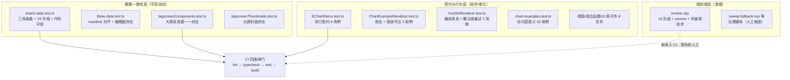

# 09 测试与质量保障

> 项目：html5-dataviz ｜ 版本：v1.1 ｜ 生成日期：2026-10-06 ｜ 依据：源码分析

## 1. 测试体系全景

本项目的质量保障由三层构成：Vitest 单元/组件测试（19 个测试文件，`pnpm test`）、Playwright 冒烟（`pnpm test:smoke`，`scripts/smoke.mjs`）、CI 四道闸门（`.github/workflows/ci.yml`：lint → typecheck → test → build）。19 个测试文件的覆盖矩阵与 vitest 环境配置已在《06-部署运行》第 4.1 节完整给出，本章不重复列表，而是**逐条解析测试的设计意图与断言手法**——这个项目测试体系的独特之处在于：大量测试不是测"行为正确"，而是测"数据/清单不漂移"（守恒测试），且用硬编码数字把数据规模钉死，这让"新增案例"这类看似无害的操作变成必须同步测试的操作。整体分层如下：

## 2. charts-data.test.ts：硬编码锁定的守恒测试

文件 `src/data/charts/__tests__/charts-data.test.ts`，六个用例逐条解析：

1. **"每个库的记录数与源库一致"**：`FILES` 常量硬编码 `antv: 351 / echarts: 348 / three: 989`，`expect(data).toHaveLength(expected)`。这个断言把三库规模变成**显式知识**——任何 JSON 增删都必须来改这个数字，从而强迫操作者意识到"数据规模是契约的一部分"。代价是每新增一条案例要手改 expected（操作 SOP 见《06-部署运行》第 5 节第 5 步）；
2. **"总数为 1688"**：三库求和硬校验，防"此消彼长"式的隐性替换（比如删 1 条 echarts 又加 1 条 antv，单库数字各自对得上但总量语义变了）；
3. **"每条记录包含全部元数据 key"**：`REQUIRED_KEYS` 17 个键逐条 `toHaveProperty`，失败信息带"缺 {key}"与具体条目，可定位到条目级。生成器产出新 JSON 时漏字段、手工补条目时字段名笔误都在这里拦截；
4. **"代码字段守恒"**：本文件的灵魂用例。`localSfcIds()` 递归扫描 `src/chart-examples/{lib}` 目录收集真实存在的 SFC id（注释声明与 `scripts/slim-chart-json.mjs` 的判定保持一致），然后双向断言：有本地 SFC 的条目**不得**携带 `componentCode/optionCode/initCode` 任何一个（"已覆盖条目不应再携带代码字段"），无本地 SFC 的条目**必须**至少带一个（"兜底条目缺少代码字段"）。它锁定的就是《00-项目总览》所述"SFC 是唯一真源"这条架构决策的机器可执行形式；
5. **"library 字段与文件归属一致且 id 唯一"**：跨三库全局唯一 + library 字段与文件归属对齐，拦截生成器串库与 id 冲突；
6. **"元数据 title/description 不得含未求值的模板表达式"**：防回归用例，注释记录了历史事故——生成器抓取官方 demo 标题时曾把未求值的模板表达式（形如 `${...}` 的字符串）写进元数据并直接显示在列表/详情/面包屑。断言覆盖 JSON 四个元数据键与三个 manifest 的 title，并明确"代码字段里的模板串是合法内容，不在此列"。

这个测试文件的价值密度极高：它同时是 schema 校验器、瘦身规则执行器、id 注册表对账器和生成器回归网。修改 slim-chart-json.mjs、更换生成器、手工编辑 JSON 前都应先读它。

## 3. 资产存在性测试：three-data.test.ts 与 bigscreenThumbnails.test.ts

`src/data/charts/__tests__/three-data.test.ts` 头注释点明了它与 charts-data 的分工：id↔SFC 守恒由后者通用逻辑覆盖，这里锁**manifest 对齐**（three.json 与 threeLocalManifest 的 id 集合完全一致；title/category/tags/globals 逐字段相等，注释强调 globals 是"详情页给组件注入资产根路径的唯一通道，两侧漂移 = 运行时 undefined 拼路径"）与**封面存在性**。封面用例有两个值得学习的细节：其一，`THUMBNAIL_EXEMPT = new Set(['webgpu_particles_soft'])`——上游本就无截图的条目被显式豁免，注释称"把'无封面'变成显式决定"，而不是放宽断言；其二，文件名检查前先 `decodeURIComponent`（裸 % 降级原文）——curio 有 17 个缩略图字段是 URL 编码的中文文件名，磁盘/运行时用解码名，唯一 fs 不解码，这是实战踩坑换来的兼容逻辑。另有"category 不得残留源内前缀"的净化断言。

`src/views/bigscreen/__tests__/bigscreenThumbnails.test.ts` 对 22 个大屏做同类检查（thumbnail 指向 `public/bigscreen-thumbnails/` 真实文件）。这两个文件合起来确立了项目的一条测试公理：**凡是清单里声明的资产引用，必须有构建期/测试期存在性证明**——因为列表破图在构建期零报错，只有用户撞上才发现。

## 4. bigscreenComponents.test.ts：锁定大屏清单映射

文件 `src/config/__tests__/bigscreenComponents.test.ts`，三个用例全部围绕"两份手工维护的 id 清单"展开：

1. **正向**：`bigscreenList`（`src/config/bigscreenData.ts`，元数据/文案/缩略图真源）的每个 id 都在 `bigscreenComponentMap`（`src/config/bigscreenComponents.ts`，组件加载真源）中有加载器——拦截"清单加了、映射忘了"，其故障表现（头注释原文）是"运行期落到'该大屏可能尚未迁移'的兜底"；
2. **反向**：componentMap 的每个 key 都来自 bigscreenList（"无孤儿加载器"）——拦截删除大屏时只删一边留下的死代码；
3. **无重复 id**：`new Set(ids).size === ids.length`。

三条用例合起来是"双向包含 + 无重复"的集合相等判定。设计上值得注意：这个测试不做任何快照或硬编码数字（不像 charts-data 锁 22 这个总数），而是纯关系校验——增删大屏无需改测试，只要两表同步即可。这与 charts-data 的硬编码策略形成对照：**数字锁定用于"规模本身是契约"的数据集，关系锁定用于"成员可变但结构不变"的注册表**。两份清单的对齐诉求、故障模式与解法，与《13-技术债务与演进建议》将讨论的 manifest 生成器缺失问题同构。

## 5. 组件契约测试与访问层测试

渲染链三个核心组件各有专属测试，用例名即规格说明：

- `src/chart-examples/__tests__/EChartDemo.test.ts`（4 用例）：静态 option 模式实例就绪后直接 setOption；onReady 返回 option 时交给实例 setOption 且 ctx 提供完整工具面；setup 返回的清理函数在卸载时执行；setup 抛错进入错误态（可重试）且重试成功后恢复。它锁定的正是《07-模块详解》第 4 节的三模式执行契约与清理语义——改 EChartDemo 的执行顺序或清理时机前必跑；
- `src/components/chart-examples/__tests__/ChartExampleRenderer.test.ts`（2 用例）：竞态用例通过注入延迟 fetcher 构造"上一示例渲染在飞"窗口，断言旧渲染不得 init/setOption、新示例胜出；错误可见性用例断言 antv-config 的 plotClass 无法解析时必须报错而非静默空白。两条分别钉死 07 篇第 7 节的代次保护与"失败可见"原则；
- `src/components/chart-examples/__tests__/VueSfcRenderer.test.ts`（2 用例）：编译进行中切换源码时新源码胜出、旧编译不得回填；沙箱 v-chart 懒注册瞬时失败后同一实例 refresh 可重试恢复（对应 `ensureSandboxVChart` 的"失败清缓存"设计）。

`src/api/__tests__/chart-examples.test.ts`（10 用例）锁定访问层与原后端对齐的语义：分页与末页余量、category 精确匹配、search 不区分大小写并覆盖 tags（注释：与原后端 ILIKE 语义一致）、getChartExample 不存在抛错、指定 library 只查该库、未知 library 返回空集、page/limit 钳制。这是"去后端化"改造的语义等价性证明——视图层之所以能无感知切换，靠的是这组用例。

视图与组合函数层（8 个文件）覆盖分页行为、面包屑与真实路由表回归（`ChartExampleDetailPage.breadcrumb.test.ts` 用真实 routes.ts 校验卡片跳转不落 404）、首页导航、404 页、大屏返回行为、主题三态、toast、筛选防抖，以及 AppButton/AppInput/AppHeader 导航态。

## 6. scripts/smoke.mjs：Playwright 冒烟

冒烟脚本 104 行，需要先起服务（`pnpm dev` 或 `pnpm preview`），`BASE_URL` 环境变量可覆盖默认 `http://localhost:5566`。断言清单：

1. **10 个页面遍历**：首页、三库列表、大屏列表、三个大屏详情（sales-analysis/business-dashboard/dashboard）、echarts area-simple 详情、three machineRoom 详情。逐页 `goto(waitUntil: 'networkidle')` → HTTP 状态断言（ok 或 304）→ `pageerror` 收集 → 等待 2500ms → 截图存 `smoke-shots/{name}.png`（运行产物，.gitignore 已忽略，供人工目检）；
2. **大屏 canvas 断言**：sales-analysis 详情 `canvas` 数量 > 0，注释称其为"echarts 渲染证据"；
3. **图表详情断言**：area-simple 用 `waitForFunction` 显式轮询 canvas 出现（20 秒超时），注释解释固定 sleep 会被 echarts-vendor 冷启动拖垮；同时断言 `getByText('渲染失败')` 计数为 0；
4. **源码弹窗断言**：点击"查看源代码" → `.scm` 出现 → 关闭 → `waitForSelector({state:'detached'})`，验证 Transition 完整走完（注释：rAF 正常的独立 Chromium 下验证开合全流程）；
5. **GL 兜底链路断言**：访问 `/charts/echarts/gl-lines3d-airline-on-globe`，该条目一票覆盖"api-async 求值 + echarts-gl 预载 + fetch 数据文件"整条兜底通路，断言 canvas > 0、无"渲染失败"、无"加载资源失败"（后者即 `/echarts-data` 资产缺失的探针）；
6. **外链零请求断言**：`page.on('request')` 全程监听，命中 `jsdelivr.net|aliyun.com|youbao.xyz|alipayobjects.com` 即收集，最后统一判失败并列出前 5 条 URL——这是内网部署前提（《08-安全与权限设计》第 7 节）的回归防线。

任何失败汇总打印并以退出码 1 结束；全部通过打印"冒烟全部通过"。smoke 的选点思路是"每条渲染链路至少一个探针"：本地直挂（area-simple）、three 壳（machineRoom）、兜底求值（GL globe）、SFC 沙箱无独立探针（⚠️ 待确认：8 条 component 类 antv 兜底条目未进冒烟页单）、大屏、外链边界。

## 7. coverage 现状

`@vitest/coverage-v8` 已在 devDependencies（^2.1.9），理论上 `pnpm vitest run --coverage` 即可产出报告；但 `package.json` 没有定义独立的 coverage script，`vitest.config.ts` 也没有配置 coverage 的 include/thresholds（⚠️ 待确认：覆盖率门禁是否在其他流水线中设置）。结合测试矩阵推断实际覆盖形状：数据一致性与渲染链契约覆盖厚（数据层测试体量接近半数），而 `src/utils/sfcRuntime.ts` 的危险模式校验、`useMapGeoJson`、`usePagination`、`useResourceFetch`、`useScreenData` 等工具与组合函数没有专属测试文件（部分逻辑间接被组件测试覆盖）；22 个大屏只有返回行为与缩略图两类测试，图表渲染正确性完全依赖冒烟的三个探针 + 人工目检截图。

## 8. 缺口与补测建议

按投入产出比排序：

1. **smoke 纳入 CI 或发布流水线**：当前 CI 只有 lint/typecheck/test/build 四道闸门，外链清零断言与 canvas 渲染证据在 CI 中是盲区——恰是"改依赖后被破坏"的高危区。建议加一个可起 preview 服务的 job（或发布前手动门禁），Playwright 依赖已在 devDependencies 中；
2. **危险模式校验单元测试**：`DANGEROUS_RUNTIME_PATTERNS` 九条正则、50 万字符上限、`__dynamicImport__` 闸门拒绝路径目前零覆盖。这组测试成本低（纯字符串断言）、价值高（安全护栏回归网），建议补 `src/utils/__tests__/sfcRuntime.security.test.ts`；
3. **loadScript 的 AMD 屏蔽行为**：dev 环境特有的 define 屏蔽/恢复逻辑值得用 happy-dom 模拟验证（加载失败后 define 是否恢复、幂等缓存是否共享 Promise）；
4. **composable 三件套**：`useResourceFetch`（AbortError 不视为错误、过期请求丢弃）、`useMapGeoJson`（loadId 竞态、fallback URL）、`usePagination`（clamp 边界）是三处独立竞态/边界实现，均无专属测试，建议按 07 篇第 7 节的对比表逐条补；
5. **冒烟补 SFC 沙箱探针**：从 8 条 `component` 类 antv 兜底条目中选 1 条加入 PAGES，使第三条渲染链路也有端到端证据；
6. **覆盖率基线**：先跑一次 `--coverage` 拿到基线数字，再决定是否设阈值门禁——对这种"资产型代码库"，盲目追求高覆盖率意义有限，守住数据守恒与渲染链契约两个高价值区即可。
