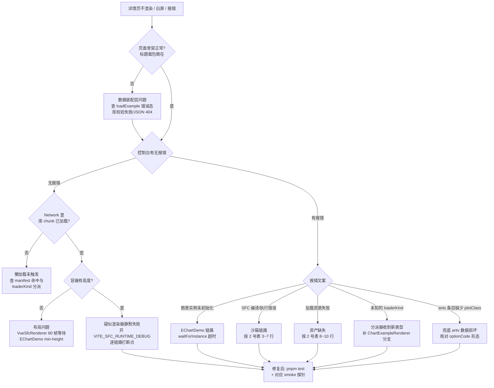

# 12 FAQ与故障排查

> 项目：html5-dataviz ｜ 版本：v1.1 ｜ 生成日期：2026-10-06 ｜ 依据：源码分析

## 1. 使用说明

《06-部署运行》第 6 节有一张"现象 → 首查位置"的速查表，本章是它的展开版：把报错按**渲染链路归属**重组，给出完整根因链与修复动作。排查前建议先建立链路定位意识——看到一个示例页的问题，先判断它走哪条链路（本地 echarts SFC / 本地 antv SFC / three 壳 / 兜底 optionCode 求值 / 兜底 SFC 沙箱编译），判断依据是 `src/chart-examples/manifest.ts` 是否命中与 JSON 条目的 `loaderKind`（契约见《15-接口全量参考》），不同链路的故障域几乎不重叠，定位范围立刻缩小一半。

链路自检可以归纳为"三问"：**一问数据从哪来**——详情页地址栏的库与 id 在 manifest 里吗（命中则本地直挂），不在则查 JSON 的 loaderKind（决定兜底走哪条执行器）；**二问代码谁来跑**——echarts SFC 的实际执行者是 EChartDemo（option/onReady/setup 三模式），antv SFC 自驱，three 走 ExampleScene 壳，兜底条目是 new Function 求值或沙箱编译，执行者不同、故障面不同；**三问资产走哪条路**——取数固定挂 `/echarts-data`、地图固定 `/map-geojson`、three 资产根由 manifest 的 globals 注入，任何"数据不显示"都应先核对这三个前缀下的文件是否真的存在。三问的答案组合起来，基本能把问题定位到单一文件。

## 2. 高频报错速查表

| # | 报错/现象 | 链路 | 根因 | 定位与修复 |
| --- | --- | --- | --- | --- |
| 1 | 渲染失败：图表实例未初始化 | 本地 echarts SFC | `EChartDemo.waitForInstance` 1500ms 内 v-chart 底层实例未就绪（echarts chunk 加载受阻/容器 0 高度/极慢设备） | Network 看 echarts chunk 是否 404/挂起；确认容器高度；点重试按钮（`run()` 重跑） |
| 2 | 图表完全空白、无报错 | 大屏/本地 SFC | `<v-chart>` 未注册（历史事故，全局注册已在 `src/main.ts`）或容器高度为 0 | 检查模板是否用了全局 v-chart；DevTools 查 `.echart-demo__chart` 的实际尺寸 |
| 3 | SFC 编译错误：Script/Template/Style 编译错误 | SFC 沙箱 | `compileSfcToComponent` 的 parse/compileScript/compileTemplate/compileStyle 四段任一抛错，错误信息含具体语法问题 | 开 `VITE_SFC_RUNTIME_DEBUG=1`（见第 4 节）看详细日志；`lang="ts"` 先确认 TS 降级正则未误删声明（`src/utils/sfc-typescript.ts` 的跨行教训） |
| 4 | [sfcRuntime] 不允许的动态导入 | SFC 沙箱 | 动态 import 的源未进依赖收集表（`__dynamicImport__` 闸门拒绝） | 把该 import 改静态，或在 `src/utils/sfc-modules.ts` 白名单/glob 覆盖范围补注册 |
| 5 | SFC 编译产物包含不安全的运行时调用 | SFC 沙箱 | 触发 `DANGEROUS_RUNTIME_PATTERNS` 九条正则之一（eval/new Function/document.write/location 赋值/parent·top 访问等） | 按拦截意图改写示例代码（9 条正则表见《08-安全与权限设计》第 2 节） |
| 6 | 缺失 componentPath 红章 | SFC 沙箱 | JSON `component` 类条目渲染时未提供 componentPath，相对导入无法解析 | Renderer 已固定传 `json/{library}/{id}.vue`；若直接用 VueSfcRenderer，补 `componentPath` 或 `inferredComponentPath` |
| 7 | ⚠ 组件缺失：{source} 橙框 | SFC 沙箱 | `ensureModule` 全链未命中，返回 MissingModuleStub | 检查源是否属 npm 白名单 11 项/`@/` 别名 glob 范围（components/utils/composables/svg-lessons）；共享组件是否随迁移带入 |
| 8 | 渲染失败：加载资源失败: /echarts-data/... (404) | 兜底求值 | `public/echarts-data/` 缺对应数据文件 | 核对文件是否随仓库分发；smoke 第 5 项（GL globe）即此场景的探针 |
| 9 | GL 示例报 globe/lines3D 系列不存在 | 兜底求值/本地 SFC | echarts-gl 未在 init 前注册 | 兜底条目确认 JSON `requiresGl: true`；本地 SFC 确认 `import 'echarts-gl'` 位于 echarts import 之后 |
| 10 | 地图系列空白或 map 未注册错误 | 兜底求值 | `requiresMap` 条目宿主预注册失败（`/map-geojson/china.json`、`world.json` 拉取失败），或示例用了第三张地图 | 查 public/map-geojson 文件；第三张地图需 SFC 内 `ctx.registerMap` 自注册 |
| 11 | 快速切换示例后画面串台/实例泄漏/错误态被顶掉 | 全部 | renderSeq/compileSeq/requestId/loadId 代次保护被改动破坏 | 对照《07-模块详解》第 7 节四处实现恢复；跑 Renderer/VueSfcRenderer 的两条竞态用例 |
| 12 | 刷新非根路径 404 | 部署 | history 路由未配 SPA fallback | 静态服务器把所有未命中路径回退 index.html（见《06-部署运行》第 3 节） |
| 13 | 子路径部署后资源 404/挂载空白 | 部署 | 构建默认 base `/`，资源以绝对路径 `/assets/...` 引用 | vite.config.ts 补 `base: '/子路径/'`；注意沙箱资源解析 `resolveAssetUrl` 与 `fetchJson` 的 `/echarts-data` 前缀语义也会随之变化（⚠️ 待确认：当前源码未见 base 相关配置或处理，子路径部署需实测资产前缀） |
| 14 | WebGL 报 context 丢失/黑画布 | three 壳 | 反复重挂载撞浏览器 8~16 个 context 上限 | 确认走 ExampleScene 壳（dispose 内 forceContextLoss），不要自建 renderer；刷新页面释放全部 context |
| 15 | 冒烟报"检测到运行时外链请求" | 全站 | 依赖升级/新示例引入 CDN import | 按 URL 定位来源；import 级走 vite alias 重映射，运行时字符串级改本地副本（手法见《08-安全与权限设计》第 6 节） |
| 16 | myChart.xxx 实例尚未就绪（console.warn 刷屏） | 本地 echarts SFC | setup/onReady 在实例就绪前调 myChart | 属设计内降级（Proxy no-op + warn）；持续刷屏说明 waitForInstance 一直超时，转 #1 排查 |

使用本表的一个方法论提示：**同一报错在不同链路上含义完全不同**，务必先对号入座再行动。以"渲染失败"这四个字为例，它至少有四种来源——EChartDemo 的错误态模板（catch 到任何异常后显示"渲染失败：{消息}"）、ChartExampleRenderer 的通用 error 态、VueSfcRenderer 的 fallback 插槽、以及 smoke 断言里统计的文案计数；表里 #1/#5/#8 的"渲染失败"前缀之后紧跟的具体消息才是根因本体，不要停在字面。同理，"加载资源失败"在 EChartDemo.fetchJson、Renderer.fetchJson 与 useMapGeoJson 三处的消息格式几乎一致，但对应的资产目录各不相同（/echarts-data、/map-geojson），按抛错堆栈而不是消息样式区分。报错消息本身在本项目里是**接口的一部分**——多处以正则匹配它（如 unhandledrejection 桥接的认领正则、smoke 的"渲染失败"计数），修改任何错误文案前先检索这些正则消费方，否则排查体系会静默失明。

## 3. 排查决策树

以最高频的"详情页不渲染"为主干的决策树（从现象出发逐层二分）：

树中三个分叉点值得展开。**"控制台无报错"分支是排查成本最高的区域**：本地直挂链路的 setup/render 异常由详情页 `onErrorCaptured` 转错误面板（不该无报错），兜底链路有 unhandledrejection 桥接，若都安静则大概率是布局（0 高度）或懒加载未触发——这正是决策树把"容器有高度"放在"库 chunk 已加载"之后的原因。**"未知的 loaderKind"** 是分派器的显式防御（switch default throw），出现即说明数据里混入了分派器不认识的新类型，属于扩展未收口。**"antv 条目缺少 plotClass"** 的二分求值上下文见《07-模块详解》第 3 节，多数情况是 optionCode 被 slim 脚本误删了 return 结构或裸对象形态不匹配。

决策树以详情页为主干，因为它是故障最密集的页面；**列表页与大屏的故障树是它的两个轻量变体**——列表页问题（分类树不出、总数不符、卡片破图）先查 `getChartCategories`/`getChartExamples` 的入参（category 拼写、page 越界）再看缩略图目录，全部分类计数与 JSON 强一致，所以"侧栏数字不对"几乎总是"JSON 被手改坏了"而非组件 bug；大屏问题先过 `bigscreenComponents.test.ts` 的三断言（清单/映射/重复 id），再查 DatavContainer 的缩放容器尺寸（父级高度为 0 时 scale 计算会得到 0），最后才是图表本身。两个变体共享同一条终止规则：**测试全绿而现象仍在时，检查是否访问的是旧构建产物**（preview 端口 4173 与 dev 端口 5566 打错、或浏览器缓存了旧 index.html），这在多环境切换时是最高频的"假故障"。

## 4. 开发与构建环境专项

环境类问题不在渲染链路内，但发生频率不低且症状迷惑性强，单独成节：

- **`pnpm dev` 预构建阶段报错（顶层 await / esbuild 崩溃）**：three 官方包含顶层 await，绕开 `vite.config.ts` 的 `optimizeDeps.esbuildOptions.target: 'esnext'` 配置（如另起 config 或降级 vite）就会触发；修复即恢复该配置，`build.target: 'esnext'` 同理（见《14-配置与环境详解》第 2.3 节）；
- **构建阶段内存溢出（heap out of memory）**：1617 个 SFC 的 glob 切分在构建期吃内存，标准解法是用 `pnpm build`（自带 8GB NODE_OPTIONS），不要绕过直接调 vite；内存确实不足的机器用 `build:fast` 或关掉并行任务；
- **dev 环境下 UMD 扩展库"xx is not defined"而 preview 正常**：Vite dev 注入的 AMD `window.define` 让 ecStat 等走了 define.amd 分支不挂全局——`loadScript` 的 define 屏蔽机制就是为此而写（见《08-安全与权限设计》第 4 节），若自写加载逻辑绕过了它就会复现；
- **端口占用**：dev 固定 5566（package.json 写死），smoke 默认也打 5566，被占用时 smoke 的失败形态是整页 HTTP 断言失败而非渲染断言失败，先看 BASE_URL 是否指向了真正起服务的端口；
- **Node 版本不匹配**：CI 锚定 node 22 + pnpm 10，本地低于 22 时 vitest 的 JSON 动态 import（1.22MB 级）与 vue-tsc 可能出现版本相关的怪异报错，升级 Node 是第一动作而非调试测试本身。

## 5. 数据一致性故障：测试红了怎么读

守恒测试是本项目最高频变红的一组测试，红 정보本身携带定位信息：**"每个库的记录数与源库一致"失败**说明 JSON 条数与 `FILES` 硬编码不符，SOP-A 第 5 步（更新 expected 数字）被跳过了；**"代码字段守恒"失败**分两个方向——"已覆盖条目不应再携带代码字段"说明给有 SFC 的条目手写了 optionCode（删掉或改兜底形态），"兜底条目缺少代码字段"说明 JSON 里有条目既没 SFC 也没代码（补 optionCode 或补 SFC）；**"每条记录包含全部元数据 key"失败**带"缺 {key}"消息，直接定位到具体条目与字段名（手工编 JSON 时的字段名笔误居多）；**"元数据不得含未求值的模板表达式"失败**说明生成/抓取逻辑把 `${...}` 串写进了 title/description/category 或 manifest title，按错误信息里的 `库 id.字段` 定位。大屏侧的 `bigscreenComponents.test.ts` 三个用例分别对应"漏写映射 / 孤儿加载器 / 重复 id"，修复动作都是把两张表对齐；`three-data.test.ts` 的 globals 断言失败最值得警惕——它意味着详情页运行时会拿 undefined 拼资产路径，three 示例会整体资产缺失。这类测试**不要用改断言的方式让它变绿**：数字与守恒关系是契约本身，测试红是契约被破坏的信号。

## 6. 调试入口清单

按"从外到内"列出可用的调试手段：

1. **环境变量 `VITE_SFC_RUNTIME_DEBUG=1`**（仅 DEV 生效，`src/utils/sfcRuntime.ts` 顶部 `isSfcRuntimeDebug` 读取）：开启后编译链输出三类日志——rewriteScriptImports 后仍有 import 残留的告警、new Function 执行失败的具体错误、runtimeBody 前 500 字符与编译产物的结构摘要（hasSetup/hasRender/keys）。排查沙箱编译问题首选；
2. **`src/utils/logger.ts`**：sfc-modules/sfcRuntime 的统一日志出口（warn/error），控制台按前缀过滤即可聚焦沙箱链路；
3. **smoke 与 sweep 脚本**：`scripts/smoke.mjs` 十页面 + 截图（`smoke-shots/` 目检）；`scripts/sweep-fallback.mjs` 可对全部条目或指定库做逐条渲染清扫（`--all`/`--lib=antv`/`--concurrency=3`），输出逐条成败表，定位"个别示例坏了但不知道是哪些"的场景不可替代；
4. **Network 面板的 chunk 语义**：vendor=框架桶、echarts-vendor/three-vendor/antv-vendor=库桶、库级 JSON chunk、`{id}.vue` 对应的示例 chunk——加载了哪些 chunk 直接反推走了哪条链路（见 10 篇第 1 节体积表）；
5. **Vue DevTools**：详情页组件树能看到 `localComp`（异步组件）或 `ChartExampleRenderer` 的挂载形态；KeepAlive 名单里只有 ChartLibraryPage；
6. **单元测试即文档**：`EChartDemo.test.ts` / `ChartExampleRenderer.test.ts` / `VueSfcRenderer.test.ts` 的用例就是三条链路的可执行规格，复现问题时先看对应测试能否在 happy-dom 下复现（能复现则改组件，不能则查数据/资产/环境）；
7. **git 考古与源码注释**：本项目的一个特殊现实是"注释即文档"——最关键的行为依据几乎都写在源码注释里（manualChunks 的事故记录、useExampleStage 与上游的差异声明、slim 脚本的"唯一真源"宣言、loadScript 的 AMD 屏蔽理由等）。遇到"为什么这么写"的疑问，`git log -p` 对应文件往往能还原完整决策现场；反之，若你的修复解决了一个非直觉问题，也应把结论写进同位置的注释，让下一位排查者少走一遍弯路。这套习惯与《13-技术债务与演进建议》第 2 条（文档漂移）互为印证：注释可信度高是因为它与代码同 PR 演进，独立文档反而容易漂移——排查时优先信注释、信测试，其次才是文档。

## 7. 三个易被误判的问题

最后澄清三个"看起来像 bug 但不是"的行为，避免无效排查：其一，**静态 option 与钩子互斥**——EChartDemo 只在"无 onReady 且无 setup"时才直接 setOption 静态 option，两者同传时 option 被忽略（契约语义，见《07-模块详解》第 4 节），不是丢失数据；其二，**兜底条目的地图注册失败不报错**——`renderEchartsOption` 对 china/world 两张图单张失败 try-catch 静默（注释：条目可能只用另一张），只有真正用到的那张缺失才会在渲染时暴露，故"地图空白"要同时查两张；其三，**编译缓存的失败口径**——`sfcRuntime.compilerCache` 与 `VueSfcRenderer` 的 sandboxVChartReady 都遵循"失败必须清缓存允许重试"，若发现同一实例 refresh 永远命中旧错误，说明有人改掉了失败清缓存逻辑，而不是浏览器缓存问题。

补充第四个近年高频误判：**smoke 截图里的"空图"不等于渲染失败**。`scripts/smoke.mjs` 的截图在页面 networkidle 后再等 2500ms 拍摄，echarts-vendor 冷启动、GL 示例的数据 fetch 都可能让截图瞬间尚未出图——判定是否真失败以脚本内显式断言（canvas 计数、"渲染失败"文案计数）为准，截图只用于人工目检辅助。同样的道理适用于列表页缩略图：缩略图懒加载在截图时刻可能还没发生，破图与未加载在截图上是两种观感，只有 `failedThumbnails` 回落的 📊 占位符才代表真实加载失败。排查渲染类问题时，"截图证据"永远排在"断言证据"之后，这是使用 smoke-shots 目录的正确姿势。
