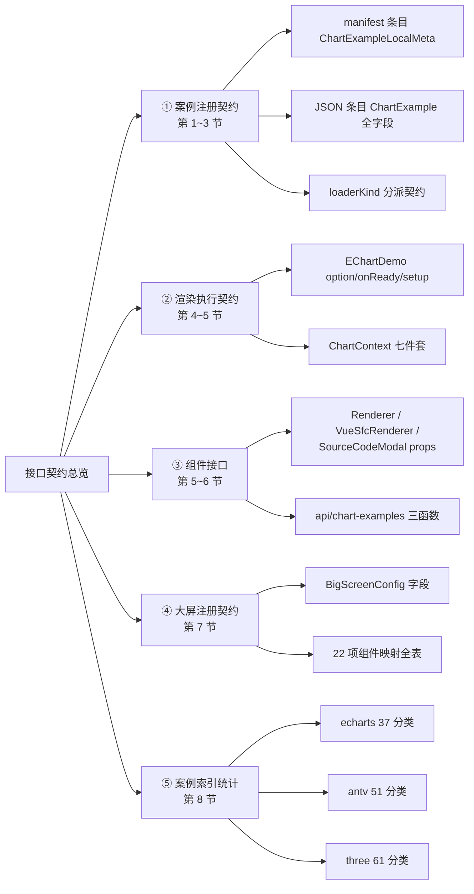

# 15 接口全量参考

> 项目：html5-dataviz ｜ 版本：v1.1 ｜ 生成日期：2026-10-06 ｜ 依据：源码分析

## 0. 总览

本篇是全站"契约"的一站式查表手册：凡跨模块的调用边界（清单条目、JSON 元数据、渲染分派、执行契约、组件 props、大屏注册、案例索引）都收敛为表格，行为细节不再展开——机制走读见《07-模块详解》，字段语义溯源见《04-数据模型》，组件接口的背景见《03-接口设计》。各接口与测试的锁定关系是本篇的暗线：**每张表都可追溯到至少一个守恒测试**。总览图给出五组契约的从属关系与查阅入口：

查表约定：条目类型名为源码中的真实导出名；"测试锁定"列给出对应测试文件；标注（可选）的字段在源码类型中带 `?`。

## 1. manifest 清单条目 ChartExampleLocalMeta（全字段）

定义于 `src/chart-examples/manifest.ts` 头部；清单规模：echartsLocalManifest 294 条、antvLocalManifest 334 条、threeLocalManifest 989 条（`src/chart-examples/three-manifest.ts`）。统一出口 `LOCAL_LIBRARY_MANIFESTS: Record<string, { manifest: ChartExampleLocalMeta[]; ids: Set<string> }>`，键为 `echarts/antv/three`。

| 字段 | 类型 | 必填 | 说明 | 测试锁定 |
| --- | --- | --- | --- | --- |
| `id` | string | 是 | 示例唯一标识 = SFC 文件名 `{id}.vue` = JSON 条目 id；跨库唯一 | `charts-data.test.ts`（id 唯一）、`three-data.test.ts`（集合一致） |
| `title` | string | 是 | 中文展示名 | `charts-data.test.ts`（模板表达式防回归） |
| `category` | string | 是 | 分类名（驱动侧栏树） | `three-data.test.ts`（与 JSON 一致） |
| `tags` | string[] | 是 | 搜索域 + 详情页胶囊 | `three-data.test.ts`（与 JSON 一致） |
| `globals` | Record\<string,string\> | 否 | three 专用资产根注入（如 `{ ASSET_HOST: '/threejs-official/' }`），详情页 `tryLoadLocal` 透传给组件 | `three-data.test.ts`（globals 逐字段相等） |

使用本表时的三个背景知识：其一，清单条目是 JSON 条目的**四字段投影**（id/title/category/tags 加可选 globals），比 JSON 轻三个数量级（manifest.ts 3812 行 + three-manifest.ts 6786 行即可索引全部 1617 个本地案例），它随入口代码静态打包，换来的是详情页零延迟的路由判断——不需要等任何 JSON chunk 下载就能决定走本地直挂还是兜底；其二，`ids` 集合与 `manifest` 数组是同源派生（`new Set(manifest.map(m => m.id))`），不存在第二处维护点；其三，echarts/antv 两份清单的生成器（server 侧）不在仓库内，条目级修改走手工 + git 留痕（《11-扩展开发指南》SOP-D），three 清单由仓库内 `scripts/gen-three-registry.mjs` 再生成且禁止手改。查询用法上，详情页只消费 `LOCAL_LIBRARY_MANIFESTS[library]` 这一个入口，`echartsLocalManifest` 等命名导出主要服务于测试与潜在工具脚本。

## 2. JSON 元数据条目 ChartExample（全字段）

定义于 `src/types/chart-examples.ts`；数据集 `src/data/charts/{echarts,antv,three}.json`（实测条数 348/351/989，守恒由 `charts-data.test.ts` 的 FILES 硬编码锁定）。

| 字段 | 类型 | 必有 | 说明 | 测试锁定 |
| --- | --- | --- | --- | --- |
| `id` | string | 是 | 全局唯一，联动 SFC 文件名/缩略图名/编译缓存键 | REQUIRED_KEYS + id 唯一用例 |
| `library` | string | 是 | `echarts` / `antv` / `three`，与文件归属一致 | library 一致用例 |
| `title` | string | 是 | 中文标题 | REQUIRED_KEYS + 模板表达式用例 |
| `titleEn` | string \| null | 是 | 英文标题（three 多为 null） | REQUIRED_KEYS |
| `description` | string | 是 | 描述（参与搜索域） | REQUIRED_KEYS |
| `category` | string | 是 | 分类名 | REQUIRED_KEYS |
| `loaderKind` | string | 是 | 渲染分派判别字段，取值见第 3 节 | REQUIRED_KEYS |
| `tags` | string[] | 是 | 标签 | REQUIRED_KEYS |
| `difficulty` | string \| null | 是 | `beginner`/`intermediate`/`advanced` 或 null | REQUIRED_KEYS |
| `sourceUrl` | string \| null | 是 | 官方示例链接；数据已填充（echarts 348/348、antv 346/351 非空）但运行时零消费 | REQUIRED_KEYS；死字段分析见《13-技术债务与演进建议》第 3 条 |
| `sortOrder` | number | 是 | 排序权重；同样写而不读，列表排序按 JSON 数组原序 | REQUIRED_KEYS |
| `status` | string | 是 | 观察值恒为 `"published"` | REQUIRED_KEYS |
| `requiresGl` | boolean | 是 | 是否依赖 echarts-gl（Renderer 预载依据） | REQUIRED_KEYS |
| `requiresMap` | boolean | 是 | 是否需要 registerMap（Renderer 预注册 china/world） | REQUIRED_KEYS |
| `thumbnail` | string \| null | 是 | null 时列表回落 `/chart-thumbs/{id}.webp` | REQUIRED_KEYS；three 侧存在性由 `three-data.test.ts` 锁定 |
| `createdAt` / `updatedAt` | string | 是 | ISO 时间戳 | REQUIRED_KEYS |
| `optionCode` | string | 条件 | 兜底 echarts 官方脚本（有本地 SFC 的条目已被 slim 脚本删除） | 代码字段守恒用例 |
| `componentCode` | string | 条件 | 兜底 SFC 源码字符串（8 条 antv `component` 条目） | 代码字段守恒用例 |
| `initCode` | string | 条件 | option 求值后的补充脚本（五形参执行） | 代码字段守恒用例 |
| `globals` | Record\<string,string\> | 否 | three 专用资产根（与 manifest 侧一致） | `three-data.test.ts` |

表中"必有"列的含义需要精确理解：**必有**指 17 个 REQUIRED_KEYS 之一（测试强制存在，值可以为 null），**条件**指代码字段三件套——它们的存在性由"是否拥有本地 SFC"唯一决定，这就是"代码字段守恒"用例的双向断言（有 SFC 必无、无 SFC 必有）。设计取舍上，本 schema 把"渲染方式"同时编码在两个字段里：`loaderKind` 描述意图（走哪条执行链），代码字段描述材料（执行什么），两者的一致性不被类型系统保证而被守恒测试保证——这是纯 JSON 数据源无法用类型约束时的补偿设计。另请注意 schema 的演进痕迹：`sourceUrl`/`sortOrder`/`status` 是原后端 API 的遗留字段（语义见第 2 节表内说明），`globals` 与 `__source`（仅 three.json，schema 外）是去后端化后新增的，新代码不应依赖 `status` 有非 published 取值的可能。

## 3. ChartExampleRenderer loaderKind 分派契约

分派入口 `renderExample()`（`src/components/chart-examples/ChartExampleRenderer.vue`）；判据链：`usesSfc`（类型优先路由：OPTION_KINDS = `['option','api-async','antv-config']` 且有 optionCode 的条目即使带 componentCode 也不进 SFC 链）→ switch loaderKind。实际条数分布为源码统计值：

| loaderKind | 库 | 条数 | 渲染函数 | 前置动作 | 失败表现 | 测试锁定 |
| --- | --- | --- | --- | --- | --- | --- |
| `local` | three | 989 | 详情页 `defineAsyncComponent` 直挂（不走 Renderer） | manifest 命中 + `findLocalModule` 精确匹配 | 详情页 onErrorCaptured 错误面板 | `charts-data.test.ts` SFC↔JSON 互不缺 |
| `option` | echarts | 211 | `renderEchartsOption(gen)` | requiresGl/requiresMap 预载；ecStat 系检测 loadScript | error 态 + unhandledrejection 桥接 | `ChartExampleRenderer.test.ts` 竞态用例 |
| `api-async` | echarts | 137 | 同上（脚本自带异步逻辑） | 同上 | 同上 | 同上 |
| `antv-config` | antv | 343 | `renderAntvConfig(gen)` | 动态 import `@antv/g2plot`；二分求值（return 前缀按函数体，否则按表达式） | 缺 plotClass/未知 PlotClass/缺 options 均 throw | `ChartExampleRenderer.test.ts` plotClass 错误可见用例 |
| `component` | antv | 8 | `VueSfcRenderer` 沙箱编译 | `ensureSandboxVChart` 懒注册 | onErrorCaptured 就地隔离 | `VueSfcRenderer.test.ts` 两用例 |

配套约定：兜底渲染容器用 `v-show` 常驻（条件分支会让 ref 恒 null）；`fetchJson` 相对路径挂 `/echarts-data/`；`initCode` 以 `(chart, echarts, option, myChart, fetchJson)` 五形参在 option 回填后执行。

本表的"前置动作"列是排查兜底条目时最重要的信息：echarts 两类的失败多发生在前置阶段（GL 未预载、扩展库未挂载、地图未注册），而 antv-config 的失败集中在求值后的三连校验（plotClass/PlotClass/options），component 类的失败则几乎全部来自沙箱编译。表外的两条隐含契约同样有效：其一，`loaderKind` 的取值集合是开放的（switch 有 default throw 兜底），新增取值必须同步 `ChartExampleRenderer` 的分派分支与本表；其二，`usesSfc` 的类型优先路由意味着"带 optionCode 的 option/api-async/antv-config 条目"即使残留 componentCode 也走求值链——这是对迁移遗留数据的容错，不代表新条目可以双字段混填。

## 4. EChartDemo 执行契约

文件 `src/chart-examples/EChartDemo.vue`；契约稳定性声明："option/onReady/setup/scripts 的语义被 294 个生成 SFC 依赖，只能收紧不能变更"。执行顺序刚性：`run()` 开头 `cleanupFn?.()` → `waitForInstance`（32ms 步进、1500ms 超时）→ `scripts` 并行预载 → 静态 option（仅当无 onReady 且无 setup）→ `onReady(ctx)`（返回 option 则代为 setOption）→ `setup(ctx)`（登记清理函数）。

| 类别 | 名称 | 类型 | 语义 | 测试锁定 |
| --- | --- | --- | --- | --- |
| prop | `option` | 对象 \| Ref\<对象\> | 静态 option（`normalizeOption` 按 `'value' in o` 解 Ref）；与钩子互斥 | 静态 option 用例 |
| prop | `onReady` | `(ctx) => option \| void \| Promise<...>` | 异步初始化钩子 | onReady 用例 |
| prop | `setup` | `(ctx) => void \| (() => void) \| Promise<...>` | 业务钩子；返回的清理函数在重试与卸载时统一调用 | setup 清理 / setup 抛错两用例 |
| prop | `scripts` | string[] | 执行前预载的本地脚本（`/echarts-data/lib/...`） | — |
| emit | `error` | `[message: string]` | 渲染失败上报 | setup 抛错用例 |

**ChartContext 七件套**（同文件导出）：`echarts`（全量命名空间，模块顶部静态 import）、`myChart`（Proxy 延迟代理：未就绪 no-op + console.warn，setOption 走 vue-echarts 默认 merge，getOption/resize/on/off/dispose bind 原生实例，其余属性转发）、`setOption(opt, opts?)`、`registerMap(name, geoJson)`、`registerTransform(t)`、`loadScript(src)`、`fetchJson(path)`（固定拼 `/echarts-data` 前缀，非 2xx 抛"加载资源失败"）。

契约表与流程篇的分工：本节表格记录"调用面"（SFC 作者能用什么、按什么顺序生效），执行时序与竞态细节见《05-核心流程》流程二、机制走读见《07-模块详解》第 4 节。使用契约最容易忽视的三条边界在此重申：`onReady` 的返回值只有"非空对象"才会被代为 setOption（返回 Promise 解包后同样适用），返回 undefined/void 时不触发；`setup` 与 `onReady` 可以共存，顺序固定为先 onReady 后 setup，setup 的清理函数登记在案后由容器全权调度（重试与卸载两个时机），SFC 内不得自行在 onBeforeUnmount 里重复清理同一定时器（会双清，虽无害但说明契约理解有偏差）；`scripts` 预载走 `Promise.all` 并行，多脚本有依赖顺序时应改在 `onReady` 内串行 await。

## 5. 渲染链组件接口（props / emits / expose）

| 组件 | 类别 | 名称 | 类型与默认 | 说明 |
| --- | --- | --- | --- | --- |
| `ChartExampleRenderer.vue` | prop | `example` | `ChartExample` 必填 | 渲染依据（loaderKind + 代码字段 + requiresGl/Map） |
| | prop | `showToolbar` | boolean，默认 true | 右上悬浮工具条（刷新/下载/全屏）；详情页传 false |
| | expose | `refresh()` | 清实例后重跑 | 详情页"刷新预览"调用 |
| | 插槽 | 经 VueSfcRenderer 透传 | `#loading` / `#fallback({error})` | 三态呈现 |
| `VueSfcRenderer.vue` | prop | `source` | `{ raw, componentPath? }` | SFC 源码与虚拟路径（相对导入解析基准） |
| | prop | `demoId` | string 必填 | 编译缓存键 / scopeId 组成部分 |
| | prop | `lazy` | boolean | IntersectionObserver（rootMargin 600px）+ mouseenter 惰性编译 |
| | prop | `mode` | `'card' \| 'detail'` | card 态注入强制 100% 宽高样式 |
| | prop | `inferredComponentPath` | string | componentPath 缺省推断值 |
| | emit | `error` | `[message]` | 编译/渲染错误 |
| | expose | `refresh()` | 重新编译 | — |
| | 插槽 | `loading` / `fallback({error})` / `placeholder` | — | 编译产物缺失 componentPath 且非 card 态显示红章 |
| `SourceCodeModal.vue` | prop | `open`(v-model) / `title` / `code` / `language('vue'\|'javascript')` / `filename` | — | Teleport 弹窗，Esc/遮罩/按钮三种关闭，打开期锁滚动 |
| | emit | `update:open` | — | — |

本节接口的演进约束补充两句。渲染链组件的 props 面是**收敛方向**上的：Renderer 不发 emit（错误在内部转为可见状态）而 SFC 渲染器发 `error`，原因是分派器要聚合多条子链路的状态、统一呈现，而 SfcRenderer 是叶子组件、上抛即可；`refresh()` 是两个渲染组件唯一的 expose——详情页的"刷新预览"对本地组件用 renderKey 重挂载、对 Renderer 走 expose 方法，两条刷新路径在《02-页面设计》第 3 节有交互层描述。给这些组件加 props 时先检查是否已有等价物（如 mode 与 inferredComponentPath 已覆盖卡片/详情两态的样式与路径推断需求），避免同义参数滋生。

## 6. 数据访问层与关键工具签名

| 模块 | 导出 | 签名要点 | 测试锁定 |
| --- | --- | --- | --- |
| `src/api/chart-examples.ts` | `getChartExamples(query)` | library 必填；category 精确等值；search 小写包含 title+titleEn+description+tags；page≥1、limit≤200 默认 20 | 10 用例 |
| | `getChartExample(id, library?)` | 未命中抛 `图表示例不存在: {id}`；省略库按 DATASET_LOADERS 键序扫描 | 同上 |
| | `getChartCategories(library)` | Map 计数按 count 降序 | 同上 |
| `src/utils/sfcRuntime.ts` | `compileSfcToComponent(code, options)` | `{component, styles}`；options `{demoId, componentPath, skipCache}`；缓存键 demoId | `VueSfcRenderer.test.ts` 间接 |
| | `compileSfc(code, options)` | never-throw 包装返回 `{component, styles, error}` | — |
| `src/utils/sfc-modules.ts` | `ensureModule(source, componentPath?)` | 白名单 → 资产 URL → 别名 glob → MissingModuleStub | — |
| | `registerSfcComponent(name, comp)` | 沙箱组件注册表写入 | — |
| `src/chart-examples/loadScript.ts` | `loadScript(src)` | Map 缓存 Promise 幂等；加载期屏蔽 AMD define | — |
| `src/composables/useResourceFetch.ts` | `useResourceFetch(fetcher, options)` | options `{immediate, watch, onError, onSuccess, initial}`；requestId + AbortController | — |
| `src/composables/useMapGeoJson.ts` | `useMapGeoJson(mapName, primaryUrl, fallbackUrl?)` | FeatureCollection 校验 + loadId 竞态 + 自动 registerMap | — |
| `src/composables/useListFilter.ts` | `useListFilter({initial, debounce=300, syncUrl, urlKeys})` | 返回 `{filters, debouncedFilters, reset, clearAll}` | 有测试 |
| `src/composables/usePagination.ts` | `usePagination({total, pageSize=24, initialPage=1})` | setPage clamp / setPageSize 回 1 | 经视图测试 |
| `src/utils/echarts-theme.ts` | `darkEchartsTheme` | 大屏暗色主题对象 | — |

本表所列工具的签名属于"内部稳定接口"：它们被渲染链与视图层直接消费，改签名会波及面广；表中未列但同样被广泛使用的 `src/utils/highlighter.ts`（Shiki 高亮，异步单例）与 `src/utils/map-data.ts`（省市坐标常量）属数据型工具，签名稳定故不赘述。查阅优先级建议：先看本表确认"有没有现成的"，再看《03-接口设计》第 4 节理解"为什么长这样"——两者合起来覆盖全部跨模块工具；组合函数层特别提醒一条使用纪律：除 useTheme（模块级 effectScope 单例）外，其余组合函数都是"每调用一次新实例"，在多个组件里各自调用即各自持有状态，不要误以为是全局共享。

## 7. 大屏注册契约

**BigScreenConfig 字段**（`src/config/bigscreenData.ts`）：`id`（路由参数与映射键）、`title`、`description`、`category`（12 类）、`thumbnail`（`/bigscreen-thumbnails/{id}.webp`）。与 `src/config/bigscreenComponents.ts` 的 `bigscreenComponentMap` 一一对应，双向对账 + 无重复 id 由 `src/config/__tests__/bigscreenComponents.test.ts` 锁定。22 项全表（顺序即清单顺序）：

全表的实际用途有三：新增大屏时按序号续接（保持清单顺序稳定，便于 diff 审阅）；排查 `/bigscreen/{id}` 404 时先查 id 是否在本表（不在则属清单未注册，在则查组件文件是否存在）；做分类筛选功能核对时以 category 列为准（12 类的分布为：数据仪表盘 5、3D可视化 4、企业通用 3、政务 2、工业/公安/金融/消防/农业/物流/生态/物联网各 1）。注意目录名与 id 的两处不完全一致（ioftv-bigscreen → ioftv-screen 目录、sc-datav-demo 系列 → ScDatavDemoNPage 组件名），以加载器右侧路径为运行时事实。

| # | id | title | category | 组件（src/views/bigscreen/…） |
| --- | --- | --- | --- | --- |
| 1 | business-dashboard | 业务数据可视化大屏 | 数据仪表盘 | business/BusinessDashboardPage.vue |
| 2 | report-dashboard | 报表数据可视化大屏 | 数据仪表盘 | report/ReportDashboardPage.vue |
| 3 | dashboard | 大数据可视化平台 | 数据仪表盘 | dashboard/DashboardPage.vue |
| 4 | cool-data-center | 酷炫智能大屏数据中心 | 企业通用 | cool-data-center/CoolDataCenterPage.vue |
| 5 | smart-center-stats | 大屏数据智慧中心统计 | 政务 | smart-center-stats/SmartCenterStatsPage.vue |
| 6 | pressure-vessel | 压力容器大屏 | 工业 | pressure-vessel/PressureVesselPage.vue |
| 7 | police-monitor | 警务综合监控管理平台 | 公安 | police-monitor/PoliceMonitorPage.vue |
| 8 | bank-data-viz | 银行数据可视化 | 金融 | bank-data-viz/BankDataVizPage.vue |
| 9 | fire-monitor | 翼兴消防监控 | 消防 | fire-monitor/FireMonitorPage.vue |
| 10 | tea-traceability | 茶叶种植大数据溯源平台 | 农业 | tea-traceability/TeaTraceabilityPage.vue |
| 11 | sales-analysis | 销售大数据分析 | 企业通用 | sales-analysis/SalesAnalysisPage.vue |
| 12 | logistics-center | 智慧物流服务中心 | 物流 | logistics-center/LogisticsCenterPage.vue |
| 13 | command-center | 作战指挥室 | 政务 | command-center/CommandCenterPage.vue |
| 14 | data-analysis-template | 大数据可视化系统数据分析通用模版 | 企业通用 | data-analysis-template/DataAnalysisTemplatePage.vue |
| 15 | nature-reserve | 自然保护地管理平台 | 生态 | nature-reserve/NatureReservePage.vue |
| 16 | sc-datav-demo0 | 3D四川地图-经济运行监测 | 3D可视化 | sc-datav-demo0/ScDatavDemo0Page.vue |
| 17 | sc-datav-demo1 | 3D四川地图-经济监测增强版 | 3D可视化 | sc-datav-demo1/ScDatavDemo1Page.vue |
| 18 | sc-datav-demo2 | 3D四川地图-电力监控暗色版 | 3D可视化 | sc-datav-demo2/ScDatavDemo2Page.vue |
| 19 | sc-datav-demo3 | 3D风力涡轮机模型展示 | 3D可视化 | sc-datav-demo3/ScDatavDemo3Page.vue |
| 20 | echarts-vision | 电商平台数据可视化 | 数据仪表盘 | echarts-vision/EchartsVisionPage.vue |
| 21 | mobile-sales-dashboard | 移动端销售数据大屏 | 数据仪表盘 | mobile-sales-dashboard/MobileSalesDashboardPage.vue |
| 22 | ioftv-bigscreen | 大数据可视化监控大屏 | 物联网 | ioftv-screen/IoftvScreenPage.vue |

## 8. 三库案例索引统计表（全量分类）

以下三表为 `src/data/charts/*.json` 的全量分类统计（按数量降序），分类数 37/51/61 合计 149，与 `getChartCategories()` 聚合结果一致；条数合计 1688。统计口径说明：这是**数据集侧**的分类计数（含兜底条目），与运行时侧栏树完全一致（`getChartCategories` 直接对同一 JSON 计数）；分类名为原样字符串，echarts/antv 用中文、antv 的部分分类与 three 的多数分类保留源站英文原名——三库命名风格不统一是迁移源各自的现状，索引表如实记录，做跨库聚合检索时应意识到"柱状图"（echarts/antv 各有一个）与 bar/gauge 等英文分类的语义重叠。数字的产生时间为 2026-10-06 源码快照，任何案例增删后本表与 FILES 硬编码数字需同步重算。

**echarts（348 条，37 分类）**：柱状图 40 ｜ 折线图 36 ｜ 散点图 29 ｜ 自定义系列 26 ｜ 地图 16 ｜ 饼图 14 ｜ 3D 柱状图 13 ｜ 矩阵图 13 ｜ 仪表盘 12 ｜ 3D 曲面图 11 ｜ 关系图 11 ｜ 地球仪 10 ｜ 日历坐标 9 ｜ 数据集 9 ｜ K线图 9 ｜ 象形柱图 8 ｜ 矩形树图 7 ｜ 桑基图 7 ｜ 树图 7 ｜ 旭日图 7 ｜ 3D 散点图 6 ｜ 雷达图 5 ｜ 3D 地图 4 ｜ 3D 路径图 4 ｜ 和弦图 4 ｜ 盒须图 4 ｜ 漏斗图 4 ｜ 平行坐标 4 ｜ 粒子流图 3 ｜ 热力图 3 ｜ 图形组件 3 ｜ 3D 地理坐标 2 ｜ 主题河流图 2 ｜ GL 关系图 2 ｜ GL 散点图 2 ｜ 3D 折线图 1 ｜ GL 路径图 1

**antv（351 条，51 分类）**：柱状图 42 ｜ 折线图 21 ｜ 案例 14 ｜ gauge 12 ｜ pattern 11 ｜ venn 11 ｜ 饼图 10 ｜ 面积图 10 ｜ 散点图 10 ｜ funnel 10 ｜ sunburst 10 ｜ multi-view 9 ｜ 玫瑰图 8 ｜ annotation 8 ｜ brush 8 ｜ facet 8 ｜ radial-bar 8 ｜ stock 8 ｜ 热力图 7 ｜ column-line 7 ｜ liquid 7 ｜ radar 7 ｜ word-cloud 7 ｜ 通用 6 ｜ basic 6 ｜ box 6 ｜ legend 6 ｜ bullet 5 ｜ circle-packing 5 ｜ sankey 5 ｜ association 4 ｜ bidirectional-bar 4 ｜ dual-line 4 ｜ grouped-column-line 4 ｜ stacked-column-line 4 ｜ tiny-area 4 ｜ violin 4 ｜ waterfall 4 ｜ custom-pattern 3 ｜ custom-shape 3 ｜ histogram 3 ｜ tiny-column 3 ｜ treemap 3 ｜ chord 2 ｜ progress 2 ｜ ring-progress 2 ｜ tiny-line 2 ｜ animation 1 ｜ grouped-stacked-line 1 ｜ label 1 ｜ tooltip 1

**three（989 条，61 分类）**：WebGPU 213 ｜ shader 88 ｜ WebGL 78 ｜ application 61 ｜ 材质 54 ｜ 加载器 54 ｜ basic 52 ｜ 基础 27 ｜ 后期处理 26 ｜ WebXR 26 ｜ particle 24 ｜ 几何体 21 ｜ 动画 20 ｜ 光照 17 ｜ 缓冲几何体 17 ｜ 控制器 13 ｜ 物理引擎 13 ｜ expand 13 ｜ 原生 WebGL 11 ｜ 导出器 10 ｜ animation 9 ｜ effectComposer 9 ｜ 交互 8 ｜ 纹理 8 ｜ 阴影 8 ｜ 后处理 7 ｜ 地球可视化教程 6 ｜ 灯光 6 ｜ 多视图 5 ｜ 实战 5 ｜ 线条 5 ｜ 性能 5 ｜ 杂项 5 ｜ CSS3D 5 ｜ 变形目标 4 ｜ 点云 4 ｜ 四元数 4 ｜ 特效 4 ｜ 物理 4 ｜ Web Audio 4 ｜ 射线检测 3 ｜ 相机 3 ｜ 资源释放 3 ｜ game 3 ｜ physics 3 ｜ 场景图 2 ｜ 视频 2 ｜ 数学 2 ｜ 着色器 2 ｜ SVG 2 ｜ 场景 1 ｜ 机房 1 ｜ 精灵 1 ｜ 镜面 1 ｜ 粒子效果 1 ｜ 色调映射 1 ｜ 贴花 1 ｜ 游戏 1 ｜ 智慧城市 1 ｜ CSS2D 1 ｜ other 1

**loaderKind 与库级汇总**：echarts = option 211 + api-async 137；antv = antv-config 343 + component 8；three = local 989。本地 SFC 覆盖 1617 条（echarts 294 + antv 334 + three 989），JSON 兜底 71 条（echarts 54 + antv 17）。three 的 989 条按 `__source` 迁移源分布：threejs-official 582、three-cesium-examples 263、three-project 108、threejs-lesson 29、earth-lessons 6、granary-3d 1（`__source` 为 schema 外溯源字段，运行时不消费）。

## 9. 查表后的变更提醒

本篇所有表格与测试存在逐条对应关系，因此**改表必改测试**：改第 1/2 节字段 → `charts-data.test.ts` 的 REQUIRED_KEYS/CODE_KEYS；改第 3 节分派 → `ChartExampleRenderer.test.ts`；改第 4 节契约 → `EChartDemo.test.ts`；改第 7 节映射 → `bigscreenComponents.test.ts`；改第 8 节规模 → FILES 硬编码数字。若新增字段、新增 loaderKind 或新增大屏，建议同步回填本篇对应表格，保持"接口参考 = 测试清单"这一定位——这也是本篇与 03/04 两篇的最大分工差异：那里讲"为什么这样设计"，这里记录"现在长什么样"。

最后给出本篇与其他篇章的**引用路由表**，按"想做什么"查：想理解某个契约的执行细节 → 07（模块内部）与 05（端到端时序）；想修改某个契约 → 先读 09 的测试锁定关系再动手；想新增条目使第 1/2/7/8 节的表变长 → 11 的对应 SOP；怀疑某个契约坏了 → 12 的速查表与决策树；想知道契约背后的体积/性能影响 → 10；评估契约层面的历史包袱 → 13。九篇新篇目由此形成闭环：15 是"现状之书"，其余各篇是"为什么"与"怎么办"，双向引用均已在各篇内落为交叉链接文字。
