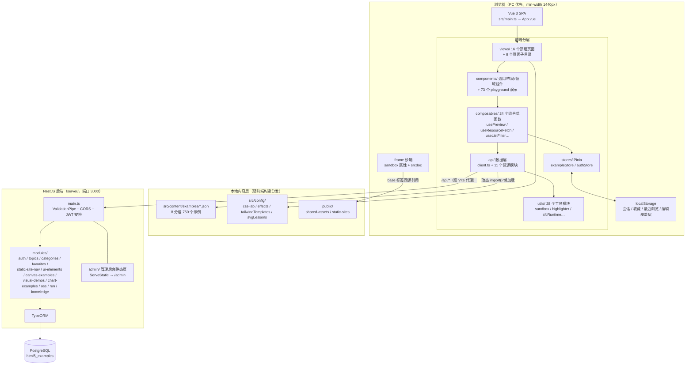
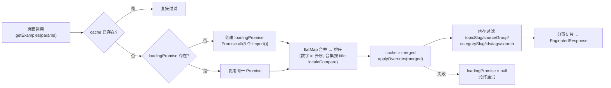

# 01 系统架构
> 项目：html5-examples ｜ 版本：v1.0 ｜ 生成日期：2026-10-06 ｜ 依据：源码分析

---

## 1. 整体架构

项目是「**Vue 3 SPA 前端 + NestJS 轻后端 + PostgreSQL**」的三层形态，但前后端耦合度已被刻意降到很低：**示例正文内化为前端本地 JSON，前端构建产物可以脱离后端纯静态部署**；后端只承担认证、收藏、目录、以及若干独立板块的数据服务。开发者通过 Vite 代理（`vite.config.ts` 中 `server.proxy['/api'] → http://localhost:3000`）消除开发期跨域。

### 1.1 架构总图



### 1.2 前端内部分层

| 层 | 目录 | 职责 | 关键约束 |
|----|------|------|---------|
| 页面层 | `src/views/` | 路由级页面，编排下层组件 | 全部经 `() => import()` 懒加载（`src/router/index.ts`） |
| 组件层 | `src/components/` | 展示与交互；`examples/demos/` 收纳 73 个独立演示子应用 | `<script setup lang="ts">`、Props/Emits 类型声明（AGENTS.md 6.3） |
| 组合层 | `src/composables/` | 可复用无界面逻辑：预览、筛选、分页、收藏、主题、toast | 命名 `useXxx`；含 3 个带 .test.ts 的可测模块 |
| 状态层 | `src/stores/` | 仅 2 个全局 store（Options 风格，ADR-2） | 页面级筛选状态不进 store，放 URL query |
| 数据层 | `src/api/` | 后端 HTTP 封装 + 本地 JSON 资源加载，对上暴露同构签名 | `client.ts` 统一超时/重试/401 处理 |
| 工具层 | `src/utils/` | 沙箱、高亮、SFC 运行时、日期、下载等纯函数 | 无 Vue 依赖（除 sfcRuntime 特例） |

依赖方向自上而下单向流动；`types/` 与 `config/` 是被所有层引用的横切模块。

这套分层的实际约束力来自三处机制而非口头约定。第一，路由的懒加载写法天然隔离了页面层——页面组件只经 `() => import()` 被路由引用，别的层不可能反向 import 一个页面；第二，`src/api/` 是数据访问的唯一出口，页面里找不到裸的 `fetch` 调用，所有 HTTP 细节（超时、重试、鉴权头）都被 `client.ts` 收拢，这意味着排查网络问题永远只需要看一处；第三，`types/` 的全局类型集中声明让跨层契约可被编译器验证，配合 `tsconfig.json` 的 strict 与 `noUnusedLocals`，类型即文档。违反分层的代码即使侥幸能跑，也很难通过 `vue-tsc` 的全量检查——这是项目用工具链固化架构纪律的典型做法。

另一个值得注意的规模事实是：前端源码里"配置与内容"的体量远超"逻辑代码"。仅 `src/content/examples/` 就有约 8.3MB 的 JSON，`src/config/css-lab/catalog.ts` 单文件 588 行，effects 四板块数据文件也以千行计。这不是坏味道，而是本项目的领域特性——它是一个内容平台，内容以版本化的结构化数据形态存在，代码的价值在于提供稳定、高性能的渲染与交互框架。

---

## 2. 示例注册与加载机制

这是本项目最核心的架构机制。项目里"示例"有四种注册形态，加载方式各不相同：

### 2.1 四种示例形态

| 形态 | 注册处 | 加载机制 | 渲染机制 |
|------|--------|---------|---------|
| **JSON 示例**（750 个，历史基线 1057） | `src/content/examples/*.json`（8 个分组文件） | `src/api/examples.ts` 的 `groupLoaders` 表：8 个动态 `import()`，Promise.all 并发加载，模块级 `cache` + `loadingPromise` 双重幂等，失败清空 `loadingPromise` 允许重试 | `buildSrcDoc()` 拼 HTML → iframe `srcdoc` |
| **SFC 演示**（73 个） | `src/components/examples/demos/` 目录 | `PlaygroundPage.vue` 中逐个 `defineAsyncComponent(() => import(...))` | 直接作为 Vue 组件渲染在页面内（非 iframe） |
| **生成器/工作台**（63+3+1） | `src/config/css-lab/catalog.ts`（`cssTools: ToolItem[]`，588 行）+ `src/views/css-lab/css/generators/` | 路由 `css/gen-:kind` 动态段 → `CssGeneratorRouter.vue` 按 kind 再动态 import 具体生成器 | Vue 组件渲染，产出代码走 CodeSlidePanel 展示 |
| **动效/模板/SVG 课程数据** | `src/config/effects/*.ts`、`tailwindTemplates.ts`、`svgLessons*.ts` | 静态 import 打入路由 chunk | 混合：卡片网格 + iframe/组件演示 |

### 2.2 本地 JSON 加载器设计（`src/api/examples.ts`）



设计要点（源码级）：

1. **接口签名向后兼容**：`getExamples` 返回 `{ data, pagination: { total, page, limit, totalPages } }`，与原 NestJS 后端分页结构一致，页面消费方零改动（文件头注释明示此迁移决策）。
2. **过滤在前端内存完成**：topicSlug / sourceGroup / categorySlug / sourceFilePrefix / ids / tags / search 七个维度全部 `Array.filter`；search 对 title 与 description 做 `toLowerCase().includes` 匹配。
3. **localStorage 覆盖层**：`OVERRIDE_KEY = 'examples-overrides-v1'`，`updateExample()` 只允许覆盖 `html/css/js` 三个内容字段并持久化；`loadAll()` 完成后 `applyOverrides()` 把覆盖合并进内存——**用"本地编辑"语义替代了原来的 DB update**，这是详情页 SourcePane「保存」按钮的数据通路。
4. **404 语义保留**：`getExampleById` 找不到时抛 `new ApiError(404, 'Not Found', '/api/examples/:id', { message: '示例不存在或已被移除' })`，让 `ExampleDetailPage.vue` 的 404 分支无感切换。

### 2.3 路由级注册（发现机制）

示例的"发现"由三层配置协同完成：

- **路由表** `src/router/index.ts`：静态声明 25+ 条路由 + 9 条兼容 redirect；`css-lab.ts` 子路由用 `css/gen-:kind` 动态段承接全部生成器，避免 63 条重复路由。
- **侧边栏目录**：`ExamplesLibrarySidebar.vue` 消费 `exampleStore` 的主题/分类与 `/api/categories/subcategories/:sourceGroup` 的真实二级分类；`CategoryLayout.vue` 从路径推导 CSS 实验室分类。
- **静态目录清单**：`src/config/css-lab/catalog.ts`（`cssTools` 数组 + `cssToolSubgroups` 8 子分类）与 `src/config/effects/index.ts`（`ALL_EFFECTS` 聚合四板块），是卡片网格与搜索索引的数据源。路由 path 由 `src/config/css-lab/routes.ts` 的 `TOOL_ROUTE_PATHS`/`toolPath()` 派生，防多处硬编码漂移。

---

## 3. server 轻后端职责

### 3.1 模块清单与职责

`server/src/app.module.ts` 注册了 18 个业务模块，全局挂 `JwtAuthGuard`（`APP_GUARD`，配合 `@Public()` 装饰器放行公开接口，见 `modules/auth/decorators/public.decorator.ts`）：

| 模块 | 职责 | 前端是否仍消费 |
|------|------|--------------|
| auth | 注册/登录/手机号登录/刷新令牌/captcha/me/logout，bcryptjs + Passport JWT + 刷新令牌实体 | 是（`src/api/auth.ts`） |
| topics / categories | 主题与分类目录 CRUD + `grouped`/`subcategories/:sourceGroup` 聚合 | 是（exampleStore 启动加载） |
| favorites | 按用户的示例收藏 | 是（`src/api/favorites.ts`） |
| static-site-nav | 静态网站模板元数据（`/tailwind/sites` 板块） | 是 |
| ui-elements | UI 片段模板 + 分类 | 是 |
| canvas-examples | 9 个图形库的示例元数据 | 是（`src/api/canvas-examples.ts`） |
| visual-demos / chart-examples | 历史板块（内容已拆至 html5-dataviz / html5-games） | 半冻结：chart-examples 前端 API 文件已删；visual-demos 仅存单条详情深链 `getVisualDemoById`（`src/api/visual-demos.ts`，见《13》第 2 条） |
| oss | 阿里云 OSS（ali-oss 依赖）上传 | 否（已核实 2026-10-06：SPA 前端、三姊妹项目与 `/admin` 静态页均无调用，见《13》第 2 条） |
| run | 代码/SQL 在线执行（`POST api/run/code/execute` 等，admin-token 守卫） | 否（已核实同上；注释所称 devtools 调用方在四项目现源码中均不存在，残余不确定仅"未开源分支"） |
| knowledge | 知识库全家桶：知识库/文档/版本/分享/最近浏览/收藏/评论/通知/片段集合/片段/标签/版本/画板（15 个实体） | 否（已核实 2026-10-06：SPA 前端、三姊妹项目与 `/admin` 静态页均无调用，见《13》第 2 条） |
| examples | 原示例 CRUD | SPA 前端**否**（已切本地 JSON）；但 `/admin` 后台静态页（`server/admin/js/examples.js`）仍在消费 `/api/examples`（已核实，见《13》第 2 条） |

### 3.2 启动与安全基线（`server/src/main.ts`）

1. 全局 `ValidationPipe`：`whitelist + forbidNonWhitelisted + transform`——未声明字段直接报错，DTO 即契约。
2. CORS：`CORS_ORIGIN` 环境变量逗号分隔白名单，默认 `localhost:5555/5560`，`credentials: true` 支持 cookie。
3. **JWT Secret 安检**：启动时检查 `JWT_SECRET`，命中弱密钥字典（`your-jwt-secret-key-change-in-production` 等）或 `<` 开头模板占位符时，生产环境直接拒绝启动，开发环境告警。
4. 生产环境缺 `DB_PASSWORD` 拒绝启动。
5. `createDefaultAdmin()`：启动时确保存在默认管理员（供 `/admin` 后台使用）。

### 3.4 模块的生命周期观：新旧并存与清理债

读 `app.module.ts` 的 import 列表时会发现一个现象：有的模块（auth、topics、favorites）被前端重度消费，有的模块（examples、chart-examples、knowledge，以及仅剩单条深链的 visual-demos）SPA 前端已经不再调用甚至没有对应的 `src/api/*.ts` 文件，但它们仍然被注册、实体仍然在 entities 数组里。这是项目"功能先行拆分、后端滞后清理"节奏的自然结果——内容拆到 html5-dataviz / html5-games 时，前端 API 封装随路由一起删掉了，后端模块因为没有部署风险而被暂时留下。

对维护者来说，正确的态度是：**把后端残留模块视为"冻结资产"而不是"活跃功能"**。不要往这些模块里加新功能，也不要在排期紧张时顺手删除它们——删除前必须确认 `/admin` 管理后台（`server/admin/`）没有依赖这些接口（静态 grep 已完成：`/admin` 仅消费 `/api/topics`、`/api/categories`、`/api/examples` 三者，见《13》第 2 条）。条件允许时，清理工作应与一次专门的"后端瘦身"任务绑定：删除模块、移除实体登记、生成 DROP 迁移，三步一次完成，并配合 `DB_SYNC=false` 环境验证。

### 3.5 数据库与迁移

TypeORM 实体 28 项（`app.module.ts` entities 数组，27 个实体文件——`board-library.entity.ts` 含 2 个实体类），`synchronize` 由 `DB_SYNC=true` 显式开启（建议仅开发用），正式结构变更走 `server/src/migrations/` 的 11 个迁移文件（从 `1718000000000-InitialSchema` 到 `1786000000000-AddPublicSnippetSupport`），经 `pnpm migration:generate/run/revert` 管理（`server/data-source.ts`，注意其 entities 数组仅 26 项、缺 `CanvasExample` 与 `SnippetVersion`，见《13》第 5 条）。迁移文件名以时间戳开头保证顺序性，从命名可以看出结构演进的几个关键节点：初始建表、收藏能力加入（1750730000000-AddFavorites）、静态站点表建立、UI 组件代码列的拆分与删除、知识库全家桶建表（1784910872223）以及公共片段支持。新接手时若数据库结构与实体有出入，第一反应应是检查迁移是否执行到位，而不是怀疑实体定义。

---

## 4. 数据流向图

```mermaid
flowchart TD
    subgraph 启动
        M1["main.ts<br/>createApp + Pinia + Router + XiaoyeUI"] --> M2["App.vue onMounted"]
        M2 --> M3["authStore.initialize()<br/>localStorage 会话 → /auth/me 校验<br/>注册 tokenProvider / 401 处理器"]
        M2 --> M4["exampleStore.loadTopicsAndCategories()<br/>Promise.all(GET /topics, GET /categories)"]
    end

    subgraph 浏览示例
        U1["用户打开 /examples"] --> U2["ExamplesLibraryPage<br/>useListFilter(300ms 防抖) + usePagination"]
        U2 --> U3["getExamples(params)<br/>api/examples.ts"]
        U3 --> U4["动态 import 8 个分组 JSON<br/>(首次) 或读内存 cache"]
        U4 --> U5["内存过滤 + 分页"]
        U5 --> U6["ExampleCard 网格<br/>VirtualExampleGrid"]
    end

    subgraph 查看与编辑
        V1["/example/:id"] --> V2["getExampleById<br/>useResourceFetch 竞态保护"]
        V2 --> V3["PreviewPane<br/>buildSrcDoc() → iframe srcdoc"]
        V2 --> V4["SourcePane<br/>Monaco + Shiki"]
        V4 -->|"编辑"| V3
        V4 -->|"保存"| V5["localStorage<br/>examples-overrides-v1"]
    end

    subgraph 用户行为（走后端）
        A1["登录 /login"] --> A2["POST /api/auth/login<br/>accessToken+refreshToken"]
        A2 --> A3["authStore.applyAuthResult<br/>持久化 + 调度提前 5min 刷新"]
        A4["收藏"] --> A5["POST/DELETE /api/favorites<br/>Bearer token"]
        A6["最近浏览"] --> A7["useRecentExamples<br/>纯 localStorage，不走后端"]
    end

    M4 --> U2
    U6 --> V1
    V2 --> A7
```

---

## 5. 关键设计决策与设计模式

以下决策来自源码实证与 `AGENTS.md` 第 10 节 ADR 的交叉验证：

| # | 决策 | 实现位置 | 动机 |
|---|------|---------|------|
| ADR-1 | Topic → Category → Example 三级数据结构 | `src/types/index.ts`、`server/src/modules/*/entities/` | 内容组织与侧边栏下钻 |
| ADR-2 | Pinia **Options Store**（禁 Setup Store） | `src/stores/exampleStore.ts` | 团队风格统一 |
| ADR-3 | 全路由懒加载 | `src/router/index.ts` 所有 `component` | 750 示例（历史基线 1057）+ 73 演示必须按需加载 |
| ADR-4 | iframe `srcdoc` 预览 | `src/utils/sandbox.ts` `buildSrcDoc()` | 示例隔离、可独立运行 |
| ADR-5 | Shiki 单例高亮器 | `src/utils/highlighter.ts`（`highlighterInstance` + `loadingPromise`） | 避免重复初始化；14 语言内联注册控体积 |
| ADR-6 | 搜索 300ms 防抖 | `src/composables/useListFilter.ts` | 输入不逐键触发过滤 |
| ADR-7 | 页面过渡 fade+translateY | `App.vue` `page-fade`（250ms） | 与 `router.scrollBehavior` 的 rAF 等待配套 |
| ADR-8 | 固定头部 64px | `App.vue`（`padding-top: var(--header-height)`） | 全站统一外壳 |

**新识别的模式**（AGENTS.md ADR 之外，源码中沉淀的架构惯例）：

1. **单例 + 双重检查锁的异步资源加载**：`api/examples.ts`（8 分组 JSON）与 `utils/highlighter.ts`（Shiki）使用同一套 `cache + loadingPromise` 手法——并发首次调用共享同一个 Promise，失败清空允许重试。
2. **last-request-wins 竞态保护**：`composables/useResourceFetch.ts` 用 `requestId` 递增 + `AbortController` 取消前序请求，配合 `client.ts` 的 `linkSignals()`（兼容 `AbortSignal.any` 降级实现），保证路由参数快速切换时只有最新结果落状态。
3. **依赖注入式 HTTP 客户端**：`api/client.ts` 通过 `setAuthTokenProvider()` / `setAuthFailureHandler()` 两个注入点解耦 authStore 与 fetch 封装——client 不 import store（避免循环依赖），store 在 `initialize()` 时反向注册。
4. **URL 即状态**：`/examples` 页的 search/topicSlug/sourceGroup/categorySlug/page 全部镜像到 URL query（`useListFilter` 的 `urlKeys` + 手动 `replaceState`），刷新/分享不丢状态；`route.query` watcher 单向响应外部导航避免回环（`ExamplesLibraryPage.vue` 88-110 行注释专门解释了这一点）。
5. **KeepAlive 白名单**：路由 `meta.keepAliveComponent` 声明式登记，`App.vue` 的 `computed keepAliveInclude` 动态收集——新增缓存页只改路由 meta 一处。
6. **数据本地化（2026-10-05）**：示例正文从 PostgreSQL 迁出到 git 管理的 JSON，"内容编辑走 git 工作流"，数据库只留用户行为数据——显著降低了部署依赖（静态托管即可展示全部示例）。
7. **路由自愈**：`router.onError` 捕获 `Loading chunk|Failed to fetch dynamically imported module` 后整页 reload（标志位防重复），应对发版后旧 chunk 404。
8. **构建期分治**：`vite.config.ts` `manualChunks` 19 条规则按"每个示例只引入自己的库"拆 vendor；`hoistTransitiveImports: false` 防跨 chunk 循环 TDZ；`resolve.dedupe: ['gsap']` 强制单一 gsap core 实例（注释记录了 MotionPathPlugin 跨实例污染的事故根因）。

这些决策放在一起看，能读出一条贯穿始终的设计哲学：**用不可变的机制代替可被绕过的约定**。防抖不靠开发者自觉而是封装进 `useListFilter`；竞态保护不靠调用方小心而是内建在 `useResourceFetch`；错误跳转不靠各页面处理而是全局 401 处理器；代码分割不靠手工 import 魔法而是 manualChunks 声明。新成员写代码时"想犯错都难"，这正是架构成熟度的体现。反过来，这也意味着修改这些基础 composable 与构建配置时的改动半径远超表面代码行数——AGENTS.md 第 9 节把它们列为"需谨慎操作（需确认）"的深层次原因就在于此。

---

## 6. iframe 沙箱安全模型

`src/utils/sandbox.ts` 是安全架构的关键文件，三个函数构成完整模型：

- `buildSrcDoc(example, snippet?)`：拼接 `<!DOCTYPE html>` 完整文档——统一 reset CSS + `example-stage` 舞台容器（仅 html5 主题，补齐被清洗掉的 body 居中样式）+ 示例 CSS + 转义后的 JS（`</script` 替换为 `<\/script` 防提前闭合；`deduplicateRepeatedJs()` 修复导入数据重复拼接导致的顶级重复声明）。`snippet` 的 css/js 追加合并、html 整体覆盖，支撑详情页「变体」切换。
- `needsSameOrigin(example)`：正则探测示例是否引用 `/shared-assets/`、`/static-sites/` 等同源资源，决定是否追加 `allow-same-origin`。
- `getSandboxAttributes(includeSameOrigin)`：默认 `['allow-scripts','allow-forms','allow-modals','allow-popups']`。源码注释坦承 `allow-scripts + allow-same-origin` 组合存在理论上的沙箱逃逸风险，并给出三条加固路线（CSP meta、独立子域、postMessage），当前以"示例代码半可信 + 入库校验"为缓解策略。

`usePreview.ts` 补齐运行面：设备视口（desktop 100%/tablet 768×1024/mobile 375×667）、`refreshKey` 自增强制 srcdoc 重算实现刷新、Blob URL 新窗口打开（60 秒后自动 revoke，`onUnmounted` 兜底清理）。

---

## 7. 浏览器端 SFC 运行时（特殊能力）

`src/utils/sfcRuntime.ts`（538 行）让**用户在浏览器里编写并运行 Vue SFC**：`@vue/compiler-sfc` 被单独拆为 `sfc-compiler` chunk（`vite.config.ts` manualChunks A2 规则），仅在该功能被触发时下载；`main.ts` 里的 `initSfcComponentRegistry(app)` 把全局组件表（`xy-*`、`v-chart`）同步给运行时，使动态编译的 SFC 能解析项目全局组件。相关工具链还包括 `sfc-modules.ts`、`sfc-typescript.ts`（浏览器内 TS 转译）与 `scripts/check-one-sfc.ts` 等校验脚本。

---

## 8. 架构权衡与已知风险

没有免费的架构。以下权衡是源码分析中识别出的、接手者应当心中有数的取舍：

**性能换隔离**。iframe srcdoc 让每个示例成为独立文档，隔离性最好，但代价是每个预览都是一个完整页面实例——大量卡片同时渲染预览时内存开销显著。项目用"卡片网格不放 iframe、进详情页才渲染"的交互设计规避了这一点；卡片位置实际落地的正是快照方案——`ExampleCodeSnapshot.vue` 用 Shiki 渲染源码前 12 行 + 渐隐 mask（该疑点已在《13-技术债务》第 4 条落定为"代码快照"，现状无债务）。

**同源便利换沙箱强度**。`allow-scripts + allow-same-origin` 组合保留了 `<base>` 加载共享资源的能力，但如 `sandbox.ts` 注释所言存在理论逃逸路径。当前威胁模型建立在"示例代码半可信"之上；一旦未来引入用户提交示例的功能，必须先落地 CSP meta 或独立子域方案。

**构建速度换加载粒度**。上千个动态 chunk 让首屏极轻，但让全量构建缓慢（8GB 堆内存即为此设）。项目曾尝试用 `experimentalMinChunkSize` 合并小 chunk，因 O(n²) 复杂度被迫放弃，这条教训写在 `vite.config.ts` 注释里，任何"优化构建"的冲动都应先读它。

**内容本地化换协作模式**。示例迁到 git JSON 后，部署依赖大幅降低、内容变更可评审可回滚，但失去了数据库的运行时管理能力——内容更新必须走完整构建发布，无法通过后台即时生效。`server/examples` 模块与管理后台因此成为"半退休"状态。若业务重新要求内容运营能力，恢复路径是现成的（后端模块仍在，接口契约在 03 篇有全表）。

**单文件路由表换可发现性**。`src/router/index.ts` 集中了全站路由与兼容重定向，配合 `css-lab.ts` 子模块，优点是一处纵览全局、旧链路治理清晰；缺点是文件会持续膨胀。新增路由时应优先挂到子路由模块（如 css-lab 的做法），避免主表无限增长。

---

*本篇完。下一篇：[02-页面设计.md](./02-页面设计.md)*
