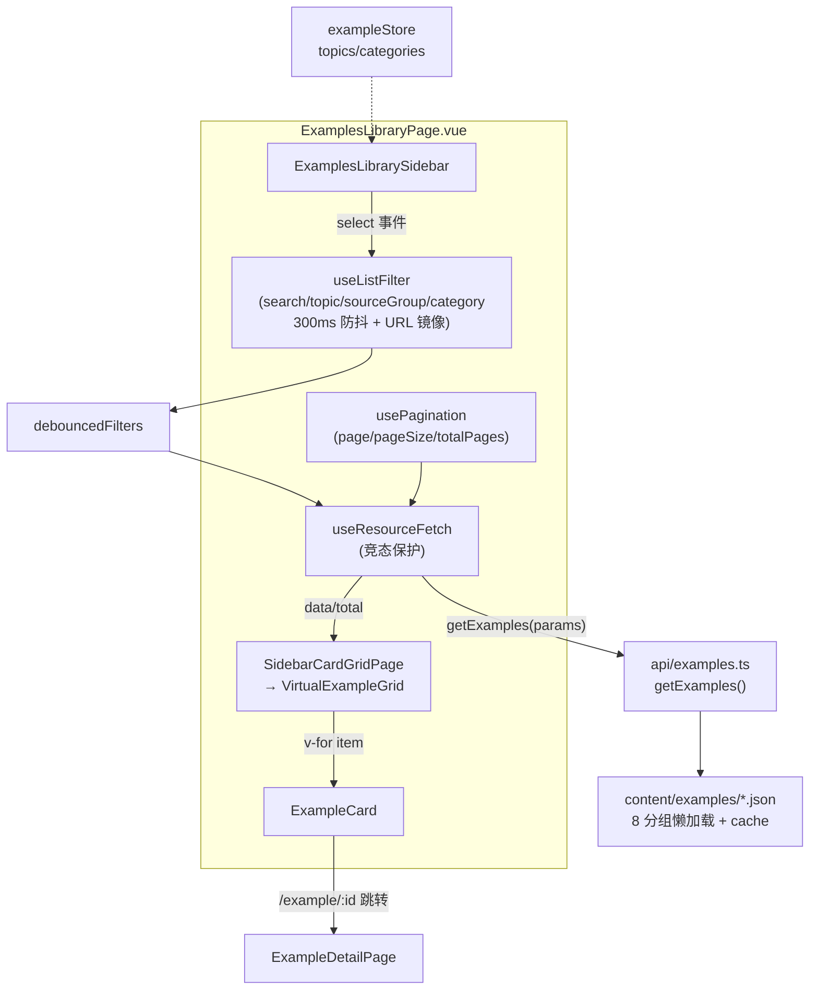
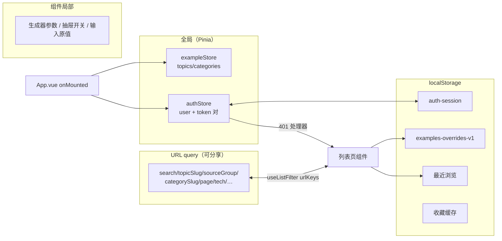
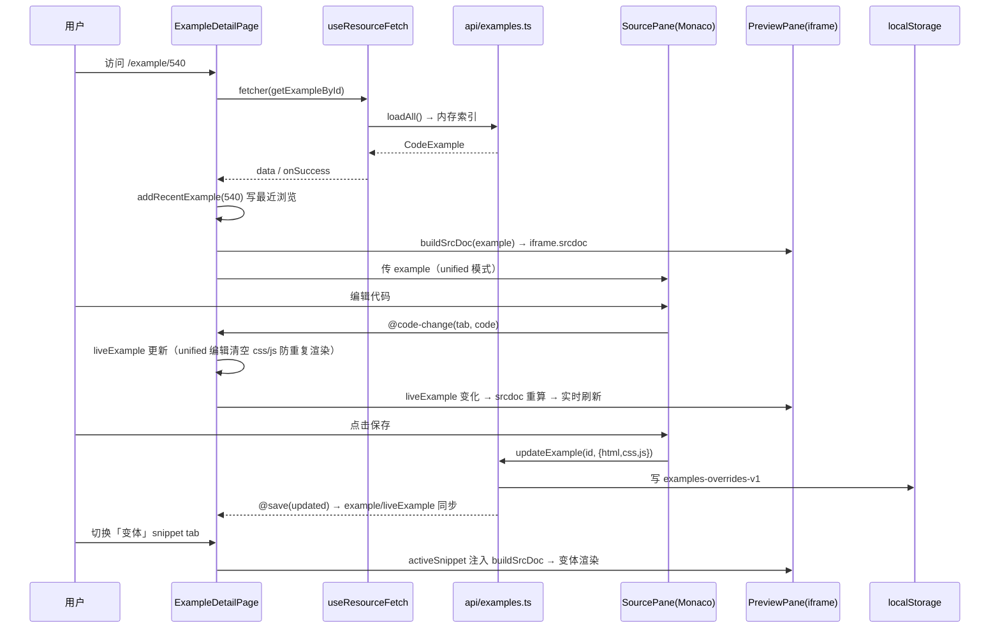
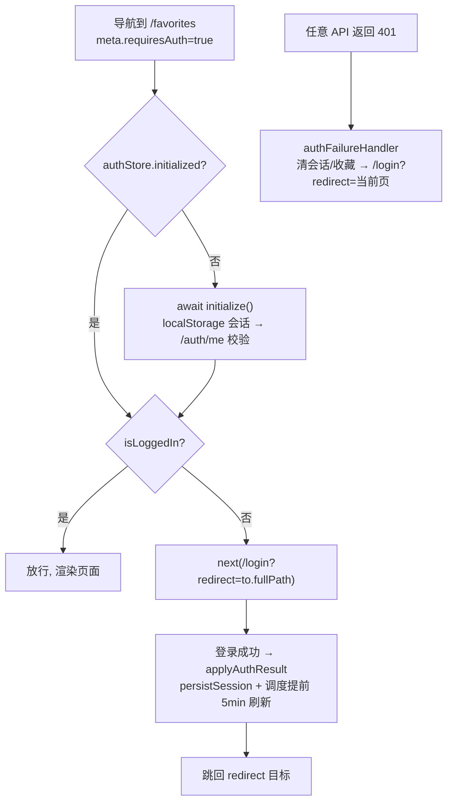
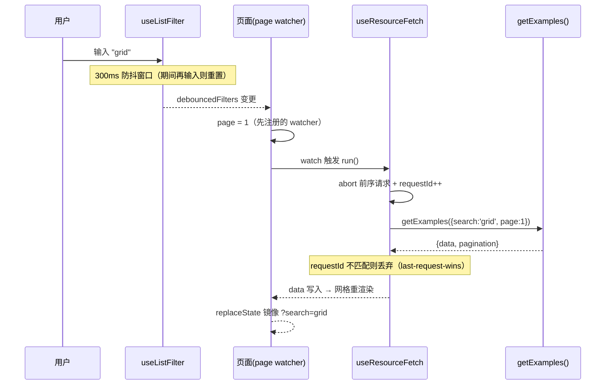

# 02 页面设计
> 项目：html5-examples ｜ 版本：v1.0 ｜ 生成日期：2026-10-06 ｜ 依据：源码分析

---

## 1. 路由与页面总表

全部路由定义集中在 `src/router/index.ts`（218 行）与 `src/router/routes/css-lab.ts`，所有页面组件懒加载，`meta.title` 驱动 `document.title`（格式 `{title} - DevCanvas`）。

### 1.1 核心页面

| 路径 | 路由名 | 页面组件（src/views/） | 说明 |
|------|--------|----------------------|------|
| `/` | TopicHub | `TopicHubPage.vue` | 主题广场首页：Hero + 统计 + 主题卡网格 |
| `/examples` | ExamplesLibrary | `ExamplesLibraryPage.vue`（156 行） | 示例库：侧边栏 + 卡片网格 + 分页；`meta.keepAliveComponent` 缓存；`beforeEnter` 把旧 `?demo=` 深链送往 `/playground` |
| `/playground` | Playground | `PlaygroundPage.vue`（469 行） | 独立演示：73 个 SFC 演示的选择器 + 舞台 |
| `/example/:id` | ExampleDetail | `ExampleDetailPage.vue`（278 行） | 示例详情：预览/源码左右分屏（`props: true`） |
| `/effects` | EffectsLibrary | `EffectsLibraryPage.vue` | 动效库：四技术板块（Animate.css/悬停/Motion Path/GSAP）合一 |
| `/ui-elements` | UiElements | `UiElementListPage.vue` | UI 组件列表 |
| `/ui-element/:id` | UiElementDetail | `UiElementDetailPage.vue` | UI 组件详情 |
| `/canvas/:library` | CanvasExamples | `CanvasExamplesPage.vue` | Canvas 示例库（9 库共用一页，`/canvas` redirect 到 `vanilla-canvas`） |
| `/svg` | SvgLessons | `SvgLessonsPage.vue` | SVG 互动课程 |
| `/tailwind/:category` | TailwindExamples | `TailwindExamplesPage.vue` | Tailwind 模板（components/sections/pages/dashboards/navsites + sites） |
| `/visual-demo/:id` | VisualDemoDetail | `VisualDemoDetailPage.vue` | 演示详情（SVG 课程与历史 visual-demo 深链共用） |
| `/login` | Login | `LoginPage.vue` | 登录页（支持 `?redirect=` 回跳） |
| `/profile` | UserProfile | `UserProfilePage.vue` | 个人中心（`meta.requiresAuth`） |
| `/favorites` | Favorites | `FavoritesPage.vue` | 我的收藏（`requiresAuth`） |
| `/recent` | RecentBrowsing | `RecentBrowsingPage.vue` | 最近浏览（`requiresAuth`） |
| `/:pathMatch(.*)*` | NotFound | `NotFoundPage.vue` | 404（Glitch 文字 + 光晕背景） |

把这张表读薄一点：全站页面其实只有五种"性格"。其一是**广场型**（首页），任务是发散——把用户送往各个板块；其二是**列表型**（示例库、独立演示、UI 组件、Tailwind、动效库、Canvas、SVG），任务收敛——用侧栏、搜索、分页帮助用户从几百上千个条目里找到目标，它们几乎全部长着同一副骨架；其三是**详情型**（示例详情、UI 组件详情、演示详情），任务是沉浸——预览与源码占满视口，导航退居面包屑；其四是**工作台型**（CSS 实验室的三个工作台与生成器），任务是操作——参数区、预览区、代码区的三区范式；其五是**账户型**（登录、收藏、最近浏览、个人中心），任务是管理——围绕用户态的轻量表单与列表。理解了这五种性格，新页面的设计工作就退化为"选性格、套骨架、填内容"。

路由层面还有两个贯穿性细节值得留意。一是 `meta.keepAliveComponent` 声明式缓存：列表型页面在路由间往返时保留滚动位置与筛选状态（示例库、独立演示、UI 组件、动效库四处已启用），详情页则不缓存保证数据新鲜——是否启用缓存取决于页面是"浏览入口"还是"终态内容"。二是全部兼容重定向都写在路由表内而非服务端配置里，这让深链治理可以随前端发版独立演进，不依赖运维配合。

### 1.2 CSS 实验室子路由（`src/router/routes/css-lab.ts`）

父路由 `/css-lab` 挂 `components/css-lab/CategoryLayout.vue` 布局（从路径推导侧边栏分类），子路由：

| 路径 | 组件 | 说明 |
|------|------|------|
| `/css-lab`（''） | `views/css-lab/CssLabHomePage.vue` | Bento Hub 首页（Hero + 工作台大卡 + 子分类 Bento + 速查表通栏 + 随机探索） |
| `css` | — | redirect 到 `/css-lab`（唯一分类不再有中间页） |
| `css/cheatsheet` | `css/CheatsheetPage.vue` | CSS 属性速查表 |
| `css/gen-flex-layout` | `css/FlexboxPage.vue` | Flex 布局工作台（`meta.noSidebar: true` 全宽） |
| `css/gen-grid-layout` | `css/GridPage.vue` | Grid 布局工作台（`noSidebar: true`） |
| `css/gen-gradient-bg` | `css/GradientPage.vue` | 渐变背景工作台 |
| `css/gen-:kind` | `css/CssGeneratorRouter.vue` | 63 个具体生成器共用的动态路由（按 `:kind` 二次分发） |

另有 14 条历史 redirect：`css/flexbox → css/gen-flex-layout` 等 11 条旧分类路径 + `gen-radial-gradient → gen-gradient-bg` 等 3 条合并生成器路径；`/tools/:pathMatch(.*)*` 通配整体迁到 `/css-lab/*`（保留 query/hash）。

### 1.3 兼容重定向（旧深链保全）

| 旧路径 | 去向 | 实现方式 |
|--------|------|---------|
| `/topic/:slug` | `/examples?topicSlug=…` | `redirect:` 函数（`router/index.ts` 48-54 行） |
| `/topic/:t/category/:c` | `/examples?topicSlug=&categorySlug=` | 同上 |
| `/mdn-examples` | `/examples?topicSlug=css&sourceGroup=css-basics` | MDN 主题 2026-06 并入 CSS 主题 |
| `/animate-css` `/hover-effects` `/motion-path` `/gsap` | `/effects?tech=…` | 动效四板块合并（Phase 3） |
| `/static-sites` | `/tailwind/sites` | 板块并入 Tailwind 模板 |
| `/examples?demo=x` | `/playground?demo=x` | `beforeEnter` 守卫（`router/index.ts` 18-21 行） |
| `/tools/*` | `/css-lab/*` | 通配 redirect（`css-lab.ts` 75-86 行） |

---

## 2. 通用布局与交互范式

项目把页面归纳为少数几个"页型"，用可复用布局组件承载，保证全站一致性：

### 2.1 范式一：SidebarCardGridPage（侧栏 + 卡片网格页）

`components/layout/SidebarCardGridPage.vue` 是最高频的页型骨架，被 `ExamplesLibraryPage`、`EffectsLibraryPage`、`CanvasExamplesPage`、`TailwindExamplesPage`、`UiElementListPage` 等页面复用。它以插槽契约组织页面：

- `#sidebar` 插槽：注入各板块专属侧边栏（`ExamplesLibrarySidebar`、`EffectsLibrarySidebar`、`SidebarMenu` 等）；
- props：`title/description/items/loading/error/total/page/pageSize/totalPages/search-value/grid-min-column-width`；
- 事件：`update:search-value`、`update:page`、`retry`。

该组件统一处理**加载骨架 / 错误重试 / 空态 / 分页器 / 搜索框 / 卡片网格**六态，页面组件只负责"取数 + 筛选"。配套的 `examples/VirtualExampleGrid.vue` 提供虚拟滚动网格，`layout/Pagination.vue`、`layout/EmptyState.vue`（loading/error/not-found/empty 四型）为原子件。

六态设计是本项目页面健壮性的来源，值得单独展开。加载态不使用转圈 spinner 而使用骨架占位（`components/skeleton/`），配合 KeepAlive 让二次进入瞬时呈现；错误态统一携带"重试"按钮，事件一路冒泡回页面的 `useResourceFetch.refresh()`，用户不需要刷新整页；空态区分"搜索无结果"与"分类为空"两种文案（`EmptyState` 的 `title/description-html` props），并给出 `ms:inbox`、`ms:explore` 等语义化图标。这些状态对页面开发者的暴露方式极其简单——`SidebarCardGridPage` 的 props 里传 `loading/error/total` 即可，六态切换全自动。新增列表型页面时，只要坚持走这套布局，就自动继承了全部健壮性；反过来，如果绕开它手搓页面，就要自行补齐六态，这是不鼓励的。

### 2.2 范式二：URL 即状态的筛选交互

以 `ExamplesLibraryPage.vue` 为标本（156 行，全部逻辑在 `<script setup>`）：

1. `useListFilter<LibraryFilters>({ initial, urlKeys })` 管理 `search/topicSlug/sourceGroup/categorySlug` 四个筛选字段并输出 `debouncedFilters`（300ms 防抖，ADR-6）；
2. `watch(debouncedFilters) → page=1`（先注册，保证一次筛选变更只发一次带 `page=1` 的请求）；
3. `useResourceFetch` 包裹 `getExamples()`，`watch: () => [debouncedFilters.value, page.value]` 自动重取；
4. 页内翻页/筛选走 `window.history.replaceState`（不触发路由跳转）；外部导航（首页主题卡、`/topic` redirect）由 `watch(() => route.query)` 单向同步进 filters——源码注释明确解释了"页内筛选不经过 router，因此不会触发本 watcher，无回环"。

### 2.3 范式三：详情页 50/50 分屏

`ExampleDetailPage.vue` 的 `.main-split` 是 `grid-template-columns: 1fr 1fr` 双栏：左 `PreviewPane`（预览 + 设备切换 + 全屏），右 `SourcePane`（源码 Tab + 编辑 + 保存）。页面高度 `calc(100vh - var(--header-height))` 锁定视口，不出现整页滚动。键盘快捷键：非输入态按 `F` 触发 `previewPaneRef.toggleFullscreen()`（`utils/keyboard.ts` 的 `isTypingTarget` 守卫）。

### 2.4 范式四：CSS 实验室的四区工作台

生成器工作台（`views/css-lab/css/generators/BaseGenerator.vue` 及 63 个子类）遵循"**配置区 → 预览区 → 代码区**"三区范式，配合 `components/css-lab/CodeSlidePanel.vue` 抽屉式代码浮层。共享类型 `generatorTypes.ts` 定义 `GeneratorSection/GeneratorParam/GeneratorPreset/CustomPreview`，参数控件只支持 `slider | color | select | text | number | toggle` 六种——新写一个生成器只需声明 sections/params 与样式计算函数，交互骨架由 `BaseGenerator` 提供。

### 2.5 范式五：全局外壳

`App.vue` 组织 `XyConfigProvider（xiaoye-ui 主题算法 + token 对齐项目 CSS 变量）→ AppHeader → ErrorBoundary → router-view`。要点：

- `<Transition name="page-fade">` + `<KeepAlive :include="keepAliveInclude">`：250ms 淡入位移过渡；离场页 `position: absolute` 防同屏跳动；KeepAlive 白名单由路由 `meta.keepAliveComponent` 动态收集。
- `useTheme.ts` 写 `.dark/.light` class 驱动 `main.css` 的 `--color-*-rgb` 变量；`App.vue` 同步切换 xiaoye-ui 的 `darkAlgorithm/defaultAlgorithm`。
- `router.scrollBehavior` 在 `savedPosition` 与"等待过渡完成后回顶部"间取舍（`requestAnimationFrame` 而非固定 setTimeout，与 250ms 过渡对齐）。
- 顶部导航数据来自 `composables/useHeaderNav.ts`：主题广场/示例库/独立演示/UI 组件/Tailwind/动效库六项平铺 + CSS 实验室、图形（SVG/Canvas）两个下拉 + 动态主题链接（过滤掉 `html5/css` 两主题，因它们已并入示例库侧边栏）。

全局外壳还有一处易被忽略的健壮性设计：`ErrorBoundary` 包在路由出口外层，任何页面渲染期的未捕获异常都会被它接住并展示兜底界面，而不是让整个应用白屏——这与 05 篇"异常路径速查"中"降级而非崩溃"的模式一脉相承。另外，`useHeaderNav` 的菜单选中态（`currentSelectedKey`）与菜单结构（`defaultNavItems`）被刻意拆成两个 computed，源码注释解释这是为了避免路由每次变化都全量重建菜单树——这类"把派生粒度想清楚再写"的细节，是读该文件时最值得带走的东西。

---

## 3. 代表示例按类别深拆

### 3.1 示例库（JSON 数据流示例）

以 id=540「Details/Summary 折叠面板」为例（`src/content/examples/html5-basics.json` 首条）：`language` 字段标注为 `css`，正文由 `html`（details/summary 折叠结构）+ `css`（面板样式）两段组成，`js: null`；`difficulty: 'beginner'`、`sourceGroup: 'html5-basics'`。渲染链路：`ExampleCard`（卡片悬浮态）→ `/example/540` → `buildSrcDoc()` 注入 `example-stage` 舞台容器（html5 主题专属，见 01 篇 §7）→ iframe 沙箱运行。

341 个示例的 `css-layout` 分组是最大分组，配合 `ExamplesLibrarySidebar` 的「主题 → sourceGroup → 子分类」三级下钻（`/api/categories/subcategories/:sourceGroup` 提供真实 category 分布）浏览。

### 3.2 独立演示（SFC 组件示例）

`PlaygroundPage.vue` 用 73 个 `defineAsyncComponent` 登记演示（WebWorker、Geolocation、SpeechReader、MusicPlayer、VideoPlayer、GithubProfile、MovieInfo、DadJokes、TodoList、Notes、Quiz、WaterTracker、Breathing、Pokemon、Lyrics、ScrollSnap…CanvasLab、ParticleLab、CryptoTool、IntlFormat 等），每个演示是 `components/examples/demos/<name>/<Name>Demo.vue` 目录。演示直接渲染在页面内（非 iframe），因此可访问路由上下文与全局组件；选择器 + 舞台的交互结构使新增演示 = 新建目录 + 一行 `defineAsyncComponent` + 一条菜单项。

### 3.3 CSS 实验室（生成器示例）

以 `ButtonGenerator.vue` 为代表：继承/组合 `BaseGenerator.vue`，声明若干 `GeneratorSection`（参数分组），每个 `GeneratorParam` 绑定 slider/color/select 控件，`computed` 拼 CSS 文本，`CodeSlidePanel` 展示可复制结果。三个独立工作台（FlexboxPage/GridPage/GradientPage）更复杂：`flexboxStore.ts`、`gridStore.ts` 是**页面级 Pinia store**（非全局），`gridConstants.ts/gridTypes.ts` 承载栅格领域模型，`components/AreaConfig.vue、AreaDisplay.vue、AreaCode.vue` 实现 Grid Area 可视化编辑三件套。

### 3.4 动效库（数据驱动示例）

`config/effects/index.ts` 是统一数据入口：`TECH_META`（4 技术：key/nameCn/desc/icon/color）+ `ALL_CATEGORIES` + `ALL_EFFECTS`（聚合四板块数组）+ `categoryById` 索引 + `totalEffects`。页面只消费该文件，不直接 import 板块数据（文件头注释明示）。四板块各配一个 Drawer 详情组件（`AnimateCssDrawer/HoverEffectDrawer/MotionDrawer/GsapEffectDrawer`），点击卡片抽屉展开运行演示。

### 3.5 页面级组件协作图

在进入组件图之前，先把"一个页面到底由几类零件组成"说透。以示例库页为例，它自身只有两件事要做：声明筛选状态结构（`LibraryFilters` 接口）和把取数函数交给 `useResourceFetch`；其余一切都是"租用"现成零件——筛选的防抖与 URL 镜像租自 `useListFilter`，分页算术租自 `usePagination`，请求的竞态保护租自 `useResourceFetch`，六态渲染租自 `SidebarCardGridPage`，导航目录租自 `ExamplesLibrarySidebar`，卡片租自 `ExampleCard`。页面组件更像"装配图纸"而不是"零件工厂"，这解释了为什么一个管理着 750 个示例的列表页只有 156 行。反过来，这也是阅读该项目的捷径：看懂一个页面用了哪些零件，比逐行读它的实现更能预测它的行为。

---

## 4. 状态管理设计

项目刻意把状态管理做得极轻——**只有 2 个全局 store，其余状态各归其位**：

### 4.1 全局状态（Pinia，Options 风格，ADR-2）

| Store | State | 关键 Action | 消费方 |
|-------|-------|-------------|--------|
| `exampleStore`（61 行） | `topics[]`、`categories[]`、`loading/loaded/error` | `loadTopicsAndCategories()`：Promise.all 拉目录，幂等（`loaded || loading` 短路） | AppHeader（导航）、TopicHub、ExamplesLibrarySidebar |
| `authStore`（255 行） | `user`、`accessToken/refreshToken/tokenExpiresAt`、`initialized` | `initialize()` / `applyAuthResult()` / `refreshAuth()` / `logout()` | 路由守卫、FavoriteButton、LoginPage、api/client |

`authStore` 的设计要点（源码级）：

- **会话持久化**：`SESSION_STORAGE_KEY = 'html5-examples-auth-session'`，`persistSession()/ensureHydrated()` 读写 localStorage，隐私模式静默降级内存会话。
- **提前刷新**：`REFRESH_AHEAD_SECONDS = 300`，`scheduleTokenRefresh()` 在过期前 5 分钟用 `refreshToken` 换新 token 对；刷新定时器是**模块级变量**而非 Pinia state（注释：避免非响应式数据进响应式系统）。
- **双通道认证**：有 token 走 `GET /auth/me`（Bearer）；无 token 回退 cookie 会话（`checkMe()`）。`client.ts` 请求时自动附 `Authorization` 头（`setAuthTokenProvider` 注入）。
- **401 联动**：`setAuthFailureHandler` 注册全局 401 处理——清会话、清收藏缓存、带 `?redirect=` 跳登录；403 不触发登出（会话仍有效）。
- **换号隔离**：`applyAuthResult`/`refreshAuth`/`logout` 三处都调 `clearFavorites()`，防止上一用户收藏残留。

### 4.2 URL 状态

列表页筛选 + 分页全部镜像 URL query（见 §2.2），这是"可分享的页面状态"。`/effects` 的 `tech/category/group`、`/tailwind/:category` 的分类路由同样遵循。

### 4.3 localStorage 状态

| 键 | 写入方 | 内容 |
|----|--------|------|
| `html5-examples-auth-session` | authStore | token 对 + 用户 |
| `examples-overrides-v1` | api/examples.ts `updateExample` | 示例内容编辑覆盖（html/css/js） |
| 最近浏览 | `useRecentExamples.ts`（`addRecentExample`） | 本地浏览历史（不依赖登录与后端） |
| 收藏缓存 | `useFavorites.ts` | 登录用户的收藏快照（换号即清） |

### 4.4 组件局部状态

筛选的"未防抖原值"、抽屉/弹窗开关、生成器参数等一律组件局部 `ref`；Grid/Flex 工作台用**页面级 store**（`gridStore.ts`/`flexboxStore.ts`，非全局注册）在配置区与代码区组件间共享参数模型。

### 4.5 状态流转全景

---

## 5. 关键 UI 交互流程

### 5.1 示例详情页：加载 → 预览 → 编辑 → 保存

### 5.2 认证守卫流程

### 5.3 列表页筛选 → 请求时序（防抖 + 竞态）

---

## 6. 设计系统落地要点

页面视觉的一致性由三层机制保证（详细规范见 `AGENTS.md` 6.8/6.9 节，此处仅列源码落点）：

1. **令牌单一数据源**：`src/assets/main.css`（CSS 变量 + Tailwind v4 `@theme`）与 `src/config/designTokens.ts`（TS 令牌）双轨同步；组件内禁止硬编码色值，统一 `rgb(var(--color-primary-rgb) / α)` 写法。
2. **图标强制 AppIcon**：Material Symbols 字体包本地打包（`main.ts` 引入 `material-symbols/outlined.css`），`components/common/AppIcon.vue` 统一渲染，禁止手写 `<svg>`。
3. **玻璃拟态原子类**：`.glass` / `.glass-strong` / `.hover-glow` 等全局类 + `GlassPanel` 组件；页面型谱（Topic Hub/Examples Hub/Detail/CSS Lab/Login/404 等 13 类）在 `AGENTS.md` 6.9.5 有 archetype 对照表。
4. **PC 优先**：`html/body` 锁 `min-width: 1440px`，禁止新增移动端断点与抽屉导航（`main.css` 与 AGENTS.md 6.8 规则 9）。

从维护者视角，这四条规则的含义可以这样转译：改主题色只应发生在一处（`main.css` 的变量定义），如果发现自己在组件里改了颜色才能让页面变对，说明组件里有硬编码违规，应该修组件而不是迁就它；加图标时先到 AppIcon 的 `ms:` 词表里找，找不到再考虑该图标是否真的必要，而不是引入第二个图标体系；新页面的第一行代码应该是"这个页面属于哪个 archetype"，确定后直接照着对照表挑组件拼装，写完再用 `main.css` 变量自查一遍有无色值逃逸。设计系统在项目中不是一个静态规范文件，而是由 lint 心智、代码评审 checklist 和 `AGENTS.md` 6.9 的页面型谱共同执行的活约束——它的回报是：全站十几个板块，视觉调整永远是一次变量修改而不是一次全站扫荡。

补充一点动效与过渡的设计立场。项目的动效哲学是"克制的确用"：页面切换 250ms 淡入位移（`App.vue` page-fade）、卡片悬停主色光晕（`.hover-glow`）、侧栏项悬停 1px 右移——每个动效都有状态反馈职责，没有纯装饰动画；所有标准过渡遵循 150/200/250ms 三档时长，且必须尊重 `prefers-reduced-motion`（AGENTS.md 6.8 规则 8）。动效库板块本身就是"动效教学"内容，其演示代码里的丰富动效属于内容而非外壳，与站点外壳的克制并不矛盾——外壳服务于内容，这是视觉层与内容层的关系底线。深浅双主题的落实也值得一提：组件层永远不写 `if (isDark)` 式分支，颜色一律走 `--color-*-rgb` 变量，由 `useTheme` 在根元素切换 `.dark/.light` 类一举切换全站；xiaoye-ui 组件则通过 `App.vue` 里 `xyThemeConfig` 的算法切换与之同步，两套体系共享同一组 designTokens 变量，保证"改一处、全站变"。

---

*本篇完。下一篇：[03-接口设计.md](./03-接口设计.md)*
